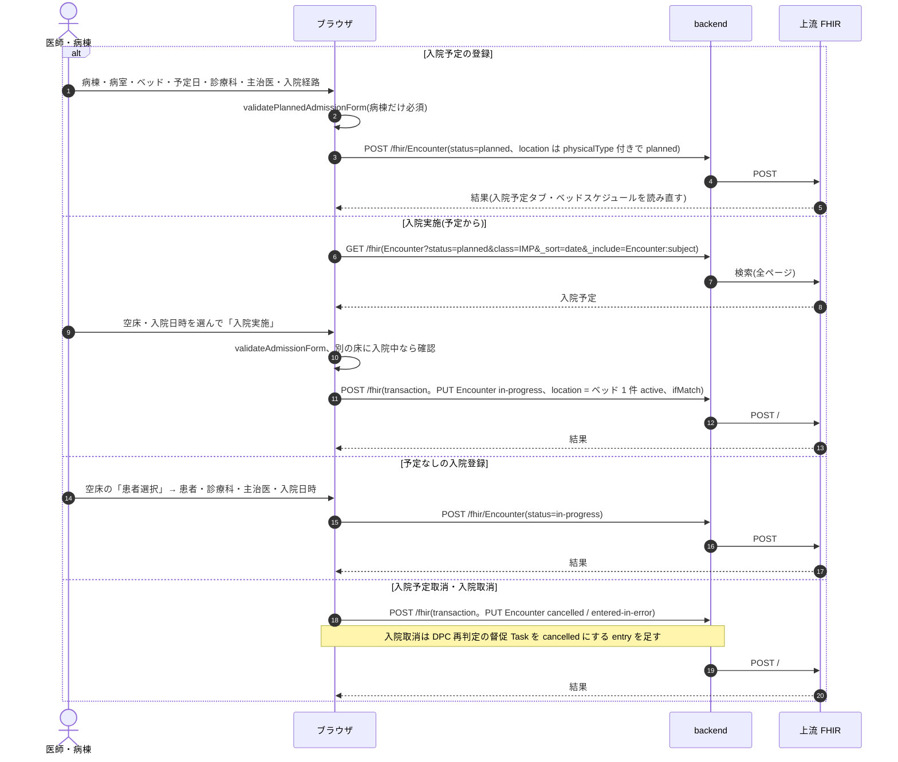
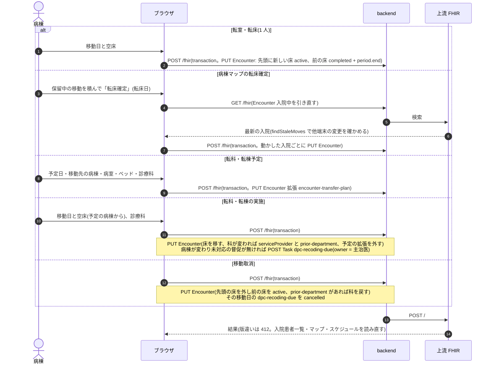
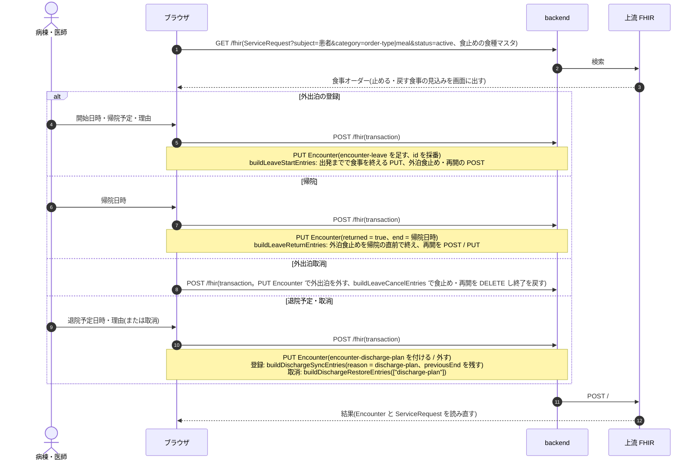
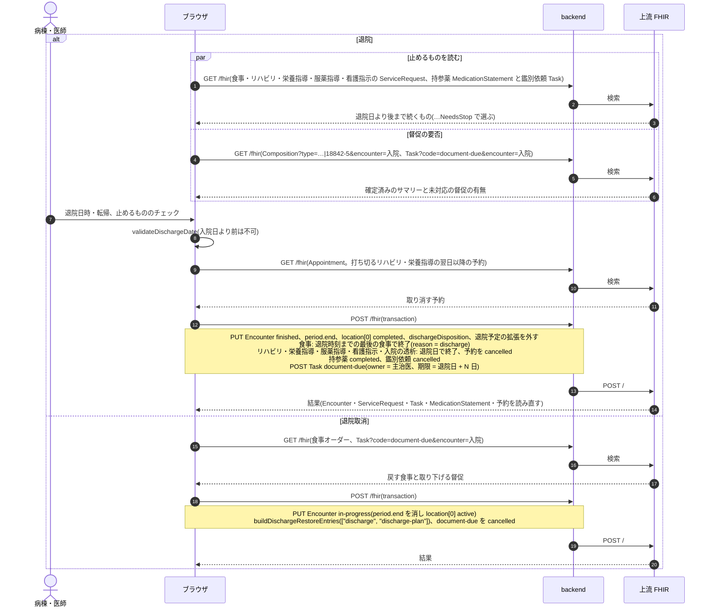

# 入院から退院までのシーケンス図

<!-- ../fhir-client/docs/order-flows/admission-discharge.md から scripts/sync-flows.mjs で作る。直接編集しない。 -->

運用の流れは[入院から退院までの業務フロー](../flows/admission-discharge.md)にあります。

## リソースの構成

| もの | リソース | 要点 |
|---|---|---|
| 入院 | `Encounter`(`class` = v3-ActCode `IMP`) | `status` = `planned` / `in-progress` / `finished` / `cancelled` / `entered-in-error`、`period.start` = 入院(予定)日、`period.end` = 退院日、`serviceProvider` = 診療科、`participant` = 主治医(`ATND`)と担当看護師(`encounter-participant-role\|nurse`)、`hospitalization.dischargeDisposition` = 転帰、拡張 `encounter-note`(特記事項) |
| 入院予定の居場所 | `Encounter.location`(`status` = `planned`) | 病棟(必須)・病室・ベッドを `physicalType`(`wa` / `ro` / `bd`)付きで並べる。参照先を引かずに階層が分かる |
| 入院中の居場所 | `Encounter.location` | `location[0]` = いまのベッド(`active`)。移動すると先頭に足し、前の床は `completed` + `period.end` で後ろに残す。科も変えた移動は移動先に拡張 `encounter-location-prior-department` |
| 入院経路 | `Encounter.hospitalization.admitSource` と拡張 | 入院経路・予定/救急の区分は `admitSource` に `dpc-admission-route` / `dpc-admission-type` のローカル体系、紹介の有無・外来からの入院などは拡張(`admissionRouteHelpers.ts`)。救急からは搬送を引き継ぐ。DPC 様式 1 の初期値になる |
| 転科・転棟予定 | 拡張 `encounter-transfer-plan` | 子 `date` / `ward` / `room` / `bed` / `department`。1 件だけ |
| 外出泊 | 拡張 `encounter-leave`(複数) | 子 `id`(uuid)/ `start` / `end`(帰院前は予定、帰院後は実際)/ `reason` / `returned` |
| 退院予定 | 拡張 `encounter-discharge-plan` | 子 `date`(dateTime)/ `reason`。1 件だけ |
| ベッド | `Location`(病棟 `wa` → 病室 `ro` → ベッド `bd`、`partOf`) | ベッド数は配下のベッドの件数。休止は `status` |
| 入院時・退院時の文書 | `QuestionnaireResponse`(`encounter` = 入院)、`Composition`(退院時サマリー LOINC `18842-5`、看護サマリー) | 入退院文書は回答の `encounter`、無ければ記入日で当てる |
| 督促 | `Task`(`document-due`・`dpc-recoding-due`) | `focus` / `encounter` = 入院、`owner` = 主治医。退院時サマリーは `restriction.period.end` = 期限 |
| 連動で止めるオーダー | 各種別の `ServiceRequest` | 食事は `meal-order-end-reason`(`discharge-plan` / `discharge` / `leave`)と `previousEnd` で戻せる形、看護指示は `nursing-order-end`、リハビリ・栄養指導・服薬指導は各種別の終了日 |
| 持参薬 | `MedicationStatement`(`context` = 入院)+ `Task`(`brought-med-review`) | 退院で `completed`、鑑別依頼は `cancelled` |

- 入院予定の日付未定は `period` を付けません。上流の `_sort=date` は期間の無いものを末尾に置くので、画面で先頭に並べ替えます(`sortPlannedAdmissions`)。
- 予定のメモを R4 の要素に載せず拡張にしているのは、`Encounter` に置き場が無いためです。外出泊の `id` は SS-MIX2 と食事の連動が外出泊ごとに突き合わせるのに使います。
- 院内の入院は病棟で絞らずに全部読み、ベッド id で突き合わせます(`fetchInpatients`。`status=in-progress,finished&class=IMP`、日付は `date=ge{日}&date=le{日}` の重なり)。入院予定は日付で絞れないので全件です(`fetchPlannedAdmissions`)。

## 状態の持ち方

| 表示 | `Encounter.status` | `period` | `location[0]` |
|---|---|---|---|
| 入院予定 | `planned` | `start` = 予定日(未定なら無し) | 病棟・病室・ベッドが `planned` |
| 入院中 | `in-progress` | `start` = 入院日時 | ベッドが `active` |
| 退院 | `finished` | `end` = 退院日時 | ベッドが `completed` |
| 入院予定取消 | `cancelled` | そのまま | そのまま |
| 入院取消 | `entered-in-error` | `end` を付けない | そのまま |

- 退院取消は `in-progress` に戻し、`period.end` を消し、`location[0]` を `active` に戻します(`buildDischargeCancelledEncounter`)。退院で落とした退院予定の拡張は戻しません。
- 同じベッドに入院中が複数あれば、入院日(同日なら更新時刻)の新しいものを表示します(`latestEncounterByBed`)。二重入院は確認だけで止めません。
- 楽観ロック: 入院の書き換えはどれも `postBundle` が版を `ifMatch` に添えるので、2 台で同じ入院を操作すると後の方が 412 で止まります。病棟マップの転床確定は、直前に入院を引き直して他端末の変更が無いことも確かめます(`findStaleMoves`)。

## シーケンス図の前提

`/fhir` への書き込みはどれも 1 回の transaction Bundle で、backend の `FhirProxyController` が上流へ中継します。入院の書き換えに連動の entry(食事・看護指示・リハビリ・督促 Task など)を足すときも同じ transaction に載せます。
SS-MIX2 を有効にしている施設では、中継が書き込みの控えを記録し(`Ssmix2::Recorder`)、`Encounter` の前後の版を比べて ADT のメッセージを組みます。

| 部品 | 場所 |
|---|---|
| 画面 | `pages/InpatientListPage.tsx`(6 タブ)、`components/InpatientPlanTables.tsx`(転科転棟・外出泊・退院予定・退院患者の表と取消)、`pages/WardMapPage.tsx`、`pages/BedSchedulePage.tsx`、`pages/BedStatusPage.tsx`、`pages/AdmissionDocumentsPage.tsx` |
| モーダル | 入院予定 `PlannedAdmissionForm.tsx`(`PlannedAdmissionModal` / 右ペイン `planned-admission-create` / 救急 `EmergencyRowModals.tsx`)、入院実施 `AdmissionExecuteModal.tsx`、予定なしの入院 `AdmissionModal.tsx`、転室・転床 `BedTransferModal.tsx`、転科転棟 `TransferPlanModal.tsx`・`TransferExecuteModal.tsx`、外出泊 `LeaveModal.tsx`・`LeaveReturnModal.tsx`、退院予定 `DischargePlanModal.tsx`、退院 `DischargeModal.tsx` |
| 組み立て | `fhir/encounterHelpers.ts`(入院・予定・移動・外出泊・予定のメモ・退院・取消)、`fhir/bedMovePlanHelpers.ts`(病棟マップの移動プラン)、`fhir/admissionRouteHelpers.ts`、`fhir/mealEncounterSync.ts`(食事の連動)、`fhir/dpcRecodingDueHelpers.ts`、`fhir/dischargeSummaryHelpers.ts`、`fhir/bedScheduleHelpers.ts`、`fhir/admissionDocumentHelpers.ts` |
| hook | `api/queries/encounter.ts`(`useInpatientEncounters` / `usePlannedAdmissions` / `useAdmitPatient` / `useUpdateEncounter` / `useCommitBedMoves` / `useDischargePatient` / `useCancelAdmission` / `useCancelTransfer` / `usePatientAdmission`)、`api/queries/bedManagement.ts`(`useEncountersInRange` / `useAdmissionDocumentResources`)、`hooks/useMealSyncContext.ts` |

## 入院予定・入院実施・入院取消

## 転室・転床・転科転棟・移動取消

`buildBedTransferEncounter` / `buildTransferPlanEncounter` / `buildTransferExecutedEncounter` / `buildTransferCancelledEncounter`、病棟マップは `buildMovePlanBundle`(`useCommitBedMoves`)。

## 外出泊・帰院・退院予定

食事の連動は `useMealSyncContext`(入院の食事オーダーと施設の食事の提供時刻)から `mealEncounterSync.ts` が entry を組みます。詳細は[食事のシーケンス図](meal.md#入退院外出泊の連動)。

## 退院・退院取消

`DischargeModal`、`useDischargePatient`、退院取消は `InpatientPlanTables` の `handleCancel`。

## 医事会計と SS-MIX2

入院の出来事は医事会計に送りません(会計送信の入口は外来一覧だけです)。入院中のオーダーの扱いは各種別の文書を読みます。
SS-MIX2 は `Encounter` の書き込みごとに前の版と比べて ADT を組みます。オーダ No は事象ごとに採番し、取消は同じ番号の DEL です。

| 起きたこと | 医事会計 | SS-MIX2 |
|---|---|---|
| 入院予定の登録・変更 | なし | `ADT^A14`(ADT-21、PV2-8 入院予定日。未定は `-`) |
| 入院予定取消 | なし | `ADT^A27`(ADT-21、DEL) |
| 入院実施・予定なしの入院登録 | なし | `ADT^A01`(ADT-22。予定からの実施も A01) |
| 入院取消 | なし | `ADT^A11`(ADT-22、DEL) |
| 転室・転床・転科転棟の実施、床を移さない転科 | なし | `ADT^A02`(ADT-42) |
| 移動取消 | なし | `ADT^A12`(ADT-42、DEL) |
| 転科・転棟予定の登録・変更 / 取消 | なし | `ADT^A15` / `ADT^A26`(ADT-41)。実施で消えたときは出さない |
| 担当者変更(主治医) | なし | `ADT^A54`(新しい主治医)/ `ADT^A55`(外れた主治医)(ADT-01) |
| 外出泊の登録・変更 / 取消 | なし | `ADT^A21` / `ADT^A52`(ADT-31) |
| 帰院 / 帰院の取り消し | なし | `ADT^A22` / `ADT^A53`(ADT-32) |
| 退院予定の登録・変更 / 取消 | なし | `ADT^A16` / `ADT^A25`(ADT-51)。退院で消えたときは出さない |
| 退院 | なし | `ADT^A03`(ADT-52、PV1-45 退院日) |
| 退院取消 | なし | `ADT^A13`(ADT-52、DEL) |
| 連動で止めた・戻した食事 | なし | 書き換えた食事オーダーごとに `OMD^O03` |
| 連動で止めた看護指示・リハビリ・栄養指導・服薬指導 | なし | なし |
| 退院時サマリー・看護サマリー・入退院文書・督促 | なし | なし |
