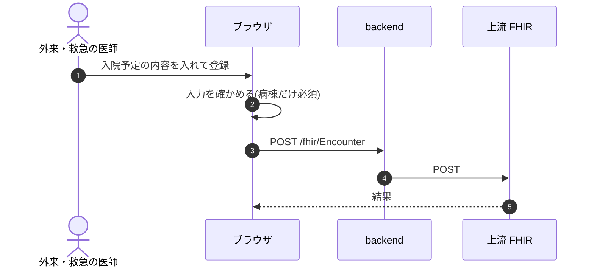
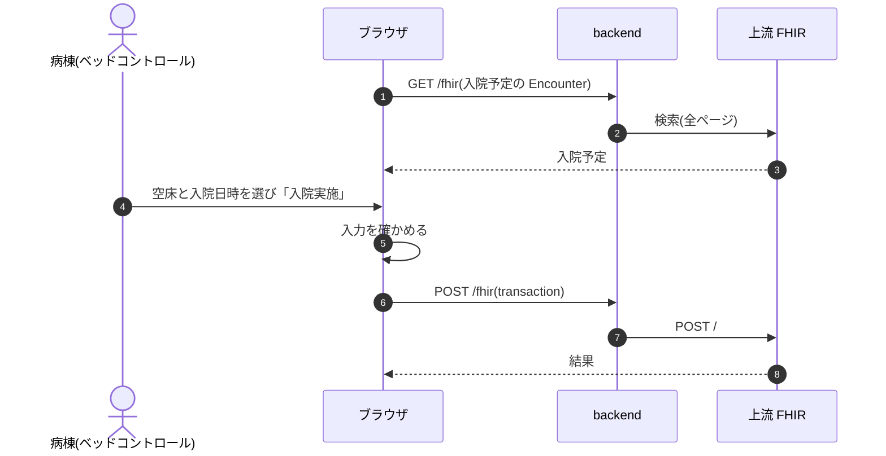
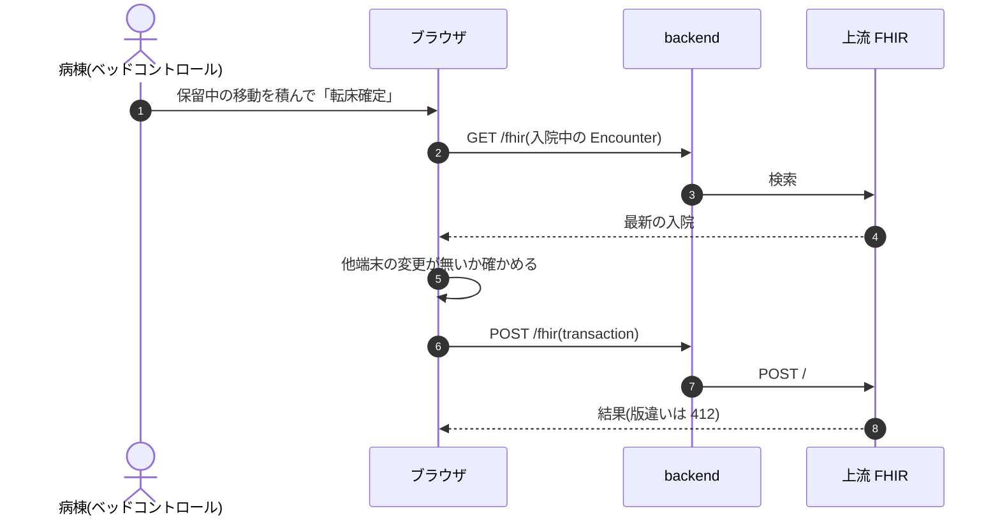
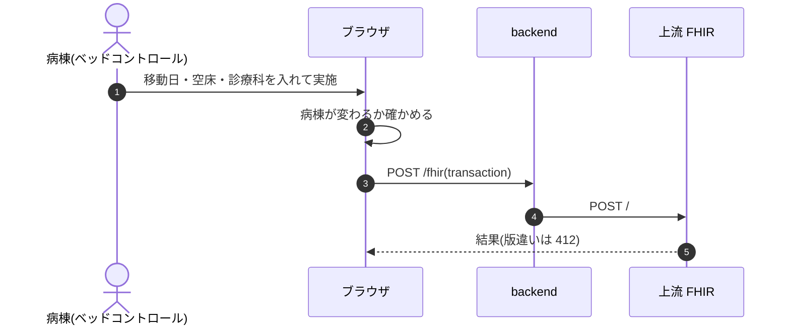
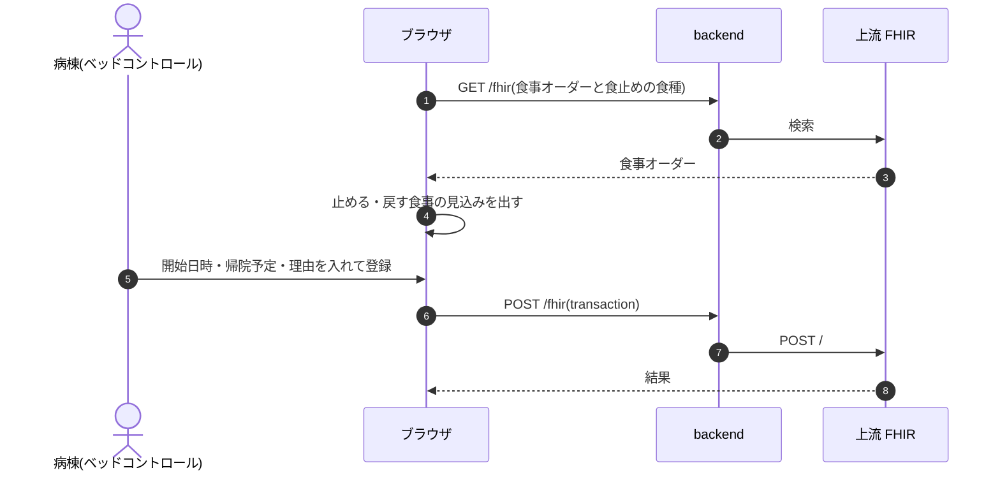
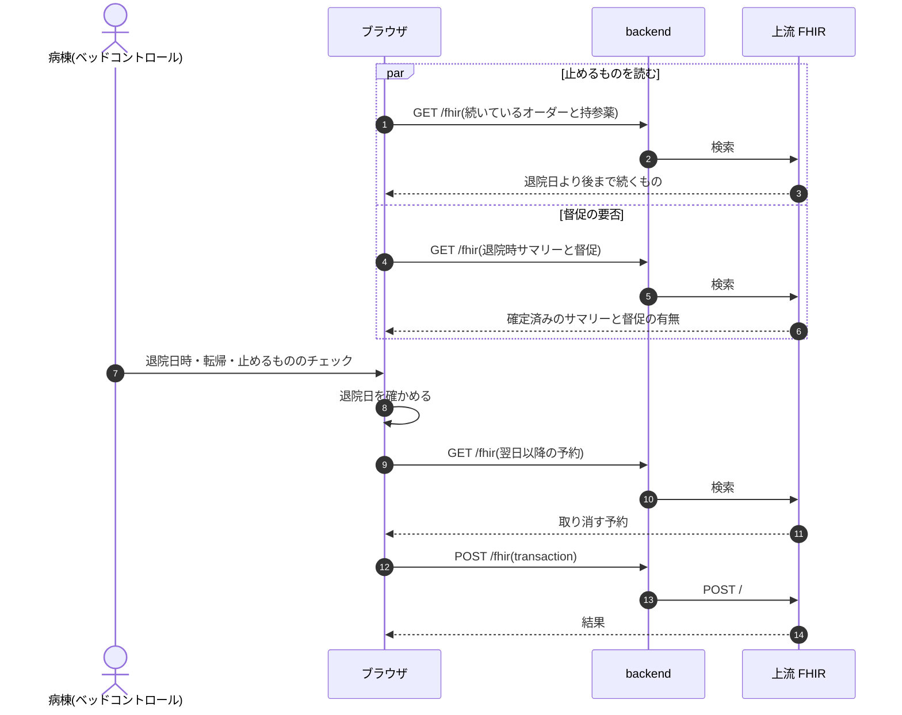
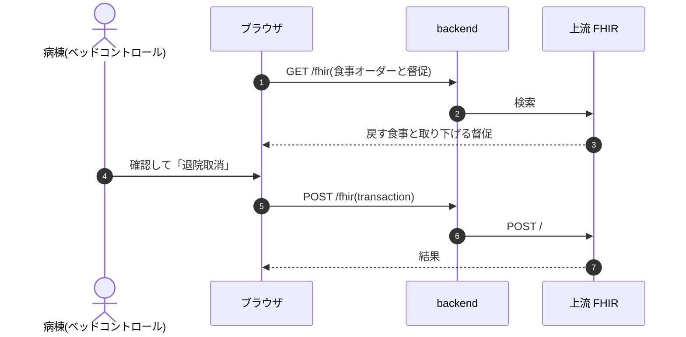

# 入院から退院までのシーケンス図

<!-- ../fhir-client/docs/order-flows/admission-discharge.md から scripts/sync-flows.mjs で作る。直接編集しない。 -->

運用の流れは[入院から退院までの業務フロー](../flows/admission-discharge.md)にあります。

## シーケンス図の前提

- **上流**: backend が中継する先の FHIR サーバーです。ブラウザの `/fhir` への読み書きは、backend の `FhirProxyController` が上流へ中継します。
- **新規の入院は単発の POST**: 入院予定の登録と予定なしの入院登録は、`Encounter` 1 件の POST です(`useAdmitPatient` の `createResource`)。
- **それ以外は transaction**: 入院の書き換えは、どれも 1 回の transaction Bundle です。連動の entry(食事・看護指示・リハビリ・督促 Task など)を足すときも、同じ transaction に載せます。
- **楽観ロック**: 入院の書き換えは `postBundle` が版を `ifMatch` に添えます。2 台で同じ入院を操作すると、後の方が 412 で止まります。
- **病棟マップの転床確定**: 直前に入院を引き直し、他端末の変更が無いことも確かめます(`findStaleMoves`)。
- **図の省略**: 応答は上流から backend を通ってブラウザへ戻りますが、図では上流からブラウザへの 1 本で書きます。同じ形の操作(入力 → transaction 1 回)は図にせず、図の下の表に出します。
- **SS-MIX2**: 有効にしている施設では、中継が書き込みの控えを記録し(`Ssmix2::Recorder`)、`Encounter` の前後の版を比べて ADT のメッセージを組みます。

| 操作 | 画面 | 組み立て | hook |
|---|---|---|---|
| 一覧を読む | `pages/InpatientListPage.tsx`(6 タブ) | `fetchInpatients`、`fetchPlannedAdmissions` | `useInpatientEncounters`、`usePlannedAdmissions`、`usePatientAdmission` |
| 入院予定の登録 | `PlannedAdmissionForm.tsx`(下の注) | `fhir/encounterHelpers.ts`、`fhir/admissionRouteHelpers.ts` | `useAdmitPatient` |
| 入院実施 | `AdmissionExecuteModal.tsx` | `fhir/encounterHelpers.ts` | `useUpdateEncounter` |
| 予定なしの入院登録 | `AdmissionModal.tsx` | `fhir/encounterHelpers.ts` | `useAdmitPatient` |
| 入院予定取消 | `pages/InpatientListPage.tsx` | `fhir/encounterHelpers.ts` | `useUpdateEncounter` |
| 入院取消 | `pages/InpatientListPage.tsx` | `buildCancelledEncounter`、`fhir/dpcRecodingDueHelpers.ts` | `useCancelAdmission` |
| 転室・転床 | `BedTransferModal.tsx` | `buildBedTransferEncounter` | `useUpdateEncounter` |
| 病棟マップの転床確定 | `pages/WardMapPage.tsx` | `fhir/bedMovePlanHelpers.ts` の `buildMovePlanBundle` | `useCommitBedMoves` |
| 転科・転棟予定 | `TransferPlanModal.tsx` | `buildTransferPlanEncounter` | `useUpdateEncounter` |
| 転科・転棟の実施 | `TransferExecuteModal.tsx` | `buildTransferExecutedEncounter` | `useUpdateEncounter` |
| 移動取消 | `pages/InpatientListPage.tsx` | `buildTransferCancelledEncounter` | `useCancelTransfer` |
| 担当者変更 | `CareStaffModal.tsx` | `fhir/encounterHelpers.ts` | `useUpdateEncounter` |
| 外出泊・帰院 | `LeaveModal.tsx`、`LeaveReturnModal.tsx` | `fhir/mealEncounterSync.ts` | `useUpdateEncounter`、`hooks/useMealSyncContext.ts` |
| 退院予定 | `DischargePlanModal.tsx` | `fhir/mealEncounterSync.ts` | `useUpdateEncounter`、`hooks/useMealSyncContext.ts` |
| 退院 | `DischargeModal.tsx` | `fhir/dischargeSummaryHelpers.ts` ほか | `useDischargePatient` |
| 予定の取消・退院取消 | `components/InpatientPlanTables.tsx` の `handleCancel` | `fhir/mealEncounterSync.ts` | `useUpdateEncounter` |
| ベッドスケジュール・病床状況 | `pages/BedSchedulePage.tsx`、`pages/BedStatusPage.tsx` | `fhir/bedScheduleHelpers.ts` | `useEncountersInRange` |
| 入退院文書 | `pages/AdmissionDocumentsPage.tsx` | `fhir/admissionDocumentHelpers.ts` | `useAdmissionDocumentResources` |

- 入院予定のフォームは 3 か所で使います。入院患者一覧の `PlannedAdmissionModal`、カルテの右ペインの `planned-admission-create`、救急の `EmergencyRowModals.tsx` です。
- 入院の hook は `api/queries/encounter.ts`、ベッドスケジュールと入退院文書の hook は `api/queries/bedManagement.ts` にあります。
- `components/InpatientPlanTables.tsx` は、転科・転棟、外出泊、退院予定、退院患者の表と取消を持ちます。

## リソースの構成

入院は `Encounter` 1 件です。予定(転科・転棟予定、外出泊、退院予定)は `Encounter` の拡張に持ちます。

| リソース | 要素 | 中身 |
|---|---|---|
| `Encounter` | `class` | v3-ActCode `IMP` |
| `Encounter` | `status` | `planned` / `in-progress` / `finished` / `cancelled` / `entered-in-error` |
| `Encounter` | `period.start` | 入院日。入院予定では入院予定日 |
| `Encounter` | `period.end` | 退院日 |
| `Encounter` | `serviceProvider` | 診療科 |
| `Encounter` | `participant` | 主治医(`ATND`)と担当看護師(`encounter-participant-role\|nurse`) |
| `Encounter` | `hospitalization.dischargeDisposition` | 転帰 |
| `Encounter` | 拡張 `encounter-note` | 特記事項 |
| `Encounter` | `location`(入院予定) | `status` = `planned`。病棟(必須)・病室・ベッドを並べる |
| `Encounter` | `location`(入院中) | `location[0]` = いまのベッド(`active`) |
| `Encounter` | 拡張 `encounter-location-prior-department` | 科も変えた移動で、移動先の `location` に残す移る前の科 |
| `Encounter` | `hospitalization.admitSource` | 入院経路と、予定・救急の区分 |
| `Encounter` | 入院経路の拡張 | 紹介の有無、外来からの入院など(`admissionRouteHelpers.ts`) |
| `Encounter` | 拡張 `encounter-transfer-plan` | 転科・転棟予定。1 件だけ |
| `Encounter` | 拡張 `encounter-leave` | 外出泊。複数 |
| `Encounter` | 拡張 `encounter-discharge-plan` | 退院予定。1 件だけ |
| `Location` | `physicalType`、`partOf` | 病棟 `wa` → 病室 `ro` → ベッド `bd` |
| `QuestionnaireResponse` | `encounter` | 入院時・退院時の文書。`encounter` = 入院 |
| `Composition` | `type` | 退院時サマリー(LOINC `18842-5`)、看護サマリー |
| `Task` | `code` = `document-due` | 退院時サマリーの督促 |
| `Task` | `code` = `dpc-recoding-due` | DPC 再判定の督促 |
| `ServiceRequest`(食事) | 拡張 `meal-order-end-reason`、`previousEnd` | 連動で止めた理由と、戻すための元の終了 |
| `ServiceRequest`(看護指示) | 拡張 `nursing-order-end` | 退院日を終了日にする |
| `ServiceRequest`(リハビリ・栄養指導・服薬指導・透析) | 各種別の終了日 | 退院日を終了日にする |
| `MedicationStatement` | `context`、`status` | 持参薬。`context` = 入院。退院で `completed` |
| `Task` | `code` = `brought-med-review` | 持参薬の鑑別依頼。退院で `cancelled` |

- **入院予定の `location`**: `physicalType`(`wa` / `ro` / `bd`)を付けて並べるので、参照先を引かずに階層が分かります。
- **入院中の `location`**: 移動すると先頭に足し、前のベッドは `completed` + `period.end` で後ろに残します。
- **入院経路**: `admitSource` は `dpc-admission-route` / `dpc-admission-type` のローカル体系です。救急からは搬送を引き継ぎます。DPC 様式 1 の初期値になります。
- **拡張の子**: `encounter-transfer-plan` は `date` / `ward` / `room` / `bed` / `department`、`encounter-discharge-plan` は `date`(dateTime)/ `reason` です。
- **外出泊の子**: `id`(uuid)/ `start` / `end` / `reason` / `returned`。`end` は、帰院前は予定、帰院後は実際の日時です。
- **外出泊の `id`**: SS-MIX2 と食事の連動が、外出泊ごとに突き合わせるのに使います。
- **予定を拡張にしている理由**: R4 の `Encounter` に置き場が無いためです。
- **食事の理由**: `meal-order-end-reason` は `discharge-plan` / `discharge` / `leave` のどれかです。
- **ベッド**: ベッド数は配下のベッドの件数です。休止は `Location.status` です。
- **督促の Task**: `focus` / `encounter` = 入院、`owner` = 主治医。退院時サマリーは `restriction.period.end` = 期限です。
- **入退院文書の当て方**: 回答の `encounter` で当て、無ければ記入日で当てます。
- **入院予定の日付未定**: `period` を付けません。上流の `_sort=date` は期間の無いものを末尾に置くので、画面で先頭に並べ替えます(`sortPlannedAdmissions`)。

入院の読み方は次のとおりです。

| 読むもの | 関数 | 検索 |
|---|---|---|
| その日の入院 | `fetchInpatients` | `status=in-progress,finished&class=IMP`、`date=ge{日}&date=le{日}` |
| 入院予定 | `fetchPlannedAdmissions` | `status=planned&class=IMP&_sort=date&_include=Encounter:subject` |

- その日の入院は病棟で絞らずに全病棟ぶんを読み、ベッド id で突き合わせます。日付の条件は、入院の期間がその日に重なるものを拾います。
- 入院予定は日付で絞れないので、全件を読みます。

## 状態の持ち方

| 表示 | `Encounter.status` | `period` | `location[0]` |
|---|---|---|---|
| 入院予定 | `planned` | `start` = 予定日(未定なら無し) | 病棟・病室・ベッドが `planned` |
| 入院中 | `in-progress` | `start` = 入院日時 | ベッドが `active` |
| 退院 | `finished` | `end` = 退院日時 | ベッドが `completed` |
| 入院予定取消 | `cancelled` | そのまま | そのまま |
| 入院取消 | `entered-in-error` | `end` を付けない | そのまま |

- 退院取消は `in-progress` に戻し、`period.end` を消し、`location[0]` を `active` に戻します(`buildDischargeCancelledEncounter`)。退院で落とした退院予定の拡張は戻しません。
- 同じベッドに入院中が複数あれば、入院日(同日なら更新時刻)の新しいものを表示します(`latestEncounterByBed`)。二重入院は確認だけで止めません。

## 入院予定・入院実施・入院取消

入院予定の登録です。

入院実施(入院予定から)です。

| 操作 | 入力と確認 | 書くもの |
|---|---|---|
| 入院予定の登録 | 病棟・病室・ベッド・予定日・診療科・主治医・入院経路。`validatePlannedAdmissionForm`(病棟だけ必須) | 単発の POST。`Encounter`(`status` = `planned`、`location` は `physicalType` 付きで `planned`) |
| 入院実施 | 空床・入院日時。`validateAdmissionForm`。別のベッドに入院中なら確認 | transaction。PUT `Encounter`(`in-progress`、`location` = ベッド 1 件 `active`、`ifMatch`) |
| 予定なしの入院登録 | 空床の「患者選択」→ 患者・診療科・主治医・入院日時 | 単発の POST。`Encounter`(`status` = `in-progress`) |
| 入院予定取消 | 確認だけ | transaction。PUT `Encounter`(`cancelled`) |
| 入院取消 | 確認だけ | transaction。PUT `Encounter`(`entered-in-error`)と、DPC 再判定の督促 Task を `cancelled` にする entry |

- 入院予定の登録のあとは、入院予定タブとベッドスケジュールを読み直します。
- 入院予定の検索式は「リソースの構成」の表にあります。

## 転室・転床・転科転棟・移動取消

病棟マップの転床確定です。

転科・転棟の実施です。

| 操作 | 入力と確認 | transaction の中身 |
|---|---|---|
| 転室・転床(1 人) | 移動日と空床 | PUT `Encounter`(先頭に新しいベッド `active`、前のベッドは `completed` + `period.end`) |
| 病棟マップの転床確定 | 転床日。`findStaleMoves` で他端末の変更を確かめる | 動かした入院ごとに PUT `Encounter` |
| 転科・転棟予定 | 予定日・移動先の病棟・病室・ベッド・診療科 | PUT `Encounter`(拡張 `encounter-transfer-plan`) |
| 転科・転棟の実施 | 移動日、空床(予定の病棟から)、診療科 | PUT `Encounter` と、条件に合えば POST `Task`(下の注) |
| 移動取消 | 確認だけ | PUT `Encounter` と、督促の取り下げ(下の注) |
| 担当者変更 | 主治医・担当看護師 | PUT `Encounter`(`participant` の主治医と担当看護師だけを入れ替える) |

- **転科・転棟の実施の PUT**: ベッドを移し、科が変われば `serviceProvider` と `encounter-location-prior-department` を書き、予定の拡張を外します。
- **転科・転棟の実施の Task**: 病棟が変わり、その入院に未対応の督促が無ければ、`dpc-recoding-due`(`owner` = 主治医)を POST します。
- **移動取消の PUT**: 先頭のベッドを外して前のベッドを `active` に戻し、`encounter-location-prior-department` があれば科を戻します。
- **移動取消の Task**: その移動日の `dpc-recoding-due` を `cancelled` にします。
- どの操作も、書いたあとに入院患者一覧・病棟マップ・ベッドスケジュールを読み直します。

## 外出泊・帰院・退院予定

外出泊の登録です。帰院・外出泊取消・退院予定も、食事オーダーを読んでから transaction を 1 回書く同じ形です。

- 食事オーダーの検索は `ServiceRequest?subject=患者&category=order-type|meal&status=active` です。食止めの食種はマスタから読みます。
- 食事の連動は、`useMealSyncContext`(入院の食事オーダーと施設の食事の提供時刻)から `mealEncounterSync.ts` が entry を組みます。詳細は [食事オーダーのシーケンス図](meal.md)「[入退院・外出泊の連動](meal.md#入退院外出泊の連動)」にあります。
- 書いたあとに `Encounter` と `ServiceRequest` を読み直します。

| 操作 | 入力 | PUT `Encounter` | 食事の entry |
|---|---|---|---|
| 外出泊の登録 | 開始日時・帰院予定・理由 | `encounter-leave` を足し、`id` を採番する | `buildLeaveStartEntries` |
| 帰院 | 帰院日時 | `returned` = true、`end` = 帰院日時 | `buildLeaveReturnEntries` |
| 外出泊取消 | 確認だけ | 外出泊を外す | `buildLeaveCancelEntries` |
| 退院予定の登録 | 退院予定日時・理由 | `encounter-discharge-plan` を付ける | `buildDischargeSyncEntries` |
| 退院予定取消 | 確認だけ | `encounter-discharge-plan` を外す | `buildDischargeRestoreEntries(["discharge-plan"])` |

| 関数 | 書くもの |
|---|---|
| `buildLeaveStartEntries` | 出発までで食事を終える PUT、外泊食止めと再開の POST |
| `buildLeaveReturnEntries` | 外泊食止めを帰院の直前で終える。再開を POST するか、あれば PUT する |
| `buildLeaveCancelEntries` | 食止めと再開を DELETE し、終了を戻す |
| `buildDischargeSyncEntries` | 食事を終える。`reason` = `discharge-plan`、`previousEnd` を残す |
| `buildDischargeRestoreEntries` | 渡した理由で止めた食事の終了を戻す |

## 退院・退院取消

退院です。

| 読むもの | 検索・条件 |
|---|---|
| 続いているオーダー | 食事・リハビリ・透析・栄養指導・服薬指導・看護指示の `ServiceRequest`。種別ごとの `…NeedsStop` で、退院日より後まで続くものを選ぶ |
| 持参薬 | `MedicationStatement`(`active` / `on-hold`)と、閉じていない鑑別依頼の `Task` |
| 退院時サマリー | `Composition?type=…\|18842-5&encounter=入院` |
| 督促 | `Task?code=document-due&encounter=入院` |
| 予約 | 打ち切るリハビリ・透析・栄養指導の、退院日の翌日以降の `Appointment` |

| transaction の中身 | 条件 |
|---|---|
| PUT `Encounter`(`finished`、`period.end`、`location[0]` を `completed`、`dischargeDisposition`、退院予定の拡張を外す) | 必ず |
| 食事を退院時刻までの最後の食事で終える(`reason` = `discharge`) | 食事のチェックがあるとき |
| リハビリ・透析・栄養指導・服薬指導・看護指示を退院日で終える | 種別ごとのチェックがあるとき |
| リハビリ・透析・栄養指導の予約を `cancelled` にする | そのオーダーを終えるとき |
| 持参薬を `completed`、鑑別依頼を `cancelled` にする | 持参薬のチェックがあるとき |
| POST `Task` `document-due`(`owner` = 主治医、期限 = 退院日 + N 日) | 確定済みのサマリーも未対応の督促も無いとき |

- 退院日の確認は `validateDischargeDate` です(入院日より前は不可)。
- 透析は入院のオーダーだけを止めます(`dialysisOrderNeedsStop`)。
- 書いたあとに `Encounter`・`ServiceRequest`・`Task`・`MedicationStatement`・予約を読み直します。

退院取消です。

| transaction の中身 | 補足 |
|---|---|
| PUT `Encounter`(`in-progress`) | `period.end` を消し、`location[0]` を `active` に戻す |
| `buildDischargeRestoreEntries(["discharge", "discharge-plan"])` | 退院と退院予定で止めた食事を戻す |
| `document-due` の `Task` を `cancelled` にする | 督促は `Task?code=document-due&encounter=入院` で読む |

## 医事会計と SS-MIX2

入院の出来事は医事会計に送りません(会計送信の入口は外来患者一覧だけです)。入院中のオーダーの扱いは各種別の文書を読みます。
SS-MIX2 は `Encounter` の書き込みごとに前の版と比べて ADT を組みます。括弧の中の `ADT-21` などはデータ種別です。オーダ No は事象ごとに採番し、取消は同じ番号の DEL です。

| 起きたこと | SS-MIX2 |
|---|---|
| 入院予定の登録・変更 | `ADT^A14`(ADT-21、PV2-8 入院予定日。未定は `-`) |
| 入院予定取消 | `ADT^A27`(ADT-21、DEL) |
| 入院実施・予定なしの入院登録 | `ADT^A01`(ADT-22。予定からの実施も A01) |
| 入院取消 | `ADT^A11`(ADT-22、DEL) |
| 転室・転床・転科転棟の実施、ベッドを移さない転科 | `ADT^A02`(ADT-42) |
| 移動取消 | `ADT^A12`(ADT-42、DEL) |
| 転科・転棟予定の登録・変更 / 取消 | `ADT^A15` / `ADT^A26`(ADT-41)。実施で消えたときは出さない |
| 担当者変更(主治医) | `ADT^A54`(新しい主治医)/ `ADT^A55`(外れた主治医)(ADT-01) |
| 外出泊の登録・変更 / 取消 | `ADT^A21` / `ADT^A52`(ADT-31) |
| 帰院 / 帰院の取り消し | `ADT^A22` / `ADT^A53`(ADT-32) |
| 退院予定の登録・変更 / 取消 | `ADT^A16` / `ADT^A25`(ADT-51)。退院で消えたときは出さない |
| 退院 | `ADT^A03`(ADT-52、PV1-45 退院日) |
| 退院取消 | `ADT^A13`(ADT-52、DEL) |
| 連動で止めた・戻した食事 | 書き換えた食事オーダーごとに `OMD^O03` |
| 連動で止めた看護指示・リハビリ・栄養指導・服薬指導 | なし |
| 退院時サマリー・看護サマリー・入退院文書・督促 | なし |

- 「ベッドを移さない転科」(`serviceProvider` だけの変更)と「帰院の取り消し」(帰院済みでなくなる変更)は、いまの画面の操作では起きません。backend は `Encounter` の版の差から拾うので、ほかの経路で書かれたときに出ます。
