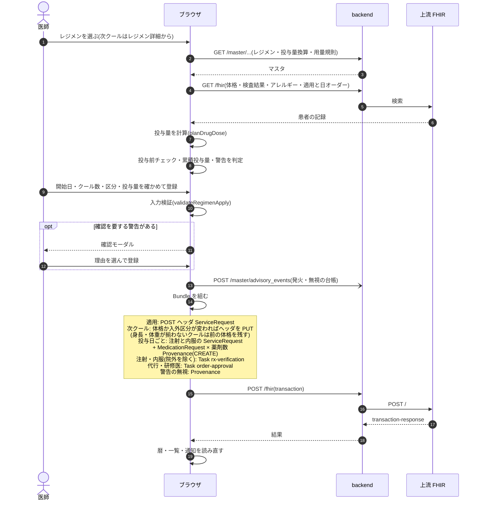
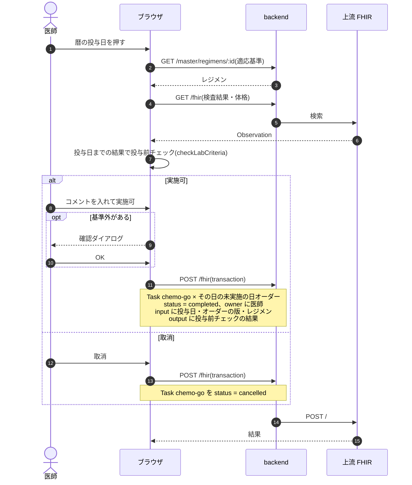
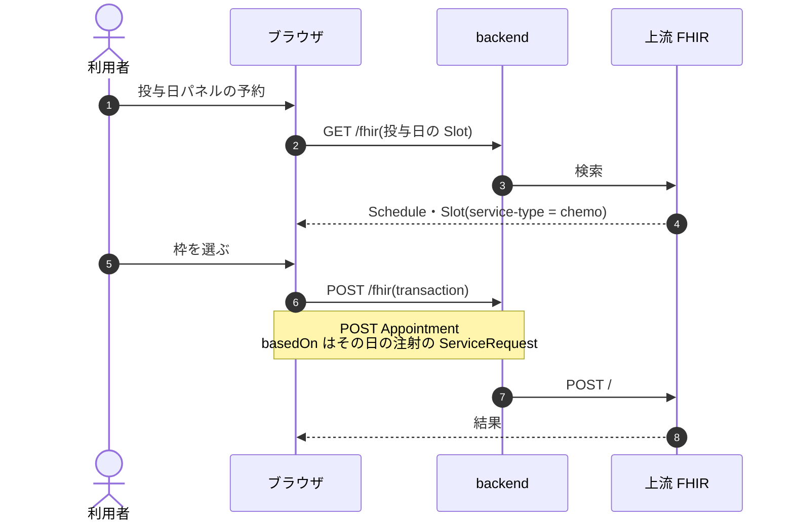
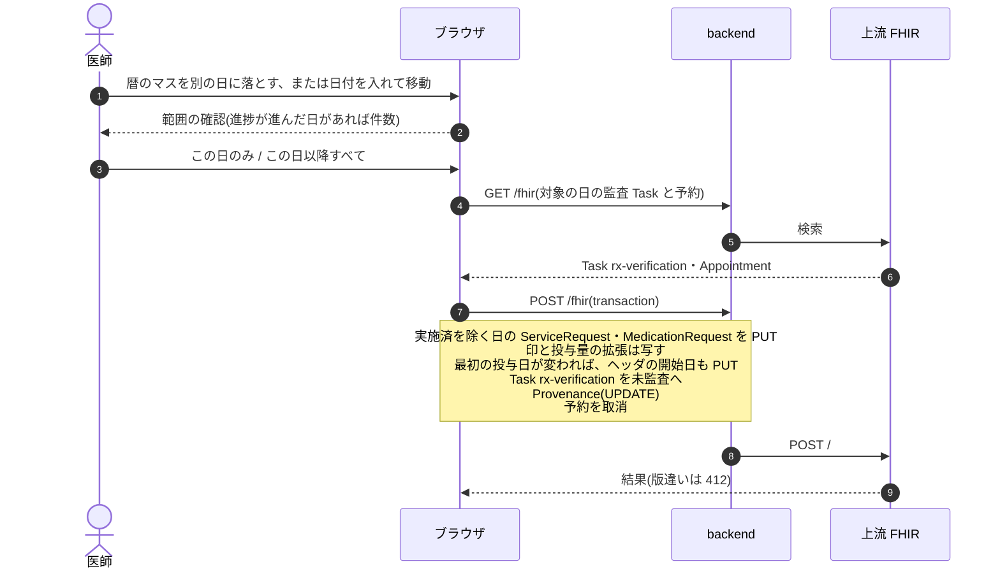
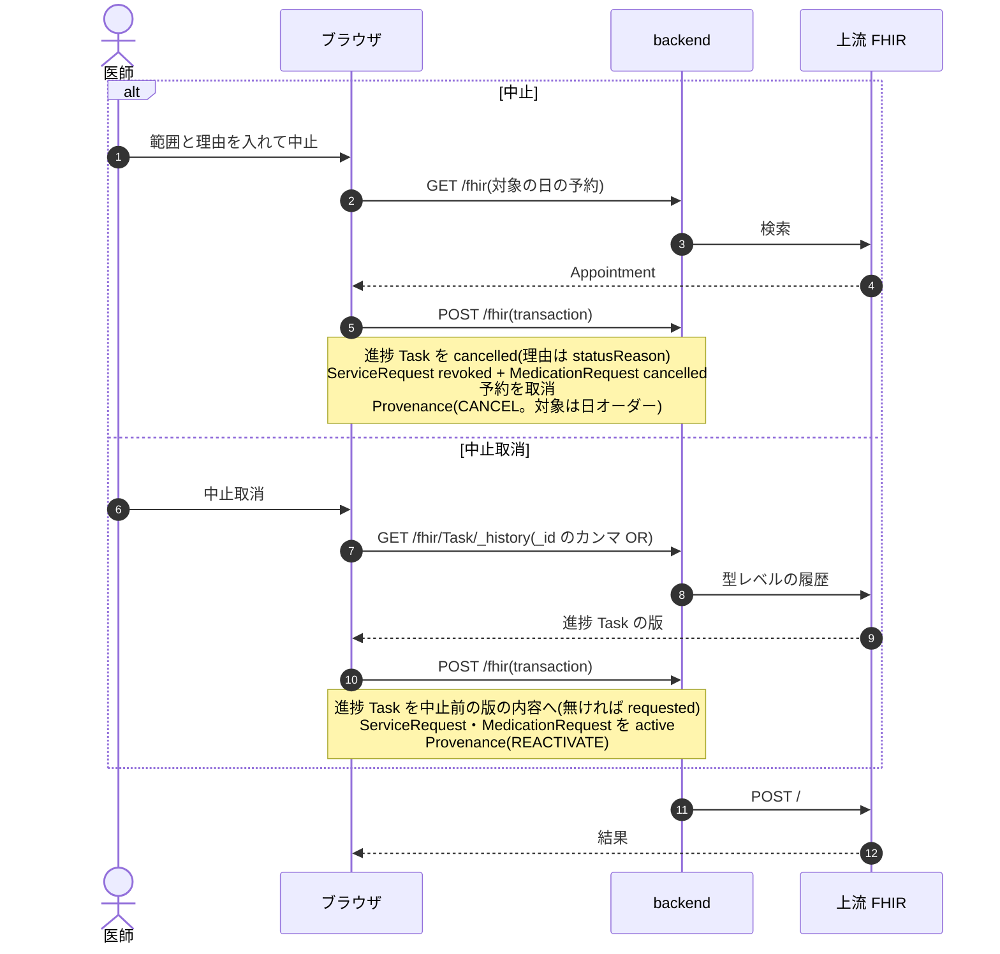
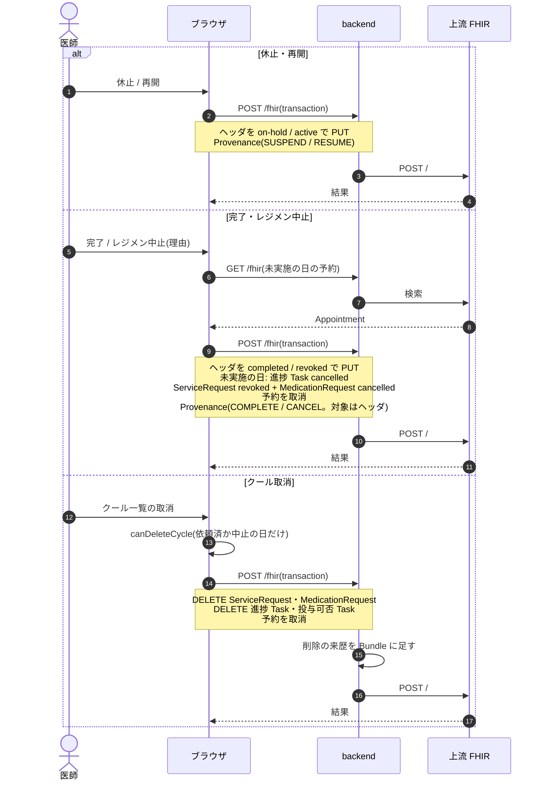

# 化学療法のシーケンス図

<!-- ../fhir-client/docs/order-flows/chemotherapy.md から scripts/sync-flows.mjs で作る。直接編集しない。 -->

運用の流れは[化学療法の業務フロー](../flows/chemotherapy.md)にあります。

## リソースの構成

適用 1 件はヘッダの `ServiceRequest`(`order-type|chemo-regimen`、`intent = plan`)です。投与日のオーダー(日オーダー)は通常の注射・処方で、`requisition` にヘッダと同じ `regimen-instance` の uuid、`regimen-order` 拡張にクール・Day・体格を持ちます。
日オーダーはヘッダを `basedOn` で指しません(`basedOn` を持つと明細として扱われ、一覧から消えます)。

| 適用の状態 | ヘッダの `status` | 記録 |
|---|---|---|
| 適用中 | `active` | |
| 休止 | `on-hold` | |
| 完了 | `completed` | `regimen` 拡張の `completedOn` |
| 中止 | `revoked` | `regimen` 拡張の `discontinuationReason`・`discontinuationNote`・`discontinuedOn` |

日オーダーの進捗は注射の `injection`、処方の `rx-dispense` の Task で、状態の対応はそれぞれの文書のとおりです。

## 投与可否 Task(`chemo-go`)

日オーダー 1 件に 1 件で、確認し直しは同じ Task を書き直します。ヘッダの版を動かさないので、受付・払出では無効になりません。

| 印 | 判定(`regimenDecisionOf`) |
|---|---|
| 未確認 | Task が無い、または `status = cancelled` |
| 実施可 | `status = completed` で、`input` の版が日オーダーの `meta.versionId` と一致 |
| 要再確認 | `status = completed` で、版が一致しない |

版が読めないときは投与日の一致だけで判定します。日オーダーのヘッダを PUT する処理を足すと、実施可は要再確認に落ちます。

## シーケンス図の前提

`/fhir` への書き込みはどれも 1 回の transaction Bundle で、backend の `FhirProxyController` が上流へ中継します。
SS-MIX2 を有効にしている施設では、中継が書き込みの控えを記録します(`Ssmix2::Recorder`)。
楽観ロックの版は `postBundle` が `ifMatch` に添え、版が違えば 412 で止まります。

## 適用・次クール登録

`components/RegimenApplyPanel.tsx`、`buildRegimenApplicationBundle`・`buildRegimenCycleBundle`(`fhir/regimenOrderHelpers.ts`)、`useCreatePrescription`(`api/queries/labResult.ts`。全種別共通)。

## 投与可否

`RegimenDecisionFields`(`components/RegimenDecision.tsx`)、`useSaveRegimenDecision`、`fhir/regimenDecisionHelpers.ts`。

## 化学療法室の予約

`RegimenDayBooking`(`components/RegimenPanels.tsx`)、`ChemoBookModal`、`useBookChemoAppointment`、`buildChemoAppointmentBundle`。

予約はオーダーと別の transaction です。適用時に取らないので、枠が空いていなくても適用は止まりません。

## 移動

`RegimenMoveModal`・`RegimenDayPanel`(`components/RegimenPanels.tsx`)、`useMoveRegimenDays`、`buildRegimenMoveBundle`、`regimenStartDateEntries`。

日オーダーを PUT するので投与可否は要再確認になります。進捗の Task は変えません。

## 投与日の中止・中止取消

`RegimenDayPanel`、`useRegimenDayStopEntries`(`api/queries/regimen.ts`)、`taskBeforeCancel`。

カルテのカードと注射一覧の `useUpdateInjectionTaskStatus`、処方一覧の `useUpdateRxTaskStatus` も、日オーダーの中止・中止取消(`isRegimenDayStop`)では同じ `useRegimenDayStopEntries` で書きます。

## 休止・再開・完了・レジメン中止・クール取消

`RegimenDetailView`、`RegimenRevokeModal`、`useUpdateRegimenStatus`・`useDeleteRegimenCycle`(`api/queries/adverseEvent.ts`)、`useRevokeRegimen`(`api/queries/regimen.ts`)。

## 払出・調剤・実施

日オーダーは通常の注射・処方なので、[注射箋発行](injection.md#注射箋発行)、[払出登録](injection.md#払出登録)、[実施](injection.md#実施)、[処方箋発行](prescription.md#処方箋発行)、[調剤登録](prescription.md#調剤登録)、[与薬](prescription.md#与薬)と同じです。
違いは表示だけで、`regimenOrderOf` で印を読み、`useHeldRegimenIds` で休止中を判定します。

## 医事会計と SS-MIX2

| 起きたこと | 医事会計(`BillingClaimBuilder`) | SS-MIX2 |
|---|---|---|
| 適用・休止・再開・完了・レジメン中止(ヘッダ) | 対象外(`OrderCatalog::IGNORED`) | 出さない |
| 日オーダーの登録・編集・移動 | 注射はなし。内服は投与日の会計に載る | RDE^O11(注射 OMP-02、内服 OMP-01) |
| 投与日の中止、完了・中止で止めた日 | 対象から外れる。実施済みの施用は送る | RDE^O11 の `CA`(DEL) |
| 中止取消 | 対象に戻る | RDE^O11 の `NW`(INS) |
| クール取消・日オーダーの削除 | 対象から外れる | RDE^O11 の `CA`(DEL) |
| 注射の実施 | 通常の注射に、その日の最初の注射の剤へ外来化学療法加算(15 歳未満は別コード)と無菌製剤処理料を 1 回足す | RAS^O17(OMP-12) |
| 投与可否・有害事象 | なし | 出さない |

外来化学療法加算のコードが施設設定に無いときは、送れなかった項目として報告します。無菌製剤処理料はコードがあるときだけ足します。

化学療法の日オーダーかどうかは `requisition` の system(`regimen-instance`)で判定します。
