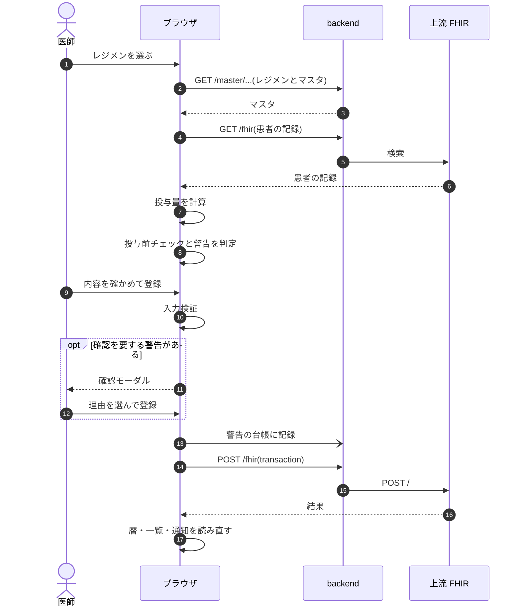
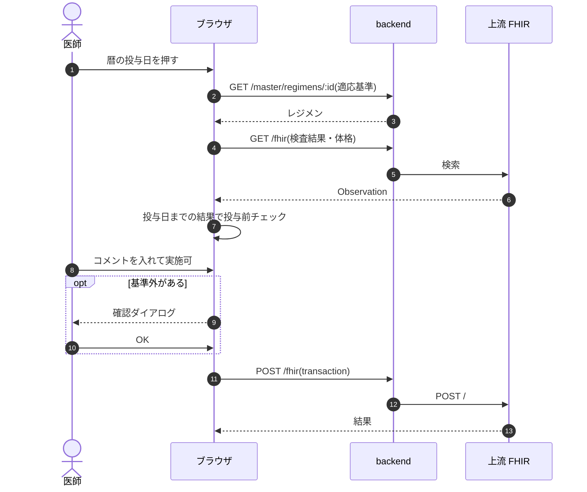
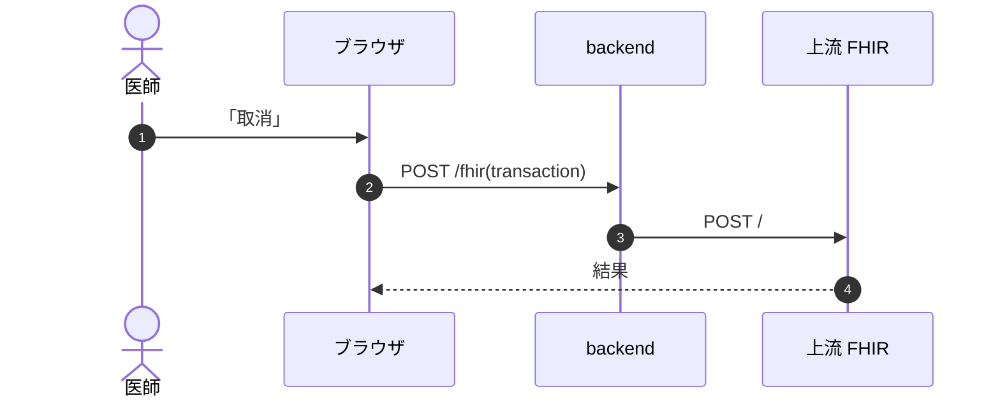
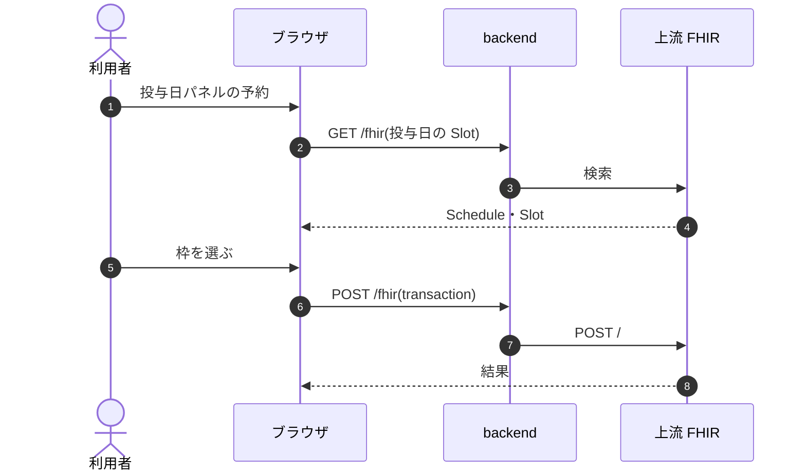
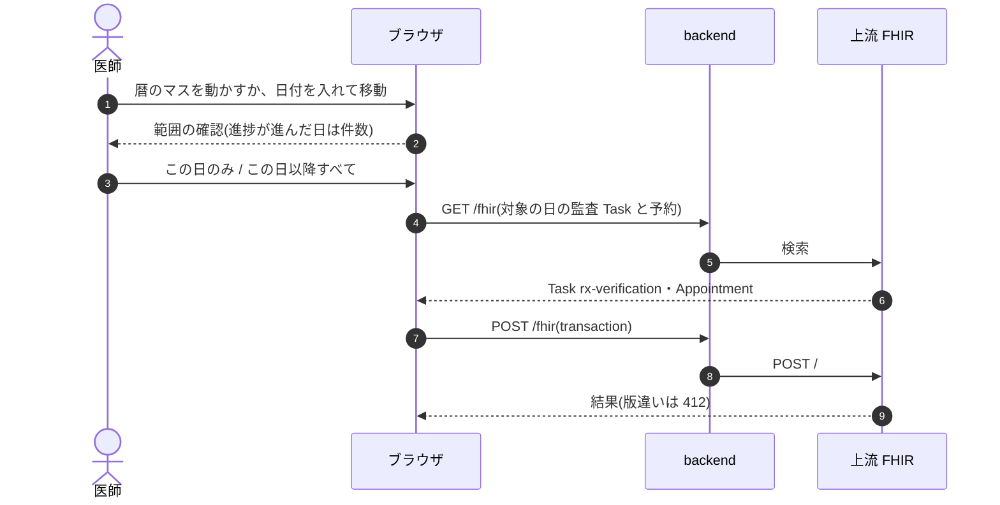
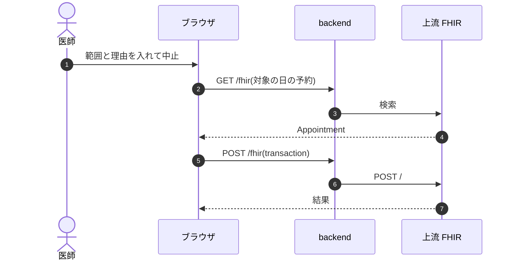
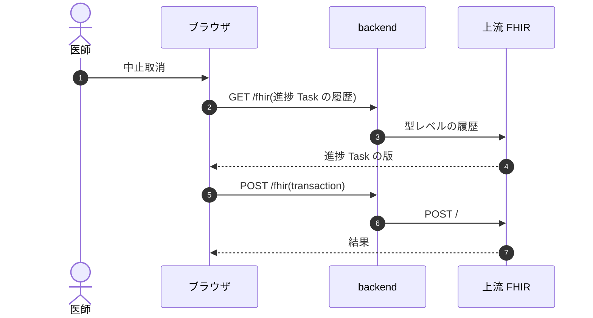
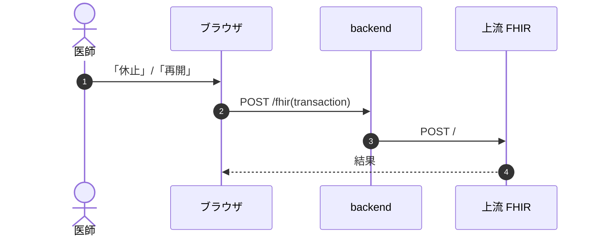
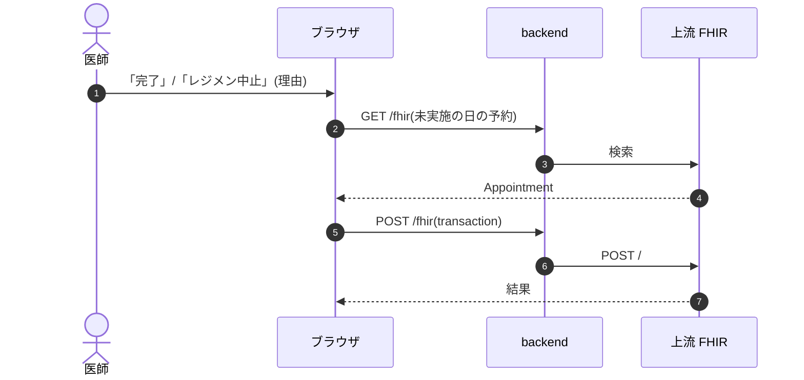
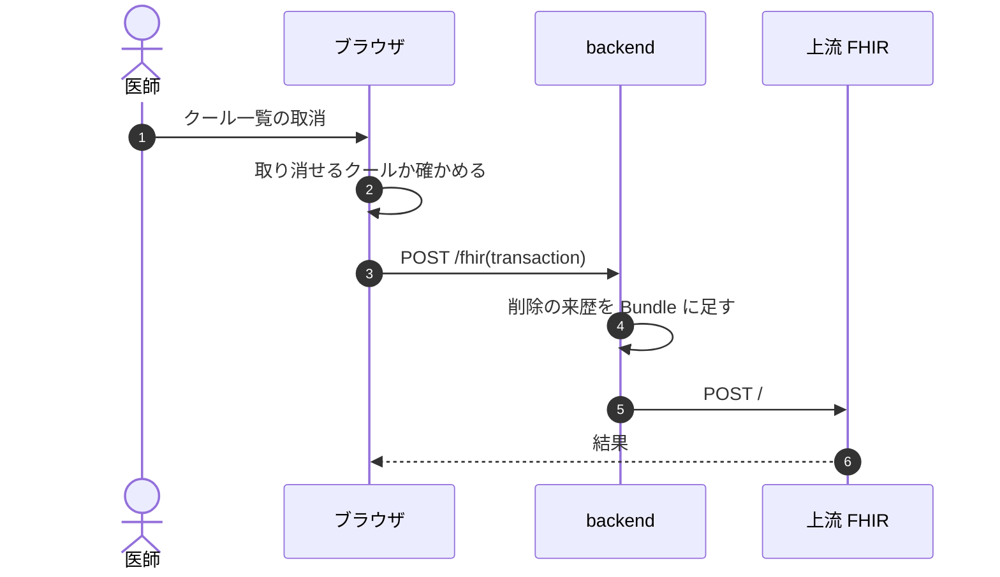

# 化学療法のシーケンス図

<!-- ../fhir-client/docs/order-flows/chemotherapy.md から scripts/sync-flows.mjs で作る。直接編集しない。 -->

運用の流れは[化学療法の業務フロー](../flows/chemotherapy.md)にあります。

## シーケンス図の前提

- **書き込みの経路**: `/fhir` への書き込みはどれも 1 回の transaction Bundle で、backend の `FhirProxyController` が上流へ中継します。
- **上流**: 上流の FHIR サーバーです。図では「上流 FHIR」と書きます。
- **応答の中継**: 上流の応答も backend を通って画面へ戻ります。図では省いて、上流から画面へ直接返す矢印で描きます。
- **SS-MIX2**: 有効にしている施設では、中継が書き込みの控えを記録します(`Ssmix2::Recorder`)。
- **楽観ロック**: 版は `postBundle` が `ifMatch` に添え、版が違えば 412 で止まります。
- **ヘッダ**: このページでは、適用 1 件を表す `ServiceRequest` を指します。
- **日オーダー**: 「運用フロー」節の「投与日のオーダー」です。通常の注射・処方の `ServiceRequest` + `MedicationRequest` です。
- **進捗 Task**: 日オーダーの状態を持つ Task で、注射は `injection`、処方は `rx-dispense` です。状態の対応は [注射オーダーのシーケンス図](injection.md)「[進捗 Task(`injection`)](injection.md#進捗-taskinjection)」と [処方オーダーのシーケンス図](prescription.md)「[進捗 Task(`rx-dispense`)](prescription.md#進捗-taskrx-dispense)」のとおりです。
- **図の登場者**: 「運用フロー」節の部署に合わせています。化学療法室の予約だけは「利用者」としています(画面に職種の分けが無いため)。

## リソースの構成

- ヘッダ `ServiceRequest`(適用 1 件)
  - 日オーダー(投与日ごとの注射・処方の `ServiceRequest` + `MedicationRequest`。ヘッダと同じ `requisition` で結ぶ)
    - 進捗 Task(`injection` / `rx-dispense`)
    - 投与可否 Task(`chemo-go`。日オーダー 1 件に 1 件)
    - 監査 Task(`rx-verification`。日オーダーごと)
    - 予約 `Appointment`(`basedOn` = その日の注射の `ServiceRequest`)
  - 有害事象 `Observation`(`basedOn` = ヘッダ)

日オーダーはヘッダを `basedOn` で指しません。`basedOn` を持つと明細として扱われ、一覧から消えます。

| リソース | 要素 | 中身 |
|---|---|---|
| ヘッダ `ServiceRequest` | `category` | `order-type|chemo-regimen` |
| ヘッダ `ServiceRequest` | `intent` | `plan` |
| ヘッダ `ServiceRequest` | `status` | 下の表 |
| ヘッダ `ServiceRequest` | `regimen` 拡張 | 完了日(`completedOn`)、中止の理由・詳細・中止日(`discontinuationReason`・`discontinuationNote`・`discontinuedOn`) |
| 日オーダー `ServiceRequest` | `requisition` | ヘッダと同じ uuid。system は `regimen-instance` |
| 日オーダー `ServiceRequest` | `regimen-order` 拡張 | クール・Day・体格 |
| 有害事象 `Observation` | `category` | 独自の `adverse-event` |
| 有害事象 `Observation` | `code.text` | CTCAE の用語(自由記述) |
| 有害事象 `Observation` | `valueInteger` | Grade |
| 有害事象 `Observation` | `effectivePeriod` | 発現日〜回復日(継続中は `end` 無し) |
| 有害事象 `Observation` | `treatment-context` 拡張 | 種別・名前の写しとクール |

化学療法の日オーダーかどうかは、`requisition` の system(`regimen-instance`)で判定します。

| 適用の状態 | ヘッダの `status` |
|---|---|
| 適用中 | `active` |
| 休止 | `on-hold` |
| 完了 | `completed` |
| 中止 | `revoked` |

## 投与可否 Task(`chemo-go`)

日オーダー 1 件に 1 件です。確認し直すときは、同じ Task を書き直します。

| 印 | 判定(`regimenDecisionOf`) |
|---|---|
| 未確認 | Task が無い、または `status = cancelled` |
| 実施可 | `status = completed` で、`input` の版が日オーダーの `meta.versionId` と一致 |
| 要再確認 | `status = completed` で、版が一致しない |

- **受付・払出で無効にならない理由**: 受付・払出は進捗 Task を書くだけで、日オーダーの `ServiceRequest` の版を動かしません。
- **版が読めないとき**: 投与日の一致だけで判定します。
- **注意**: 日オーダーの `ServiceRequest` を PUT する処理を足すと、版が変わるので実施可が要再確認に落ちます。

## 部品

| 操作 | 画面 | 組み立て | hook |
|---|---|---|---|
| 適用・次クール登録 | `components/RegimenApplyPanel.tsx` | `buildRegimenApplicationBundle`・`buildRegimenCycleBundle`(`fhir/regimenOrderHelpers.ts`) | `useCreatePrescription` |
| 投与可否 | `RegimenDecisionFields`(`components/RegimenDecision.tsx`) | `fhir/regimenDecisionHelpers.ts` | `useSaveRegimenDecision` |
| 化学療法室の予約 | `RegimenDayBooking`(`components/RegimenPanels.tsx`)・`ChemoBookModal` | `buildChemoAppointmentBundle` | `useBookChemoAppointment` |
| 移動 | `RegimenMoveModal`・`RegimenDayPanel`(`components/RegimenPanels.tsx`) | `buildRegimenMoveBundle`・`regimenStartDateEntries` | `useMoveRegimenDays` |
| 投与日の中止・中止取消 | `RegimenDayPanel` | `taskBeforeCancel` | `useRegimenDayStopEntries` |
| 休止・再開・完了 | `RegimenDetailView` | | `useUpdateRegimenStatus` |
| レジメン中止 | `RegimenRevokeModal` | | `useRevokeRegimen` |
| クール取消 | `RegimenDetailView` | `canDeleteCycle` | `useDeleteRegimenCycle` |
| 有害事象 | `RegimenAdverseEventPanel`・`AdverseEventEditor` | `fhir/adverseEventHelpers.ts` | `useSaveAdverseEvent`・`useDeleteAdverseEvent` |
| 一覧の印 | 注射一覧・処方一覧・払出登録・調剤登録 | `regimenOrderOf` | `useHeldRegimenIds`(休止中の判定) |

hook の置き場所は名前と合っていません。

- `useCreatePrescription` は `api/queries/labResult.ts` にあります。名前は処方由来ですが、全種別の登録が通ります。
- `useUpdateRegimenStatus`・`useDeleteRegimenCycle` は `api/queries/adverseEvent.ts` にあります(有害事象の hook と同じファイル)。
- `useSaveRegimenDecision`・`useBookChemoAppointment`・`useMoveRegimenDays`・`useRegimenDayStopEntries`・`useRevokeRegimen`・`useHeldRegimenIds` は `api/queries/regimen.ts` にあります。

適用編集(予定クール数の延長など)と有害事象の記録は、シーケンス図を省いています。有害事象は 1 件 = 1 `Observation` で、追加・更新は transaction Bundle の POST / PUT です(楽観ロックは使いません)。

## 適用・次クール登録

- 次クールは、レジメン詳細の「第 N クール登録」から始まります。
- マスタはレジメン・投与量換算・用量規則です。患者の記録は体格・検査結果・アレルギー・適用と日オーダーです。
- 投与量の計算は `planDrugDose`、入力検証は `validateRegimenApply` です。
- `-)` の矢印は応答を待たない送信です。警告の台帳は `POST /master/advisory_events`(発火・無視)です。

| transaction で書くもの | 条件 |
|---|---|
| POST ヘッダ `ServiceRequest` | 適用 |
| PUT ヘッダ `ServiceRequest` | 次クールで、体格か入外区分が変わったとき。身長・体重が揃わないクールは前の体格を残す |
| 投与日ごとに、注射と内服の `ServiceRequest` + `MedicationRequest` × 薬剤数 | いつも |
| `Provenance`(CREATE) | いつも |
| 監査 Task `rx-verification` | 注射と、院外を除く内服 |
| Task `order-approval` | 代行入力・研修医 |
| 警告の無視の `Provenance` | 確認モーダルで理由を選んだ |

## 投与可否

実施可の記録です。

- 投与前チェックは `checkLabCriteria` です。
- transaction は、その日の未実施の日オーダーごとに Task `chemo-go` を書きます。

| Task `chemo-go` の要素 | 中身 |
|---|---|
| `status` | `completed` |
| `owner` | 確認した医師 |
| `input` | 投与日・日オーダーの版・レジメン |
| `output` | 投与前チェックの結果 |

「取消」です。

transaction は Task `chemo-go` を `status = cancelled` にします。

## 化学療法室の予約

- 枠の検索は `service-type = chemo` です。
- transaction は `Appointment` の POST で、`basedOn` はその日の注射の `ServiceRequest` です。
- 予約はオーダーと別の transaction です。適用のときに取らないので、枠が空いていなくても適用は止まりません。

## 移動

| transaction で書くもの | 条件 |
|---|---|
| PUT 日オーダーの `ServiceRequest`・`MedicationRequest` | 実施済を除く日。印と投与量の拡張は写す |
| PUT ヘッダの開始日 | 最初の投与日が変わったとき |
| 監査 Task `rx-verification` を未監査へ | いつも |
| `Provenance`(UPDATE) | いつも |
| 予約の取消 | 予約がある |

日オーダーを PUT するので、投与可否は要再確認になります。進捗 Task は変えません。

## 投与日の中止・中止取消

中止です。

| transaction で書くもの | 中身 |
|---|---|
| 進捗 Task | `cancelled`。理由は `statusReason` |
| 日オーダー | `ServiceRequest` を `revoked`、`MedicationRequest` を `cancelled` |
| 予約 | 取消 |
| `Provenance` | CANCEL。対象は日オーダー |

中止取消です。

- 履歴は `GET /fhir/Task/_history` で、`_id` をカンマ区切りの OR で渡します。中止の前の版は `taskBeforeCancel` で選びます。

| transaction で書くもの | 中身 |
|---|---|
| 進捗 Task | 中止の前の版の内容に戻す。前の版が無ければ `requested` |
| 日オーダー | `ServiceRequest`・`MedicationRequest` を `active` |
| `Provenance` | REACTIVATE |

ほかの入口も同じ書き込みになります。

| 入口 | hook | 日オーダーの中止・中止取消のとき |
|---|---|---|
| カルテの注射カード、注射一覧 | `useUpdateInjectionTaskStatus` | `useRegimenDayStopEntries` で書く |
| 処方一覧 | `useUpdateRxTaskStatus` | `useRegimenDayStopEntries` で書く |

日オーダーの中止・中止取消かどうかは `isRegimenDayStop` で見分けます。通常の注射・処方の中止取消は `requested` に戻すので、戻り先が違います。

## 休止・再開・完了・レジメン中止・クール取消

休止・再開です。

transaction はヘッダを `on-hold` / `active` で PUT し、`Provenance`(SUSPEND / RESUME)を足します。

完了・レジメン中止です。

| transaction で書くもの | 中身 |
|---|---|
| ヘッダ | `completed` / `revoked` で PUT |
| 未実施の日の進捗 Task | `cancelled` |
| 未実施の日の日オーダー | `ServiceRequest` を `revoked`、`MedicationRequest` を `cancelled` |
| 予約 | 取消 |
| `Provenance` | COMPLETE / CANCEL。対象はヘッダ |

クール取消です。

- 確かめるのは `canDeleteCycle` で、依頼済か中止の日だけのクールを取り消せます。
- transaction は、日オーダーの `ServiceRequest`・`MedicationRequest`、進捗 Task・投与可否 Task の DELETE と、予約の取消です。

## 払出・調剤・実施

日オーダーは通常の注射・処方なので、[注射オーダーのシーケンス図](injection.md)「[注射箋発行](injection.md#注射箋発行)」「[払出登録](injection.md#払出登録)」「[実施](injection.md#実施)」、[処方オーダーのシーケンス図](prescription.md)「[処方箋発行](prescription.md#処方箋発行)」「[調剤登録](prescription.md#調剤登録)」「[与薬](prescription.md#与薬)」と同じです。
違いは表示だけで、`regimenOrderOf` で印を読み、`useHeldRegimenIds` で休止中を判定します。

## 医事会計と SS-MIX2

医事会計(`BillingClaimBuilder`)は、ヘッダを送らず、日オーダーを通常の注射・処方と同じく送ります。SS-MIX2 の括弧内はデータ種別、INS / DEL は処理区分です。

| 起きたこと | 医事会計 | SS-MIX2 |
|---|---|---|
| 適用・休止・再開・完了・レジメン中止(ヘッダ) | 送らない(`OrderCatalog::IGNORED`) | 出さない |
| 日オーダーの登録・編集・移動 | 注射は送らない。内服は投与日の会計で送る | RDE^O11(注射は OMP-02、内服は OMP-01) |
| 投与日の中止、完了・レジメン中止で止めた日 | 対象から外れる。実施済みの施用は送る | RDE^O11 の `CA`(DEL) |
| 中止取消 | 対象に戻る | RDE^O11 の `NW`(INS) |
| クール取消・日オーダーの削除 | 対象から外れる | RDE^O11 の `CA`(DEL) |
| 注射の実施 | 通常の注射と同じく送り、外来化学療法加算と無菌製剤処理料を足す | RAS^O17(OMP-12) |
| 投与可否・有害事象 | 送らない | 出さない |

- **足す場所**: 外来化学療法加算と無菌製剤処理料は、その日の最初の注射の剤に 1 回だけ足します。
- **外来化学療法加算**: 15 歳未満は別のコードです。コードが施設設定に無いときは、送れなかった項目として報告します。
- **無菌製剤処理料**: コードが施設設定にあるときだけ足します。
