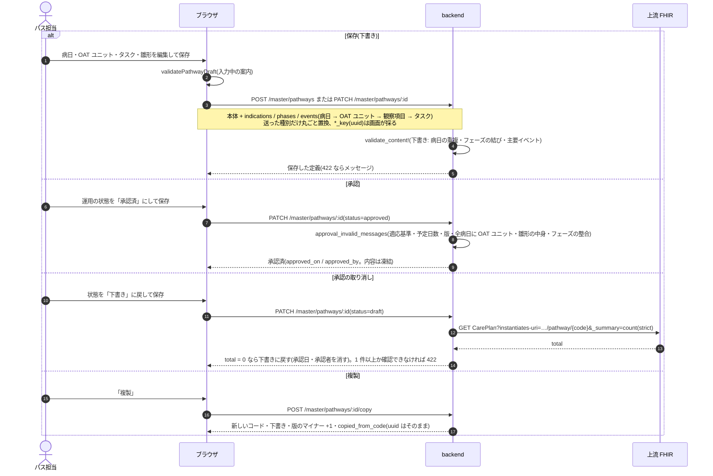
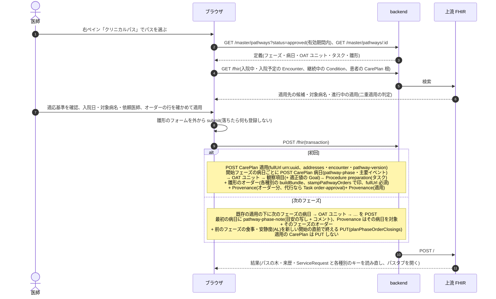
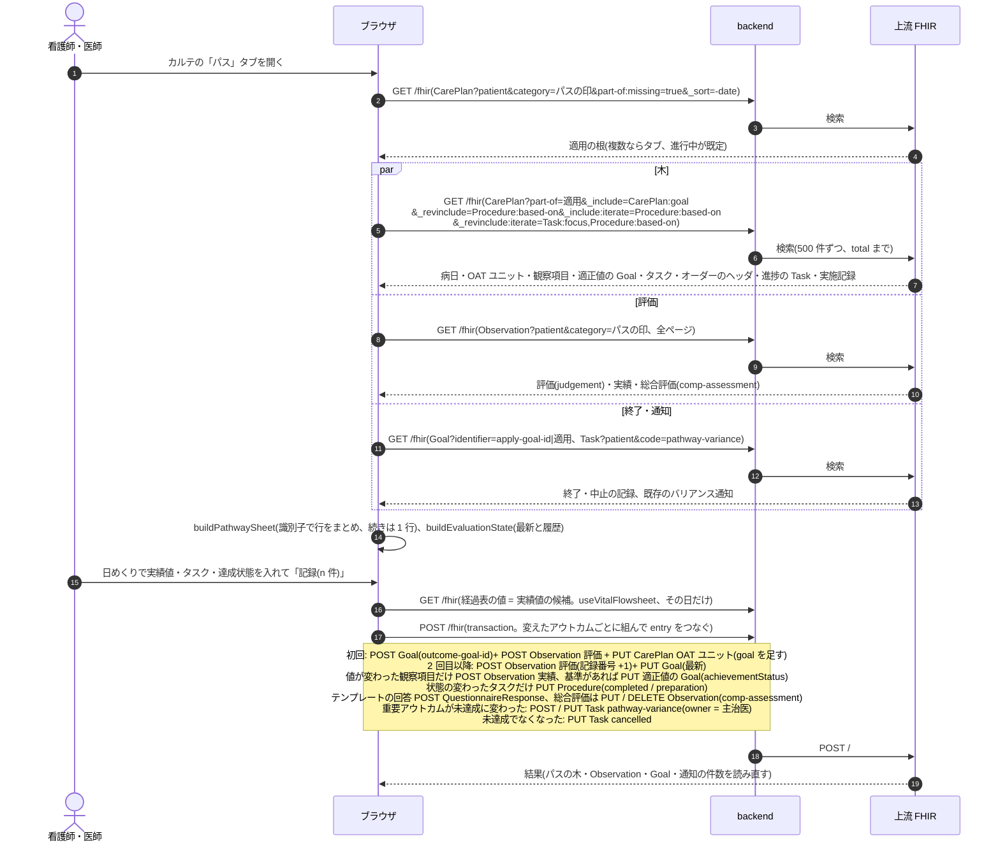
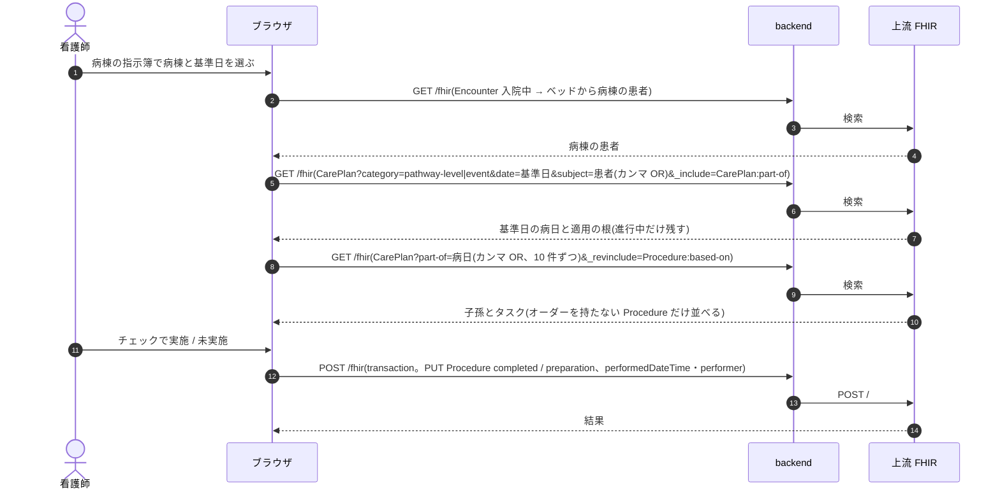
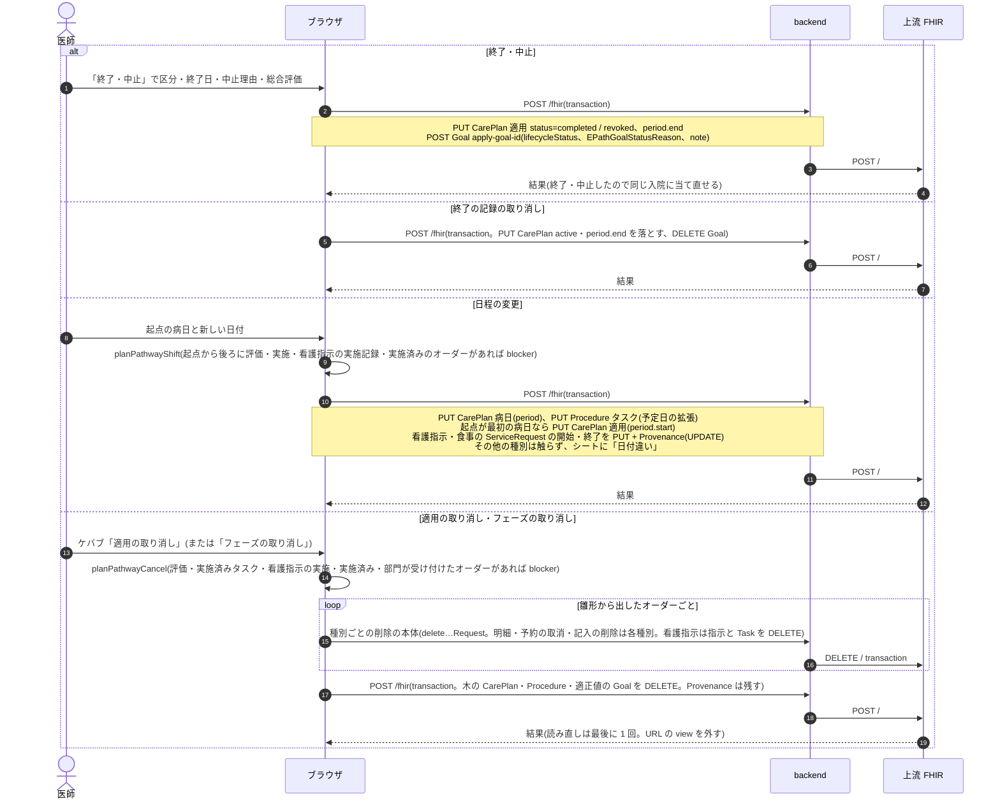

# クリニカルパスのシーケンス図

<!-- ../fhir-client/docs/order-flows/clinical-pathway.md から scripts/sync-flows.mjs で作る。直接編集しない。 -->

運用の流れは[クリニカルパスの業務フロー](../flows/clinical-pathway.md)にあります。

## リソースの構成

定義は backend の DB、適用後は上流 FHIR に ePath 準拠の CarePlan の木で置きます。

| もの | 置き場所 | 要点 |
|---|---|---|
| パス定義 | backend `master_pathways` と子(対象病名・フェーズ・分岐・病日・OAT ユニット・観察項目・タスク) | `pathway_code` で結び、子は 1 リクエストで丸ごと置換。OAT ユニット・観察項目・タスクの `*_key`(uuid)は画面が採り、適用後の識別子に持ち越す。オーダー雛形は `order_type` + `order_values`(jsonb。オーダーセットのエントリと同じ形) |
| BOM | backend `master_bom_outcomes` / `master_bom_assessments` / `master_bom_pairs` | 取込で全件洗い替え。検索専用 |
| 適用 | `CarePlan`(根。`partOf` 無し) | `category` = `care-plan-type\|clinical-pathway` + `pathway-level\|apply`、`instantiatesUri` = `…/pathway/{code}`、`identifier` = `apply-id\|{施設コード}.{適用uuid}`、`addresses` = 対象病名、`encounter`、`period.start` = 入院日、拡張 `pathway-version` |
| 病日 | `CarePlan`(`partOf` = [適用]) | `pathway-level\|event`、`identifier` = `event-id\|….{病日[-ステップ]}`、`period.start = end = その日`、拡張 `pathway-phase`(フェーズ)・`pathway-phase-note`・`pathway-major-event` |
| OAT ユニット | `CarePlan`(`partOf` = [適用, 病日]) | `pathway-level\|oat-unit`、`identifier` = `oat-unit-id\|….{unit_key}`、`category` に BOM の大分類・中分類・コード、重要アウトカム、予定外は `EPathCarePlanUnplannedKind` = `Y`、`goal` → アウトカムの Goal(評価後) |
| 観察項目 | `CarePlan`(`partOf` = [適用, 病日, OAT ユニット]) | `pathway-level\|assessment`、`identifier` = `assessment-id\|….{assessment_key}`、`goal` → 適正値の `Goal`(`assessment-goal-id`。`target.detailString` / `detailRange` / `detailCodeableConcept`)。結ぶ観察項目の無いタスクは `ZZZZZZZZZZ` の観察項目で包む |
| タスク | `Procedure`(`basedOn` = [観察項目の CarePlan, オーダーのヘッダ]) | `status` = `preparation`(未実施)/ `completed`(実施)、`performedDateTime`、`performer`、拡張 `EPathProcedureTaskPlannedDateTime`(予定日)、`pathway-display-order` |
| 雛形から出たオーダー | 各種別のヘッダ `ServiceRequest` | `identifier` = `pathway-instance\|{適用uuid}`、拡張 `pathway-order`(valueCoding = パスコード・名前)、`requisition` = 同じ uuid。参照はタスク → オーダーの一方向 |
| アウトカムの評価 | `Goal`(`outcome-goal-id` = OAT ユニットの識別子)+ `Observation`(`observation-evaluation-id` = `….{記録番号}`) | `Goal.achievementStatus` = `EPathStateOfAchievementCS` 1 達成 / 2 未達成 / 3 未評価(最新)、`outcomeReference` → 評価を記録順に全部。`Observation.code` = `EPathEvaluationItemCS\|judgement`、`component` = S / O / A / P または `comp-assessment`(自由記載)、`category[0]` = パスの印、`basedOn` → OAT ユニット |
| 観察項目の実績 | `Observation`(`observation-result-id` = `….{assessment_key}.{記録番号}`) | `code` = 観察項目のコード、`value[x]` は看護観察の表現タイプ、`basedOn` → 観察項目の CarePlan。値が前回と変わったときだけ POST、PUT・DELETE しない |
| 病日の総合評価 | `Observation`(`observation-comp-assessment-id` = 病日の識別子) | `code` = `comp-assessment`、`valueString`、`basedOn` → 病日の CarePlan。病日に 1 件、上書き(PUT)、空にしたら DELETE |
| 終了・中止 | `Goal`(`apply-goal-id` = 適用の識別子) | `lifecycleStatus` = `completed` / `cancelled`、拡張 `EPathGoalStatusReason` = `EPathPathClosingTypeCS` 1 終了 / 2 中止、`statusDate` = 終了日、`note` = 中止理由(「中止理由: 」で始める)と総合評価 |
| バリアンスの通知 | `Task`(`task-code\|pathway-variance`) | `priority` = `urgent`、`focus` → 評価の Observation、`basedOn` → OAT ユニット、`owner` → 入院の主治医(participant ATND)、`input` にパス名・適用・病日・アウトカム |
| 来歴 | `Provenance` | 適用の CarePlan を対象に 1 件(author = 依頼医師、enterer = ログイン本人)。雛形から出たオーダーには種別共通の来歴(代行なら承認待ちの通知) |

- 子孫は `partOf` に祖先すべてを並べます。`part-of=CarePlan/{適用}` の 1 回で木全体、`part-of:missing=true` で根だけが引けます。
- 階層は `pathway-level` の category で判定します(partOf の本数でも導けるが、木を全部読まないと分からない)。EP12 出力では落とします。
- 評価・実績の Observation は `category[0]` にパスの印を置きます(上流は category の先頭しか索引しない)。`vital-signs` を持たないので経過表に出ません。
- 適用の木は 1 ページ(500 件)を超えうるので、`usePathwayApplicationTree` は total から残りのページも読みます。

## 状態の持ち方

| 表示 | 定義(`master_pathways.status`) | 適用(`CarePlan.status`) | 適用の `Goal` |
|---|---|---|---|
| 下書き / 承認済 / 廃止 | `draft` / `approved` / `retired` | – | – |
| 進行中 | – | `active`、`period.end` 無し | 無い |
| 終了 | – | `completed`、`period.end` = 終了日 | `lifecycleStatus` = `completed`、終了区分 1 |
| 中止 | – | `revoked`、`period.end` = 終了日 | `lifecycleStatus` = `cancelled`、終了区分 2 |
| 終了の記録の取り消し | – | `active` に戻し `period.end` を落とす | DELETE |
| 取り消し | – | 木を DELETE | – |

- 「どこまでフェーズを適用したか」は保存せず、適用済みの病日の `pathway-phase` の印から逆算します(`nextPhasesOf`)。印の無い適用は先頭のフェーズとして読みます。
- タスクの実施は `pathwayTaskPerformedOn` で判定します。チェックリストは Procedure の `status`、看護指示・リハビリ・栄養指導はその日の実施記録(`OrderProgress.performedDates`)、その他はオーダーの進捗 Task(`orderProgressByOrderId`。Task で進み具合を持たない処方・食事・細菌・化学療法は `ServiceRequest.status`)です。
- 二重適用のガードは、同じ Encounter に `active` の同じ `pathwayCode` があるかだけを見ます。終了・中止した適用には当て直せます。
- 承認の取り消し(`approved` → `draft`)は、backend が上流に `CarePlan?instantiates-uri=…&_summary=count`(strict)を問い合わせ、1 件でもあれば 422、確認できないときも 422 です。

## シーケンス図の前提

`/fhir` への書き込みはどれも 1 回の transaction Bundle で、backend の `FhirProxyController` が上流へ中継します。
SS-MIX2 を有効にしている施設では、中継が書き込みの控えを記録します(`Ssmix2::Recorder`。CarePlan・Goal・パスの Observation・タスクの Procedure は対象外で、雛形から出たオーダーの `ServiceRequest` / `MedicationRequest` だけが各種別のメッセージになります)。
楽観ロックの版は `postBundle` が `ifMatch` に添え、版が違えば 412 で止まります。

| 部品 | 場所 |
|---|---|
| 定義の一覧・編集 | `pages/PathwayListPage.tsx`(`/pathways`)、`pages/PathwayEditorPage.tsx`(`/pathways/new`・`/pathways/:id`)、病日 `components/PathwayEventCard.tsx`、概要表 `PathwayOverviewTable.tsx`、雛形 `PathwayTaskTemplateModal.tsx`、分岐 `PathwayPhaseBranchModal.tsx`、プレビュー `PathwaySheetPreviewModal.tsx`、draft の型と検証 `fhir/pathwayHelpers.ts` |
| 定義の API | `api/masterClient/pathway.ts`・`api/masterQueries/pathway.ts`(`usePathwaySearch` / `usePathway` / `useApplicablePathways` / `usePathwayMutations`)、backend `Master::PathwaysController`(`validate_content!` が下書きと承認の検証)、BOM `BomOutcomesController` / `BomAssessmentsController` |
| 適用 | `components/PathwayApplyPanel.tsx`(右ペイン `pathway-apply` / `pathway-phase`)、`fhir/pathwayApplyHelpers.ts`(`buildPathwayApplyBundle` / `buildPathwayPhaseBundle` / `pathwayOrderPlan` / `stampPathwayOrders` / `buildUnplannedUnitBundle` / `parsePathwayApplication`)、`api/queries/pathway.ts`(`useApplyPathway` / `useAddUnplannedUnit` / `usePatientPlannedAdmissions`) |
| パスタブ | `components/KartePathwayTab.tsx`、日めくり `PathwayDayView.tsx`、評価 `PathwayEvaluatePanel.tsx`、総合評価 `PathwayDayAssessmentPanel.tsx`、タスク `PathwayTaskPanel.tsx`、オーダー詳細 `PathwayOrderModal.tsx`、シートの組み立て `fhir/pathwaySheetHelpers.ts`、評価の組み立て `fhir/pathwayEvaluationHelpers.ts`(`buildPathwayEvaluationBundle` / `buildPathwayDayAssessmentBundle` / `buildPathwayTaskBundle` / `judgeAssessment` / `proposeAchievement`) |
| 読み | `api/queries/pathway.ts`(`usePathwayApplications` / `usePathwayApplicationTree` / `usePathwayObservations` / `usePathwayApplyGoal` / `usePathwayVarianceTasks` / `useActivePathwaysByPatient` / `usePathwayWardTasks`) |
| 変更・終了 | `components/PathwayNextPhaseModal.tsx`、`PathwayUnplannedPanel.tsx`、`PathwaySchedulePanel.tsx`(`fhir/pathwayScheduleHelpers.ts` の `planPathwayShift` / `buildPathwayShiftBundle` / `planPhaseOrderClosings`)、`PathwayClosePanel.tsx`(`fhir/pathwayCloseHelpers.ts`)、`PathwayCancelPanel.tsx`(`planPathwayCancel` / `buildPathwayTreeDeleteBundle`、`useCancelPathwayApplication`) |
| バリアンス | `fhir/pathwayVarianceHelpers.ts`、`hooks/usePathwayVarianceNotice.ts`、`components/notifications/notificationRegistry.tsx`(`pathway-variance`) |
| ほかの画面 | `components/PathwayWardTasks.tsx`(指示簿、`fhir/pathwayWorklistHelpers.ts`)、`PathwayNameLinks.tsx`(入院患者一覧・患者ヘッダ)、`fhir/pathwayKarteHelpers.ts`(カルテのカード)、`fhir/pathwayExtractHelpers.ts`(データ抽出)、`fhir/epathMessageHelpers.ts` + `api/queries/epathExport.ts`(ePath XML) |

## 定義の保存・承認・複製

定義は FHIR を通らず backend の DB だけです。承認の取り消しだけが上流に件数を問い合わせます。

## 適用(初回と次のフェーズ)

`buildPathwayApplyBundle` / `buildPathwayPhaseBundle`、`useApplyPathway`。計画の木とオーダーと来歴を 1 つの transaction にまとめます(`mergeTransactionBundles`)。

- 識別子は `{施設コード}.{適用uuid}` を先頭に階層ごとにピリオドで連ね、`unit_key` / `assessment_key` / `task_key` は定義の uuid です。定義を直しても同じアウトカムを追えます。
- 続く病日の看護指示は `orderContinuityOf` で 1 件にまとめ(先頭の病日の雛形、終了日は続きの最終日)、食事・安静度は後に並ぶ同じ種類のオーダーの直前で終えます(`pathwayOrderEnd`)。その他の種別は病日ごとに 1 件です。
- 予定外の追加(`buildUnplannedUnitBundle`、`useAddUnplannedUnit`)も同じ形で、選んだ病日の下に OAT ユニット → 観察項目 → Procedure を POST し、付けたオーダーを同じ transaction に入れます。`EPathCarePlanUnplannedKind` = `Y`、`unit_key` はその場の uuid です。

## パスタブの読みと日次評価

`usePathwayApplicationTree`(木)・`usePathwayObservations`(評価・実績・総合評価、全ページ)・`usePathwayApplyGoal`(終了・中止)・`usePathwayVarianceTasks`、記録は `buildPathwayEvaluationBundle` と `useRecordPathwayEvaluation`。

- 上流は `_revinclude:iterate` を 2 つ並べると最後の 1 つしか効かないので、カンマで 1 つにします。
- 既存の Observation には PUT も DELETE もしません(実績の訂正は正しい値をもう一度記録する)。テンプレートの回答も消さず、再編集したら新しい回答を POST して新しい評価だけが指します。
- オーダーを持たないタスクを 1 件だけ実施・未実施にする(`PathwayTaskPanel`、指示簿の「パスのタスク」)は `buildPathwayTaskBundle` の Procedure の PUT だけで、評価には触れません。
- パスタブから開いたオーダー詳細・実施入力・看護指示の実施入力は種別ごとの一覧しか読み直さないので、閉じたときに木を読み直します(`PATHWAY_TREE_KEY_PREFIX`)。

## 指示簿のパスのタスク

`usePathwayWardTasks`、`parsePathwayWardTasks`。看護指示と違って `ward` 検索は使えないので、その日の入院患者のベッドから病棟を決めます。

## 終了・中止・日程の変更・取り消し

`buildPathwayCloseBundle` / `buildPathwayReopenBundle`(`useClosePathway`)、`planPathwayShift` / `buildPathwayShiftBundle`(`useShiftPathwaySchedule`)、`planPathwayCancel` / `buildPathwayTreeDeleteBundle`(`useCancelPathwayApplication`)。

- 取り消しで種別ごとの削除の hook を使わないのは、hook が 1 件ごとに一覧を読み直させ、数十件を続けると上流の回数制限に当たるためです。途中で失敗したら木は残し、もう一度開けば残ったオーダーから続けられます。
- 退院の transaction はパスに触りません(看護指示・食事・リハビリの打ち切りだけ)。退院後も進行中のまま残るのは運用で閉じます(バックログ A-6)。

## 医事会計と SS-MIX2

パスの計画・評価そのもの(CarePlan・Goal・パスの Observation・タスクの Procedure)は請求の項目を持たず、SS-MIX2 の対象リソース(`Ssmix2::Dispatcher::RESOURCE_TYPES`)にも入っていません。雛形から出たオーダーは、パスから出たことに関係なく各種別の規則で送られます。

| 起きたこと | 医事会計(`BillingClaimBuilder`) | SS-MIX2 |
|---|---|---|
| 定義の保存・承認・複製・廃止 | なし | なし |
| 適用・次のフェーズ・予定外の追加(計画の木) | なし | なし |
| 雛形から出たオーダーの登録 | 種別ごと(処方・食事・看護指示・他科依頼は対象外、部門オーダーは実施記録から) | 種別ごと(処方・注射は `RDE^O11`、検体検査は `OML^O33`、放射線・生理などは `OMG^O19`、食事は `OMD^O03`。看護指示・他科依頼は出さない) |
| 雛形から出たオーダーの実施 | 種別ごと(実施記録から送る) | 種別ごと(`RAS^O17` / `OMI^Z23` など) |
| 評価・実績・総合評価・タスクの実施(チェックリスト) | なし | なし |
| 日程の変更 | なし(看護指示・食事の日付が動くだけ) | 書き換えた食事オーダーごとに `OMD^O03`(`NW`)。看護指示はメッセージにならない |
| 終了・中止・終了の記録の取り消し | なし | なし |
| 適用の取り消し | 消したオーダーが対象から外れる(種別ごと) | 消したオーダーの `CA`(DEL)(種別ごと) |
| バリアンスの通知 | なし | なし |

雛形から出たオーダーかどうかは、ヘッダの `identifier`(`pathway-instance`)と拡張 `pathway-order` で判定します(`pathwayOf`)。
