# クリニカルパスのシーケンス図

<!-- ../fhir-client/docs/order-flows/clinical-pathway.md から scripts/sync-flows.mjs で作る。直接編集しない。 -->

運用の流れは[クリニカルパスの業務フロー](../flows/clinical-pathway.md)にあります。

## シーケンス図の前提

**書き込みの経路**

- `/fhir` への書き込みはどれも 1 回の transaction Bundle で、backend の `FhirProxyController` が上流へ中継します。
- SS-MIX2 を有効にしている施設では、中継が書き込みの控えを記録します(`Ssmix2::Recorder`)。対象と対象外は「医事会計と SS-MIX2」にあります。
- 楽観ロックの版は `postBundle` が `ifMatch` に添え、版が違えば 412 で止まります。
- 定義は FHIR を通らず、backend の DB だけに置きます。

**このページの呼び名**

| 呼び名 | 指すもの |
|---|---|
| 上流 | backend が中継する先の FHIR サーバー |
| 定義 | backend の DB に置くパス定義(`master_pathways` と子) |
| 適用 | 患者に適用したパス。上流の `CarePlan` の木 |
| 木・根 | 適用の `CarePlan`(根)と、それを `partOf` で指す子孫 |
| OAT ユニット | 1 つのアウトカム + それを判定する観察項目 + 実施するタスクの組 |
| ヘッダ | パスから出たオーダーの `ServiceRequest` |
| 雛形から出たオーダー | 運用フローの「パスから出たオーダー」 |
| パスの印 | `category` の `care-plan-type\|clinical-pathway`(`PATHWAY_MARKER_SYSTEM` / `PATHWAY_MARKER_CODE`) |
| 厳密な検索 | `Prefer: handling=strict` を付けた検索。上流が知らない条件を読み飛ばさず、エラーにする |
| EP12 | ePath の適用後パスデータ |

**図の書き方**

- 図では、上流から backend を通ってブラウザへ返る応答を、上流からブラウザへの 1 本の矢印で書きます。
- 検索の条件と transaction の中身は、図の下の表に書きます。
- 登場者の「主治医」「病棟の看護師」は、運用フローの部署に合わせた名前です。パスシートの記録はどの職種でも行えます。

## リソースの構成

定義は backend の DB、適用後は上流 FHIR に ePath 準拠の `CarePlan` の木で置きます。

- 適用(`CarePlan`。根)
  - 病日(`CarePlan`。`partOf` = [適用])
    - OAT ユニット(`CarePlan`。`partOf` = [適用, 病日])
      - 観察項目(`CarePlan`。`partOf` = [適用, 病日, OAT ユニット])
        - タスク(`Procedure`。`basedOn` = [観察項目の `CarePlan`, オーダーのヘッダ])
        - 適正値(`Goal`。観察項目の `goal` が指す)
        - 観察項目の実績(`Observation`。`basedOn` = 観察項目)
      - アウトカムの評価(`Goal` + `Observation`。`basedOn` = OAT ユニット)
    - 病日の総合評価(`Observation`。`basedOn` = 病日)
- 適用に付くもの: 終了・中止(`Goal`)、来歴(`Provenance`)、バリアンスの通知(`Task`)
- 雛形から出たオーダー(各種別の `ServiceRequest`。タスクから指す)

**定義(backend の DB)**

| もの | 置き場所 | 中身 |
|---|---|---|
| パス定義 | `master_pathways` と子 | 子は対象病名・フェーズ・分岐・病日・OAT ユニット・観察項目・タスク |
| 子の結び方 | `pathway_code` | 子は 1 リクエストで丸ごと置換する |
| 識別子 | `*_key`(uuid) | OAT ユニット・観察項目・タスクの識別子。画面が採り、適用後の識別子に持ち越す |
| オーダー雛形 | `order_type` + `order_values`(jsonb) | オーダーセットのエントリと同じ形 |
| BOM | `master_bom_outcomes` / `master_bom_assessments` / `master_bom_pairs` | 取込で全件を洗い替える。検索専用 |

**計画の木**

| リソース | 要素 | 中身 |
|---|---|---|
| `CarePlan`(適用) | `partOf` | 無し(根) |
| `CarePlan`(適用) | `category` | `care-plan-type\|clinical-pathway` + `pathway-level\|apply` |
| `CarePlan`(適用) | `instantiatesUri` | `…/pathway/{code}` |
| `CarePlan`(適用) | `identifier` | `apply-id\|{施設コード}.{適用uuid}` |
| `CarePlan`(適用) | `addresses` | 対象病名 |
| `CarePlan`(適用) | `encounter` | 入院 |
| `CarePlan`(適用) | `period.start` | 入院日 |
| `CarePlan`(適用) | 拡張 `pathway-version` | 版 |
| `CarePlan`(病日) | `category` | `pathway-level\|event` |
| `CarePlan`(病日) | `identifier` | `event-id\|….{病日[-ステップ]}` |
| `CarePlan`(病日) | `period` | `start` = `end` = その日 |
| `CarePlan`(病日) | 拡張 `pathway-phase` | フェーズ |
| `CarePlan`(病日) | 拡張 `pathway-phase-note` | 選んだ目安の写しとコメント |
| `CarePlan`(病日) | 拡張 `pathway-major-event` | 主要イベント |
| `CarePlan`(OAT ユニット) | `category` | `pathway-level\|oat-unit`、BOM の大分類・中分類・コード、重要アウトカム |
| `CarePlan`(OAT ユニット) | `identifier` | `oat-unit-id\|….{unit_key}` |
| `CarePlan`(OAT ユニット) | `EPathCarePlanUnplannedKind` | 予定外は `Y` |
| `CarePlan`(OAT ユニット) | `goal` | アウトカムの `Goal`(評価後) |
| `CarePlan`(観察項目) | `category` | `pathway-level\|assessment` |
| `CarePlan`(観察項目) | `identifier` | `assessment-id\|….{assessment_key}` |
| `CarePlan`(観察項目) | `goal` | 適正値の `Goal` |
| `Goal`(適正値) | `identifier` | `assessment-goal-id` |
| `Goal`(適正値) | `target` | `detailString` / `detailRange` / `detailCodeableConcept` |
| `Procedure`(タスク) | `basedOn` | 観察項目の `CarePlan` と、オーダーのヘッダ |
| `Procedure`(タスク) | `status` | `preparation`(未実施)/ `completed`(実施) |
| `Procedure`(タスク) | `performedDateTime`・`performer` | 実施の日時と実施者 |
| `Procedure`(タスク) | 拡張 `EPathProcedureTaskPlannedDateTime` | 予定日 |
| `Procedure`(タスク) | 拡張 `pathway-display-order` | 定義の並び順 |
| `ServiceRequest`(雛形から出たオーダー) | `identifier` | `pathway-instance\|{適用uuid}` |
| `ServiceRequest`(雛形から出たオーダー) | 拡張 `pathway-order` | valueCoding = パスコード・名前 |
| `ServiceRequest`(雛形から出たオーダー) | `requisition` | 同じ uuid |
| `Provenance`(来歴) | `target` | 適用の `CarePlan`。1 件 |
| `Provenance`(来歴) | `agent` | author = 依頼医師、enterer = ログイン本人 |

- 子孫は `partOf` に祖先すべてを並べます。`part-of=CarePlan/{適用}` の 1 回で木全体、`part-of:missing=true` で根だけが引けます。
- 階層は `pathway-level` の category で判定します。`partOf` の本数でも導けますが、木を全部読まないと分かりません。この category は EP12 出力では落とします。
- 結ぶ観察項目の無いタスクは、コード `ZZZZZZZZZZ` の観察項目で包みます。ePath の「タスクのみの観察項目」を表す固定コードです(`EMPTY_ASSESSMENT_CODE`)。
- 参照は、タスクからオーダーへの一方向です。
- 雛形から出たオーダーには、種別共通の来歴も付きます。代行入力なら承認待ちの通知が付きます。
- 雛形から出たオーダーかどうかは、ヘッダの `identifier`(`pathway-instance`)と拡張 `pathway-order` で判定します(`pathwayOf`)。
- 適用の木は 1 ページ(500 件)を超えうるので、`usePathwayApplicationTree` は total から残りのページも読みます。

**評価と記録**

| リソース | 要素 | 中身 |
|---|---|---|
| `Goal`(アウトカムの評価) | `identifier` | `outcome-goal-id` = OAT ユニットの識別子 |
| `Goal`(アウトカムの評価) | `achievementStatus` | `EPathStateOfAchievementCS` の 1 達成 / 2 未達成 / 3 未評価。最新の値 |
| `Goal`(アウトカムの評価) | `outcomeReference` | 評価の `Observation` を記録順に全部 |
| `Observation`(評価) | `identifier` | `observation-evaluation-id` = `….{記録番号}` |
| `Observation`(評価) | `code` | `EPathEvaluationItemCS\|judgement` |
| `Observation`(評価) | `component` | S / O / A / P、または `comp-assessment`(自由記載) |
| `Observation`(評価) | `category[0]` | パスの印 |
| `Observation`(評価) | `basedOn` | OAT ユニット |
| `Observation`(観察項目の実績) | `identifier` | `observation-result-id` = `….{assessment_key}.{記録番号}` |
| `Observation`(観察項目の実績) | `code` | 観察項目のコード |
| `Observation`(観察項目の実績) | `value[x]` | 看護観察の表現タイプ |
| `Observation`(観察項目の実績) | `basedOn` | 観察項目の `CarePlan` |
| `Observation`(病日の総合評価) | `identifier` | `observation-comp-assessment-id` = 病日の識別子 |
| `Observation`(病日の総合評価) | `code` | `comp-assessment` |
| `Observation`(病日の総合評価) | `valueString` | 総合評価の文 |
| `Observation`(病日の総合評価) | `basedOn` | 病日の `CarePlan` |
| `Goal`(終了・中止) | `identifier` | `apply-goal-id` = 適用の識別子 |
| `Goal`(終了・中止) | `lifecycleStatus` | `completed` / `cancelled` |
| `Goal`(終了・中止) | 拡張 `EPathGoalStatusReason` | `EPathPathClosingTypeCS` の 1 終了 / 2 中止 |
| `Goal`(終了・中止) | `statusDate` | 終了日 |
| `Goal`(終了・中止) | `note` | 中止理由(「中止理由: 」で始める)と総合評価 |
| `Task`(バリアンスの通知) | `code` | `task-code\|pathway-variance` |
| `Task`(バリアンスの通知) | `priority` | `urgent`。運用フローの「通知の強度は「注意」」に当たる |
| `Task`(バリアンスの通知) | `focus` | 評価の `Observation` |
| `Task`(バリアンスの通知) | `basedOn` | OAT ユニット |
| `Task`(バリアンスの通知) | `owner` | 入院の主治医(participant ATND) |
| `Task`(バリアンスの通知) | `input` | パス名・適用・病日・アウトカム |

- 観察項目の実績は、値が前回と変わったときだけ POST します。PUT・DELETE はしません。
- 病日の総合評価は病日に 1 件で、上書き(PUT)します。空にしたら DELETE します。
- 評価・実績の `Observation` は `category[0]` にパスの印を置きます。上流が category の先頭しか索引しないためです。`vital-signs` を持たないので、経過表には出ません。
- 通知の強度は `Task.priority` に写します。注意が `urgent`、アラートが `stat` / `asap` です(`fhir/notificationHelpers.ts`)。

## 状態の持ち方

**定義の状態**

| 表示 | `master_pathways.status` |
|---|---|
| 下書き | `draft` |
| 承認済 | `approved` |
| 廃止 | `retired` |

**適用の状態**

| 表示 | `CarePlan.status` | `period.end` | 適用の `Goal` |
|---|---|---|---|
| 進行中 | `active` | 無し | 無い |
| 終了 | `completed` | 終了日 | `lifecycleStatus` = `completed`、終了区分 1 |
| 中止 | `revoked` | 終了日 | `lifecycleStatus` = `cancelled`、終了区分 2 |

**状態を戻す操作**

| 操作 | 適用の `CarePlan` | 適用の `Goal` |
|---|---|---|
| 終了の記録の取り消し | `active` に戻し、`period.end` を落とす | DELETE |
| 適用の取り消し | 木を DELETE | – |

- **フェーズの進み**: 「どこまでフェーズを適用したか」は保存しません。適用済みの病日の `pathway-phase` の印から逆算します(`nextPhasesOf`)。印の無い適用は、先頭のフェーズとして読みます。
- **二重適用のガード**: 同じ `Encounter` に、`active` の同じ `pathwayCode` があるかだけを見ます。終了・中止した適用があっても、もう一度適用できます。
- **承認の取り消し**: `approved` から `draft` に戻すとき、backend が上流に件数を問い合わせます。1 件でもあれば 422、確認できないときも 422 です。

タスクの実施は `pathwayTaskPerformedOn` で判定します。

| タスクの種類 | 判定に使うもの |
|---|---|
| チェックリスト | `Procedure` の `status` |
| 看護指示・リハビリ・栄養指導 | その日の実施記録(`OrderProgress.performedDates`) |
| そのほかのオーダー | オーダーの進捗の `Task`(`orderProgressByOrderId`) |
| 処方・食事・細菌・化学療法 | `ServiceRequest.status`。進み具合を `Task` で持たないため |

## 部品

画面は `components/` と `pages/`、組み立ては `fhir/`、hook は `api/queries/pathway.ts` にあります。

| 操作 | 画面 | 組み立て | hook |
|---|---|---|---|
| 定義の一覧 | `pages/PathwayListPage.tsx` | – | `usePathwaySearch` |
| 定義の編集 | `pages/PathwayEditorPage.tsx` | `validatePathwayDraft` | `usePathway`・`usePathwayMutations` |
| 適用 | `PathwayApplyPanel.tsx` | `buildPathwayApplyBundle`・`pathwayOrderPlan`・`stampPathwayOrders` | `useApplyPathway`・`useApplicablePathways`・`usePatientPlannedAdmissions` |
| 次のフェーズ | `PathwayNextPhaseModal.tsx`・`PathwayApplyPanel.tsx` | `buildPathwayPhaseBundle`・`planPhaseOrderClosings` | `useApplyPathway` |
| 予定外の追加 | `PathwayUnplannedPanel.tsx` | `buildUnplannedUnitBundle` | `useAddUnplannedUnit` |
| パスタブの読み込み | `KartePathwayTab.tsx` | `parsePathwayApplication`・`buildPathwaySheet` | 下の「読み込みの hook」 |
| 日次評価 | `PathwayDayView.tsx`・`PathwayEvaluatePanel.tsx` | `buildPathwayEvaluationBundle`・`judgeAssessment`・`proposeAchievement` | `useRecordPathwayEvaluation` |
| 病日の総合評価 | `PathwayDayAssessmentPanel.tsx` | `buildPathwayDayAssessmentBundle` | – |
| タスクの実施 | `PathwayTaskPanel.tsx` | `buildPathwayTaskBundle` | – |
| オーダーの詳細 | `PathwayOrderModal.tsx` | – | – |
| 指示簿のパスのタスク | `PathwayWardTasks.tsx` | `parsePathwayWardTasks` | `usePathwayWardTasks` |
| 日程の変更 | `PathwaySchedulePanel.tsx` | `planPathwayShift`・`buildPathwayShiftBundle` | `useShiftPathwaySchedule` |
| 終了・中止と、その取り消し | `PathwayClosePanel.tsx` | `buildPathwayCloseBundle`・`buildPathwayReopenBundle` | `useClosePathway` |
| 適用・フェーズの取り消し | `PathwayCancelPanel.tsx` | `planPathwayCancel`・`buildPathwayTreeDeleteBundle` | `useCancelPathwayApplication` |
| バリアンスの通知 | `notifications/notificationRegistry.tsx` | `pathwayVarianceHelpers.ts` | `usePathwayVarianceNotice` |

- 「–」は、専用の名前をこの表に載せていない所です。
- 読み込みの hook は、`usePathwayApplications`・`usePathwayApplicationTree`・`usePathwayObservations`・`usePathwayApplyGoal`・`usePathwayVarianceTasks`・`useActivePathwaysByPatient`・`usePathwayWardTasks` です。

名前と置き場所が合わないもの:

- 定義の hook(`usePathwaySearch` / `usePathway` / `useApplicablePathways` / `usePathwayMutations`)は `api/masterQueries/pathway.ts` にあります。
- `usePathwayVarianceNotice` は `hooks/usePathwayVarianceNotice.ts` にあります。
- `validatePathwayDraft` は入力中の案内で、`fhir/pathwayHelpers.ts` にあります。下書きと承認の検証は backend の `validate_content!` です。
- 適用の右ペインの種別は `pathway-apply`、次のフェーズは `pathway-phase` です。

そのほかの置き場所:

| もの | 場所 |
|---|---|
| 定義の画面の経路 | `/pathways`、`/pathways/new`、`/pathways/:id` |
| 定義の編集の部品 | 病日 `PathwayEventCard.tsx`、概要表 `PathwayOverviewTable.tsx`、雛形 `PathwayTaskTemplateModal.tsx` |
| 定義の編集の部品(続き) | 分岐 `PathwayPhaseBranchModal.tsx`、プレビュー `PathwaySheetPreviewModal.tsx` |
| draft の型と検証 | `fhir/pathwayHelpers.ts` |
| 定義の API(frontend) | `api/masterClient/pathway.ts`・`api/masterQueries/pathway.ts` |
| 定義の API(backend) | `Master::PathwaysController` |
| BOM の API | `BomOutcomesController` / `BomAssessmentsController` |
| 適用の組み立て | `fhir/pathwayApplyHelpers.ts` |
| パスシートの組み立て | `fhir/pathwaySheetHelpers.ts` |
| 評価の組み立て | `fhir/pathwayEvaluationHelpers.ts` |
| 日程の変更の組み立て | `fhir/pathwayScheduleHelpers.ts` |
| 終了・中止の組み立て | `fhir/pathwayCloseHelpers.ts` |
| 指示簿 | `fhir/pathwayWorklistHelpers.ts` |
| 入院患者一覧・患者ヘッダのパス名 | `PathwayNameLinks.tsx` |
| カルテのカード | `fhir/pathwayKarteHelpers.ts` |
| データ抽出 | `fhir/pathwayExtractHelpers.ts` |
| ePath の XML | `fhir/epathMessageHelpers.ts` + `api/queries/epathExport.ts` |

## 定義の保存

定義は FHIR を通らず、backend の DB だけに書きます。

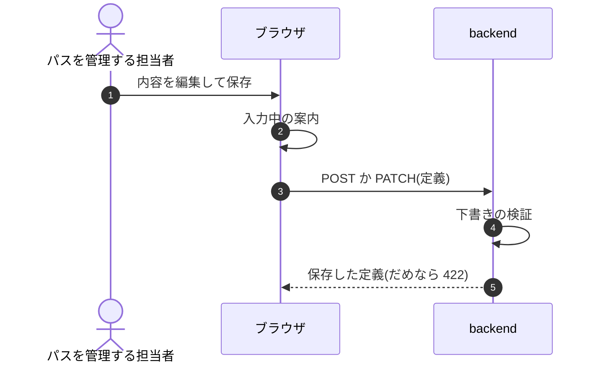

| 項目 | 中身 |
|---|---|
| 編集するもの | 病日・OAT ユニット・タスク・雛形 |
| 入力中の案内 | `validatePathwayDraft` |
| リクエスト | `POST /master/pathways` または `PATCH /master/pathways/:id` |
| 送るもの | 本体 + indications / phases / events(病日 → OAT ユニット → 観察項目 → タスク) |
| 置換の単位 | 送った種別だけを丸ごと置換する。`*_key`(uuid)は画面が採る |
| 下書きの検証 | `validate_content!`。病日の重複・フェーズの結び・主要イベント |
| 失敗 | 422 とメッセージ |

## 定義の承認

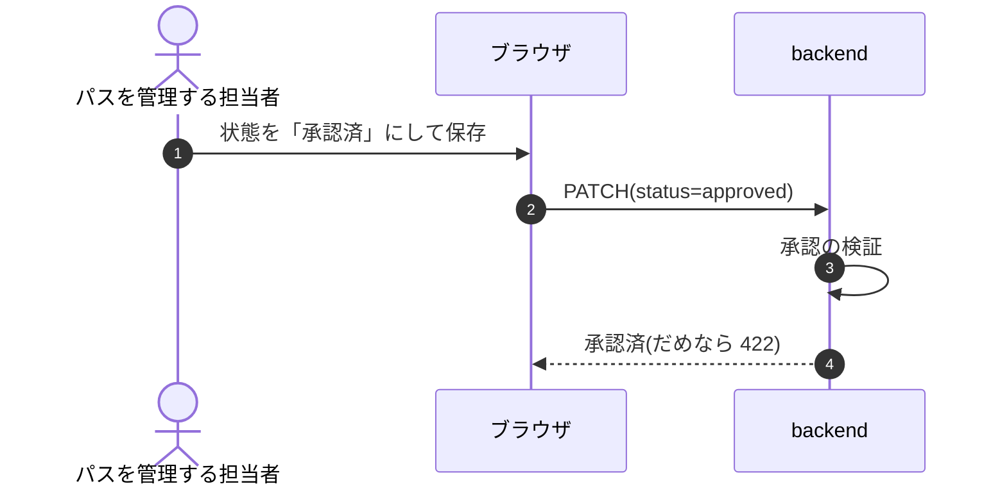

| 項目 | 中身 |
|---|---|
| 画面の操作 | 運用の状態を「承認済」にして保存する |
| リクエスト | `PATCH /master/pathways/:id`(status=approved) |
| 承認の検証 | `approval_invalid_messages` |
| 結果 | `approved_on` / `approved_by` が入り、内容は凍結される |

- 承認の検証が見るのは、適応基準・予定日数・版・病日の有無・全病日に OAT ユニット・雛形の中身・予定日数と標準の経路の最終病日・フェーズの整合です。
- フェーズの整合は、各フェーズに病日があること、フェーズ名、分岐の循環、開始フェーズからの到達、病日の連続、分岐先が前のフェーズの翌日から始まることです(`phase_invalid_messages`)。

## 承認の取り消し

承認の取り消しだけが、上流に件数を問い合わせます。

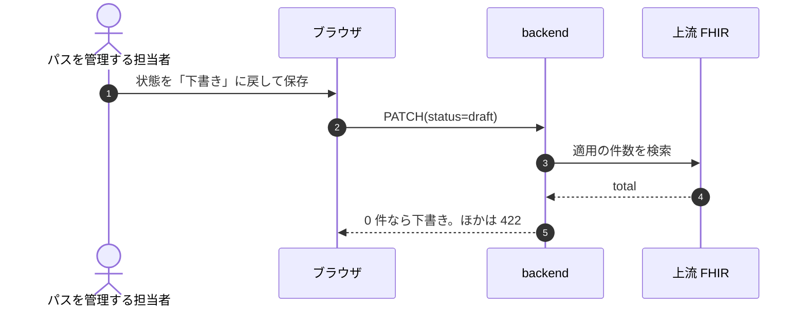

| 項目 | 中身 |
|---|---|
| リクエスト | `PATCH /master/pathways/:id`(status=draft) |
| 件数の検索 | `GET CarePlan?instantiates-uri=…/pathway/{code}&_summary=count`(厳密な検索) |
| total = 0 | 下書きに戻し、承認日・承認者を消す |
| 1 件以上、または確認できない | 422 |

## 定義の複製

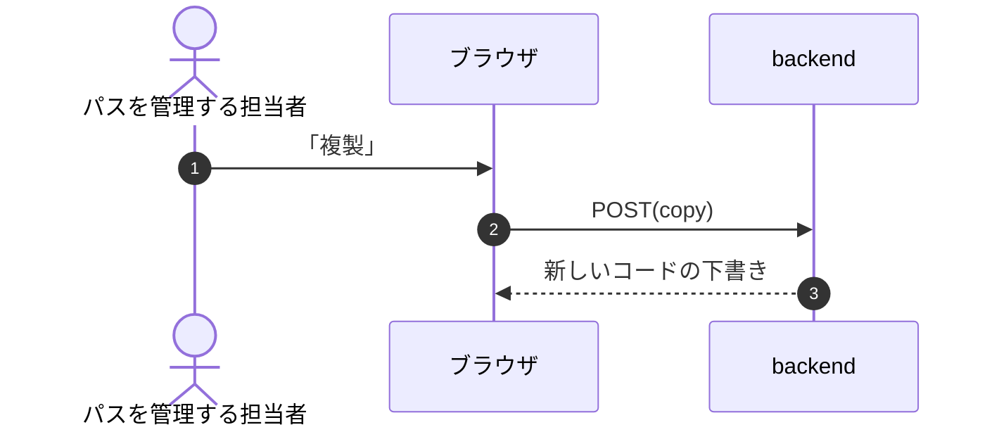

| 項目 | 中身 |
|---|---|
| リクエスト | `POST /master/pathways/:id/copy` |
| 結果 | 新しいコード・下書き・版のマイナー +1・`copied_from_code`。uuid はそのまま |

## 適用(初回と次のフェーズ)

初回と次のフェーズは同じ流れで、transaction の中身だけが違います。計画の木とオーダーと来歴を、1 つの transaction にまとめます(`mergeTransactionBundles`)。

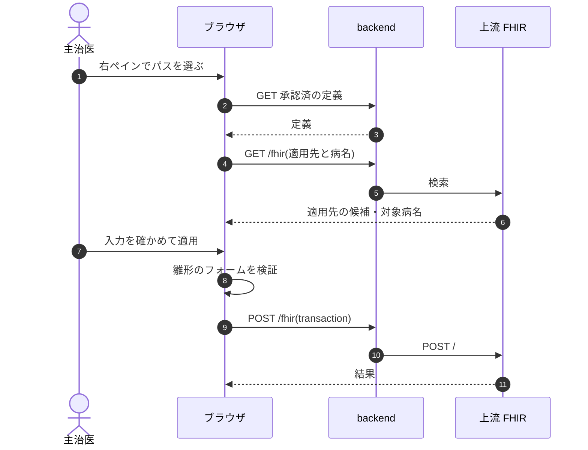

| 読むもの | 取得先 |
|---|---|
| 適用できる定義 | `GET /master/pathways?status=approved`(有効期間内) |
| 選んだ定義 | `GET /master/pathways/:id`。フェーズ・病日・OAT ユニット・タスク・雛形 |
| 適用先の候補 | `GET /fhir` で入院中・入院予定の `Encounter` |
| 対象病名 | `GET /fhir` で継続中の `Condition` |
| 進行中の適用 | `GET /fhir` で患者の `CarePlan` の根。二重適用の判定に使う |

- 主治医が確かめるのは、適応基準・入院日・対象病名・依頼医師・オーダーの行です。
- 雛形のフォームは、外から submit して検証します。落ちたら、何も登録しません。
- 結果のあと、パスの木・来歴・`ServiceRequest` と各種別のキーを読み直し、パスタブを開きます。

| 初回の transaction に書くもの | 補足 |
|---|---|
| POST `CarePlan`(適用) | fullUrl は urn:uuid。`addresses`・`encounter`・`pathway-version` |
| POST `CarePlan`(病日) | 開始フェーズの病日ごと。`pathway-phase`・主要イベント |
| POST `CarePlan`(OAT ユニット、観察項目) | 病日の下に順に。観察項目には適正値の `Goal` |
| POST `Procedure` preparation(タスク) | 観察項目の下 |
| 雛形のオーダー | 各種別の buildBundle。`stampPathwayOrders` で印を付ける。fullUrl 必須 |
| POST `Provenance`(オーダー分) | 代行入力なら `Task` `order-approval` も |
| POST `Provenance`(適用) | 1 件 |

| 次のフェーズの transaction に書くもの | 補足 |
|---|---|
| POST 次のフェーズの病日 → OAT ユニット → … | 既存の適用の下に足す |
| 最初の病日の `pathway-phase-note` | 目安の写し + コメント |
| POST `Provenance` | 最初の病日を対象にする |
| そのフェーズのオーダー | 初回と同じ形 |
| PUT 前のフェーズの食事・安静度(AL) | 新しい開始の直前で終える(`planPhaseOrderClosings`) |

- 次のフェーズでは、適用の `CarePlan` は PUT しません。
- **識別子**: `{施設コード}.{適用uuid}` を先頭に、階層ごとにピリオドで連ねます。`unit_key` / `assessment_key` / `task_key` は定義の uuid です。定義を直しても、同じアウトカムを追えます。
- **看護指示**: 続く病日の看護指示は `orderContinuityOf` で 1 件にまとめます。内容は先頭の病日の雛形、終了日は続きの最終日です。
- **食事・安静度**: 後に並ぶ同じ種類のオーダーの直前で終えます(`pathwayOrderEnd`)。そのほかの種別は病日ごとに 1 件です。
- **予定外の追加**: 同じ形です(`buildUnplannedUnitBundle`、`useAddUnplannedUnit`)。選んだ病日の下に OAT ユニット → 観察項目 → `Procedure` を POST し、付けたオーダーを同じ transaction に入れます。`EPathCarePlanUnplannedKind` = `Y`、`unit_key` はその場の uuid です。

## パスタブの読み込み

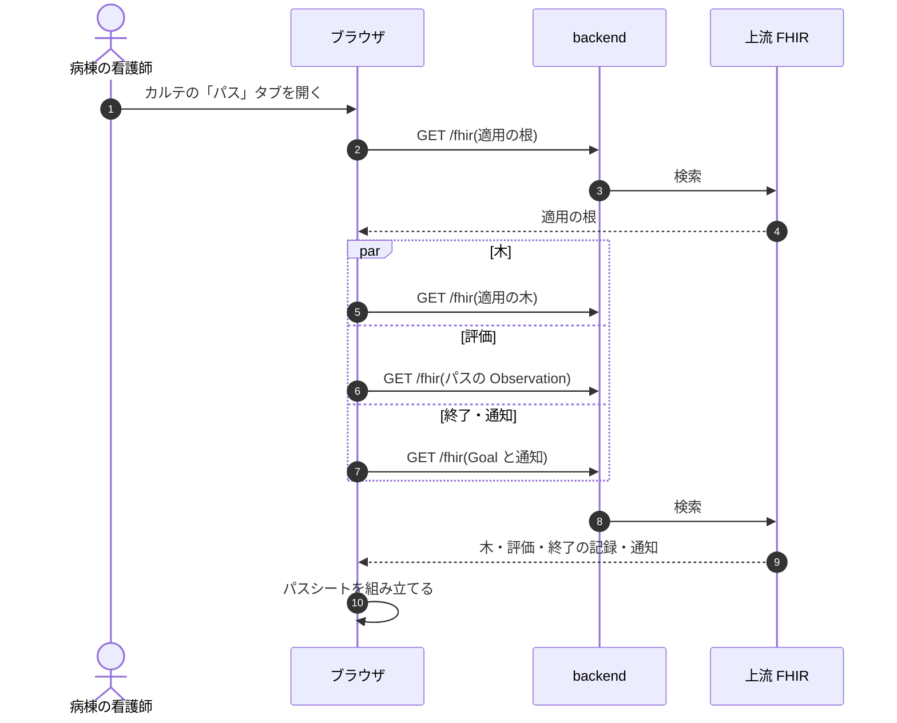

| 読むもの | 検索 | hook |
|---|---|---|
| 適用の根 | `CarePlan?patient&category=パスの印&part-of:missing=true&_sort=-date` | `usePathwayApplications` |
| 適用の木 | 下の「木の検索」 | `usePathwayApplicationTree` |
| 評価・実績・総合評価 | `Observation?patient&category=パスの印`(全ページ) | `usePathwayObservations` |
| 終了・中止の記録 | `Goal?identifier=apply-goal-id\|適用` | `usePathwayApplyGoal` |
| 既存のバリアンスの通知 | `Task?patient&code=pathway-variance` | `usePathwayVarianceTasks` |

木の検索は `CarePlan?part-of=適用` に次を付け、500 件ずつ total まで読みます。

- `_include=CarePlan:goal`
- `_revinclude=Procedure:based-on`
- `_include:iterate=Procedure:based-on`
- `_revinclude:iterate=Task:focus,Procedure:based-on`

木の検索で読めるものは、病日・OAT ユニット・観察項目・適正値の `Goal`・タスク・オーダーのヘッダ・進捗の `Task`・実施記録です。

- 適用が複数あればタブで並べ、進行中を既定にします。
- 評価の `Observation` は、評価(judgement)・実績・総合評価(comp-assessment)です。
- パスシートは `buildPathwaySheet` が識別子で行をまとめ、続きは 1 行にします。評価の最新と履歴は `buildEvaluationState` が作ります。
- 上流は `_revinclude:iterate` を 2 つ並べると最後の 1 つしか効かないので、カンマで 1 つにします。

## 日次評価の記録

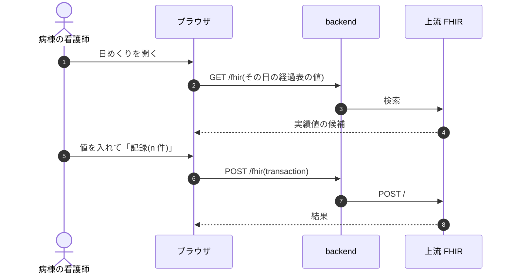

- 経過表の値は `useVitalFlowsheet` で、その日だけを読みます。
- 看護師が入れるのは、実績値・タスクの実施・達成状態です。
- transaction は、変えたアウトカムごとに組んで entry をつなぎます(`buildPathwayEvaluationBundle`、`useRecordPathwayEvaluation`)。
- 結果のあと、パスの木・`Observation`・`Goal`・通知の件数を読み直します。

| transaction に書くもの | 条件 |
|---|---|
| POST `Goal`(`outcome-goal-id`)+ POST `Observation`(評価) | そのアウトカムの初回の評価 |
| PUT `CarePlan`(OAT ユニット)に `goal` を足す | そのアウトカムの初回の評価 |
| POST `Observation`(評価。記録番号 +1)+ PUT `Goal`(最新) | 2 回目以降の評価 |
| POST `Observation`(実績) | 値が変わった観察項目だけ |
| PUT 適正値の `Goal`(`achievementStatus`) | 観察項目に基準があるとき |
| PUT `Procedure`(completed / preparation) | 状態の変わったタスクだけ |
| POST `QuestionnaireResponse` | テンプレートの回答 |
| PUT / DELETE `Observation`(comp-assessment) | 病日の総合評価 |
| POST / PUT `Task` pathway-variance(owner = 主治医) | 重要アウトカムが未達成に変わったとき |
| PUT `Task` cancelled | 未達成でなくなったとき |

- 既存の `Observation` には PUT も DELETE もしません。実績の訂正は、正しい値をもう一度記録します。
- テンプレートの回答も消しません。再編集したら新しい回答を POST し、新しい評価だけがそれを指します。
- オーダーを持たないタスクを 1 件だけ実施・未実施にするとき(`PathwayTaskPanel`、指示簿の「パスのタスク」)は、`buildPathwayTaskBundle` の `Procedure` の PUT だけです。評価には触れません。
- パスタブから開いたオーダーの詳細・実施入力・看護指示の実施入力は、種別ごとの一覧しか読み直しません。閉じたときに木を読み直します(`PATHWAY_TREE_KEY_PREFIX`)。

## 指示簿のパスのタスク

看護指示と違って `ward` 検索は使えないので、その日の入院患者のベッドから病棟を決めます(`usePathwayWardTasks`、`parsePathwayWardTasks`)。

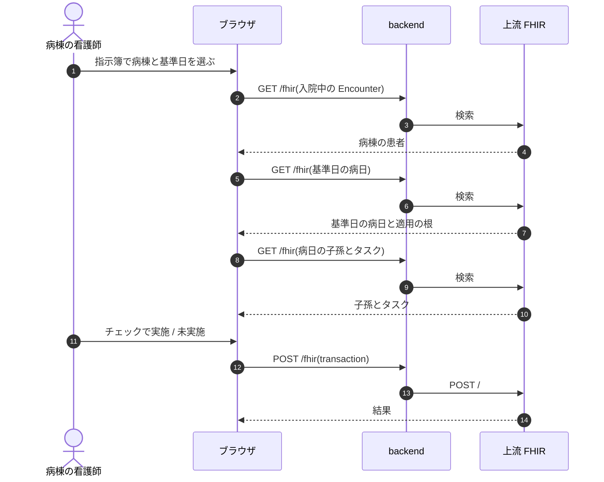

| 読むもの | 検索 | 補足 |
|---|---|---|
| 病棟の患者 | 入院中の `Encounter` | ベッドから病棟の患者を決める |
| 基準日の病日と適用の根 | `CarePlan?category=pathway-level\|event&date=基準日&subject=患者&_include=CarePlan:part-of` | 患者はカンマの OR。進行中の適用だけ残す |
| 子孫とタスク | `CarePlan?part-of=病日&_revinclude=Procedure:based-on` | 病日はカンマの OR で 10 件ずつ。オーダーを持たない `Procedure` だけ並べる |

| transaction に書くもの | 補足 |
|---|---|
| PUT `Procedure` completed / preparation | `performedDateTime`・`performer` |

## 終了・中止

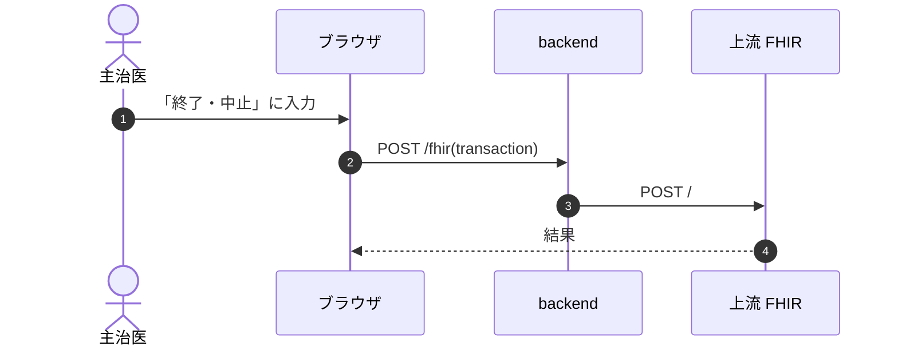

| transaction に書くもの | 補足 |
|---|---|
| PUT `CarePlan`(適用) | `status` = completed / revoked、`period.end` |
| POST `Goal`(`apply-goal-id`) | `lifecycleStatus`、`EPathGoalStatusReason`、`note` |

- 入力は、区分・終了日・中止理由・総合評価です(`buildPathwayCloseBundle`、`useClosePathway`)。
- 終了・中止したので、同じ入院にもう一度適用できます。

## 終了の記録の取り消し

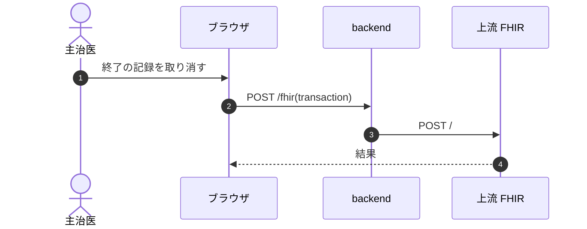

| transaction に書くもの | 補足 |
|---|---|
| PUT `CarePlan`(適用) | `active` に戻し、`period.end` を落とす |
| DELETE `Goal` | 終了・中止の記録 |

- 組み立ては `buildPathwayReopenBundle` です。

## 日程の変更

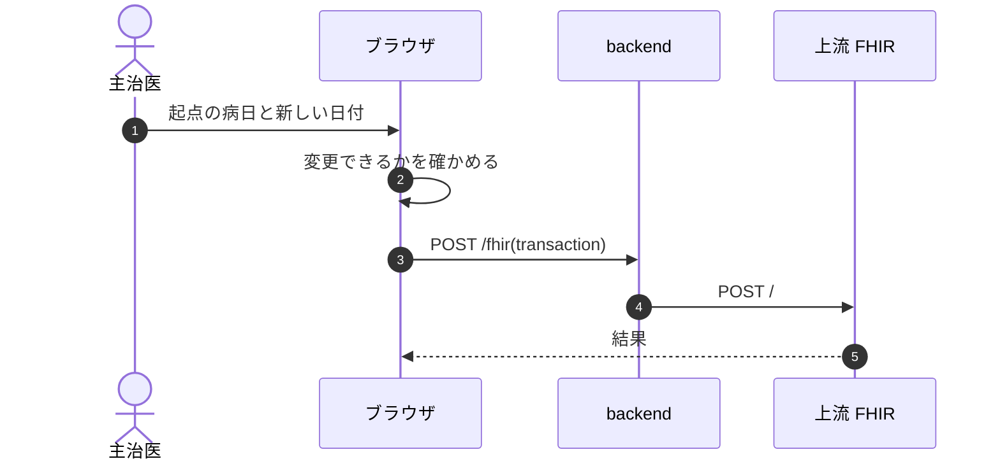

`planPathwayShift` は、起点から後ろに次のどれかがあれば、変更を止めます(blocker)。

- 評価
- 実施
- 看護指示の実施記録
- 実施済みのオーダー

| transaction に書くもの | 条件 |
|---|---|
| PUT `CarePlan`(病日)の `period` | – |
| PUT `Procedure`(タスク)の予定日の拡張 | – |
| PUT `CarePlan`(適用)の `period.start` | 起点が最初の病日のとき |
| PUT 看護指示・食事の `ServiceRequest` の開始・終了 + `Provenance`(UPDATE) | – |

- そのほかの種別のオーダーは触らず、パスシートに「日付違い」を出します。
- 組み立ては `buildPathwayShiftBundle`、hook は `useShiftPathwaySchedule` です。

## 適用の取り消し・フェーズの取り消し

画面の操作は、パスタブの見出しのメニューの「適用の取り消し」か「フェーズの取り消し」です。

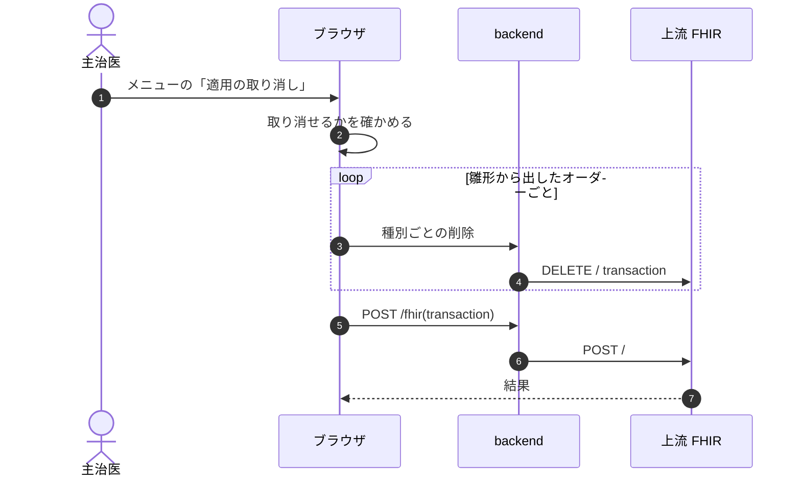

`planPathwayCancel` は、次のどれかがあれば、取り消しを止めます(blocker)。

- 評価
- 実施済みのタスク
- 看護指示の実施
- 実施済みのオーダー、部門が受け付けたオーダー

| 書くもの | 補足 |
|---|---|
| 種別ごとの削除の本体(`delete…Request`) | 明細・予約の取消・記入の削除は各種別のとおり。看護指示は指示と `Task` を DELETE |
| DELETE 木の `CarePlan`・`Procedure`・適正値の `Goal` | 最後の transaction。`Provenance` は残す |

- 読み直しは最後に 1 回です。URL の view を外します。
- 種別ごとの削除の hook を使わないのは、hook が 1 件ごとに一覧を読み直させ、数十件を続けると上流の回数制限に当たるためです。
- 途中で失敗したら木は残します。もう一度開けば、残ったオーダーから続けられます。
- 退院の transaction はパスに触りません。打ち切るのは看護指示・食事・リハビリだけです。退院後も進行中のまま残る適用は、利用者が終了を記録して閉じます。

## 医事会計と SS-MIX2

パスの計画・評価そのもの(`CarePlan`・`Goal`・パスの `Observation`・タスクの `Procedure`)は請求の項目を持たず、SS-MIX2 の対象リソース(`Ssmix2::Dispatcher::RESOURCE_TYPES`)にも入っていません。
雛形から出たオーダーは、パスから出たことに関係なく、各種別の規則で送られます。SS-MIX2 のメッセージになるのは、雛形から出たオーダーの `ServiceRequest` / `MedicationRequest` だけです。

次の操作は、医事会計にも SS-MIX2 にも何も送りません。

- 定義の保存・承認・複製・廃止
- 適用・次のフェーズ・予定外の追加(計画の木)
- 評価・実績・総合評価・タスクの実施(チェックリスト)
- 終了・中止・終了の記録の取り消し
- バリアンスの通知

送るものがある操作は、次のとおりです。

| 起きたこと | 医事会計(`BillingClaimBuilder`) | SS-MIX2 |
|---|---|---|
| 雛形から出たオーダーの登録 | 種別ごと | 種別ごと |
| 雛形から出たオーダーの実施 | 種別ごと。実施記録から送る | 種別ごと(`RAS^O17` / `OMI^Z23` など) |
| 日程の変更 | なし | 書き換えた食事オーダーごとに `OMD^O03`(`NW`) |
| 適用の取り消し | 消したオーダーが対象から外れる(種別ごと) | 消したオーダーの `CA`(DEL)(種別ごと) |

- **登録の医事会計**: 処方・食事・看護指示・他科依頼は対象外です。部門オーダーは実施記録から送ります。
- **登録の SS-MIX2**: 処方・注射は `RDE^O11`、検体検査は `OML^O33`、放射線・生理などは `OMG^O19`、食事は `OMD^O03` です。看護指示・他科依頼は出しません。
- **日程の変更**: 看護指示・食事の日付が動くだけです。看護指示はメッセージになりません。
