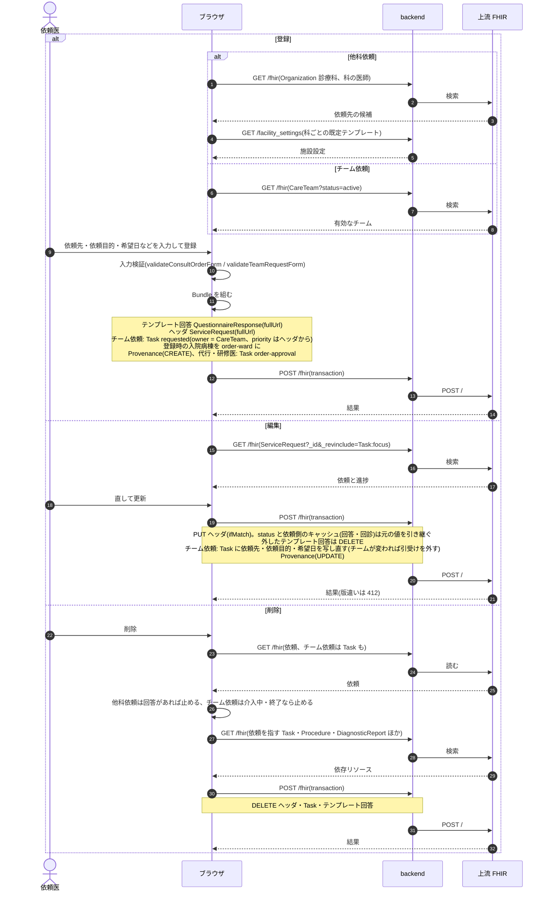
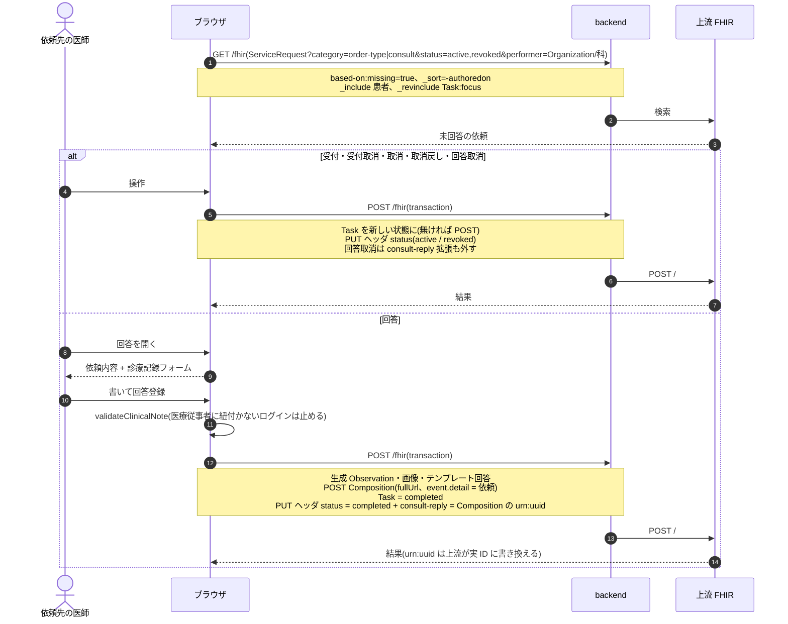
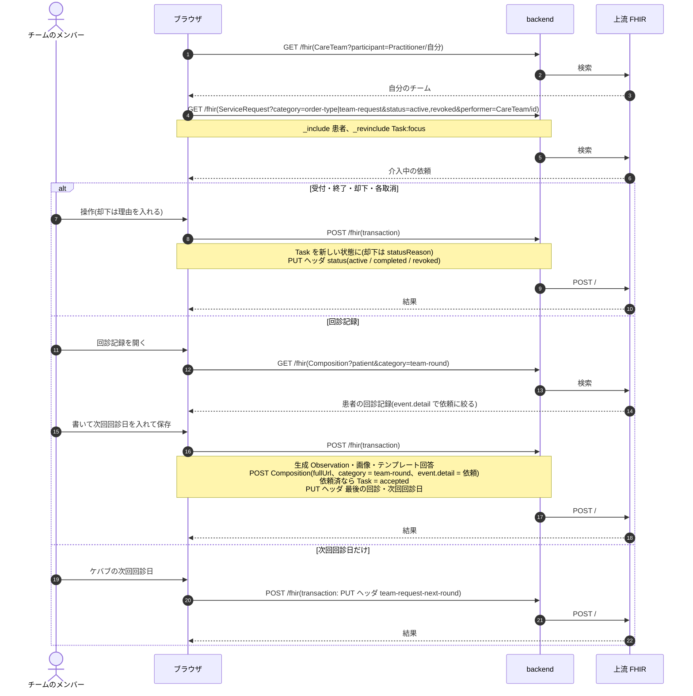
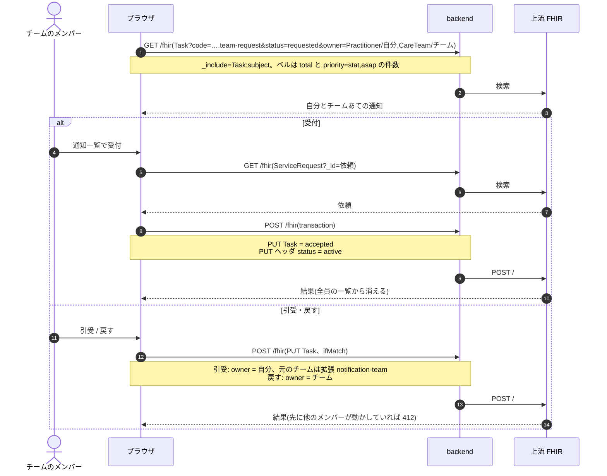

# 他科依頼・チーム依頼のシーケンス図

<!-- ../fhir-client/docs/order-flows/consult-team.md から scripts/sync-flows.mjs で作る。直接編集しない。 -->

運用の流れは[他科依頼・チーム依頼の業務フロー](../flows/consult-team.md)にあります。

## リソースの構成

どちらも明細を持たないヘッダの `ServiceRequest` 1 本と、進捗の `Task`(`focus` = ヘッダ)、返ってくる `Composition` です。

| もの | 他科依頼 | チーム依頼 |
|---|---|---|
| ヘッダ | `ServiceRequest`(`category` = `order-type|consult`) | `ServiceRequest`(`category` = `order-type|team-request`) |
| `code` | `consult-request-type`(consult / opinion / exam / transfer) | `care-team-kind`(チームの区分) |
| 依頼先 | `performer[0]` = `Organization`(科)、`performer[1]` = `Practitioner`(指名医師、任意) | `performer[0]` = `CareTeam` |
| 依頼目的 | `reasonCode[0].text`。テンプレート回答は拡張 `consult-purpose-questionnaire-response` | `reasonCode[0].text`。拡張 `team-request-purpose-questionnaire-response` |
| `status` | `active`(依頼済・対応中)/ `completed`(回答済)/ `revoked`(取消) | `active`(依頼済・介入中)/ `completed`(終了)/ `revoked`(却下) |
| 依頼側のキャッシュ | 拡張 `consult-reply`(回答の `Composition`。表示用で、正本は回答の `event.detail`) | 拡張 `team-request-last-round`・`team-request-last-round-date`・`team-request-next-round` |
| 進捗 | `Task`(`task-code|consult`)。**登録時には作らず**、Task が無い依頼は依頼済 | `Task`(`task-code|team-request`)。**登録と同じ transaction で作る**。`owner` = `CareTeam`、`description` = 依頼目的、`input`「希望日」、却下の理由は `statusReason.text` |
| 返るもの | `Composition`(`type` = LOINC 11488-4、`event[0].detail` = 依頼、`event[0].code` = `consult-note-event|reply`、拡張 `order-department` = 答えた科) | `Composition`(`type` = 11506-3、`category` = `clinical-note-category|team-round`、`event[0].detail` = 依頼、`event[0].code` = `consult-note-event|round`) |
| 代行入力 | `Provenance`(`target` = ヘッダ) | 同じ |

- 上流は `Composition.event` を索引しないので、チーム依頼の回診記録の一覧は患者の回診記録(`Composition?patient=&category=…|team-round`)を引いて `event.detail` で絞ります(`useTeamRounds`)。
- カルテのタイムラインは `KARTE_NOTE_TYPE_SEARCH`(`fhir/clinicalNoteHelpers.ts`)で経過記録と他科依頼回答の両方を引きます。
- 放射線治療オーダーは元の他科依頼を拡張 `radiotherapy-consult-request` で指せます。検査結果フォローの対応オーダーにも他科依頼を選べます。

## 進捗 Task と status

他の部門オーダーは進捗を Task だけで持ちますが、この 2 つは日付で一覧を切れないので、**Task の遷移と同じ transaction で `ServiceRequest.status` も動かします**(`consultOrderStatusFor` / `teamRequestOrderStatusFor`)。
表示の正本は Task(依頼済と対応中を status で区別できないため)、status は一覧を引くための索引です。片方だけを書く入口を作りません。

| 書き込みの入口 | 他科依頼(`api/queries/consult.ts`) | チーム依頼(`api/queries/teamRequest.ts`) |
|---|---|---|
| 状態の変更 | `useUpdateConsultTaskStatus` | `useUpdateTeamRequestTaskStatus`(却下は理由を添える) |
| 記録の保存 | `useSaveConsultReply` | `useSaveTeamRound` |
| その他 | – | `useSetTeamRequestNextRound`(次回回診日だけ)、通知一覧の受付(`teamRequestAcceptEntries`、`api/notificationActions.ts`) |

遷移の表は `consultTaskActions`(`fhir/consultTaskHelpers.ts`)と `teamRequestTaskActions`(`fhir/teamRequestTaskHelpers.ts`)です。
`executionPeriod` は受付で `start`、回答・終了で `end` が入ります(`createTaskHelpers` の `buildTaskUpdate`)。

## シーケンス図の前提

`/fhir` への書き込みはどれも 1 回の transaction Bundle で、backend の `FhirProxyController` が上流へ中継します。
SS-MIX2 を有効にしている施設では、中継が書き込みの控えを記録します(`Ssmix2::Recorder`。この 2 種別はメッセージになりません)。
楽観ロックの版は `postBundle` が `ifMatch` に添え、版が違えば 412 で止まります。

| 部品 | 他科依頼 | チーム依頼 |
|---|---|---|
| フォーム | `components/ConsultOrderForm.tsx`・`ConsultOrderPanels.tsx` | `TeamRequestForm.tsx`・`TeamRequestPanels.tsx` |
| 組み立て | `fhir/consultOrderHelpers.ts`・`consultTaskHelpers.ts` | `fhir/teamRequestHelpers.ts`・`teamRequestTaskHelpers.ts` |
| 一覧 | `pages/ConsultWorklistPage.tsx`(`/consult-worklist`) | `pages/TeamWorklistPage.tsx`(`/team-worklist`) |
| 記録のモーダル | `components/ConsultReplyModal.tsx` | `components/TeamRoundModal.tsx` |
| チームのマスタ | – | `pages/CareTeamPage.tsx`(`/care-teams`)、`fhir/careTeamHelpers.ts`、`api/queries/careTeam.ts` |
| 通知 | – | `components/notifications/notificationRegistry.tsx` の `team-request` |

## 登録・編集・削除

`buildConsultOrderBundle` / `buildConsultOrderUpdateBundle` / `buildConsultOrderDeleteBundle`、`buildTeamRequestBundle` / `buildTeamRequestUpdateBundle` / `buildTeamRequestDeleteBundle`、
`useCreatePrescription`(`api/queries/labResult.ts`。全種別共通)、`useUpdateConsultOrder` / `useUpdateTeamRequest`、`useDeleteConsultOrder` / `useDeleteTeamRequest`。

## 他科依頼の受付・回答・取消

`useConsultWorklist`(`status=active,revoked` / `completed` と `performer=Organization/{科}` で上流が絞る)、`useUpdateConsultTaskStatus`、`useSaveConsultReply`、`buildClinicalNote` の `consultOrderId` / `department`。

## チーム依頼の受付・回診記録・終了・却下

`useMyCareTeams`(`CareTeam?participant=Practitioner/{自分}`)、`useTeamRequestWorklist`(`performer=CareTeam/{id}`)、`useUpdateTeamRequestTaskStatus`、`useSaveTeamRound`、`useSetTeamRequestNextRound`、`buildClinicalNote` の `teamRequestId`。

## チームあての通知

依頼済の進捗 Task がそのまま通知です。共通の作法は `fhir/notificationHelpers.ts` です。

## 医事会計と SS-MIX2

どちらも出来高で請求する項目が無いので、医事会計には送りません(`OrderCatalog::IGNORED`。「送れない項目」にも出しません)。栄養サポートチーム加算などの加算は、この依頼からは送りません。
SS-MIX2 のメッセージも作りません(`Ssmix2::Messages::OmgO19` などの対象外)。

| 起きたこと | 医事会計(`BillingClaimBuilder`) | SS-MIX2 |
|---|---|---|
| 登録・編集・削除 | なし | なし |
| 受付・取消・却下・終了 | なし | なし |
| 回答・回診記録の保存 | なし | なし(診療記録はメッセージにしない) |
