# 他科依頼・チーム依頼のシーケンス図

<!-- ../fhir-client/docs/order-flows/consult-team.md から scripts/sync-flows.mjs で作る。直接編集しない。 -->

運用の流れは[他科依頼・チーム依頼の業務フロー](../flows/consult-team.md)にあります。

## シーケンス図の前提

- **書き込みの経路**: `/fhir` への書き込みはどれも 1 回の transaction Bundle で、backend の `FhirProxyController` が上流へ中継します。
- **上流**: backend の先にある FHIR サーバーのことです。図では「上流 FHIR」と書きます。
- **応答の中継は省く**: 図の `FHIR-->>UI` は、上流の応答を backend がそのままブラウザへ返すことを表します。
- **ヘッダ**: 依頼本体の `ServiceRequest` のことです。ほかの種別と呼び名を揃えていますが、この 2 種別は明細を持たず、ヘッダ 1 本だけです。
- **回答とテンプレートの記入内容**: このページの「回答」は、他科依頼に返す診療記録(`Composition`)です。テンプレートに記入した内容(`QuestionnaireResponse`)は「テンプレートの記入内容」と書き分けます。
- **楽観ロック**: 版は `postBundle` が `ifMatch` に添え、版が違えば 412 で止まります。
- **SS-MIX2**: 有効にしている施設では、中継が書き込みの控えを記録します(`Ssmix2::Recorder`)。この 2 種別はメッセージになりません。

## リソースの構成

どちらも同じ形です。

- ヘッダ `ServiceRequest`(依頼。明細は持たない)
  - `Task`(進捗。`focus` = ヘッダ)
  - `Composition`(返ってくる診療記録。`event[0].detail` = ヘッダ)
  - `QuestionnaireResponse`(依頼目的のテンプレートの記入内容。ヘッダの拡張が指す)
  - `Provenance`(代行入力。`target` = ヘッダ)

| リソース | 要素 | 他科依頼 | チーム依頼 |
|---|---|---|---|
| ヘッダ `ServiceRequest` | `category` | `order-type|consult` | `order-type|team-request` |
| | `code` | `consult-request-type`(consult / opinion / exam / transfer) | `care-team-kind`(チームの区分) |
| | `performer[0]` | `Organization`(科) | `CareTeam` |
| | `performer[1]` | `Practitioner`(指名医師、任意) | – |
| | `reasonCode[0].text` | 依頼目的 | 依頼目的 |
| | テンプレートの記入内容を指す拡張 | `consult-purpose-questionnaire-response` | `team-request-purpose-questionnaire-response` |
| | `status` = `active` | 依頼済・対応中 | 依頼済・介入中 |
| | `status` = `completed` | 回答済 | 終了 |
| | `status` = `revoked` | 取消 | 却下 |
| | 表示用に写しておく拡張 | `consult-reply`(回答の `Composition`) | `team-request-last-round`・`team-request-last-round-date`・`team-request-next-round` |
| `Task` | `code` | `task-code|consult` | `task-code|team-request` |
| | 作る時期 | **登録時には作らない**。Task が無い依頼は依頼済 | **登録と同じ transaction で作る** |
| | `owner` | – | `CareTeam` |
| | `description` | – | 依頼目的 |
| | `input` | – | 「希望日」 |
| | `statusReason.text` | – | 却下の理由 |
| `Composition` | `type` | LOINC 11488-4 | 11506-3 |
| | `category` | – | `clinical-note-category|team-round` |
| | `event[0].detail` | 依頼 | 依頼 |
| | `event[0].code` | `consult-note-event|reply` | `consult-note-event|round` |
| | 拡張 `order-department` | 答えた科 | – |

- **`consult-reply` の位置づけ**: 表示用の写しです。正本は、回答の `Composition` の `event.detail` です。
- **回診記録の一覧**: 上流は `Composition.event` を索引しません。チーム依頼の回診記録の一覧は、患者の回診記録(`Composition?patient=&category=…|team-round`)を引いて `event.detail` で絞ります(`useTeamRounds`)。
- **カルテのタイムライン**: `KARTE_NOTE_TYPE_SEARCH`(`fhir/clinicalNoteHelpers.ts`)で、経過記録と他科依頼回答の両方を引きます。
- **放射線治療・検査結果フォロー**: 放射線治療オーダーは、元の他科依頼を拡張 `radiotherapy-consult-request` で指せます。検査結果フォローの対応オーダーにも他科依頼を選べます。

## 進捗 Task と status

他の部門オーダーは進捗を Task だけで持ちますが、この 2 つは日付で一覧を引けないので、**Task の遷移と同じ transaction で `ServiceRequest.status` も動かします**(`consultOrderStatusFor` / `teamRequestOrderStatusFor`)。

- 表示の正本は Task です(依頼済と対応中を status で区別できないため)。
- status は、一覧を引くための索引です。
- 片方だけを書く入口を作りません。

| 書き込みの入口 | 他科依頼(`api/queries/consult.ts`) | チーム依頼(`api/queries/teamRequest.ts`) |
|---|---|---|
| 状態の変更 | `useUpdateConsultTaskStatus` | `useUpdateTeamRequestTaskStatus`(却下は理由を添える) |
| 記録の保存 | `useSaveConsultReply` | `useSaveTeamRound` |
| 次回回診日だけ | – | `useSetTeamRequestNextRound` |
| 通知一覧の受付 | – | `teamRequestAcceptEntries`(`api/notificationActions.ts`) |

遷移の表は `consultTaskActions`(`fhir/consultTaskHelpers.ts`)と `teamRequestTaskActions`(`fhir/teamRequestTaskHelpers.ts`)です。
`executionPeriod` は受付で `start`、回答・終了で `end` が入ります(`createTaskHelpers` の `buildTaskUpdate`)。

## 部品

| 操作 | 他科依頼 | チーム依頼 |
|---|---|---|
| フォーム | `components/ConsultOrderForm.tsx`・`ConsultOrderPanels.tsx` | `TeamRequestForm.tsx`・`TeamRequestPanels.tsx` |
| 組み立て(ファイル) | `fhir/consultOrderHelpers.ts`・`consultTaskHelpers.ts` | `fhir/teamRequestHelpers.ts`・`teamRequestTaskHelpers.ts` |
| 登録の組み立て | `buildConsultOrderBundle` | `buildTeamRequestBundle` |
| 編集の組み立て | `buildConsultOrderUpdateBundle` | `buildTeamRequestUpdateBundle` |
| 削除の組み立て | `buildConsultOrderDeleteBundle` | `buildTeamRequestDeleteBundle` |
| 登録の hook | `useCreatePrescription`(`api/queries/labResult.ts`。名前と違い全種別共通) | 同じ hook |
| 編集の hook | `useUpdateConsultOrder` | `useUpdateTeamRequest` |
| 削除の hook | `useDeleteConsultOrder` | `useDeleteTeamRequest` |
| 一覧 | `pages/ConsultWorklistPage.tsx`(`/consult-worklist`)、`useConsultWorklist` | `pages/TeamWorklistPage.tsx`(`/team-worklist`)、`useMyCareTeams`・`useTeamRequestWorklist` |
| 記録のモーダル | `components/ConsultReplyModal.tsx` | `components/TeamRoundModal.tsx` |
| 記録の組み立て | `buildClinicalNote` の `consultOrderId` / `department` | `buildClinicalNote` の `teamRequestId` |
| チームのマスタ | – | `pages/CareTeamPage.tsx`(`/care-teams`)、`fhir/careTeamHelpers.ts`、`api/queries/careTeam.ts` |
| 通知 | – | `components/notifications/notificationRegistry.tsx` の `team-request` |

## 登録・編集・削除

**登録**

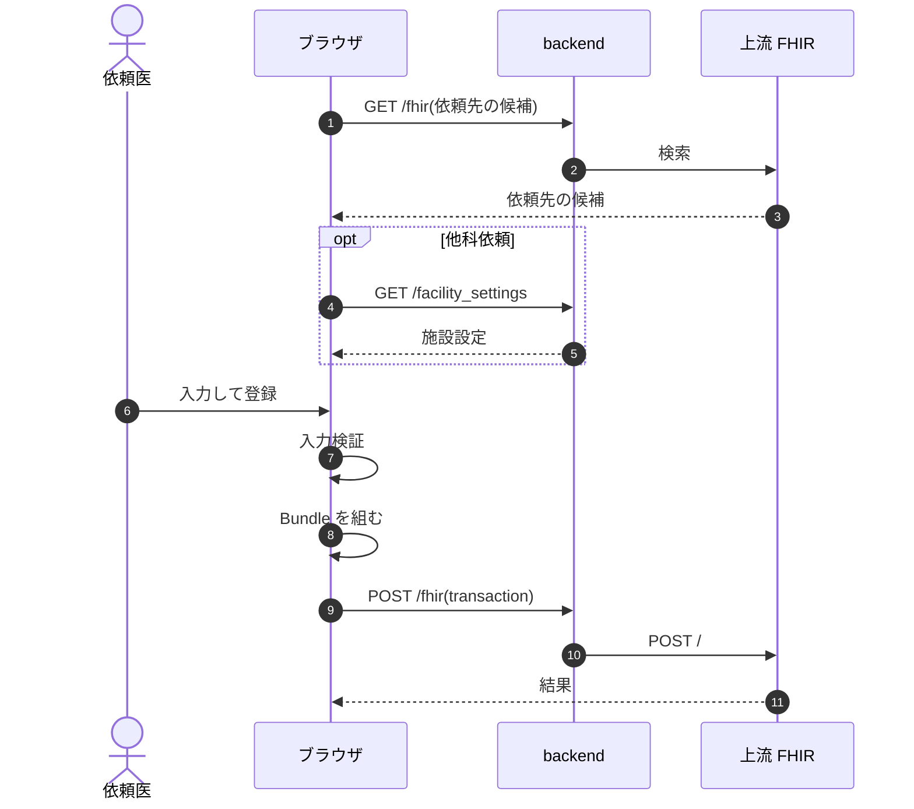

| 段 | 他科依頼 | チーム依頼 |
|---|---|---|
| 依頼先の候補の検索 | `Organization`(診療科)、科の医師 | `CareTeam?status=active`(有効なチーム) |
| 施設設定 | 科ごとの既定のテンプレート | 読まない |
| 入力 | 依頼先・依頼目的・希望日など | 同じ |
| 入力検証 | `validateConsultOrderForm` | `validateTeamRequestForm` |

| transaction に入れるもの | 条件 |
|---|---|
| ヘッダ `ServiceRequest`(fullUrl) | いつも。登録時の入院病棟を `order-ward` に入れる |
| `Provenance`(CREATE) | いつも |
| テンプレートの記入内容 `QuestionnaireResponse`(fullUrl) | テンプレートで依頼目的を書いたとき |
| `Task` requested(`owner` = `CareTeam`、`priority` はヘッダから) | チーム依頼 |
| `Task` order-approval | 代行・研修医のとき |

**編集**

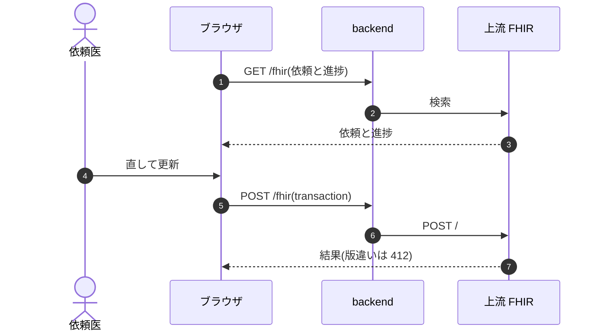

| 段 | 中身 |
|---|---|
| 依頼と進捗の検索 | `ServiceRequest?_id&_revinclude=Task:focus` |
| ヘッダ | PUT(`ifMatch`)。status と、表示用に写しておく拡張(回答・回診)は元の値を引き継ぐ |
| テンプレートの記入内容 | 外したものは DELETE |
| チーム依頼の `Task` | 依頼先・依頼目的・希望日を写し直す。チームが変われば引受けを外す |
| 来歴 | `Provenance`(UPDATE) |

**削除**

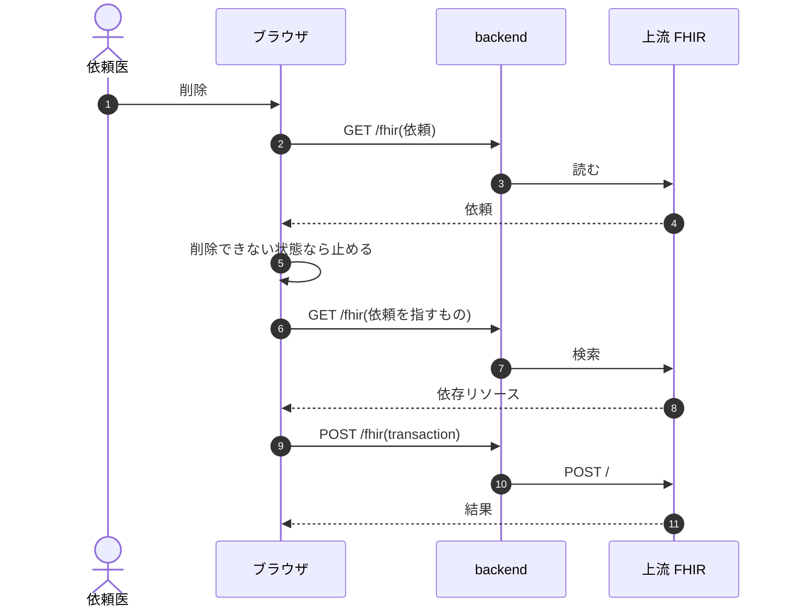

| 段 | 中身 |
|---|---|
| 依頼を読む | 依頼。チーム依頼は `Task` も読む |
| 止める条件 | 他科依頼は回答があれば止める。チーム依頼は介入中・終了なら止める |
| 依頼を指すものの検索 | `Task`・`Procedure`・`DiagnosticReport` ほか |
| transaction | DELETE ヘッダ・`Task`・テンプレートの記入内容 |

## 他科依頼の受付・回答・取消

**一覧を開く**

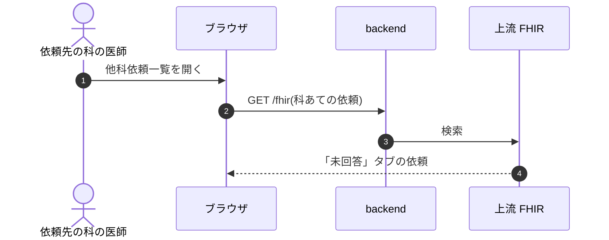

| タブ | 検索の条件 |
|---|---|
| 「未回答」 | `ServiceRequest?category=order-type|consult&status=active,revoked&performer=Organization/科`。取消した依頼も返る |
| 「回答済」 | 同じ検索で `status=completed` |
| どちらも | `based-on:missing=true`、`_sort=-authoredon`、`_include` 患者、`_revinclude` `Task:focus` |

絞り込みは上流が行います(`useConsultWorklist`)。

**状態の変更**

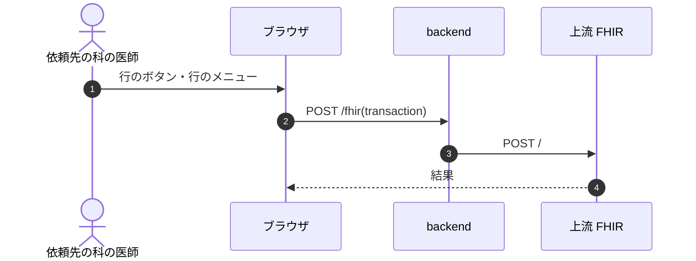

| 操作 | `Task` | ヘッダ |
|---|---|---|
| 受付・受付取消・取消・取消戻し・回答取消 | 新しい状態にする(無ければ POST) | PUT status(active / revoked) |
| 回答取消だけ | 同じ | 拡張 `consult-reply` も外す |

**回答**

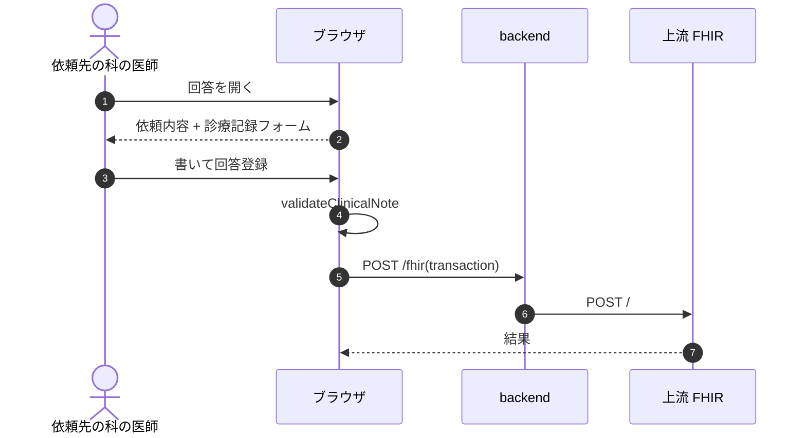

| 段 | 中身 |
|---|---|
| 入力検証 | `validateClinicalNote`。医療従事者に紐付かないログインは止める |
| 診療記録が生むもの | 生成 `Observation`・画像・診療記録のテンプレートの記入内容 |
| `Composition` | POST(fullUrl、`event.detail` = 依頼) |
| `Task` | completed |
| ヘッダ | PUT status = completed、`consult-reply` = `Composition` の urn:uuid |
| 結果 | urn:uuid は上流が実 ID に書き換える |

## チーム依頼の受付・回診記録・終了・却下

**一覧を開く**

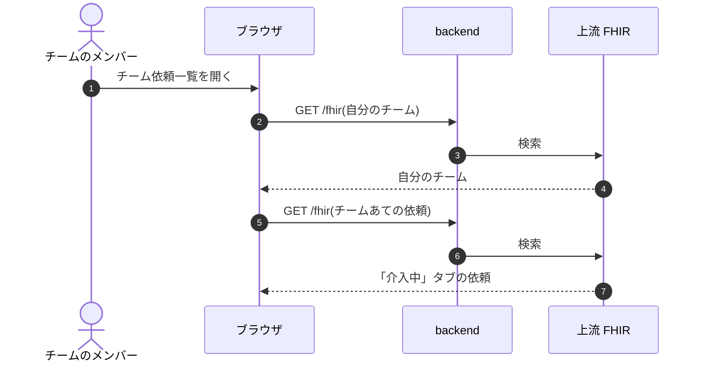

| 検索 | 条件 |
|---|---|
| 自分のチーム | `CareTeam?participant=Practitioner/自分`(`useMyCareTeams`) |
| チームあての依頼 | `ServiceRequest?category=order-type|team-request&status=active,revoked&performer=CareTeam/id`、`_include` 患者、`_revinclude` `Task:focus`(`useTeamRequestWorklist`)。却下した依頼も返る |

**状態の変更・次回回診日**

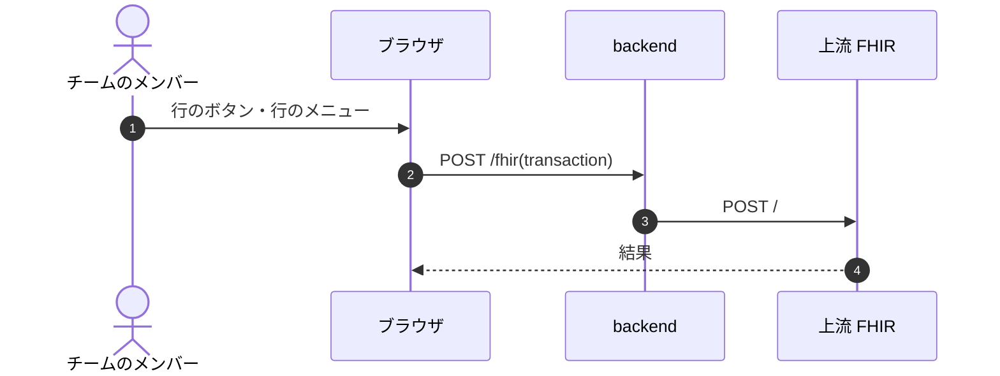

| 操作 | transaction |
|---|---|
| 受付・終了・却下・各取消 | `Task` を新しい状態にする(却下は `statusReason`)、PUT ヘッダ status(active / completed / revoked) |
| 行のメニューの次回回診日 | PUT ヘッダ `team-request-next-round` だけ |

**回診記録**

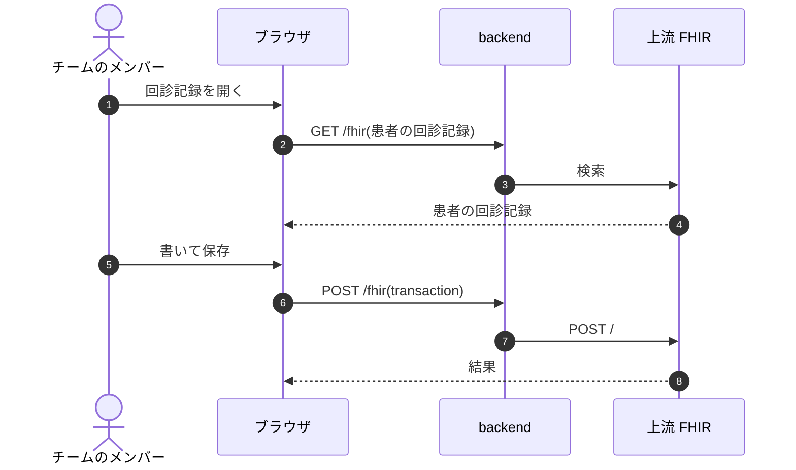

| 段 | 中身 |
|---|---|
| 患者の回診記録の検索 | `Composition?patient&category=team-round`。返った記録を `event.detail` で依頼に絞る |
| 入力 | 回診記録と次回回診日 |
| 診療記録が生むもの | 生成 `Observation`・画像・診療記録のテンプレートの記入内容 |
| `Composition` | POST(fullUrl、`category` = team-round、`event.detail` = 依頼) |
| `Task` | 依頼済なら accepted |
| ヘッダ | PUT 最後の回診・次回回診日 |

## チームあての通知

依頼済の進捗 Task がそのまま通知です。共通の作法は `fhir/notificationHelpers.ts` です。

**通知を読む・受付**

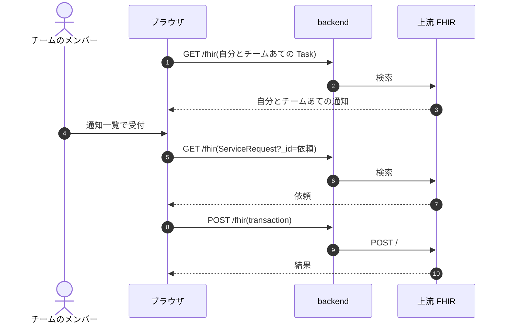

| 段 | 中身 |
|---|---|
| 通知の検索 | `Task?code=…,team-request&status=requested&owner=Practitioner/自分,CareTeam/チーム`、`_include=Task:subject` |
| ベルの件数 | total と、`priority=stat,asap` の件数 |
| 受付の transaction | PUT `Task` = accepted、PUT ヘッダ status = active |
| 受付の結果 | 通知は全員の一覧から消える |

**引受・戻す**

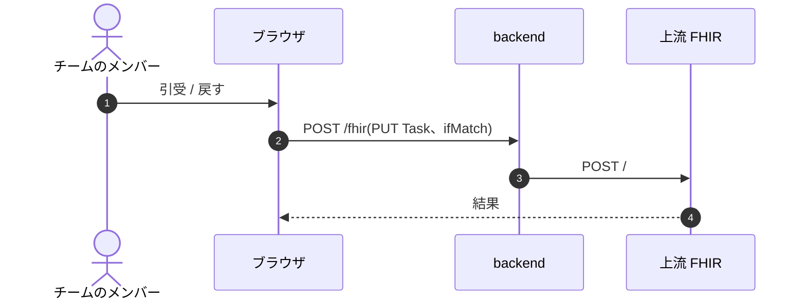

| 操作 | `Task` |
|---|---|
| 引受 | `owner` = 自分。元のチームは拡張 `notification-team` に残す |
| 戻す | `owner` = チーム |

先に他のメンバーが動かしていれば、412 で止まります。

## 医事会計と SS-MIX2

どちらも出来高で請求する項目が無いので、医事会計には送りません(`OrderCatalog::IGNORED`。「送れない項目」にも出しません)。栄養サポートチーム加算などの加算は、この依頼からは送りません。
SS-MIX2 のメッセージも作りません(`Ssmix2::Messages::OmgO19` などの対象外)。診療記録もメッセージにしません。
登録・編集・削除、受付・取消・却下・終了、回答・回診記録の保存のどれでも、医事会計と SS-MIX2 には何も送りません。
