# 透析オーダーのシーケンス図

<!-- ../fhir-client/docs/order-flows/dialysis.md から scripts/sync-flows.mjs で作る。直接編集しない。 -->

運用の流れは[透析オーダーの業務フロー](../flows/dialysis.md)にあります。

## シーケンス図の前提

**書き込みの経路**

- `/fhir` への書き込みはどれも 1 回の transaction Bundle で、backend の `FhirProxyController` が上流へ中継します。
- SS-MIX2 を有効にしている施設では、中継が書き込みの控えを記録します(`Ssmix2::Recorder`)。透析はメッセージになりません。
- 楽観ロックの版は `postBundle` が `ifMatch` に添え、版が違えば 412 で止まります。
- 編集フォームは `useEditSnapshot` で開いた時点の版に固定します(`hooks/useDialysisOrderInitialValues.ts`)。
- 予約の展開・変更・入れ替えは、検索で読んだ `Slot` / `Appointment` をそのまま PUT します。別の端末が先に動かしていれば 412 で transaction の全体が失敗し、一部だけが書かれることはありません。

**このページの呼び名**

| 呼び名 | 指すもの |
|---|---|
| 上流 | backend が中継する先の FHIR サーバー |
| ヘッダ | オーダーの `ServiceRequest`。透析は明細を持たない |
| 進捗 | オーダーの状態を持つ `Task`。運用フローの「オーダーの状態」 |
| ハブ | 1 回の実施(回)をまとめる `Procedure` |
| 子 | ハブを `partOf` で指す測定値・血圧・薬剤・追加の手技 |
| 経過表のハブ | 透析経過表をまとめる `Procedure`。実施のハブを `partOf` で指す |
| 厳密な検索 | `Prefer: handling=strict` を付けた検索。上流が知らない条件を読み飛ばさず、エラーにする(`SearchOptions.strict`) |
| 読み切る検索 | 上限に達したらエラーにして、欠けた結果を使わない検索(`complete: true`) |
| `status=有効` | 予約の検索で、取り消されていない状態を並べたもの(`ACTIVE_APPOINTMENT_STATUSES`) |

**図の書き方**

- 図では、上流から backend を通ってブラウザへ返る応答を、上流からブラウザへの 1 本の矢印で書きます。
- 検索の条件と transaction の中身は、図の下の表に書きます。

## リソースの構成

- オーダー(`ServiceRequest`。ヘッダだけで、明細は持たない)
  - 進捗(`Task`。`focus` = オーダー)
  - 予約(`Appointment`。`basedOn` = オーダー)
    - 枠(`Slot`)→ 枠表(`Schedule`)→ ベッド(`Location`)→ 透析室(`Location`)
  - 1 回の実施のハブ(`Procedure`。`basedOn` = オーダー)
    - 測定値・血圧(`Observation`。`partOf` = ハブ)
    - 薬剤(`MedicationAdministration`。`partOf` = ハブ)
    - 追加の手技(`Procedure`。`partOf` = ハブ)
    - 経過表のハブ(`Procedure`。`partOf` = 実施のハブ)
      - 打点・できごと(`Observation`。`partOf` = 経過表のハブ)
      - 透析中の薬剤(`MedicationAdministration`。`partOf` = 経過表のハブ)
- 患者に直に付くもの: ドライウェイト(`Observation`)、患者メモ(`QuestionnaireResponse`)

**オーダーと進捗**

| リソース | 要素 | 中身 |
|---|---|---|
| `ServiceRequest` | `category` | `order-type|dialysis` + 入外区分(v3 ActCode の `IMP` / `AMB`) |
| `ServiceRequest` | `code` | 浄化方法(`dialysis-modality`) |
| `ServiceRequest` | `occurrenceDateTime` | 開始日(日付のみ) |
| `ServiceRequest` | `reasonReference` | 対象プロブレム |
| `ServiceRequest` | 拡張 `dialysis-order-end` | 終了日。無ければ継続中 |
| `ServiceRequest` | 拡張 `dialysis-bedside` | ベッドサイド |
| `ServiceRequest` | 拡張 `dialysis-schedule-pattern` | 曜日 × シフト。シフトは `dialysis-shift` の coding |
| `ServiceRequest` | 拡張 `dialysis-prescription` | 透析条件 |
| `Task` | `code` | `task-code|dialysis` |
| `Task` | `focus` | オーダー |
| `Provenance` | `target` | オーダー。代行入力の記録で、種別共通 |

- `Task` は**登録時には作りません**。`Task` が無いオーダーは依頼済です。
- `Task` は透析室の受け入れの状態で、回の実施では動かしません。

**透析室・枠・予約**

| リソース | 要素 | 中身 |
|---|---|---|
| `Location`(透析室・ベッド) | `type` | `location-type|dialysis-unit` |
| `Location`(透析室) | `physicalType` | `ro` |
| `Location`(ベッド) | `physicalType` | `bd` |
| `Location`(ベッド) | `partOf` | 透析室 |
| `Location` | `status` | 無効は `inactive` |
| `Schedule`(枠表) | `serviceType` | `schedule-service-type|dialysis` |
| `Schedule`(枠表) | `actor` | ベッドの `Location` |
| `Schedule`(枠表) | `active` | 無効なベッドは false |
| `Slot`(枠) | – | 1 日 × シフト × ベッドで 1 枠(定員 1) |
| `Appointment`(予約) | `basedOn` | オーダー |
| `Appointment`(予約) | `participant` | 患者 + ベッドの `Location` |
| `Appointment`(予約) | `slot` | 枠 |
| `Appointment`(予約) | `serviceType` | dialysis |
| `Appointment`(予約) | 拡張 `dialysis-shift` | シフト |

- 透析のベッドは病床ではないので、入院の `Encounter.location` にはしません。
- 予約のシフトは枠の開始時刻から引きます。拡張 `dialysis-shift` は、枠が読めないときの代わりです。

**1 回の実施**

| リソース | 要素 | 中身 |
|---|---|---|
| `Procedure`(ハブ) | `basedOn` | オーダー |
| `Procedure`(ハブ) | `category` | `order-type|dialysis` |
| `Procedure`(ハブ) | `code` | 浄化方法 |
| `Procedure`(ハブ) | `status` | `preparation`(入室)/ `in-progress`(開始)/ `completed`(終了) |
| `Procedure`(ハブ) | `performedPeriod` | 開始〜終了 |
| `Procedure`(ハブ) | `usedCode` | 血液浄化器(`blood-purifier`)と器材(`medical-material`)+ `dialysis-material-quantity` |
| `Procedure`(ハブ) | 拡張 `dialysis-appointment` | 予約 |
| `Observation`(測定値) | `partOf` | ハブ |
| `Observation`(測定値) | `code` | `dialysis-measurement`(下の表) |
| `Observation`(測定値) | `category` | `order-type|dialysis` |
| `Observation`(血圧) | `partOf` | ハブ |
| `Observation`(血圧) | `code` | LOINC 85354-9 + component |
| `Observation`(血圧) | `category` | `vital-signs` + `order-type|dialysis` |
| `Observation`(血圧) | 拡張 `dialysis-measurement-timing` | `pre` / `post` |
| `MedicationAdministration`(薬剤) | `partOf` | ハブ |
| `MedicationAdministration`(薬剤) | `medication-lot-number` | ロット |
| `MedicationAdministration`(薬剤) | `dialysis-bundled-medication` | 算定しない薬剤は true |
| `Procedure`(追加の手技) | `partOf` | ハブ |
| `Procedure`(追加の手技) | `basedOn` | オーダー |
| `Procedure`(追加の手技) | `code` | `dialysis-procedure-code`(レセ電算の診療行為コード) |

| `dialysis-measurement` のコード | 単位 |
|---|---|
| `pre-weight` / `post-weight` | kg |
| `ultrafiltration` | L |
| `actual-minutes` | min |
| `qb` / `qd` | mL/min |
| `dry-weight` | kg |

**ドライウェイトと患者メモ**

| リソース | 要素 | 中身 |
|---|---|---|
| `Observation`(ドライウェイト) | `code` | `dialysis-measurement|dry-weight` |
| `Observation`(ドライウェイト) | `partOf` | 無し |
| `QuestionnaireResponse`(患者メモ) | `questionnaire` | テンプレート `Questionnaire/dialysis-memo-01` |
| `QuestionnaireResponse`(患者メモ) | `meta.tag` | `questionnaire-response-purpose|dialysis-memo` |
| `QuestionnaireResponse`(患者メモ) | `encounter` | 無し |

- ドライウェイトは患者単位の状態値で、直近 1 件を読みます。
- 患者メモは患者 1 人に 1 件です。`_tag` の厳密な検索で引き、カルテの時系列からは `_tag:not` で外します。

**透析経過表**

| リソース | 要素 | 中身 |
|---|---|---|
| `Procedure`(経過表のハブ) | `partOf` | 実施のハブ |
| `Procedure`(経過表のハブ) | `basedOn` | 無し |
| `Procedure`(経過表のハブ) | `category` | `order-type|dialysis-chart` |
| `Procedure`(経過表のハブ) | `status` | `in-progress` / `completed`(回の終了で閉じる) |
| `Observation`(打点) | `partOf` | 経過表のハブ |
| `Observation`(打点) | `category` | `order-type|dialysis-chart` |
| `Observation`(打点) | `code` | 血圧・脈拍・SpO2・体温は LOINC、装置の値は `dialysis-measurement` |
| `Observation`(できごと) | `code` | `dialysis-event` |
| `MedicationAdministration`(透析中の薬剤) | `partOf` | 経過表のハブ |
| `MedicationAdministration`(透析中の薬剤) | `category` | `order-type|dialysis-chart` |

- 透析中の薬剤は会計に乗りません。

**この形にした理由と読み方**

- **期間**: `occurrencePeriod` にせず開始日 + 拡張にするのは、上流が `occurrenceDateTime` を索引するためです。リハビリ・食事と同じ判断です。上流は `order-period` で開始日と `dialysis-order-end` を合わせて索引しています。
- **入室のハブ**: `performed[x]` を持たないので日付で引けません。ボードは「期間に始めた回」と「`status=preparation,in-progress` の回」を別々に引いて束ねます(`fetchDialysisSessions`)。
- **予約と回の突き合わせ**: ハブの `dialysis-appointment` を優先し、無ければ同じオーダー × 同じ日です(`dialysisSessionForAppointment`)。
- **実施取消**: 経過表 → 子 → ハブの順に DELETE し、予約を `booked` に戻します。entered-in-error では残しません。ドライウェイトは消しません。
- **経過表の読み方**: 経過表のハブは `basedOn` を持たないので、カルテの詳細(`based-on` + `_revinclude:iterate`)に打点が乗りません。読むときは `Procedure?part-of=実施のハブ` で引きます。
- **場所の type**: 透析室とベッドにローカルの `location-type|dialysis-unit` を与えるのは、病棟(`type=HU` 起点)・診察室(`LOCATION_TYPE_OPTIONS`)・病床の集計のどれにも混ざらないようにするためです。`LOCATION_TYPE_OPTIONS` には足しません。

## 進捗 Task と status

**回を実施しても Task を動かしません。** ほかの部門は「実施記録 + Task を completed に」としますが、透析はそうしません(リハビリも同じ)。そうすると、初日の実施でオーダーが終了扱いになるためです(`fhir/dialysisTaskHelpers.ts`・`dialysisResultHelpers.ts` の冒頭コメント)。

| Task | 表示 | `ServiceRequest.status` | ヘッダに書くもの | 取り消す予約 |
|---|---|---|---|---|
| (無し)/ `requested` | 依頼済 | `active` | – | – |
| `accepted` | 実施中 | `active` | – | – |
| `on-hold` | 中断 | `active` のまま | – | 中断の期間の有効な予約 |
| `completed` | 終了 | `active` のまま | `dialysis-order-end`(終了日) | 終了日の翌日以降 |
| `cancelled` | 中止 | `revoked` | – | 今日以降 |

- **遷移**: 遷移の表は `dialysisTaskActions`、書き込みの入口は `useUpdateDialysisTaskStatus`(`api/queries/dialysis.ts`)です。中止・中止取消は `orderCancelEntries` でヘッダの status を揃えます。
- **終了日を書く理由**: 部門一覧・患者帯は `order-period` で引きます。終了日が無いと、status=active のまま基準日に当たり続けます(`buildDialysisOrderCloseEntry`)。
- **終了取消**: `Task` だけを `accepted` に戻し、`dialysis-order-end` は消しません。意図した非対称で、理由は運用フローの「終了・中断・中止・退院」の「戻す操作」にあります。
- **中断の期間**: `Task.statusReason.text` に「中断 2026-11-12〜2026-11-20」の書式で残します。`dialysisTaskHold` が読み戻して一覧の状態の下に出し、再開(`accepted`)で消します。
- **予約の取消**: 終了・中断・中止・退院は、もう来ない日の有効な予約の取消(`PUT Appointment cancelled` + `PUT Slot free`)を同じ transaction に積みます(`fetchOrderAppointmentCancelEntries` の `from` / `to`)。
- **取り消す対象の検索**: 厳密な検索で全ページを読みます。条件が効かずに全件を拾うと、関係ない予約まで取り消すためです。欠けたら書き込みを止めます。
- **`executionPeriod`**: 受付で `start`、終了で `end` が入ります(`createTaskHelpers` の `buildTaskUpdate`)。
- **カルテのタイムライン**: `accepted` / `on-hold` / `completed` で実施情報を出します(`karteTimeline.ts` の dialysis 分岐)。

## 部品

組み立ては `fhir/`、hook は `api/queries/dialysis.ts`、画面は `components/` と `pages/` にあります。

| 操作 | 画面 | 組み立て | hook |
|---|---|---|---|
| 登録 | `DialysisOrderForm.tsx`・`DialysisOrderPanels.tsx` | `buildDialysisOrderBundle` | `useCreatePrescription` |
| 編集 | 同じ 2 つ | `buildDialysisOrderUpdateBundle` | `useUpdateDialysisOrder` |
| 削除 | カルテのカード | `deleteDialysisOrderRequest` | `postOrderDeleteBundle` |
| 一覧の読み込み | `pages/DialysisWorklistPage.tsx` | `fetchWorklistBundles` | `useDialysisWorklist` |
| 状態の変更 | `pages/DialysisWorklistPage.tsx` | `dialysisTaskHelpers.ts` | `useUpdateDialysisTaskStatus` |
| 展開 | `DialysisExpandModal.tsx` | `planDialysisExpansion`・`buildDialysisAppointmentBatchBundle` | `useBookDialysisAppointments` |
| 臨時 | `DialysisBookModal.tsx` | `buildDialysisAppointmentBundle` | `useBookDialysisAppointments` |
| 空き枠から | `DialysisCellBookModal.tsx` | `buildDialysisAppointmentBundle` | `useBookDialysisAppointments` |
| 予約変更 | `DialysisBookModal.tsx`・`DialysisBoard.tsx` | `buildDialysisRescheduleBundle` | `useRescheduleDialysisAppointment` |
| 入れ替え | `DialysisBoard.tsx` | `buildDialysisSwapBundle` | `useSwapDialysisAppointments` |
| 予約取消 | `DialysisBoard.tsx` | – | `useCancelAppointment` |
| ボードの読み込み | `DialysisBoard.tsx` | `fetchDialysisSessions` | `useDialysisBoard`・`useDialysisSlots`・`useDialysisSessions` |
| 入室・開始・回の終了 | `DialysisPerformModal.tsx` | `buildDialysisArrivalBundle`・`buildDialysisStartBundle`・`buildDialysisFinishBundle` | `useDialysisPerform`・`useLatestDryWeight` |
| 実施取消 | `DialysisBoard.tsx` | `buildDialysisPerformDeleteBundle` | `useCancelDialysisPerform` |
| 透析経過表 | `pages/DialysisChartPage.tsx`・`DialysisChartPanel.tsx`・`DialysisChartModal.tsx` | `dialysisChartHelpers.ts` | `useDialysisChart`・`useDialysisChartWrite` |
| 透析経過表の印刷 | `pages/DialysisChartPrintPage.tsx` | `dialysisChartHelpers.ts` | `useDialysisChart` |
| 患者メモ | `DialysisMemo.tsx`(詳細の区画・ボードのモーダル) | `dialysisMemoHelpers.ts` | `useDialysisMemo` |
| 患者一覧 | `DialysisPatientTable.tsx` | `dialysisPatientListHelpers.ts` | `useDialysisPatientData` |
| 月間統計 | `DialysisMonthlyStats.tsx` | `dialysisStatsHelpers.ts` | `useDialysisMonth` |
| 退院での打ち切り | `DischargeModal.tsx` | `dialysisOrderNeedsStop`・`buildDialysisOrderStopEntries` | `usePatientDialysisOrders` |
| ホームのカード | `homeCards/HomeWorklistCard.tsx` の `DialysisCard` | – | `useDialysisWorklist` |

- 終了・中断のモーダルは `pages/DialysisWorklistPage.tsx` の中にあります。

名前と置き場所が合わないもの:

- `useCreatePrescription` は `api/queries/labResult.ts` にあり、全種別共通の登録の hook です。
- `postOrderDeleteBundle` は `api/queries/orderDelete.ts` にあります。
- `useCancelAppointment` は `api/queries/appointment.ts` にあります。
- 退院の transaction は `api/queries/encounter.ts` が組み、そこに `buildDialysisOrderStopEntries` を積みます。
- 患者メモの書き込みは、`QuestionnaireResponseCreatePanel` と編集パネルに `tag` を渡して行います。

そのほかの置き場所:

| もの | 場所 |
|---|---|
| オーダーの詳細 | `components/DialysisOrderDetailPanel.tsx` |
| カルテのカード | `components/karteCardBodies/DialysisOrderCardBody.tsx` |
| オーダー・終了日・退院の打ち切りの組み立て | `fhir/dialysisOrderHelpers.ts` |
| シフト | `fhir/dialysisShiftHelpers.ts` |
| 予約・展開の計画・変更・入れ替え | `fhir/dialysisAppointmentHelpers.ts` |
| 透析室・ベッド・枠 | `fhir/dialysisUnitHelpers.ts`、画面は `pages/DialysisUnitPage.tsx` |
| 実施 | `fhir/dialysisResultHelpers.ts` |
| 血液浄化器の行 | `fhir/bloodPurifierHelpers.ts` |
| 経過表の器 | `fhir/timeSeriesChartHelpers.ts`、`components/timeSeriesChart/` |
| 透析経過表の経路 | `/dialysis-sessions/:sessionId/chart`、印刷は `/dialysis-chart-print/:sessionId` |
| 患者メモの雛形 | `docs/report-mappings/dialysis-memo-01.questionnaire.json` |
| 血液浄化器のマスタ | `pages/BloodPurifierPage.tsx`(`/blood-purifiers`)、backend `master/blood_purifiers` |
| 施設設定 | `dialysis_shifts` / `dialysis_lab_items` / `receipt_codes.dialysis`(`backend/app/models/facility_settings.rb`) |

## 登録

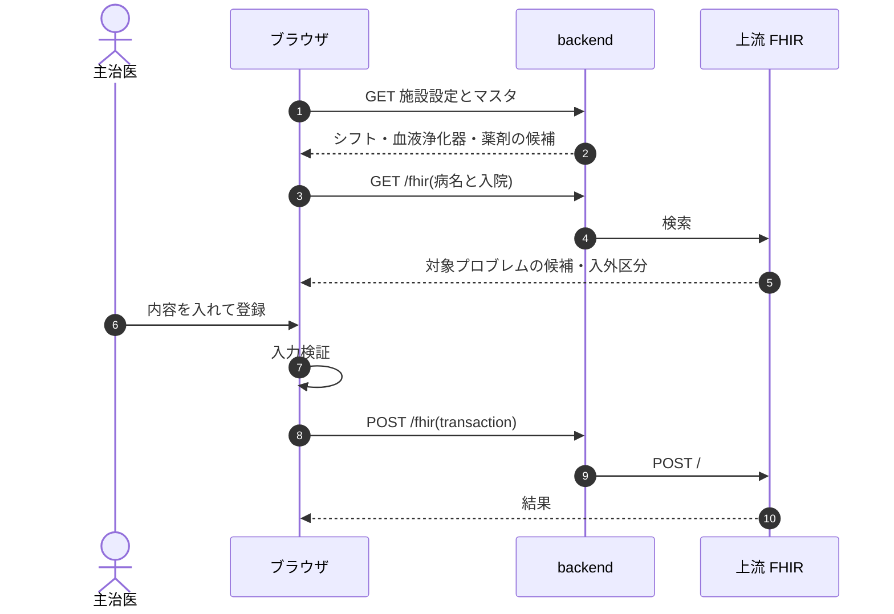

| 読むもの | 取得先 |
|---|---|
| シフト | `GET /facility_settings` |
| 血液浄化器 | `GET /master/blood_purifiers` |
| 透析液などの候補 | `GET /master/medicines`(選んだとき) |
| 対象プロブレムの候補 | `GET /fhir` で患者の `Condition` |
| 入外区分の初期値 | `GET /fhir` で入院中の `Encounter` |

| transaction に書くもの | 条件 |
|---|---|
| POST `ServiceRequest`(ヘッダ。fullUrl を付ける) | 常に |
| POST `Provenance`(CREATE) | 常に |
| POST `Task` `order-approval` | 代行入力・研修医のとき |

- 主治医が入れるのは、浄化方法・期間・曜日 × シフト・透析条件です。
- 入力検証は `validateDialysisOrderForm` です。

## 編集

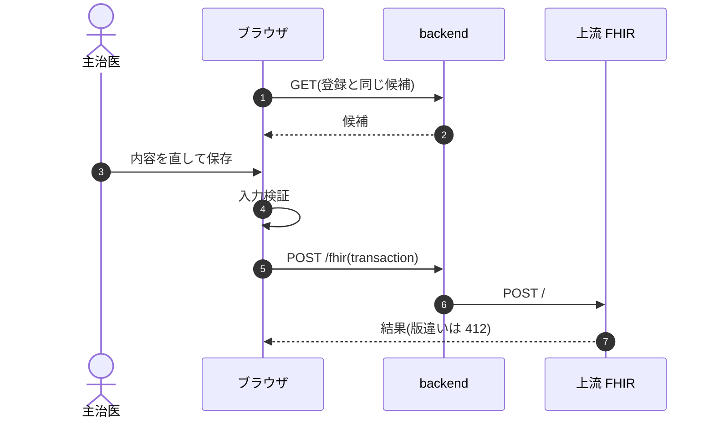

| transaction に書くもの | 条件 |
|---|---|
| PUT `ServiceRequest`(ヘッダ) | `ifMatch` は開いた時点の版 |
| ヘッダの `status` | 元が `revoked` なら `revoked` のまま(`keepOrderRevoked`) |
| POST `Provenance`(UPDATE) | 常に |

## 削除

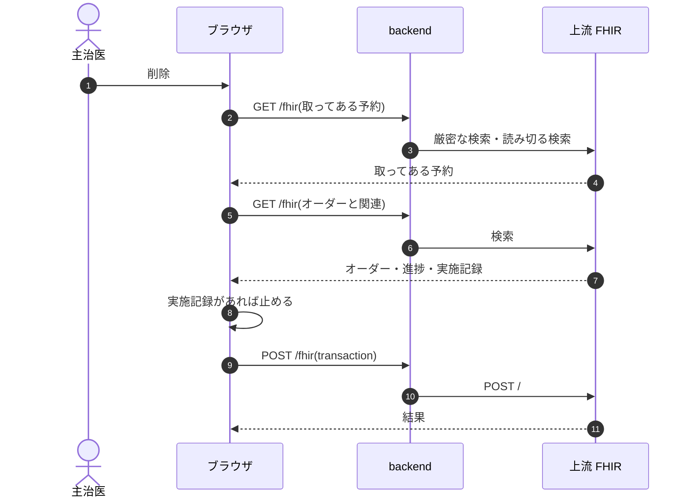

| 読むもの | 検索 |
|---|---|
| 取ってある予約 | `Appointment?based-on=オーダー&status=有効` |
| オーダー・進捗・実施記録 | `ServiceRequest?_id&_revinclude=Task:focus,Procedure:based-on,…` |

| transaction に書くもの | 条件 |
|---|---|
| PUT `Appointment` cancelled + `Slot` free | 取ってある予約ごと |
| DELETE `Task` | – |
| DELETE `ServiceRequest`(ヘッダ) | – |

## 透析一覧の読み込み

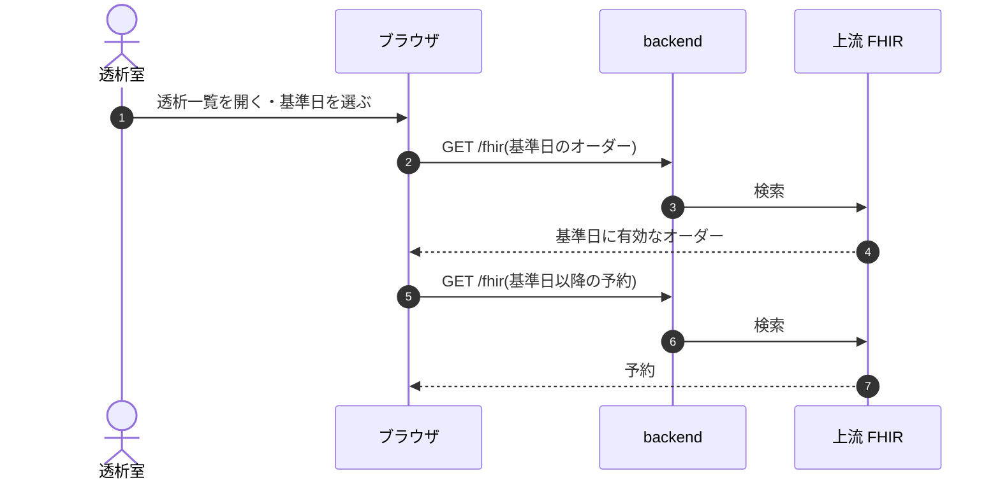

| 読むもの | 検索 |
|---|---|
| 基準日に有効なオーダー | `ServiceRequest?category=order-type|dialysis&status=active,revoked&order-period=ge基準日&order-period=le基準日&based-on:missing=true` |
| 患者と進捗 | 上の検索に `_include` 患者、`_revinclude` `Task:focus` |
| 予約 | `Appointment?date=ge基準日&service-type=…|dialysis&status=有効&_sort=date` |

- `fetchWorklistBundles` で 500 件ずつ読みます。一覧か予約が上限で欠けたら `truncated` を出します。
- 予約は、一覧の「次回予約」「予約(件数と最終日)」の列になります。
- ホームのカードも同じ読み込みで、当日で読みます。

## 状態の変更

受付・受付取消・再開・中止取消・終了取消は、予約を読まずに transaction を送ります。終了・中断・中止は、先に取り消す予約を読みます。

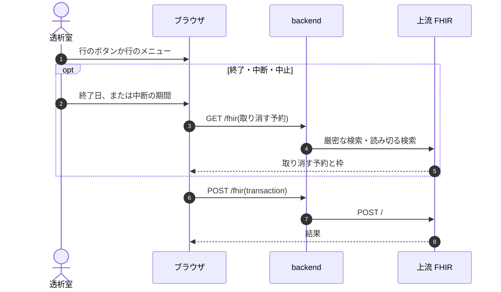

| 操作 | 取り消す予約の検索(`Appointment?based-on=オーダー&status=有効` に足す条件) |
|---|---|
| 終了 | `date=ge終了日の翌日` |
| 中断 | `date=ge開始日&date=lt再開予定日の翌日` |
| 中止 | `date=ge今日` |

| 操作 | transaction に書くもの |
|---|---|
| 受付・受付取消・再開・終了取消 | `Task` を新しい状態に(無ければ POST)。`statusReason` は消す |
| 中止 | `Task` を新しい状態に、PUT ヘッダ `status=revoked`、予約の取消 |
| 中止取消 | `Task` を新しい状態に、PUT ヘッダ `status=active`(`ifMatch`) |
| 終了 | PUT `Task` completed(`executionPeriod.end`)、PUT ヘッダ `dialysis-order-end` = 終了日(`ifMatch`)、予約の取消 |
| 中断 | PUT `Task` on-hold(`statusReason.text` = 「中断 from〜to」)、予約の取消。ヘッダは触らない |

- 予約の取消は、予約ごとに PUT `Appointment` cancelled + `Slot` free です。
- 中断では、中断開始日と再開予定日を入れます。

## 予約の展開

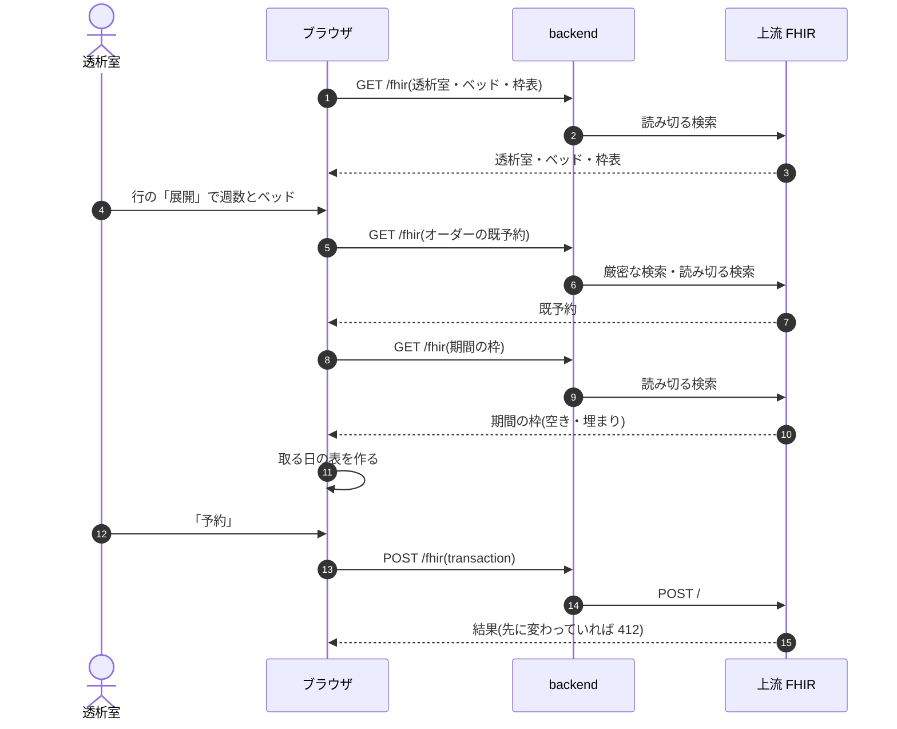

| 読むもの | 検索 |
|---|---|
| 透析室・ベッド | `Location?type=…|dialysis-unit` |
| 枠表 | `Schedule?service-type=…|dialysis` |
| オーダーの既予約 | `Appointment?based-on=オーダー&status=有効,fulfilled&_sort=date` |
| 期間の枠 | `Slot?schedule=a,b,c&start=ge…&start=lt…`(カンマ OR) |

| transaction に書くもの | 条件 |
|---|---|
| POST `Appointment`(`basedOn`、患者 + ベッド、`slot`、`dialysis-shift`) | 件数ぶん |
| PUT `Slot` busy | 件数ぶん。読んだ版の `ifMatch` |

- 既予約は、開始日・除外する日・前回のベッドの初期値に使います。
- 取る日の表は、曜日 × シフトから日を起こし、枠あり / 枠なし / 既に予約あり を出します(`planDialysisExpansion`)。上限は 40 件です。
- 412 のときは枠の空きを読み直します。
- 予約の transaction は、オーダーの登録とは独立した単独の transaction です。下の予約の図も同じです。

## 臨時・空き枠からの予約

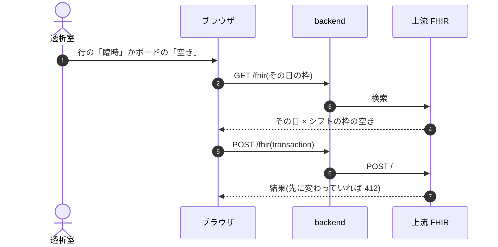

| 読むもの | 検索 |
|---|---|
| その日の枠 | `Slot?schedule=…&start=ge当日&start=lt翌日` |

| transaction に書くもの | 条件 |
|---|---|
| POST `Appointment` + PUT `Slot` busy | 1 件 |

- 「臨時」では日付・シフト・ベッドを、ボードの「空き」では患者を選びます。
- 透析室・ベッド・枠表は、展開の図と同じ検索で先に読んであります。

## 予約変更・入れ替え・取消

どれも、カードの予約を 1 回の transaction で書き換えます。

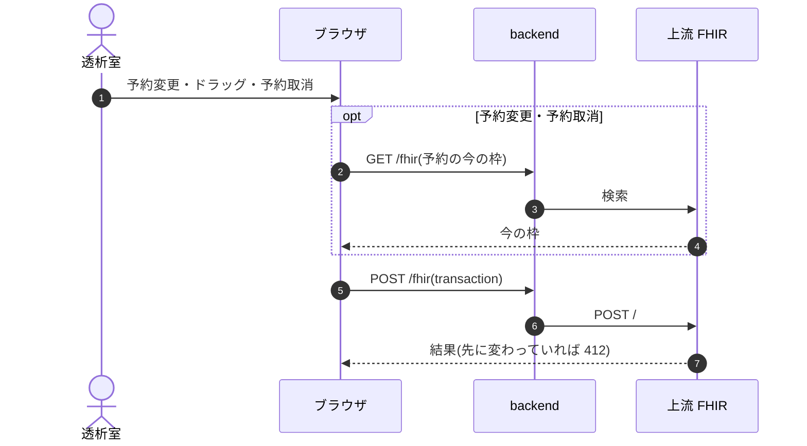

| 操作 | 画面の操作 | transaction に書くもの |
|---|---|---|
| 予約変更 | カードのメニューの「予約変更」、カードを空き枠へ落とす | PUT `Appointment`、前の `Slot` free、新しい `Slot` busy |
| 入れ替え | カードを同じ日 × シフトの別のカードへ落とす | 2 件の `Appointment` の PUT(`ifMatch`)。`Slot` は busy のまま |
| 予約取消 | カードのメニューの「予約取消」 | PUT `Appointment` cancelled、`Slot` free |

- 予約変更の PUT は、日時・`slot`・ベッドの `participant`・`description`・`dialysis-shift` を書き換えます。
- 入れ替えは、2 件の `Appointment` の `slot`・ベッド・時刻・名前を交換します。
- 予約取消ができるのは、実施記録の無い予約だけです。
- 今の枠は、`Appointment` が押さえている `Slot` を検索して読みます。
- 412 のときは枠の空きを読み直します。

## ボードの読み込み

ボードは予約(`useDialysisBoard`)・枠(`useDialysisSlots`)・回(`useDialysisSessions`)を別々に読んで束ねます。図は回の読み込みです。

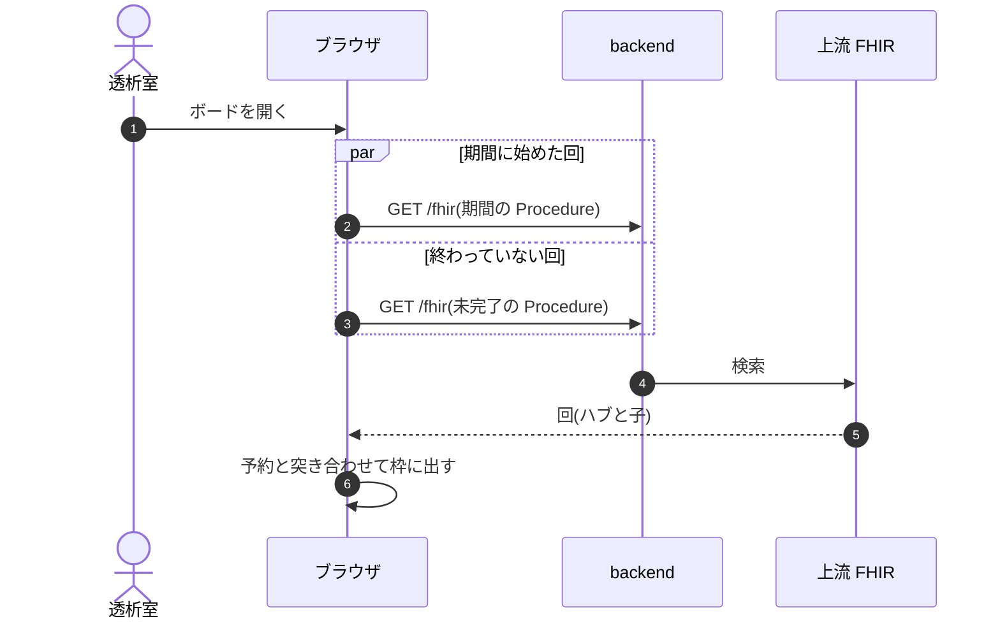

| 読むもの | 検索 |
|---|---|
| 期間に始めた回 | `Procedure?category=order-type|dialysis&date=ge…&date=lt…` |
| 終わっていない回 | `Procedure?category=…|dialysis&status=preparation,in-progress` |
| 子(どちらの検索にも付ける) | `_revinclude=Observation:part-of,MedicationAdministration:part-of,Procedure:part-of` |

## 入室

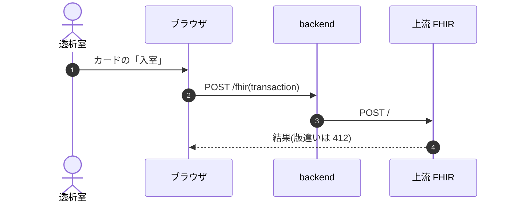

| transaction に書くもの | 条件 |
|---|---|
| POST `Procedure` preparation(`dialysis-appointment`) | – |
| PUT `Appointment` arrived | `ifMatch` |

## 開始

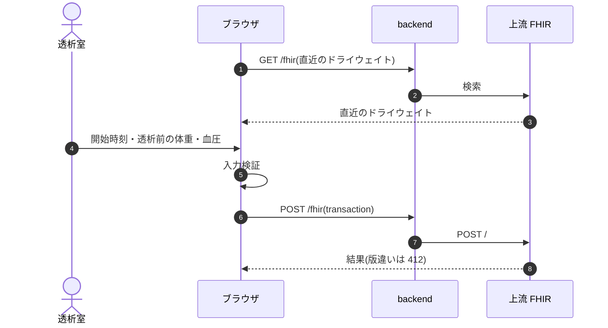

| 読むもの | 検索 |
|---|---|
| 直近のドライウェイト | `Observation?code=…|dry-weight&_sort=-date&_count=1` |

| transaction に書くもの | 条件 |
|---|---|
| PUT ハブ in-progress + `performedPeriod.start` | ハブが無ければ POST |
| POST `Observation`(体重・血圧) | – |
| `Appointment` arrived | – |

- 入力検証は `validateDialysisPerformForm`(start)です。

## 回の終了・一括記録

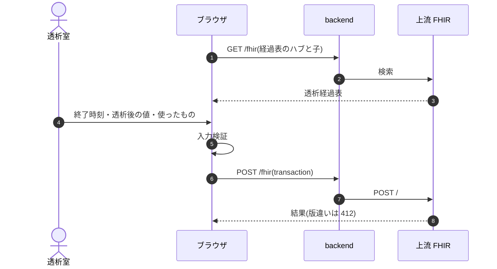

| 読むもの | 検索 |
|---|---|
| 透析経過表 | `Procedure?part-of=ハブ&category=…|dialysis-chart` と、その子 |

| transaction に書くもの | 条件 |
|---|---|
| PUT ハブ completed + `performedPeriod` + `usedCode` | ハブが無ければ POST |
| POST `Observation`・`MedicationAdministration`・子の `Procedure` | – |
| POST `Observation` dry-weight | ドライウェイトを変えたとき |
| PUT 経過表のハブ completed | 経過表のハブがあるとき |
| PUT `Appointment` fulfilled | – |

- 透析経過表は、透析後血圧・累積除水・薬剤の初期値に使います。
- 画面で入れるのは、終了時刻・透析後の値・薬剤・器材・手技・ドライウェイトです。
- 入力検証は `validateDialysisPerformForm`(finish)です。

## 実施取消

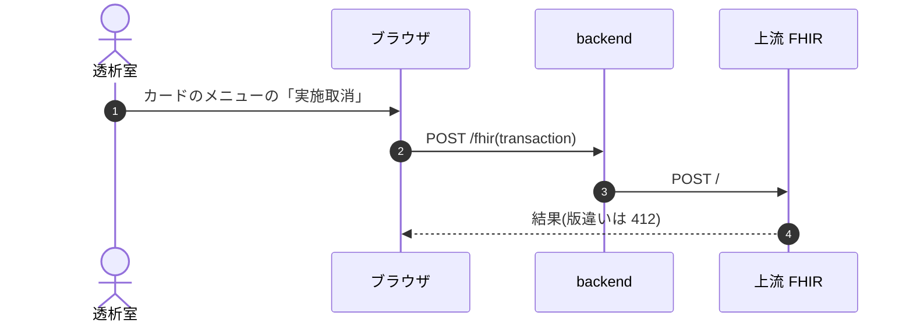

| transaction に書くもの(この順) |
|---|
| DELETE 経過表の子と経過表のハブ |
| DELETE 薬剤・測定値・子の手技 |
| DELETE ハブ |
| PUT `Appointment` booked |

## 透析経過表

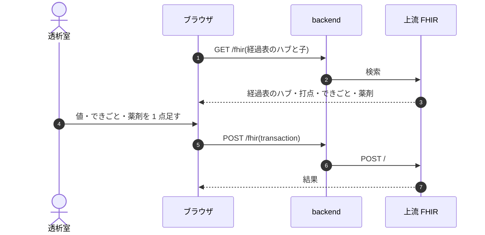

| 読むもの | 検索 |
|---|---|
| 経過表のハブと子 | `Procedure?part-of=実施のハブ&category=…|dialysis-chart&_revinclude=Observation:part-of,MedicationAdministration:part-of` |

| transaction に書くもの | 条件 |
|---|---|
| POST 経過表のハブ in-progress(`partOf` = 実施のハブ) | 初回だけ。urn:uuid で結ぶ |
| POST `Observation` / `MedicationAdministration`(`partOf` = 経過表のハブ) | 足した 1 点 |
| PUT `MedicationAdministration`(終了時刻) | 持続の薬剤の「終了」 |

- 書き込みは `useDialysisChartWrite` で、1 点ずつです。足すのは血圧・装置の値・できごと・薬剤です。
- 持続の薬剤の終了時刻の初期値は、終わった回では回の終了です。

## 患者メモ

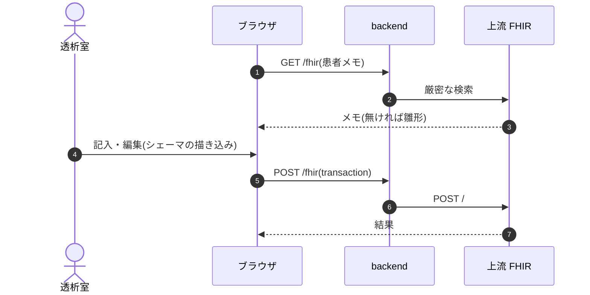

| 読むもの | 検索 |
|---|---|
| 患者メモ | `QuestionnaireResponse?patient=…&_tag=…|dialysis-memo&_sort=-authored&_count=1&_include=questionnaire` |

| transaction に書くもの | 条件 |
|---|---|
| POST `QuestionnaireResponse`(`meta.tag` = dialysis-memo、`encounter` 無し) | 初回 |
| PUT `QuestionnaireResponse` | 以後。`ifMatch`。版の履歴は `_history` |

- 厳密な検索にするのは、`_tag` が効かないと別の回答を出すためです。
- メモが無いときは、雛形 HD_MEMO_01 の有効な版を出します。

## 患者一覧・月間統計の読み込み

どちらも読むだけです。

| 画面 | 読むもの | 検索 | 補足 |
|---|---|---|---|
| 患者一覧 | ドライウェイトの推移 | `Observation?code=…|dry-weight&subject=Patient/a,b,…&date=lt翌日&_sort=-date` | 50 人ずつ |
| 患者一覧 | 採血 | `Observation?code=結果項目コード,…&subject=…&date=ge90日前&date=lt翌日&_sort=-date` | 20 人ずつ |
| 患者一覧 | 直近と前回の透析 | 基準日までの 3 週間の回の `Procedure`。ボードと同じ | – |
| 月間統計 | 実施 | `Procedure?category=…|dialysis&date=ge月初&date=lt翌月初&_include=Procedure:based-on` | 読み切る検索 |
| 月間統計 | 予約 | `Appointment?service-type=…|dialysis&date=…` | 読み切る検索 |
| 月間統計 | 枠 | `Slot?schedule=…&start=…` | 読み切る検索 |

- 患者一覧は、結果が欠けたら `TruncatedNotice` を出します。
- 月間統計は 1 か月 5,000 件までで、実施・予約・枠から回数・稼働率・日別(CSV)を出します。

## 退院での打ち切り

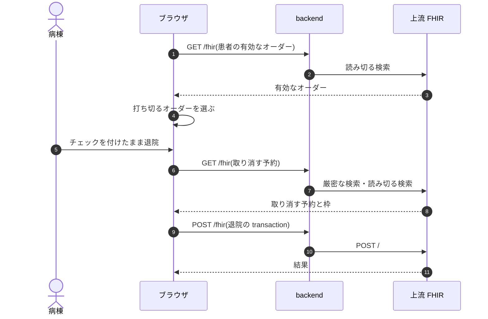

| 読むもの | 検索 |
|---|---|
| 患者の有効なオーダー | `ServiceRequest?subject=患者&category=order-type|dialysis&status=active` |
| 取り消す予約 | `Appointment?based-on=オーダー&date=ge退院日の翌日&status=有効`(選んだオーダーごと) |

| 退院の transaction に書くもの | 条件 |
|---|---|
| PUT ヘッダ `dialysis-order-end` = 退院日 | 選んだオーダーごと。`Task` は動かさない |
| PUT `Appointment` cancelled + `Slot` free | 予約ごと |

- 打ち切るオーダーは `dialysisOrderNeedsStop` が選びます。入外区分が入院で、退院日より後まで続くものです。
- 有効なオーダーの検索は全件を読み(`usePatientDialysisOrders`)、欠けた結果は使いません。
- チェックは「入院の透析オーダーを退院日で終了する」です。
- 退院の transaction には、`Encounter`・ベッドの更新、食事・リハビリの打ち切りも一緒に入ります。

## 医事会計と SS-MIX2

透析のオーダー・予約・実施は、SS-MIX2 のメッセージになりません(`OMG^O19` の対象外です)。

医事会計は実施記録から集めます(`BillingClaimBuilder` の `:procedure` 経路、`Resolvers::Dialysis`)。完了したハブ 1 件 = 1 剤で、日レセの診療種別区分は 400 です。
期間継続型(`continuous`)なので、実施記録の無い日のヘッダは報告しません。

| 起きたこと | 医事会計(`BillingClaimBuilder`) |
|---|---|
| オーダーの登録・編集・削除 | なし |
| 受付・オーダーの終了・中断・中止・退院での打ち切り | なし |
| 予約の展開・臨時・変更・入れ替え・取消 | なし |
| 入室・開始 | なし。完了していないハブは集めない |
| 回の終了・一括記録 | 回を始めた日(`performedPeriod.start` の日)に送る |
| 実施取消 | 対象から外れる(DELETE) |
| 透析経過表・患者メモ・ドライウェイト | なし |

- 回の終了・一括記録で、時刻・コードが無いときは「送れない項目」に出します。

**手技**

- 維持透析(hd / hdf / i-hdf)は、`performedPeriod` の分数で 4 時間未満 / 4〜5 時間 / 5 時間以上に分けます。施設設定 `receipt_codes.dialysis` の浄化方法 × 時間区分のコードを引きます。
- 急性血液浄化(chdf / chd / pe / dfpp / dhp)は、浄化方法ごとに 1 つのコードです。
- 追加の手技(子の `Procedure`)は、そのコードのまま並べます。resolver を持つ種別では `PerformedItemBuilder` が子の手技を拾わないので、`Resolvers::Dialysis` が自分で並べます。

**薬剤**

- `dialysis-bundled-medication` の付いた薬剤は送りません。それ以外は、処置と同じく医薬品コードと使用量で送ります。
- 透析経過表の薬剤は送りません。送るのは、回の終了の入力で実施記録の行にしたものだけです。

**器材**

- 血液浄化器は、施設マスタ(`master_blood_purifiers`)の製品に紐付けた特定器材コード(`receipt_material_code`)に読み替えます。放射線の器材マスタと同じ解決です(`PerformedItemBuilder::LOCAL_MATERIALS`)。
- 紐付けの無い製品・手入力の製品は「送れない項目」に出します。

**送れない項目に出すもの**(理由つき)

- 開始・終了の時刻が無い維持透析
- 施設設定にコードが無い浄化方法 × 時間区分
- 診療行為コードの無い追加の手技

**送らないもの**

- 慢性維持透析患者外来医学管理料・導入期加算・障害者等加算・時間外加算は送りません。患者属性や月次の判定が要るため、医事側で付けます。
