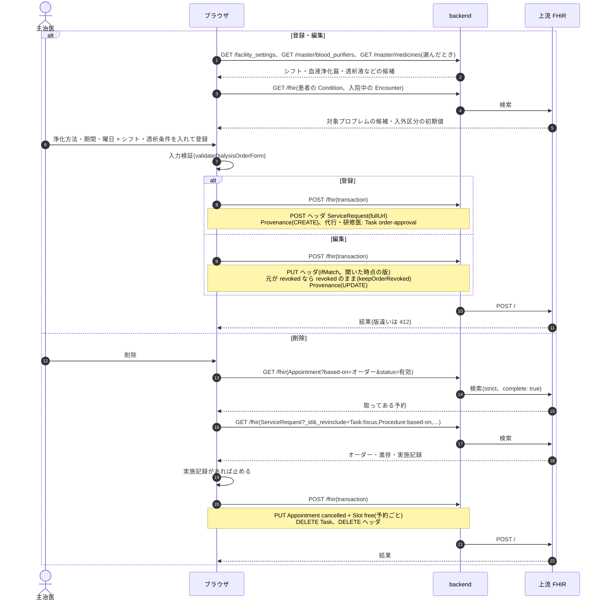
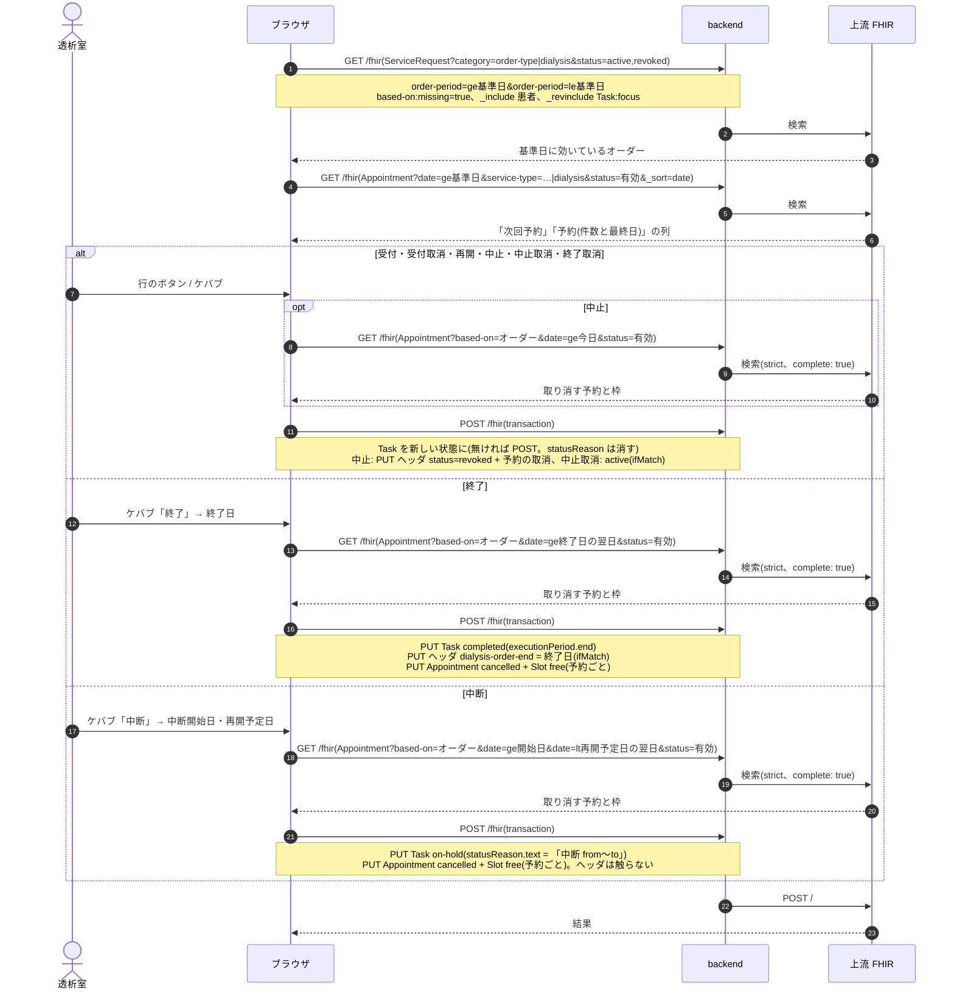
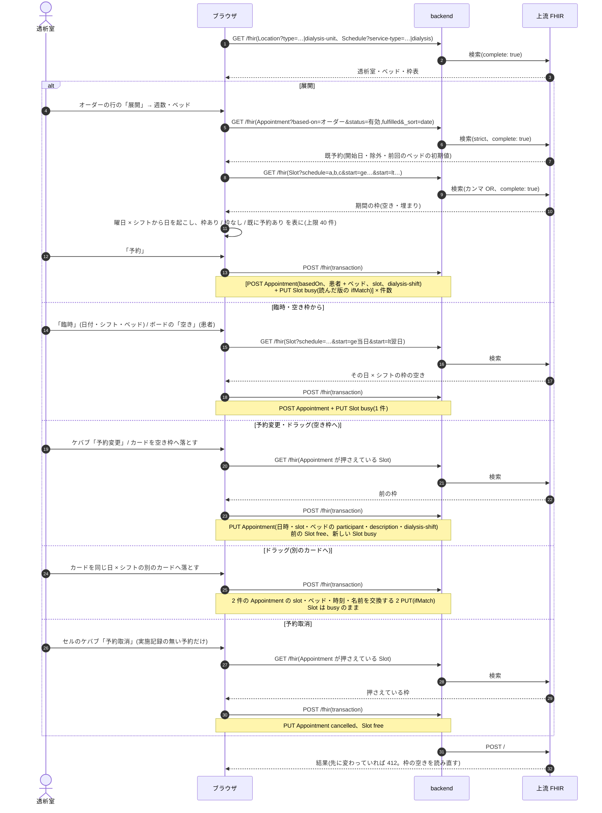
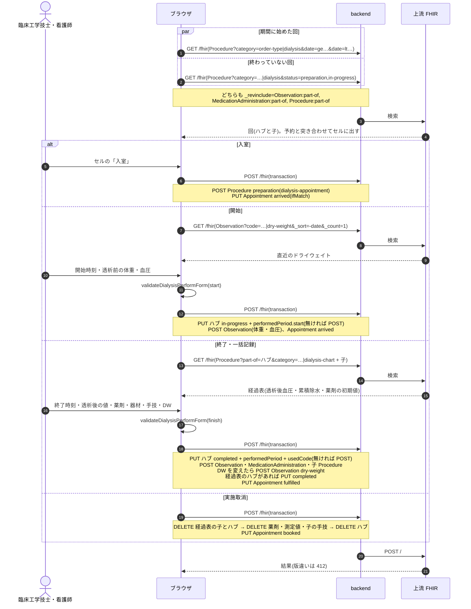
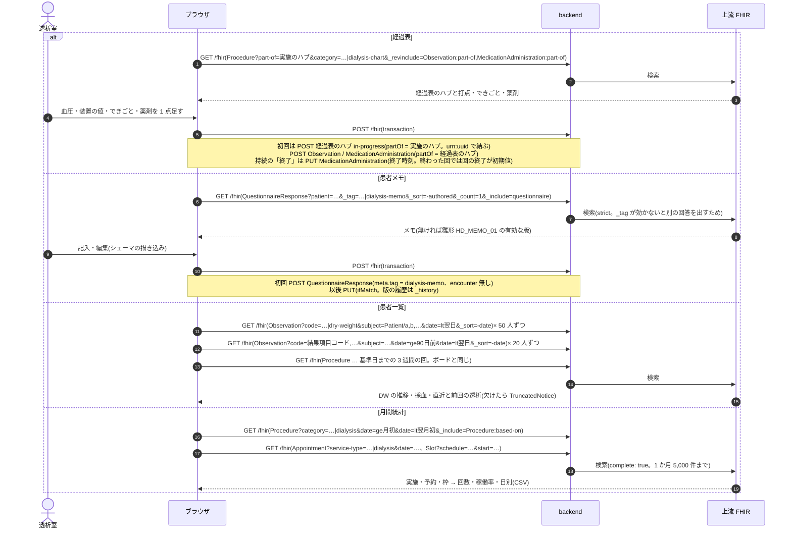
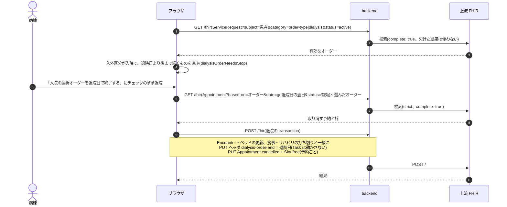

# 透析オーダーのシーケンス図

<!-- ../fhir-client/docs/order-flows/dialysis.md から scripts/sync-flows.mjs で作る。直接編集しない。 -->

運用の流れは[透析オーダーの業務フロー](../flows/dialysis.md)にあります。

## リソースの構成

| もの | リソース | 要点 |
|---|---|---|
| オーダー | `ServiceRequest` | `category` = `order-type|dialysis` + `prescription-setting`、`code` = 浄化方法(`dialysis-modality`)、`occurrenceDateTime` = 開始日(日付のみ)、`reasonReference` = 対象プロブレム、拡張 `dialysis-order-end`(終了日。無ければ継続中)/ `dialysis-bedside` / `dialysis-schedule-pattern`(曜日 × シフト。シフトは `dialysis-shift` の coding)/ `dialysis-prescription`(透析条件)。明細は持たない |
| 進捗 | `Task`(`task-code|dialysis`、`focus` = オーダー) | **登録時には作らず**、Task が無いオーダーは依頼済。部門の受け入れ状態で、実施では動かさない |
| 透析室・ベッド | `Location`(`type` = `location-type|dialysis-unit`) | 透析室は `physicalType` = `ro`、ベッドは `bd` + `partOf` = 透析室。無効は `status` = `inactive`。病床ではないので入院の `Encounter.location` にはしない |
| 枠 | `Schedule` + `Slot` | 枠表は `serviceType` = `schedule-service-type|dialysis`、`actor` = ベッドの `Location`(無効なベッドは `active` = false)。1 日 × シフト × ベッドで 1 枠(定員 1) |
| 予約 | `Appointment`(`basedOn` = オーダー) | `participant` = 患者 + ベッドの `Location`、`slot`、`serviceType` = dialysis、拡張 `dialysis-shift`。シフトは枠の開始時刻から引き、拡張は枠が読めないときの代わり |
| 1 回の実施 | `Procedure` ハブ(`basedOn` = オーダー) | `category` = `order-type|dialysis`、`code` = 浄化方法、`status` = `preparation`(入室)/ `in-progress`(開始)/ `completed`(終了)、`performedPeriod` = 開始〜終了、`usedCode` = 血液浄化器(`blood-purifier`)と器材(`medical-material`)+ `dialysis-material-quantity`、拡張 `dialysis-appointment` = 予約 |
| 測定値 | `Observation`(`partOf` = ハブ) | `dialysis-measurement` の `pre-weight` / `post-weight`(kg)・`ultrafiltration`(L)・`actual-minutes`(min)・`qb` / `qd`(mL/min)、`category` = `order-type|dialysis` |
| 血圧 | `Observation`(`partOf` = ハブ) | LOINC 85354-9 + component、`category` = `vital-signs` + `order-type|dialysis`、拡張 `dialysis-measurement-timing` = `pre` / `post` |
| 薬剤 | `MedicationAdministration`(`partOf` = ハブ) | ロットは `medication-lot-number`、算定しない薬剤は `dialysis-bundled-medication` = true |
| 追加の手技 | `Procedure`(`partOf` = ハブ、`basedOn` = オーダー) | `code` = `dialysis-procedure-code`(レセ電算の診療行為コード) |
| ドライウェイト | `Observation`(`partOf` 無し) | `dialysis-measurement|dry-weight`(kg)。患者単位の状態値で、直近 1 件を読む |
| 患者メモ | `QuestionnaireResponse`(`encounter` 無し) | テンプレート `Questionnaire/dialysis-memo-01` の回答を患者 1 人に 1 件。`meta.tag` = `questionnaire-response-purpose|dialysis-memo` で引き(`_tag`、strict)、カルテの時系列からは `_tag:not` で外す |
| 透析経過表 | `Procedure` ハブ(`partOf` = 実施のハブ、`basedOn` 無し) | `category` = `order-type|dialysis-chart`、`status` = `in-progress` / `completed`(回の終了で閉じる)。打点は `Observation`(`partOf` = 経過表のハブ、`category` = `order-type|dialysis-chart`。血圧・脈拍・SpO2・体温は LOINC、装置の値は `dialysis-measurement`)、できごとは `dialysis-event` の `Observation`、透析中の薬剤は `MedicationAdministration`(`partOf` = 経過表のハブ、同じ `category`。会計には乗らない) |
| 代行入力 | `Provenance`(`target` = オーダー) | 種別共通 |

- 期間を `occurrencePeriod` にせず開始日 + 拡張にするのは、上流が `occurrenceDateTime` を索引するため(リハビリ・食事と同じ判断)。上流は `order-period` で開始日と `dialysis-order-end` を合わせて索引しています。
- 入室のハブは `performed[x]` を持たないので日付で引けません。ボードは「期間に始めた回」と「`status=preparation,in-progress` の回」を別々に引いて束ねます(`fetchDialysisSessions`)。
- 予約と回の突き合わせはハブの `dialysis-appointment` を優先し、無ければ同じオーダー × 同じ日です(`dialysisSessionForAppointment`)。
- 実施取消は経過表 → 子 → ハブの順に DELETE し(entered-in-error で残さない)、予約を `booked` に戻します。ドライウェイトは消しません。
- 経過表のハブは `basedOn` を持たないので、カルテの詳細(`based-on` + `_revinclude:iterate`)に打点が乗りません。読むときは `Procedure?part-of=実施のハブ` で引きます。
- 透析室とベッドにローカルの `location-type|dialysis-unit` を与えるのは、病棟(`type=HU` 起点)・診察室(`LOCATION_TYPE_OPTIONS`)・病床の集計のどれにも混ざらないようにするためです。`LOCATION_TYPE_OPTIONS` には足しません。

## 進捗 Task と status

**実施しても Task を動かしません。** リハビリと同じ逸脱で、他部門と同じ「実施記録 + Task を completed に」にすると初日の実施で終了扱いになります(`fhir/dialysisTaskHelpers.ts`・`dialysisResultHelpers.ts` の冒頭コメント)。

| Task | 表示 | `ServiceRequest.status` | ヘッダに書くもの | 予約 |
|---|---|---|---|---|
| (無し)/ `requested` | 依頼済 | `active` | – | – |
| `accepted` | 実施中 | `active` | – | – |
| `on-hold` | 中断 | `active` のまま | – (`Task.statusReason.text` = 「中断 2026-11-12〜2026-11-20」) | 中断の期間の有効な予約を cancelled に |
| `completed` | 終了 | `active` のまま | `dialysis-order-end`(終了日) | 終了日の翌日以降を cancelled に |
| `cancelled` | 中止 | `revoked` | – | 今日以降を cancelled に |

- 遷移の表は `dialysisTaskActions`、書き込みの入口は `useUpdateDialysisTaskStatus`(`api/queries/dialysis.ts`)です。中止・中止取消は `orderCancelEntries` でヘッダの status を揃えます。
- 終了で `dialysis-order-end` を書くのは、部門一覧・患者帯が `order-period` で引くので、終了日が無いと status=active のまま基準日に永久にヒットし続けるためです(`buildDialysisOrderCloseEntry`)。終了取消では消しません(意図した非対称)。
- 中断の期間は `Task.statusReason.text` に決まった書式で残し、`dialysisTaskHold` が読み戻して一覧のステータスの下に出します。再開(`accepted`)で消します。
- 終了・中断・中止・退院は、もう来ない日の有効な予約の取消(`PUT Appointment cancelled` + `PUT Slot free`)を同じ transaction に積みます(`fetchOrderAppointmentCancelEntries` の `from` / `to`)。取り消す対象の検索は strict で全ページを読み(条件が効かずに全件を拾うと、関係ない予約まで取り消すため)、欠けたら書き込みを止めます。
- `executionPeriod` は受付で `start`、終了で `end` が入ります(`createTaskHelpers` の `buildTaskUpdate`)。
- カルテのタイムラインは、`accepted` / `on-hold` / `completed` で実施情報を出します(`karteTimeline.ts` の dialysis 分岐)。

## シーケンス図の前提

`/fhir` への書き込みはどれも 1 回の transaction Bundle で、backend の `FhirProxyController` が上流へ中継します。
SS-MIX2 を有効にしている施設では、中継が書き込みの控えを記録します(`Ssmix2::Recorder`。透析はメッセージになりません)。
楽観ロックの版は `postBundle` が `ifMatch` に添え、版が違えば 412 で止まります。編集フォームは `useEditSnapshot` で開いた時点の版に固定します(`hooks/useDialysisOrderInitialValues.ts`)。
予約の展開・変更・入れ替えは、検索で読んだ `Slot` / `Appointment` をそのまま PUT するので、別の端末が先に動かしていれば 412 で全体が落ちます。部分成功は作りません。

| 部品 | 場所 |
|---|---|
| オーダー | `components/DialysisOrderForm.tsx`・`DialysisOrderPanels.tsx`、詳細 `DialysisOrderDetailPanel.tsx`、カード `karteCardBodies/DialysisOrderCardBody.tsx` |
| 組み立て | `fhir/dialysisOrderHelpers.ts`(オーダー・終了日・退院の打ち切り)・`dialysisTaskHelpers.ts`(進捗)・`dialysisShiftHelpers.ts`(シフト)・`dialysisAppointmentHelpers.ts`(予約・展開の計画・変更・入れ替え)・`dialysisUnitHelpers.ts`(透析室・ベッド・枠)・`dialysisResultHelpers.ts`(実施)・`dialysisChartHelpers.ts`(経過表。器は `timeSeriesChartHelpers.ts`)・`bloodPurifierHelpers.ts`(血液浄化器の行) |
| 部門の画面 | `pages/DialysisWorklistPage.tsx`(ボード・週・オーダー・患者・統計。終了・中断のモーダルもここ)、`components/DialysisBoard.tsx`、`pages/DialysisUnitPage.tsx`、経過表 `pages/DialysisChartPage.tsx`(`/dialysis-sessions/:sessionId/chart`)・`components/DialysisChartPanel.tsx`・`DialysisChartModal.tsx`・印刷 `pages/DialysisChartPrintPage.tsx`(`/dialysis-chart-print/:sessionId`)(器は `components/timeSeriesChart/`) |
| 患者一覧・統計 | `components/DialysisPatientTable.tsx`・`fhir/dialysisPatientListHelpers.ts`(`useDialysisPatientData`)、`components/DialysisMonthlyStats.tsx`・`fhir/dialysisStatsHelpers.ts`(`useDialysisMonth`) |
| 患者メモ | `components/DialysisMemo.tsx`(詳細の区画・ボードのモーダル)、`fhir/dialysisMemoHelpers.ts`、雛形 `docs/report-mappings/dialysis-memo-01.questionnaire.json` |
| モーダル | 実施 `components/DialysisPerformModal.tsx`、展開 `DialysisExpandModal.tsx`、臨時・変更 `DialysisBookModal.tsx`、空き枠から `DialysisCellBookModal.tsx` |
| マスタ・設定 | 血液浄化器 `pages/BloodPurifierPage.tsx`(`/blood-purifiers`、backend `master/blood_purifiers`)、施設設定 `dialysis_shifts` / `dialysis_lab_items` / `receipt_codes.dialysis`(`backend/app/models/facility_settings.rb`) |
| hook | `api/queries/dialysis.ts`(`useDialysisWorklist`・`useDialysisBoard`・`useDialysisSlots`・`useDialysisSessions`・`useDialysisPerform`・`useCancelDialysisPerform`・`useLatestDryWeight`・`usePatientDialysisOrders`・`useBookDialysisAppointments`・`useRescheduleDialysisAppointment`・`useSwapDialysisAppointments`・`useUpdateDialysisTaskStatus`・`useDialysisChart`・`useDialysisChartWrite`・`useDialysisMemo` ほか)、予約の取消は `api/queries/appointment.ts` |
| 退院 | `components/DischargeModal.tsx`、`api/queries/encounter.ts`(`buildDialysisOrderStopEntries` を退院の transaction に積む) |
| ホーム | `components/homeCards/HomeWorklistCard.tsx` の `DialysisCard`(`useDialysisWorklist` を当日で読む) |

## 登録・編集・削除

`buildDialysisOrderBundle` / `buildDialysisOrderUpdateBundle`、`useCreatePrescription`(`api/queries/labResult.ts`。全種別共通)、`useUpdateDialysisOrder`、`deleteDialysisOrderRequest` / `postOrderDeleteBundle`(`api/queries/orderDelete.ts`)。

## 透析一覧と進捗の変更

`useDialysisWorklist`(`fetchWorklistBundles` で 500 件ずつ)、`useUpdateDialysisTaskStatus`。一覧か予約が上限で欠けたら `truncated` を出します。ホームのカードも同じ読み込みです。

## 予約の展開・臨時・空き枠・変更・入れ替え・取消

`planDialysisExpansion` / `buildDialysisAppointmentBatchBundle`(`useBookDialysisAppointments`)、`buildDialysisAppointmentBundle`、`buildDialysisRescheduleBundle`(`useRescheduleDialysisAppointment`)、`buildDialysisSwapBundle`(`useSwapDialysisAppointments`)、取消は `useCancelAppointment`。オーダーの登録とは独立した単独の transaction です。

## 各回の実施

`buildDialysisArrivalBundle` / `buildDialysisStartBundle` / `buildDialysisFinishBundle`(`useDialysisPerform`)、`buildDialysisPerformDeleteBundle`(`useCancelDialysisPerform`)。ボードは予約(`useDialysisBoard`)・枠(`useDialysisSlots`)・回(`useDialysisSessions`)を別々に読んで束ねます。

## 経過表・患者メモ・患者一覧・統計

経過表の書き込みは `useDialysisChartWrite`(1 点ずつ)、患者メモは `QuestionnaireResponseCreatePanel` / 編集パネル(`tag` を渡す)、患者一覧は `useDialysisPatientData`、統計は `useDialysisMonth`。

## 退院での打ち切り

`usePatientDialysisOrders`(患者の有効なオーダーを全件読む)、`dialysisOrderNeedsStop`、`buildDialysisOrderStopEntries`(`api/queries/encounter.ts` の退院の transaction に積む)。

## 医事会計と SS-MIX2

透析は実施記録から集めます(`BillingClaimBuilder` の `:procedure` 経路、`Resolvers::Dialysis`)。完了したハブ 1 件 = 1 剤で、日レセの診療種別区分は 400 です。
期間継続型(`continuous`)なので、実施記録の無い日のヘッダは報告しません。

- 手技: 維持透析(hd / hdf / i-hdf)は `performedPeriod` の分数で 4 時間未満 / 4〜5 時間 / 5 時間以上に分け、施設設定 `receipt_codes.dialysis` の浄化方法 × 時間区分のコードを引きます。急性血液浄化(chdf / chd / pe / dfpp / dhp)は浄化方法ごとに 1 つのコードです。追加の手技(子の Procedure)はそのコードのまま並べます(resolver を持つ種別では `PerformedItemBuilder` が子の手技を拾わないので、`Resolvers::Dialysis` が自分で並べます)。
- 薬剤: `dialysis-bundled-medication` の付いた薬剤は送りません。それ以外は処置と同じく医薬品コードと使用量で送ります。経過表の薬剤は送りません(終了の入力で実施記録の行にしたものだけ)。
- 器材: 血液浄化器は施設マスタ(`master_blood_purifiers`)の製品に紐付けた特定器材コード(`receipt_material_code`)に読み替えます(放射線の器材マスタと同じ解決。`PerformedItemBuilder::LOCAL_MATERIALS`)。紐付けの無い製品・手入力の製品は「送れない項目」に出します。
- 開始・終了の時刻が無い維持透析、施設設定にコードが無い浄化方法 × 時間区分、診療行為コードの無い追加の手技は「送れない項目」に理由つきで出します。
- 送らないもの: 慢性維持透析患者外来医学管理料・導入期加算・障害者等加算・時間外加算(患者属性や月次の判定が要るため医事側で付けます)。

| 起きたこと | 医事会計(`BillingClaimBuilder`) | SS-MIX2 |
|---|---|---|
| 登録・編集・削除 | なし | なし(`OMG^O19` の対象外) |
| 受付・終了・中断・中止・退院での打ち切り | なし | なし |
| 予約の展開・臨時・変更・入れ替え・取消 | なし | なし |
| 入室・開始 | なし(完了していないハブは集めない) | なし |
| 終了・一括記録 | 開始日に送る。時刻・コードが無いときは「送れない項目」に出す | なし |
| 実施取消 | 対象から外れる(DELETE) | なし |
| 経過表・患者メモ・ドライウェイト | なし | なし |
