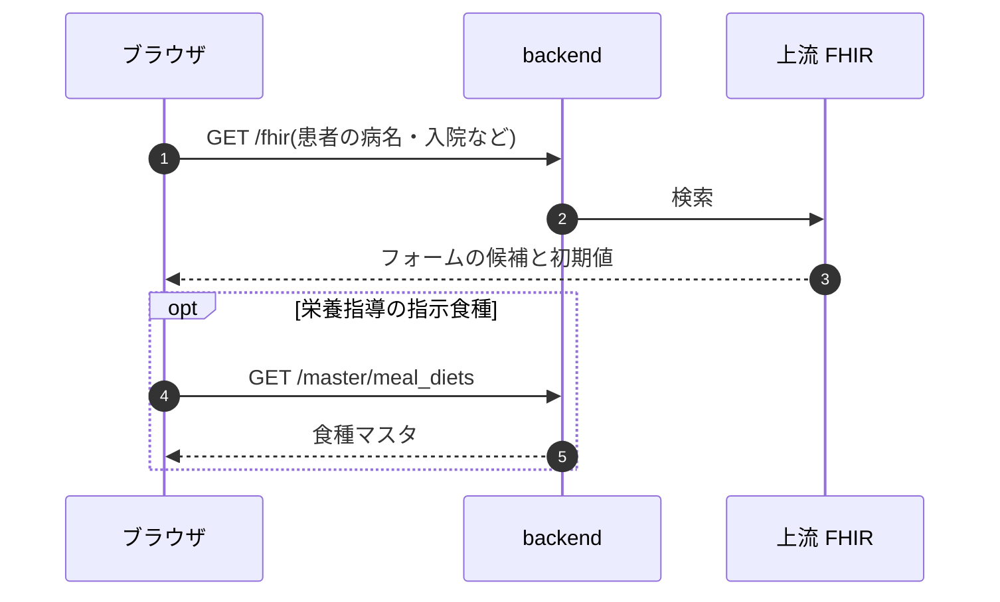
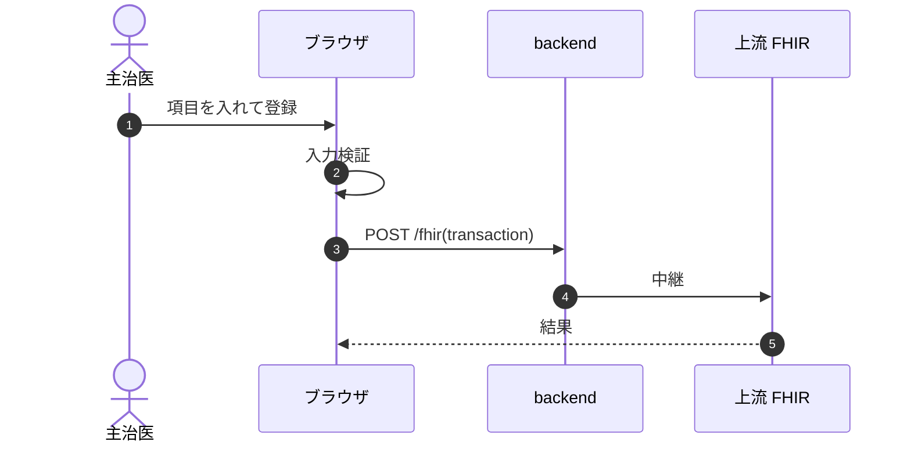
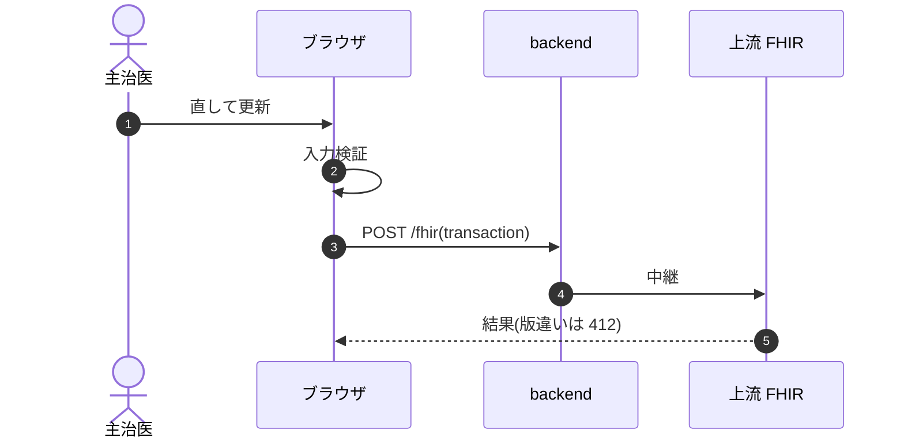
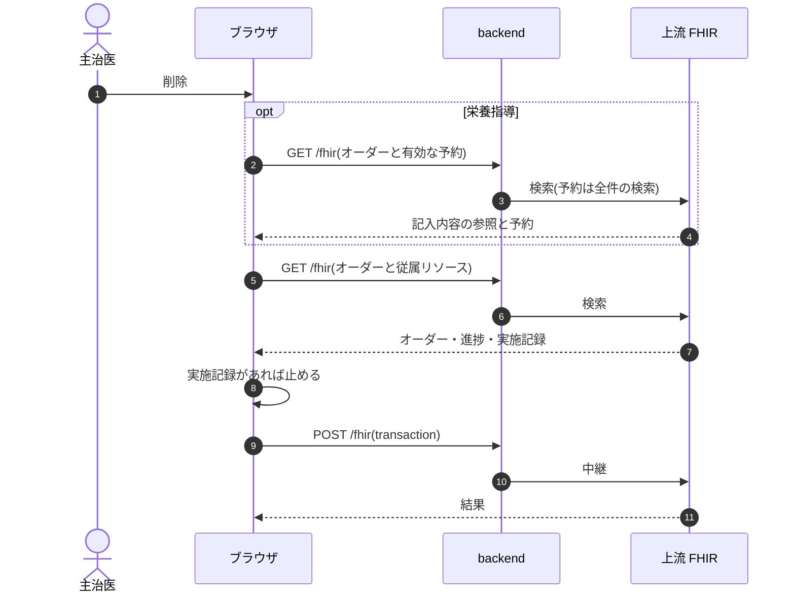
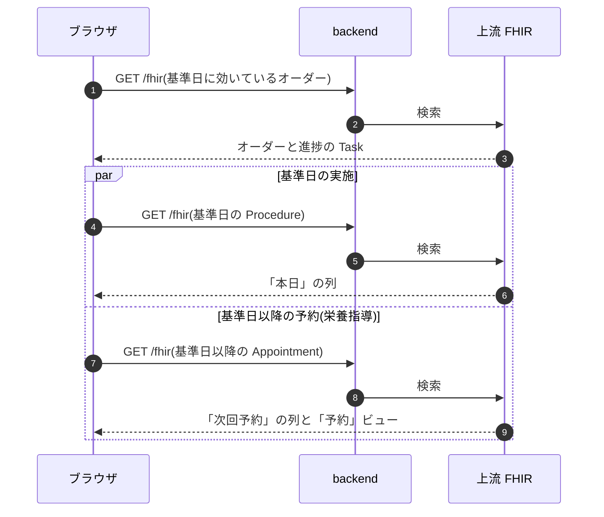
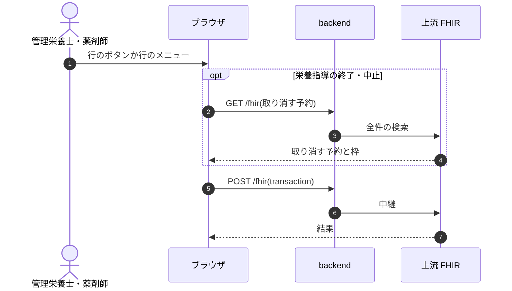
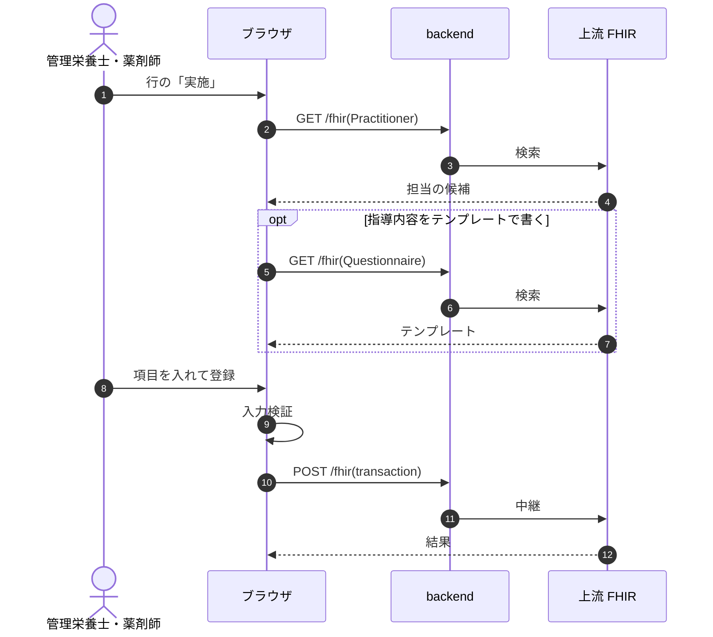
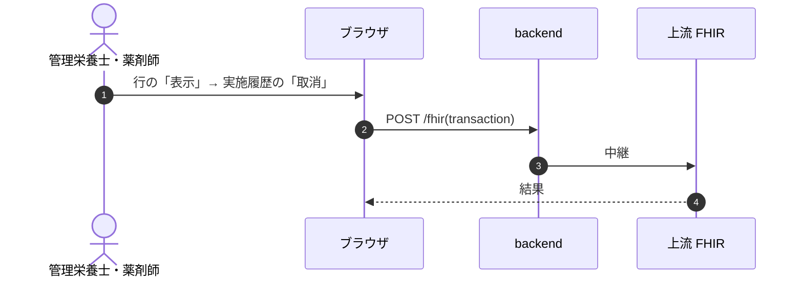
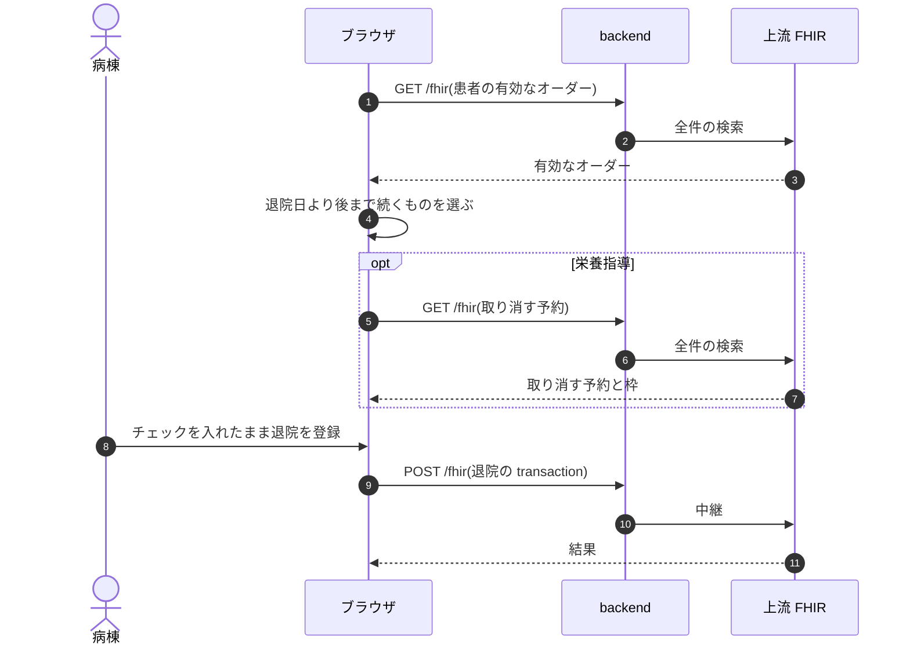

# 栄養指導・服薬指導のシーケンス図

<!-- ../fhir-client/docs/order-flows/guidance.md から scripts/sync-flows.mjs で作る。直接編集しない。 -->

運用の流れは[栄養指導・服薬指導の業務フロー](../flows/guidance.md)にあります。

## シーケンス図の前提

- **書き込みの経路**: `/fhir` への書き込みはどれも 1 回の transaction Bundle で、backend の `FhirProxyController` が上流へ中継します。
- **SS-MIX2**: 有効にしている施設では、中継が書き込みの控えを記録します(`Ssmix2::Recorder`)。栄養指導・服薬指導は、どちらも電文になりません。
- **楽観ロック**: 版は `postBundle` が `ifMatch` に添え、版が違えば 412 で止まります。編集フォームは `useEditSnapshot` で開いた時点の版に固定します(`hooks/useNutritionGuidanceOrderInitialValues.ts`、`hooks/useMedicationGuidanceOrderInitialValues.ts`)。
- **図の描き方**: 応答は backend を通って戻りますが、図では上流からブラウザへ直接描きます。検索の条件と transaction の中身は、図の下の表に出します。

このページで使う呼び名は次のとおりです。

| 呼び名 | 指すもの |
|---|---|
| 上流 | 上流の FHIR サーバー |
| ヘッダ | オーダー 1 件を表す `ServiceRequest`。明細は持たない |
| 全件の検索 | 全ページを読み切る検索(`complete: true`)。欠けた結果は使わず、書き込みを止める |
| 予約の取消 | 栄養指導の、もう来ない日の有効な予約を `cancelled` にし、枠を `free` に戻すこと |
| 記入内容 | テンプレートで書いた回答(`QuestionnaireResponse`) |

識別子は、栄養指導が `NutritionGuidance`、服薬指導が `MedicationGuidance` を名前に持ちます。2 つで同じ形のものは、栄養指導の名前を書き、服薬指導の名前を並べます。

## リソースの構成

ヘッダ(`ServiceRequest`)の要素は次のとおりです。

| 要素 | 栄養指導 | 服薬指導 |
|---|---|---|
| `category` | `order-type|nutrition-guidance` と 入外区分(v3 ActCode の `IMP` / `AMB`) | `order-type|medication-guidance` と 入外区分(v3 ActCode の `IMP` / `AMB`) |
| `code` | 指導形態(`nutrition-guidance-format`) | 指導区分(`medication-guidance-kind`) |
| `orderDetail[]` | 使わない | 指導条件(`medication-guidance-condition`) |
| `occurrenceDateTime` | 開始日 | 開始日 |
| `reasonCode` | 指導目的 | 指導してほしいこと |
| `note` | 栄養部門への指示 | 薬剤部への連絡事項 |
| `reasonReference` | 対象プロブレム | 対象プロブレム |

ヘッダの拡張は次のとおりです。

| 拡張 | 中身 |
|---|---|
| `nutrition-guidance-order-end` | 栄養指導の終了日 |
| `nutrition-guidance-target-disease` | 対象疾患名 |
| `nutrition-guidance-target-condition` | 対象疾患名を写した元の `Condition` |
| `nutrition-guidance-target-diet` | 指示食種。食種マスタの Coding で、system は食事と共通の `meal-type` |
| `nutrition-guidance-purpose-questionnaire-response` | 指導目的の記入内容への参照 |
| `medication-guidance-order-end` | 服薬指導の終了日 |
| `medication-guidance-target-drugs` | 対象薬剤 |

ヘッダのほかのリソースは次のとおりです。

| もの | リソース | 栄養指導 | 服薬指導 |
|---|---|---|---|
| 指導目的の記入内容 | `QuestionnaireResponse` | ヘッダの拡張から参照する | 無い |
| 進捗 | `Task`(`focus` = ヘッダ) | `task-code|nutrition-guidance` | `task-code|medication-guidance`。`owner` = 受け持ちの薬剤師 |
| 実施記録 | `Procedure`(`basedOn` = ヘッダ) | 下の表 | 下の表 |
| 予約 | `Appointment`(`basedOn` = ヘッダ)と `Slot` | 枠表は `Schedule` | 無い |
| 代行入力 | `Provenance`(`target` = ヘッダ) | 種別共通 | 種別共通 |

実施記録(`Procedure`)の要素は次のとおりです。

| 要素 | 栄養指導 | 服薬指導 |
|---|---|---|
| `category` | `order-type|nutrition-guidance` | `order-type|medication-guidance` |
| `code` | 指導種別(`nutrition-guidance-session-type`) | 指導種別(`medication-guidance-session-type`) |
| `code` の値 | initial / follow-up / group | standard / high-risk / discharge |
| `performer` | 担当管理栄養士 | 指導した薬剤師 |
| 拡張(実施時間・理解度) | `nutrition-guidance-performed-minutes`(分) | `medication-guidance-understanding`(good / partial / poor) |
| 拡張(指導記録の記入内容) | `nutrition-guidance-record` | `medication-guidance-record` |
| `note` | 指導内容 | 指導内容 |

- **指導目的の記入内容**: ヘッダと同じ transaction で書きます。テンプレートの解除・オーダーの削除で消します。
- **進捗の Task**: 登録時には作りません。Task が無いオーダーは依頼済です。服薬指導で受け持ちだけ先に付けると、依頼済のまま Task を作ります。
- **予約の枠表**: `Schedule` の `serviceType` は `schedule-service-type|nutrition-guidance` です。定員は 1 に潰しません。
- **期間の持ち方**: 期間を開始日と終了日の拡張で持つ理由と、上流の `order-period` 索引は、リハビリと同じです([リハビリオーダーのシーケンス図](rehab.md)「[リソースの構成](rehab.md#リソースの構成)」)。
- **分類の置き場所**: 指導形態・指導種別・指導区分・指導条件・理解度は、診療報酬上の固定の分類です。DB マスタを持たず、フロントの定数に置いています。

## 進捗 Task と status

**実施しても Task を動かしません。** ほかの種別は実施で Task を進めますが、この 2 種別はリハビリと同じく進めません。初回の指導で終了扱いにならないようにするためです。実施ボタンを他部門と同じ形に揃えるリファクタをしないでください(`fhir/nutritionGuidanceTaskHelpers.ts`・`medicationGuidanceTaskHelpers.ts` の冒頭コメント)。

| Task | 表示 | `ServiceRequest.status` | ヘッダに書くもの |
|---|---|---|---|
| (無し)/ `requested` | 依頼済 | `active` | – |
| `accepted` | 実施中 | `active` | – |
| `completed` | 終了 | `active` のまま | 終了日の拡張(`nutrition-guidance-order-end` / `medication-guidance-order-end`) |
| `cancelled` | 中止 | `revoked` | – |

- **遷移の表**: `nutritionGuidanceTaskActions` / `medicationGuidanceTaskActions` です。
- **書き込みの入口**: `useUpdateNutritionGuidanceTaskStatus` / `useUpdateMedicationGuidanceTaskStatus` です。中止・中止取消は、`orderCancelEntries` でヘッダの status を揃えます。
- **終了で終了日を書く理由**: 部門の一覧は `order-period` で引きます。終了日が無いと、基準日にいつまでもヒットし続けるためです(`buildNutritionGuidanceOrderCloseEntry` / `buildMedicationGuidanceOrderCloseEntry`)。
- **終了取消で終了日を消さない**: 意図した非対称です。
- **予約の取消**: 栄養指導の終了・中止・退院は、予約の取消を同じ transaction に積みます。予約は `fetchOrderAppointmentCancelEntries` の `from` 以降を、全件の検索で読みます。
- **受け持ちの薬剤師の変更**: `useAssignMedicationGuidancePharmacist` / `buildMedicationGuidanceAssignment` は、Task だけを書きます。状態の変更(`buildTaskUpdate`)は元の Task を引き継ぐので、受け持ちは残ります。
- **カルテのタイムライン**: `accepted` / `completed` のときに実施履歴を出します(`karteTimeline.ts`。リハビリと同じ)。

## 部品

| 部品 | 栄養指導 | 服薬指導 |
|---|---|---|
| オーダーのフォーム | `components/NutritionGuidanceOrderForm.tsx`・`NutritionGuidanceOrderPanels.tsx` | `components/MedicationGuidanceOrderForm.tsx`・`MedicationGuidanceOrderPanels.tsx` |
| オーダーの詳細 | `components/NutritionGuidanceOrderDetailPanel.tsx` | `components/MedicationGuidanceOrderDetailPanel.tsx` |
| カード | `components/karteCardBodies/NutritionGuidanceOrderCardBody.tsx` | `components/karteCardBodies/MedicationGuidanceOrderCardBody.tsx` |
| 組み立て(オーダー) | `fhir/nutritionGuidanceOrderHelpers.ts` | `fhir/medicationGuidanceOrderHelpers.ts` |
| 組み立て(進捗) | `fhir/nutritionGuidanceTaskHelpers.ts` | `fhir/medicationGuidanceTaskHelpers.ts` |
| 組み立て(実施) | `fhir/nutritionGuidanceResultHelpers.ts` | `fhir/medicationGuidanceResultHelpers.ts` |
| 組み立て(予約) | `fhir/appointmentHelpers.ts` の `buildNutritionGuidanceAppointmentBundle` | 無い |
| 部門の画面 | `pages/NutritionGuidanceWorklistPage.tsx`(依頼・予約の 2 ビュー、終了のモーダル) | `pages/MedicationGuidanceWorklistPage.tsx`(終了・担当のモーダル) |
| 実施入力 | `components/NutritionGuidancePerformModal.tsx` | `components/MedicationGuidancePerformModal.tsx` |
| 次回予約・日時変更 | `components/NutritionGuidanceBookModal.tsx` | 無い |
| hook | `api/queries/nutritionGuidance.ts` | `api/queries/medicationGuidance.ts` |
| 予約の取消・日時変更の hook | `api/queries/appointment.ts` | 無い |

- `NutritionGuidanceBookModal.tsx` は、`AppointmentSlotPicker` を `scheduleType="nutrition-guidance"` で使います。
- 退院は、2 種別とも `components/DischargeModal.tsx` と `api/queries/encounter.ts`(`buildNutritionGuidanceOrderStopEntries` / `buildMedicationGuidanceOrderStopEntries`)です。
- パスからの実施は、2 種別とも `components/PathwayOrderModal.tsx`(`acceptTask`)です。

## 登録・編集・削除

| 操作 | 組み立て | hook |
|---|---|---|
| 登録 | `buildNutritionGuidanceOrderBundle` / `buildMedicationGuidanceOrderBundle` | `useCreatePrescription` |
| 編集 | `buildNutritionGuidanceOrderUpdateBundle` / `buildMedicationGuidanceOrderUpdateBundle` | `useUpdateNutritionGuidanceOrder` / `useUpdateMedicationGuidanceOrder` |
| 削除 | `deleteNutritionGuidanceOrderRequest` / `deleteMedicationGuidanceOrderRequest` | `postOrderDeleteBundle`(`api/queries/orderDelete.ts`) |

`useCreatePrescription` は名前に反して全種別共通の hook で、`api/queries/labResult.ts` にあります。

フォームを開いたときの読み込みです。

| 読むもの | 得るもの |
|---|---|
| 患者の `Condition` | 病名・対象プロブレムの候補 |
| 入院中の `Encounter` | 入外区分の初期値 |
| 食事オーダー(栄養指導だけ) | いまの食種 |

登録です。

入力検証は `validateNutritionGuidanceOrderForm` / `validateMedicationGuidanceOrderForm` です。

| 書くもの | 条件 |
|---|---|
| POST `QuestionnaireResponse`(`urn:uuid`) | 栄養指導の指導目的をテンプレートで書いたとき |
| POST ヘッダ `ServiceRequest` | `fullUrl` を付ける |
| `Provenance`(CREATE) | 毎回 |
| `Task` `order-approval` | 代行入力・研修医のとき |

編集です。

| 書くもの | 条件 |
|---|---|
| 記入内容の PUT / POST | 栄養指導の指導目的をテンプレートで書いたとき |
| 記入内容の DELETE | 栄養指導で、テンプレートを解除したとき |
| PUT ヘッダ | `ifMatch` を添える(開いた時点の版)。元が `revoked` なら `revoked` のまま(`keepOrderRevoked`) |
| `Provenance`(UPDATE) | 毎回 |

削除です。

| 読む・書くもの | 条件 |
|---|---|
| 栄養指導の検索 | `ServiceRequest/id` と、`Appointment?based-on=オーダー&status=有効` |
| 従属リソースの検索 | `ServiceRequest?_id&_revinclude=Task:focus,Procedure:based-on,…` |
| PUT `Appointment` を `cancelled` に、`Slot` を `free` に | 栄養指導。予約ごと |
| DELETE `QuestionnaireResponse` | 栄養指導。指導目的の記入内容 |
| DELETE `Task`、DELETE ヘッダ | 実施記録が無いとき |

## 部門の一覧・進捗・担当

一覧の hook は `useNutritionGuidanceWorklist` / `useMedicationGuidanceWorklist` で、`fetchWorklistBundles` が 500 件ずつ読みます。一覧・実施・予約のどれかが上限で欠けたら、`truncated` を出します。

一覧の読み込みです。

| 読むもの | 条件 |
|---|---|
| オーダー | `ServiceRequest?category=order-type|種別&status=active,revoked` |
| | `order-period=ge基準日&order-period=le基準日`、`based-on:missing=true` |
| | `_include` 患者、`_revinclude` `Task:focus`。Task の `owner` が受け持ちの薬剤師 |
| 実施 | `Procedure?category=order-type|種別&date=基準日` |
| 予約 | `Appointment?date=ge基準日&service-type=…|nutrition-guidance&status=有効&_sort=date` |

状態の変更と、受け持ちの薬剤師の変更です。

| 操作 | 書くもの |
|---|---|
| 受付・受付取消・終了取消 | `Task` を新しい状態にする。無ければ POST |
| 中止取消 | `Task` を `requested` に、PUT ヘッダ `status=active`(`ifMatch`) |
| 中止 | PUT `Task` `cancelled`、PUT ヘッダ `status=revoked`(`ifMatch`)。栄養指導は予約の取消 |
| 終了 | PUT `Task` `completed`(`executionPeriod.end`)、PUT ヘッダの終了日の拡張 = 終了日(`ifMatch`)。栄養指導は予約の取消 |
| 担当(服薬指導) | `Task` の `owner` を書き換える。無ければ `requested` で POST |

| 予約の取消で読む予約 | 条件 |
|---|---|
| 中止 | `Appointment?based-on=オーダー&date=ge今日&status=有効` |
| 終了 | `Appointment?based-on=オーダー&date=ge終了日の翌日&status=有効` |

予約の取消は、予約ごとに PUT `Appointment` `cancelled` と `Slot` `free` を積みます。

予約・日時変更・取消のシーケンスは、リハビリと同じです([リハビリオーダーのシーケンス図](rehab.md)「[予約・日時変更・取消](rehab.md#予約日時変更取消)」)。栄養指導で使うのは、`useBookNutritionGuidanceAppointment` / `buildNutritionGuidanceAppointmentBundle`、`useRescheduleAppointment`、`useCancelAppointment` です。

## 実施・実施の取消・退院での打ち切り

| 操作 | 組み立て | hook |
|---|---|---|
| 実施 | `buildNutritionGuidancePerformBundle` / `buildMedicationGuidancePerformBundle` | `useRegisterNutritionGuidancePerform` / `useRegisterMedicationGuidancePerform` |
| 実施の取消 | | `useDeleteNutritionGuidancePerform` / `useDeleteMedicationGuidancePerform` |
| 退院での打ち切り | `buildNutritionGuidanceOrderStopEntries` / `buildMedicationGuidanceOrderStopEntries` | `usePatientNutritionGuidanceOrders` / `usePatientMedicationGuidanceOrders` |

実施です。

入れるのは、指導種別・実施時間(栄養指導)・理解度(服薬指導)・担当・指導内容です。入力検証は `validateNutritionGuidancePerformForm` / `validateMedicationGuidancePerformForm` です。

| 書くもの | 条件 |
|---|---|
| POST `QuestionnaireResponse`(`urn:uuid`) | 指導内容をテンプレートで書いたとき |
| POST `Procedure` | `basedOn` = オーダー |
| 進捗の `Task` | 動かさない |
| `Task` を `accepted` に | パスから依頼済のオーダーを実施したとき。同じ transaction に積む |

実施の取消です。

| 書くもの | 条件 |
|---|---|
| DELETE `Procedure` | 毎回。`entered-in-error` では残さない |
| DELETE `QuestionnaireResponse` | 指導記録の記入内容があるとき |

退院での打ち切りです。

| 読む・書くもの | 条件 |
|---|---|
| オーダーの検索 | `ServiceRequest?subject=患者&category=order-type|種別&status=active` |
| 選ぶ | `nutritionGuidanceOrderNeedsStop` / `medicationGuidanceOrderNeedsStop` |
| 予約の検索 | `Appointment?based-on=オーダー&date=ge退院日の翌日&status=有効`。選んだオーダーごと |
| PUT ヘッダの終了日の拡張 = 退院日 | `Task` は動かさない |
| 予約の取消 | 栄養指導。予約ごと |

退院の transaction には、`Encounter`・ベッドの更新と、食事・リハビリの打ち切りも一緒に載ります。

## 医事会計と SS-MIX2

SS-MIX2 の電文は、どの操作でも出しません(`OMG^O19` の対象外です)。

**栄養指導**

- 実施記録から集めます(`BillingClaimBuilder` の `:procedure` 経路、`Resolvers::NutritionGuidance`)。
- 実施 1 件が 1 剤で、数量は 1 です。コードは、施設設定の `receipt_codes.nutrition_guidance`(初回 / 2 回目以降 / 集団)から指導種別で引きます。
- 期間継続型(`continuous`)なので、実施記録の無い日のヘッダは報告しません。
- 日レセの診療種別区分は 130 です。

**服薬指導**

- 送り方は未実装です(`OrderCatalog::PENDING`)。
- 薬剤管理指導料・退院時薬剤情報管理指導料の区分を、実施の指導種別から引く形にはしてあります。コードの持ち方は決めていません。

| 起きたこと | 医事会計(`BillingClaimBuilder`) |
|---|---|
| 登録・編集・削除 | 栄養指導は何も送らない |
| | 服薬指導は、オーダーの開始日の送信で「この種別はまだ医事会計へ送りません」と送れない項目に出す |
| 実施 | 栄養指導は実施日に送る。指導種別が無いときと、施設設定にコードが無いときは「送れない項目」に出す |
| | 服薬指導は送らない |
| 実施の取消 | 対象から外れる(DELETE) |
| 受付・終了・中止・担当・退院での打ち切り、予約・日時変更・取消 | 何も送らない |
