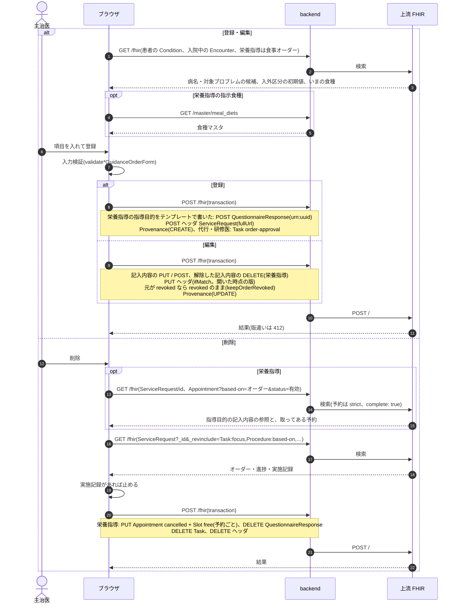
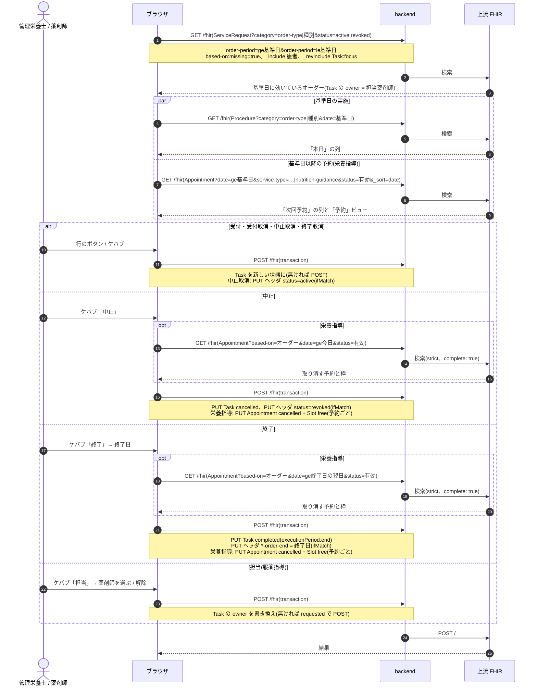
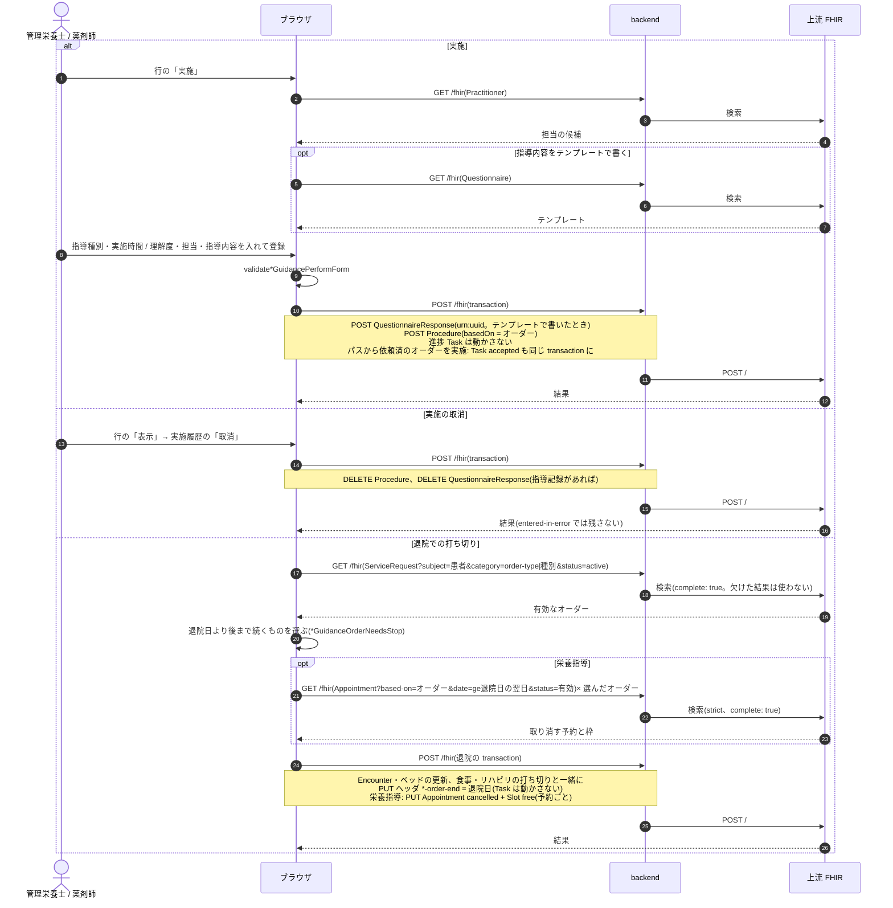

# 栄養指導・服薬指導のシーケンス図

<!-- ../fhir-client/docs/order-flows/guidance.md から scripts/sync-flows.mjs で作る。直接編集しない。 -->

運用の流れは[栄養指導・服薬指導の業務フロー](../flows/guidance.md)にあります。

## リソースの構成

| もの | リソース | 栄養指導 | 服薬指導 |
|---|---|---|---|
| オーダー(ヘッダ) | `ServiceRequest` | `category` = `order-type|nutrition-guidance` + `prescription-setting`、`code` = 指導形態(`nutrition-guidance-format`)、`occurrenceDateTime` = 開始日、`reasonCode` = 指導目的、`note` = 栄養部門への指示、`reasonReference` = 対象プロブレム | `category` = `order-type|medication-guidance` + `prescription-setting`、`code` = 指導区分(`medication-guidance-kind`)、`orderDetail[]` = 指導条件(`medication-guidance-condition`)、`occurrenceDateTime` = 開始日、`reasonCode` = 指導してほしいこと、`note` = 薬剤部への連絡事項、`reasonReference` = 対象プロブレム |
| 期間・対象 | ヘッダの拡張 | `nutrition-guidance-order-end`、`-target-disease`、`-target-condition`(写した元の Condition)、`-target-diet`(食種マスタの Coding、system は食事と共通の `meal-type`)、`-purpose-questionnaire-response` | `medication-guidance-order-end`、`-target-drugs` |
| 指導目的の記入内容 | `QuestionnaireResponse` | ヘッダの拡張から参照。ヘッダと同じ transaction で書き、テンプレートの解除・オーダーの削除で消す | – |
| 進捗 | `Task`(`focus` = ヘッダ) | `task-code|nutrition-guidance`。**登録時には作らず**、Task が無いオーダーは依頼済 | `task-code|medication-guidance`。`owner` = 担当薬剤師。担当だけ先に付けると依頼済のまま Task を作る |
| 実施記録 | `Procedure`(`basedOn` = ヘッダ) | `category` = `order-type|nutrition-guidance`、`code` = 指導種別(`nutrition-guidance-session-type`: initial / follow-up / group)、`performer` = 担当管理栄養士、拡張 `nutrition-guidance-performed-minutes`(分)・`nutrition-guidance-record`(指導記録の QR)、`note` = 指導内容 | `category` = `order-type|medication-guidance`、`code` = 指導種別(`medication-guidance-session-type`: standard / high-risk / discharge)、`performer` = 指導した薬剤師、拡張 `medication-guidance-understanding`(good / partial / poor)・`medication-guidance-record`、`note` = 指導内容 |
| 予約 | `Appointment`(`basedOn` = ヘッダ) + `Slot` | 枠表は `Schedule`(`serviceType` = `schedule-service-type|nutrition-guidance`)。定員は 1 に潰さない | – |
| 代行入力 | `Provenance`(`target` = ヘッダ) | 種別共通 | 種別共通 |

- 期間を開始日 + 終了日の拡張で持つ理由、上流の `order-period` 索引はリハビリと同じです([リハビリオーダーの業務フロー](../flows/rehab.md)「リソースの構成」)。
- 指導形態・指導種別・指導区分・指導条件・理解度は診療報酬上の固定の分類なので、DB マスタを持たずフロントの定数に置いています。

## 進捗 Task と status

**実施しても Task を動かしません。** リハビリと同じ逸脱で、初回の指導で終了扱いにならないようにするためです。実施ボタンを他部門と同じ形に揃えるリファクタをしないでください(`fhir/nutritionGuidanceTaskHelpers.ts`・`medicationGuidanceTaskHelpers.ts` の冒頭コメント)。

| Task | 表示 | `ServiceRequest.status` | ヘッダに書くもの |
|---|---|---|---|
| (無し)/ `requested` | 依頼済 | `active` | – |
| `accepted` | 実施中 | `active` | – |
| `completed` | 終了 | `active` のまま | `*-order-end`(終了日) |
| `cancelled` | 中止 | `revoked` | – |

- 遷移の表は `nutritionGuidanceTaskActions` / `medicationGuidanceTaskActions`、書き込みの入口は `useUpdateNutritionGuidanceTaskStatus` / `useUpdateMedicationGuidanceTaskStatus` です。中止・中止取消は `orderCancelEntries` でヘッダの status を揃えます。
- 終了で終了日を書くのは、部門一覧が `order-period` で引くので、終了日が無いと基準日に永久にヒットし続けるためです(`build*GuidanceOrderCloseEntry`)。終了取消では消しません(意図した非対称)。
- 栄養指導の終了・中止・退院は、もう来ない日の有効な予約の取消を同じ transaction に積みます(`fetchOrderAppointmentCancelEntries` の `from`。strict で全ページを読み、欠けたら書き込みを止める)。
- 担当薬剤師の変更(`useAssignMedicationGuidancePharmacist` / `buildMedicationGuidanceAssignment`)は Task だけを書きます。状態の変更(`buildTaskUpdate`)は元の Task を引き継ぐので担当は残ります。
- カルテのタイムラインは、`accepted` / `completed` のときに実施履歴を出します(`karteTimeline.ts`。リハビリと同じ)。

## シーケンス図の前提

`/fhir` への書き込みはどれも 1 回の transaction Bundle で、backend の `FhirProxyController` が上流へ中継します。
SS-MIX2 を有効にしている施設では、中継が書き込みの控えを記録します(`Ssmix2::Recorder`。どちらもメッセージになりません)。
楽観ロックの版は `postBundle` が `ifMatch` に添え、版が違えば 412 で止まります。編集フォームは `useEditSnapshot` で開いた時点の版に固定します(`hooks/use*GuidanceOrderInitialValues.ts`)。

| 部品 | 栄養指導 | 服薬指導 |
|---|---|---|
| オーダーのフォーム | `components/NutritionGuidanceOrderForm.tsx`・`NutritionGuidanceOrderPanels.tsx`、詳細 `NutritionGuidanceOrderDetailPanel.tsx`、カード `karteCardBodies/NutritionGuidanceOrderCardBody.tsx` | `components/MedicationGuidanceOrderForm.tsx`・`MedicationGuidanceOrderPanels.tsx`、詳細 `MedicationGuidanceOrderDetailPanel.tsx`、カード `karteCardBodies/MedicationGuidanceOrderCardBody.tsx` |
| 組み立て | `fhir/nutritionGuidanceOrderHelpers.ts`・`nutritionGuidanceTaskHelpers.ts`・`nutritionGuidanceResultHelpers.ts`、予約 `fhir/appointmentHelpers.ts` の `buildNutritionGuidanceAppointmentBundle` | `fhir/medicationGuidanceOrderHelpers.ts`・`medicationGuidanceTaskHelpers.ts`・`medicationGuidanceResultHelpers.ts` |
| 部門の画面 | `pages/NutritionGuidanceWorklistPage.tsx`(依頼・予約の 2 ビュー、終了のモーダル) | `pages/MedicationGuidanceWorklistPage.tsx`(終了・担当のモーダル) |
| モーダル | 実施入力 `components/NutritionGuidancePerformModal.tsx`、次回予約・日時変更 `NutritionGuidanceBookModal.tsx`(`AppointmentSlotPicker` の `scheduleType="nutrition-guidance"`) | 実施入力 `components/MedicationGuidancePerformModal.tsx` |
| hook | `api/queries/nutritionGuidance.ts`、予約の取消・日時変更は `api/queries/appointment.ts` | `api/queries/medicationGuidance.ts` |
| 退院・パス | `components/DischargeModal.tsx`・`api/queries/encounter.ts`(`build*GuidanceOrderStopEntries`)、`components/PathwayOrderModal.tsx`(`acceptTask`) | 同左 |

## 登録・編集・削除

`buildNutritionGuidanceOrderBundle` / `buildNutritionGuidanceOrderUpdateBundle`、`buildMedicationGuidanceOrderBundle` / `buildMedicationGuidanceOrderUpdateBundle`、`useCreatePrescription`(`api/queries/labResult.ts`。全種別共通)、`useUpdate*GuidanceOrder`、`delete*GuidanceOrderRequest` / `postOrderDeleteBundle`(`api/queries/orderDelete.ts`)。

## 部門の一覧・進捗・担当

`useNutritionGuidanceWorklist` / `useMedicationGuidanceWorklist`(`fetchWorklistBundles` で 500 件ずつ)。一覧・実施・予約のどれかが上限で欠けたら `truncated` を出します。

予約・日時変更・取消のシーケンスはリハビリと同じです(`useBookNutritionGuidanceAppointment` / `buildNutritionGuidanceAppointmentBundle`、`useRescheduleAppointment`、`useCancelAppointment`。[リハビリオーダーの業務フロー](../flows/rehab.md)「シーケンス図: 予約・日時変更・取消」)。

## 実施・実施の取消・退院での打ち切り

`build*GuidancePerformBundle`、`useRegister*GuidancePerform`、`useDelete*GuidancePerform`、退院は `build*GuidanceOrderStopEntries`(`usePatient*GuidanceOrders` で患者の有効なオーダーを全件読む)。

## 医事会計と SS-MIX2

栄養指導は実施記録から集めます(`BillingClaimBuilder` の `:procedure` 経路、`Resolvers::NutritionGuidance`)。実施 1 件 = 1 剤で、コードは施設設定の `receipt_codes.nutrition_guidance`(初回 / 2 回目以降 / 集団)から指導種別で引き、数量は 1 です。期間継続型(`continuous`)なので、実施記録の無い日のヘッダは報告しません。日レセの診療種別区分は 130 です。
服薬指導は送り方が未実装です(`OrderCatalog::PENDING`)。薬剤管理指導料・退院時薬剤情報管理指導料の区分を実施の指導種別から引く形にはしてありますが、コードの持ち方を決めていません。

| 起きたこと | 医事会計(`BillingClaimBuilder`) | SS-MIX2 |
|---|---|---|
| 登録・編集・削除 | 栄養指導はなし。服薬指導はオーダーの開始日の送信で「この種別はまだ医事会計へ送りません」と送れない項目に出す | なし(`OMG^O19` の対象外) |
| 受付・終了・中止・担当・退院での打ち切り | なし | なし |
| 予約・日時変更・取消(栄養指導) | なし | なし |
| 実施 | 栄養指導は実施日に送る。指導種別が無い、施設設定にコードが無いときは「送れない項目」に出す。服薬指導は送らない | なし |
| 実施の取消 | 対象から外れる(DELETE) | なし |
