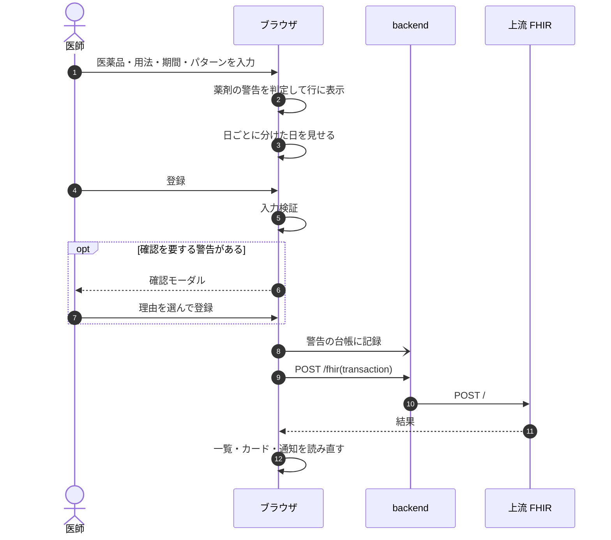
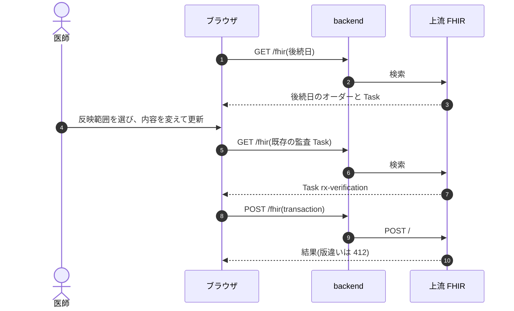
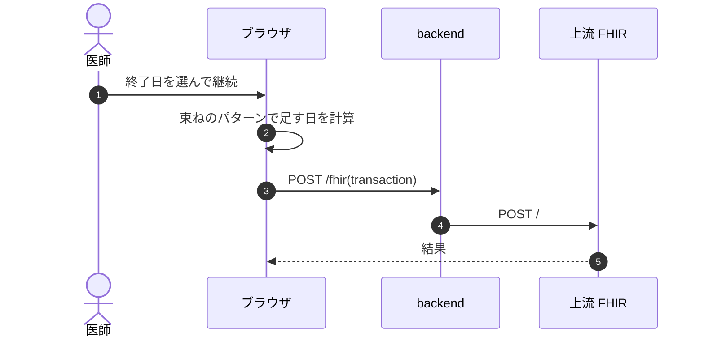
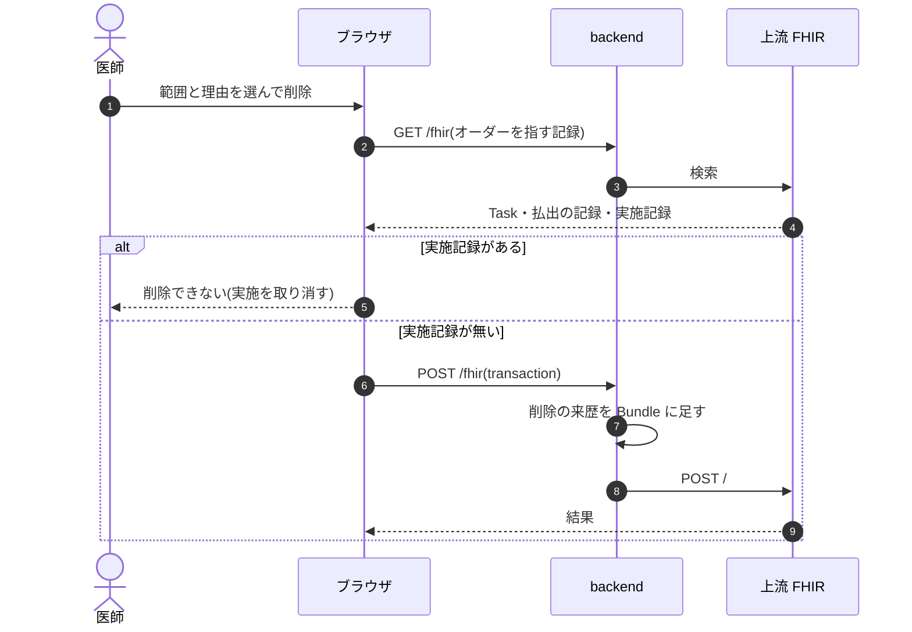
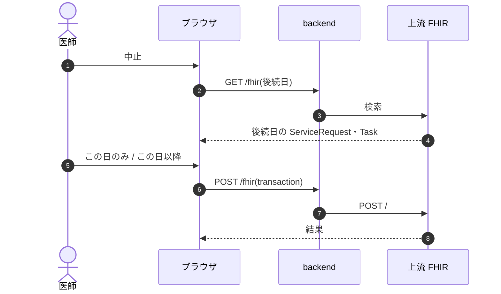
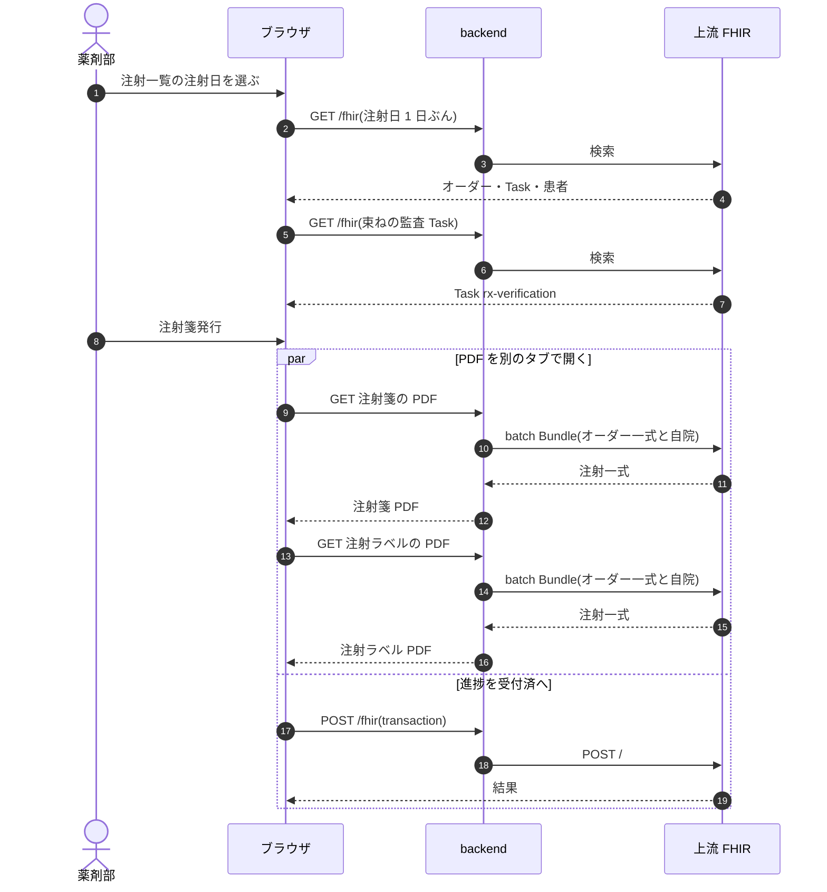
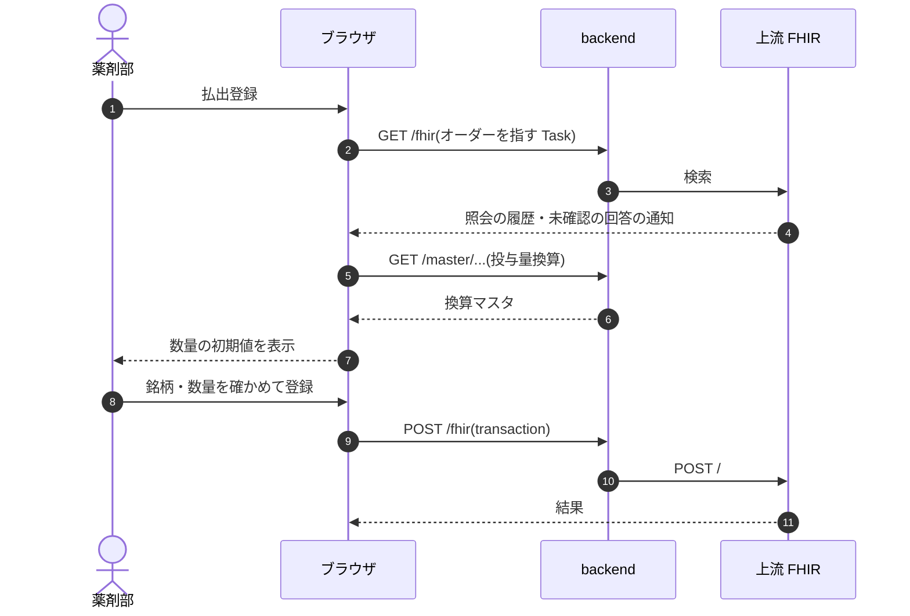
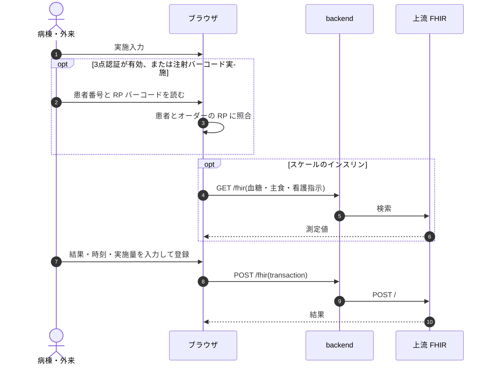
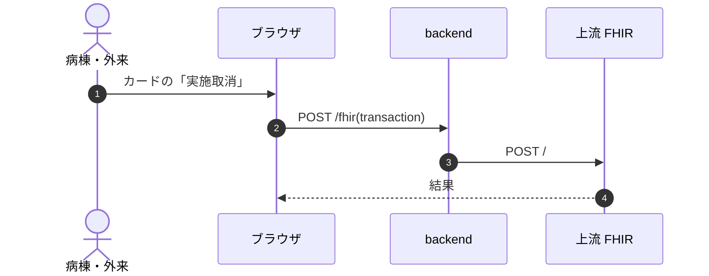

# 注射オーダーのシーケンス図

<!-- ../fhir-client/docs/order-flows/injection.md から scripts/sync-flows.mjs で作る。直接編集しない。 -->

運用の流れは[注射オーダーの業務フロー](../flows/injection.md)にあります。

## シーケンス図の前提

- **書き込みの経路**: `/fhir` への書き込みはどれも 1 回の transaction Bundle で、backend の `FhirProxyController` が上流へ中継します。
- **上流**: 上流の FHIR サーバーです。図では「上流 FHIR」と書きます。
- **応答の中継**: 上流の応答も backend を通って画面へ戻ります。図では省いて、上流から画面へ直接返す矢印で描きます。
- **SS-MIX2**: 有効にしている施設では、中継が書き込みの控えを記録します(`Ssmix2::Recorder`)。
- **楽観ロック**: 版は `postBundle` が `ifMatch` に添え、版が違えば 412 で止まります。
- **日ごとのオーダー**: 注射 1 日ぶんの `ServiceRequest`(ヘッダ)と、薬剤の行の `MedicationRequest` です。
- **束ね**: 連日の注射の日ごとのオーダーをまとめる単位です。全部の日が同じ `requisition` を持ちます。
- **後続日**: 同じ束ねの、選んだ日より後の日です。「この日以降すべて」の操作で一緒に書きます。
- **進捗 Task・監査 Task**: 状態を持つ Task(`injection`)と、処方監査を待つ Task(`rx-verification`)です。
- **ハブ**: 実施 1 回を表す `Procedure` です。薬剤ごとの `MedicationAdministration` がぶら下がります。
- **図の登場者**: 「運用フロー」節の部署(医師・薬剤部・病棟・外来)に合わせています。薬剤部は薬剤師、病棟・外来は看護師です。

## リソースの構成

- 束ね(`requisition` が同じ日ごとのオーダーの集まり)
  - 監査 Task(`rx-verification`。束ねに 1 件)
  - 日ごとのオーダーのヘッダ `ServiceRequest`
    - `MedicationRequest`(薬剤の行。`basedOn` でヘッダを指す)
      - `MedicationDispense`(払出登録。`authorizingPrescription` で薬剤の行を指す)
    - 進捗 Task(`injection`。日ごとのオーダーに 1 件)
    - 実施のハブ `Procedure`(`basedOn` でヘッダを指す。実施 1 回に 1 件)
      - `MedicationAdministration`(施用した薬剤。`partOf` でハブを指す)

| リソース | 要素 | 中身 |
|---|---|---|
| ヘッダ `ServiceRequest` | `category` | オーダー種別 `order-type|injection`、入外区分(`prescription-setting`)、注射区分(`injection-category`) |
| ヘッダ `ServiceRequest` | `requisition` | 束ねの uuid(`injection-series`) |
| ヘッダ `ServiceRequest` | 拡張 `injection-series-start` | 束ねの開始日 |
| ヘッダ `ServiceRequest` | 拡張 `injection-series-schedule` | 実施パターン(毎日のときは付けない) |
| ヘッダ `ServiceRequest` | `status` | 中止で `revoked`、中止取消で `active` |
| `MedicationRequest` | `status` | 中止で `cancelled`、中止取消で `active` |
| 監査 Task | `groupIdentifier` | 束ねの uuid |
| 監査 Task | `focus` | 束ねの最初の日 |
| ハブ `Procedure` | 拡張 `injection-verification` | 3点認証の照合の結果 |
| `MedicationAdministration` | `request` | 薬剤の行。オーダーに無い薬剤を足したときは持たない |

監査 Task が指す最初の日を削除すると、残りの最初の日へ付け替えます(`rxVerificationDeleteEntries`)。

## 進捗 Task(`injection`)

Task は登録時には作りません。**Task が無いオーダーは依頼済**として扱い、最初のステータス変更で作ります。
日ごとのオーダーに 1 件です。

| 状態 | `Task.status` |
|---|---|
| 依頼済 | `requested`(または Task 無し) |
| 受付済 | `accepted` |
| 照会中・処方変更待ち | `on-hold` + `statusReason` |
| 払出済 | `in-progress` |
| 実施済 | `completed` |
| 中止 | `cancelled` |

## 部品

| 操作 | 画面 | 組み立て | hook |
|---|---|---|---|
| 登録 | `components/InjectionForm.tsx`・`InjectionPanels.tsx` | `buildInjectionBundle`(`fhir/injectionHelpers.ts`) | `useCreatePrescription` |
| 編集 | `InjectionEditPanel` | `fhir/injectionHelpers.ts` | `useInjectionSeriesLater`(後続日) |
| 継続 | `InjectionContinueModal` | `injectionExtensionDates` | 同上 |
| 削除 | `InjectionDeleteModal` | `deleteInjectionSeriesRequest` | `postOrderDeleteBundle`(`api/queries/orderDelete.ts`) |
| 中止・中止取消・受付取消・払出取消 | `InjectionCancelModal`、`pages/InjectionWorklistPage.tsx` | `rxOrderCancelEntries` | `useUpdateInjectionTaskStatus` |
| 注射箋発行 | `pages/InjectionWorklistPage.tsx`・`InjectionPrintPage.tsx` | backend の `InjectionReport` | `useUpdateInjectionTaskStatus` |
| 払出登録 | `components/InjectionDispenseModal.tsx` | `fhir/injectionDispenseHelpers.ts` | `useRegisterInjectionDispense` |
| 実施 | `components/InjectionPerformModal.tsx`・`InjectionVerifyStep.tsx` | `fhir/injectionPerformHelpers.ts` | `useRegisterInjectionPerform`・`useCancelInjectionPerforms` |

hook の置き場所は名前と合っていません。

- `useCreatePrescription` は `api/queries/labResult.ts` にあります。名前は処方由来ですが、全種別の登録が通ります。
- `useUpdateInjectionTaskStatus`・`useRegisterInjectionPerform`・`useCancelInjectionPerforms` は `api/queries/outpatient.ts` にあります。

## 登録

- 日ごとに分ける日は `injectionDates` で計算します。
- `-)` の矢印は応答を待たない送信です。警告の台帳は `POST /master/advisory_events`(発火・無視)です。

| transaction で書くもの | 条件 |
|---|---|
| 日ごとに `ServiceRequest` + `MedicationRequest` × 薬剤数 | いつも。全部の日で `requisition` と開始日が同じ |
| `Provenance`(CREATE) | いつも |
| 監査 Task `rx-verification` | いつも。束ねに 1 件 |
| Task `order-approval` | 代行入力・研修医 |
| 警告の無視の `Provenance` | 確認モーダルで理由を選んだ |
| 届出の通知の Task | 特定抗菌薬を含む。連日でも 1 件 |

## 編集・継続・削除

どの操作も、先に後続日を引きます。検索の条件は `requisition` と `occurrence` で、後続日の `ServiceRequest`・`MedicationRequest`・Task が返ります。

編集です。登録と同じ警告の判定を通ります(図では省いています)。

| transaction で書くもの | 反映範囲 |
|---|---|
| PUT `ServiceRequest`・`MedicationRequest` | この日のみ |
| POST 追加した薬剤の行 / DELETE 消した薬剤の行 | この日のみ |
| 後続日の PUT `ServiceRequest` | この日以降 |
| 後続日の `MedicationRequest` の差し替え | この日以降 |
| `Provenance`(UPDATE) | どちらでも |
| 監査 Task `rx-verification` を未監査へ | どちらでも |
| 進捗 Task を受付済へ | 処方変更待ちのとき |

継続です。

足す日は `injectionExtensionDates` で計算します。

| transaction で書くもの | 条件 |
|---|---|
| 足す日の `ServiceRequest` + `MedicationRequest` | いつも。`requisition`・開始日・パターンは元の束ねと同じ |
| `Provenance`(CREATE) | いつも |
| 監査 Task `rx-verification` を未監査へ | いつも |

削除です。

| transaction で書くもの | 条件 |
|---|---|
| DELETE `ServiceRequest`・`MedicationRequest` | いつも |
| DELETE Task・`MedicationDispense` | あれば |
| 監査 Task の付け替え | 束ねに残る日がある |
| 予約の取消 | 予約がある |

## 中止・中止取消

カルテのカードと注射カレンダーからの中止です。中止取消も同じ流れです。

transaction は、選んだ日ぶんを次のように書きます。

| 操作 | 進捗 Task `injection` | `ServiceRequest` | `MedicationRequest` |
|---|---|---|---|
| 中止 | `cancelled` | `revoked` | `cancelled` |
| 中止取消 | `requested` | `active` | `active` |
| 受付取消 | `requested` | 変えない | 変えない |
| 払出取消 | `accepted` | 変えない | 変えない |

- オーダーの `status` を揃えるのは `rxOrderCancelEntries` です。
- 注射一覧の行のメニューは範囲を選ばず、同じ hook(`useUpdateInjectionTaskStatus`)でその日だけを書きます。受付取消・払出取消も同じ hook です。
- 払出取消は進捗を受付済へ戻すだけで、`MedicationDispense` は残ります。
- 中止取消の戻り先は依頼済(`requested`)です。化学療法の投与日の注射だけは中止の前の進捗に戻します([化学療法のシーケンス図](chemotherapy.md)「[投与日の中止・中止取消](chemotherapy.md#投与日の中止中止取消)」)。

## 処方監査・疑義照会

処方と同じ画面・hook を使います([処方オーダーのシーケンス図](prescription.md)「[処方監査](prescription.md#処方監査)」「[疑義照会](prescription.md#疑義照会)」)。
注射一覧の「監査」「疑義照会」から開き、進捗の組み立てだけを `progressBuilderOf("injection")` で切り替えます。

## 注射箋発行

PDF の生成は上流を読むだけです。再発行と注射ラベルだけの発行は同じ PDF を刷り、進捗を動かしません。

- 1 日ぶんの検索は `ServiceRequest`・`MedicationRequest`・Task・患者を返します。
- 別のタブは `/injection-print/:order_id` で、注射箋と注射ラベルの PDF を並べます。
- 注射箋は `GET /reports/injections/:order_id/pdf`、注射ラベルは `GET /reports/injection_labels/:order_id/pdf` です。
- transaction は進捗 Task `injection` を `accepted` にします。

## 払出登録

「払出登録」は受付済の行にだけ出ます。

- Task の検索は `focus` がこのオーダーの Task で、照会の履歴と未確認の回答の通知を取り出します。
- 数量の初期値は、投与量 × その日の施用回数を、換算マスタで製剤数に直したものです。

| transaction で書くもの | 条件 |
|---|---|
| POST `MedicationDispense` × 薬剤数 | いつも |
| 進捗 Task を `in-progress`(払出済) | いつも |
| 回答の通知を `completed` | 未確認の回答の通知がある |

## 実施

払出済かどうかに関わらず記録できます。

実施入力です。

- 照合は、患者の `identifier` とオーダーの RP の番号に対して行います。照合できないときは理由を選んでスキップします。
- インスリンの検索は、血糖と主食の `Observation` と、血糖の看護指示です。
- 実施量は薬剤ごとに入れます。

| 結果 | transaction で書くもの |
|---|---|
| 実施・途中で中止 | POST `Procedure`(`completed` / `stopped`。照合の結果は拡張) |
| 実施・途中で中止 | POST `MedicationAdministration` × 施用した薬剤 |
| 実施・途中で中止 | POST `Observation`(手入力の血糖値があるとき) |
| 実施・途中で中止 | 進捗 Task `injection` を `completed`(予定回数に達したとき) |
| 実施せず | POST `Procedure`(`not-done`、理由) |

実施取消です。

transaction は、そのオーダーの実施記録すべてについて `MedicationAdministration`、`Procedure` の順に DELETE します。実施済だった進捗 Task `injection` は `requested` に戻します(払出済だったかは分からないので、いちばん手前に戻します)。

## 医事会計と SS-MIX2

医事会計(`BillingClaimBuilder`)は、注射を実施記録から送ります。SS-MIX2 の括弧内はデータ種別、INS / DEL は処理区分です。

| 起きたこと | 医事会計 | SS-MIX2 |
|---|---|---|
| 登録・編集 | 送らない | RDE^O11(OMP-02)。`ServiceRequest` を書くと出す |
| 削除 | 対象から外れる | RDE^O11 の `CA`(DEL) |
| 中止 | 対象から外れる。実施済みの施用は送る | RDE^O11 の `CA`(DEL) |
| 中止取消 | 対象に戻る | RDE^O11 の `NW`(INS) |
| 実施 | 薬剤の行を 1 施用 1 剤で送る | RAS^O17(OMP-12)。実施ごとに採番 |
| 途中で中止・実施せず | 請求せず理由を報告 | RAS^O17 |
| 実施取消 | 対象から外れる | RAS^O17 の DEL |

実施の剤の区分は、手技・用法種別・経路から決まります。手技料は日レセが算定します。
