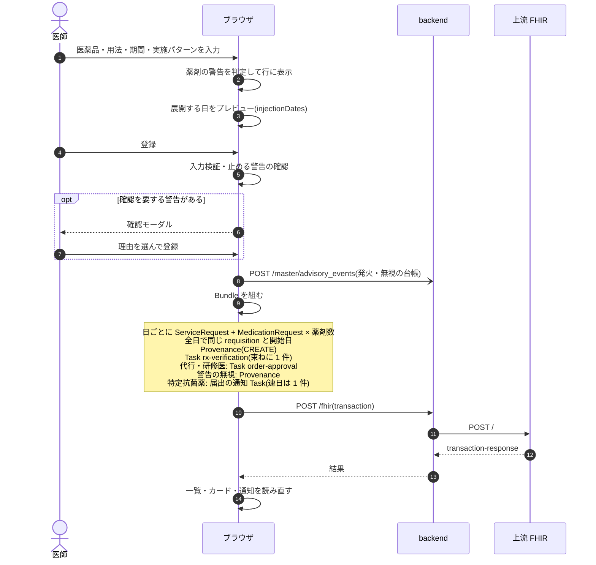
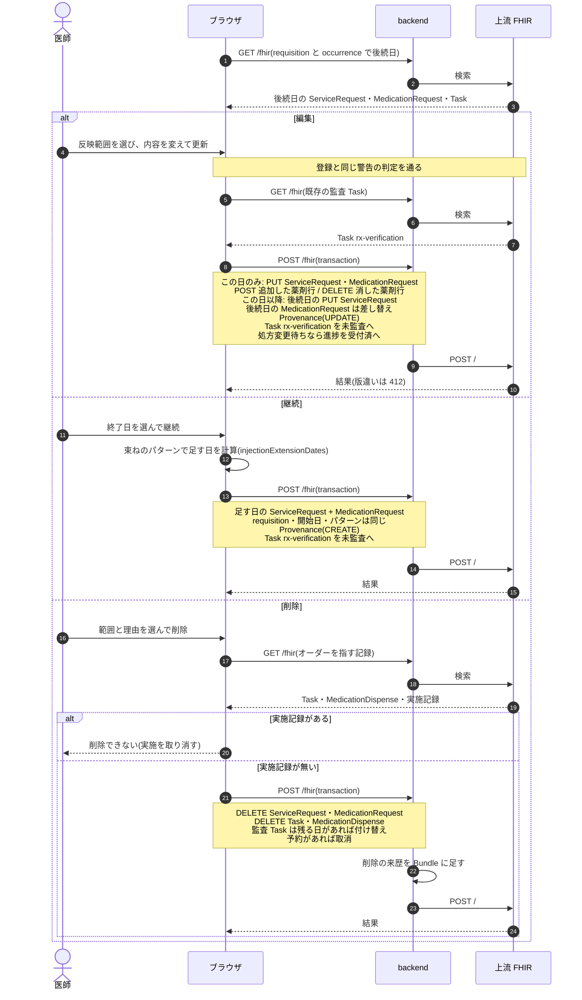
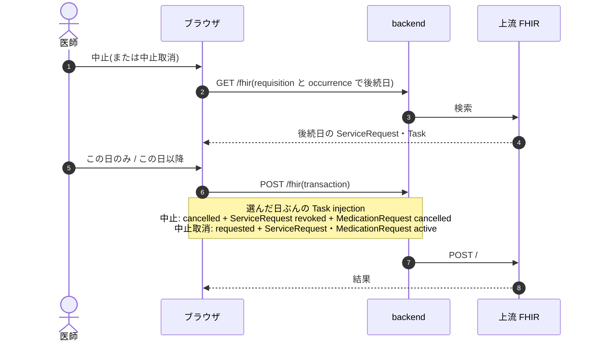
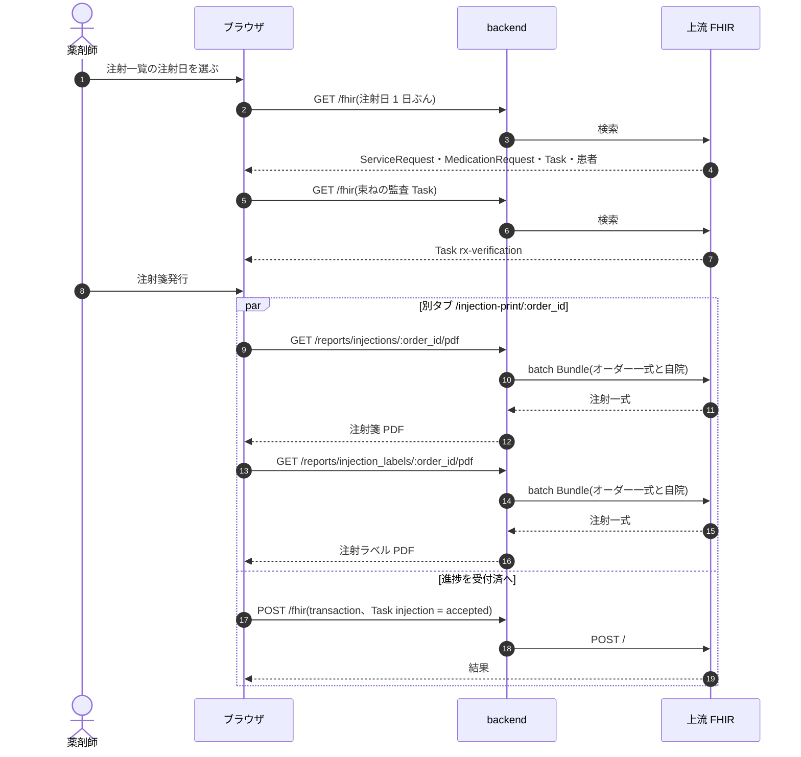
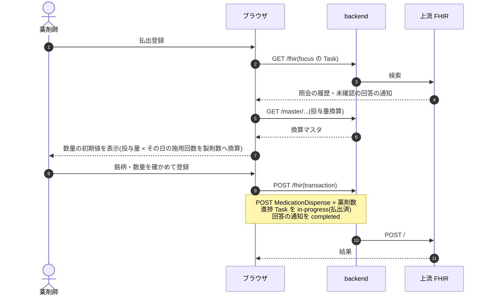
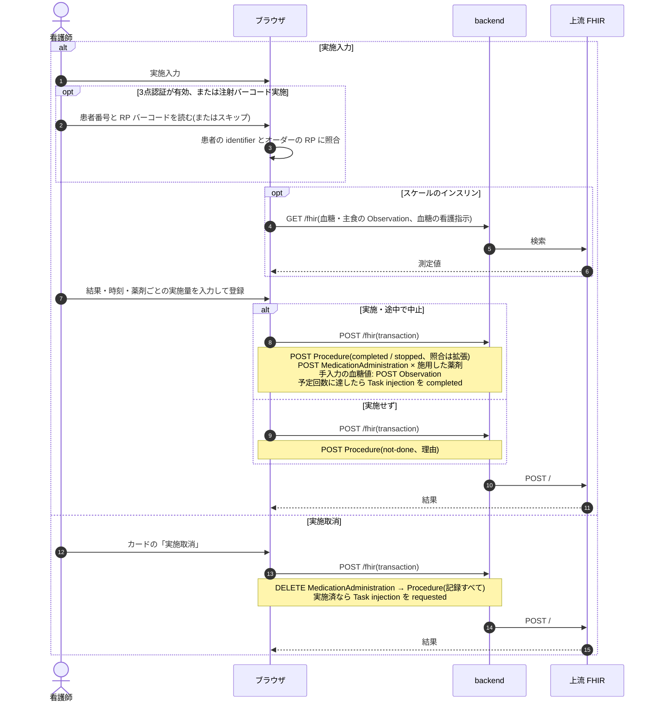

# 注射オーダーのシーケンス図

<!-- ../fhir-client/docs/order-flows/injection.md から scripts/sync-flows.mjs で作る。直接編集しない。 -->

運用の流れは[注射オーダーの業務フロー](../flows/injection.md)にあります。

## 進捗 Task(`injection`)

Task は登録時には作りません。**Task が無いオーダーは依頼済**として扱い、最初のステータス変更で作ります。
日ごとのオーダーに 1 件です。

| 状態 | `Task.status` |
|---|---|
| 依頼済 | `requested`(または Task 無し) |
| 受付済 | `accepted` |
| 照会中・処方変更待ち | `on-hold` + `statusReason` |
| 払出済 | `in-progress` |
| 実施済 | `completed` |
| 中止 | `cancelled` |

監査 Task(`rx-verification`)は束ね(`requisition`)に 1 件で、`groupIdentifier` に束ねの uuid、`focus` に束ねの最初の日を持ちます。
最初の日を削除すると残りの最初の日へ付け替えます(`rxVerificationDeleteEntries`)。

中止は同じ transaction で `ServiceRequest` を `revoked`、`MedicationRequest` を `cancelled` にします(`rxOrderCancelEntries`)。中止取消は `active` に戻します。

## シーケンス図の前提

`/fhir` への書き込みはどれも 1 回の transaction Bundle で、backend の `FhirProxyController` が上流へ中継します。
SS-MIX2 を有効にしている施設では、中継が書き込みの控えを記録します(`Ssmix2::Recorder`)。
楽観ロックの版は `postBundle` が `ifMatch` に添え、版が違えば 412 で止まります。

## 登録

`components/InjectionForm.tsx`・`InjectionPanels.tsx`、`buildInjectionBundle`(`fhir/injectionHelpers.ts`)、`useCreatePrescription`(`api/queries/labResult.ts`。全種別共通)。

## 編集・継続・削除

`InjectionEditPanel`、`InjectionContinueModal`、`InjectionDeleteModal`、`useInjectionSeriesLater`(後続日)、`deleteInjectionSeriesRequest`、`postOrderDeleteBundle`(`api/queries/orderDelete.ts`)。

## 中止・中止取消

`InjectionCancelModal`、`useUpdateInjectionTaskStatus`(`api/queries/outpatient.ts`)。注射一覧のメニューは範囲を選ばず、同じ hook でその日だけを書きます。

## 処方監査・疑義照会

処方と同じ画面・hook を使います([処方監査](prescription.md#処方監査)、[疑義照会](prescription.md#疑義照会))。
注射一覧の「監査」「疑義照会」から開き、進捗の組み立てだけを `progressBuilderOf("injection")` で切り替えます。

## 注射箋発行

`pages/InjectionWorklistPage.tsx`・`InjectionPrintPage.tsx`、`useUpdateInjectionTaskStatus`、`InjectionReport`。
PDF の生成は読むだけで、再発行と注射ラベル単独の発行は同じ PDF を刷り進捗を動かしません。

## 払出登録

`components/InjectionDispenseModal.tsx`、`fhir/injectionDispenseHelpers.ts`、`useRegisterInjectionDispense`。受付済の行にだけ出ます。

払出取消は進捗を受付済へ戻すだけで、`MedicationDispense` は残ります。

## 実施

`components/InjectionPerformModal.tsx`・`InjectionVerifyStep.tsx`、`fhir/injectionPerformHelpers.ts`、`useRegisterInjectionPerform`・`useCancelInjectionPerforms`。
払出済かどうかに関わらず記録できます。

## 医事会計と SS-MIX2

| 起きたこと | 医事会計(`BillingClaimBuilder`) | SS-MIX2 |
|---|---|---|
| 登録・編集 | なし | RDE^O11(OMP-02)。`ServiceRequest` を書くと出す |
| 削除 | 対象から外れる | RDE^O11 の `CA`(DEL) |
| 中止 | 対象から外れる。実施済みの施用は送る | RDE^O11 の `CA`(DEL) |
| 中止取消 | 対象に戻る | RDE^O11 の `NW`(INS) |
| 実施 | 薬剤行を 1 施用 1 剤で送る。剤区分は手技・用法種別・経路から決まり、手技料は日レセが算定 | RAS^O17(OMP-12)。実施ごとに採番 |
| 途中で中止・実施せず | 請求せず理由を報告 | RAS^O17 |
| 実施取消 | 対象から外れる | RAS^O17 の DEL |
