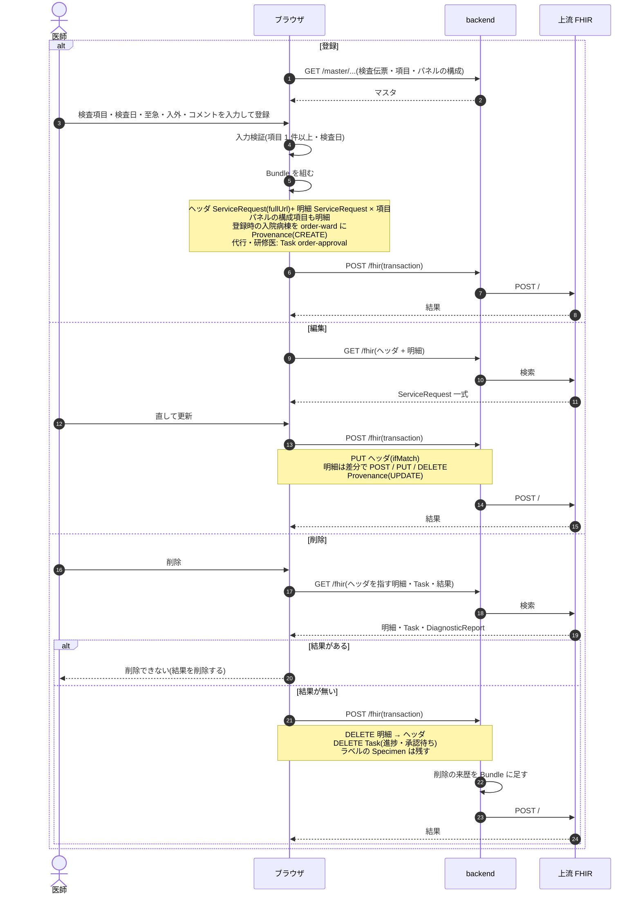
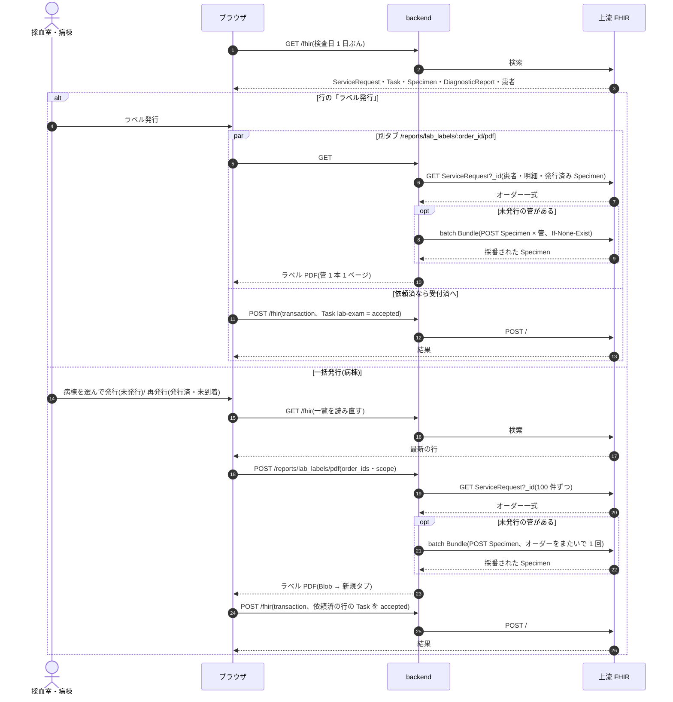
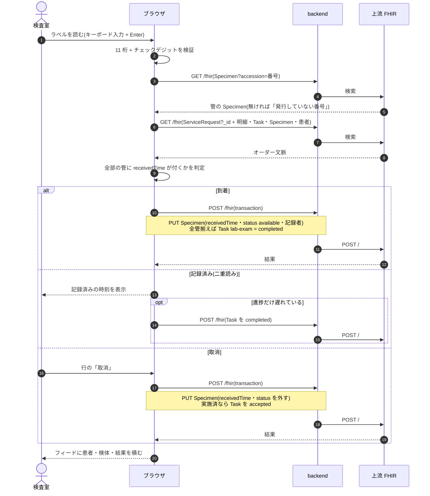
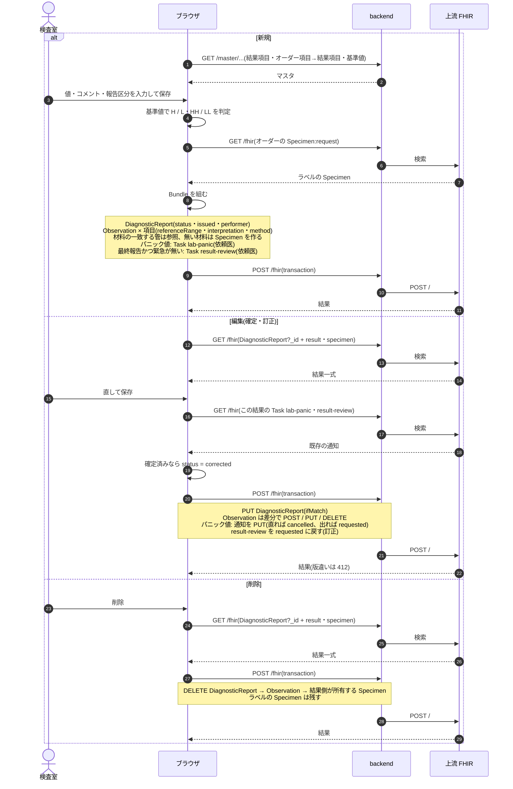
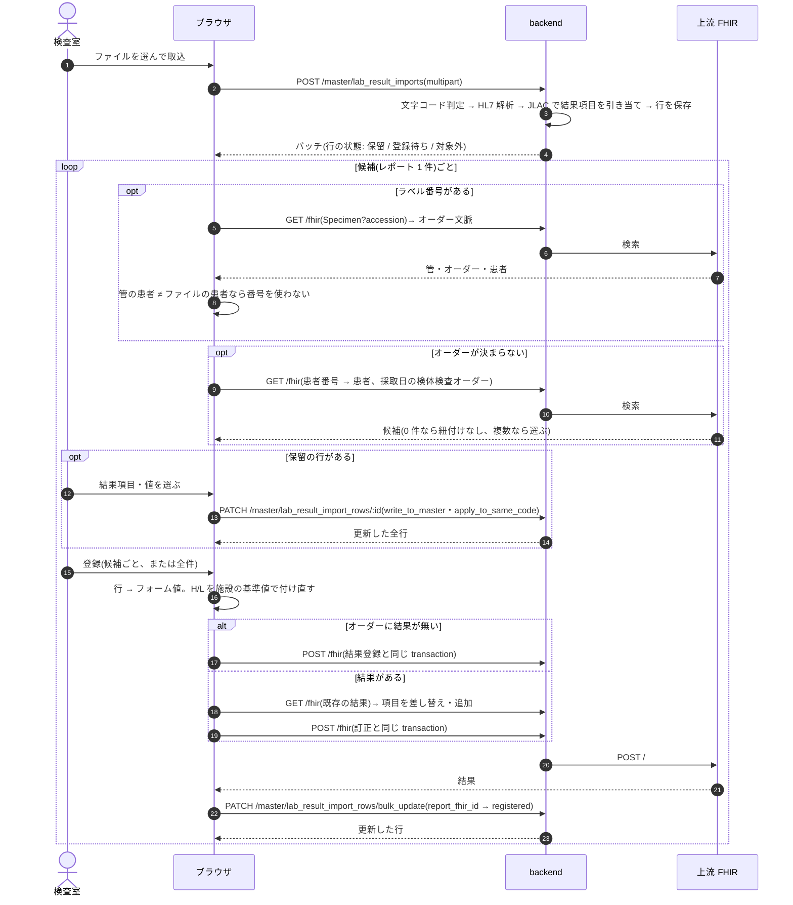
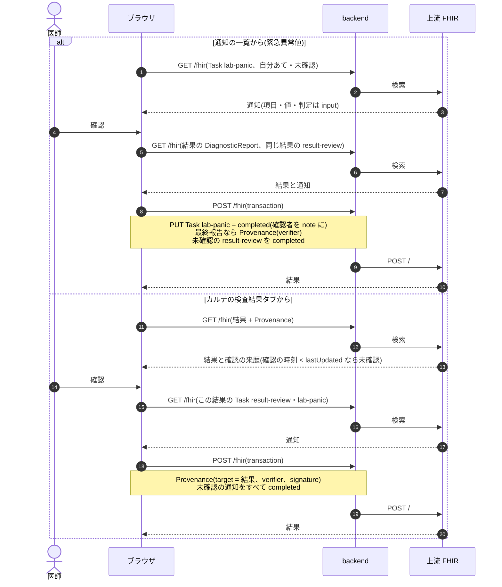

# 検体検査オーダーのシーケンス図

<!-- ../fhir-client/docs/order-flows/lab.md から scripts/sync-flows.mjs で作る。直接編集しない。 -->

運用の流れは[検体検査オーダーの業務フロー](../flows/lab.md)にあります。

## リソースの構成

オーダーはヘッダの `ServiceRequest`(`order-type|lab`)と、検査項目 1 件ずつの明細 `ServiceRequest`(`basedOn` でヘッダを指す)です。パネルの構成項目はさらに明細を `basedOn` で指します。
明細はオーダー時点のマスタの内容(項目コード・名称・JLAC・検体・採取管)を写し、採る検体は contained の `Specimen` で `ServiceRequest.specimen` から指します(`fhir/labOrderHelpers.ts`)。

| もの | リソース | 補足 |
|---|---|---|
| 進捗 | `Task`(`task-code|lab-exam`、`focus` = ヘッダ) | 下の表 |
| 管(採取管)の台帳 | `Specimen`(`request` = ヘッダ、`accessionIdentifier` = ラベル番号) | 発行 = 作成、到着 = `receivedTime` + `status: available`、記録者は拡張 `lab-arrival-recorder` |
| 結果 | `DiagnosticReport`(`basedOn` = ヘッダ)+ `Observation`(`result`) | 報告区分は `status`(`preliminary` / `final` / `corrected`)、採取日は `effectiveDateTime`、報告日時は `issued` |
| 結果の検体 | `DiagnosticReport.specimen` | 材料の一致する管の `Specimen` を参照(書き換えない)。無い材料・紐付け無しの結果は結果側が `Specimen` を作って所有する |
| 緊急異常値の通知 | `Task`(`task-code|lab-panic`、`focus` = 結果、`owner` = 依頼医、`priority = stat`) | 項目は `input` に構造化 |
| 検査結果確認の通知 | `Task`(`task-code|result-review`、`focus` = 結果、`owner` = 依頼医) | 最終報告のときだけ |
| 確認(既読) | `Provenance`(`target` = 結果、`agent.type = verifier`、`signature`) | 正本。通知は宛先と未確認・確認済みだけ |
| 代行入力 | `Provenance`(`target` = ヘッダ、`activity` CREATE / UPDATE) | 明細は `target` に入れない |

## 進捗 Task(`lab-exam`)

Task は登録時には作りません。**Task が無いオーダーは依頼済**として扱い、最初のステータス変更で作ります(`fhir/labTaskHelpers.ts`)。
中止は同じ transaction でヘッダの `ServiceRequest` を `revoked` にし、中止取消で `active` に戻します(`orderCancelEntries`)。
中止したオーダーを編集しても `revoked` のままです(`keepOrderRevoked`)。

| 状態 | `Task.status` | `executionPeriod` |
|---|---|---|
| 依頼済 | `requested`(または Task 無し) | なし |
| 受付済 | `accepted` | `start` |
| 実施済 | `completed` | `start` / `end` |
| 中止 | `cancelled`(ヘッダは `revoked`) | なし |

受付済へは行の「ラベル発行」と一括発行、実施済へは到着確認の全管到着が進めます。メニューの「受付」「実施」は同じ Task の書き込みを手で行う代替です。

## シーケンス図の前提

`/fhir` への書き込みはどれも 1 回の transaction Bundle で、backend の `FhirProxyController` が上流へ中継します。
SS-MIX2 を有効にしている施設では、中継が書き込みの控えを記録します(`Ssmix2::Recorder`)。
楽観ロックの版は `postBundle` が `ifMatch` に添え、版が違えば 412 で止まります。
例外はラベルの PDF で、backend(`LabLabelReport`)が上流を直接読み書きします。

## 登録・編集・削除

`components/LabOrderForm.tsx`・`LabOrderPanels.tsx`、`buildLabOrderBundle` / `buildLabOrderUpdateBundle` / `buildLabOrderDeleteBundle`(`fhir/labOrderHelpers.ts`)、
`useCreatePrescription` / `useUpdatePrescription`(`api/queries/labResult.ts`。全種別共通)、`useDeleteLabOrder`(`api/queries/lab.ts`)。

## ラベル発行

`pages/LabWorklistPage.tsx`、`components/LabLabelBatchModal.tsx`、`useUpdateLabTaskStatus` / `useIssueLabLabels`(`api/queries/lab.ts`)、`LabLabelReport`(backend)。
番号は上流が `Specimen` の作成時に採番します(連番 10 桁 + チェックデジット)。

Task の書き込みに失敗しても `Specimen` は残るので、再発行で同じ番号を刷れます。

## 到着確認

`pages/LabArrivalPage.tsx`、`fetchLabelSpecimenByNumber` / `fetchLabArrivalContext`(`api/queries/injection.ts`)、`buildSpecimenArrival` / `buildSpecimenArrivalCancel`(`fhir/labSpecimenHelpers.ts`)。

## 結果登録・訂正

`components/LabResultEntryModal.tsx`(一覧)・`KarteLabResultTab.tsx`・`LabResultForm.tsx`、`buildLabResultBundle` / `buildLabResultUpdateBundle` / `buildLabResultDeleteBundle`(`fhir/labResultHelpers.ts`)、
`useCreateLabResult` / `useUpdateLabResult` / `useDeleteLabResult`(`api/queries/labResult.ts`)。通知の組み立ては `fhir/labPanicHelpers.ts`・`fhir/resultReviewHelpers.ts`。

## 結果取込

`pages/LabResultImportPage.tsx`・`LabResultImportDetailPage.tsx`、`hooks/useLabImportGroupContext.ts`、`fhir/labImportHelpers.ts`、backend の `LabImport::*`。
上流への登録は手入力と同じ `useCreateLabResult` / `useUpdateLabResult` を通ります。

## 結果確認

`pages/NotificationPage.tsx`(`components/notifications/notificationRegistry.tsx`)、`useMarkResultReviewed`(`api/queries/notification.ts`)、`urgentConfirmationEntries`(`api/notificationActions.ts`)、
`buildReviewProvenance`(`fhir/provenanceHelpers.ts`)。

## 医事会計と SS-MIX2

検体検査は実施入力を持たないので、医事会計はオーダーの検査日で集めます(`BillingClaimBuilder` の `:order` 経路)。進捗 Task は見ず、中止は `ServiceRequest.status` で判定します。

| 起きたこと | 医事会計(`BillingClaimBuilder`) | SS-MIX2 |
|---|---|---|
| 登録・編集 | 検査日のオーダーの項目を `receipt_code` で送る。血液の検体があれば採血料を最初の剤に 1 回足す。`receipt_code` の無い項目は「送れない項目」に出す | OML^O33(OML-01)。ヘッダを書くと出す。編集も INS |
| 削除 | 対象から外れる | OML^O33 の `CA`(DEL) |
| 中止 | 対象から外れる(`ServiceRequest` が `revoked`)。送ったあとの中止は医事が送り直す | OML^O33 の `CA`(DEL)。中止取消は `NW`(INS) |
| 受付・到着 | なし | なし(Specimen の作成・更新はメッセージにしない) |
| 結果の登録・確定・訂正 | なし | OUL^R22(OML-11)。訂正も INS(前の有効ファイルは過去履歴になる) |
| 結果の削除 | なし | OUL^R22 の `CA`(DEL) |

外来迅速検体検査加算は「当日結果説明」を判定できないので送りません。
