# 検体検査オーダーのシーケンス図

<!-- ../fhir-client/docs/order-flows/lab.md から scripts/sync-flows.mjs で作る。直接編集しない。 -->

運用の流れは[検体検査オーダーの業務フロー](../flows/lab.md)にあります。

## シーケンス図の前提

- **書き込みの経路**: `/fhir` への書き込みはどれも 1 回の transaction Bundle で、backend の `FhirProxyController` が上流へ中継します。
- **上流**: 上流の FHIR サーバーです。図では「上流 FHIR」と書きます。
- **応答の中継**: 上流の応答も backend を通って画面へ戻ります。図では省いて、上流から画面へ直接返す矢印で描きます。
- **SS-MIX2**: 有効にしている施設では、中継が書き込みの控えを記録します(`Ssmix2::Recorder`)。
- **楽観ロック**: 版は `postBundle` が `ifMatch` に添え、版が違えば 412 で止まります。
- **例外**: ラベルの PDF は、backend(`LabLabelReport`)が上流を直接読み書きします。こちらは batch Bundle です。
- **ヘッダと明細**: ヘッダはオーダー 1 件を表す `ServiceRequest`、明細は検査項目 1 件を表す `ServiceRequest` です。
- **進捗 Task**: 採血室・検査室の作業の状態を持つ Task(`lab-exam`)です。
- **管の Specimen**: ラベルを刷った管 1 本を表す `Specimen` です。発行で作り、到着を記録します。
- **結果の Specimen**: 結果に付ける検体です。材料の一致する管の Specimen を指すか、結果側が作ります。
- **ラベル番号**: 連番 10 桁 + チェックデジット 1 桁の計 11 桁です。上流が管の Specimen の作成時に採番します。
- **図の登場者**: 「運用フロー」節の部署(医師・採血室・病棟・検査室)に合わせています。

## リソースの構成

- ヘッダ `ServiceRequest`(`order-type|lab`)
  - 明細 `ServiceRequest`(検査項目 1 件。`basedOn` でヘッダを指す)
    - パネルの構成項目の明細(`basedOn` でパネルの明細を指す)
    - contained `Specimen`(採る検体。`ServiceRequest.specimen` から指す)
  - 進捗 Task(`lab-exam`。`focus` でヘッダを指す)
  - 管の Specimen(`request` でヘッダを指す)
  - 結果 `DiagnosticReport`(`basedOn` でヘッダを指す)
    - `Observation`(項目の結果。`result` から指す)
    - 結果の Specimen(`DiagnosticReport.specimen` から指す)
    - 緊急異常値の通知 Task(`lab-panic`。`focus` で結果を指す)
    - 検査結果確認の通知 Task(`result-review`。`focus` で結果を指す)
    - 確認の来歴 `Provenance`(`target` で結果を指す)

| リソース | 要素 | 中身 |
|---|---|---|
| 明細 `ServiceRequest` | `code` ほか | オーダー時点のマスタの内容(項目コード・名称・JLAC・検体・採取管)を写す |
| 管の Specimen | `accessionIdentifier` | ラベル番号 |
| 管の Specimen | `receivedTime` と `status: available` | 到着 |
| 管の Specimen | 拡張 `lab-arrival-recorder` | 到着を記録した人 |
| `DiagnosticReport` | `status` | 報告区分(`preliminary` / `final` / `corrected`) |
| `DiagnosticReport` | `effectiveDateTime` | 採取日 |
| `DiagnosticReport` | `issued` | 報告日時 |
| 結果の Specimen | (参照するとき) | 材料の一致する管の Specimen を参照する。書き換えない |
| 結果の Specimen | (作るとき) | 材料の一致する管が無いときと、紐付けの無い結果のとき。結果側が作って所有する |
| 緊急異常値の通知 Task | `owner`・`priority` | 依頼医、`stat` |
| 緊急異常値の通知 Task | `input` | パニック値の項目・値・判定 |
| 検査結果確認の通知 Task | `owner` | 依頼医。最終報告と訂正報告のときだけ作る |
| 確認の来歴 `Provenance` | `agent.type`・`signature` | `verifier`。確認の正本。通知は宛先と未確認・確認済みだけを持つ |
| 代行入力の `Provenance` | `target`・`activity` | ヘッダ(明細は入れない)、CREATE / UPDATE |

明細の組み立ては `fhir/labOrderHelpers.ts` にあります。

## 進捗 Task(`lab-exam`)

- Task は登録時には作りません。**Task が無いオーダーは依頼済**として扱い、最初のステータス変更で作ります(`fhir/labTaskHelpers.ts`)。
- 中止は同じ transaction でヘッダを `revoked` にし、中止取消で `active` に戻します(`orderCancelEntries`)。
- 中止したオーダーを編集しても `revoked` のままです(`keepOrderRevoked`)。

| 状態 | `Task.status` | `executionPeriod` |
|---|---|---|
| 依頼済 | `requested`(または Task 無し) | なし |
| 受付済 | `accepted` | `start` |
| 実施済 | `completed` | `start` / `end` |
| 中止 | `cancelled`(ヘッダは `revoked`) | なし |

- **ふだんの進め方**: 行の「ラベル発行」と一括発行が受付済へ、全部の管の到着が実施済へ進めます。
- **代わりの操作**: 行のメニューの「受付」「実施」は、同じ Task の書き込みを手で行う代わりの操作です。
- **一覧の「取消」と到着の取消**: 一覧の「取消」は Task を 1 つ前に戻すだけです。到着の取消は管の Specimen の到着を外し、実施済なら Task を `accepted` に戻します。

## 部品

| 操作 | 画面 | 組み立て | hook |
|---|---|---|---|
| 登録 | `components/LabOrderForm.tsx`・`LabOrderPanels.tsx` | `buildLabOrderBundle`(`fhir/labOrderHelpers.ts`) | `useCreatePrescription` |
| 編集 | 同上 | `buildLabOrderUpdateBundle` | `useUpdatePrescription` |
| 削除 | カルテのカード | `buildLabOrderDeleteBundle` | `useDeleteLabOrder`(`api/queries/lab.ts`) |
| 一覧・状態の変更 | `pages/LabWorklistPage.tsx` | `fhir/labTaskHelpers.ts` | `useUpdateLabTaskStatus`(`api/queries/lab.ts`) |
| ラベル一括発行 | `components/LabLabelBatchModal.tsx` | backend の `LabLabelReport` | `useIssueLabLabels`(`api/queries/lab.ts`) |
| 到着確認 | `pages/LabArrivalPage.tsx` | `buildSpecimenArrival` / `buildSpecimenArrivalCancel`(`fhir/labSpecimenHelpers.ts`) | `useUpdateLabArrival`、`fetchLabelSpecimenByNumber` / `fetchLabArrivalContext` |
| 結果登録・訂正・削除 | `components/LabResultEntryModal.tsx`(一覧)・`KarteLabResultTab.tsx`・`LabResultForm.tsx` | `buildLabResultBundle` / `buildLabResultUpdateBundle` / `buildLabResultDeleteBundle`(`fhir/labResultHelpers.ts`) | `useCreateLabResult` / `useUpdateLabResult` / `useDeleteLabResult`(`api/queries/labResult.ts`) |
| 結果の通知 | 同上 | `fhir/labPanicHelpers.ts`・`fhir/resultReviewHelpers.ts` | 同上 |
| 結果取込 | `pages/LabResultImportPage.tsx`・`LabResultImportDetailPage.tsx` | `fhir/labImportHelpers.ts`、`hooks/useLabImportGroupContext.ts`、backend の `LabImport::*` | `useCreateLabResult` / `useUpdateLabResult` |
| 結果確認(通知から) | `pages/NotificationPage.tsx`(`components/notifications/notificationRegistry.tsx`) | `urgentConfirmationEntries`(`api/notificationActions.ts`) | `useMarkResultReviewed` |
| 結果確認(カルテから) | `KarteLabResultTab.tsx` の `ResultReviewAction` | `buildReviewProvenance`(`fhir/provenanceHelpers.ts`) | `useMarkResultReviewed` |

hook の置き場所は名前と合っていません。

- `useCreatePrescription`・`useUpdatePrescription` は `api/queries/labResult.ts` にあります。名前は処方由来ですが、全種別の登録・編集が通ります。
- `useUpdateLabArrival`・`fetchLabelSpecimenByNumber`・`fetchLabArrivalContext` は `api/queries/injection.ts` にあります。
- `useMarkResultReviewed` は `api/queries/notification.ts` にあります。

## 登録・編集・削除

登録です。

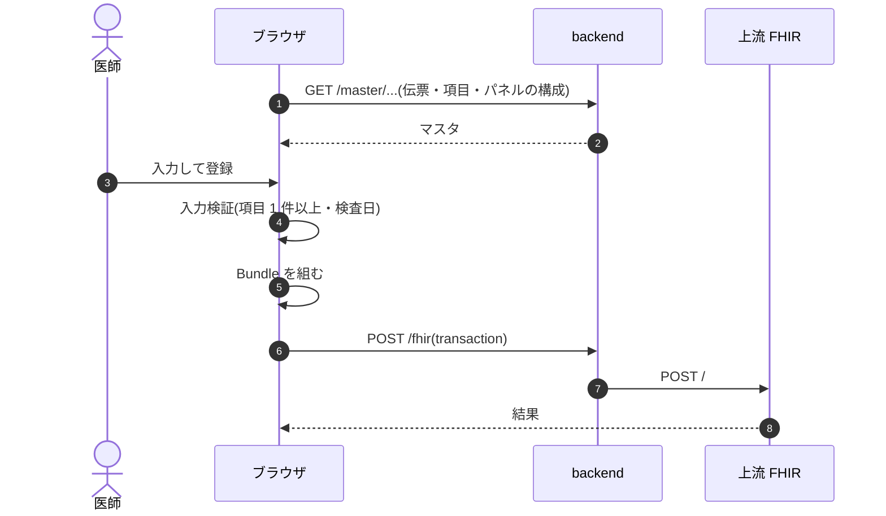

医師が入れるのは、検査項目・検査日・至急・入外区分・コメントです。

| transaction で書くもの | 条件 |
|---|---|
| ヘッダ `ServiceRequest` | `fullUrl` を付ける。登録時の入院病棟を `order-ward` に入れる |
| 明細 `ServiceRequest` × 項目 | パネルの構成項目も明細にする |
| `Provenance`(CREATE) | 毎回 |
| `Task` `order-approval` | 代行入力・研修医のとき |

編集です。

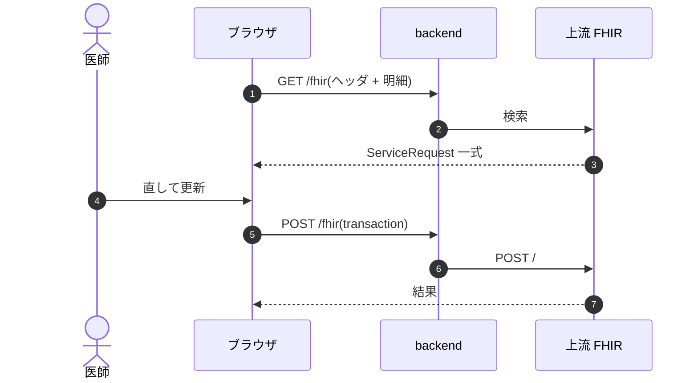

| transaction で書くもの | 条件 |
|---|---|
| PUT ヘッダ | `ifMatch` を添える |
| 明細の POST / PUT / DELETE | 差分で書く |
| `Provenance`(UPDATE) | 毎回 |

削除です。

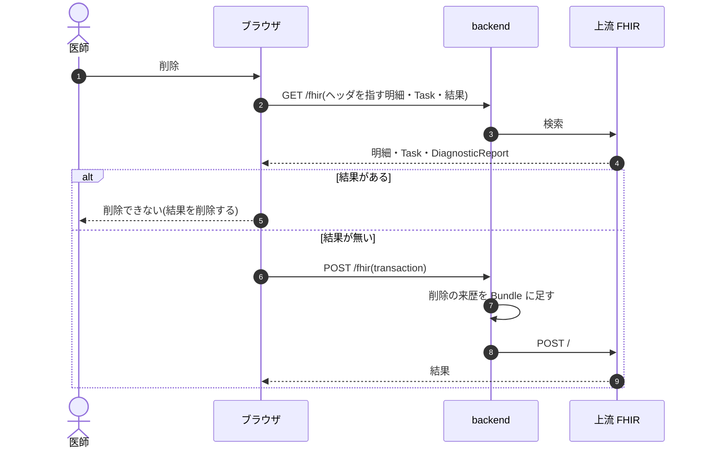

| transaction で書くもの | 条件 |
|---|---|
| DELETE 明細 → ヘッダ | この順に積む |
| DELETE `Task` | 進捗・承認待ち |
| 管の Specimen | 消さずに残す |

## ラベル発行

行の「ラベル発行」です。

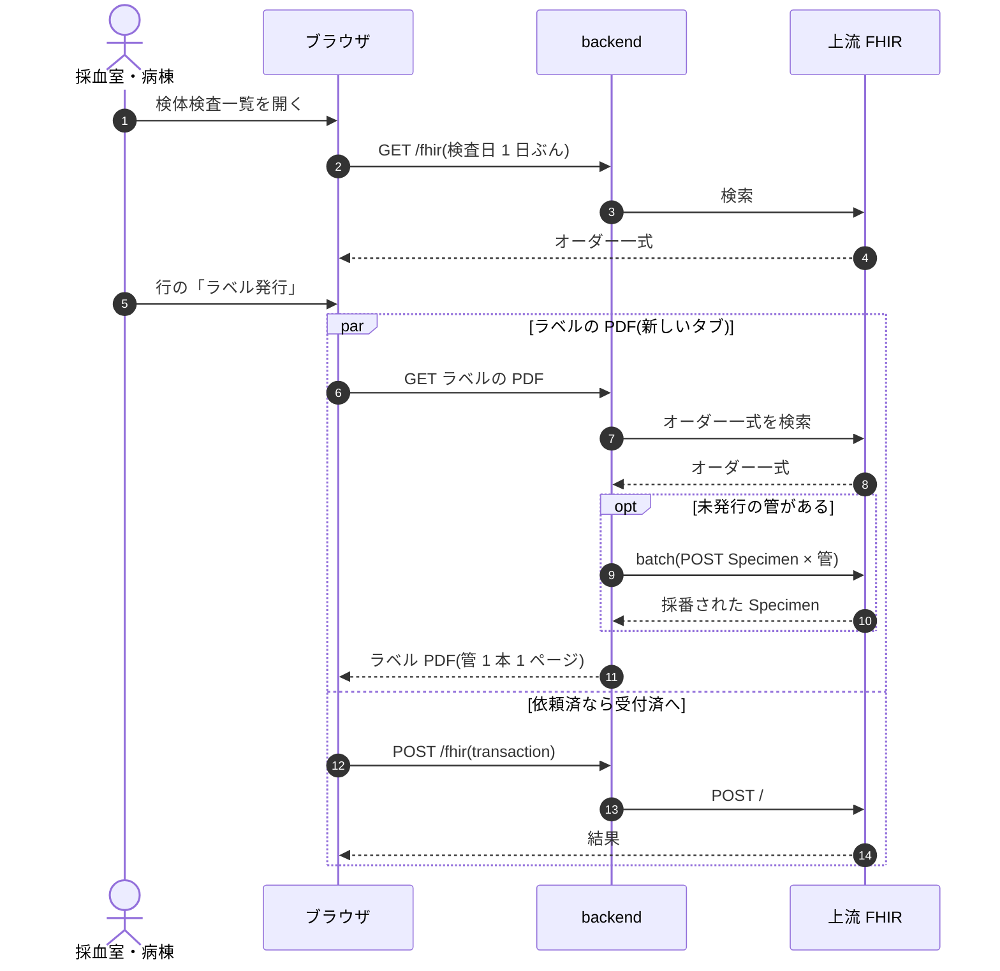

| 読む・書くもの | 条件 |
|---|---|
| 一覧の検索 | 検査日 1 日ぶんの `ServiceRequest`・`Task`・`Specimen`・`DiagnosticReport`・患者 |
| ラベルの PDF | `GET /reports/lab_labels/:order_id/pdf` |
| backend の検索 | `ServiceRequest?_id` に、患者・明細・発行済みの管の Specimen を含める |
| 管の Specimen の作成 | 未発行の管だけ。`If-None-Exist` を添える |
| `Task` `lab-exam` = `accepted` | 依頼済のときだけ |

「ラベル一括発行」です。

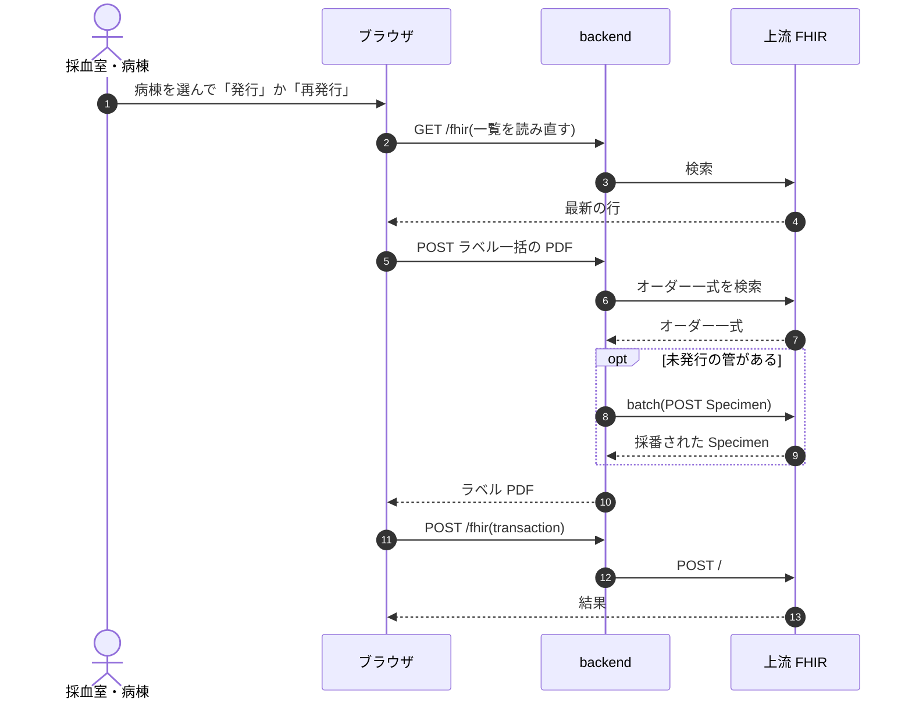

| 読む・書くもの | 条件 |
|---|---|
| ラベル一括の PDF | `POST /reports/lab_labels/pdf`(`order_ids`・`scope`) |
| `scope` | 「発行」は未発行の管、「再発行」は発行済みで未到着の管 |
| backend の検索 | `ServiceRequest?_id` を 100 件ずつ |
| 管の Specimen の作成 | オーダーをまたいで 1 回の batch |
| PDF の受け取り | Blob で受けて新しいタブで開く |
| `Task` `lab-exam` = `accepted` | 依頼済の行だけ |

Task の書き込みに失敗しても管の Specimen は残るので、再発行で同じ番号を刷れます。

## 到着確認

管を読んで到着を記録するときです。

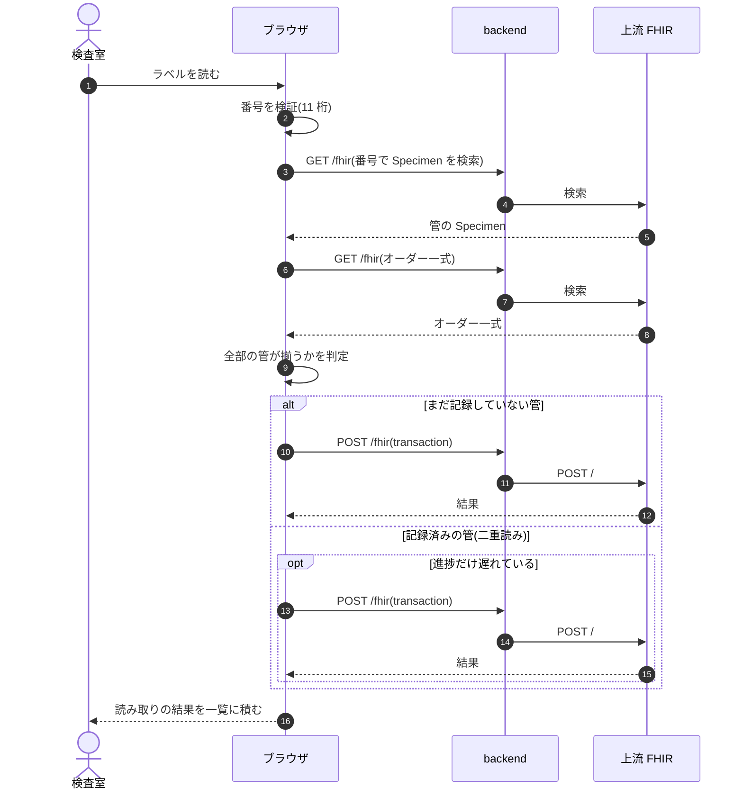

| 読む・書くもの | 条件 |
|---|---|
| 番号の検証 | 11 桁で、末尾のチェックデジット(M10W3)が合うか |
| 管の検索 | `Specimen?accession=番号`。無ければ「この番号の発行記録がありません」 |
| オーダー一式の検索 | `ServiceRequest?_id` に、明細・`Task`・`Specimen`・患者を含める |
| 揃ったかの判定 | オーダーの検体のどれにも、到着した管があるか。今回の管も数える |
| PUT 管の Specimen | `receivedTime`・`status: available`・記録者 |
| `Task` `lab-exam` = `completed` | 全部の管が揃い、`Task` が `accepted` のとき |

- 細菌検査の容器は、同じ画面で別の判定(容器が揃うと受付済)をします。
- 病理の容器と、細菌検査の取り下げたラベルは、到着を記録しません。

到着の取消です。

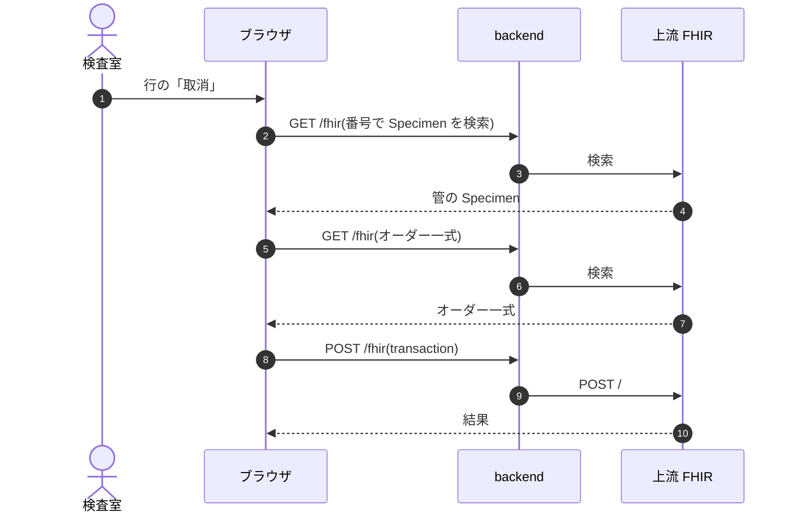

| transaction で書くもの | 条件 |
|---|---|
| PUT 管の Specimen | `receivedTime` と `status` を外す |
| `Task` `lab-exam` = `accepted` | `Task` が `completed` のとき |

画面を開いたまま別の端末で状態が変わっていることがあるので、取消でも管と進捗を読み直します。

## 結果登録・訂正

新規です。

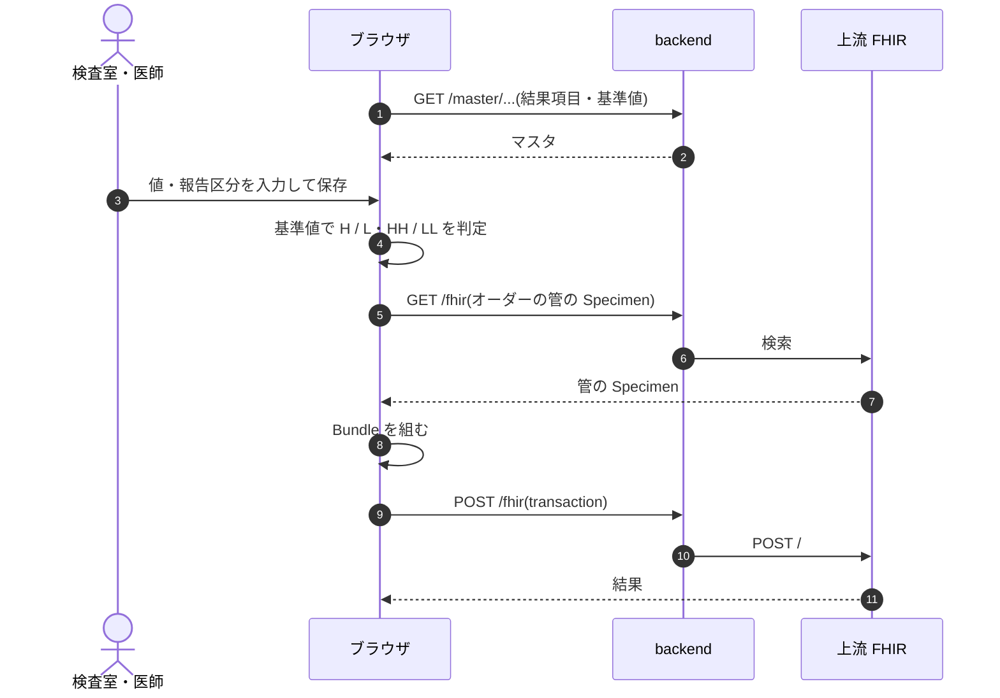

| 読む・書くもの | 条件 |
|---|---|
| マスタ | 結果項目、オーダー項目から結果項目への対応、基準値 |
| 管の検索 | `Specimen:request` でオーダーの管を引く |
| `DiagnosticReport` | `status`・`issued`・`performer` |
| `Observation` × 項目 | `referenceRange`・`interpretation`・`method` |
| 結果の Specimen | 材料の一致する管があれば参照し、無ければ作る |
| `Task` `lab-panic`(依頼医) | パニック値があるとき。報告区分によらない |
| `Task` `result-review`(依頼医) | 最終報告で、未確認の緊急異常値の通知が無いとき |

編集(確定・訂正)です。

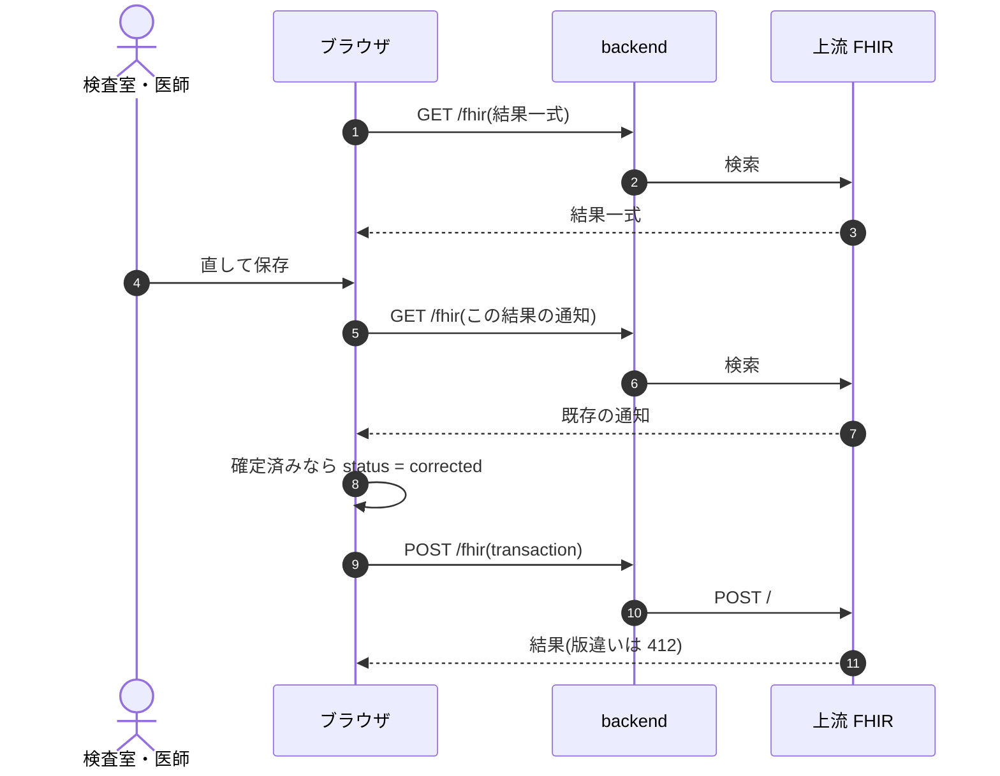

| 読む・書くもの | 条件 |
|---|---|
| 結果一式の検索 | `DiagnosticReport?_id` に `result`・`specimen` を含める |
| 通知の検索 | この結果の `Task` `lab-panic`・`result-review` |
| PUT `DiagnosticReport` | `ifMatch` を添える |
| `Observation` の POST / PUT / DELETE | 差分で書く |
| PUT `Task` `lab-panic` | パニック値が直れば `cancelled`、またパニック値になれば `requested` |
| `Task` `result-review` | 訂正なら `requested` に戻す。未確認の緊急異常値の通知があるあいだは作らず、未確認のものは取り下げる |

削除です。

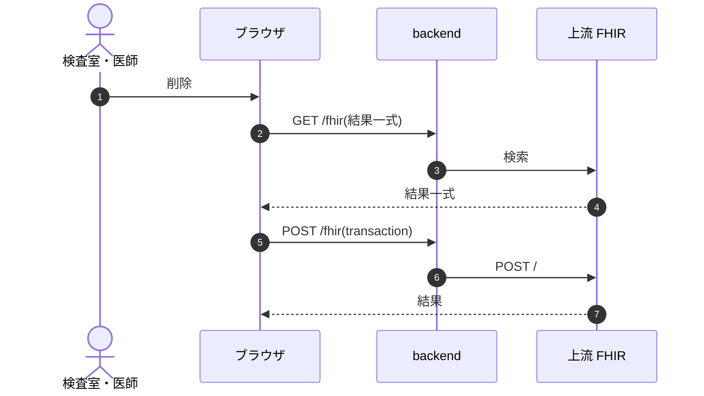

| transaction で書くもの | 条件 |
|---|---|
| DELETE `DiagnosticReport` → `Observation` → 結果側が作った Specimen | この順に積む |
| 管の Specimen | 消さずに残す |

## 結果取込

ファイルの読み込みです。

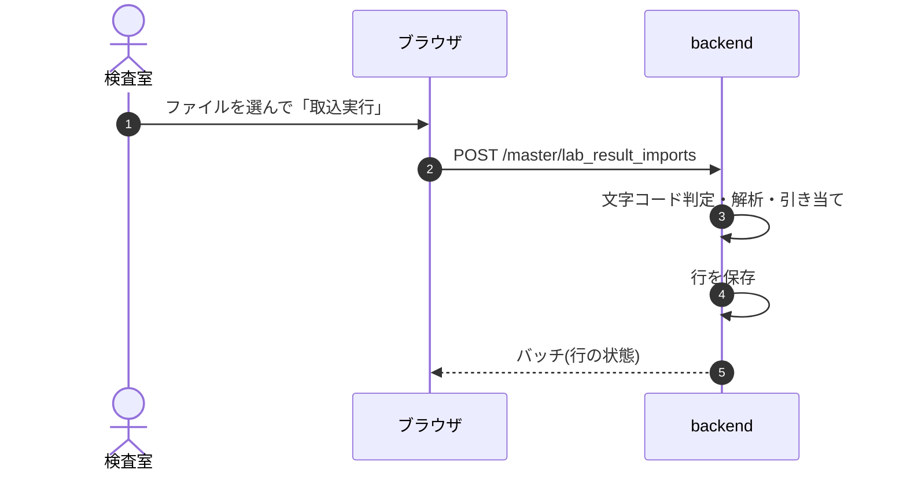

| backend の処理 | 中身 |
|---|---|
| 受け付ける形式 | JAHIS 臨床検査データ交換規約(HL7 v2.5)の ORU^R01(ファイル転送型)と OUL^R22(会話型)。multipart で送る |
| 文字コード | BOM → ESC シーケンス → MSH-18 の宣言 → UTF-8 として妥当か → CP932 の順に判定する。宣言と中身が食い違うファイルは取り込まない |
| 結果項目の引き当て | JLAC10 / JLAC11 の完全一致 → 17 桁の先頭 12 桁の前方一致の順。決まらない行は保留 |
| 値の検証 | CD / CO の値が選択肢に無い行、PQ に数値でない値が来た行は保留 |
| 取り込まない行 | OBX-11 が `X`・`D` の行と、SPM 直下の OBX |
| 候補 | ORC・OBR 群 1 件が結果 1 件 |
| 行の状態 | 保留 / 登録待ち / 対象外 |
| 同じメッセージ ID | 詳細画面で知らせるが、取込は止めない(訂正版が同じ ID で来ることがあるため) |

候補ごとの登録です。

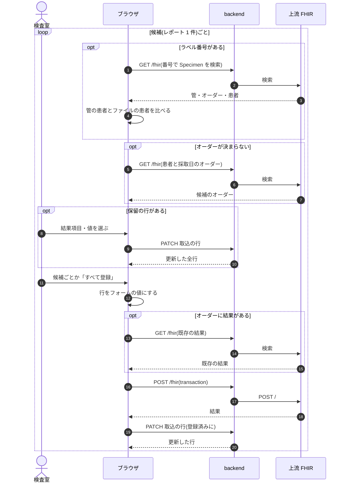

| 読む・書くもの | 条件 |
|---|---|
| オーダーの決め方 | 人が選んだオーダー → ラベル番号 → 患者番号 + 採取日の順 |
| ラベル番号の検索 | `Specimen?accession` から、管・オーダー・患者を引く。管の患者がファイルの患者と違えば番号を使わない |
| 患者と採取日の検索 | 患者番号から患者を引き、採取日の検体検査オーダーを探す。0 件なら紐付けなし、複数なら選ぶ |
| 保留の行の更新 | `PATCH /master/lab_result_import_rows/:id`(`write_to_master`・`apply_to_same_code`) |
| フォームの値 | H / L を施設の基準値で付け直す。基準値の無い項目だけ OBX-8 を写す。OBX-7 は画面に出すだけ |
| 報告区分 | OBR-25 の `P` は中間報告、`F` / `C` は最終報告 |
| transaction | 結果が無ければ結果登録と同じ。あれば項目を差し替え・追加して、訂正と同じ(`useCreateLabResult` / `useUpdateLabResult`) |
| 登録済みの印 | `PATCH /master/lab_result_import_rows/bulk_update`(`report_fhir_id` を付けて `registered` に) |

## 結果確認

通知の一覧から(緊急異常値)です。

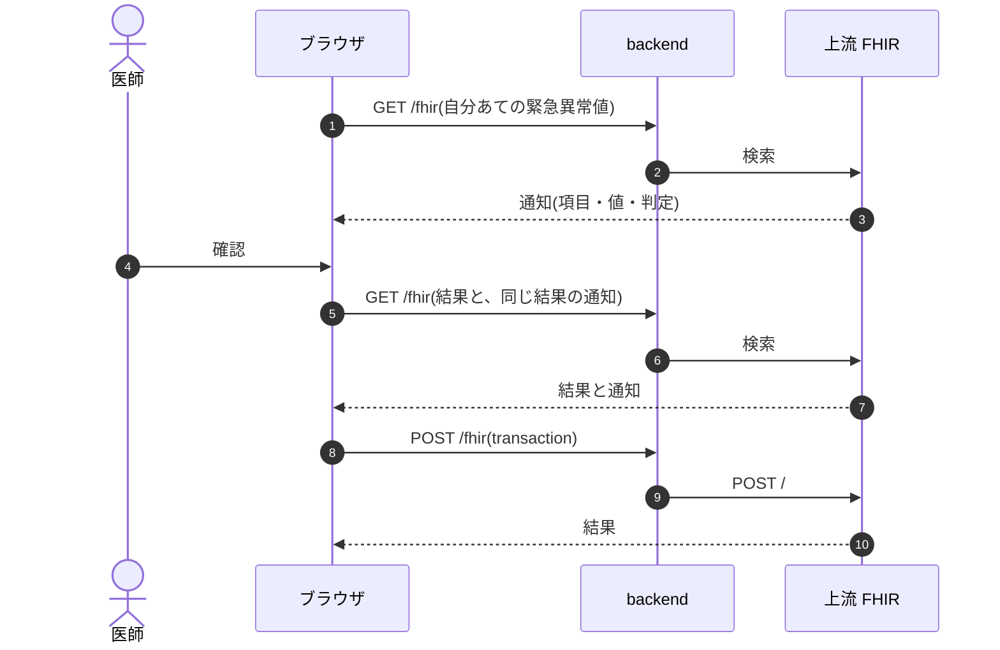

| 読む・書くもの | 条件 |
|---|---|
| 通知の検索 | `Task` `lab-panic`、自分あて・未確認。項目・値・判定は `input` |
| 結果と通知の検索 | 結果の `DiagnosticReport` と、同じ結果の `result-review` |
| PUT `Task` `lab-panic` = `completed` | 確認者を `note` に入れる |
| `Provenance`(verifier) | 最終報告・訂正報告のとき |
| 未確認の `result-review` を `completed` に | あるとき |

カルテの検査結果タブからです。

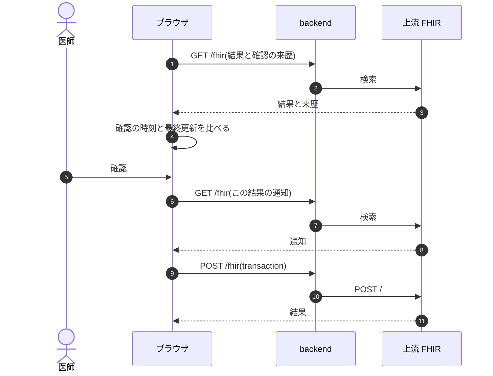

| 読む・書くもの | 条件 |
|---|---|
| 未確認の判定 | 確認の来歴の時刻が、結果の `meta.lastUpdated` より前なら未確認 |
| 通知の検索 | この結果の `Task` `result-review`・`lab-panic` |
| `Provenance` | `target` = 結果、`agent.type = verifier`、`signature` |
| 未確認の通知を `completed` に | `result-review` も `lab-panic` も |

## 医事会計と SS-MIX2

医事会計(`BillingClaimBuilder`)は、検体検査を実施記録からではなくオーダーの検査日で集めます(`:order` 経路)。進捗 Task は見ず、中止は `ServiceRequest.status` で判定します。
SS-MIX2 の括弧内はデータ種別、INS / DEL は処理区分です。

| 起きたこと | 医事会計 | SS-MIX2 |
|---|---|---|
| 登録・編集 | 検査日のオーダーの項目を `receipt_code` で送る | OML^O33(OML-01)。編集も INS |
| 削除 | 対象から外れる | OML^O33 の `CA`(DEL) |
| 中止 | 対象から外れる(`ServiceRequest` が `revoked`) | OML^O33 の `CA`(DEL) |
| 中止取消 | 対象に戻る | OML^O33 の `NW`(INS) |
| 受付・到着 | 送らない | 送らない |
| 結果の登録・確定・訂正 | 送らない | OUL^R22(OML-11)。訂正も INS |
| 結果の削除 | 送らない | OUL^R22 の `CA`(DEL) |

- **採血料**: 血液の検体があれば、採血料を最初の剤に 1 回足します。
- **送れない項目**: `receipt_code` の無い項目は「送れない項目」に出します。
- **会計を送ったあとの中止**: 医事課が送り直します。
- **OML^O33**: ヘッダを書くと出します。
- **受付・到着**: `Specimen` の作成・更新はメッセージにしません。
- **結果の訂正**: 前の有効なファイルは過去の履歴になります。
- **外来迅速検体検査加算**: 「当日結果説明」を判定できないので送りません。
