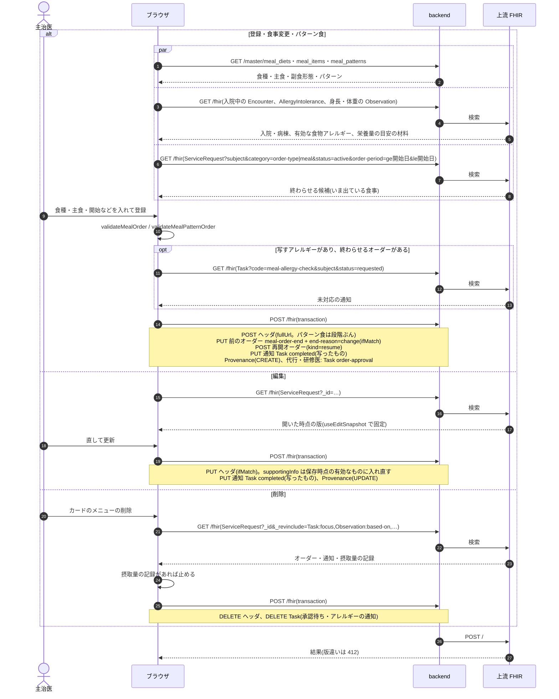
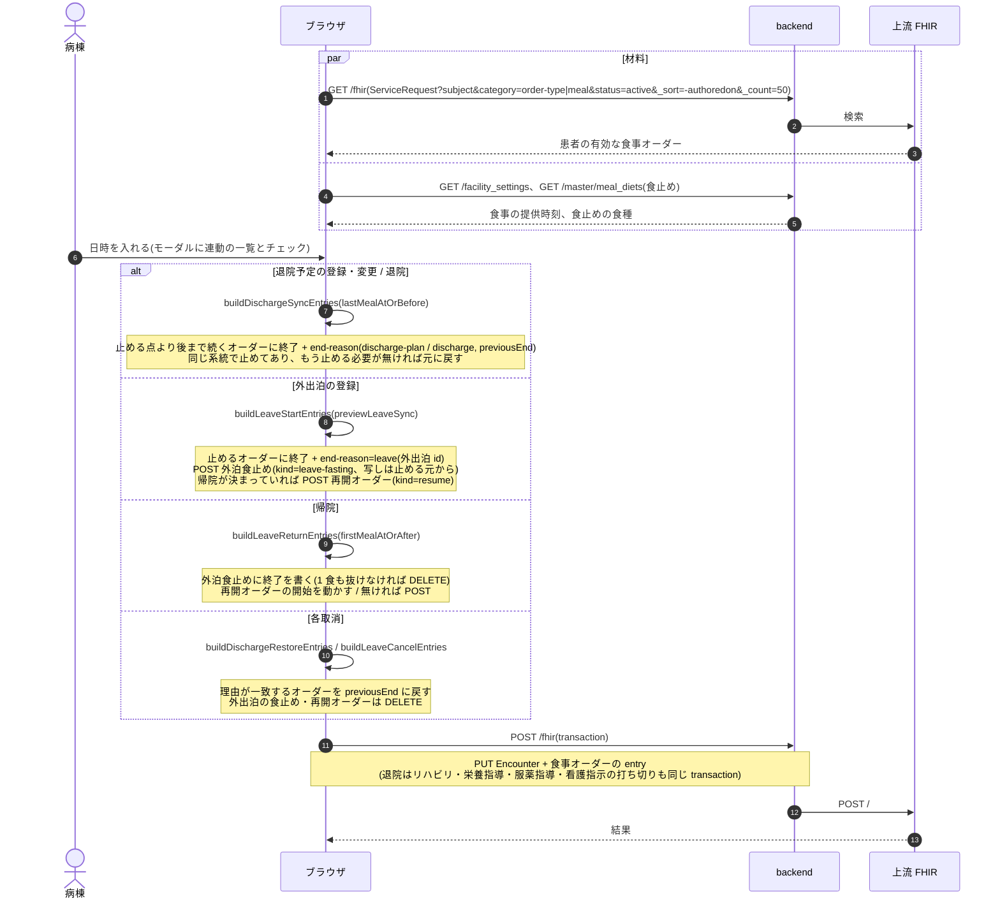
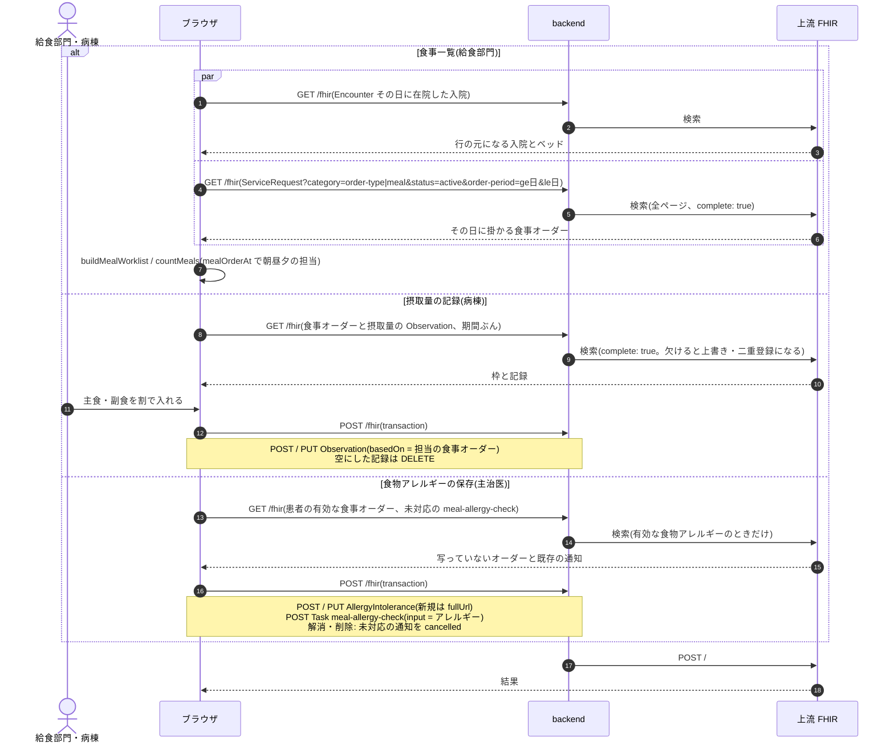

# 食事オーダーのシーケンス図

<!-- ../fhir-client/docs/order-flows/meal.md から scripts/sync-flows.mjs で作る。直接編集しない。 -->

運用の流れは[食事オーダーの業務フロー](../flows/meal.md)にあります。

## リソースの構成

| もの | リソース | 要点 |
|---|---|---|
| オーダー(ヘッダ) | `ServiceRequest` | `category` = `order-type|meal` + `prescription-setting|inpatient`、`code` = 食種(`meal-type`)、`orderDetail[]` = 主食(`meal-staple-food`、拡張 `meal-timing` で朝昼夕。無ければ全食共通)と副食形態(`meal-side-dish-form`)、`occurrenceDateTime` = 開始(時刻 08/12/18 = 朝昼夕)、`note` = コメント、`reasonReference` = 対象プロブレム、`encounter` = 入院、`supportingInfo` = 写した食物アレルギー(`AllergyIntolerance` の参照 + 名称)。明細は持たない |
| 期間・中身 | ヘッダの拡張 | `meal-order-end`(終了。無ければ継続)、`meal-skipped-timing`(欠食。朝昼夕ぶん繰り返す)、`meal-fasting-reason`(欠食理由)、`meal-salt-limit`(塩分制限、UCUM `g`)、`meal-pattern`(パターン食の名称・段階)、`order-department` / `order-ward` |
| 種別・終了の理由 | ヘッダの拡張 | `meal-order-link`(`kind` = start / change / resume / leave-fasting、`source`、`leave` = 外出泊 id)、`meal-order-end-reason`(`reason` = change / discharge-plan / discharge / leave、`leave`、`previousEnd` = 連動の前の終了) |
| 進捗 | 無い | 部門の受付・実施が無いので `Task` を作らない |
| 摂取量 | `Observation`(`basedOn` = その食事を出しているヘッダ) | 1 食 × 主食 / 副食で 2 件。MEDIS 看護観察マスタの「食事摂取量(主食)/(副食)％」、`effectiveDateTime` は 08/12/18 |
| 外出泊 | `Encounter` の拡張(子拡張 `id`) | 食事側は `meal-order-link.leave` / `meal-order-end-reason.leave` の id で結び付く |
| アレルギーの通知 | `Task`(`task-code|meal-allergy-check`、`focus` = ヘッダ、`input` = アレルギー) | 通知は Task に統一の 1 種別 |
| 代行入力 | `Provenance`(`target` = ヘッダ) | 種別共通 |

- 期間を `occurrencePeriod` にせず開始 + 拡張にするのは、上流が `occurrenceDateTime` を索引するため。上流は `order-period` で開始と `meal-order-end` を合わせて索引しており、「その日に掛かる食事」はこれで上流が絞ります。
- 08/12/18 は SS-MIX2(TQ1-7/8、ODS-2)の食事タイミングのコードで、施設の食事提供時刻(`facility_settings.meal_schedule`)とは別物です。提供時刻は入退院の連動で「どの食事まで / から」を決めるのにだけ使います。
- 食止めはマスタの食種の属性(`is_fasting`)で、オーダーには写しません。編集で開くとマスタを引き直して判定します。`doNotPerform` は使いません。
- 欠食理由は `reasonCode` に入れません。`reasonCode` / `reasonReference` はオーダーを出す理由(治療食の病名)の席で、欠食理由はオーダーの一部(食事を出さない指示)に付く理由のため。

## 状態の持ち方

**`ServiceRequest.status` は登録から削除まで `active` のまま**で、Task も無く、中止(`revoked`)もありません。どの食事を誰が担当するかは開始・終了の文字列(`YYYY-MM-DDTHH:mm`)の辞書順で決めます。

| 判定 | 規則 | 実装 |
|---|---|---|
| ある食事の担当 | 開始 ≦ その食事 かつ(終了なし または その食事 ≦ 終了)。複数あればいちばん後に始まったもの | `mealOrderAt`、1 日ぶんは `mealDayEntries` |
| 食事変更で終わらせる候補 | 新しい食事の開始日に掛かる有効なオーダー(開始日も見る。まだ始まっていないオーダーを候補にしない) | `useActiveMealOrders`(`order-period=ge日&le日`) |
| 終わらせる点 / 再開する点 | 直前の食事 / 次の食事 | `previousMealPoint` / `nextMealPoint` |
| 再開できるか | 元のオーダーが新しい終了より後まで続くはずだったか | `mealOrderResumable`(`mealOrderNeedsStop` と同じ条件) |
| 連動の止める点 / 戻す点 | 時刻までに出た最後の食事 / 時刻以降の最初の食事 | `lastMealAtOrBefore` / `firstMealAtOrAfter` |
| 連動の取消で戻すか | `meal-order-end-reason` の理由が一致するものだけ `previousEnd` に戻す。退院予定 → 退院は同じ系統 | `buildMealOrderRestoreEntry`、`isSameEndCauseFamily` |
| 今日以降も食事を出すか | アレルギーの照合・通知の対象 | `mealOrderServesOnOrAfter` |

- 開始と終了が同じ点、または終了が開始より前になったオーダーは担当する食事が無く、暦と一覧に出ません(カードには出ます)。食事変更を続けると自然に起きます。
- 編集(`buildMealOrderUpdateBundle`)は、終了を変えていなければ終了の理由を引き継ぎ、手で変えたら外します。登録日時・種別・入院・パターンは元のオーダーから引き継ぎます。

## シーケンス図の前提

`/fhir` への書き込みはどれも 1 回の transaction Bundle で、backend の `FhirProxyController` が上流へ中継します。
SS-MIX2 を有効にしている施設では、中継が書き込みの控えを記録し(`Ssmix2::Recorder`)、食事オーダーの書き込みごとに `OMD^O03` を組みます。
楽観ロックの版は `postBundle` が `ifMatch` に添え、版が違えば 412 で止まります。編集フォームは `useEditSnapshot` で開いた時点の版に固定し(`MealOrderPanels.tsx`)、`withVersionLock` でその版を添えます。食事変更で終わらせる前のオーダーは読んだ版で PUT します。

| 部品 | 場所 |
|---|---|
| オーダーのフォーム | `components/MealOrderForm.tsx`・`MealOrderPanels.tsx`(入院判定・食事変更の候補)、食種選択 `MealDietPickerModal.tsx`(パターン食のタブ `MealPatternPickerList.tsx`、段階の表 `MealPatternStepsTable.tsx`)、詳細 `MealOrderDetailPanel.tsx`、カード `karteCardBodies/MealOrderCardBody.tsx` |
| 暦 | `components/KarteMealTab.tsx`(マスの押し分け)、アレルギーの注意 `MealAllergyNotice.tsx` |
| 組み立て | `fhir/mealOrderHelpers.ts`(登録・食事変更・再開・編集・担当の判定)、パターン食 `fhir/mealPatternHelpers.ts`、アレルギーの照合 `fhir/mealAllergyHelpers.ts`・通知 `fhir/mealAllergyTaskHelpers.ts` |
| 入退院の連動 | `fhir/mealEncounterSync.ts`(純関数)、材料 `hooks/useMealSyncContext.ts`、一覧とチェック `components/MealSyncSummary.tsx`、`DischargePlanModal` / `DischargeModal` / `LeaveModal` / `LeaveReturnModal` / `InpatientPlanTables`(各取消) |
| 部門の画面 | `pages/MealWorklistPage.tsx`(`/meal-worklist`)、集計 `fhir/mealWorklistHelpers.ts` |
| 摂取量 | `fhir/flowsheetMealHelpers.ts`(経過表と一括入力の枠と記録) |
| hook | `api/queries/meal.ts` |

## 登録・食事変更・編集・削除

`buildMealOrderBundle` / `buildMealPatternBundle` / `buildMealOrderUpdateBundle`、`useCreateMealOrder`(`useCreatePrescription` に通知の自動完了を足したもの)、`useUpdateMealOrder`、`deleteMealOrderRequest` / `postOrderDeleteBundle`(`api/queries/orderDelete.ts`)。

- 雛形(オーダーセット・パスのタスク・パターン食の段階)はアレルギーの写しを持たず、適用時にその患者の有効なものを入れます(`BuildBundleArgs.foodAllergies`)。

## 入退院・外出泊の連動

`useMealSyncContext`(モーダル)/ `useMealSyncContextLoader`(行メニュー)が材料を揃え、`mealEncounterSync.ts` の純関数が entry を組み、入院の書き換え(`buildEncounterUpdateBundle` の第 2 引数)と同じ transaction に載せます。

- 外出泊の取消・帰院で消す食止め・再開オーダーは、入院の transaction に直接 `DELETE` を積みます(削除の共通経路 `postOrderDeleteBundle` は通りません)。
- 外出泊 id の無い連動前のデータは、帰院実施で食事を戻せません(画面に注意を出します)。

## 食事一覧・摂取量・アレルギーの通知

`useMealOrdersOn`(`complete: true`。食数の合計に使うので、500 件 × 4 ページで欠けたら止める)、`useInpatientEncounters`、`useBedWardIndex`。アレルギー側は `useCreateAllergy` / `useUpdateAllergy` / `useDeleteAllergy` が `mealAllergyCheckEntriesFor` で通知を同梱します。

## 医事会計と SS-MIX2

食事はレセコン送信の対象外です(`OrderCatalog::IGNORED`。出来高で請求する項目が無い種別として報告もしません)。入院時食事療養費の算定は扱っていません。
SS-MIX2 は食事オーダーの書き込みごとに `OMD^O03` を組みます(`Ssmix2::Messages::OmdO03`)。食種は ODS-1 T(食止めは `NPO^食止め^SSMIXTF01`)、主食は食事ごとの ODS-1 D(ODS-2 に時間帯)、欠食は時間帯付きの食止め、副食形態・塩分制限は食種の ODS-4、コメントは NTE、写した食物アレルギーは AL1、開始・終了は TQ1-7/8(`YYYYMMDDHH`)です。

| 起きたこと | 医事会計 | SS-MIX2 |
|---|---|---|
| 登録・パターン食・再開オーダー・外泊食止め | なし | 新しいオーダーごとに `OMD^O03`(ORC-1 `NW`) |
| 編集・食事変更で終わらせる・入退院の連動で終了が付く / 戻る | なし | 書き換えたオーダーごとに `OMD^O03`(`NW`。TQ1-8 が新しい終了) |
| 削除・外出泊の取消や帰院で消える食止め・再開 | なし | `OMD^O03`(ORC-1 `CA`) |
| 摂取量の記録 | なし | なし |
| 食物アレルギーの保存 | なし | `ADT^A60`(アレルギー側。食事オーダーの電文は出ない) |
