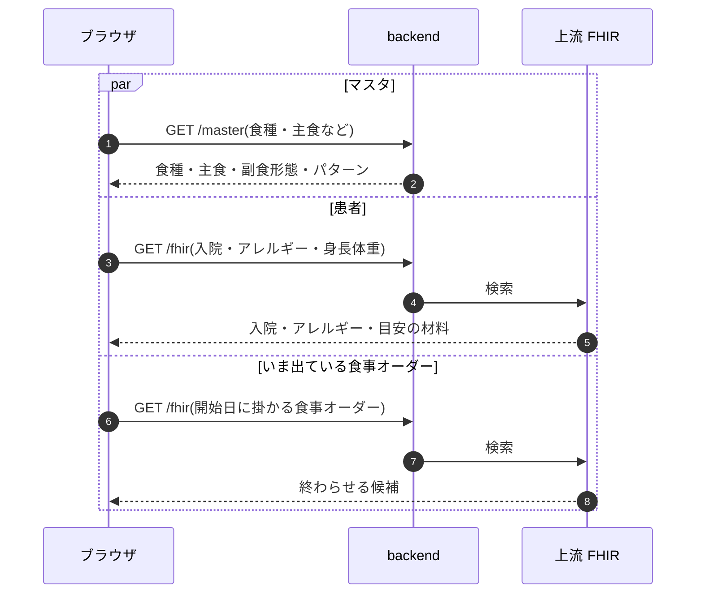
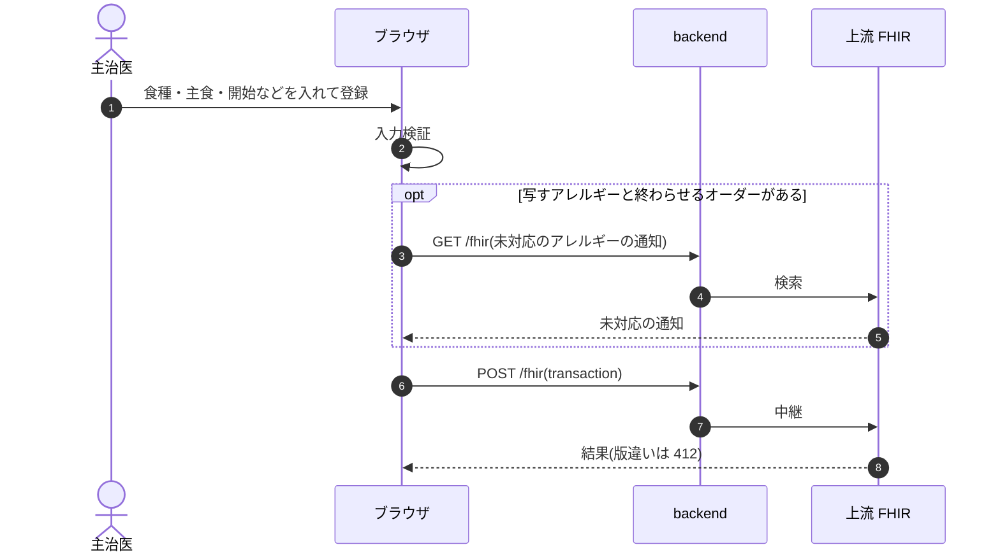
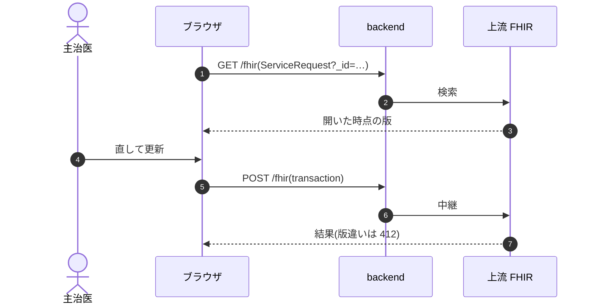
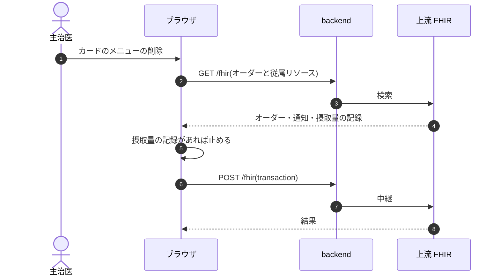
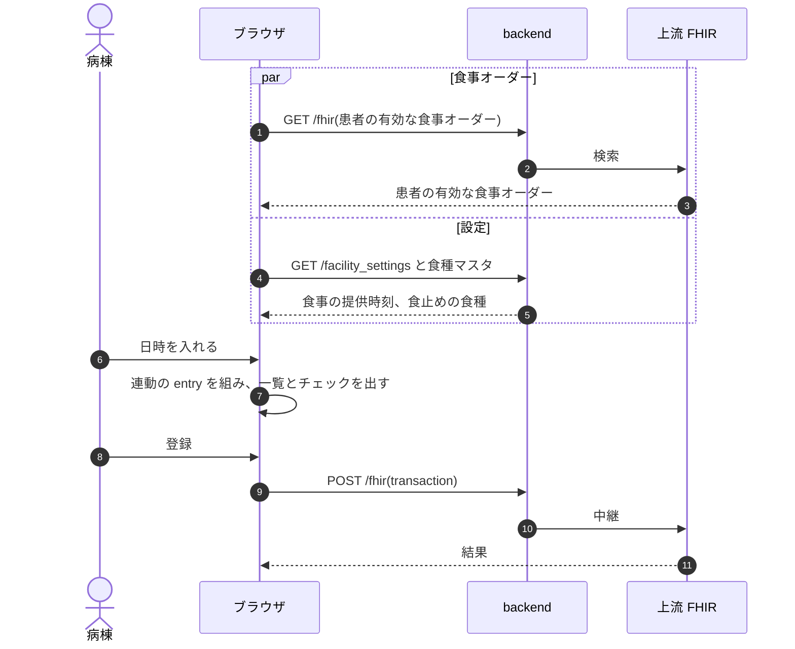
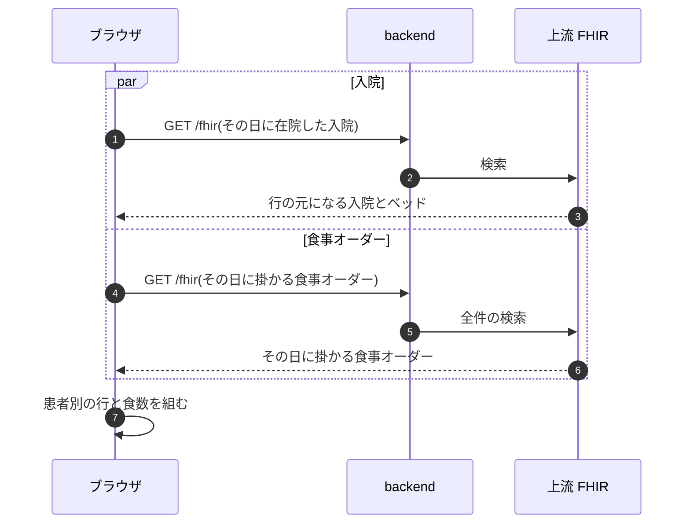
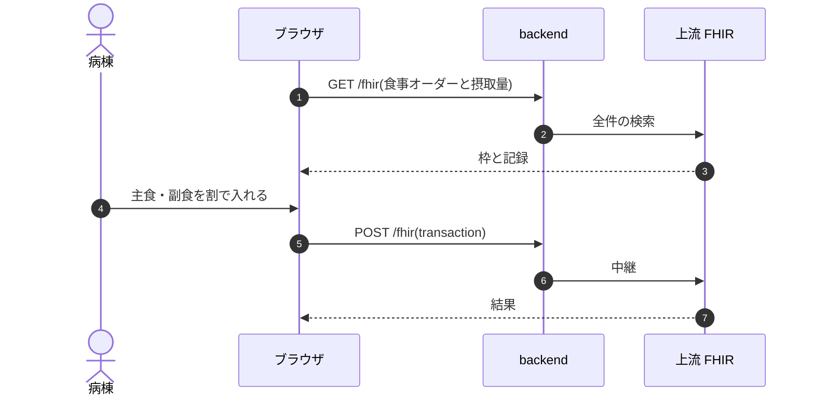
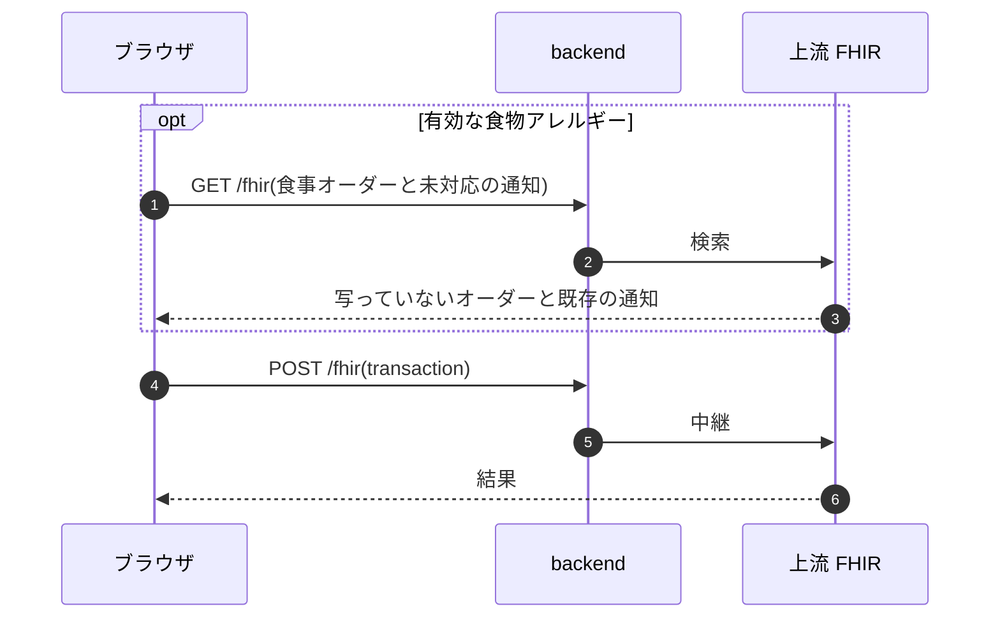

# 食事オーダーのシーケンス図

<!-- ../fhir-client/docs/order-flows/meal.md から scripts/sync-flows.mjs で作る。直接編集しない。 -->

運用の流れは[食事オーダーの業務フロー](../flows/meal.md)にあります。

## シーケンス図の前提

- **書き込みの経路**: `/fhir` への書き込みはどれも 1 回の transaction Bundle で、backend の `FhirProxyController` が上流へ中継します。
- **SS-MIX2**: 有効にしている施設では、中継が書き込みの控えを記録し(`Ssmix2::Recorder`)、食事オーダーの書き込みごとに `OMD^O03` を組みます。
- **図の描き方**: 応答は backend を通って戻りますが、図では上流からブラウザへ直接描きます。検索の条件と transaction の中身は、図の下の表に出します。

楽観ロックの版の決め方は、書き込みで違います。

| 書き込み | 版の決め方 |
|---|---|
| 共通 | `postBundle` が版を `ifMatch` に添える。版が違えば 412 で止まる |
| 編集フォーム | `useEditSnapshot` で開いた時点の版に固定し(`MealOrderPanels.tsx`)、`withVersionLock` でその版を添える |
| 食事変更で終わらせる、前のオーダー | 読んだ版で PUT する |

このページで使う呼び名は次のとおりです。

| 呼び名 | 指すもの |
|---|---|
| 上流 | 上流の FHIR サーバー |
| ヘッダ | 食事オーダー 1 本を表す `ServiceRequest`。明細は持たない |
| 点 | 日付と朝・昼・夕の組。文字列 `YYYY-MM-DDTHH:mm` で持ち、時刻 08 / 12 / 18 が朝・昼・夕 |
| 担当 | ある点の食を出しているオーダーであること |
| 連動 | 入退院・外出泊の書き込みと同じ transaction で、食事オーダーを止め、戻すこと |
| 全件の検索 | 全ページを読み切る検索(`complete: true`)。欠けたら結果を使わない |
| 雛形 | オーダーセット・パスのタスク・パターン食の段階に持つ、オーダーの内容 |

## リソースの構成

ヘッダ(`ServiceRequest`)の要素は次のとおりです。

| 要素 | 中身 |
|---|---|
| `category` | `order-type|meal` と `v3-ActCode|IMP` |
| `code` | 食種(`meal-type`) |
| `orderDetail[]` | 主食(`meal-staple-food`)と副食形態(`meal-side-dish-form`) |
| `orderDetail[]` の拡張 `meal-timing` | 主食がどの食のものか(朝昼夕)。無ければ全食共通 |
| `occurrenceDateTime` | 開始の点 |
| `note` | コメント |
| `reasonReference` | 対象プロブレム |
| `encounter` | 入院 |
| `supportingInfo` | 写した食物アレルギー(`AllergyIntolerance` の参照と名称) |

ヘッダの拡張は次のとおりです。

| 拡張 | 中身 |
|---|---|
| `meal-order-end` | 終了の点。無ければ継続 |
| `meal-skipped-timing` | 欠食。朝昼夕ぶん繰り返す |
| `meal-fasting-reason` | 欠食理由 |
| `meal-salt-limit` | 塩分制限(UCUM `g`) |
| `meal-pattern` | パターン食の名称・段階 |
| `order-department` / `order-ward` | 登録時の診療科・病棟 |
| `meal-order-link` | 種別。`kind`・`source`・`leave`(外出泊 id)を持つ |
| `meal-order-end-reason` | 終了の理由。`reason`・`leave`・`previousEnd`(連動の前の終了)を持つ |

| 拡張の値 | 取る値 |
|---|---|
| `meal-order-link.kind` | `start` / `change` / `resume` / `leave-fasting` |
| `meal-order-end-reason.reason` | `change` / `discharge-plan` / `discharge` / `leave` |

ヘッダのほかのリソースは次のとおりです。

| もの | リソース | 要点 |
|---|---|---|
| 進捗 | 無い | 部門の受付・実施が無いので `Task` を作らない |
| 摂取量 | `Observation` | `basedOn` = その食を担当するヘッダ。1 食に主食・副食の 2 件 |
| 外出泊 | `Encounter` の拡張(子拡張 `id`) | 食事側は `meal-order-link.leave` と `meal-order-end-reason.leave` の id で結び付く |
| アレルギーの通知 | `Task` | `task-code|meal-allergy-check`、`focus` = ヘッダ、`input` = アレルギー |
| 代行入力 | `Provenance` | `target` = ヘッダ。種別共通 |

- **摂取量**: コードは MEDIS 看護観察マスタの「食事摂取量(主食)/(副食)％」です。`effectiveDateTime` の時刻は 08 / 12 / 18 です。
- **アレルギーの通知**: 通知は `Task` に統一してあり、その 1 種別です。
- **期間の持ち方**: 期間を `occurrencePeriod` にせず、開始と拡張に分けています。上流が `occurrenceDateTime` を索引するためです。
- **その日に掛かる食事オーダー**: 上流は `order-period` で、開始と `meal-order-end` を合わせて索引しています。「その日に掛かる食事オーダー」は、これで上流が絞ります。
- **08 / 12 / 18**: SS-MIX2(TQ1-7/8、ODS-2)の食事タイミングのコードです。施設の食事提供時刻(`facility_settings.meal_schedule`)とは別物です。提供時刻は、連動で「どの食まで / どの食から」を決めるのにだけ使います。
- **食止め**: マスタの食種の属性(`is_fasting`)で、オーダーには写しません。編集で開くとマスタを引き直して判定します。`doNotPerform` は使いません。
- **欠食理由**: `reasonCode` には入れません。`reasonCode` / `reasonReference` は、オーダーを出す理由(治療食の病名)を入れる要素です。欠食理由は、オーダーの一部(食事を出さない指示)に付く理由なので、拡張に持ちます。

## 状態の持ち方

**`ServiceRequest.status` は登録から削除まで `active` のまま**で、Task も無く、中止(`revoked`)もありません。ある点の食をどのオーダーが担当するかは、開始と終了の点の文字列を辞書順に比べて決めます。

| 判定 | 規則 | 実装 |
|---|---|---|
| ある点の担当 | 開始 ≦ その点、かつ終了が無いか、その点 ≦ 終了のオーダー。複数あれば、いちばん後に始まったもの | `mealOrderAt`。1 日ぶんは `mealDayEntries` |
| 食事変更で終わらせる候補 | 新しいオーダーの開始日に掛かる有効なオーダー | `useActiveMealOrders`(`order-period=ge日&le日`) |
| 終わらせる点 | 新しいオーダーの開始の 1 つ前の点 | `previousMealPoint` |
| 再開する点 | 新しいオーダーの終了の次の点 | `nextMealPoint` |
| 再開できるか | 元のオーダーが、新しいオーダーの終了より後まで続くはずだったなら再開できる | `mealOrderResumable`(`mealOrderNeedsStop` と同じ条件) |
| 連動で止める点 | その時刻までに出た最後の点 | `lastMealAtOrBefore` |
| 連動で戻す点 | その時刻以降の最初の点 | `firstMealAtOrAfter` |
| 連動の取消で戻すか | `meal-order-end-reason` の理由が一致するものだけ、`previousEnd` に戻す | `buildMealOrderRestoreEntry`、`isSameEndCauseFamily` |
| アレルギーの照合・通知の対象か | 今日以降も食事を出すオーダーなら対象 | `mealOrderServesOnOrAfter` |

- **終わらせる候補**: 開始日も見ます。まだ始まっていないオーダーを候補にしないためです。
- **同じ系統**: 連動の取消では、退院予定と退院を同じ系統の理由として扱います。
- **担当する食が無いオーダー**: 終了が開始より前になったオーダーは、担当する食が無く、暦と食事一覧に出ません(カードには出ます)。同じ点から始まる食事変更を続けると起きます。
- **開始と終了が同じ点のオーダー**: 上の規則では、その 1 食だけを担当します。
- **編集で引き継ぐもの**: 編集(`buildMealOrderUpdateBundle`)は、登録日時・種別・入院・パターンを元のオーダーから引き継ぎます。終了の理由は、終了を変えていなければ引き継ぎ、手で変えたら外します。

## 部品

| 部品 | 場所 |
|---|---|
| オーダーのフォーム | `components/MealOrderForm.tsx` |
| 入院の判定・食事変更の候補 | `components/MealOrderPanels.tsx` |
| 食種選択 | `components/MealDietPickerModal.tsx` |
| パターン食のタブ | `components/MealPatternPickerList.tsx` |
| パターン食の段階の表 | `components/MealPatternStepsTable.tsx` |
| オーダーの詳細 | `components/MealOrderDetailPanel.tsx` |
| カード | `components/karteCardBodies/MealOrderCardBody.tsx` |
| 暦(マスの押し分け) | `components/KarteMealTab.tsx` |
| 暦の上のアレルギーの注意 | `components/MealAllergyNotice.tsx` |
| 組み立て(登録・食事変更・再開・編集・担当の判定) | `fhir/mealOrderHelpers.ts` |
| 組み立て(パターン食) | `fhir/mealPatternHelpers.ts` |
| アレルギーの照合 | `fhir/mealAllergyHelpers.ts` |
| アレルギーの通知 | `fhir/mealAllergyTaskHelpers.ts` |
| 連動の組み立て(純関数) | `fhir/mealEncounterSync.ts` |
| 連動の材料を揃える hook | `hooks/useMealSyncContext.ts` |
| 連動の一覧とチェック | `components/MealSyncSummary.tsx` |
| 連動を呼ぶ画面 | `DischargePlanModal`・`DischargeModal`・`LeaveModal`・`LeaveReturnModal`、各取消は `InpatientPlanTables` |
| 食事一覧 | `pages/MealWorklistPage.tsx`(`/meal-worklist`) |
| 食事一覧の集計 | `fhir/mealWorklistHelpers.ts` |
| 摂取量(経過表と一括入力の枠と記録) | `fhir/flowsheetMealHelpers.ts` |
| hook | `api/queries/meal.ts` |

## 登録・食事変更・編集・削除

| 操作 | 組み立て | hook |
|---|---|---|
| 登録・食事変更 | `buildMealOrderBundle` | `useCreateMealOrder` |
| パターン食 | `buildMealPatternBundle` | `useCreateMealOrder` |
| 編集 | `buildMealOrderUpdateBundle` | `useUpdateMealOrder` |
| 削除 | `deleteMealOrderRequest` | `postOrderDeleteBundle`(`api/queries/orderDelete.ts`) |

`useCreateMealOrder` は、全種別共通の `useCreatePrescription` に通知の自動完了を足したものです。

フォームを開いたときの読み込みです。3 つを並行して読みます。

| 読むもの | 条件 |
|---|---|
| マスタ | `GET /master/meal_diets`・`meal_items`・`meal_patterns` |
| 患者 | 入院中の `Encounter`、`AllergyIntolerance`、身長・体重の `Observation` |
| 患者から得るもの | 入院・病棟、有効な食物アレルギー、栄養量の目安の材料 |
| 終わらせる候補 | `ServiceRequest?subject&category=order-type|meal&status=active&order-period=ge開始日&le開始日` |

登録・食事変更・パターン食です。

| 読む・書くもの | 条件 |
|---|---|
| 入力検証 | `validateMealOrder`。パターン食は `validateMealPatternOrder` |
| 未対応の通知の検索 | `Task?code=meal-allergy-check&subject&status=requested` |
| POST ヘッダ | `fullUrl` を付ける。パターン食は段階ぶん |
| PUT 前のオーダー | `meal-order-end` と `end-reason=change` を入れる。`ifMatch` を添える |
| POST 再開オーダー | `kind=resume`。再開するとき |
| PUT 通知の `Task` を `completed` に | 新しいオーダーにアレルギーが写ったもの |
| `Provenance`(CREATE) | 毎回 |
| `Task` `order-approval` | 代行入力・研修医のとき |

雛形はアレルギーの写しを持ちません。適用のときに、その患者の有効なものを入れます(`BuildBundleArgs.foodAllergies`)。

編集です。

| 書くもの | 条件 |
|---|---|
| PUT ヘッダ | `ifMatch` を添える(`useEditSnapshot` で固定した版)。`supportingInfo` は保存時点の有効なものに入れ直す |
| PUT 通知の `Task` を `completed` に | アレルギーが写ったもの |
| `Provenance`(UPDATE) | 毎回 |

削除です。

| 読む・書くもの | 条件 |
|---|---|
| 検索 | `ServiceRequest?_id&_revinclude=Task:focus,Observation:based-on,…` |
| DELETE ヘッダ | 摂取量の記録が無いとき |
| DELETE `Task` | 承認待ちの通知・アレルギーの通知 |

## 入退院・外出泊の連動

- 材料は、モーダルでは `useMealSyncContext`、行メニューでは `useMealSyncContextLoader` が揃えます。
- `mealEncounterSync.ts` の純関数が entry を組みます。
- 組んだ entry は、入院の書き換え(`buildEncounterUpdateBundle` の第 2 引数)と同じ transaction に載せます。

| 読む・書くもの | 条件 |
|---|---|
| 食事オーダーの検索 | `ServiceRequest?subject&category=order-type|meal&status=active&_sort=-authoredon&_count=50` |
| 設定 | `GET /facility_settings`、`GET /master/meal_diets`(食止めの食種) |
| PUT `Encounter` と食事オーダーの entry | 同じ transaction に載せる |
| リハビリ・栄養指導・服薬指導・看護指示の打ち切り | 退院のとき。同じ transaction に載せる |

操作ごとに組む entry は次のとおりです。

| 操作 | 組み立て | 食事オーダーの entry |
|---|---|---|
| 退院予定の登録・変更、退院 | `buildDischargeSyncEntries`(`lastMealAtOrBefore`) | 止める点より後まで続くオーダーに、終了と `end-reason`(`discharge-plan` / `discharge`、`previousEnd`)を入れる |
| | | 同じ系統で止めてあり、もう止める必要が無いオーダーは元に戻す |
| 外出泊の登録 | `buildLeaveStartEntries`(`previewLeaveSync`) | 止めるオーダーに、終了と `end-reason=leave`(外出泊 id)を入れる |
| | | POST 外泊食止め(`kind=leave-fasting`)。アレルギーの写しは止める元から取る |
| | | 帰院が決まっていれば、POST 再開オーダー(`kind=resume`) |
| 帰院 | `buildLeaveReturnEntries`(`firstMealAtOrAfter`) | 外泊食止めに終了を書く。1 食も抜けなければ DELETE |
| | | 再開オーダーの開始を動かす。無ければ POST |
| 各取消 | `buildDischargeRestoreEntries` / `buildLeaveCancelEntries` | 理由が一致するオーダーを `previousEnd` に戻す |
| | | 外出泊の食止め・再開オーダーは DELETE |

- 外出泊の取消・帰院で消す食止め・再開オーダーは、入院の transaction に直接 `DELETE` を積みます(削除の共通経路 `postOrderDeleteBundle` は通りません)。
- 外出泊 id を持たない、連動の仕組みを入れる前のデータは、帰院実施で食事を戻せません(画面に注意を出します)。

## 食事一覧・摂取量・アレルギーの通知

| 操作 | hook・組み立て |
|---|---|
| 食事一覧 | `useMealOrdersOn`、`useInpatientEncounters`、`useBedWardIndex`、`buildMealWorklist` / `countMeals` |
| 摂取量の記録 | `fhir/flowsheetMealHelpers.ts` |
| 食物アレルギーの保存 | `useCreateAllergy` / `useUpdateAllergy` / `useDeleteAllergy`。`mealAllergyCheckEntriesFor` で通知を同梱する |

食事一覧(給食部門)です。2 つを並行して読みます。

| 読むもの | 条件 |
|---|---|
| 入院 | その日に在院した `Encounter` |
| 食事オーダー | `ServiceRequest?category=order-type|meal&status=active&order-period=ge日&le日` |
| 行と食数 | `buildMealWorklist` / `countMeals`。朝昼夕の担当は `mealOrderAt` で決める |

食事オーダーは `useMealOrdersOn` の全件の検索で読みます。食数の合計に使うので、500 件 × 4 ページで欠けたら止めます。

摂取量の記録(病棟)です。

| 読む・書くもの | 条件 |
|---|---|
| 検索 | 期間ぶんの食事オーダーと、摂取量の `Observation`。欠けると上書き・二重登録になるので、全件の検索にする |
| POST / PUT `Observation` | `basedOn` = その食を担当する食事オーダー |
| DELETE `Observation` | 空にした記録 |

食物アレルギーの保存です。アレルギータブで保存したときに、通知も同じ transaction に載せます。

| 読む・書くもの | 条件 |
|---|---|
| 検索 | 患者の有効な食事オーダーと、未対応の `meal-allergy-check` |
| POST / PUT `AllergyIntolerance` | 新規は `fullUrl` を付ける |
| POST `Task` `meal-allergy-check` | `input` = アレルギー。写っていないオーダーごと |
| 未対応の通知を `cancelled` に | 解消・削除のとき |

## 医事会計と SS-MIX2

- **医事会計**: 食事はレセコン送信の対象外で、どの操作でも何も送りません(`OrderCatalog::IGNORED`。出来高で請求する項目が無い種別として報告もしません)。入院時食事療養費の算定は扱っていません。
- **SS-MIX2**: 食事オーダーの書き込みごとに `OMD^O03` を組みます(`Ssmix2::Messages::OmdO03`)。

| 項目 | `OMD^O03` での持ち方 |
|---|---|
| 食種 | ODS-1 T。食止めは `NPO^食止め^SSMIXTF01` |
| 主食 | 食ごとの ODS-1 D。ODS-2 に時間帯 |
| 欠食 | 時間帯付きの食止め |
| 副食形態・塩分制限 | 食種の ODS-4 |
| コメント | NTE |
| 写した食物アレルギー | AL1 |
| 開始・終了 | TQ1-7/8(`YYYYMMDDHH`) |

| 起きたこと | SS-MIX2 |
|---|---|
| 登録・パターン食・再開オーダー・外泊食止め | 新しいオーダーごとに `OMD^O03`(ORC-1 `NW`) |
| 編集、食事変更で終わらせる、連動で終了が付く / 戻る | 書き換えたオーダーごとに `OMD^O03`(`NW`。TQ1-8 が新しい終了) |
| 削除、外出泊の取消や帰院で消える食止め・再開 | `OMD^O03`(ORC-1 `CA`) |
| 摂取量の記録 | なし |
| 食物アレルギーの保存 | `ADT^A60`(アレルギー側。食事オーダーの電文は出ない) |
