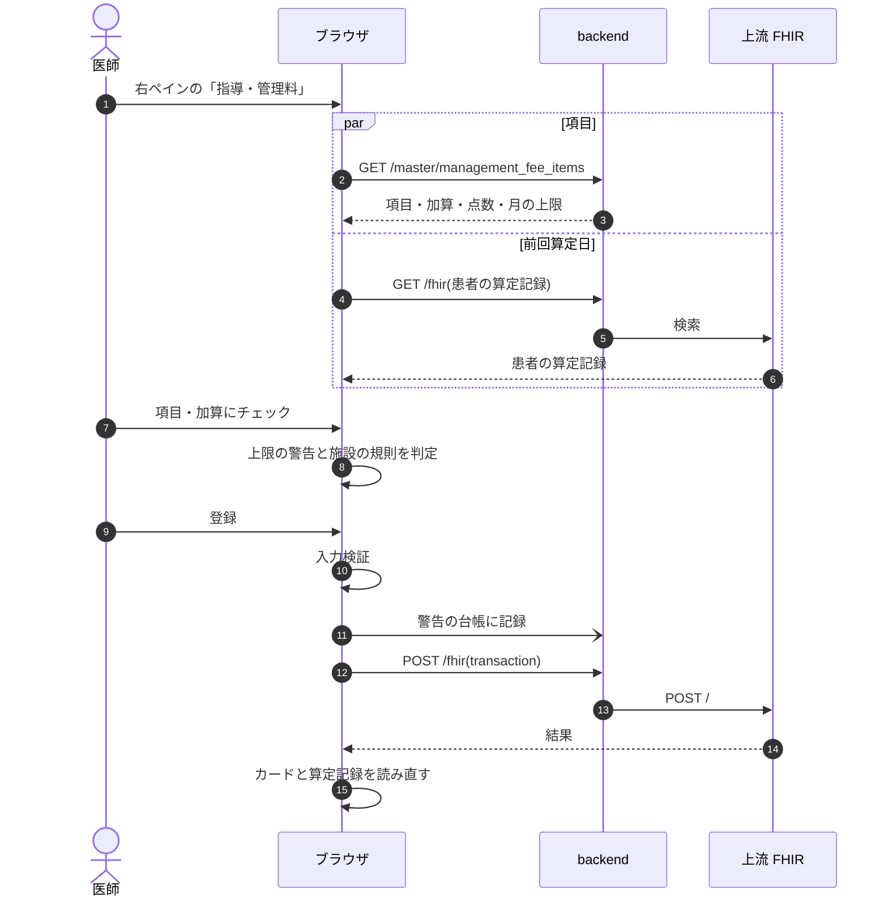
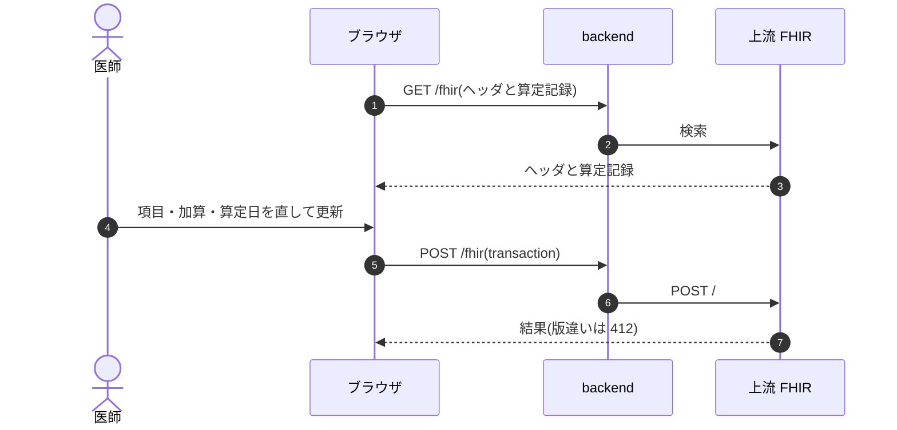
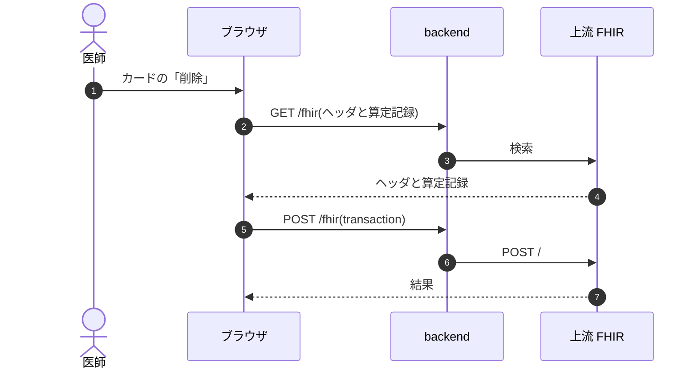
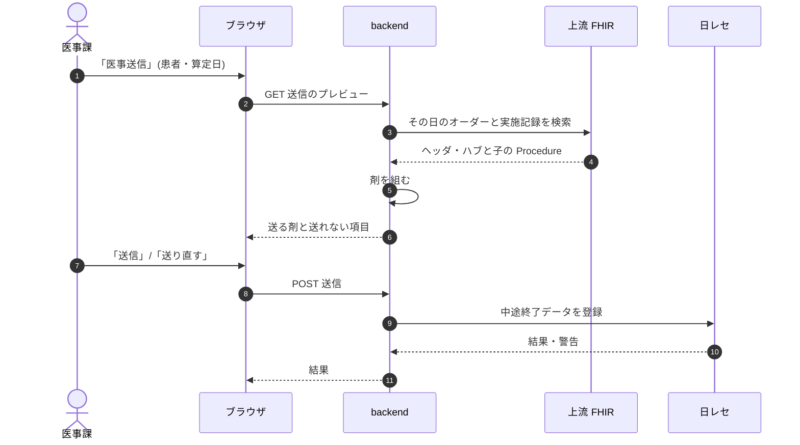

# 指導・管理料のシーケンス図

<!-- ../fhir-client/docs/order-flows/medical-management.md から scripts/sync-flows.mjs で作る。直接編集しない。 -->

運用の流れは[指導・管理料の業務フロー](../flows/medical-management.md)にあります。

## シーケンス図の前提

- **書き込みの経路**: `/fhir` への書き込みはどれも 1 回の transaction Bundle で、backend の `FhirProxyController` が上流へ中継します。
- **上流**: 上流の FHIR サーバーです。図では「上流 FHIR」と書きます。
- **応答の中継**: 上流の応答も backend を通って画面へ戻ります。図では省いて、上流から画面へ直接返す矢印で描きます。
- **SS-MIX2**: 有効にしている施設では、中継が書き込みの控えを記録します(`Ssmix2::Recorder`)。指導・管理料はメッセージになりません。
- **楽観ロック**: 版は `postBundle` が `ifMatch` に添え、版が違えば 412 で止まります。
- **編集の版の固定**: 編集フォームは `useEditSnapshot` で開いた時点の版に固定し(`hooks/useMedicalManagementOrderInitialValues.ts`)、`withVersionLock` でヘッダと実施記録の元の版を添えます。
- **ヘッダ**: オーダー 1 件を表す `ServiceRequest` です。明細の `ServiceRequest` は持ちません。
- **ハブ**: 項目 1 つの実施記録の `Procedure` です。
- **子**: 加算 1 つの実施記録の `Procedure` で、`partOf` でハブを指します。
- **算定記録**: ハブと子の `Procedure` をまとめた呼び名です。「運用フロー」節の「算定の記録」に当たります。

## リソースの構成

- ヘッダ `ServiceRequest`(オーダー 1 件)
  - ハブ `Procedure`(項目 1 つに 1 つ。`basedOn` = ヘッダ)
    - 子 `Procedure`(加算 1 つに 1 つ。`partOf` = ハブ、`basedOn` = ヘッダ)
  - `Provenance`(`target` = ヘッダ。登録・編集で付ける)
  - Task `order-approval`(代行入力・研修医のとき)

子も `basedOn` でヘッダを指すのは、`_revinclude=Procedure:based-on` 1 本でハブと子を一緒に引くためです。

| リソース | 要素 | 中身 |
|---|---|---|
| ヘッダ `ServiceRequest` | `status` | `completed`(登録したときから) |
| ヘッダ `ServiceRequest` | `category` | `order-type|medical-management` と、入外区分の `prescription-setting` |
| ヘッダ `ServiceRequest` | `code.text` | 項目名のまとめ |
| ヘッダ `ServiceRequest` | `occurrenceDateTime` | 算定日(日付のみ) |
| ヘッダ `ServiceRequest` | `note` | 備考 |
| ヘッダ `ServiceRequest` | `reasonReference` | 対象プロブレム |
| ヘッダ `ServiceRequest` | 依頼科・病棟 | `applyOrderContext` / `withOrderWard` で付ける |
| ハブ・子 `Procedure` | `category` | `order-type|medical-management` |
| ハブ・子 `Procedure` | `code` | `medical-management-procedure-code|レセ電算コード` |
| ハブ・子 `Procedure` | `status` | `completed` |
| ハブ・子 `Procedure` | `performedDateTime` | 算定日 |
| ハブ・子 `Procedure` | `performer` | 指示医師 |
| ハブ・子 `Procedure` | `order-department` 拡張 | 依頼科 |

backend の項目マスタ(`master_management_fee_items`)の列です。

| 列 | 中身 |
|---|---|
| `receipt_code` | 管理料のレセ電算コード |
| `addition_codes` | 加算の候補(jsonb) |
| `inpatient` / `outpatient` | 入院・外来で算定できるか |
| `monthly_limit` | 月の上限回数 |
| `active` | 有効か |
| `display_order` | 表示順 |

名称と点数は列に持たず、一覧の API が診療行為マスタを LEFT JOIN して添えます。

- **進捗 Task**: 作りません。部門が受けない種別なので、部門一覧・予約・受付もありません。
- **備考の置き場所**: 備考を `Procedure.note` に置かないのは、実施記録の `note` が医事送信でフリーコメント(810000001)として日レセへ送られるためです。
- **コード体系**: 実施記録のコード体系を `{種別}-procedure-code` にしてあるので、会計側に種別ごとの対応表は要りません(`OrderCatalog::Definition#procedure_code_system`)。

## 状態の持ち方

| 表示 | `ServiceRequest.status` | `Procedure.status` |
|---|---|---|
| 登録済み(= 実施済) | `completed` | `completed` |
| 削除 | リソースごと消す | リソースごと消す |

- **遷移**: 状態の遷移はありません。`revoked` も書きません。
- **読むもの**: カルテ・前回算定日・会計で読むのは、`status = completed` の `Procedure` だけです(`medicalManagementItemsByOrderId` / `medicalManagementHistoryByCode`)。

## 部品

| 操作 | 画面 | 組み立て | hook |
|---|---|---|---|
| 登録 | `components/MedicalManagementOrderForm.tsx`・`MedicalManagementOrderPanels.tsx`(右ペイン) | `buildMedicalManagementOrderBundle`(`fhir/medicalManagementOrderHelpers.ts`) | `useCreatePrescription` |
| 前回算定日と上限 | 同上 | `medicalManagementLimitAdvisories`(同上) | `usePatientMedicalManagementProcedures` |
| 編集 | 同上 | `buildMedicalManagementOrderUpdateBundle`(同上) | `useUpdateMedicalManagementOrder` |
| 削除 | カルテのカード | `buildMedicalManagementOrderDeleteBundle`(同上) | `useDeleteMedicalManagementOrder` |
| 表示 | 詳細 `MedicalManagementOrderDetailPanel.tsx`、カード `karteCardBodies/MedicalManagementOrderCardBody.tsx` | カード用の束ね(同上) | |
| 項目マスタ | `pages/ManagementFeeItemPage.tsx` | `api/masterClient/managementFee.ts` | backend `Master::ManagementFeeItemsController` |
| オーダーセット・パス | `components/orderSetRegistry.tsx`(`medicalManagementOrder`) | | パスの取消は `useCancelPathwayApplication`(`api/queries/pathway.ts`) |
| 会計 | | backend `Integrations::ReceiptComputer::OrderCatalog`(`medical-management`)・`BillingClaimBuilder`・`Integrations::Orca::MedicalMessage` | |

hook の置き場所です。

- `useCreatePrescription` は `api/queries/labResult.ts` にあります。名前は処方由来ですが、全種別の登録が通ります。
- 詳細・更新・削除・患者の算定記録の hook は `api/queries/medicalManagement.ts` にあります。

## 登録

| 読むもの | 条件 |
|---|---|
| 項目 | `active=true&setting=<入外区分>`。backend が診療行為マスタを結合して名称・点数を添える |
| 患者の算定記録 | `Procedure?patient&category=order-type|medical-management&status=completed&_sort=-date` |

- **算定記録の件数**: 500 件 1 ページまで読み、切れたら truncated として「直近 500 件」の注記を出します。コードごとに前回算定日と当月の回数を数えます。
- **判定と検証**: 上限の警告は `medicalManagementLimitAdvisories`、入力検証は `validateMedicalManagementOrderForm` です。
- **台帳**: `-)` の矢印は応答を待たない送信です。警告の台帳は `POST /master/advisory_events`(警告の発火)です。

| transaction で書くもの | 条件 |
|---|---|
| POST ヘッダ `ServiceRequest`(`status = completed`、`fullUrl` は urn:uuid) | いつも |
| POST ハブ `Procedure`(`basedOn` = ヘッダの urn:uuid) | 項目ごと |
| POST 子 `Procedure`(`partOf` = ハブの urn:uuid) | 加算ごと |
| `Provenance`(CREATE) | いつも |
| Task `order-approval` | 代行入力・研修医 |

## 編集・削除

編集です。

- 検索は `ServiceRequest?_id&_revinclude=Procedure:based-on` です。読んだ内容は、開いた時点の版に固定します。

| transaction で書くもの | 条件 |
|---|---|
| PUT ヘッダ `ServiceRequest`(`ifMatch`) | いつも。依頼科・指示医師・登録日時は元のまま |
| PUT ハブ・子 `Procedure`(`ifMatch`) | 残した項目・加算 |
| POST ハブ・子 `Procedure` | 足した項目・加算 |
| DELETE 子 → ハブ | 外した項目・加算 |
| `Provenance`(UPDATE) | いつも |

残した項目は、同じ `Procedure` を PUT します。会計を送り直したときに、剤の実施記録の id が変わらないようにするためです。

削除です。

- 検索は編集と同じです。
- transaction は、子 → ハブの順に `Procedure` を DELETE し、最後にヘッダの `ServiceRequest` を DELETE します。
- 種別共通の削除処理は、実施記録のあるオーダーの削除を止めます。ただし、同じ transaction で消す実施記録は「実施済み」と数えません。

## 医事送信

会計の組み立ては `BillingClaimBuilder` の `:procedure` 経路です(既定の組み立てで、種別専用の resolver はありません)。

| 呼び出し | パス |
|---|---|
| 送信のプレビュー | `GET /integrations/receipt/billings/preview?patient_id&date` |
| 送信 | `POST /integrations/receipt/billings` |

- **剤の組み方**: ハブ 1 つが 1 剤で、子(加算)は同じ剤の行になります。
- **診療種別区分**: 手技の章から決めます(`MedicalMessage::CHAPTER_CLASS`)。B 章は 130、C 章は 140、引けなければ 130 です。
- **送り直し**: 外来の送り直しは、削除してから再登録します。
- **送れないとき**: 日レセで会計済み・編集済みのときは、送り直しも取消も止めます。理由は backend が返します。

## 医事会計と SS-MIX2

医事会計(`BillingClaimBuilder`)は、指導・管理料を実施記録から集めます(`OrderCatalog` の `medical-management`、`source: :procedure`)。SS-MIX2 にはどの操作も出しません。

| 起きたこと | 医事会計 |
|---|---|
| 登録 | 算定日に送る(項目 1 つ = 1 剤) |
| 編集 | 算定日の内容で送る。送信済みなら、送り直しで入れ替わる |
| 削除 | 対象から外れる。送信済みなら、送り直しで消える |
| オーダーセット・パスの適用 | 置いた日に送る |
| パスの適用の取消 | 対象から外れる |

- **コード**: `medical-management-procedure-code` のレセ電算コードを、そのまま送ります。
- **未実施の報告**: 期間継続型(`continuous`)の扱いにしてあるので、実施記録の無いヘッダを「未実施」と報告しません。登録と同時に記録を書くので、通常は起きません。
- **SS-MIX2 に出ない理由**: ヘッダの `ServiceRequest` は `OMG^O19` の対象種別(放射線・内視鏡・生理)ではありません。実施記録の `Procedure` も、`RAS^O17`(処方・注射)・`OMI^Z23`(放射線・内視鏡)の対象種別ではありません。
