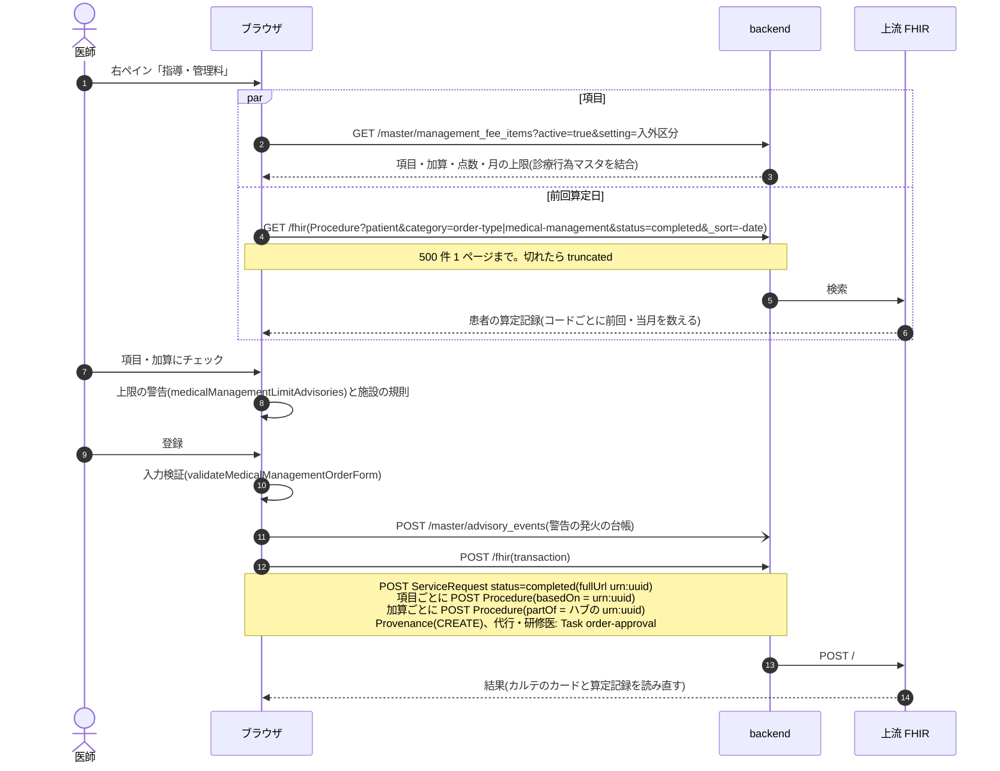
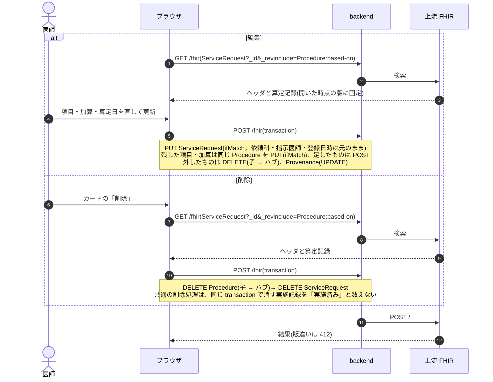
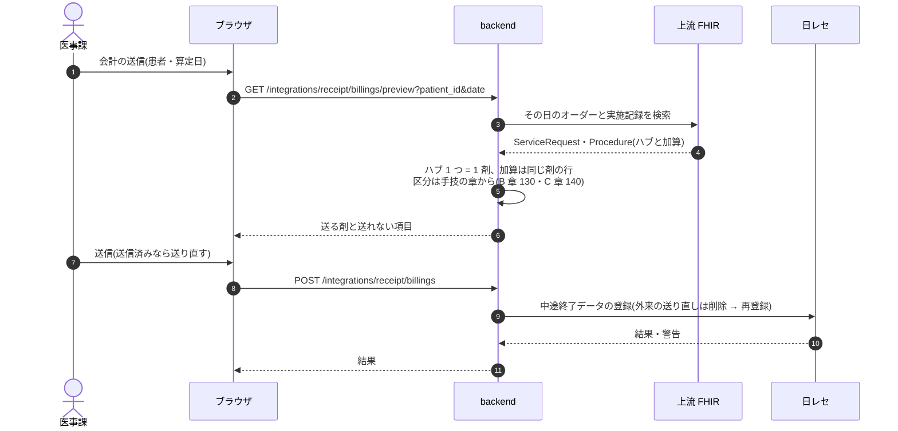

# 指導・管理料のシーケンス図

<!-- ../fhir-client/docs/order-flows/medical-management.md から scripts/sync-flows.mjs で作る。直接編集しない。 -->

運用の流れは[指導・管理料の業務フロー](../flows/medical-management.md)にあります。

## リソースの構成

| もの | リソース | 要点 |
|---|---|---|
| オーダー(ヘッダ) | `ServiceRequest` | `status` = `completed`(登録時から)、`category` = `order-type|medical-management` + `prescription-setting`(入外区分)、`code.text` = 項目名のまとめ、`occurrenceDateTime` = 算定日(日付のみ)、`note` = 備考、`reasonReference` = 対象プロブレム、依頼科・病棟は `applyOrderContext` / `withOrderWard`。明細の `ServiceRequest` は持たない |
| 算定した項目 | `Procedure`(ハブ、`basedOn` = ヘッダ) | 項目 1 つに 1 つ。`category` = `order-type|medical-management`、`code` = `medical-management-procedure-code|レセ電算コード`、`status` = `completed`、`performedDateTime` = 算定日、`performer` = 指示医師、`order-department` 拡張 |
| 加算 | `Procedure`(子、`partOf` = ハブ) | `basedOn` もヘッダを指す(`_revinclude=Procedure:based-on` 1 本でハブと加算を一緒に引くため) |
| 代行入力 | `Provenance`(`target` = ヘッダ) | 種別共通。登録・編集で付ける。代行・研修医は `Task` `order-approval` |
| 項目マスタ | backend `master_management_fee_items` | `receipt_code`・`addition_codes`(jsonb)・`inpatient` / `outpatient`・`monthly_limit`・`active`・`display_order`。名称・点数は一覧 API が診療行為マスタを LEFT JOIN して添える |

- 進捗の `Task` を作りません。部門が受けない種別なので、部門一覧・予約・受付もありません。
- 備考を `Procedure.note` に置かないのは、実施記録の note が会計送信でフリーコメント(810000001)として日レセへ送られるためです。
- 実施記録のコード体系を `{種別}-procedure-code` にしてあるので、会計側に種別ごとの対応表は要りません(`OrderCatalog::Definition#procedure_code_system`)。

## 状態の持ち方

| 表示 | `ServiceRequest.status` | `Procedure.status` |
|---|---|---|
| 登録済み(= 実施済) | `completed` | `completed` |
| 削除 | リソースごと消す | リソースごと消す |

- 状態の遷移はありません。`revoked` も書きません。
- カルテ・前回算定日・会計で読むのは `status = completed` の `Procedure` だけです(`medicalManagementItemsByOrderId` / `medicalManagementHistoryByCode`)。

## シーケンス図の前提

`/fhir` への書き込みはどれも 1 回の transaction Bundle で、backend の `FhirProxyController` が上流へ中継します。
SS-MIX2 を有効にしている施設では、中継が書き込みの控えを記録します(`Ssmix2::Recorder`。指導・管理料はメッセージになりません)。
楽観ロックの版は `postBundle` が `ifMatch` に添え、版が違えば 412 で止まります。編集フォームは `useEditSnapshot` で開いた時点の版に固定し(`hooks/useMedicalManagementOrderInitialValues.ts`)、`withVersionLock` でヘッダと実施記録の元の版を添えます。

| 部品 | 場所 |
|---|---|
| フォーム | `components/MedicalManagementOrderForm.tsx`・`MedicalManagementOrderPanels.tsx`(右ペイン)、詳細 `MedicalManagementOrderDetailPanel.tsx`、カード `karteCardBodies/MedicalManagementOrderCardBody.tsx` |
| 組み立て | `fhir/medicalManagementOrderHelpers.ts`(登録・更新・削除の Bundle、前回算定日・上限の警告、カード用の束ね) |
| hook | `api/queries/medicalManagement.ts`(詳細・更新・削除・患者の算定記録)、登録は `useCreatePrescription`(全種別共通) |
| 項目マスタ | `pages/ManagementFeeItemPage.tsx`、`api/masterClient/managementFee.ts`、backend `Master::ManagementFeeItemsController` |
| セット・パス | `components/orderSetRegistry.tsx`(`medicalManagementOrder`)、パスの取消 `api/queries/pathway.ts`(`useCancelPathwayApplication`) |
| 会計 | backend `Integrations::ReceiptComputer::OrderCatalog`(`medical-management`)・`BillingClaimBuilder`・`Integrations::Orca::MedicalMessage` |

## 登録

`buildMedicalManagementOrderBundle`、`useCreatePrescription`、`usePatientMedicalManagementProcedures`。

## 編集・削除

`buildMedicalManagementOrderUpdateBundle` / `buildMedicalManagementOrderDeleteBundle`、`useUpdateMedicalManagementOrder`、`useDeleteMedicalManagementOrder`。

- 編集で同じコードの記録を使い回すのは、会計の送り直しで同じ剤の記録 id が変わらないようにするためです。

## 会計の送信

`BillingClaimBuilder` の `:procedure` 経路(既定の組み立て。種別専用の resolver はありません)。

## 医事会計と SS-MIX2

指導・管理料は実施記録から集めます(`OrderCatalog` の `medical-management`、`source: :procedure`)。ハブの `Procedure` 1 つが 1 剤で、加算(子)は同じ剤の行になり、コードは `medical-management-procedure-code` のレセ電算コードをそのまま送ります。日レセの診療種別区分は手技の章から決まります(`MedicalMessage::CHAPTER_CLASS`。B 章 130・C 章 140、引けなければ 130)。期間継続型(`continuous`)の扱いにしてあるので、実施記録の無いヘッダを「未実施」と報告しません(登録と同時に記録を書くので通常は起きません)。
SS-MIX2 は、ヘッダの `ServiceRequest` が `OMG^O19` の対象種別(放射線・内視鏡・生理)に入らず、実施記録の `Procedure` も `RAS^O17`(処方・注射)・`OMI^Z23`(放射線・内視鏡)の対象種別ではないので、メッセージになりません。

| 起きたこと | 医事会計(`BillingClaimBuilder`) | SS-MIX2 |
|---|---|---|
| 登録 | 算定日に送る(項目 1 つ = 1 剤) | なし |
| 編集 | 算定日の内容で送る。送信済みなら送り直しで入れ替わる | なし |
| 削除 | 対象から外れる。送信済みなら送り直しで消える | なし |
| オーダーセット・パスの適用 | 置いた日に送る | なし |
| パスの適用の取消 | 対象から外れる | なし |
