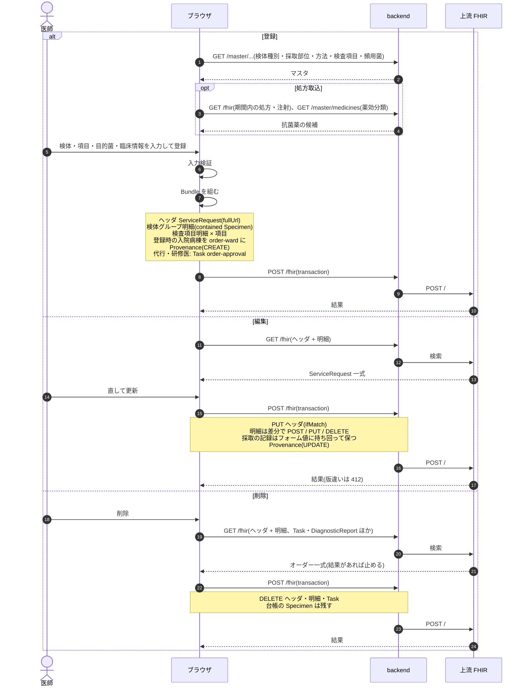
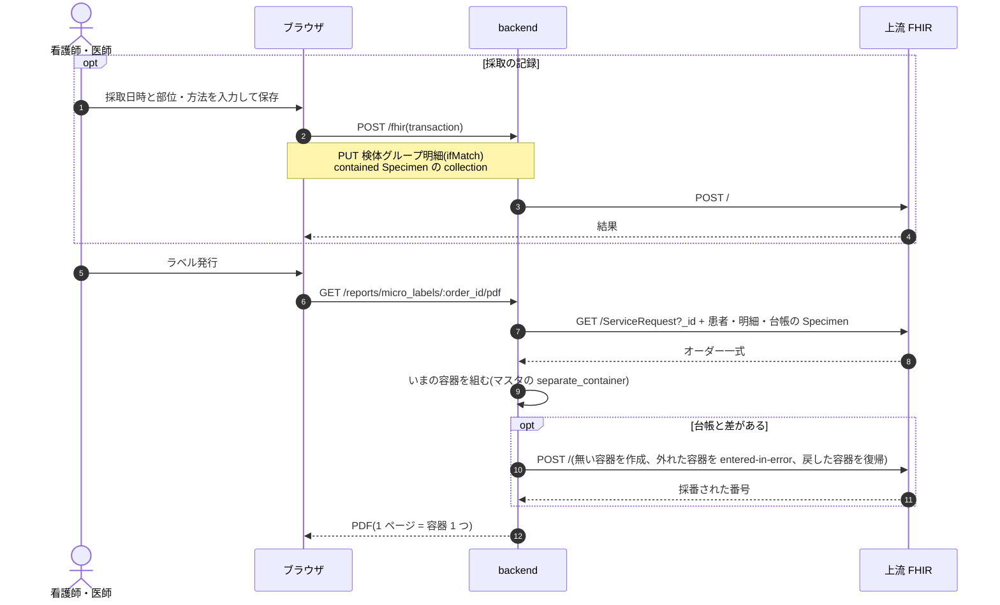
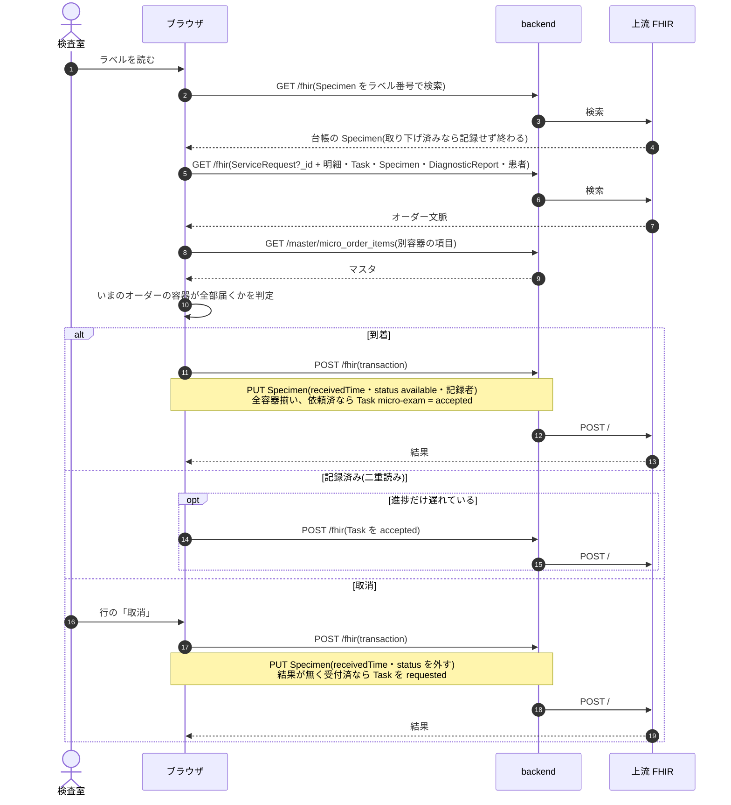
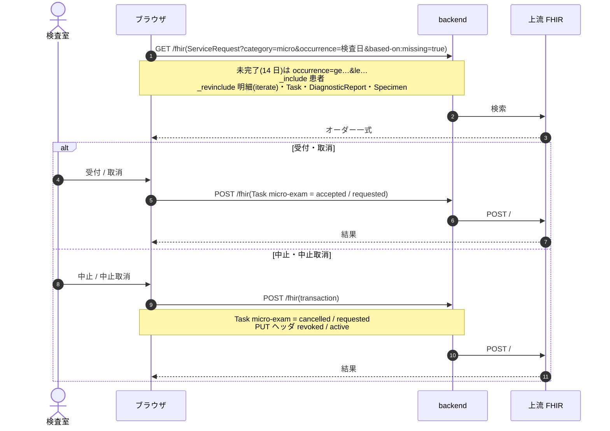
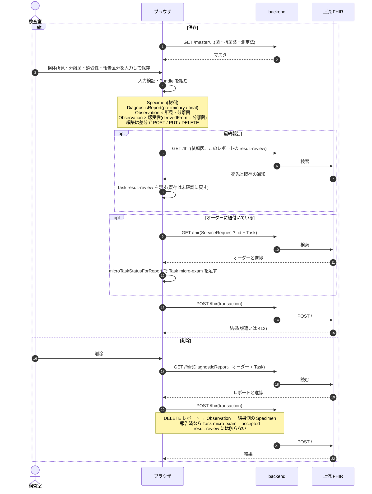

# 細菌検査オーダーのシーケンス図

<!-- ../fhir-client/docs/order-flows/micro.md から scripts/sync-flows.mjs で作る。直接編集しない。 -->

運用の流れは[細菌検査オーダーの業務フロー](../flows/micro.md)にあります。

## リソースの構成

オーダーは 3 層です。ヘッダの `ServiceRequest`(`order-type|micro`)← `basedOn` ── 検体グループ明細(contained `Specimen`)← `basedOn` ── 検査項目明細です。UI は 1 オーダー 1 検体に制限していますが、構造は複数検体を持てます(`fhir/microOrderHelpers.ts`)。
ヘッダは拡張 `micro-prior-antimicrobial`(前投与抗菌薬)・`micro-exam-purpose`(検査目的)を持ち、検体グループ明細は `orderDetail`(目的菌)・`reason*`(疑い病名)・採取予定日時を持ちます。

| もの | リソース | 補足 |
|---|---|---|
| 進捗 | `Task`(`task-code|micro-exam`、`focus` = ヘッダ) | 下の表 |
| 採取の記録 | 検体グループ明細の contained `Specimen` の `collection`(`collectedDateTime`・`collector`・`bodySite`・`method`) | 明細だけを PUT する(ヘッダを組み直すと依頼医が替わる)。来歴は付けない |
| 容器の台帳 | `Specimen`(`request` = [ヘッダ, 検体グループ明細]、`identifier` = `micro-container`、`accessionIdentifier` = ラベル番号) | 発行 = 作成、到着 = `receivedTime` + `status: available`、取り下げ = `entered-in-error`。番号は検体検査の採取管と同じ採番。`identifier` は検体の容器なら検体グループ明細の id、ボトルなら検査項目明細の id |
| 結果 | `DiagnosticReport`(`category` = v2-0074 `MB`、`code` = LOINC `18725-2`、`basedOn` = ヘッダ、`status` = `preliminary` / `final`)+ `Observation` | 培養・塗抹・喀痰品質・膿尿・分離菌(`component` に菌量・起炎性)。プロファイルは付けない |
| 薬剤感受性 | `Observation`(`derivedFrom` = 分離菌の `Observation`、`code` = JANIS 抗菌薬) | MIC は `valueQuantity`、S / I / R は `interpretation`、阻止円径は `component`。分離菌の並びは `DiagnosticReport.result` の順 |
| 結果の検体 | `Specimen`(`type` = JANIS 材料コード) | 結果側が所有する。ラベルの台帳とは別で、参照しない |
| 検査結果確認の通知 | `Task`(`task-code|result-review`、`focus` = 結果、`owner` = 依頼医) | 最終報告のときだけ |
| 確認(既読) | `Provenance`(`target` = 結果、`agent.type = verifier`、`signature`) | 検体検査と同じ |
| 代行入力 | `Provenance`(`target` = ヘッダ、`activity` CREATE / UPDATE) | 明細は `target` に入れない |

## 進捗 Task(`micro-exam`)

Task は登録時には作りません。**Task が無いオーダーは依頼済**として扱い、最初の受付・中止か結果の保存で作ります(`fhir/microTaskHelpers.ts`)。
中止は同じ transaction でヘッダを `revoked` にし、中止取消で `active` に戻します(`orderCancelEntries`)。中止したオーダーを編集しても `revoked` のままです(`keepOrderRevoked`)。
Task が無いまま結果があるオーダー(進捗を持つ前のデータ)は、表示だけ報告区分から読みます(`microOrderStatus`)。

| 状態 | `Task.status` | `executionPeriod` | 進めるもの |
|---|---|---|---|
| 依頼済 | `requested`(または Task 無し) | なし | 取消、到着の取消、中止取消 |
| 受付済 | `accepted` | `start` | 全容器の到着、一覧の受付、中間報告の保存、結果の削除(報告済から) |
| 報告済 | `completed` | `start` / `end` | 最終報告の保存 |
| 中止 | `cancelled` | なし | 一覧の中止。結果の保存では動かない |

結果の保存・削除で進める判定は `microTaskStatusForReport` です。報告区分は `DiagnosticReport.status` が正本で、Task には持ちません。

## シーケンス図の前提

`/fhir` への書き込みはどれも 1 回の transaction Bundle で、backend の `FhirProxyController` が上流へ中継します。
楽観ロックの版は `postBundle` が `ifMatch` に添え、版が違えば 412 で止まります。
例外はラベルの PDF で、backend(`MicroLabelReport`)が上流を直接読み書きします。

## 登録・編集・削除

`components/MicroOrderForm.tsx`・`MicroOrderPanels.tsx`、`buildMicroOrderBundle` / `buildMicroOrderUpdateBundle` / `buildMicroOrderDeleteBundle`(`fhir/microOrderHelpers.ts`)、
`useCreatePrescription` / `useUpdatePrescription`(`api/queries/labResult.ts`。全種別共通)、`useDeleteMicroOrder`(`api/queries/micro.ts`)、処方取込は `hooks/useAntimicrobialSuggestions.ts`。

## 採取の記録とラベル発行

`components/MicroCollectionModal.tsx`、`useRecordMicroCollection`(`api/queries/micro.ts`)、`buildMicroCollectionBundle`(`fhir/microOrderHelpers.ts`)、
`Reports::MicroLabelPdfsController`、`MicroLabelReport`・`Reports::MicroLabelRenderer`(backend)。

## 到着確認

`pages/LabArrivalPage.tsx`(台帳の識別子で検体検査・細菌・病理を振り分ける)、`fetchMicroArrivalContext`(`api/queries/micro.ts`)、`allMicroContainersArrived`(`fhir/microContainerHelpers.ts`)、`useUpdateLabArrival`(`api/queries/injection.ts`)。

## 一覧・受付・中止

`pages/MicroWorklistPage.tsx`、`useMicroWorklist` / `useUpdateMicroTaskStatus`(`api/queries/micro.ts`)、`makeUpdateTaskStatusHook`(`api/queries/worklist.ts`)。

## 結果登録・編集・削除

`components/KarteMicroResultTab.tsx`・`MicroResultForm.tsx`・`MicroResultDetailPanel.tsx`、`buildMicroResultBundle` / `buildMicroResultUpdateBundle` / `buildMicroResultDeleteBundle`(`fhir/microResultHelpers.ts`)、
`useCreateMicroResult` / `useUpdateMicroResult` / `useDeleteMicroResult`(`api/queries/micro.ts`)、`withResultReviewTask`(`api/queries/notification.ts`)。

結果確認の書き込みは [検体検査オーダーの業務フロー](../flows/lab.md)「シーケンス図: 結果確認」のカルテからの経路と同じです(`ResultReviewAction`、`useMarkResultReviewed`)。

## 医事会計と SS-MIX2

細菌検査は検体検査と同じくオーダーの検査日で集める種別です(`BillingClaimBuilder` の `:order` 経路)。進捗 Task は見ず、中止は `ServiceRequest.status` で判定します。
項目はヘッダの孫(検体グループ明細の下)にあるので、`_revinclude:iterate` で辿り、項目コードを持たない明細をその下の項目に置き換えて集めます(`item_details`)。
レセ電算コードは検査項目マスタの `receipt_code` で、同梱の seed には入っていません。施設が細菌検査オーダーマスタの検査項目で設定します。1 項目に 1 コードなので、検体の系統で点数が変わる培養は項目を分けないと正しく算定できません。
SS-MIX2 の電文は持ちません。`OmlO33` は `order-type|lab`、`OulR22` は v2-0074 `LAB` だけを対象にします。

| 起きたこと | 医事会計(`BillingClaimBuilder`) | SS-MIX2 |
|---|---|---|
| 登録・編集 | 検査日のオーダーの項目を `receipt_code` で送る。`receipt_code` の無い項目は「送れない項目」に出す | なし |
| ラベル発行・採取・到着・受付 | なし | なし |
| 中間報告・最終報告・結果の削除 | なし | なし |
| 中止 | 対象から外れる(`ServiceRequest` が `revoked`) | なし |
| 削除 | 対象から外れる | なし |
