# 細菌検査オーダーのシーケンス図

<!-- ../fhir-client/docs/order-flows/micro.md から scripts/sync-flows.mjs で作る。直接編集しない。 -->

運用の流れは[細菌検査オーダーの業務フロー](../flows/micro.md)にあります。

## シーケンス図の前提

- **書き込みの経路**: `/fhir` への書き込みはどれも 1 回の transaction Bundle で、backend の `FhirProxyController` が上流の FHIR サーバー(以下「上流」)へ中継します。
- **例外**: ラベルの PDF だけは、backend(`MicroLabelReport`)が上流を直接読み書きします。
- **図の省略**: 図では、上流の応答が backend を通ってブラウザへ戻る矢印を省き、上流からブラウザへの 1 本で描きます。
- **楽観ロック**: 版は `postBundle` が `ifMatch` に添え、版が違えば 412 で止まります。
- **ヘッダ**: オーダー 1 件の `ServiceRequest`(`order-type|micro`)です。
- **検体グループ明細**: 検体 1 つぶんの `ServiceRequest` です。contained の `Specimen` を持ち、`basedOn` でヘッダを指します。
- **検査項目明細**: 検査項目 1 件ずつの `ServiceRequest` です。`basedOn` で検体グループ明細を指します。
- **容器の台帳**: ラベルを刷った容器 1 つごとの `Specimen` です。以下「台帳」とも書きます。

## リソースの構成

オーダーは 3 層です。下の層が上の層を `basedOn` で指します。

- ヘッダ `ServiceRequest`(`order-type|micro`)
  - 検体グループ明細 `ServiceRequest`(contained `Specimen`)
    - 検査項目明細 `ServiceRequest`
  - 進捗 `Task`(`focus` = ヘッダ)
  - 容器の台帳 `Specimen`(`request` = [ヘッダ, 検体グループ明細])
  - 結果 `DiagnosticReport`(`basedOn` = ヘッダ)
    - 所見・分離菌の `Observation`
      - 薬剤感受性の `Observation`(`derivedFrom` = 分離菌)
    - 結果の検体 `Specimen`
    - 検査結果確認の通知 `Task`、確認の `Provenance`
  - 代行入力の `Provenance`(`target` = ヘッダ)

UI は 1 オーダー 1 検体に制限していますが、構造は複数検体を持てます(`fhir/microOrderHelpers.ts`)。

**オーダー**

| リソース | 要素 | 中身 |
|---|---|---|
| ヘッダ | 拡張 `micro-prior-antimicrobial` | 前投与抗菌薬 |
| ヘッダ | 拡張 `micro-exam-purpose` | 検査目的 |
| 検体グループ明細 | `orderDetail` | 目的菌 |
| 検体グループ明細 | `reason*` | 疑い病名 |
| 検体グループ明細 | 採取予定日時 | 採取の予定 |
| 検体グループ明細 | contained `Specimen` の `collection` | 採取の記録 |
| 進捗 `Task` | `code` | `task-code|micro-exam` |

- 採取の記録は `collectedDateTime`・`collector`・`bodySite`・`method` です。
- 採取の記録は、明細だけを PUT します(ヘッダを組み直すと依頼医が替わるため)。`Provenance` は付けません。

**容器の台帳 `Specimen`**

| 要素 | 中身 |
|---|---|
| `request` | [ヘッダ, 検体グループ明細] |
| `identifier`(`micro-container`) | 検体の容器なら検体グループ明細の id、ボトルなら検査項目明細の id |
| `accessionIdentifier` | ラベル番号。検体検査の採取管と同じ採番 |

| 容器に起きたこと | 台帳 |
|---|---|
| 発行 | 作成 |
| 到着 | `receivedTime` + `status: available` |
| 取り下げ | `entered-in-error` |

**結果**

| もの | リソース | 補足 |
|---|---|---|
| 結果 | `DiagnosticReport`(`category` = v2-0074 `MB`、`code` = LOINC `18725-2`) | `status` = `preliminary` / `final`。プロファイルは付けない |
| 所見・分離菌 | `Observation` | 培養・塗抹・喀痰品質・膿尿・分離菌。分離菌は `component` に菌量・起炎性 |
| 薬剤感受性 | `Observation`(`code` = JANIS 抗菌薬) | MIC は `valueQuantity`、S / I / R は `interpretation`、阻止円径は `component` |
| 結果の検体 | `Specimen`(`type` = JANIS 材料コード) | 結果側が所有する。容器の台帳とは別で、参照しない |
| 検査結果確認の通知 | `Task`(`task-code|result-review`、`focus` = 結果、`owner` = 依頼医) | 最終報告のときだけ |
| 確認(既読) | `Provenance`(`target` = 結果、`agent.type = verifier`、`signature`) | 検体検査と同じ |
| 代行入力 | `Provenance`(`target` = ヘッダ、`activity` CREATE / UPDATE) | 明細は `target` に入れない |

分離菌の並びは `DiagnosticReport.result` の順です。

## 進捗 Task(`micro-exam`)

- Task は登録時には作りません。**Task が無いオーダーは依頼済**として扱い、最初の受付・中止か結果の保存で作ります(`fhir/microTaskHelpers.ts`)。
- 中止は同じ transaction でヘッダを `revoked` にし、中止取消で `active` に戻します(`orderCancelEntries`)。
- 中止したオーダーを編集しても `revoked` のままです(`keepOrderRevoked`)。
- Task が無いまま結果があるオーダー(進捗を持つ前のデータ)は、表示だけ報告区分から読みます(`microOrderStatus`)。
- 結果の保存・削除で状態を動かす判定は `microTaskStatusForReport` です。報告区分は `DiagnosticReport.status` が正本で、Task には持ちません。

| 状態 | `Task.status` | `executionPeriod` | この状態にするもの |
|---|---|---|---|
| 依頼済 | `requested`(または Task 無し) | なし | 一覧の取消、到着の取消、中止取消 |
| 受付済 | `accepted` | `start` | 全容器の到着、一覧の受付、中間報告の保存、結果の削除(報告済から) |
| 報告済 | `completed` | `start` / `end` | 最終報告の保存 |
| 中止 | `cancelled` | なし | 一覧の中止。結果の保存では動かない |

## 部品

| 操作 | 画面 | 組み立て | hook |
|---|---|---|---|
| 登録 | `components/MicroOrderForm.tsx`・`MicroOrderPanels.tsx` | `buildMicroOrderBundle` | `useCreatePrescription` |
| 編集 | 同じ | `buildMicroOrderUpdateBundle` | `useUpdatePrescription` |
| 削除 | 同じ | `buildMicroOrderDeleteBundle` | `useDeleteMicroOrder` |
| 採取の記録 | `components/MicroCollectionModal.tsx` | `buildMicroCollectionBundle` | `useRecordMicroCollection` |
| ラベル発行 | backend の `Reports::MicroLabelPdfsController` | `MicroLabelReport`・`Reports::MicroLabelRenderer` | なし |
| 到着確認 | `pages/LabArrivalPage.tsx` | `allMicroContainersArrived` | `useUpdateLabArrival` |
| 一覧・受付・中止 | `pages/MicroWorklistPage.tsx` | `fhir/microTaskHelpers.ts` | `useMicroWorklist`・`useUpdateMicroTaskStatus` |
| 結果の保存 | `components/KarteMicroResultTab.tsx`・`MicroResultForm.tsx` | `buildMicroResultBundle`・`buildMicroResultUpdateBundle` | `useCreateMicroResult`・`useUpdateMicroResult` |
| 結果の削除 | `components/MicroResultDetailPanel.tsx` | `buildMicroResultDeleteBundle` | `useDeleteMicroResult` |
| 結果確認 | カルテ | `ResultReviewAction` | `useMarkResultReviewed` |

- **置き場所**: オーダーと採取の組み立ては `fhir/microOrderHelpers.ts`、結果は `fhir/microResultHelpers.ts`、容器は `fhir/microContainerHelpers.ts`、細菌検査の hook は `api/queries/micro.ts` です。
- **全種別共通の hook**: `useCreatePrescription` / `useUpdatePrescription`(`api/queries/labResult.ts`)は、名前に反して全種別共通の登録・編集の hook です。
- **処方取込**: `hooks/useAntimicrobialSuggestions.ts` です。
- **到着確認**: `pages/LabArrivalPage.tsx` は、台帳の識別子で検体検査・細菌・病理を振り分けます。オーダー文脈は `fetchMicroArrivalContext`(`api/queries/micro.ts`)で読みます。`useUpdateLabArrival` は `api/queries/injection.ts` にあります。
- **ステータス変更**: `useUpdateMicroTaskStatus` は `makeUpdateTaskStatusHook`(`api/queries/worklist.ts`)で作ります。
- **通知**: 検査結果確認の通知は `withResultReviewTask`(`api/queries/notification.ts`)で足します。

## 登録・編集・削除

**登録**

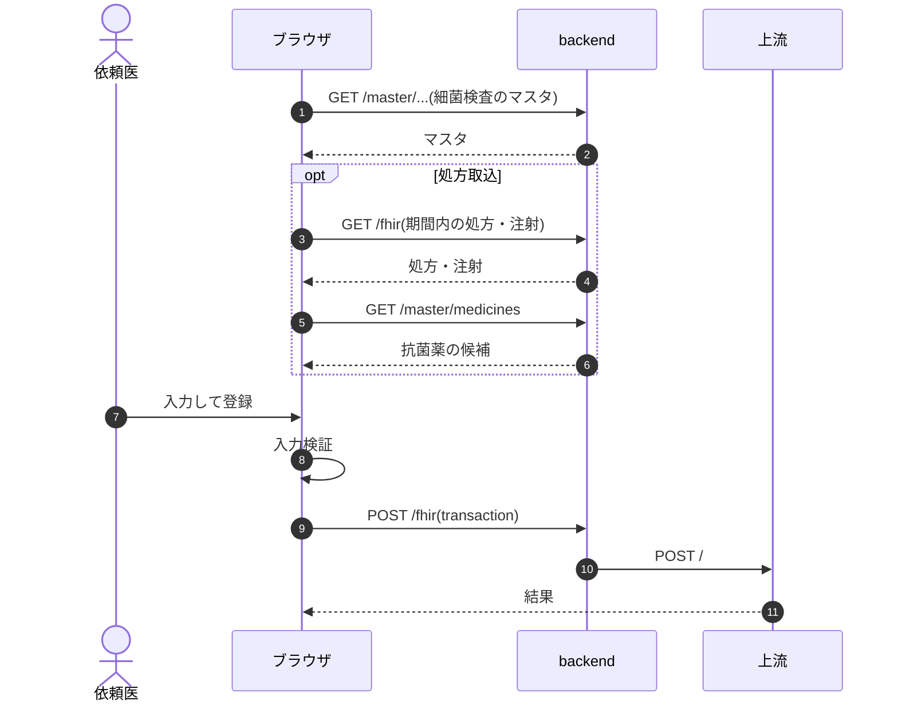

- マスタは、検体種別・採取部位・方法・検査項目・頻用菌です。
- `/master/medicines` からは薬効分類を読み、抗菌薬を選び出します。
- 依頼医が入力するのは、検体・項目・目的菌・臨床情報です。

| 書くもの | 条件 |
|---|---|
| ヘッダ `ServiceRequest`(`fullUrl`) | いつも |
| 検体グループ明細(contained `Specimen`) | いつも |
| 検査項目明細 × 項目 | いつも |
| 登録時の入院病棟を `order-ward` に | いつも |
| `Provenance`(CREATE) | いつも |
| `Task` `order-approval` | 代行・研修医 |

**編集**

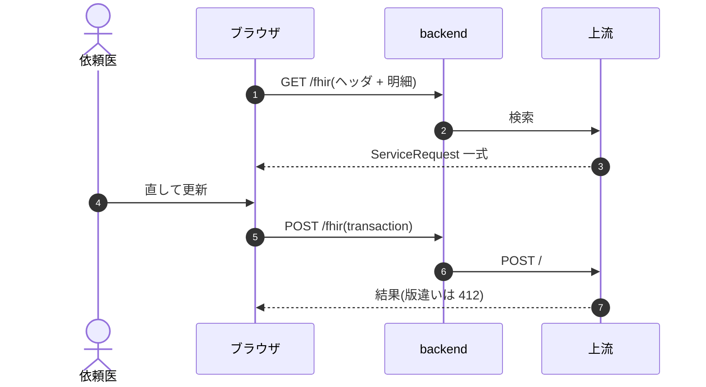

| 書くもの | 条件 |
|---|---|
| PUT ヘッダ(`ifMatch`) | いつも |
| 明細を差分で POST / PUT / DELETE | いつも |
| `Provenance`(UPDATE) | いつも |

採取の記録は、フォーム値に持ち回って保ちます。

**削除**

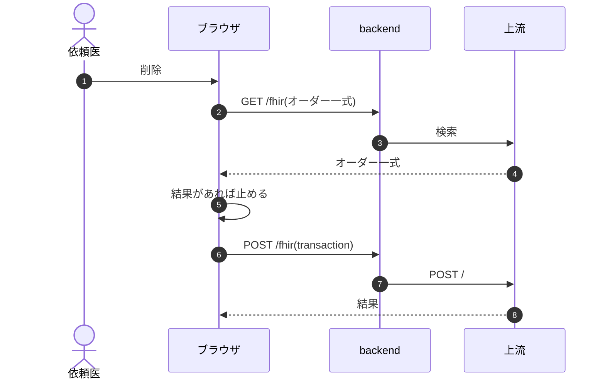

検索は、ヘッダ + 明細と、`Task`・`DiagnosticReport` ほかです。

| 書くもの | 条件 |
|---|---|
| DELETE ヘッダ・明細・`Task` | いつも |

台帳の `Specimen` は残します。

## 採取の記録とラベル発行

**採取の記録**

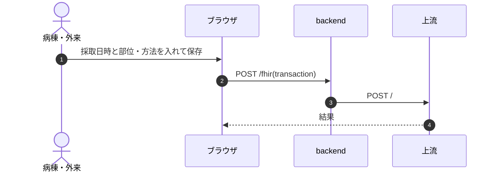

| 書くもの | 条件 |
|---|---|
| PUT 検体グループ明細(`ifMatch`) | contained `Specimen` の `collection` を書く |

**ラベル発行**

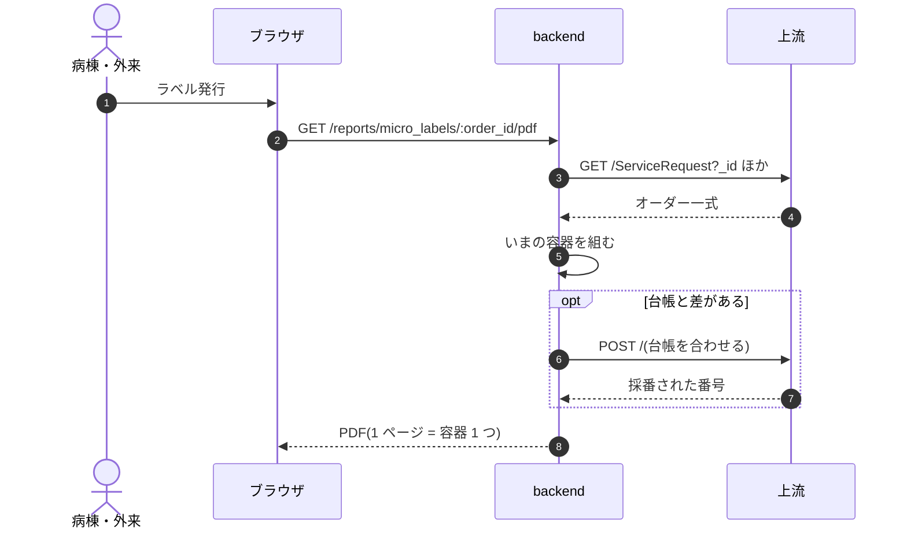

- 読むのは、`ServiceRequest?_id` + 患者・明細・台帳の `Specimen` です。
- いまの容器は、マスタの `separate_container` から組みます。

| 台帳との差 | 書くもの |
|---|---|
| 台帳に無い容器 | 作成 |
| 外れた容器 | `entered-in-error` |
| 戻した容器 | 復帰 |

## 到着確認

**到着**

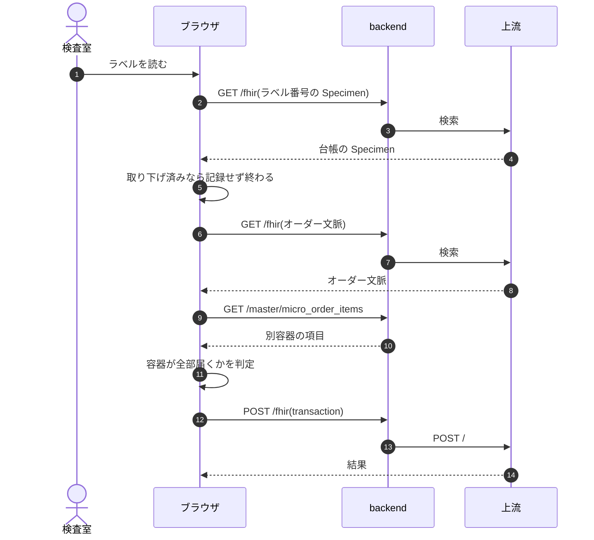

- オーダー文脈の検索は `ServiceRequest?_id` + 明細・`Task`・`Specimen`・`DiagnosticReport`・患者です。
- 判定するのは、いまのオーダーの容器が全部届くかです。

| 書くもの | 条件 |
|---|---|
| PUT `Specimen`(`receivedTime`・`status` `available`・記録者) | いつも |
| `Task` `micro-exam` = `accepted` | 全容器が揃い、依頼済のとき |

すでに到着を記録した容器を読んだとき(二重読み)は、到着を書き直しません。進捗だけ遅れていれば、`Task` を `accepted` にします。

**到着の取消**

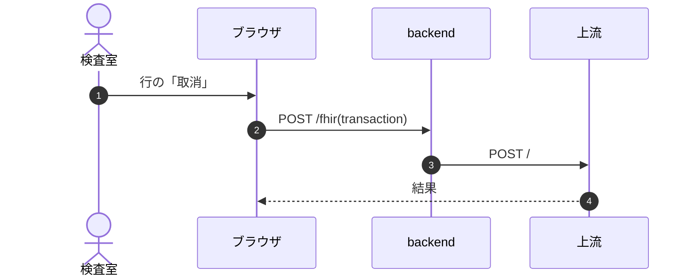

| 書くもの | 条件 |
|---|---|
| PUT `Specimen`(`receivedTime`・`status` を外す) | いつも |
| `Task` を `requested` | 結果が無く、受付済のとき |

## 一覧・受付・中止

**一覧を開く**

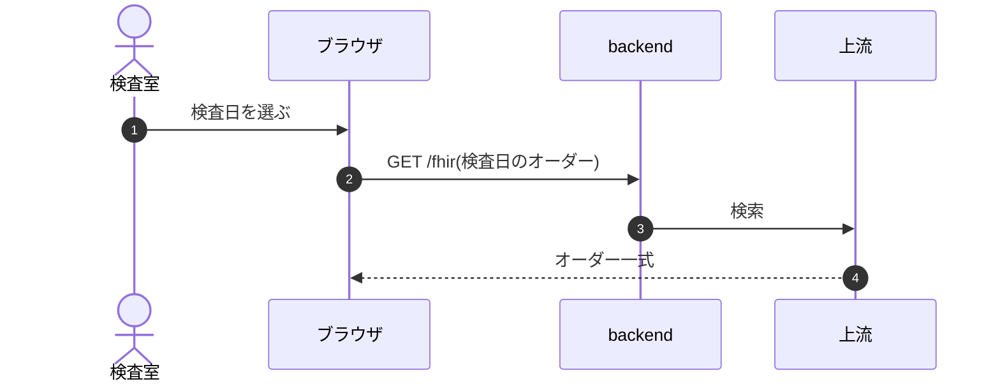

- 検索は `ServiceRequest?category=micro&occurrence=検査日&based-on:missing=true` です。
- 未完了(14 日)は `occurrence=ge…&le…` で引きます。
- `_include` で患者、`_revinclude` で明細(iterate)・`Task`・`DiagnosticReport`・`Specimen` を付けます。

**受付・取消・中止・中止取消**

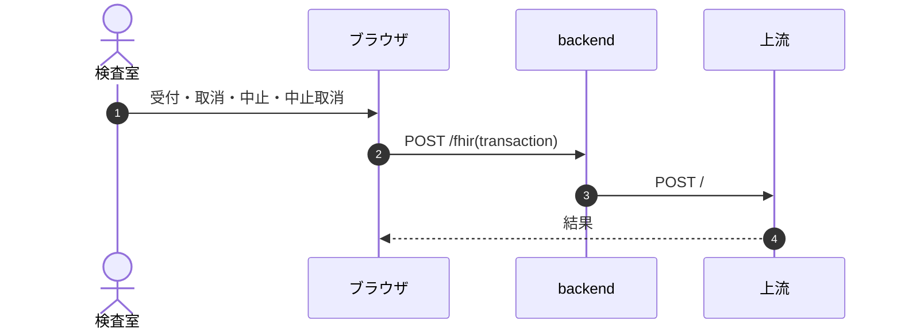

| 操作 | 書くもの |
|---|---|
| 受付 | `Task` `micro-exam` = `accepted` |
| 一覧の取消 | `Task` `micro-exam` = `requested` |
| 中止 | `Task` `micro-exam` = `cancelled`、PUT ヘッダ `revoked` |
| 中止取消 | `Task` `micro-exam` = `requested`、PUT ヘッダ `active` |

## 結果登録・編集・削除

**保存**

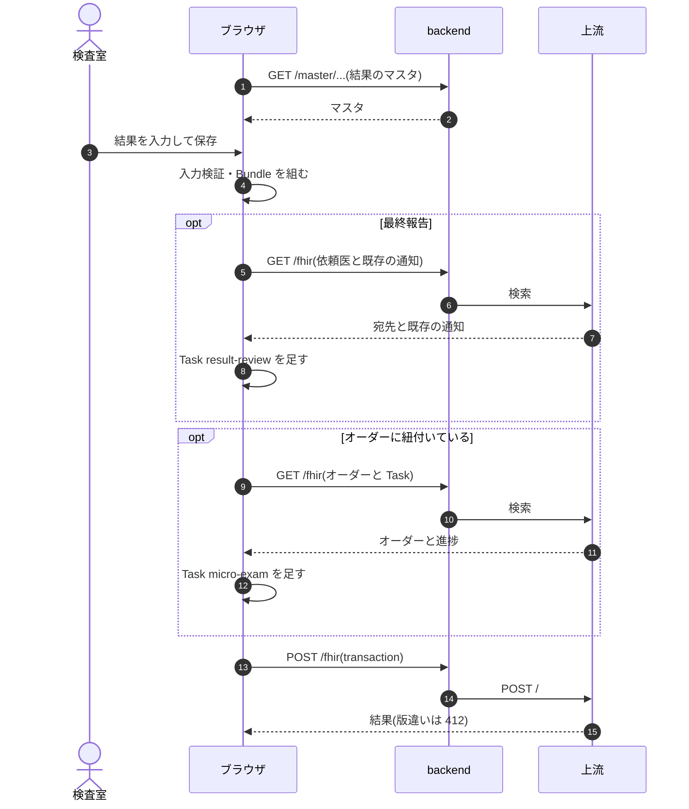

- マスタは、菌・抗菌薬・測定法です。
- 入力するのは、検体所見・分離菌・感受性・報告区分です。
- 既存の通知の検索は、このレポートの `result-review` です。既存の通知は未確認に戻します。
- オーダーの検索は `ServiceRequest?_id` + `Task` です。`Task` `micro-exam` の状態は `microTaskStatusForReport` で決めます。

| 書くもの | 条件 |
|---|---|
| `Specimen`(材料) | いつも |
| `DiagnosticReport`(`preliminary` / `final`) | いつも |
| `Observation` × 所見・分離菌 | 入力したぶん |
| `Observation` × 感受性(`derivedFrom` = 分離菌) | 入力したぶん |
| `Task` `result-review` | 最終報告 |
| `Task` `micro-exam` | オーダーに紐付いているとき |

編集は、差分で POST / PUT / DELETE します。

**削除**

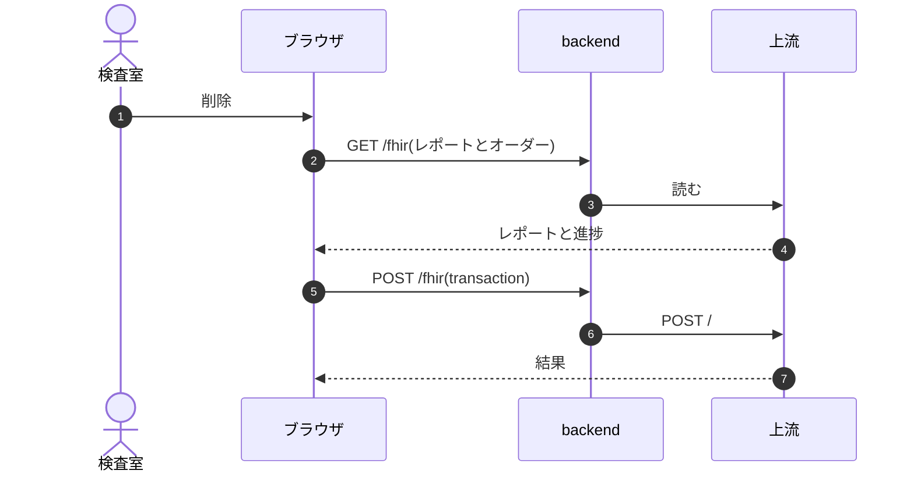

読むのは、`DiagnosticReport` と、オーダー + `Task` です。

| 書くもの | 条件 |
|---|---|
| DELETE レポート → `Observation` → 結果側の `Specimen` | いつも |
| `Task` `micro-exam` = `accepted` | 報告済のとき |

`result-review` には触りません。

**結果確認**

結果確認の書き込みは [検体検査オーダーのシーケンス図](lab.md)「[結果確認](lab.md#結果確認)」のカルテからの経路と同じです(`ResultReviewAction`、`useMarkResultReviewed`)。

## 医事会計と SS-MIX2

細菌検査は、検体検査と同じくオーダーの検査日で集める種別です(`BillingClaimBuilder` の `:order` 経路)。SS-MIX2 の電文は持ちません。`OmlO33` は `order-type|lab`、`OulR22` は v2-0074 `LAB` だけを対象にします。

- **状態の見方**: 進捗 Task は見ず、中止は `ServiceRequest.status` で判定します。
- **項目の集め方**: 項目はヘッダの孫(検体グループ明細の下)にあるので、`_revinclude:iterate` で辿ります。項目コードを持たない明細は、その下の項目に置き換えて集めます(`item_details`)。
- **レセ電算コード**: 検査項目マスタの `receipt_code` です。同梱の seed には入っていません。施設が細菌検査オーダーマスタの検査項目で設定します。
- **項目の分け方**: 1 項目に 1 コードなので、検体の系統で点数が変わる培養は、項目を分けないと正しく算定できません。

| 起きたこと | 医事会計(`BillingClaimBuilder`) |
|---|---|
| 登録・編集 | 検査日のオーダーの項目を `receipt_code` で送る |
| ラベル発行・採取・到着・受付 | なし |
| 中間報告・最終報告・結果の削除 | なし |
| 中止 | 対象から外れる(`ServiceRequest` が `revoked`) |
| 削除 | 対象から外れる |

`receipt_code` の無い項目は「送れない項目」に出します。
