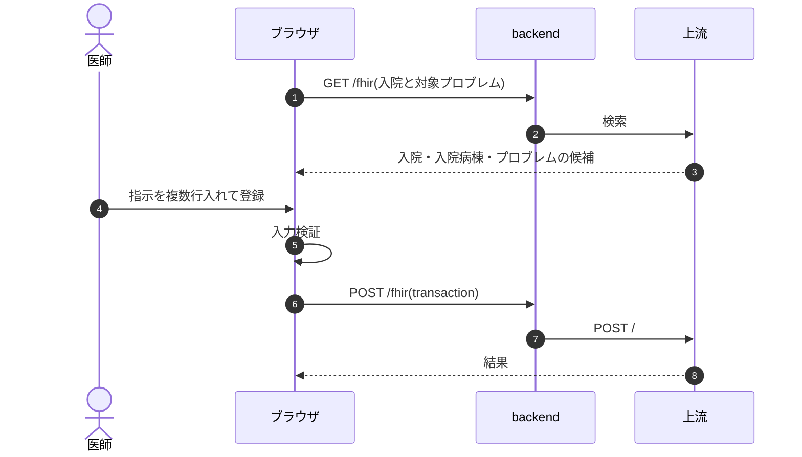
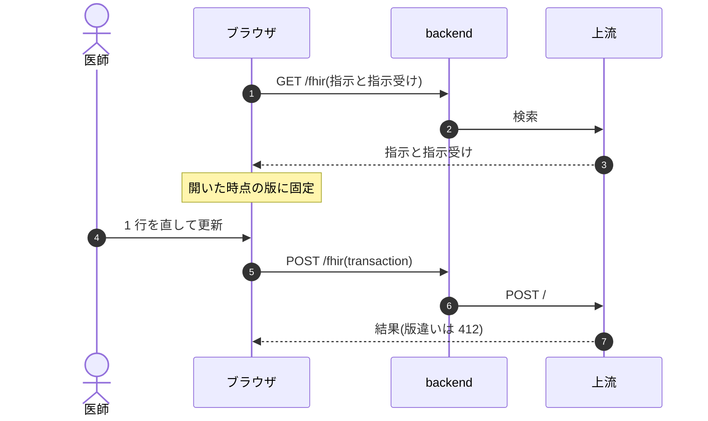
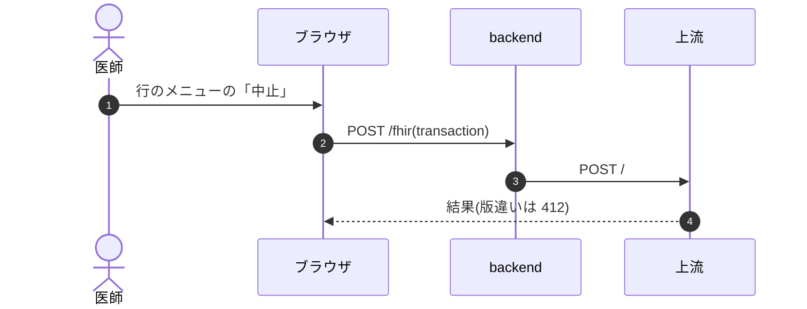
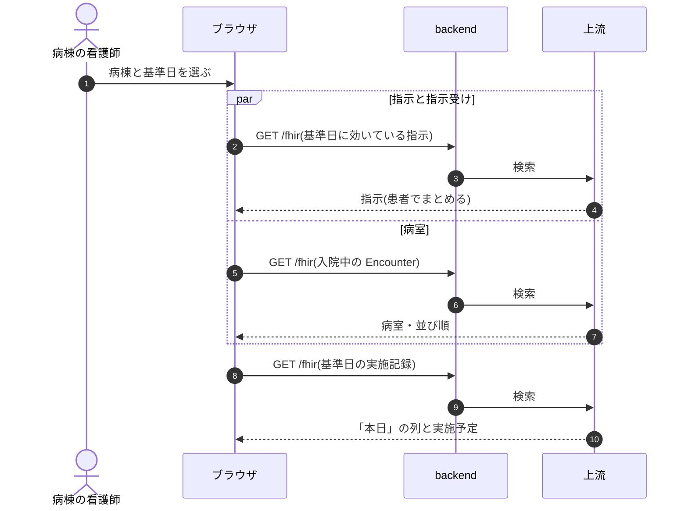
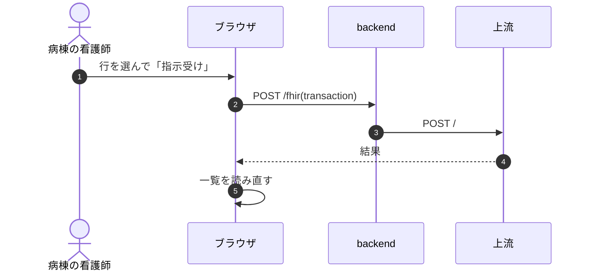
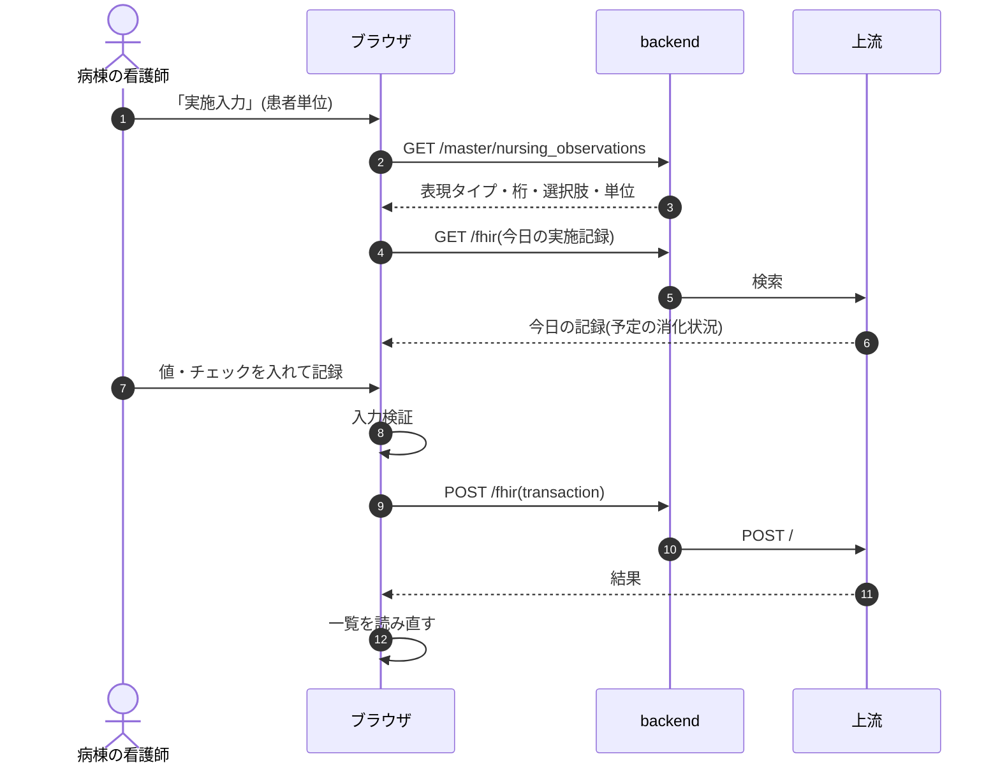
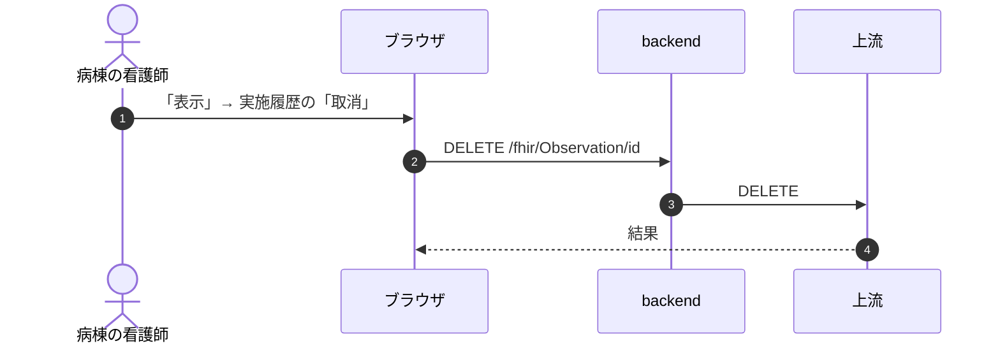
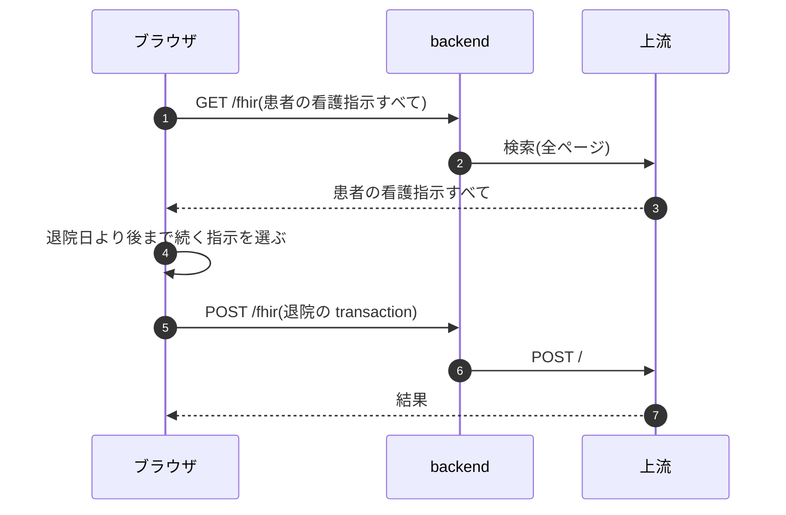
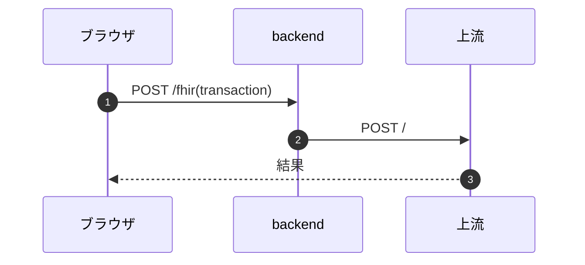
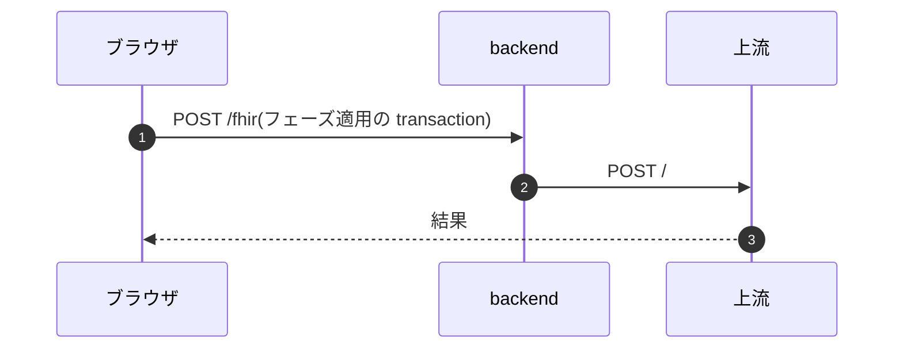

# 看護指示のシーケンス図

<!-- ../fhir-client/docs/order-flows/nursing.md から scripts/sync-flows.mjs で作る。直接編集しない。 -->

運用の流れは[看護指示の業務フロー](../flows/nursing.md)にあります。

## シーケンス図の前提

- **書き込みの経路**: `/fhir` への書き込みはどれも 1 回の transaction Bundle で、backend の `FhirProxyController` が上流の FHIR サーバー(以下「上流」)へ中継します。
- **図の省略**: 図では、上流の応答が backend を通ってブラウザへ戻る矢印を省き、上流からブラウザへの 1 本で描きます。
- **楽観ロック**: 版は `postBundle` が `ifMatch` に添え、版が違えば 412 で止まります。編集フォームは `useEditSnapshot` で開いた時点の版に固定し、`withVersionLock` で元の版を添えます。
- **全ページを読み切る検索**: 欠けた結果を使えない検索は、全ページを読み切ります(`complete: true`)。
- **SS-MIX2**: 有効にしている施設では、中継が書き込みの控えを記録します(`Ssmix2::Recorder`)。看護指示とその実施はメッセージになりません。
- **指示**: 看護指示 1 行の `ServiceRequest` を「指示」と呼びます。明細もヘッダも持ちません。

## リソースの構成

- 指示 `ServiceRequest`(1 行に 1 つ)
  - 指示受け `Task`(`focus` = 指示。指示 1 行に 1 つ)
  - 実施(観察) `Observation`(`basedOn` = 指示)
  - 実施(行為) `Procedure`(`basedOn` = 指示)
  - 代行入力 `Provenance`(`target` = 指示。種別共通で、登録・編集で付ける)

**指示 `ServiceRequest`**

| 要素 | 中身 |
|---|---|
| `category` | `order-type|nursing` + `prescription-setting|inpatient`(固定) |
| `code`(看護行為) | 16 桁の階層コード `master-nursingAction-16digits` + 管理番号 `urn:oid:1.2.392.200119.4.704` |
| `code`(看護観察) | `master-nursingObservationKeyCode` |
| `code`(自由記載) | `text` だけ |
| `orderDetail[0].text` | 条件 |
| `occurrenceDateTime` | 開始日(日付のみ) |
| `encounter` | 入院 |
| `reasonReference` | 対象プロブレム |
| 拡張 `nursing-order-end` | 終了日。無ければ継続中 |
| 拡張 `nursing-order-schedule` | 頻度(`valueTiming`)。無ければ適宜 |
| `requisition` | `nursing-order-requisition|uuid`。同時に出した行 |
| 拡張 `nursing-care-plan-activity` | 看護計画の `CarePlan` と行の id |
| 依頼科・病棟の拡張 | `applyOrderContext` / `withOrderWard` で付ける(他のオーダーと同じ) |

**指示受け `Task`**

| 要素 | 中身 |
|---|---|
| `code` | `task-code|nursing` |
| `status` | 登録の transaction で `requested` を作る |
| `owner` | 受けた人 |
| `executionPeriod.start` | 受けた日時 |

**実施(観察) `Observation`**

| 要素 | 中身 |
|---|---|
| `category` | `order-type|nursing` **だけ** |
| `code` | MEDIS 観察コード + LOINC(`NURSING_LOINC_MAP` にあれば) |
| `value[x]` | 表現タイプで決まる |
| `identifier` | `nursing-perform-entry|uuid`。1 回の記録の束ね |

**実施(行為) `Procedure`**

| 要素 | 中身 |
|---|---|
| `category` | `order-type|nursing` |
| `status` | `completed` |
| `performedDateTime` | 実施日時 |
| `performer[].actor` | 実施者 |

**この形にした理由**

- **頻度を拡張に置く**: `occurrence[x]` は choice なので、`occurrenceTiming` は開始日の `occurrenceDateTime` と併用できません。上流も `occurrenceDateTime` しか索引しません(リハビリの週あたり回数と同じ判断)。
- **期間の検索**: 上流は `order-period` で、開始日と `nursing-order-end` を合わせて索引しています。「その日に効いている指示」は `order-period=ge{日}&order-period=le{日}` で上流に絞らせます。
- **病棟の検索**: 病棟の指示簿は、`order-ward` の `ward` 検索で絞ります。
- **観察に `vital-signs` を付けない**: 上流は `Observation.category` の先頭しか索引しません。`vital-signs` を先頭に置くと、カルテのバイタル検索に混ざります。すると、カードにならない記録で診療日だけが増えます。経過表だけ `category=vital-signs,nursing` で引きます。
- **カルテの時系列**: 看護指示は `ORDER_KINDS`(`fhir/orderKinds.ts`)に入っていません。カルテの時系列からは `karteTimeline.ts` の `orderRequests` で外しています。外さないと、種別の振り分けの最後に落ちて処方カードになります。

## 状態の持ち方

| 指示の状態・指示受けの状態 | `ServiceRequest.status` | 終了日の拡張 | 指示受け `Task` |
|---|---|---|---|
| 有効・指示受け待ち | `active` | 無いか、見る日以降 | `requested` |
| 有効・指示受け済 | `active` | 無いか、見る日以降 | `accepted`(`owner`) |
| 終了 | `active` のまま | 見る日より前 | 動かさない |
| 中止 | `revoked` | そのまま | `cancelled` |

| 判定 | 関数 |
|---|---|
| 状態(終了は日付で決める) | `nursingOrderState` |
| 指示簿に残すか | `isNursingOrderRunningOn` |
| 退院などで打ち切るか | `nursingOrderNeedsStop` |

- `completed` は読めますが、書く経路はありません。終了日を過ぎても `active` のまま上流の検索に残ります(`order-period` で絞るので一覧には出ません)。
- **実施しても指示受けの Task を動かしません**。指示受けは「受けたか」で、作業の進み具合ではないためです(実施が日々積み上がる点はリハビリと同じ)。
- 編集は元の `status` を保ちます(中止・終了した指示を編集で有効に戻さない)。

## 部品

| 操作 | 画面 | 組み立て | hook |
|---|---|---|---|
| 登録 | `components/NursingOrderForm.tsx`・`NursingOrderPanels.tsx`(右ペイン `nursing-order-create`) | `buildNursingOrderBundle` | `useCreatePrescription` |
| 編集 | 同じフォーム(右ペイン `nursing-order-edit`) | `buildNursingOrderUpdateBundle` | `useUpdateNursingOrder` |
| 中止 | `components/KarteNursingTab.tsx`・`pages/NursingWorklistPage.tsx` | `fhir/nursingOrderHelpers.ts` | `useRevokeNursingOrder` |
| 病棟の指示簿 | `pages/NursingWorklistPage.tsx`(`/nursing-worklist`) | `fhir/nursingScheduleHelpers.ts` | `useNursingWorklist`・`useNursingPerformsOn` |
| 指示受け | 病棟の指示簿・`components/KarteNursingTab.tsx` | `fhir/nursingTaskHelpers.ts` | `useAcceptNursingOrders` |
| 実施 | `components/NursingPerformModal.tsx` | `buildNursingPerformBundle` | `useRegisterNursingPerform` |
| 実施の取消 | `components/NursingOrderDetailModal.tsx` | なし(1 件の DELETE) | `useDeleteNursingPerform` |
| 退院 | `components/DischargeModal.tsx` | `buildNursingOrderStopEntries` | `api/queries/encounter.ts` |
| 看護計画の指示展開 | `components/NursingCarePlanPanels.tsx` | `buildNursingOrderBundle` | `useCreatePrescription` |
| 看護計画の解決・取消 | 看護計画の画面 | `fhir/nursingCarePlanHelpers.ts` | 看護計画の hook |
| パス・セット | `components/orderSetRegistry.tsx` | `fhir/pathwayApplyHelpers.ts`・`fhir/pathwayScheduleHelpers.ts` | パス・セットの hook |

- **置き場所**: 指示・終了日・中止・退院の打ち切りの組み立ては `fhir/nursingOrderHelpers.ts`、実施記録は `fhir/nursingPerformHelpers.ts`、看護指示の hook は `api/queries/nursing.ts` です(`useActiveNursingOrders` / `usePatientNursingOrders` も)。
- **全種別共通の hook**: `useCreatePrescription`(`api/queries/labResult.ts`)は、名前に反して全種別共通の登録の hook です。
- **カルテ**: `components/KarteNursingTab.tsx` が一覧と履歴、`NursingOrderDetailModal.tsx` が詳細です。用語の検索は `NursingItemSearchModal.tsx` です。
- **病棟の画面**: 病棟の指示簿は「未指示受け」「実施予定」「全指示」の 3 タブです。`pages/InpatientListPage.tsx` に未指示受けの札があります。
- **頻度**: `fhir/nursingScheduleHelpers.ts` は、頻度の Timing・展開・突き合わせを持ちます。
- **打ち切り**: 個々の指示を閉じる組み立ては `buildNursingOrderCloseEntry` です。パスは `orderContinuityOf`(`pathwayApplyHelpers.ts`)と `planPhaseOrderClosings`(`pathwayScheduleHelpers.ts`)を使います。

## 登録

| 読むもの | 条件 |
|---|---|
| `Encounter` | 入院中 |
| `Condition` | 患者のもの |

入力検証は `validateNursingOrderForm` です。

| 書くもの | 条件 |
|---|---|
| POST `ServiceRequest`(`fullUrl` は `urn:uuid`、同じ `requisition`) | 行ごと |
| POST `Task` `requested`(`focus` = その `urn:uuid`) | 行ごと |
| `Provenance`(CREATE) | いつも |
| `Task` `order-approval` | 代行・研修医 |
| `Task` を `accepted` + `owner` = 看護師本人にする | 看護計画から出したとき |

## 編集

検索は `ServiceRequest?_id&_revinclude=Task:focus` です。

| 書くもの | 条件 |
|---|---|
| PUT `ServiceRequest`(`ifMatch`) | `requisition`・発行日・`status` は元のまま |
| `Provenance`(UPDATE) | いつも |

## 中止

| 書くもの | 条件 |
|---|---|
| PUT `ServiceRequest` `status=revoked`(`ifMatch`) | いつも |
| `Task` `cancelled` | Task が無ければ POST |

## 病棟の指示簿

| 検索 | 条件 |
|---|---|
| 指示と指示受け | `ServiceRequest?category=order-type|nursing&status=active` |
| 同上(期間) | `order-period=ge基準日&order-period=le基準日` |
| 同上(病棟と付随) | `ward=Location/病棟`、`_include` 患者、`_revinclude` `Task:focus` |
| 病室 | `Encounter`(入院中、病棟)。入院患者一覧と同じキャッシュ |
| 実施記録 | `Observation`・`Procedure?category=order-type|nursing&date=基準日&patient=…` |

- 指示の検索は `fetchWorklistBundles` で 500 件ずつ引きます。一覧が上限で欠けたら `truncated` を出します。
- 実施記録の検索は、患者 20 人ずつに分けて並列で引き、全ページを読み切ります。
- 頻度の展開と、実施との突き合わせは画面側でします。

## 指示受け

| 書くもの | 条件 |
|---|---|
| `Task` `accepted` + `owner` = ログイン中の本人 | 選んだ行ごと。Task が無ければ POST、あれば PUT |

読み直すのは、指示簿・カルテのタブ・入院患者一覧の札です。

## 実施

- マスタは管理番号で引きます。
- 今日の実施記録の検索は `Observation`・`Procedure?category=order-type|nursing&date=今日&patient=患者` です。
- 入力検証は `validateNursingPerformForm` です。
- 読み直すのは、経過表・「本日」の列・実施履歴です。

| 書くもの | 条件 |
|---|---|
| POST `Observation`(`basedOn` = 指示) | 値の入った観察ごと |
| POST `Procedure`(`basedOn` = 指示) | チェックした行為ごと |
| 同じ `nursing-perform-entry` | 1 回の記録を束ねる |

指示受けの `Task` は動かしません。

## 実施の取消

行為の記録なら `DELETE /fhir/Procedure/id` です。

## 退院での打ち切り

退院・看護計画の解決・パスのフェーズでの打ち切りは、どれも「その日より後まで続く有効な指示に、その日を終了日として書く」で、指示受けの Task は触りません。

- 操作するのは退院の画面です(`components/DischargeModal.tsx`)。
- 検索は `ServiceRequest?subject=患者&category=order-type|nursing&_revinclude=Task:focus` で、全ページを読み切ります。欠けた結果は使いません。
- 退院日より後まで続く指示は `nursingOrderNeedsStop` で選びます。

| 書くもの | 条件 |
|---|---|
| PUT `ServiceRequest` の `nursing-order-end` = 退院日 | 退院日より後まで続く指示ごと |
| `Encounter`・ベッドの更新、食事・リハビリなどの打ち切り | 同じ transaction に一緒に積む |

## 看護計画の解決・取消

| 書くもの | 条件 |
|---|---|
| PUT `Condition`(`resolved` / `entered-in-error`)、PUT `CarePlan` | 解決は `resolved`、取消は `entered-in-error` |
| 計画から出した指示に `nursing-order-end` = 解決日 | 解決 |
| 有効な指示を `status=revoked` | 取消 |

## パスの次のフェーズ

| 書くもの | 条件 |
|---|---|
| POST 新しい安静度の指示 | フェーズの適用 |
| 前の安静度(AL)の指示に `nursing-order-end` = 新しい開始の前日 | フェーズの適用 |

## 医事会計と SS-MIX2

看護指示は、登録・編集・中止・指示受け・実施・実施の取消・打ち切りのどれでも、医事会計にも SS-MIX2 にも何も送りません。退院そのものは `ADT` で出ます。

- **医事会計**: 出来高で請求する項目を持たないので、対象外です(`OrderCatalog::IGNORED` の `nursing`)。送れない項目としても報告しません。
- **SS-MIX2(指示)**: 看護指示の `ServiceRequest` は、どのメッセージ種別にも当たりません。
- **SS-MIX2(観察)**: 単独で書いた `Observation`(看護観察・バイタル)は、対象のリソースに入っていません(`Ssmix2::Dispatcher::RESOURCE_TYPES`)。
- **SS-MIX2(行為)**: 行為の `Procedure` も、実施記録のメッセージ(`RAS^O17` / `OMI^Z23`)の対象種別ではありません。
