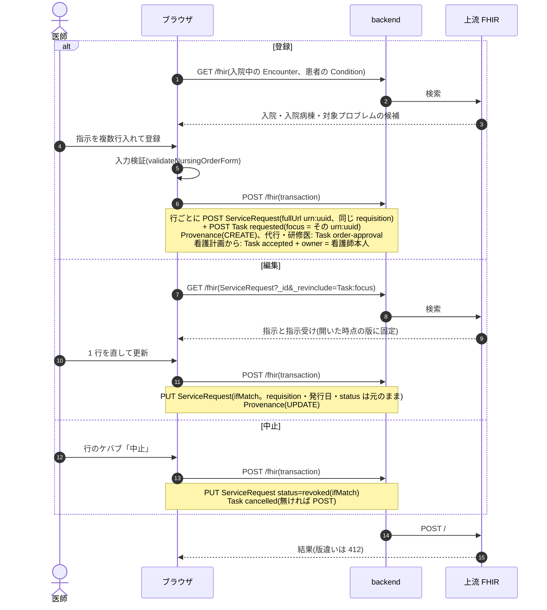
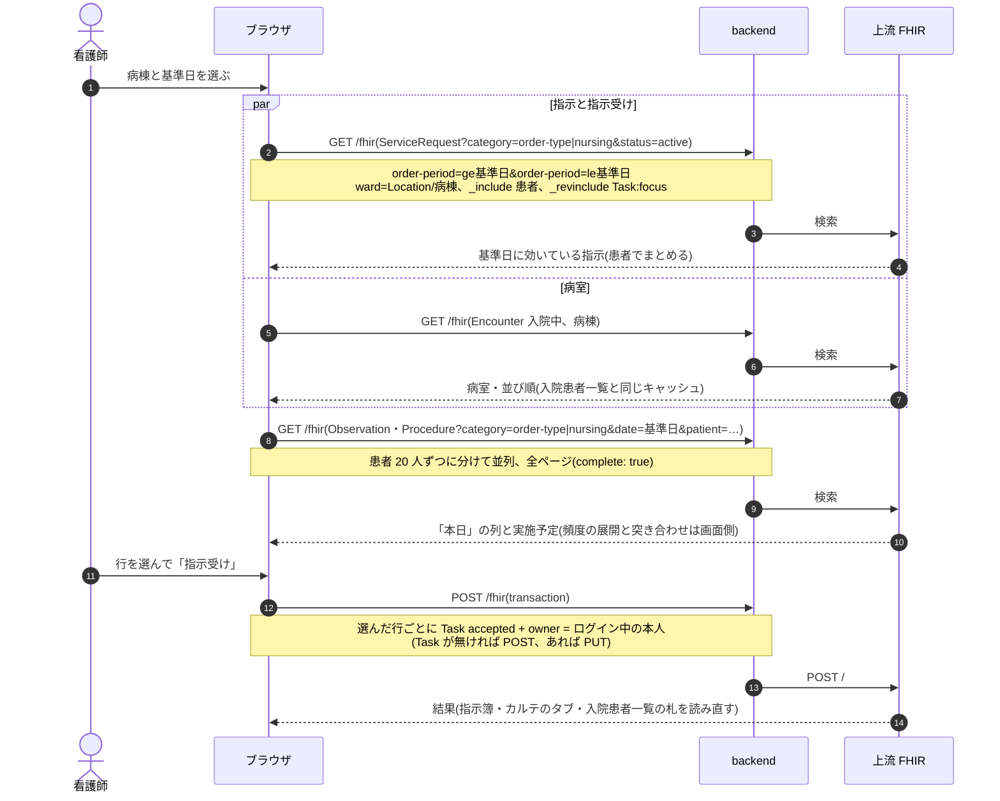
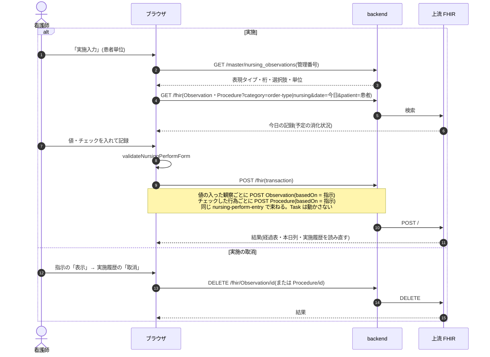
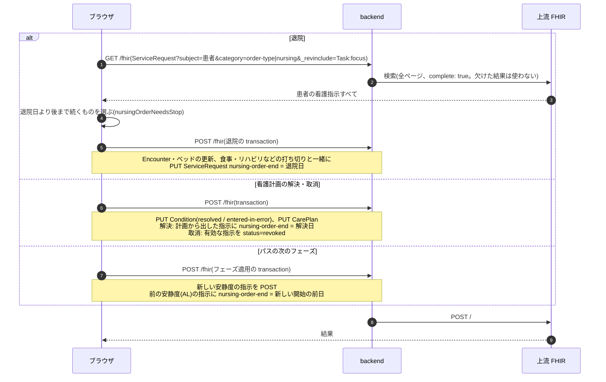

# 看護指示のシーケンス図

<!-- ../fhir-client/docs/order-flows/nursing.md から scripts/sync-flows.mjs で作る。直接編集しない。 -->

運用の流れは[看護指示の業務フロー](../flows/nursing.md)にあります。

## リソースの構成

| もの | リソース | 要点 |
|---|---|---|
| 指示(1 行) | `ServiceRequest` | `category` = `order-type|nursing` + `prescription-setting|inpatient`(固定)、`code` = 看護行為(16 桁の階層コード `master-nursingAction-16digits` + 管理番号 `urn:oid:1.2.392.200119.4.704`)/ 看護観察(`master-nursingObservationKeyCode`)/ `text` だけ(自由記載)、`orderDetail[0].text` = 条件、`occurrenceDateTime` = 開始日(日付のみ)、`encounter` = 入院、`reasonReference` = 対象プロブレム。明細もヘッダも持たない |
| 期間・頻度・束ね | 指示の拡張と `requisition` | `nursing-order-end`(終了日。無ければ継続中)、`nursing-order-schedule`(`valueTiming`。無ければ適宜)、`requisition` = `nursing-order-requisition|uuid`(同時に出した行)、`nursing-care-plan-activity`(看護計画の `CarePlan` と行の id) |
| 依頼科・病棟 | 指示の拡張 | `applyOrderContext` / `withOrderWard`(他のオーダーと同じ。病棟の指示簿は `order-ward` の `ward` 検索で絞る) |
| 指示受け | `Task`(`task-code|nursing`、`focus` = 指示) | 指示 1 行に 1 つ。登録の transaction で `requested` を作る。受けた人は `owner`、受けた日時は `executionPeriod.start` |
| 実施(観察) | `Observation`(`basedOn` = 指示) | `category` = `order-type|nursing` **だけ**、`code` = MEDIS 観察コード + LOINC(`NURSING_LOINC_MAP` にあれば)、`value[x]` は表現タイプで決まる、`identifier` = `nursing-perform-entry|uuid`(1 回の記録の束ね) |
| 実施(行為) | `Procedure`(`basedOn` = 指示) | `category` = `order-type|nursing`、`status` = `completed`、`performedDateTime`、`performer[].actor` |
| 代行入力 | `Provenance`(`target` = 指示) | 種別共通。登録・編集で付ける |

- 頻度を `occurrenceTiming` にせず拡張にするのは、`occurrence[x]` が choice で開始日の `occurrenceDateTime` と併用できず、上流も `occurrenceDateTime` しか索引しないためです(リハビリの週あたり回数と同じ判断)。
- 上流は `order-period` で開始日と `nursing-order-end` を合わせて索引しています。「その日に効いている指示」は `order-period=ge{日}&order-period=le{日}` で上流に絞らせます。
- 観察の `category` に `vital-signs` を付けないのは、上流が `Observation.category` の先頭しか索引せず、先頭に置くとカルテのバイタル検索に混ざってカードにならない記録で診療日だけが増えるためです。経過表だけ `category=vital-signs,nursing` で引きます。
- 看護指示は `ORDER_KINDS`(`fhir/orderKinds.ts`)に入っていません。カルテの時系列からは `karteTimeline.ts` の `orderRequests` で外しています(外すと種別の振り分けの最後に落ちて処方カードになります)。

## 状態の持ち方

| 表示 | `ServiceRequest.status` | 終了日の拡張 | 指示受け `Task` |
|---|---|---|---|
| 有効・指示受け待ち | `active` | 無いか、見る日以降 | `requested` |
| 有効・指示受け済 | `active` | 無いか、見る日以降 | `accepted`(`owner`) |
| 終了 | `active` のまま | 見る日より前 | 動かさない |
| 中止 | `revoked` | そのまま | `cancelled` |

- 状態の判定は `nursingOrderState`(終了は日付で決める)、指示簿に残すかは `isNursingOrderRunningOn`、退院などで打ち切るかは `nursingOrderNeedsStop` です。
- `completed` は読めますが、書く経路はありません。終了日を過ぎても `active` のまま上流の検索に残ります(`order-period` で絞るので一覧には出ません)。
- **実施しても指示受けの Task を動かしません**。指示受けは「受けたか」で、作業の進捗ではないためです(実施が日々積み上がる点はリハビリと同じ)。
- 編集は元の `status` を保ちます(中止・終了した指示を編集で有効に戻さない)。

## シーケンス図の前提

`/fhir` への書き込みはどれも 1 回の transaction Bundle で、backend の `FhirProxyController` が上流へ中継します。
SS-MIX2 を有効にしている施設では、中継が書き込みの控えを記録します(`Ssmix2::Recorder`。看護指示とその実施はメッセージになりません)。
楽観ロックの版は `postBundle` が `ifMatch` に添え、版が違えば 412 で止まります。編集フォームは `useEditSnapshot` で開いた時点の版に固定し、`withVersionLock` で元の版を添えます。

| 部品 | 場所 |
|---|---|
| 登録・編集のフォーム | `components/NursingOrderForm.tsx`・`NursingOrderPanels.tsx`(右ペイン `nursing-order-create` / `nursing-order-edit`)、用語の検索 `NursingItemSearchModal.tsx` |
| 組み立て | `fhir/nursingOrderHelpers.ts`(指示・終了日・中止・退院の打ち切り)・`nursingTaskHelpers.ts`(指示受け)・`nursingScheduleHelpers.ts`(頻度の Timing・展開・突き合わせ)・`nursingPerformHelpers.ts`(実施記録) |
| カルテ | `components/KarteNursingTab.tsx`(一覧・履歴)、詳細 `NursingOrderDetailModal.tsx`、実施入力 `NursingPerformModal.tsx` |
| 病棟の画面 | `pages/NursingWorklistPage.tsx`(`/nursing-worklist`。未指示受け・実施予定・全指示の 3 タブ)、`pages/InpatientListPage.tsx`(未指示受けの札) |
| hook | `api/queries/nursing.ts`(`useActiveNursingOrders` / `usePatientNursingOrders` / `useNursingWorklist` / `useAcceptNursingOrders` / `useRevokeNursingOrder` / 実施記録)、登録は `useCreatePrescription`(`api/queries/labResult.ts`。全種別共通) |
| 退院 | `components/DischargeModal.tsx`、`api/queries/encounter.ts`(`buildNursingOrderStopEntries` を退院の transaction に積む) |
| 看護計画 | `components/NursingCarePlanPanels.tsx`(指示展開)、`fhir/nursingCarePlanHelpers.ts`(解決・取消で指示を閉じる) |
| パス・セット | `fhir/pathwayApplyHelpers.ts`(`orderContinuityOf`)、`fhir/pathwayScheduleHelpers.ts`(`planPhaseOrderClosings`)、`components/orderSetRegistry.tsx` |

## 登録・編集・中止

`buildNursingOrderBundle` / `buildNursingOrderUpdateBundle`、`useCreatePrescription`、`useUpdateNursingOrder`、`useRevokeNursingOrder`。

## 病棟の指示簿と指示受け

`useNursingWorklist`(`fetchWorklistBundles` で 500 件ずつ)、`useNursingPerformsOn`、`useAcceptNursingOrders`。一覧が上限で欠けたら `truncated` を出します。

## 実施・実施の取消

`buildNursingPerformBundle`、`useRegisterNursingPerform`、`useDeleteNursingPerform`。

## 退院・看護計画の解決・パスの段階での打ち切り

`buildNursingOrderStopEntries` / `buildNursingOrderCloseEntry`。どれも「その日より後まで続く有効な指示に、その日を終了日として書く」で、指示受けの Task は触りません。

## 医事会計と SS-MIX2

看護指示は出来高で請求する項目を持たないので、医事会計の対象外です(`OrderCatalog::IGNORED` の `nursing`)。送れない項目としても報告しません。
SS-MIX2 は、看護指示の `ServiceRequest` がどのメッセージ種別にも当たらず、単独で書いた `Observation`(看護観察・バイタル)は対象のリソースに入っていません(`Ssmix2::Dispatcher::RESOURCE_TYPES`)。行為の `Procedure` も実施記録のメッセージ(`RAS^O17` / `OMI^Z23`)の対象種別ではありません。

| 起きたこと | 医事会計(`BillingClaimBuilder`) | SS-MIX2 |
|---|---|---|
| 登録・編集・中止 | なし | なし |
| 指示受け | なし | なし |
| 実施・実施の取消 | なし | なし |
| 退院・看護計画の解決・パスでの打ち切り | なし | なし(退院そのものは `ADT` で出る) |
