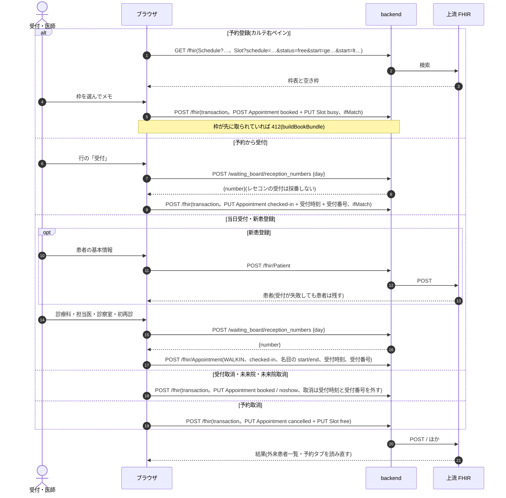
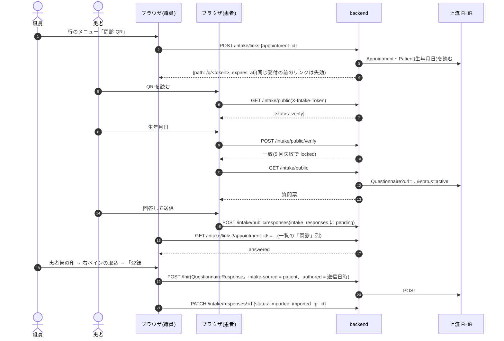
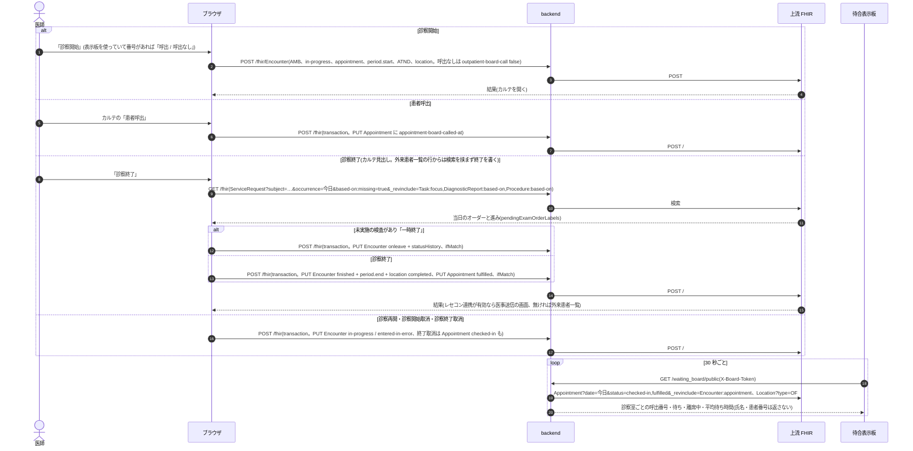
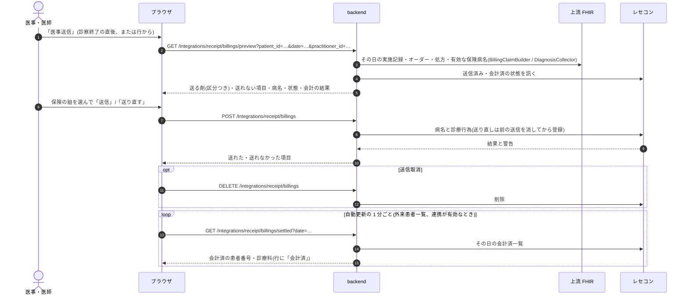

# 外来の受付から会計までのシーケンス図

<!-- ../fhir-client/docs/order-flows/outpatient.md から scripts/sync-flows.mjs で作る。直接編集しない。 -->

運用の流れは[外来の受付から会計までの業務フロー](../flows/outpatient.md)にあります。

## リソースの構成

| もの | リソース | 要点 |
|---|---|---|
| 予約枠 | `Schedule`(`actor` = 医師・診察室、`specialty` = 診療科)+ `Slot`(`free` / `busy` / `busy-unavailable`) | 診察の枠表は種別「診察」(`scheduleType="consultation"`)。検査の枠表と分けて選ばせる |
| 予約・受付 | `Appointment` | `status` = `booked` → `checked-in` → `fulfilled`(ほか `noshow` / `cancelled`)。`participant[0]` は必ず患者(上流が患者コンパートメントをここから索引する)、続けて医師・診察室。`specialty` = 診療科(SS-MIX2 の診療科コード)、`slot` = 押さえた枠、`reasonReference` = 予約時に添えた病名 |
| 当日受付 | `Appointment`(`appointmentType` = `WALKIN`) | 枠を持たない。`checked-in` の予約は app-3 で `start` / `end` が必須なので、受付時刻から 15 分の名目の時間を入れる |
| 受付時刻 | 拡張 `appointment-checked-in-at` | 当日受付の `start` は名目なので、受付時刻は必ずここから読む |
| 受付番号 | `Appointment.identifier`(system `http://fhir-client.local/identifier/reception-number`) | backend の日別カウンタ(`reception_number_counters`)が払い出す。レセコン連携の受付はレセコンの受付 ID |
| 初再診 | 拡張 `appointment-visit-kind`(`first` / `revisit`) | 未選択は拡張ごと持たない(医事会計に任せる) |
| 保険の組 | 拡張 `reception-coverage-set` | レセコン連携の受付だけが持つ。医事送信の初期値 |
| レセコンの受付キー | `Appointment.identifier`(レセコンの受付の system、「日付:ID」) | 条件付き PUT の突き合わせキー |
| 表示板の呼出 | 拡張 `appointment-board-called-at`(予約)、`outpatient-board-call`(診察、`valueBoolean` false) | 呼出は時刻の上書きだけで状態は変えない。「呼出なし」の診察にだけ false を付ける |
| 診察 | `Encounter`(`class` = v3-ActCode `AMB`) | `status` = `in-progress` / `onleave` / `finished` / `entered-in-error`、`appointment` = 受付、`period` = 診察開始・終了、`participant` = 担当医(`ATND`)、`location[0]` = 診察室、`statusHistory` = 一時終了などの過ぎた期間 |
| Web 問診の回答 | backend の `intake_links` / `intake_responses` → 取込で `QuestionnaireResponse` | 取込まで上流に書かない。取込の回答は拡張 `intake-source` = `patient`、`authored` = 患者の送信日時 |
| 当日オーダーの進み | 各種別のヘッダ `ServiceRequest` + `Task`・`DiagnosticReport`・`Procedure` | 外来患者一覧が `occurrence` = 診察日で読み、印の段階にする |
| 会計 | レセコン側 | カルテは控えを持たない。送信済み・会計済はそのつどレセコンに訊く |

- 外来の診察は診療科(`serviceProvider`)を持ちません。受付の `specialty` は SS-MIX2 の診療科コードだけで Organization の id が引けないためで、診療科の表示と会計の診療科は受付から読みます。
- 診察は診察開始で初めて建ちます。予約・受付の段階では `Encounter` はありません。
- 外来患者一覧は `Appointment?date={日}&status:not=cancelled,entered-in-error&_include=Appointment:patient&_revinclude=Encounter:appointment` の 1 本で読みます(500 件 × 2 ページまで。超えたら `truncated`)。検査予約(`basedOn` あり)は検索で落とせないので画面で外します(`isExamAppointment`)。

## 状態の持ち方

| 表示 | `Appointment.status` | 診察 `Encounter.status` | 判定 |
|---|---|---|---|
| 予約済 | `booked` | なし | `appointment.status` |
| 受付済 | `checked-in` | なし | 同上 |
| 診察中 | `checked-in` | `in-progress` | 擬似コード `in-exam`(`outpatientStatusCode`) |
| 一時終了 | `checked-in` | `onleave` | 擬似コード `exam-paused` |
| 診療済 | `fulfilled` | `finished` | `appointment.status` |
| 未来院 | `noshow` | なし | 同上 |
| 取消 | `cancelled` | なし | 一覧の検索で落とす |

- 同じ受付に診察が複数あれば、`entered-in-error` を除き、診察開始(同時刻なら更新時刻)の新しいものを採ります(`latestExamByAppointment`、待合表示板の backend も同じ規則)。
- 一時終了・診察再開は `statusHistory` に過ぎた期間を積みます(`withStatusChange`)。受付は `checked-in` のまま触りません。
- 診察終了は `Encounter` の `finished` + `period.end` + `location[0]` の `completed` と、受付の `fulfilled` を**同じ transaction** で書きます。診察終了取消はその逆(`in-progress`、`period.end` を消す、`location[0]` を `active`、受付を `checked-in`)です。
- カルテ見出しのボタンは今日の受付済の受付とその診察から決めます(`usePatientTodayOutpatient`)。過去の日に閉じ忘れた診察は見出しに出ないので、外来患者一覧で日付を戻して閉じます。
- 楽観ロック: 受付・診察の書き換えはどれも transaction で、`postBundle` が読んだ版を `ifMatch` に添えます。2 台で同じ受付を操作すると後の方が 412 で止まります。予約は枠を読んだ版で `busy` にするので、同じ空き枠の取り合いも 412 で止まります。

## シーケンス図の前提

`/fhir` への書き込みは backend の `FhirProxyController` が上流へ中継します。予約と枠、診察と受付のように一緒に動くものは 1 本の transaction Bundle に載せます。受付番号・待合表示板・Web 問診・会計送信は backend の独自 API で、それぞれ `/waiting_board/*`・`/intake/*`・`/integrations/receipt/*` です。
SS-MIX2 を有効にしている施設では、中継が書き込みの控えを記録し(`Ssmix2::Recorder`)、受付になった `Appointment` から ADT を組みます。

| 部品 | 場所 |
|---|---|
| 画面 | `pages/OutpatientListPage.tsx`(一覧・行のボタンとメニュー・ドロワー)、`pages/KartePage.tsx`(見出しの診察ボタン)、`pages/WaitingBoardPage.tsx`、`pages/IntakePage.tsx`、`pages/Schedule*Page.tsx` |
| モーダル・パネル | 当日受付 `WalkInCheckInModal.tsx`、新患登録 `NewPatientCheckInModal.tsx`、受付の編集 `OutpatientReceptionModal.tsx`(`ReceptionFields.tsx`)、呼出の確認 `ExamStartCallModal.tsx`、患者呼出 `PatientCallModal.tsx`、一時終了の選択 `ExamFinishChoiceModal.tsx`、医事送信 `BillingSendModal.tsx`、問診 QR `IntakeQrModal.tsx`、問診の取込 `IntakeReviewPanel.tsx`、予約 `AppointmentPanels.tsx`(`AppointmentSlotPicker.tsx`) |
| 組み立て | `fhir/appointmentHelpers.ts`(予約・当日受付・受付時刻・受付番号・初再診・取消・日時変更)、`fhir/outpatientEncounterHelpers.ts`(診察・状態の合成)、`fhir/outpatientOrderProgressHelpers.ts`(当日オーダーの印・未実施の検査)、`fhir/coverageHelpers.ts`(保険の組)、`fhir/scheduleHelpers.ts` |
| hook | `api/queries/outpatient.ts`(`useOutpatientList` / `useOutpatientOrders` / `useUpdateAppointmentStatus` / `useWalkInCheckIn` / `useStartOutpatientExam` / `useUpdateOutpatientExam` / `useUpdateOutpatientReception` / `useCallOutpatient` / `usePatientTodayOutpatient`)、`api/queries/appointment.ts`(`useBookAppointment` / `useCancelAppointment` / `useRescheduleAppointment`)、`api/queries/schedule.ts`、`api/receiptClient.ts` |
| backend | `WaitingBoard::StaffController`(受付番号・リンク)・`WaitingBoard::Snapshot`、`Intake::StaffController`・`Intake::PublicController`、`Integrations::Receipt::BillingsController`・`ReceiptComputer::BillingSender`、`ReceiptComputer::ReceptionImporter` |

## 予約・受付・当日受付・新患登録

レセコン連携の受付は、院内エージェントがレセコンの通知を中立の形にして `POST /integrations/receipt/events`(`reception.created` / `.updated` / `.canceled`)に送ります。`ReceptionImporter` が受付キーの identifier で条件付き PUT(`WALKIN`・`checked-in`・レセコンの受付番号・保険の組)し、取消は診察(`Encounter?appointment=`)が無いときだけ `cancelled` にします。同じ患者の通知は `pg_advisory_xact_lock` で直列にします。

## Web 問診

## 診察開始・呼出・一時終了・診察終了

## 医事送信・会計済

## 医事会計と SS-MIX2

医事会計に送るのは医事送信の画面で送った内容だけで、受付・診察の出来事そのものは送りません(診察開始の時刻は送信のときに実施時刻として添えます)。外来の診察(`class` = `AMB`)は SS-MIX2 の ADT を起こさず、受付だけが `ADT^A04` を出します。

| 起きたこと | 医事会計 | SS-MIX2 |
|---|---|---|
| 予約登録・日時変更・予約取消 | なし | なし |
| 受付(予約から・当日受付・新患登録・レセコンからの受付) | なし | `ADT^A04`(ADT-12、PV1-44 受付日時、PV1-7 担当医)。受付済のまま担当医などを変えた更新では出さない |
| 新患登録の患者登録 | なし(レセコン連携では患者はレセコンが正本) | `ADT^A08`(ADT-00) |
| 受付取消・未来院 | なし | なし(A04 の取り消しは出さない) |
| 診察開始・一時終了・診察再開・診察終了と各取消 | なし | なし |
| 患者呼出 | なし | なし |
| Web 問診の取込 | なし | なし |
| 医事送信 | 病名と、その日の診療行為(実施記録から組んだ剤)。初再診料は医事会計の自動算定 | なし |
| 送り直し / 送信取消 | 前の送信を消して登録し直す / 消す | なし |
| 診察中に出したオーダー | 各種別の実施記録として医事送信に乗る | 各種別のメッセージ(処方 `RDE^O11`、検体検査 `OML^O33` など) |
