# 外来の受付から会計までのシーケンス図

<!-- ../fhir-client/docs/order-flows/outpatient.md から scripts/sync-flows.mjs で作る。直接編集しない。 -->

運用の流れは[外来の受付から会計までの業務フロー](../flows/outpatient.md)にあります。

## シーケンス図の前提

- **上流**: backend が中継する先の FHIR サーバーです。ブラウザの `/fhir` への読み書きは、backend の `FhirProxyController` が上流へ中継します。
- **一緒に動くものは transaction**: 予約と枠、診察と受付のように一緒に動くものは、1 本の transaction Bundle に載せます。受付・診察の書き換えはどれも transaction です。
- **新規の 1 件は単発の POST**: 当日受付の `Appointment`、新患登録の `Patient`、診察開始の `Encounter` は、1 件の POST です(`createResource`)。
- **楽観ロック**: `postBundle` が読んだ版を `ifMatch` に添えます。2 台で同じ受付を操作すると、後の方が 412 で止まります。予約は枠を読んだ版で `busy` にするので、同じ空き枠の取り合いも 412 で止まります。
- **図の省略**: 応答は上流から backend を通ってブラウザへ戻りますが、図では上流からブラウザへの 1 本で書きます。同じ形の操作(入力 → transaction 1 回)は図にせず、図の下の表に出します。
- **SS-MIX2**: 有効にしている施設では、中継が書き込みの控えを記録し(`Ssmix2::Recorder`)、受付になった `Appointment` から ADT を組みます。
- **呼び名**: 画面の「医事送信」を、設計文書とコードでは会計送信(billing)と呼びます。

backend の独自 API は次の 3 つです。

| API | パス | 使う場面 |
|---|---|---|
| 待合表示板 | `/waiting_board/*` | 受付番号の採番(`/waiting_board/reception_numbers`)、表示板のリンク、表示板の読み込み |
| Web 問診 | `/intake/*` | QR の発行、患者の回答、取込 |
| レセコン連携 | `/integrations/receipt/*` | 医事送信、会計済の問い合わせ、レセコンからの受付の通知 |

| 操作 | 画面 | 組み立て | hook |
|---|---|---|---|
| 一覧を読む | `pages/OutpatientListPage.tsx` | `fhir/outpatientEncounterHelpers.ts`(状態の合成) | `useOutpatientList`、`useOutpatientOrders` |
| 予約登録・日時変更・予約取消 | `AppointmentPanels.tsx`(`AppointmentSlotPicker.tsx`) | `fhir/appointmentHelpers.ts`、`fhir/scheduleHelpers.ts` | `useBookAppointment`、`useRescheduleAppointment`、`useCancelAppointment` |
| 受付・受付取消・未来院 | `pages/OutpatientListPage.tsx` | `fhir/appointmentHelpers.ts` | `useUpdateAppointmentStatus` |
| 当日受付 | `WalkInCheckInModal.tsx` | `fhir/appointmentHelpers.ts` | `useWalkInCheckIn` |
| 新患登録 | `NewPatientCheckInModal.tsx` | `fhir/appointmentHelpers.ts` | `useCreatePatient`、`useWalkInCheckIn` |
| 受付の編集 | `OutpatientReceptionModal.tsx`(`ReceptionFields.tsx`) | `fhir/appointmentHelpers.ts` | `useUpdateOutpatientReception` |
| 診察開始 | `ExamStartCallModal.tsx`(呼出の確認) | `fhir/outpatientEncounterHelpers.ts` | `useStartOutpatientExam` |
| 患者呼出 | `PatientCallModal.tsx` | `fhir/appointmentHelpers.ts` | `useCallOutpatient` |
| 診察終了・一時終了・再開・取消 | `ExamFinishChoiceModal.tsx`(一時終了の選択) | `fhir/outpatientOrderProgressHelpers.ts` | `useUpdateOutpatientExam` |
| カルテの見出しのボタン | `pages/KartePage.tsx` | `fhir/outpatientEncounterHelpers.ts` | `usePatientTodayOutpatient` |
| 医事送信 | `BillingSendModal.tsx` | `fhir/coverageHelpers.ts`(保険の組) | `api/receiptQueries.ts`(`api/receiptClient.ts`) |
| Web 問診 | `IntakeQrModal.tsx`、`IntakeReviewPanel.tsx`、`pages/IntakePage.tsx` | – | `api/intakeQueries.ts` |
| 待合表示板 | `pages/WaitingBoardPage.tsx` | – | `api/waitingBoardQueries.ts` |
| 予約枠 | `pages/Schedule*Page.tsx` | `fhir/scheduleHelpers.ts` | `api/queries/schedule.ts` |

- 外来の hook は `api/queries/outpatient.ts`、予約の hook は `api/queries/appointment.ts` にあります。
- `fhir/outpatientOrderProgressHelpers.ts` は、当日オーダーの印と未実施の検査を判定します。

| backend の部品 | 役割 |
|---|---|
| `WaitingBoard::StaffController` | 受付番号、表示板のリンク |
| `WaitingBoard::Snapshot` | 表示板に出す内容 |
| `Intake::StaffController`、`Intake::PublicController` | Web 問診の職員側、患者側 |
| `Integrations::Receipt::BillingsController`、`ReceiptComputer::BillingSender` | 医事送信 |
| `ReceiptComputer::ReceptionImporter` | レセコンからの受付の取り込み |

## リソースの構成

受付は `Appointment`、診察は `Encounter` です。診察は診察開始で初めてでき、予約・受付の段階では `Encounter` はありません。

| リソース | 要素 | 中身 |
|---|---|---|
| `Schedule` | `actor`、`specialty` | 予約枠の枠表。医師・診察室と診療科 |
| `Slot` | `status` | `free` / `busy` / `busy-unavailable` |
| `Appointment` | `status` | `booked` → `checked-in` → `fulfilled`。ほかに `noshow` / `cancelled` |
| `Appointment` | `participant` | `participant[0]` は必ず患者。続けて医師・診察室 |
| `Appointment` | `specialty` | 診療科(SS-MIX2 の診療科コード) |
| `Appointment` | `slot` | 押さえた枠 |
| `Appointment` | `reasonReference` | 予約時に添えた病名 |
| `Appointment` | `appointmentType` | 当日受付は `WALKIN`。枠を持たない |
| `Appointment` | 拡張 `appointment-checked-in-at` | 受付時刻 |
| `Appointment` | `identifier`(受付番号) | system `http://fhir-client.local/identifier/reception-number` |
| `Appointment` | `identifier`(レセコンの受付キー) | レセコンの受付の system、「日付:ID」 |
| `Appointment` | 拡張 `appointment-visit-kind` | 初再診。`first` / `revisit` |
| `Appointment` | 拡張 `reception-coverage-set` | 保険の組 |
| `Appointment` | 拡張 `appointment-board-called-at` | 待合表示板に呼び出した時刻 |
| `Encounter` | `class` | v3-ActCode `AMB` |
| `Encounter` | `status` | `in-progress` / `onleave` / `finished` / `entered-in-error` |
| `Encounter` | `appointment` | 受付 |
| `Encounter` | `period` | 診察開始・終了 |
| `Encounter` | `participant` | 担当医(`ATND`) |
| `Encounter` | `location[0]` | 診察室 |
| `Encounter` | `statusHistory` | 一時終了などの過ぎた期間 |
| `Encounter` | 拡張 `outpatient-board-call` | 「呼出なし」の診察にだけ `valueBoolean` false を付ける |
| `QuestionnaireResponse` | 拡張 `intake-source`、`authored` | 取り込んだ Web 問診の回答 |

- **`participant[0]` は患者**: 上流が患者コンパートメントをここから索引するためです。
- **診察の枠表**: 種別「診察」(`scheduleType="consultation"`)です。検査の枠表と分けて選ばせます。
- **当日受付の `start` / `end`**: `checked-in` の予約は FHIR の制約 app-3 で `start` / `end` が必須なので、受付時刻から 15 分の名目の時間を入れます。受付時刻は必ず `appointment-checked-in-at` から読みます。
- **受付番号**: backend の日別カウンタ(`reception_number_counters`)が払い出します。レセコン連携の受付は、レセコンの受付 ID を使います。
- **初再診**: 未選択なら拡張ごと持ちません(判定はレセコンに任せます)。
- **保険の組**: レセコン連携の受付だけが持ちます。医事送信の初期値になります。
- **レセコンの受付キー**: 条件付き PUT の突き合わせキーです。
- **呼出**: 時刻の上書きだけで、状態は変えません。
- **Web 問診の回答**: 取込まで上流に書きません。backend の `intake_links` / `intake_responses` に持ち、取込で `QuestionnaireResponse` にします。取込の回答は `intake-source` = `patient`、`authored` = 患者の送信日時です。
- **当日オーダーの進み**: 各種別のヘッダ(オーダーの親の `ServiceRequest`)と `Task`・`DiagnosticReport`・`Procedure` を、`occurrence` = 診察日で読み、印の段階にします。
- **会計**: レセコン側にあります。カルテは控えを持たず、送信済みと会計済は、そのつどレセコンに訊きます。
- **診察は診療科を持ちません**: 外来の `Encounter` に `serviceProvider` はありません。受付の `specialty` は SS-MIX2 の診療科コードだけで、Organization の id が引けないためです。診療科の表示と会計の診療科は、受付から読みます。

外来患者一覧は次の 1 本で読みます。

```text
Appointment?date={日}&status:not=cancelled,entered-in-error
  &_include=Appointment:patient&_revinclude=Encounter:appointment
```

- 500 件 × 2 ページまで読みます。超えたら `truncated` になります。
- 検査予約(`basedOn` あり)は検索で落とせないので、画面で外します(`isExamAppointment`)。

## 状態の持ち方

| 表示 | `Appointment.status` | 診察 `Encounter.status` | 判定 |
|---|---|---|---|
| 予約済 | `booked` | なし | `Appointment.status` |
| 受付済 | `checked-in` | なし | `Appointment.status` |
| 診察中 | `checked-in` | `in-progress` | 画面で合成する状態コード `in-exam` |
| 一時終了 | `checked-in` | `onleave` | 画面で合成する状態コード `exam-paused` |
| 診療済 | `fulfilled` | `finished` | `Appointment.status` |
| 未来院 | `noshow` | なし | `Appointment.status` |
| 取消 | `cancelled` | なし | 一覧の検索で落とす |

- 状態コードの合成は `outpatientStatusCode` です。診察中・一時終了の間も、受付は `checked-in` のまま触りません。
- 同じ受付に診察が複数あれば、`entered-in-error` を除き、診察開始(同時刻なら更新時刻)の新しいものを採ります(`latestExamByAppointment`、待合表示板の backend も同じ規則)。
- 一時終了・診察再開は `statusHistory` に過ぎた期間を積みます(`withStatusChange`)。
- 診察終了は、`Encounter` の変更と受付の `fulfilled` を**同じ transaction** で書きます。診察終了取消はその逆です。中身は「シーケンス図: 診察開始・呼出・一時終了・診察終了」の表にあります。
- カルテ見出しのボタンは、今日の受付済の受付とその診察から決めます(`usePatientTodayOutpatient`)。過去の日に閉じ忘れた診察は見出しに出ないので、外来患者一覧で日付を戻して閉じます。

## 予約・受付・当日受付・新患登録

予約登録(カルテの右ペイン)です。

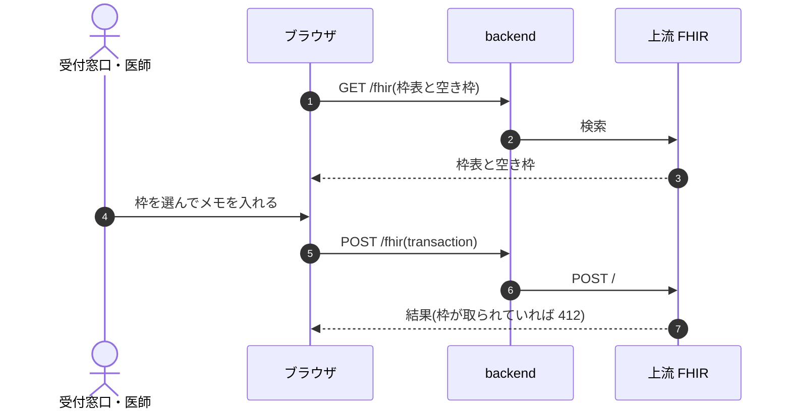

予約からの受付です。

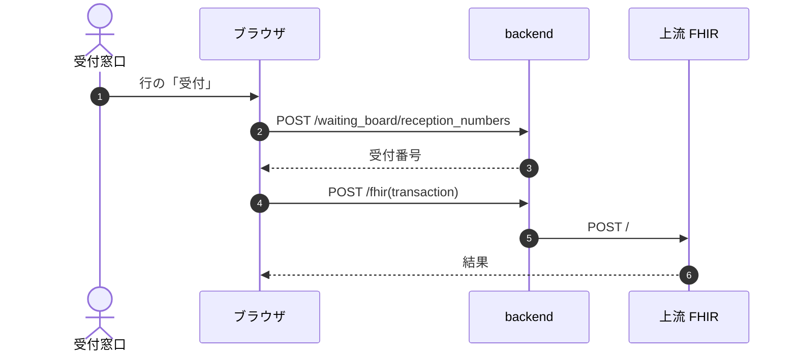

当日受付・新患登録です。

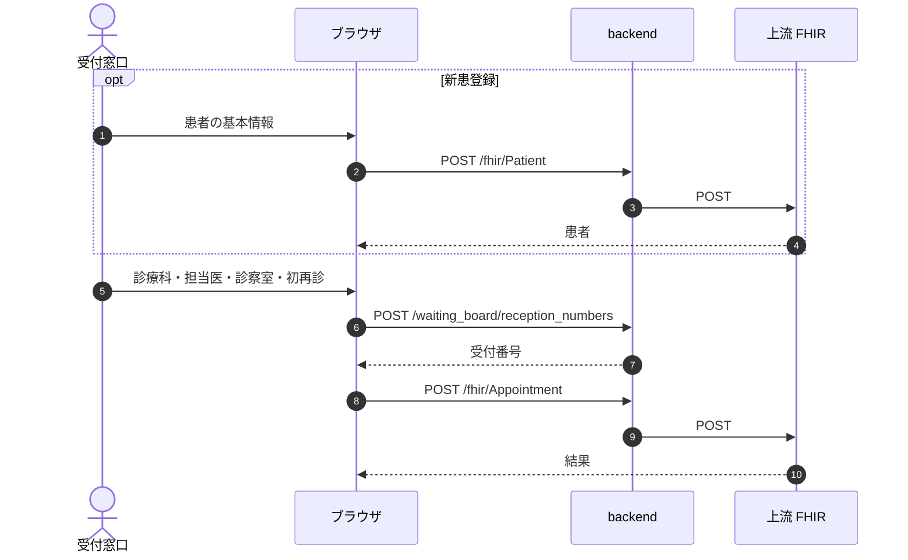

| 操作 | 前に読むもの・採番 | 書くもの |
|---|---|---|
| 予約登録 | `Schedule?…`、`Slot?schedule=…&status=free&start=ge…&start=lt…` | transaction。POST `Appointment`(`booked`)+ PUT `Slot`(`busy`、`ifMatch`)。`buildBookBundle` |
| 日時変更 | 予約の枠 | transaction。PUT `Appointment`(日時と `slot`)+ 前の `Slot` を `free`、新しい `Slot` を `busy`。`buildRescheduleBundle` |
| 予約取消 | 予約の枠 | transaction。PUT `Appointment`(`cancelled`)+ PUT `Slot`(`free`) |
| 予約から受付 | 受付番号(`{day}` を渡して `{number}` を受ける) | transaction。PUT `Appointment`(`checked-in`、受付時刻、受付番号、`ifMatch`) |
| 当日受付・新患登録 | 受付番号 | 単発の POST。`Appointment`(`WALKIN`、`checked-in`、名目の `start` / `end`、受付時刻、受付番号) |
| 受付取消 | – | transaction。PUT `Appointment`(`booked`)。受付時刻と受付番号を外す |
| 未来院・未来院取消 | – | transaction。PUT `Appointment`(`noshow` / `booked`) |

- 新患登録は、先に `Patient` を POST します。受付が失敗しても、患者は残します。
- レセコンの受付は、受付番号を採番しません。
- どの操作も、書いたあとに外来患者一覧と予約タブを読み直します。

### レセコンからの受付

レセコン連携の受付は、ブラウザを通りません。院内エージェントがレセコンの通知を受け、backend に送ります。

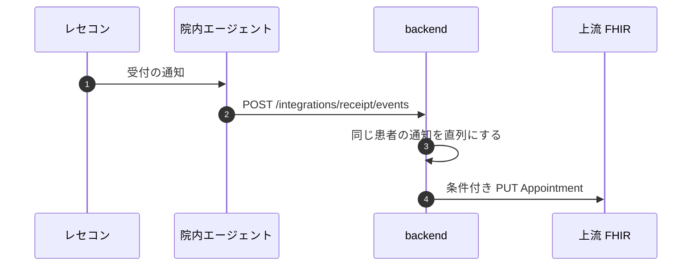

| 通知 | backend(`ReceptionImporter`)がすること |
|---|---|
| `reception.created`、`reception.updated` | 受付キーの `identifier` で条件付き PUT する。`WALKIN`・`checked-in`・レセコンの受付番号・保険の組 |
| `reception.canceled` | 診察(`Encounter?appointment=`)が無いときだけ `cancelled` にする |

- 院内エージェントは、レセコンの通知を中立の形にして送ります。
- 同じ患者の通知は `pg_advisory_xact_lock` で直列にします。

## Web 問診

QR の発行です。

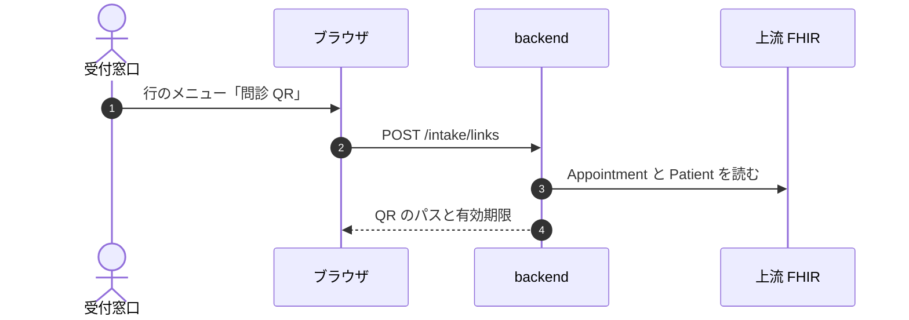

患者の回答です。

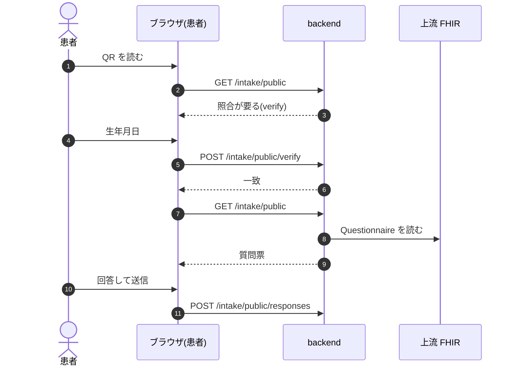

取込です。

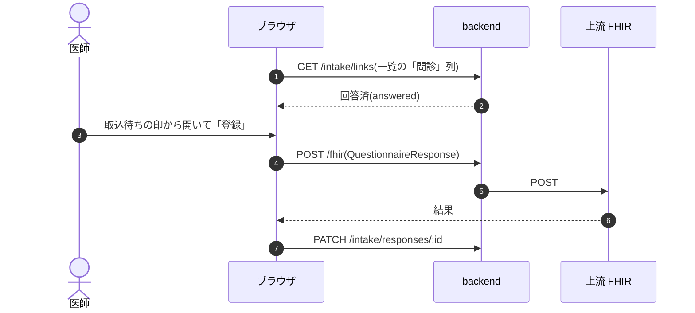

| 呼び出し | 中身 |
|---|---|
| `POST /intake/links` | `{appointment_id}` を渡し、`{path: /q/<token>, expires_at}` を受ける。同じ受付の前のリンクは失効する |
| 発行のときに読むもの | `Appointment` と `Patient`(生年月日) |
| `GET /intake/public` | ヘッダ `X-Intake-Token`。照合の前は `{status: verify}` を返す |
| `POST /intake/public/verify` | 生年月日を照合する。5 回失敗で `locked` |
| 質問票 | `Questionnaire?url=…&status=active` |
| `POST /intake/public/responses` | `intake_responses` に `pending` で保存する |
| `GET /intake/links?appointment_ids=…` | 一覧の「問診」列の状態 |
| 取込の POST | `QuestionnaireResponse`。`intake-source` = `patient`、`authored` = 送信日時 |
| `PATCH /intake/responses/:id` | 取込は `{status: imported, imported_qr_id}`、破棄は `{status: discarded}` |

- 破棄は、上流に書かずに `PATCH` だけを送ります。

## 診察開始・呼出・一時終了・診察終了

診察開始です。

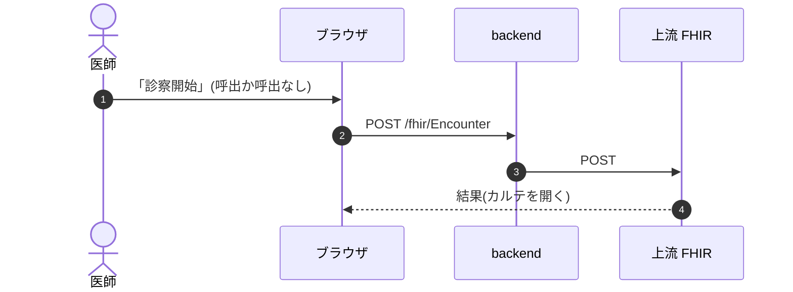

診察終了(カルテの見出しから)です。外来患者一覧の行からは、検索を挟まずに診察終了を書きます。

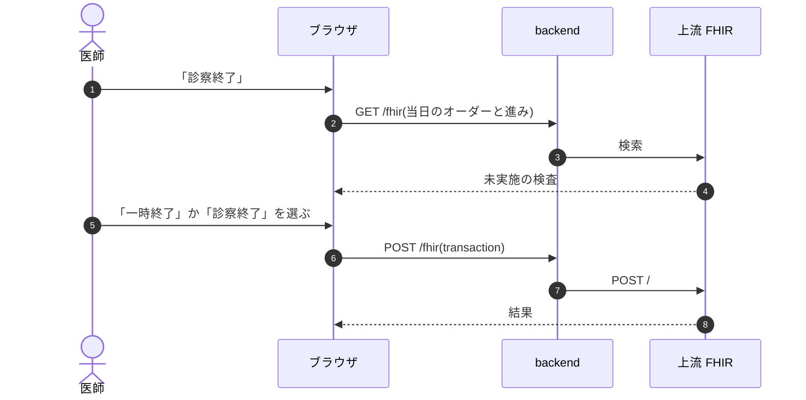

当日のオーダーの検索は次のとおりです。未実施の検査は `pendingExamOrderLabels` で拾います。

```text
ServiceRequest?subject=…&occurrence=今日&based-on:missing=true
  &_revinclude=Task:focus,DiagnosticReport:based-on,Procedure:based-on
```

| 操作 | 書くもの |
|---|---|
| 診察開始 | 単発の POST。`Encounter`(`AMB`、`in-progress`、`appointment`、`period.start`、`ATND`、`location`)。「呼出なし」は `outpatient-board-call` false |
| 患者呼出 | transaction。PUT `Appointment`(`appointment-board-called-at`) |
| 一時終了 | transaction。PUT `Encounter`(`onleave` + `statusHistory`、`ifMatch`) |
| 診察終了 | transaction。PUT `Encounter`(`finished` + `period.end` + `location[0]` を `completed`)と PUT `Appointment`(`fulfilled`)。`ifMatch` |
| 診察再開 | transaction。PUT `Encounter`(`in-progress`) |
| 診察開始取消 | transaction。PUT `Encounter`(`entered-in-error`) |
| 診察終了取消 | transaction。PUT `Encounter`(`in-progress`、`period.end` を消す、`location[0]` を `active`)と PUT `Appointment`(`checked-in`) |

- 診察開始の画面は、待合表示板を使っていて受付番号があれば「呼出 / 呼出なし」を聞きます。
- 診察終了のあとは、レセコン連携が有効なら医事送信の画面を開き、無ければ外来患者一覧へ戻ります。

待合表示板の読み込みです。

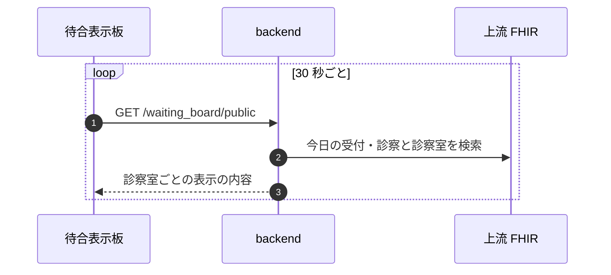

- 表示板はヘッダ `X-Board-Token` を付けて読みます。
- backend の検索は `Appointment?date=今日&status=checked-in,fulfilled&_revinclude=Encounter:appointment` と `Location?type=OF` です。
- 返すのは、診察室ごとの呼出番号・待ち・離席中・平均待ち時間です。氏名と患者番号は返しません。

## 医事送信・会計済

医事送信です。

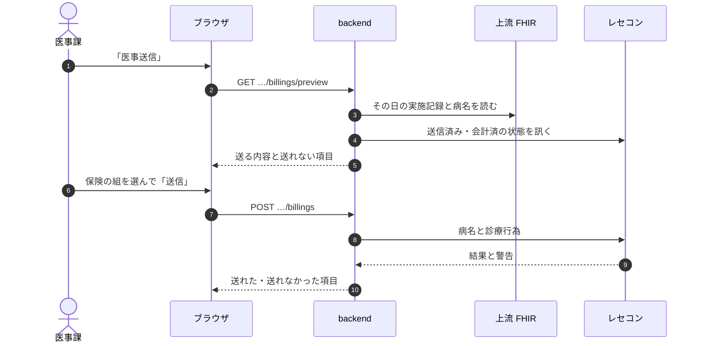

パスの `…` は `/integrations/receipt` です。剤は、レセコンに送る診療行為のまとまりです(実施記録から組みます)。

| 呼び出し | 中身 |
|---|---|
| 「医事送信」を開く場面 | 診察終了の直後、または外来患者一覧の行から |
| `GET /integrations/receipt/billings/preview` | `patient_id`・`date`・`practitioner_id` を渡す |
| backend が上流から読むもの | その日の実施記録・オーダー・処方・有効な保険病名(`BillingClaimBuilder` / `DiagnosisCollector`) |
| preview の応答 | 送る剤(区分つき)・送れない項目・病名・状態・会計の結果 |
| `POST /integrations/receipt/billings` | 「送信」と「送り直す」。送り直しは、前の送信を消してから登録する |
| `DELETE /integrations/receipt/billings` | 送信取消。レセコンの送信を削除する |
| `GET /integrations/receipt/billings/settled?date=…` | その日の会計済の患者番号・診療科。行に「会計済」を出す |

- 会計済の問い合わせは、外来患者一覧で、レセコン連携が有効なときだけ行います。「自動更新」がオンなら 1 分ごとに読み直します。

## 医事会計と SS-MIX2

医事会計に送るのは医事送信の画面で送った内容だけで、受付・診察の出来事そのものは送りません(診察開始の時刻は送信のときに実施時刻として添えます)。外来の診察(`class` = `AMB`)は SS-MIX2 の ADT を起こさず、受付だけが `ADT^A04` を出します。

| 起きたこと | 医事会計 | SS-MIX2 |
|---|---|---|
| 予約登録・日時変更・予約取消 | なし | なし |
| 受付(予約から・当日受付・新患登録・レセコンからの受付) | なし | `ADT^A04`(ADT-12、PV1-44 受付日時、PV1-7 担当医)。受付済のまま担当医などを変えた更新では出さない |
| 新患登録の患者登録 | なし(レセコン連携では患者はレセコンが正本) | `ADT^A08`(ADT-00) |
| 受付取消・未来院 | なし | なし(A04 の取り消しは出さない) |
| 診察開始・一時終了・診察再開・診察終了と各取消 | なし | なし |
| 患者呼出 | なし | なし |
| Web 問診の取込 | なし | なし |
| 医事送信 | 病名と、その日の診療行為(実施記録から組んだ剤)。初再診料は医事会計の自動算定 | なし |
| 送り直し / 送信取消 | 前の送信を消して登録し直す / 消す | なし |
| 診察中に出したオーダー | 各種別の実施記録として医事送信に乗る | 各種別のメッセージ(処方 `RDE^O11`、検体検査 `OML^O33` など) |
