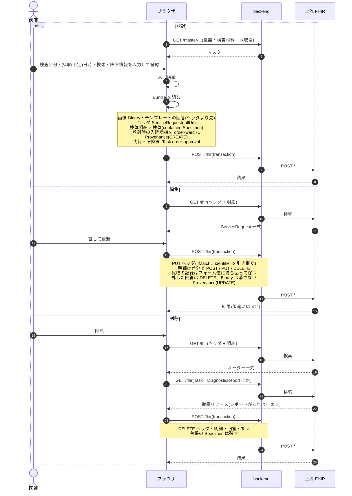
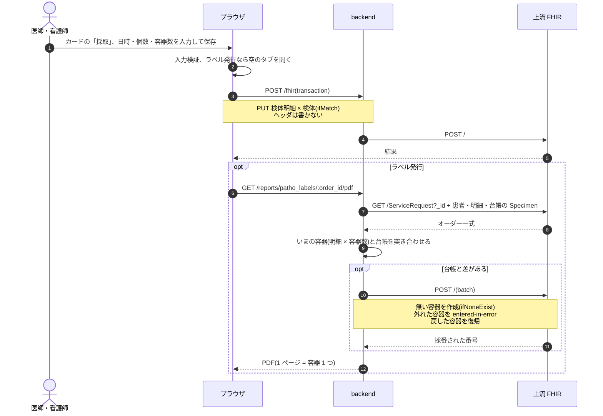
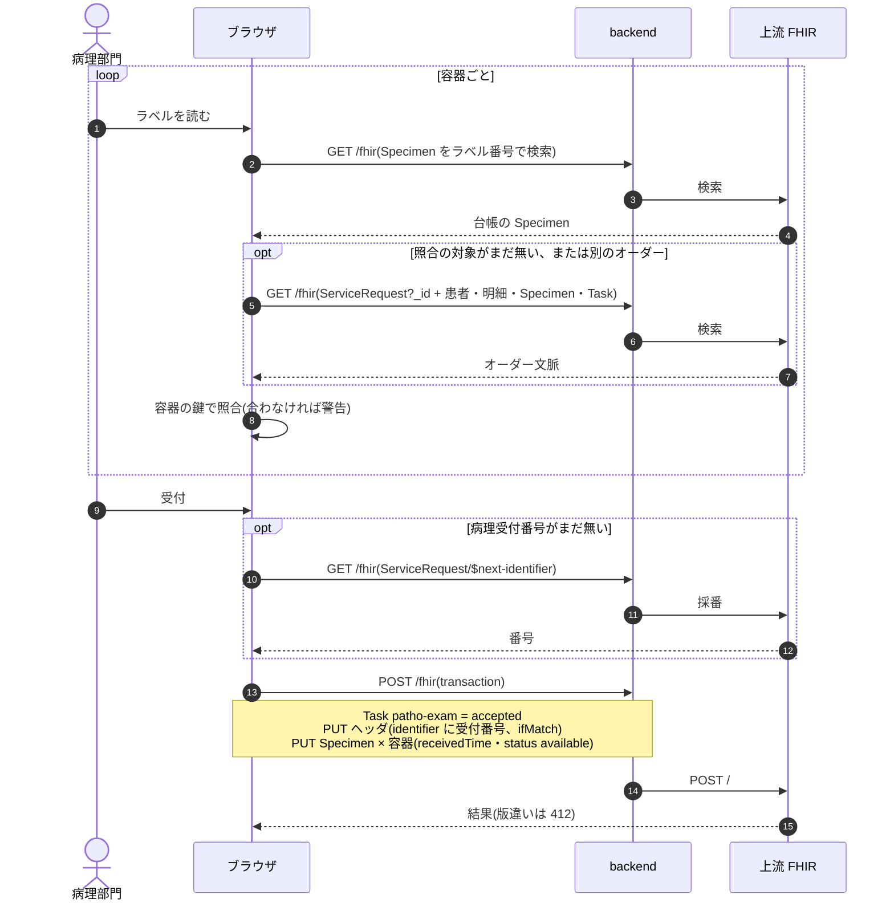
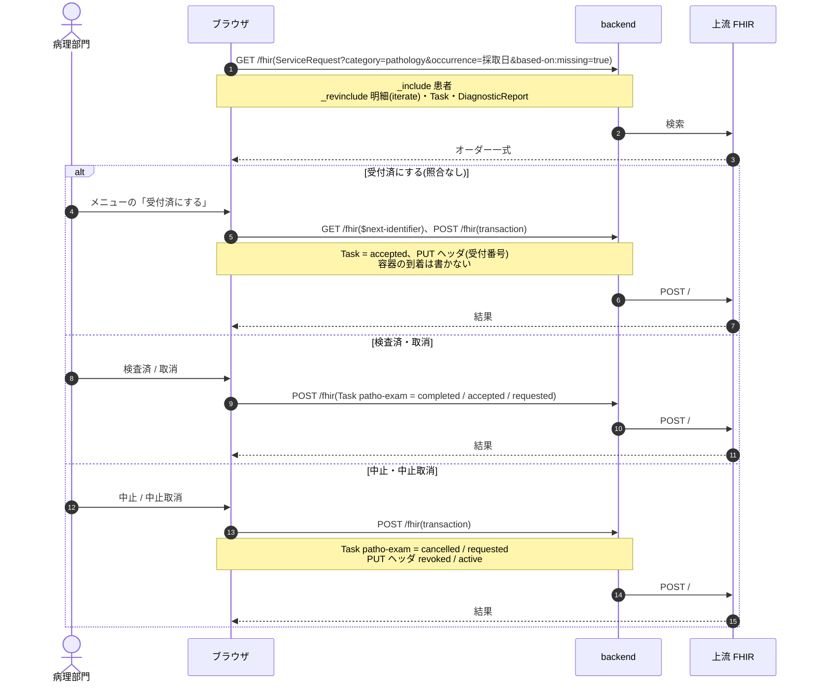
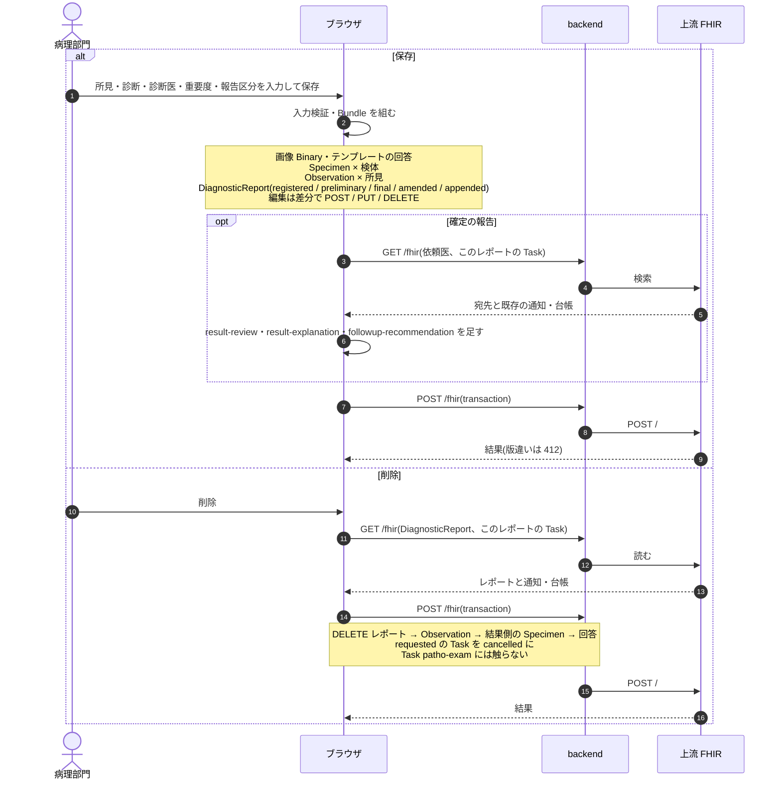
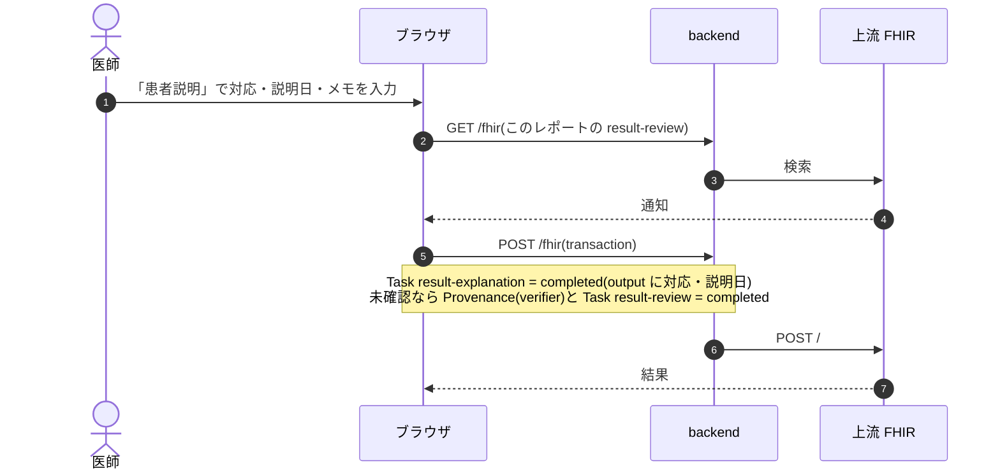

# 病理検査オーダーのシーケンス図

<!-- ../fhir-client/docs/order-flows/patho.md から scripts/sync-flows.mjs で作る。直接編集しない。 -->

運用の流れは[病理検査オーダーの業務フロー](../flows/patho.md)にあります。

## リソースの構成

オーダーは 2 層です。ヘッダの `ServiceRequest`(`order-type|pathology`、`code` = 検査区分 LPATHO001)← `basedOn` ── 検体明細(contained `Specimen`)です。検査項目の層はありません(`fhir/pathoOrderHelpers.ts`)。
ヘッダは拡張 `patho-clinical-info`(臨床経過)・`patho-clinical-info-questionnaire-response`(テンプレートの回答)・`patho-report-due`(報告希望日)・`patho-operating-room`(手術室番号)・`patho-schema-image`(シェーマ、`Binary`)を持ちます。

| もの | リソース | 補足 |
|---|---|---|
| 進捗 | `Task`(`task-code|patho-exam`、`focus` = ヘッダ) | 下の表 |
| 採取の記録 | 検体明細の contained `Specimen` の `collection`(`collectedDateTime`・`quantity`・`bodySite`)と拡張 `patho-container-count` | 明細だけを PUT する(ヘッダを組み直すと依頼医が替わる)。来歴は付けない。`collector` は持たない |
| 容器の台帳 | `Specimen`(`request` = [ヘッダ, 検体明細]、`identifier` = `patho-container`、`accessionIdentifier` = ラベル番号) | `identifier` の値は「検体明細の id:明細内の順番」。発行 = 作成、到着 = `receivedTime` + `status: available`、取り下げ = `entered-in-error`。番号は検体検査の採取管と同じ採番 |
| 病理受付番号 | ヘッダの `identifier`(`IdSystem/patho-accession-number`) | 上流の `ServiceRequest/$next-identifier` で払い出す。編集でも元の値を引き継ぐ |
| 結果 | `DiagnosticReport`(`category` = v2-0074 `SP` / `CP`、`code` = LOINC `11526-1`、`basedOn` = ヘッダ、`status` = `registered` / `preliminary` / `final` / `amended` / `appended`)+ `Observation` | 所見は規約のセクション LOINC を `Observation.code` に使う(肉眼 `22634-0`・顕微鏡 `22635-7`・診断 `22637-3`・追加染色 `10157-6`)。細胞診の診断は `valueCodeableConcept`(判定)+ `component`(推定病変)。`Observation.status` に `appended` は無いので `amended` にする |
| レポートの補足 | `resultsInterpreter`(診断医)、拡張 `patho-report-importance`(重要度)・`patho-follow-up`(フォロー推奨)・`patho-report-image`(画像、`Binary`)・`patho-diagnosis-response`(診断のテンプレートの回答) | 回答はレポートと同じ transaction に積む |
| 結果の検体 | `Specimen`(`type` = 検体タイプ) | 結果側が所有する。ラベルの台帳とは別で、参照しない |
| 検査結果確認の通知 | `Task`(`task-code|result-review`、`focus` = 結果、`owner` = 依頼医) | 確定の報告のとき。重要度ありは `priority = stat`、印は `input` |
| 患者説明 | `Task`(`task-code|result-explanation`、`focus` = 結果、`owner` = 依頼医) | `completed` で記録済。対応と説明日は `output`。通知のレジストリには載せない |
| フォロー推奨 | `Task`(`task-code|followup-recommendation`、`focus` = 結果、`owner` = 依頼医) | 読影・所見レポートと同じ |
| 確認(既読) | `Provenance`(`target` = 結果、`agent.type = verifier`、`signature`) | 検体検査と同じ |
| 代行入力 | `Provenance`(`target` = ヘッダ、`activity` CREATE / UPDATE) | 明細は `target` に入れない |

## 進捗 Task(`patho-exam`)

Task は登録時には作りません。**Task が無いオーダーは依頼済**として扱い、最初の受付・中止で作ります(`fhir/pathoTaskHelpers.ts`)。
中止は同じ transaction でヘッダを `revoked` にし、中止取消で `active` に戻します(`orderCancelEntries`)。中止したオーダーを編集しても `revoked` のままです(`keepOrderRevoked`)。

| 状態 | `Task.status` | `executionPeriod` | 進めるもの |
|---|---|---|---|
| 依頼済 | `requested`(または Task 無し) | なし | 受付の取消、中止取消 |
| 受付済 | `accepted` | `start` | 病理受付、受付済にする、検査済の取消 |
| 検査済 | `completed` | `start` / `end` | 一覧の「検査済」 |
| 中止 | `cancelled` | なし | 一覧の中止 |

検体検査・細菌検査と違い、レポートの保存・削除は Task に触りません。報告区分は `DiagnosticReport.status` が正本です。
外来の印(`fhir/outpatientOrderProgressHelpers.ts`)はレポートがあれば進捗より先にレポートの段階を見ます。`registered`(下書き)はレポートの段階に数えず、進捗で決めます。

## シーケンス図の前提

`/fhir` への書き込みはどれも 1 回の transaction Bundle で、backend の `FhirProxyController` が上流へ中継します。
楽観ロックの版は `postBundle` が `ifMatch` に添え、版が違えば 412 で止まります。
例外はラベルの PDF で、backend(`PathoLabelReport`)が上流を直接読み書きします。こちらは batch Bundle です。

## 登録・編集・削除

`components/PathoOrderForm.tsx`・`PathoOrderPanels.tsx`、`buildPathoOrderBundle` / `buildPathoOrderUpdateBundle` / `buildPathoOrderDeleteBundle`(`fhir/pathoOrderHelpers.ts`)、
`useCreatePrescription` / `useUpdatePrescription`(`api/queries/labResult.ts`。全種別共通)、`useDeletePathoOrder`(`api/queries/patho.ts`)、`postOrderDeleteBundle`(`api/queries/orderDelete.ts`)。

## 採取の記録とラベル発行

`components/PathoCollectionModal.tsx`、`buildPathoCollectionBundle`(`fhir/pathoOrderHelpers.ts`)、`useRecordPathoCollection`(`api/queries/patho.ts`)、
`Reports::PathoLabelPdfsController`、`PathoLabelReport`。保存の前に空のタブを開くのはポップアップブロックを避けるためで、PDF は保存の後に差し替えます(保存前に刷ると直す前の容器数になる)。

カードのメニューと一覧のメニューの「ラベル発行」は、`opt ラベル発行` の部分だけを新しいタブで行います。

## 病理受付

`pages/PathoReceptionPage.tsx`、`expectedPathoContainers` / `buildPathoReceptionBundle`(`fhir/pathoReceptionHelpers.ts`)、
`fetchPathoReceptionContext` / `fetchContainerByLabelNumber` / `useReceivePathoOrder`(`api/queries/pathoReception.ts`)。

## 一覧・検査済・中止

`pages/PathoWorklistPage.tsx`、`usePathoWorklist` / `useUpdatePathoTaskStatus`(`api/queries/patho.ts`)、`makeUpdateTaskStatusHook`(`api/queries/worklist.ts`)、`findPathoOrderIdByNumber`(`api/queries/pathoReception.ts`)。

## レポートの登録・編集・削除

`components/KartePathoResultTab.tsx`・`PathoResultForm.tsx`・`PathoResultDetailPanel.tsx`、`buildPathoResultBundle` / `buildPathoResultUpdateBundle` / `buildPathoResultDeleteBundle` / `nextReportStatus`(`fhir/pathoResultHelpers.ts`)、
`useCreatePathoResult` / `useUpdatePathoResult` / `useDeletePathoResult` / `withPathoReportTasks`(`api/queries/patho.ts`)。

結果確認の書き込みは [検体検査オーダーの業務フロー](../flows/lab.md)「シーケンス図: 結果確認」のカルテからの経路と同じです(`ResultReviewAction`、`useMarkResultReviewed`)。

## 患者説明の記録

`components/ResultExplanationAction.tsx`・`ResultExplanationModal.tsx`、`recordExplanationEntry`(`fhir/resultExplanationHelpers.ts`)、`useRecordExplanation` / `useReopenExplanation`(`api/queries/resultFollowup.ts`)。

## 医事会計と SS-MIX2

病理検査は検体検査と同じくオーダーで集める種別です(`BillingClaimBuilder` の `:order` 経路)。実施入力を持たないので、進捗 Task は見ず、**オーダーの採取(予定)日**で集めます。採取の記録の日時は使いません。中止は `ServiceRequest.status` で判定します。
レセ電算コードは検査項目マスタではなく施設設定の「病理検査(検査区分ごと)」から検査区分で引きます(`Resolvers::Pathology`)。数量は検体明細の数です。判断料・診断料は日レセが自動算定します。
SS-MIX2 の電文は持ちません。`OmlO33` は `order-type|lab`、`OmgO19` は放射線・内視鏡・生理、`OulR22` は v2-0074 `LAB`、`OruR01` は `physio` だけを対象にします。

| 起きたこと | 医事会計(`BillingClaimBuilder`) | SS-MIX2 |
|---|---|---|
| 登録・編集 | 採取(予定)日のオーダーを検査区分のコードで送る。コードが未設定なら「送れない項目」に出す | なし |
| 採取・ラベル発行・受付・検査済 | なし | なし |
| レポートの保存・訂正・追加・削除 | なし | なし |
| 中止 | 対象から外れる(`ServiceRequest` が `revoked`) | なし |
| 削除 | 対象から外れる | なし |
