# 病理検査オーダーのシーケンス図

<!-- ../fhir-client/docs/order-flows/patho.md から scripts/sync-flows.mjs で作る。直接編集しない。 -->

運用の流れは[病理検査オーダーの業務フロー](../flows/patho.md)にあります。

## シーケンス図の前提

- **書き込みの経路**: `/fhir` への書き込みはどれも 1 回の transaction Bundle で、backend の `FhirProxyController` が上流へ中継します。
- **楽観ロック**: 版は `postBundle` が `ifMatch` に添え、版が違えば 412 で止まります。
- **例外**: ラベルの PDF は backend(`PathoLabelReport`)が上流を直接読み書きします。こちらは batch Bundle です。
- **図の描き方**: 応答は backend を通って戻りますが、図では上流からブラウザへ直接描きます。検索の条件と transaction の中身は、図の下の表に出します。

このページで使う呼び名は次のとおりです。

| 呼び名 | 指すもの |
|---|---|
| 上流 | 上流の FHIR サーバー |
| ヘッダ | オーダー 1 件を表す `ServiceRequest` |
| 検体明細 | 検体 1 つを表す `ServiceRequest`。`basedOn` でヘッダを指し、検体を contained `Specimen` で持つ |
| 容器の Specimen | ラベルを刷る容器 1 つを表す `Specimen`。発行・到着・取り下げを記録する |
| 結果の Specimen | レポートに書く検体を表す `Specimen` |
| 来歴 | `Provenance` |

## リソースの構成

オーダーは 2 層で、検査項目の層はありません(`fhir/pathoOrderHelpers.ts`)。

- ヘッダ: `ServiceRequest`(`order-type|pathology`、`code` = 検査区分 LPATHO001)
  - 検体明細: `ServiceRequest`(`basedOn` = ヘッダ)× 検体
    - 検体: contained `Specimen`

`Specimen` は 3 種類あり、互いに別のものです。

| 種類 | 作るとき | 表すもの | ほかとの関係 |
|---|---|---|---|
| 検体明細の contained `Specimen` | オーダーの登録 | 依頼した検体と採取の記録 | 検体明細の中にある |
| 容器の Specimen | ラベル発行 | 容器 1 つとラベル番号・到着 | `request` でヘッダと検体明細を指す |
| 結果の Specimen | レポートの保存 | レポートに書いた検体 | 結果側が所有する。容器の Specimen は参照しない |

ヘッダの拡張は次のとおりです。

| 拡張 | 中身 |
|---|---|
| `patho-clinical-info` | 臨床経過 |
| `patho-clinical-info-questionnaire-response` | 臨床経過のテンプレートの回答 |
| `patho-report-due` | 報告希望日 |
| `patho-operating-room` | 手術室番号 |
| `patho-schema-image` | シェーマ(`Binary`) |

オーダーと採取・容器の要素は次のとおりです。

| もの | リソース | 要素 | 中身 |
|---|---|---|---|
| 進捗 | `Task` | `code` | `task-code|patho-exam` |
| | | `focus` | ヘッダ |
| 採取の記録 | 検体明細の contained `Specimen` | `collection.collectedDateTime` | 採取日時 |
| | | `collection.quantity` | 検体個数 |
| | | `collection.bodySite` | 臓器・左右 |
| | 検体明細 | 拡張 `patho-container-count` | 容器数 |
| 容器 | 容器の Specimen | `request` | [ヘッダ, 検体明細] |
| | | `identifier`(`patho-container`) | 「検体明細の id:明細内の順番」 |
| | | `accessionIdentifier` | ラベル番号 |
| | | `receivedTime` と `status: available` | 到着 |
| | | `status: entered-in-error` | 取り下げ |
| 病理受付番号 | ヘッダ | `identifier`(`IdSystem/patho-accession-number`) | 受付で振る番号 |
| 代行入力 | `Provenance` | `target` | ヘッダ(明細は入れない) |
| | | `activity` | CREATE / UPDATE |

- **採取の記録**: 明細だけを PUT します。ヘッダを組み直すと依頼医が替わるためです。来歴は付けません。`collector` は持ちません。
- **容器の Specimen**: 発行で作成します。ラベル番号は検体検査の採取管と同じ採番です。
- **病理受付番号**: 上流の `ServiceRequest/$next-identifier` で払い出します。オーダーを編集しても元の値を引き継ぎます。

レポートの要素は次のとおりです。

| もの | リソース | 要素 | 中身 |
|---|---|---|---|
| 結果 | `DiagnosticReport` | `category` | v2-0074 `SP` / `CP` |
| | | `code` | LOINC `11526-1` |
| | | `basedOn` | ヘッダ |
| | | `status` | 報告区分(下の表) |
| | | `resultsInterpreter` | 診断医 |
| | | 拡張 `patho-report-importance` | 重要度 |
| | | 拡張 `patho-follow-up` | フォロー推奨 |
| | | 拡張 `patho-report-image` | 画像(`Binary`) |
| | | 拡張 `patho-diagnosis-response` | 診断のテンプレートの回答 |
| 所見 | `Observation` | `code` | 規約のセクション LOINC(下の表) |
| 結果の検体 | 結果の Specimen | `type` | 検体タイプ |
| 検査結果確認の通知 | `Task` | `code` | `task-code|result-review` |
| 患者説明 | `Task` | `code` | `task-code|result-explanation` |
| フォロー推奨 | `Task` | `code` | `task-code|followup-recommendation` |
| 確認(既読) | `Provenance` | `target` | 結果 |
| | | `agent.type` | `verifier`(`signature` を付ける) |

3 つの `Task` は、どれも `focus` = 結果、`owner` = 依頼医です。

| 報告区分 | `DiagnosticReport.status` |
|---|---|
| 下書き | `registered` |
| 中間報告 | `preliminary` |
| 最終報告 | `final` |
| 訂正報告 | `amended` |
| 追加報告 | `appended` |

| 所見 | `Observation.code`(LOINC) |
|---|---|
| 肉眼所見 | `22634-0` |
| 顕微鏡所見 | `22635-7` |
| 診断 | `22637-3` |
| 追加染色 | `10157-6` |

- **細胞診の診断**: `valueCodeableConcept`(判定)と `component`(推定病変)に持ちます。
- **追加報告の所見**: `Observation.status` に `appended` は無いので、`amended` にします。
- **テンプレートの回答**: レポートと同じ transaction に積みます。
- **検査結果確認の通知**: 確定の報告(最終・訂正・追加)のときに作ります。重要度ありは `priority = stat` で、印は `input` に持ちます。
- **患者説明**: `completed` で記録済です。対応と説明日は `output` に持ちます。通知一覧(ヘッダーのベル)には出しません。
- **フォロー推奨**: 読影・所見レポートと同じ持ち方です。
- **確認(既読)**: 検体検査と同じ持ち方です。

## 進捗 Task(`patho-exam`)

- Task は登録時には作りません。**Task が無いオーダーは依頼済**として扱い、最初の受付・中止で作ります(`fhir/pathoTaskHelpers.ts`)。
- 中止は同じ transaction でヘッダを `revoked` にし、中止取消で `active` に戻します(`orderCancelEntries`)。
- 中止したオーダーを編集しても `revoked` のままです(`keepOrderRevoked`)。

| 状態 | `Task.status` | `executionPeriod` | この状態にする操作 |
|---|---|---|---|
| 依頼済 | `requested`(または Task 無し) | なし | 受付の取消、中止取消 |
| 受付済 | `accepted` | `start` | 病理受付、受付済にする、検査済の取消 |
| 検査済 | `completed` | `start` / `end` | 一覧の「検査済」 |
| 中止 | `cancelled` | なし | 一覧の中止 |

- **レポートとの関係**: 検体検査・細菌検査と違い、レポートの保存・削除は Task に触りません。報告区分は `DiagnosticReport.status` が正本です。
- **外来患者一覧の印**: `fhir/outpatientOrderProgressHelpers.ts` が決めます。レポートがあれば、進捗より先にレポートの段階を見ます。`registered`(下書き)はレポートの段階に数えず、進捗で決めます。

## 登録・編集・削除

| 操作 | 画面 | 組み立て | hook |
|---|---|---|---|
| 登録 | `components/PathoOrderForm.tsx`・`PathoOrderPanels.tsx` | `buildPathoOrderBundle` | `useCreatePrescription` |
| 編集 | 同じ | `buildPathoOrderUpdateBundle` | `useUpdatePrescription` |
| 削除 | カルテのカード | `buildPathoOrderDeleteBundle` | `useDeletePathoOrder`、`postOrderDeleteBundle` |

- 組み立ては `fhir/pathoOrderHelpers.ts` にあります。
- `useCreatePrescription` / `useUpdatePrescription` は名前に反して全種別共通の hook で、`api/queries/labResult.ts` にあります。
- `useDeletePathoOrder` は `api/queries/patho.ts`、`postOrderDeleteBundle` は `api/queries/orderDelete.ts` にあります。
- オーダーセット・クリニカルパスからの適用も、登録と同じ保存を通ります。

登録です。

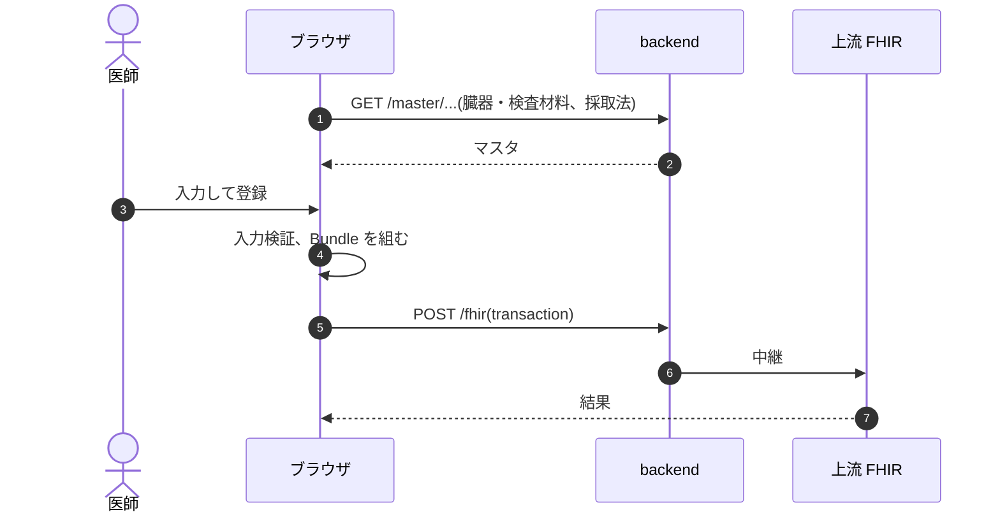

医師が入れるのは、検査区分・採取(予定)日時・検体・臨床情報です。

| 書くもの | 条件 |
|---|---|
| 画像の `Binary`・テンプレートの回答 | あれば。ヘッダより先に積む |
| ヘッダ `ServiceRequest` | `fullUrl` を付ける。登録時の入院病棟を `order-ward` に入れる |
| 検体明細 × 検体 | contained `Specimen` を持つ |
| `Provenance`(CREATE) | 毎回 |
| `Task` `order-approval` | 代行入力・研修医のとき |

編集です。

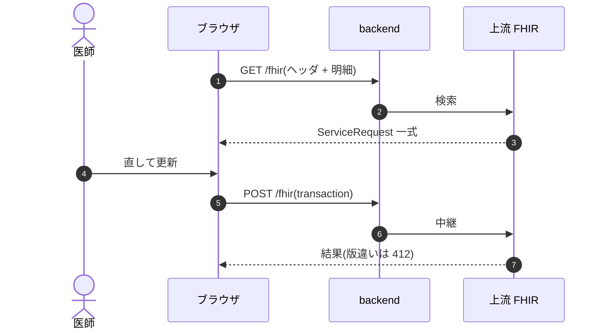

| 書くもの | 条件 |
|---|---|
| PUT ヘッダ | `ifMatch` を添える。`identifier` を引き継ぐ |
| 明細の POST / PUT / DELETE | 差分で書く。採取の記録はフォームの値に持ち回って保つ |
| DELETE テンプレートの回答 | 外した回答だけ。`Binary` は消さない |
| `Provenance`(UPDATE) | 毎回 |

削除です。

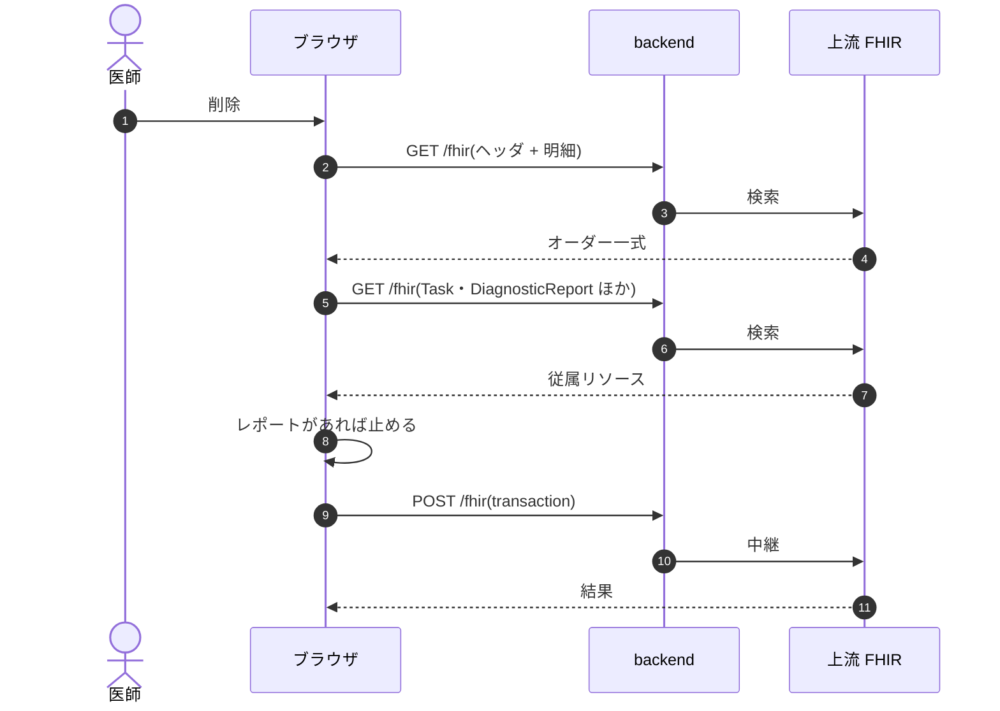

| 書くもの | 条件 |
|---|---|
| DELETE ヘッダ・明細・テンプレートの回答・`Task` | レポートが無いとき |
| 容器の Specimen | 消さずに残す |

## 採取の記録とラベル発行

| 操作 | 画面 | 組み立て | hook・backend |
|---|---|---|---|
| 採取の記録 | `components/PathoCollectionModal.tsx` | `buildPathoCollectionBundle`(`fhir/pathoOrderHelpers.ts`) | `useRecordPathoCollection`(`api/queries/patho.ts`) |
| ラベル発行 | 新しいタブの PDF | `PathoLabelReport` | `Reports::PathoLabelPdfsController` |

採取の記録です。

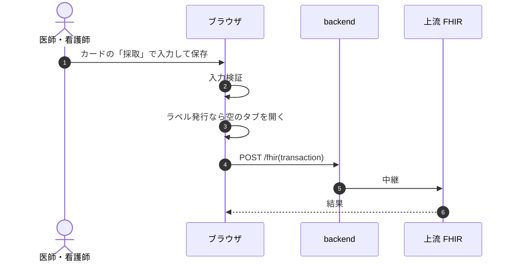

入れるのは、日時・個数・容器数です。

| 書くもの | 条件 |
|---|---|
| PUT 検体明細 × 検体 | `ifMatch` を添える |
| ヘッダ | 書かない |

- 保存の前に空のタブを開くのは、ポップアップブロックを避けるためです。
- PDF は保存の後に、そのタブへ差し替えます。保存の前に刷ると、直す前の容器数になるためです。

ラベル発行です。採取の記録で「ラベル発行」にチェックがあるときは、保存の後に続けて行います。

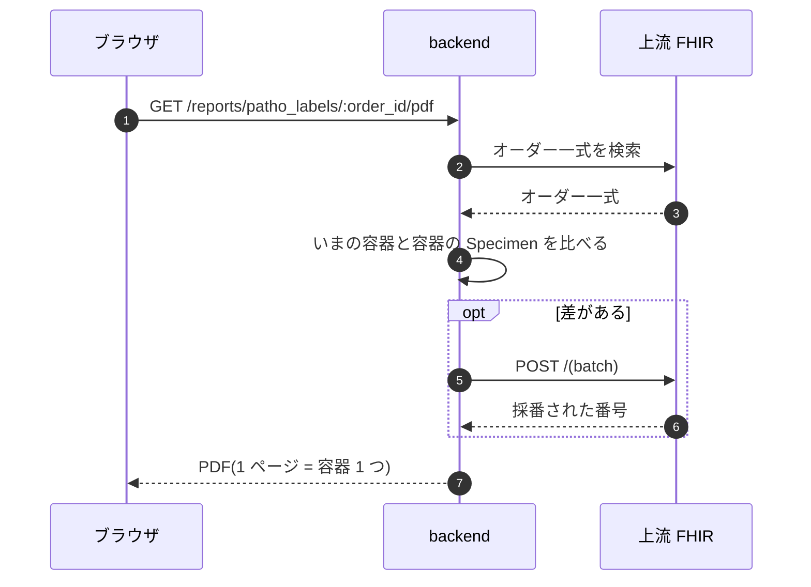

| 読む・書くもの | 条件 |
|---|---|
| 検索 | `GET /ServiceRequest?_id` に、患者・明細・容器の Specimen を含める |
| いまの容器 | 明細 × 容器数 |
| 容器の Specimen を作成 | まだ無い容器。`ifNoneExist` を添える |
| 容器の Specimen を `entered-in-error` に | 外れた容器 |
| 容器の Specimen を復帰 | 戻した容器 |

カードのメニューと病理検査一覧の行のメニューの「ラベル発行」は、このラベル発行だけを新しいタブで行います。

## 病理受付

| 操作 | 画面 | 組み立て | hook |
|---|---|---|---|
| ラベルを読む | `pages/PathoReceptionPage.tsx` | `expectedPathoContainers` | `fetchContainerByLabelNumber`、`fetchPathoReceptionContext` |
| 受付 | 同じ | `buildPathoReceptionBundle` | `useReceivePathoOrder` |

組み立ては `fhir/pathoReceptionHelpers.ts`、hook は `api/queries/pathoReception.ts` にあります。

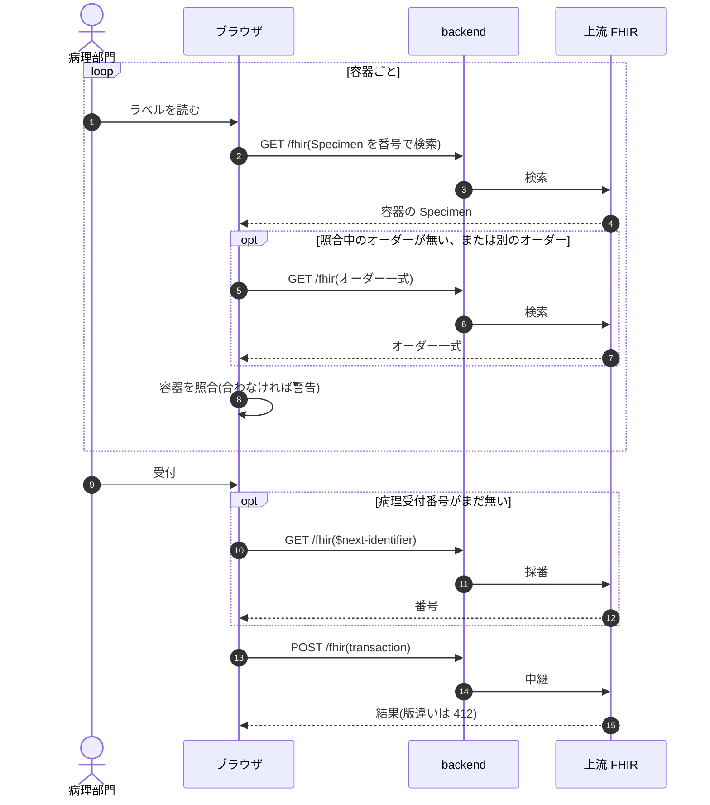

| 読む・書くもの | 条件 |
|---|---|
| オーダー一式の検索 | `ServiceRequest?_id` に、患者・明細・容器の Specimen・`Task` を含める |
| 容器の照合 | 容器の Specimen の `identifier`(`patho-container`)が、いまの容器(明細 × 容器数)にあるかを見る |
| 採番 | `ServiceRequest/$next-identifier` |
| `Task` `patho-exam` = `accepted` | 受付のとき |
| PUT ヘッダ | `identifier` に病理受付番号を入れる。`ifMatch` を添える |
| PUT 容器の Specimen × 容器 | `receivedTime` と `status: available` |

別のオーダーのラベルを読んだときは、患者が同じかを見るためにそのオーダーを読み、警告を出して照合には入れません。

## 一覧・検査済・中止

| 操作 | 画面 | hook |
|---|---|---|
| 一覧 | `pages/PathoWorklistPage.tsx` | `usePathoWorklist`(`api/queries/patho.ts`) |
| 状態の変更 | 同じ | `useUpdatePathoTaskStatus`(`api/queries/patho.ts`)。`makeUpdateTaskStatusHook`(`api/queries/worklist.ts`)で作る |
| 番号から探す | 同じ | `findPathoOrderIdByNumber`(`api/queries/pathoReception.ts`) |

一覧の読み込みです。

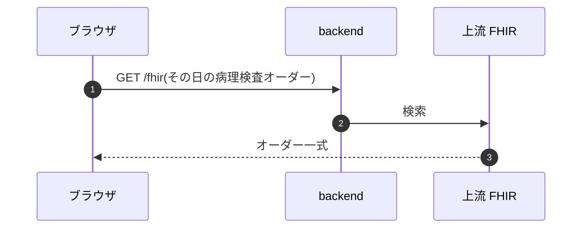

| 検索 | 条件 |
|---|---|
| `ServiceRequest` | `category=pathology`、`occurrence` = 採取日、`based-on:missing=true` |
| `_include` | 患者 |
| `_revinclude` | 明細(iterate)・`Task`・`DiagnosticReport` |

「受付済にする」(照合なしの受付)です。

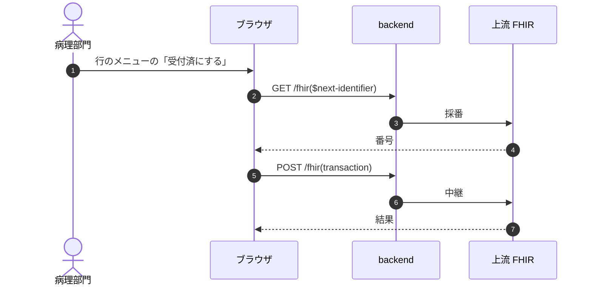

| 書くもの | 条件 |
|---|---|
| `Task` `patho-exam` = `accepted` | 毎回 |
| PUT ヘッダ | 病理受付番号を入れる |
| 容器の到着 | 書かない |

検査済・取消・中止・中止取消です。

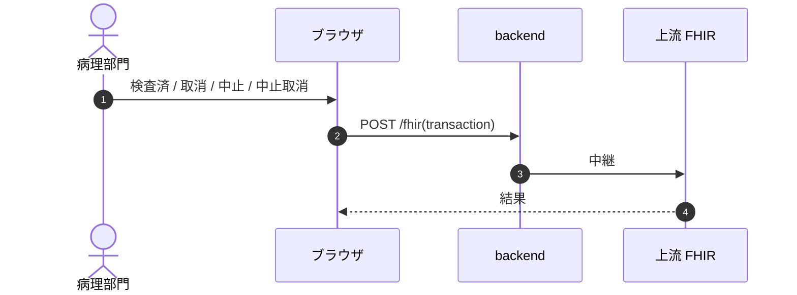

| 操作 | `Task` `patho-exam` | ヘッダ |
|---|---|---|
| 検査済 | `completed` | 書かない |
| 取消(検査済から) | `accepted` | 書かない |
| 取消(受付済から) | `requested` | 書かない |
| 中止 | `cancelled` | PUT `revoked` |
| 中止取消 | `requested` | PUT `active` |

## レポートの登録・編集・削除

| 操作 | 画面 | 組み立て | hook |
|---|---|---|---|
| 登録 | `components/KartePathoResultTab.tsx`・`PathoResultForm.tsx` | `buildPathoResultBundle` | `useCreatePathoResult` |
| 編集 | 同じ | `buildPathoResultUpdateBundle`、`nextReportStatus` | `useUpdatePathoResult` |
| 削除 | `components/PathoResultDetailPanel.tsx` | `buildPathoResultDeleteBundle` | `useDeletePathoResult` |

- 組み立ては `fhir/pathoResultHelpers.ts`、hook は `api/queries/patho.ts` にあります。
- 通知と患者説明・フォロー推奨の `Task` は、`withPathoReportTasks`(`api/queries/patho.ts`)が足します。
- `PathoResultForm.tsx` は、カルテの病理タブと病理検査一覧の両方から使います。

保存(登録・編集)です。

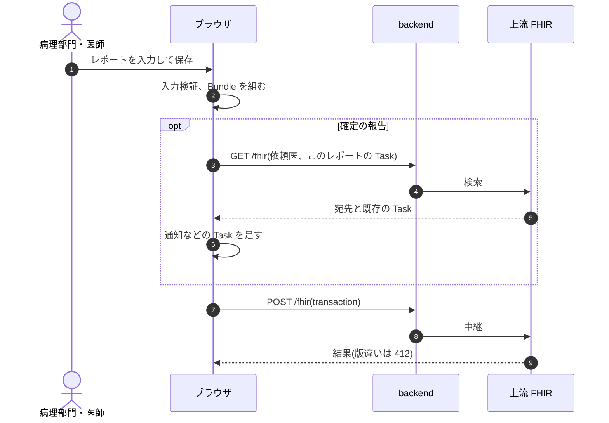

入れるのは、所見・診断・診断医・重要度・報告区分です。

| 書くもの | 条件 |
|---|---|
| 画像の `Binary`・テンプレートの回答 | あれば |
| 結果の Specimen × 検体 | 毎回 |
| `Observation` × 所見 | 毎回 |
| `DiagnosticReport` | `status` は報告区分(`registered` / `preliminary` / `final` / `amended` / `appended`) |
| `Task` `result-review`・`result-explanation`・`followup-recommendation` | 確定の報告のとき |

編集は、差分で POST / PUT / DELETE します。

削除です。

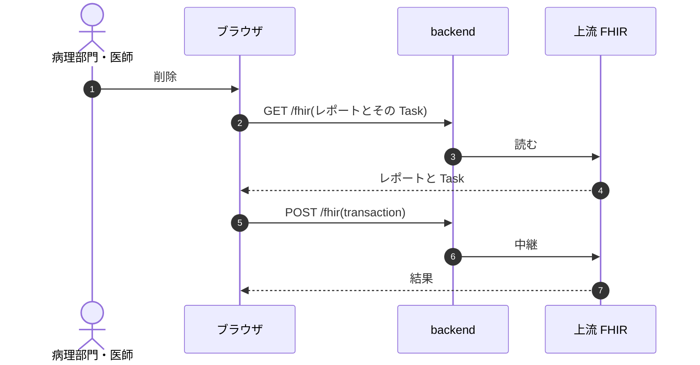

| 書くもの | 条件 |
|---|---|
| DELETE レポート → `Observation` → 結果の Specimen → テンプレートの回答 | この順に積む |
| `Task` を `cancelled` に | `requested` のもの(通知・患者説明・フォロー推奨) |
| `Task` `patho-exam` | 触らない |

結果確認の書き込みは、[検体検査オーダーのシーケンス図](lab.md)「[結果確認](lab.md#結果確認)」のカルテからの経路と同じです(`ResultReviewAction`、`useMarkResultReviewed`)。

## 患者説明の記録

| 操作 | 画面 | 組み立て | hook |
|---|---|---|---|
| 記録 | `components/ResultExplanationAction.tsx`・`ResultExplanationModal.tsx` | `recordExplanationEntry`(`fhir/resultExplanationHelpers.ts`) | `useRecordExplanation` |
| 未説明に戻す | 同じ | | `useReopenExplanation` |

hook は `api/queries/resultFollowup.ts` にあります。

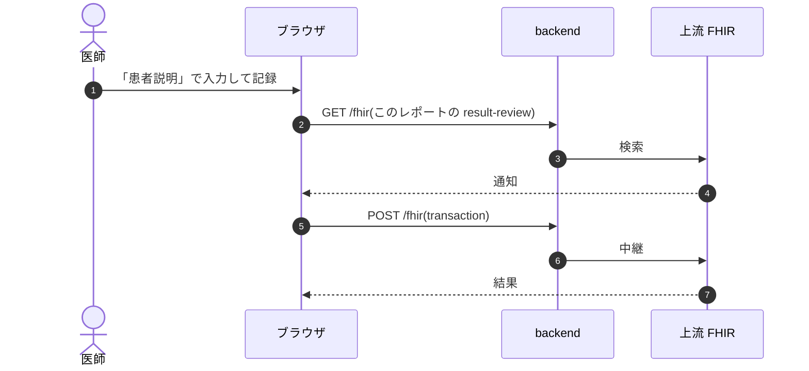

入れるのは、対応・説明日・メモです。

| 書くもの | 条件 |
|---|---|
| `Task` `result-explanation` = `completed` | `output` に対応と説明日を入れる |
| `Provenance`(verifier) | まだ確認していないとき |
| `Task` `result-review` = `completed` | まだ確認していないとき |

## 医事会計と SS-MIX2

- **集め方**: 病理検査は、検体検査と同じくオーダーで集める種別です(`BillingClaimBuilder` の `:order` 経路)。実施入力を持たないので、進捗 Task は見ず、**オーダーの採取(予定)日**で集めます。採取の記録の日時は使いません。
- **中止**: `ServiceRequest.status` で判定します。
- **コード**: レセ電算コードは、検査項目マスタではなく施設設定の「病理検査(検査区分ごと)」から検査区分で引きます(`Resolvers::Pathology`)。数量は検体明細の数です。判断料・診断料は日レセが自動算定します。
- **SS-MIX2**: 病理検査の電文は出しません。既存の電文の対象は次のとおりで、病理検査はどれにも入りません。

| 電文 | 対象 |
|---|---|
| `OmlO33` | `order-type|lab` |
| `OmgO19` | 放射線・内視鏡・生理 |
| `OulR22` | v2-0074 `LAB` |
| `OruR01` | `physio` |

| 起きたこと | 医事会計(`BillingClaimBuilder`) |
|---|---|
| 登録・編集 | 採取(予定)日のオーダーを検査区分のコードで送る。コードが未設定なら「送れない項目」に出す |
| 中止 | 対象から外れる(`ServiceRequest` が `revoked`) |
| 削除 | 対象から外れる |
| 採取・ラベル発行・受付・検査済、レポートの保存・訂正・追加・削除 | 何も送らない |
