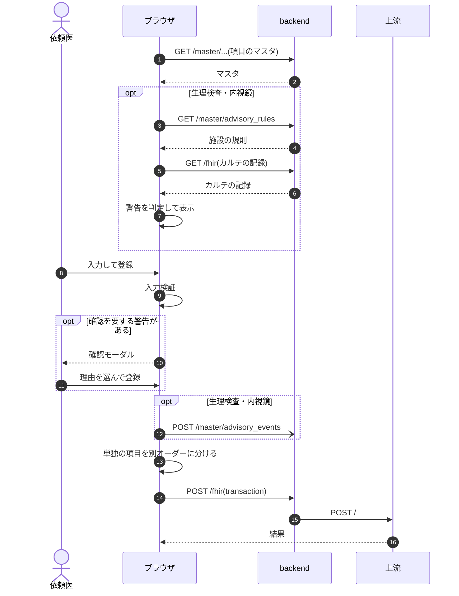
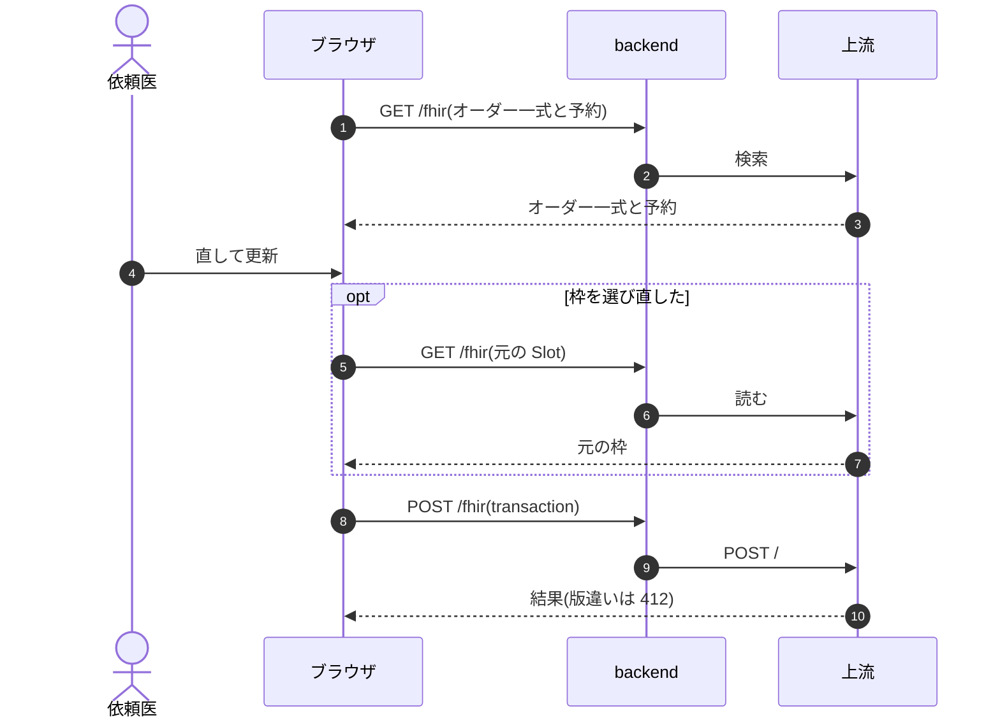
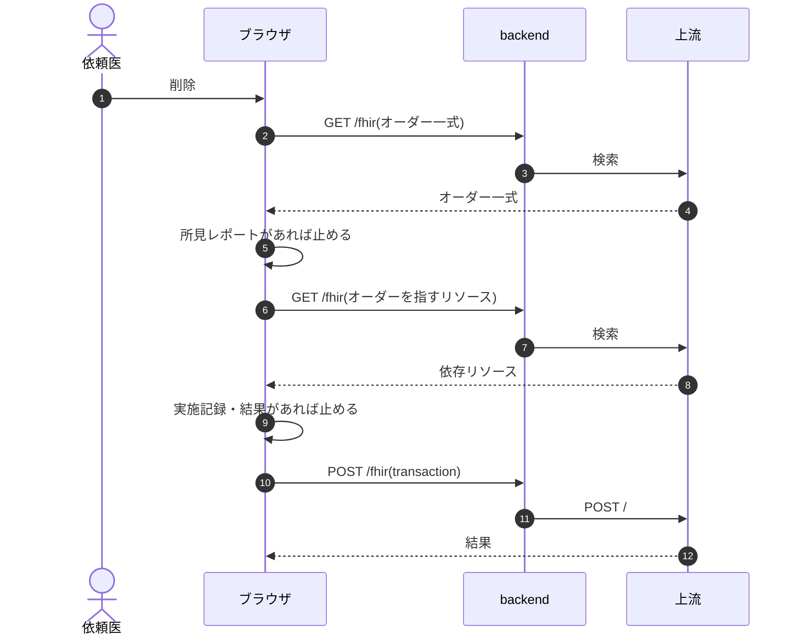
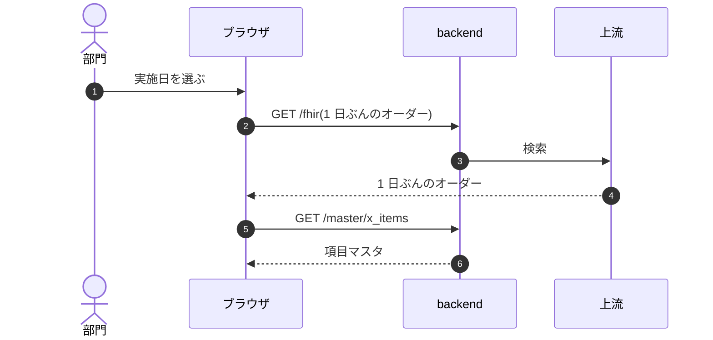
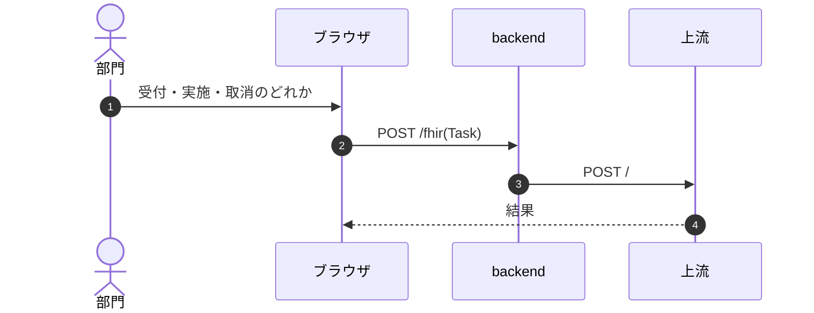
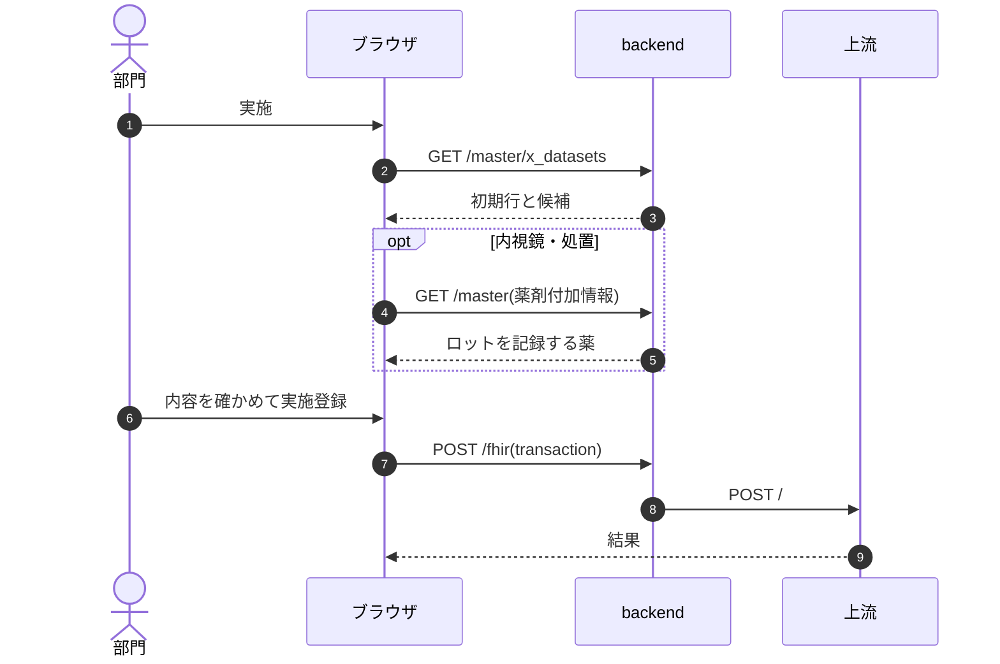
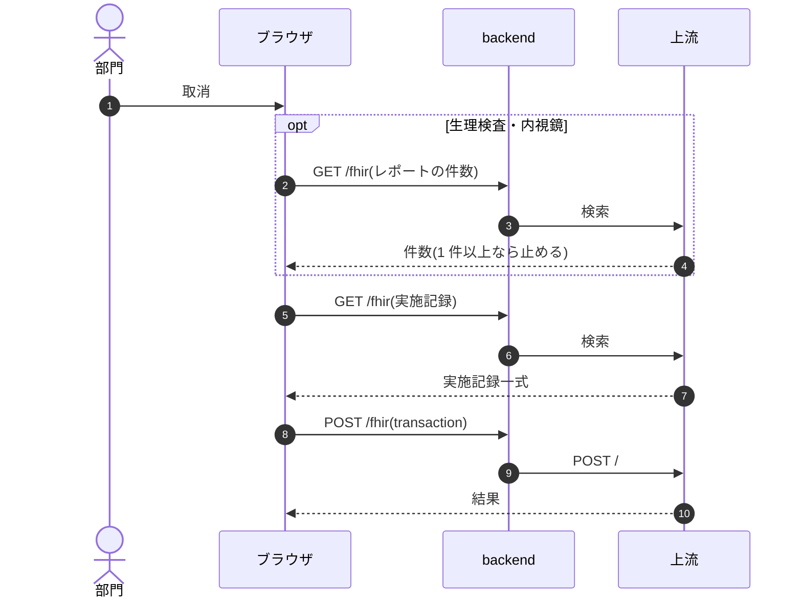
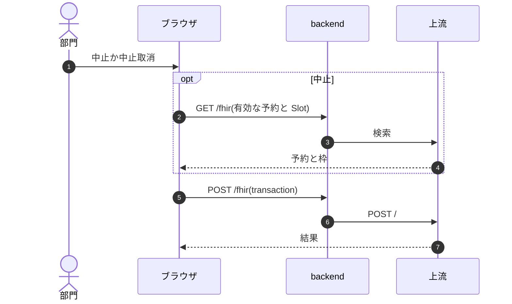

# 生理検査・内視鏡・処置オーダーのシーケンス図

<!-- ../fhir-client/docs/order-flows/physio-endoscopy-treatment.md から scripts/sync-flows.mjs で作る。直接編集しない。 -->

運用の流れは[生理検査・内視鏡・処置オーダーの業務フロー](../flows/physio-endoscopy-treatment.md)にあります。

## シーケンス図の前提

- **書き込みの経路**: `/fhir` への書き込みはどれも 1 回の transaction Bundle で、backend の `FhirProxyController` が上流の FHIR サーバー(以下「上流」)へ中継します。
- **図の省略**: 図では、上流の応答が backend を通ってブラウザへ戻る矢印を省き、上流からブラウザへの 1 本で描きます。
- **楽観ロック**: 版は `postBundle` が `ifMatch` に添え、版が違えば 412 で止まります。
- **SS-MIX2**: 有効にしている施設では、中継が書き込みの控えを記録します(`Ssmix2::Recorder`)。
- **ヘッダと明細**: オーダー 1 件の `ServiceRequest`(`order-type|physio` / `endoscopy` / `treatment`)を「ヘッダ」、項目 1 件ずつの `ServiceRequest` を「明細」と呼びます。明細は `basedOn` でヘッダを指します。
- **GP の明細**: 単項目の明細か、セット親の明細です。セットの構成項目の明細は、さらに親の明細を `basedOn` で指します。
- **ハブと子**: 実施記録の中心の `Procedure` を「ハブ」、ハブを `partOf` で指すリソースを「子」と呼びます。
- **`X` と `x`**: 図と表の `X` は `Physio` / `Endoscopy` / `Treatment` のどれか、`x` は `physio` / `endoscopy` / `treatment` のどれかです。
- **部門**: 図の「部門」は、生理検査室・内視鏡室・処置室です。

## リソースの構成

- ヘッダ `ServiceRequest`(`order-type|x`)
  - 明細 `ServiceRequest`(項目 1 件ずつ。`basedOn` = ヘッダ)
    - セットの構成項目の明細(`basedOn` = 親の明細)
  - 進捗 `Task`(`focus` = ヘッダ)
  - 予約 `Appointment`(`basedOn` = ヘッダ)+ `Slot`
  - 実施記録のハブ `Procedure`
    - 子 `Procedure`(2 件目以降の手技)
    - 子 `MedicationAdministration`(薬剤)
  - 所見レポート `DiagnosticReport` + 所見 `Observation`(生理検査・内視鏡)
  - 代行入力・警告の確認の `Provenance`(`target` = ヘッダ)

放射線との違いは次の 3 つです。

- 明細に JJ1017 のコードと `bodySite` がありません。
- 実施記録に被曝線量の `Observation` がありません。
- 処置の明細は `category`・`reason*`・`note`・拡張を持ちません。

**ヘッダと明細**

| 要素 | 生理検査 | 内視鏡 | 処置 |
|---|---|---|---|
| 明細の項目コード | `physio-order-item` | `endoscopy-order-item` | `treatment-order-item` |
| 明細の `category` | `physio-exam-type`(検査種別) | `endoscopy-exam-type`(検査種別) | なし |
| ヘッダの `priority` | `routine` / `urgent` / `asap` | 生理検査と同じ | 書かない |
| 検査目的(GP の明細) | 拡張 `physio-exam-purpose` | 拡張 `endoscopy-exam-purpose` | なし |
| 特別指示(GP の明細) | `note` | `note` | なし |
| 検査目的のテンプレート回答 | 拡張 `physio-exam-purpose-questionnaire-response` | `endoscopy-` の同名の拡張 | なし |
| 特別指示のテンプレート回答 | 拡張 `physio-remarks-questionnaire-response` | `endoscopy-` の同名の拡張 | なし |

`priority` は、`routine` が通常、`urgent` が至急、`asap` が事後です。

**進捗・予約・実施記録**

| 要素 | 生理検査 | 内視鏡 | 処置 |
|---|---|---|---|
| 進捗 `Task` の `code` | `task-code|physio-exam` | `task-code|endoscopy-exam` | `task-code|treatment` |
| 予約 | `Appointment` + `Slot` | 生理検査と同じ | 生理検査と同じ |
| ハブの `category` | `order-type|physio` | `order-type|endoscopy` | `order-type|treatment` |
| ハブの `code`(手技 1 件目) | `physio-procedure-code` | `endoscopy-` の同じ形 | `treatment-` の同じ形 |
| ハブの `usedCode`(器材) | 拡張 `physio-material-quantity` を付ける | `endoscopy-` の同じ形 | `treatment-` の同じ形 |
| 子の薬剤 | `MedicationAdministration` | ロット番号も持つ | ロット番号も持つ |

**所見レポートと通知**

| 要素 | 生理検査 | 内視鏡 | 処置 |
|---|---|---|---|
| `DiagnosticReport.category` | `order-type|physio` と v2-0074 `OTH` | `order-type|endoscopy` と `OTH` | なし |
| `DiagnosticReport.code` | `exam-report-code|physio` | LOINC `18751-8` | なし |
| `DiagnosticReport.conclusion` | 判定 | 診断 | なし |
| 重要所見の通知 `Task` の `code` | `task-code|physio-critical-finding` | `task-code|endoscopy-critical-finding` | なし |
| 検査結果確認・フォロー推奨・確認(既読) | 放射線と同じ | 放射線と同じ | なし |
| `Provenance`(`target` = ヘッダ) | 代行入力・警告の確認 | 代行入力・警告の確認 | 代行入力だけ |

- 所見は `Observation` です。重要所見の通知の `focus` はレポートです。
- 検査結果確認は `result-review`、フォロー推奨は `followup-recommendation`、確認(既読)は `Provenance` の verifier です。
- 所見レポートの部品は放射線と共用で、違いは `EXAM_REPORT_CONFIGS.physio` / `.endoscopy`(`fhir/examReportHelpers.ts`)の設定だけです。
- `category` に v2-0074 の `OTH` を持つので、検体検査・細菌・病理の結果タブには混ざりません。

## 進捗 Task

- 状態と遷移は 3 種別で同じです。`fhir/examTaskHelpers.ts` の `examTaskActions` と `createExamTaskHelpers` を、`Task.code` だけ変えて使います。
- Task は登録時には作らず、**Task が無いオーダーは依頼済**です。即実施だけは、登録と同じ transaction で `completed` の Task を作ります。
- 各状態で同じ transaction に書くものは放射線と同じです([放射線検査オーダーのシーケンス図](rad.md)「[進捗 Task(`rad-exam`)](rad.md#進捗-taskrad-exam)」)。
- 実施済からの取消で消す実施記録に `Observation` が無いことだけが違います(`performCancelEntries` の `observations: false`)。

## 部品

| 部品 | 生理検査 | 内視鏡 | 処置 |
|---|---|---|---|
| フォーム | `components/PhysioOrderForm.tsx`・`PhysioOrderPanels.tsx` | `EndoscopyOrderForm.tsx`・`EndoscopyOrderPanels.tsx` | `TreatmentOrderForm.tsx`・`TreatmentOrderPanels.tsx` |
| オーダーの組み立て | `fhir/physioOrderHelpers.ts` → `examOrderHelpers.ts` | `fhir/endoscopyOrderHelpers.ts` → `examOrderHelpers.ts` | `fhir/treatmentOrderHelpers.ts` |
| 実施記録の組み立て | `fhir/physioResultHelpers.ts` → `examResultHelpers.ts` | `fhir/endoscopyResultHelpers.ts` → `examResultHelpers.ts` | `fhir/treatmentResultHelpers.ts` → `examResultHelpers.ts` |
| 部門一覧 | `pages/PhysioWorklistPage.tsx` → `ExamWorklistPage.tsx` | `pages/EndoscopyWorklistPage.tsx` → `ExamWorklistPage.tsx` | `pages/TreatmentWorklistPage.tsx` |
| 実施入力 | `components/PhysioPerformModal.tsx` → `ExamPerformInputModal.tsx` | `EndoscopyPerformModal.tsx` → `ExamPerformInputModal.tsx` | `TreatmentPerformModal.tsx` → `ExamPerformInputModal.tsx` |
| 警告 | `useInfectionAdvisory`・`useAdvisoryRuleAdvisories(…, "physio")` | 同じ hook(`"endoscopy"`) | なし |

| 操作 | 組み立て | hook |
|---|---|---|
| 登録 | `buildXOrderBundle` | `useCreatePrescription` |
| 即実施の登録 | `buildXOrderWithPerformBundle` | `useCreatePrescription` |
| 編集 | `buildXOrderUpdateBundle` | `useUpdateXOrder` |
| 削除 | `buildXOrderDeleteBundle` | `useDeleteXOrder` |
| 日付未定の予約 | `buildExamScheduleBundle` | `useScheduleExamOrder` |
| 一覧・受付・取消・中止 | `fhir/examTaskHelpers.ts` | `useXWorklist`・`useUpdateXTaskStatus` |
| 実施 | `buildXPerformBundle` | `useRegisterXPerform` |
| 実施済からの取消 | `buildXPerformDeleteEntries` | `useUpdateXTaskStatus` |
| 所見レポート | `buildExamReportBundle` | `useSaveExamReport`・`useDeleteExamReport` |

- **hook の作り方**: 生理検査と内視鏡の hook は、`api/queries/examOrder.ts` の `createExamOrderQueries` が部門の設定から作ります(`api/queries/physio.ts`・`endoscopy.ts`)。処置は同じ形を `api/queries/treatment.ts` に直接持ちます。
- **全種別共通の hook**: `useCreatePrescription`(`api/queries/labResult.ts`)は、名前に反して全種別共通の登録の hook です。
- **ステータス変更**: `useUpdateXTaskStatus` は `makeUpdateTaskStatusHook`(`api/queries/worklist.ts`)を、`releaseAppointments` と `cancelPerform` を有効にして使います。
- **所見レポートの画面**: `components/ExamReportEntryModal.tsx`・`ExamReportForm.tsx`・`KarteExamReportTab.tsx` です。組み立ては `fhir/examReportHelpers.ts`、hook は `api/queries/examReport.ts` にあります。

## 登録・編集・削除

**登録**

- マスタは、伝票・項目・セットの構成・検査種別です。
- 警告のために読むカルテの記録は、感染症の記録と、規則が読む記録です。
- 依頼医が入力するのは、項目・実施日時または枠です。生理検査・内視鏡は、至急区分・依頼病名なども入力します。
- 確認を要する警告があるのは、生理検査・内視鏡だけです。
- `POST /master/advisory_events` は、発火・無視の台帳です。
- 単独の項目は `splitXOrderValues` で別オーダーに分けます。

| 書くもの | 条件 |
|---|---|
| ヘッダ `ServiceRequest`(`fullUrl`)+ 明細 × 項目 | オーダーごと |
| テンプレート回答 `QuestionnaireResponse` | 生理検査・内視鏡 |
| `Appointment`(`basedOn` = ヘッダ)+ `Slot` `busy` | 予約 |
| 実施記録一式 + `Task` = `completed` | 即実施 |
| 登録時の入院病棟を `order-ward` に | いつも |
| `Provenance`(CREATE) | いつも |
| `Task` `order-approval` | 代行・研修医 |

**編集**

最初の検索は、ヘッダ + 明細と `Appointment?based-on` です。

| 書くもの | 条件 |
|---|---|
| PUT ヘッダ(`ifMatch`) | いつも |
| 明細を差分で POST / PUT / DELETE | いつも |
| DELETE 外したテンプレート回答 | 生理検査・内視鏡 |
| `Appointment` の日時 + 元の `Slot` `free` + 新しい `Slot` `busy` | 枠の変更 |
| `Provenance`(UPDATE) | いつも |

**削除**

所見レポートで止めるのは、生理検査・内視鏡だけです。

| 検索 | 条件 |
|---|---|
| オーダー一式 | `ServiceRequest?_id` + 明細・`Appointment`・`DiagnosticReport` |
| 依存リソース | オーダーを指す `Task`・`Procedure`・`DiagnosticReport` ほか |

| 書くもの | 条件 |
|---|---|
| DELETE ヘッダ・明細・`Task` | いつも |
| DELETE テンプレート回答 | 生理検査・内視鏡 |
| `Appointment` `cancelled` + `Slot` `free` | 有効な予約 |

## 日付未定の予約(生理検査・内視鏡)

放射線と同じ書き込みです([放射線検査オーダーのシーケンス図](rad.md)「[日付未定の予約](rad.md#日付未定の予約)」)。通る部品は次のとおりです。

| 順 | 部品 |
|---|---|
| 1 | `ExamWorklistPage.tsx` の日付未定タブ(`UNSCHEDULED_WORKLIST_DATE` で `occurrence:missing=true` を引く) |
| 2 | `components/ExamBookingModal.tsx` |
| 3 | `useScheduleExamOrder`(`api/queries/worklist.ts`) |
| 4 | `buildExamScheduleBundle`(`fhir/appointmentHelpers.ts`) |

枠表と所要時間は、オーダーの項目のうち枠表を持つ最初の項目のマスタ値を初期値にします。

## 受付・実施・取消・中止

**一覧を開く**

- 検索は `ServiceRequest?category=order-type|x&occurrence=実施日&based-on:missing=true` です。
- `_include` で患者、`_revinclude` で明細・`Task` を付けます。生理検査・内視鏡は `DiagnosticReport` も付けます。
- 項目マスタからは、実施入力の有無と枠表を読みます。

**受付、実施(実施入力なし)、受付済からの取消**

| 操作 | 書くもの |
|---|---|
| 受付 | `Task` = `accepted` |
| 実施(実施入力なし) | `Task` = `completed` |
| 受付済からの取消 | `Task` = `requested` |

**実施(実施入力あり)**

- データセットは、項目のデータセットを引きます。
- 薬剤付加情報からは、ロット管理の薬を読みます。
- 確かめるのは、手技・薬剤・器材です。

| 書くもの | 条件 |
|---|---|
| POST ハブ `Procedure` + 子 `Procedure` | いつも(子は 2 件目以降の手技) |
| POST `MedicationAdministration` | 薬剤 |
| `Task` = `completed` | いつも |

**実施済からの取消**

| 検索 | 条件 |
|---|---|
| レポートの件数 | `DiagnosticReport?based-on&_summary=count` |
| 実施記録 | `Procedure?based-on` + 子 |

| 書くもの | 条件 |
|---|---|
| DELETE 子(薬剤・手技)→ ハブ | いつも |
| `Task` = `accepted` | いつも |

**中止・中止取消**

予約の検索は `Appointment?based-on` + 有効な予約、`Slot` です。

| 操作 | 書くもの |
|---|---|
| 中止 | `Task` = `cancelled`、PUT ヘッダ `revoked`、`Appointment` `cancelled` + `Slot` `free` |
| 中止取消 | `Task` = `requested`、PUT ヘッダ `active` |

## 所見レポートと結果確認(生理検査・内視鏡)

放射線の読影レポートと同じ書き込みです([放射線検査オーダーのシーケンス図](rad.md)「[読影レポート](rad.md#読影レポート)」「[結果確認](rad.md#結果確認)」)。読み替えるのは次の 3 つです。

| 読み替えるもの | 生理検査 | 内視鏡 |
|---|---|---|
| `DiagnosticReport` の `category` と `code` | 「リソースの構成」の表のとおり | 「リソースの構成」の表のとおり |
| 重要所見の `Task.code` | `physio-critical-finding` | `endoscopy-critical-finding` |
| 拡張の接頭辞 | `physio-` | `endoscopy-` |

## 医事会計と SS-MIX2

3 種別とも放射線と同じく実施記録から集めます(`BillingClaimBuilder` の `:procedure` 経路、`OrderCatalog`)。

- **手技**: ハブと子の `Procedure.code` で送ります。オーダー項目の `receipt_code` は使いません。
- **1 剤にまとめる**: 薬剤・器材・実施コメントと一緒に 1 剤にします。剤の区分は、手技の点数表の章から決めます。
- **部位のコメント**: 放射線にある部位のコメントは付きません。
- **日付**: 実施時刻の日です。
- **実施入力のない項目だけのオーダー**: このときに限り、オーダーの実施日と項目の `receipt_code` で組みます。

医事会計(`BillingClaimBuilder`)に送るものは、3 種別で同じです。

| 起きたこと | 医事会計 |
|---|---|
| 登録・編集・予約、受付 | なし |
| 実施(実施入力あり) | 実施記録から手技・薬剤・器材・コメントを送る |
| 実施(実施入力なし) | 部門が実施済にしたオーダーの項目を `receipt_code` で送る |
| 当日の未実施 | 送らずに報告する |
| 実施済からの取消、中止、削除 | 対象から外れる |
| 所見レポートの保存・訂正・削除 | なし |

- コードの無い行(手入力の器材など)は「送れない項目」に出します。
- 当日の未実施は、実施入力ありは「実施記録がありません(未実施のため送りません)」、なしは「部門で実施済になっていません」と報告します。
- 中止は `ServiceRequest` が `revoked` になることで外れます。送ったあとの中止は、医事が送り直します。

SS-MIX2 は種別で違います。処置は何も出しません。受付は、どの種別もメッセージにしません(進捗 Task はメッセージにしない)。

| 起きたこと | 生理検査 | 内視鏡 |
|---|---|---|
| 登録・編集・予約 | OMG^O19(OMG-03) | OMG^O19(OMG-02) |
| 実施(実施入力あり) | なし | OMI^Z23(OMG-12) |
| 実施済からの取消 | なし | OMI^Z23 の `CA`(DEL) |
| 中止 | OMG^O19 の `CA`(DEL) | OMG^O19 の `CA`(DEL) |
| 中止取消 | OMG^O19 の `NW`(INS) | OMG^O19 の `NW`(INS) |
| 削除 | OMG^O19 の `CA`(DEL) | OMG^O19 の `CA`(DEL) |
| 所見レポートの保存・訂正・削除 | ORU^R01(OMG-13) | なし |

- **登録・編集・予約**: ヘッダを書くと出します。OBR-4 は検査種別・項目のローカルコードです。
- **所見レポート(生理検査)**: 所見と判定を OBX の TX に置きます。訂正も INS、削除は DEL です。
- 実施(実施入力なし)と当日の未実施は、どの種別も何も出しません。
