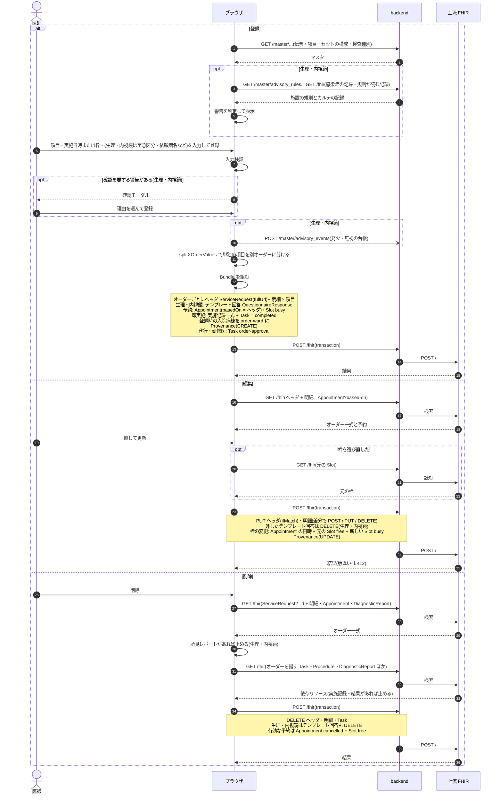
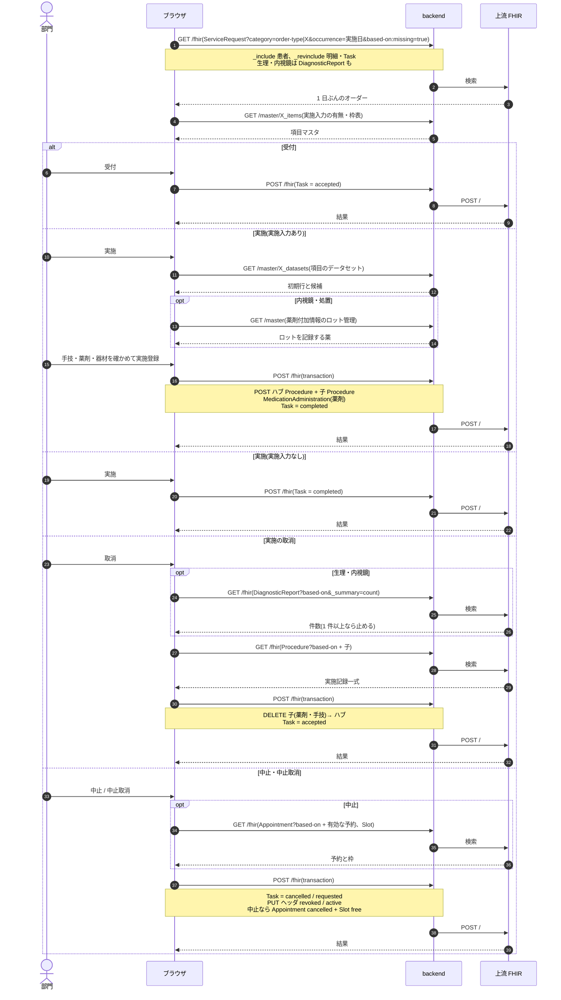

# 生理検査・内視鏡・処置オーダーのシーケンス図

<!-- ../fhir-client/docs/order-flows/physio-endoscopy-treatment.md から scripts/sync-flows.mjs で作る。直接編集しない。 -->

運用の流れは[生理検査・内視鏡・処置オーダーの業務フロー](../flows/physio-endoscopy-treatment.md)にあります。

## リソースの構成

オーダーはヘッダの `ServiceRequest`(`order-type|physio` / `endoscopy` / `treatment`)と、項目 1 件ずつの明細 `ServiceRequest`(`basedOn` でヘッダを指す)です。セットの構成項目はさらに親の明細を `basedOn` で指します。
放射線との違いは、明細に JJ1017 のコードと `bodySite` が無いこと、実施記録に被曝線量の `Observation` が無いこと、処置の明細が `category`・`reason*`・`note`・拡張を持たないことです。

| もの | 生理検査 | 内視鏡 | 処置 |
|---|---|---|---|
| 明細の項目コード | `physio-order-item` | `endoscopy-order-item` | `treatment-order-item` |
| 明細の `category` | `physio-exam-type`(検査種別) | `endoscopy-exam-type`(検査種別) | なし |
| ヘッダの `priority` | `routine`(通常)/ `urgent`(至急)/ `asap`(事後) | 同じ | 書かない |
| 検査目的・特別指示 | GP の明細に拡張 `physio-exam-purpose` と `note`、テンプレート回答は拡張 `physio-exam-purpose-questionnaire-response` / `physio-remarks-questionnaire-response` | `endoscopy-*` の同名の拡張 | なし |
| 進捗 | `Task`(`task-code|physio-exam`、`focus` = ヘッダ) | `Task`(`task-code|endoscopy-exam`) | `Task`(`task-code|treatment`) |
| 予約 | `Appointment`(`basedOn` = ヘッダ)+ `Slot` | 同じ | 同じ |
| 実施記録 | ハブ `Procedure`(`category` = `order-type|physio`、`code` = 手技 1 件目の `physio-procedure-code`、`usedCode` = 器材 + 拡張 `physio-material-quantity`)← `partOf` ── `Procedure`(2 件目以降の手技)、`MedicationAdministration`(薬剤) | `endoscopy-*` の同じ形。薬剤にロット番号 | `treatment-*` の同じ形。薬剤にロット番号 |
| 所見レポート | `DiagnosticReport`(`category` = `order-type|physio` と v2-0074 `OTH`、`code` = `exam-report-code|physio`、`conclusion` = 判定)+ `Observation`(所見) | `DiagnosticReport`(`category` = `order-type|endoscopy` と `OTH`、`code` = LOINC `18751-8`) | なし |
| 重要所見の通知 | `Task`(`task-code|physio-critical-finding`、`focus` = レポート) | `Task`(`task-code|endoscopy-critical-finding`) | なし |
| 検査結果確認・フォロー推奨・確認(既読) | 放射線と同じ(`result-review`・`followup-recommendation`・`Provenance` verifier) | 同じ | なし |
| 代行入力・警告の確認 | `Provenance`(`target` = ヘッダ) | 同じ | 代行入力だけ |

所見レポートの部品は放射線と共用で、違いは `EXAM_REPORT_CONFIGS.physio` / `.endoscopy`(`fhir/examReportHelpers.ts`)の設定だけです。
`category` に v2-0074 の `OTH` を持つので、検体検査・細菌・病理の結果タブには混ざりません。

## 進捗 Task

状態と遷移は 3 種別で同じで、`fhir/examTaskHelpers.ts` の `examTaskActions` と `createExamTaskHelpers` を `Task.code` だけ変えて使います。
Task は登録時には作らず、**Task が無いオーダーは依頼済**です。即実施だけは登録と同じ transaction で `completed` の Task を作ります。
各状態で同じ transaction に書くものは放射線と同じです([放射線検査オーダーの業務フロー](../flows/rad.md)「進捗 Task」)。実施の取消で消す実施記録に `Observation` が無いことだけが違います(`performCancelEntries` の `observations: false`)。

## シーケンス図の前提

`/fhir` への書き込みはどれも 1 回の transaction Bundle で、backend の `FhirProxyController` が上流へ中継します。
SS-MIX2 を有効にしている施設では、中継が書き込みの控えを記録します(`Ssmix2::Recorder`)。
楽観ロックの版は `postBundle` が `ifMatch` に添え、版が違えば 412 で止まります。

生理検査と内視鏡の hook は `api/queries/examOrder.ts` の `createExamOrderQueries` が部門の設定から作ります(`api/queries/physio.ts`・`endoscopy.ts`)。処置は同じ形を `api/queries/treatment.ts` に直接持ちます。
下の図の `X` は `Physio` / `Endoscopy` / `Treatment` のどれかです。

| 部品 | 生理検査 | 内視鏡 | 処置 |
|---|---|---|---|
| フォーム | `components/PhysioOrderForm.tsx`・`PhysioOrderPanels.tsx` | `EndoscopyOrderForm.tsx`・`EndoscopyOrderPanels.tsx` | `TreatmentOrderForm.tsx`・`TreatmentOrderPanels.tsx` |
| オーダーの組み立て | `fhir/physioOrderHelpers.ts` | `fhir/endoscopyOrderHelpers.ts` | `fhir/treatmentOrderHelpers.ts` |
| 実施記録の組み立て | `fhir/physioResultHelpers.ts` | `fhir/endoscopyResultHelpers.ts` | `fhir/treatmentResultHelpers.ts` |
| 部門一覧 | `pages/PhysioWorklistPage.tsx` → `ExamWorklistPage.tsx` | `pages/EndoscopyWorklistPage.tsx` → `ExamWorklistPage.tsx` | `pages/TreatmentWorklistPage.tsx` |
| 実施入力 | `components/PhysioPerformModal.tsx` | `EndoscopyPerformModal.tsx` | `TreatmentPerformModal.tsx` |
| 警告 | `useInfectionAdvisory`・`useAdvisoryRuleAdvisories(…, "physio")` | 同じ(`"endoscopy"`) | なし |

## 登録・編集・削除

`buildXOrderBundle` / `buildXOrderUpdateBundle` / `buildXOrderDeleteBundle`、`buildXOrderWithPerformBundle`(即実施)、`useCreatePrescription`(`api/queries/labResult.ts`。全種別共通)、`useUpdateXOrder` / `useDeleteXOrder`。

## 日付未定の予約(生理検査・内視鏡)

放射線と同じ書き込みです([放射線検査オーダーの業務フロー](../flows/rad.md)「シーケンス図: 日付未定の予約」)。`ExamWorklistPage.tsx` の日付未定タブ(`UNSCHEDULED_WORKLIST_DATE` で `occurrence:missing=true` を引く)から `components/ExamBookingModal.tsx`、`useScheduleExamOrder`(`api/queries/worklist.ts`)、`buildExamScheduleBundle`(`fhir/appointmentHelpers.ts`)を通ります。枠表と所要時間は、オーダーの項目のうち枠表を持つ最初の項目のマスタ値を初期値にします。

## 受付・実施・取消・中止

`useXWorklist` / `useUpdateXTaskStatus` / `useRegisterXPerform`、`makeUpdateTaskStatusHook`(`api/queries/worklist.ts`。`releaseAppointments` と `cancelPerform` を有効にして使う)、`buildXPerformBundle` / `buildXPerformDeleteEntries`。

## 所見レポートと結果確認(生理検査・内視鏡)

放射線の読影レポートと同じ書き込みです([放射線検査オーダーの業務フロー](../flows/rad.md)「シーケンス図: 読影レポート」「シーケンス図: 結果確認」)。
部品は `components/ExamReportEntryModal.tsx`・`ExamReportForm.tsx`・`KarteExamReportTab.tsx`、`buildExamReportBundle`(`fhir/examReportHelpers.ts`)、`useSaveExamReport` / `useDeleteExamReport`(`api/queries/examReport.ts`)で、
読み替えるのは `DiagnosticReport` の `category` と `code`、重要所見の `Task.code`(`physio-critical-finding` / `endoscopy-critical-finding`)、拡張の接頭辞(`physio-` / `endoscopy-`)です。

## 医事会計と SS-MIX2

3 種別とも放射線と同じく実施記録から集めます(`BillingClaimBuilder` の `:procedure` 経路、`OrderCatalog`)。手技はハブと子の `Procedure.code` で、オーダー項目の `receipt_code` は使いません。
薬剤・器材・実施コメントと一緒に 1 剤にし、剤の区分は手技の点数表の章から決めます。放射線にある部位のコメントは付きません。日付は実施時刻の日です。
実施入力のない項目だけのオーダーに限り、オーダーの実施日と項目の `receipt_code` で組みます。

| 起きたこと | 医事会計(`BillingClaimBuilder`) | SS-MIX2 |
|---|---|---|
| 登録・編集・予約 | なし | 生理は OMG^O19(OMG-03)、内視鏡は OMG^O19(OMG-02)。ヘッダを書くと出す。OBR-4 は検査種別・項目のローカルコード。処置はなし |
| 受付 | なし | なし(進捗 Task はメッセージにしない) |
| 実施(実施入力あり) | 実施記録から手技・薬剤・器材・コメントを送る。コードの無い行(手入力の器材など)は「送れない項目」に出す | 内視鏡は OMI^Z23(OMG-12)。生理・処置はなし |
| 実施(実施入力なし) | 部門が実施済にしたオーダーの項目を `receipt_code` で送る | なし |
| 当日の未実施 | 実施入力ありは「実施記録がありません(未実施のため送りません)」、なしは「部門で実施済になっていません」と報告 | なし |
| 実施の取消 | 対象から外れる | 内視鏡は OMI^Z23 の `CA`(DEL) |
| 中止 | 対象から外れる(`ServiceRequest` が `revoked`)。送ったあとの中止は医事が送り直す | 生理・内視鏡は OMG^O19 の `CA`(DEL)。中止取消は `NW`(INS) |
| 削除 | 対象から外れる | 生理・内視鏡は OMG^O19 の `CA`(DEL) |
| 所見レポートの保存・訂正・削除 | なし | 生理は ORU^R01(OMG-13)。所見と判定を OBX の TX に置き、訂正も INS、削除は DEL。内視鏡はなし |
