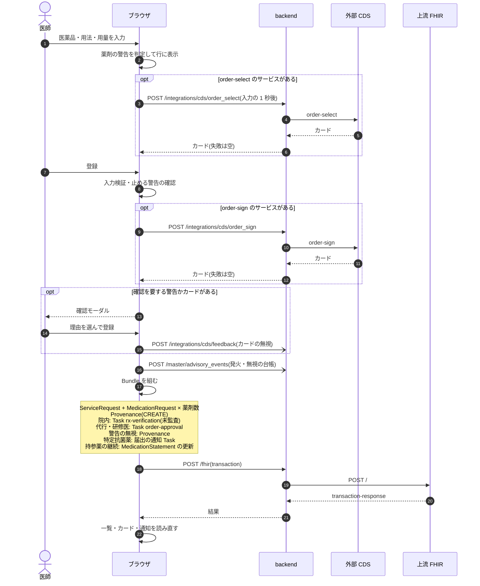
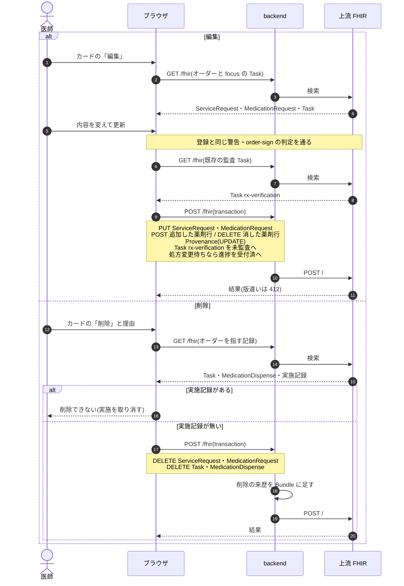
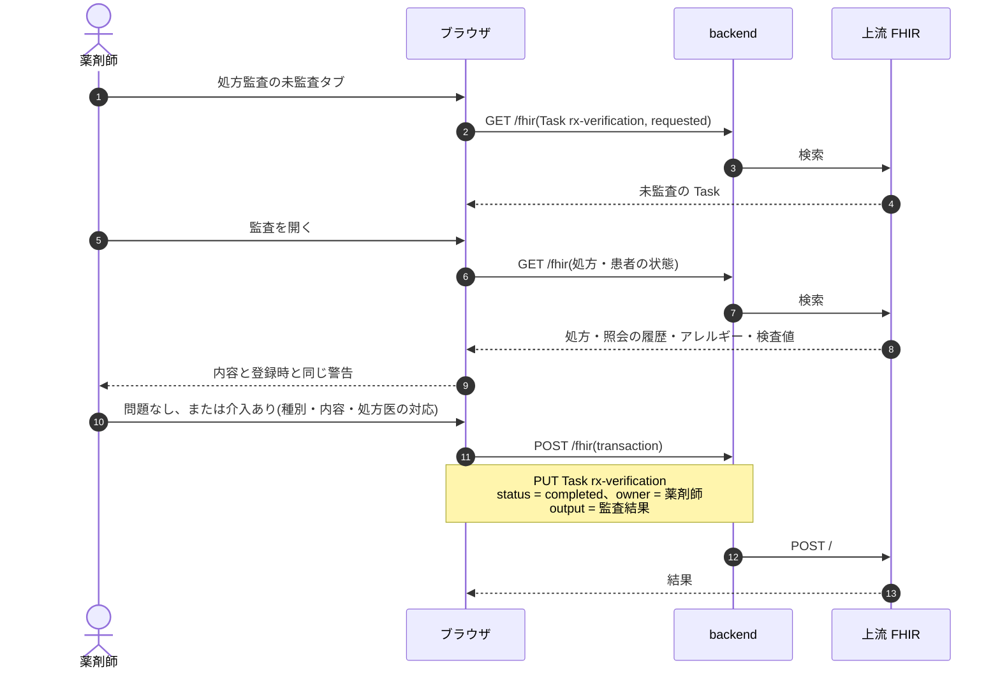
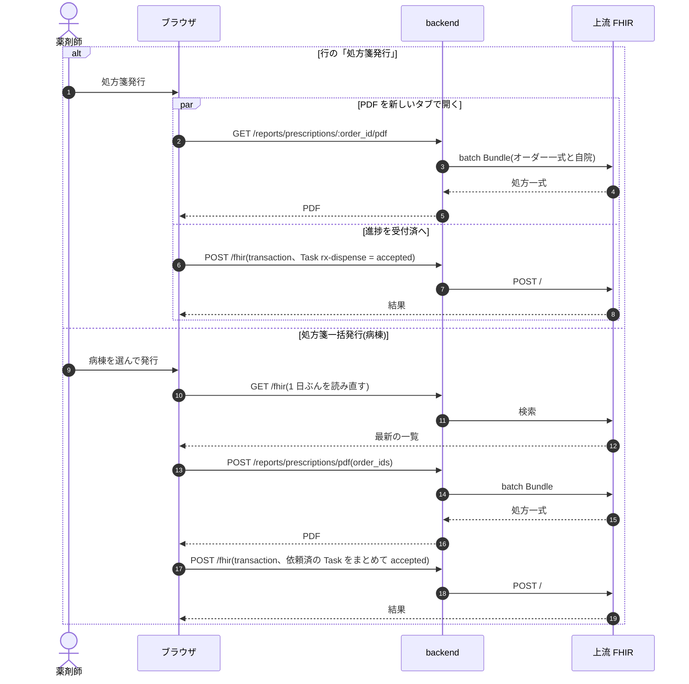
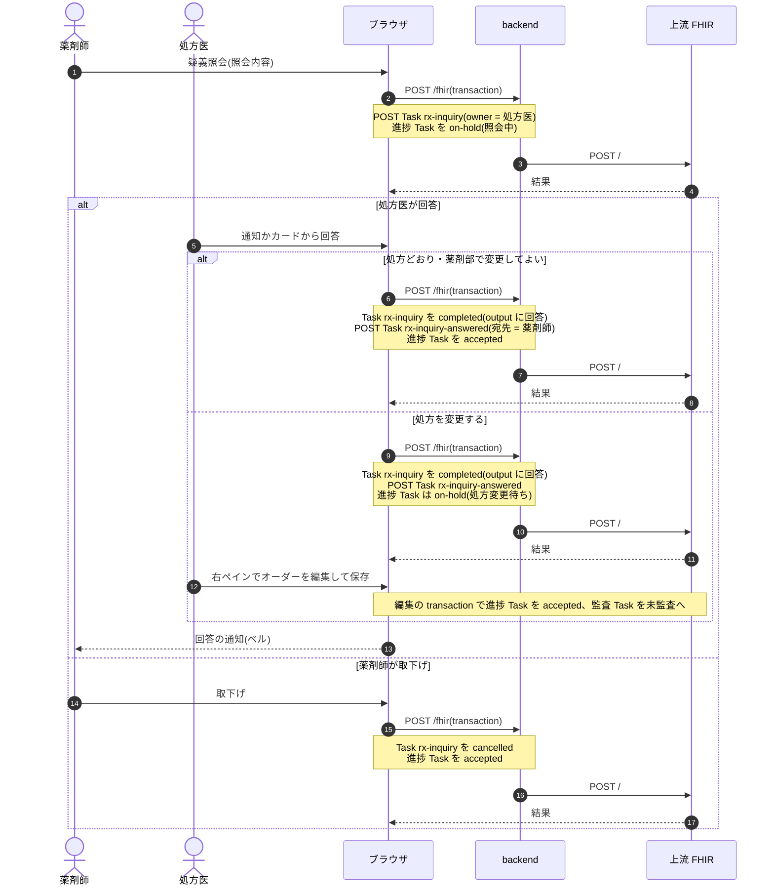
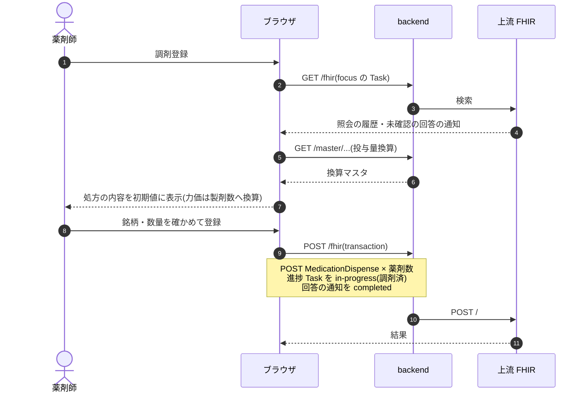
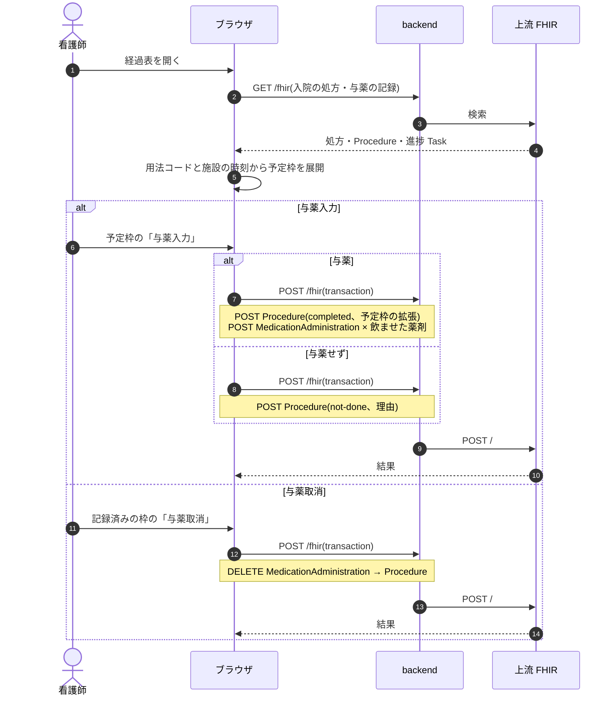

# 処方オーダーのシーケンス図

<!-- ../fhir-client/docs/order-flows/prescription.md から scripts/sync-flows.mjs で作る。直接編集しない。 -->

運用の流れは[処方オーダーの業務フロー](../flows/prescription.md)にあります。

## 進捗 Task(`rx-dispense`)

Task は登録時には作りません。**Task が無いオーダーは依頼済**として扱い、最初のステータス変更で作ります。
与薬では動きません。

| 状態 | `Task.status` |
|---|---|
| 依頼済 | `requested`(または Task 無し) |
| 受付済 | `accepted` |
| 照会中・処方変更待ち | `on-hold` + `statusReason` |
| 調剤済 | `in-progress` |
| 実施済 (作る操作なし) | `completed` |
| 中止 | `cancelled` |

中止は同じ transaction で `ServiceRequest` を `revoked`、`MedicationRequest` を `cancelled` にします(`rxOrderCancelEntries`)。中止取消は `active` に戻します。

## シーケンス図の前提

`/fhir` への書き込みはどれも 1 回の transaction Bundle で、backend の `FhirProxyController` が上流へ中継します。
SS-MIX2 を有効にしている施設では、中継が書き込みの控えを記録します(`Ssmix2::Recorder`)。
楽観ロックの版は `postBundle` が `ifMatch` に添え、版が違えば 412 で止まります。

## 登録

`components/PrescriptionForm.tsx`・`PrescriptionPanels.tsx`、`useCreatePrescription`(`api/queries/labResult.ts`)。

## 編集・削除

`PrescriptionEditPanel`、`useUpdatePrescription`、`postOrderDeleteBundle`(`api/queries/orderDelete.ts`)。

## 処方監査

`pages/RxVerificationPage.tsx`・`components/RxVerificationModal.tsx`、`useCompleteRxVerification`。処方一覧の「監査」からも同じモーダルが開きます。

## 処方箋発行

`pages/RxWorklistPage.tsx`・`components/RxBatchIssueModal.tsx`、`useUpdateRxTaskStatus`・`useIssuePrescriptions`。
PDF の生成は読むだけで、再発行は同じ PDF を刷り進捗を動かしません。

## 疑義照会

`components/RxInquiryModal.tsx`・`RxInquirySection.tsx`、`fhir/rxInquiryHelpers.ts`、`useWriteRxInquiry`。

## 調剤登録

`components/RxDispenseModal.tsx`、`fhir/rxDispenseHelpers.ts`、`useRegisterRxDispense`。受付済の行にだけ出ます。

## 与薬

`components/OralPerformModal.tsx`・`VitalFlowsheetPanel.tsx`、`fhir/oralPerformHelpers.ts`、`useRegisterOralPerform`・`useCancelOralPerforms`。
調剤済かどうかに関わらず記録でき、進捗 Task は動きません。

