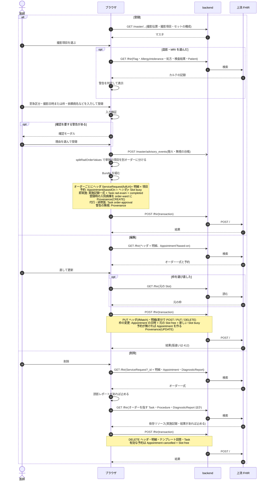
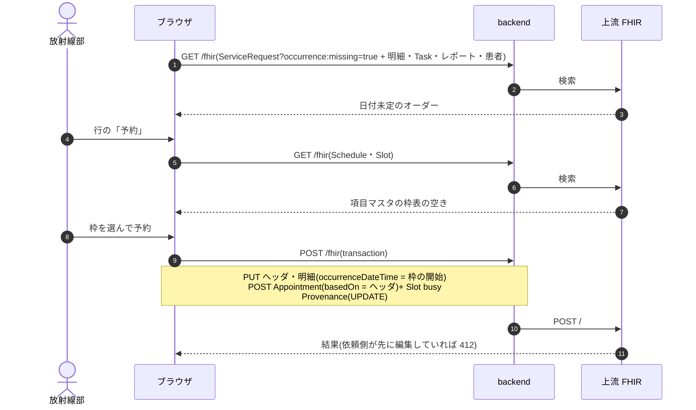
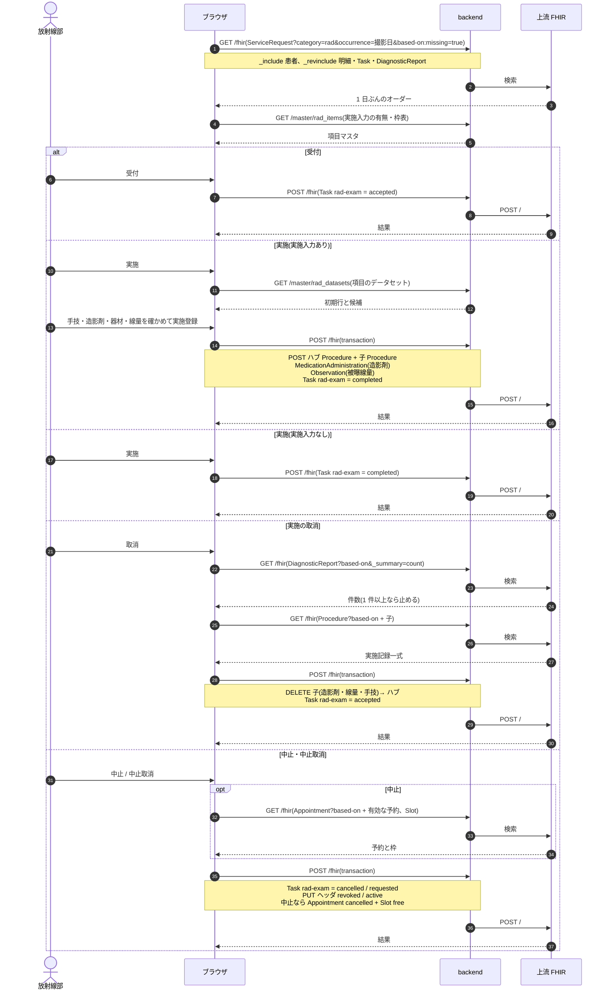
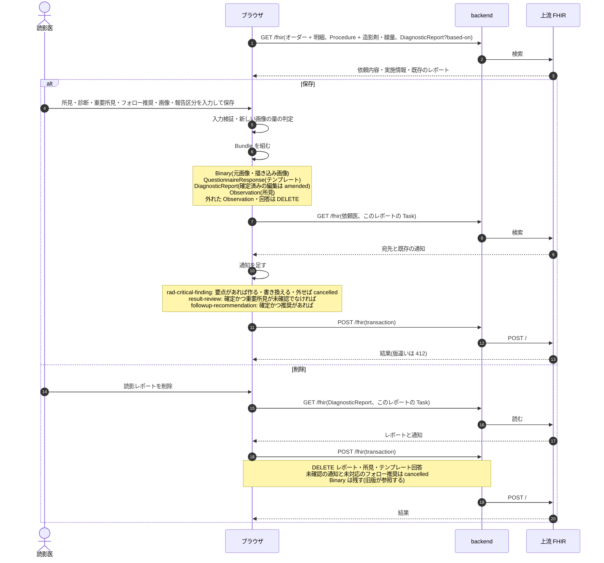
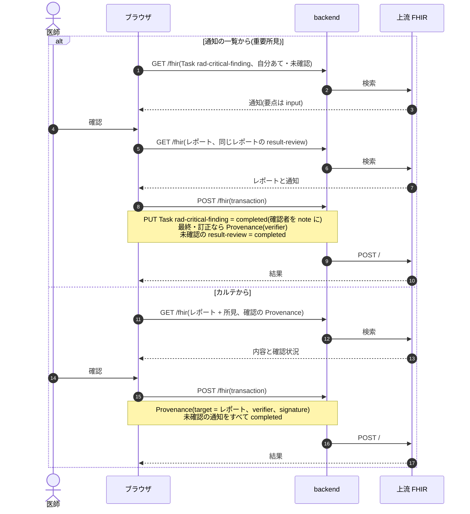

# 放射線検査オーダーのシーケンス図

<!-- ../fhir-client/docs/order-flows/rad.md から scripts/sync-flows.mjs で作る。直接編集しない。 -->

運用の流れは[放射線検査オーダーの業務フロー](../flows/rad.md)にあります。

## リソースの構成

オーダーはヘッダの `ServiceRequest`(`order-type|rad`)と、撮影項目 1 件ずつの明細 `ServiceRequest`(`basedOn` でヘッダを指す)です。セットの構成項目はさらに親の明細を `basedOn` で指します。
明細は項目コード・JJ1017-32 / 16M / 16S・種別(`category`)・部位と左右(`bodySite`)を写し、依頼病名(`reason*`)・検査目的(拡張 `rad-exam-purpose`)・特別指示(`note`)は GP(単項目かセット親)の明細にだけ持ちます(`fhir/radOrderHelpers.ts`)。

| もの | リソース | 補足 |
|---|---|---|
| 進捗 | `Task`(`task-code|rad-exam`、`focus` = ヘッダ) | 下の表 |
| 予約 | `Appointment`(`basedOn` = ヘッダ)+ `Slot`(`busy` / `free`) | オーダーと同じ transaction で書く。連続した複数枠を取ることがある |
| 検査目的・特別指示のテンプレート記入 | `QuestionnaireResponse` | 明細の拡張 `rad-exam-purpose-questionnaire-response` / `rad-remarks-questionnaire-response` が指す。削除で一緒に消す |
| 実施記録 | ハブ `Procedure`(`order-type|rad`、`basedOn` = ヘッダ、`code` = 手技 1 件目、`usedCode` = 器材、`performedDateTime`)← `partOf` ── `Procedure`(2 件目以降の手技)、`MedicationAdministration`(造影剤)、`Observation`(被曝線量。`rad-dose`) | オーダーに 1 件。実施入力のない項目だけのオーダーには作らない |
| 読影レポート | `DiagnosticReport`(`basedOn` = ヘッダ、`category` = LOINC `LP29684-5` と v2-0074 `RAD`、`code` = `18748-4`、`status` = `preliminary` / `final` / `amended`、`resultsInterpreter` = 読影医、`performer` = 自院、`conclusion` = 診断)+ `Observation`(所見 1 件) | オーダーに 1 件。部品は生理検査・内視鏡と共用(`EXAM_REPORT_CONFIGS.rad`) |
| 読影の画像 | `Binary` × 2(元画像・描き込み画像) | レポートの拡張 `rad-report-image` の `source` / `annotated` が指す。レポートを消しても残す |
| 読影のテンプレート記入 | `QuestionnaireResponse` | 拡張 `rad-report-findings-response` / `rad-report-conclusion-response` が指す |
| 重要所見の通知 | `Task`(`task-code|rad-critical-finding`、`focus` = レポート、`owner` = 依頼医) | 要点はレポートの拡張 `rad-critical-finding` と `Task.input` |
| 検査結果確認の通知 | `Task`(`task-code|result-review`、`focus` = レポート、`owner` = 依頼医) | 最終・訂正のときだけ。重要所見が未確認の間は作らない |
| フォロー推奨 | レポートの拡張 `rad-follow-up` + `Task`(`task-code|followup-recommendation`) | 確定したときに台帳へ載せる |
| 確認(既読) | `Provenance`(`target` = レポート、`agent.type = verifier`、`signature`) | 正本。通知は宛先と未確認・確認済みだけ |
| 代行入力・警告の確認 | `Provenance`(`target` = ヘッダ) | 明細は `target` に入れない。警告の確認は activity `override` |

## 進捗 Task(`rad-exam`)

Task は登録時には作りません。**Task が無いオーダーは依頼済**として扱い、最初のステータス変更で作ります(`fhir/radTaskHelpers.ts`)。即実施だけは登録と同じ transaction で `completed` の Task を作ります。
中止は同じ transaction でヘッダを `revoked` にし、中止取消で `active` に戻します(`orderCancelEntries`)。中止したオーダーを編集しても `revoked` のままです(`keepOrderRevoked`)。

| 状態 | `Task.status` | `executionPeriod` | 同じ transaction で書くもの |
|---|---|---|---|
| 依頼済 | `requested`(または Task 無し) | なし | 中止取消ならヘッダ `active` |
| 受付済 | `accepted` | `start` | 実施の取消なら実施記録の DELETE |
| 実施済 | `completed` | `start` / `end` | 実施記録(ハブ + 子)。実施入力のない項目だけなら無し |
| 中止 | `cancelled` | なし | ヘッダ `revoked`、有効な予約の `Appointment` `cancelled` + `Slot` `free` |

読影の進み具合は Task に足しません。撮影と読影は別の担当者の別の工程で、一覧の列は `DiagnosticReport.status` から出します。

## シーケンス図の前提

`/fhir` への書き込みはどれも 1 回の transaction Bundle で、backend の `FhirProxyController` が上流へ中継します。
SS-MIX2 を有効にしている施設では、中継が書き込みの控えを記録します(`Ssmix2::Recorder`)。
楽観ロックの版は `postBundle` が `ifMatch` に添え、版が違えば 412 で止まります。

## 登録・編集・削除

`components/RadOrderForm.tsx`・`RadOrderPanels.tsx`・`ExamOrderPanels.tsx`、`buildRadOrderBundle` / `buildRadOrderUpdateBundle` / `buildRadOrderDeleteBundle`(`fhir/radOrderHelpers.ts`)、
`buildRadOrderWithPerformBundle`(`fhir/radResultHelpers.ts`。即実施)、`useCreatePrescription`(`api/queries/labResult.ts`。全種別共通)、`useUpdateRadOrder` / `useDeleteRadOrder`(`api/queries/rad.ts`)、
警告は `hooks/useRadSafetyAdvisories.ts`・`fhir/radSafetyHelpers.ts`。

## 日付未定の予約

`pages/RadWorklistPage.tsx`、`components/ExamBookingModal.tsx`、`useScheduleExamOrder`(`api/queries/worklist.ts`)、`buildExamScheduleBundle`(`fhir/appointmentHelpers.ts`)。

## 受付・実施・取消・中止

`pages/RadWorklistPage.tsx`、`useRadWorklist` / `useUpdateRadTaskStatus` / `useRegisterRadPerform`(`api/queries/rad.ts`)、`makeUpdateTaskStatusHook`(`api/queries/worklist.ts`)、
`components/RadPerformModal.tsx`、`buildRadPerformBundle` / `buildRadPerformDeleteEntries`(`fhir/radResultHelpers.ts`)。

## 読影レポート

`components/ExamReportEntryModal.tsx`・`ExamReportForm.tsx`・`KarteExamReportTab.tsx`、`buildExamReportBundle`(`fhir/examReportHelpers.ts`)、`useSaveExamReport` / `useDeleteExamReport`(`api/queries/examReport.ts`)。
通知の組み立ては `fhir/examCriticalFindingHelpers.ts`・`fhir/resultReviewHelpers.ts`・`fhir/followUpHelpers.ts`。

## 結果確認

確認の書き込みは検体検査と同じです([検体検査オーダーの業務フロー](../flows/lab.md)「シーケンス図: 結果確認」)。放射線では緊急の通知が `rad-critical-finding` になり、`ResultReviewAction`(カルテ)と `urgentConfirmationEntries`(通知の一覧)を通ります。

## 医事会計と SS-MIX2

放射線は実施記録から集めます(`BillingClaimBuilder` の `:procedure` 経路)。手技はハブと子の `Procedure.code` で、オーダー項目の `receipt_code` は使いません。実施入力に手技の行が無ければ手技は送られないので、データセットの初期行に手技を入れておきます。
部位のコメントは項目マスタの `site_comment_code` から足し、造影剤・器材・実施コメントと一緒に 1 剤にします。日付は実施時刻の日です。実施入力のない項目だけのオーダーに限り、オーダーの撮影日と項目の `receipt_code` で組みます。

| 起きたこと | 医事会計(`BillingClaimBuilder`) | SS-MIX2 |
|---|---|---|
| 登録・編集・予約 | なし | OMG^O19(OMG-01)。ヘッダを書くと出す。編集・日付の確定も `NW`(INS) |
| 受付 | なし | なし(進捗 Task はメッセージにしない) |
| 実施(実施入力あり) | 実施記録から手技・部位コメント・造影剤・器材・コメントを送る。コードの無い行は「送れない項目」に出す | OMI^Z23(OMG-11)。手技・使用物品(造影剤・器材)・被曝線量 |
| 実施(実施入力なし) | 部門が実施済にしたオーダーの項目を `receipt_code` で送る | なし(実施記録が無い) |
| 当日の未実施 | 実施入力ありは「実施記録がありません(未実施のため送りません)」、なしは「部門で実施済になっていません」と報告 | なし |
| 実施の取消 | 対象から外れる | OMI^Z23 の `CA`(DEL) |
| 中止 | 対象から外れる(`ServiceRequest` が `revoked`)。送ったあとの中止は医事が送り直す | OMG^O19 の `CA`(DEL)。中止取消は `NW`(INS) |
| 削除 | 対象から外れる | OMG^O19 の `CA`(DEL) |
| 読影レポートの保存・訂正・削除 | なし | なし(読影レポートに対応する電文は無く、実施通知 OMI^Z23 まで) |
