# 放射線検査オーダーのシーケンス図

<!-- ../fhir-client/docs/order-flows/rad.md から scripts/sync-flows.mjs で作る。直接編集しない。 -->

運用の流れは[放射線検査オーダーの業務フロー](../flows/rad.md)にあります。

## シーケンス図の前提

- **書き込みの経路**: `/fhir` への書き込みはどれも 1 回の transaction Bundle で、backend の `FhirProxyController` が上流の FHIR サーバー(以下「上流」)へ中継します。
- **図の省略**: 図では、上流の応答が backend を通ってブラウザへ戻る矢印を省き、上流からブラウザへの 1 本で描きます。
- **楽観ロック**: 版は `postBundle` が `ifMatch` に添え、版が違えば 412 で止まります。
- **SS-MIX2**: 有効にしている施設では、中継が書き込みの控えを記録します(`Ssmix2::Recorder`)。
- **ヘッダと明細**: オーダー 1 件の `ServiceRequest`(`order-type|rad`)を「ヘッダ」、撮影項目 1 件ずつの `ServiceRequest` を「明細」と呼びます。明細は `basedOn` でヘッダを指します。
- **GP の明細**: 単項目の明細か、セット親の明細です。セットの構成項目の明細は、さらに親の明細を `basedOn` で指します。
- **ハブと子**: 実施記録の中心の `Procedure` を「ハブ」、ハブを `partOf` で指すリソースを「子」と呼びます。
- **確定**: 読影レポートの `final` と `amended` を合わせて「確定」と呼びます。

## リソースの構成

- ヘッダ `ServiceRequest`(`order-type|rad`)
  - 明細 `ServiceRequest`(撮影項目 1 件ずつ。`basedOn` = ヘッダ)
    - セットの構成項目の明細(`basedOn` = 親の明細)
  - 進捗 `Task`(`focus` = ヘッダ)
  - 予約 `Appointment`(`basedOn` = ヘッダ)+ `Slot`
  - 実施記録のハブ `Procedure`(`basedOn` = ヘッダ。オーダーに 1 件)
    - 子 `Procedure`(2 件目以降の手技)
    - 子 `MedicationAdministration`(造影剤)
    - 子 `Observation`(被曝線量)
  - 読影レポート `DiagnosticReport`(`basedOn` = ヘッダ。オーダーに 1 件)
    - 所見 `Observation`(1 件)
    - 画像 `Binary` × 2(元画像・描き込み画像)
    - 通知の `Task`、確認の `Provenance`
  - 代行入力・警告の確認の `Provenance`(`target` = ヘッダ)

組み立ては `fhir/radOrderHelpers.ts` です。

**明細**

| 要素 | 中身 |
|---|---|
| 項目コード | 撮影項目のコードと JJ1017-32 / 16M / 16S |
| `category` | 種別 |
| `bodySite` | 部位と左右 |
| `reason*` | 依頼病名。GP の明細にだけ持つ |
| 拡張 `rad-exam-purpose` | 検査目的。GP の明細にだけ持つ |
| `note` | 特別指示。GP の明細にだけ持つ |
| 拡張 `rad-exam-purpose-questionnaire-response` | 検査目的のテンプレート記入の `QuestionnaireResponse` を指す |
| 拡張 `rad-remarks-questionnaire-response` | 特別指示のテンプレート記入の `QuestionnaireResponse` を指す |

テンプレート記入の `QuestionnaireResponse` は、オーダーの削除で一緒に消します。

**進捗・予約・実施記録**

| リソース | 要素 | 中身 |
|---|---|---|
| 進捗 `Task` | `code` | `task-code|rad-exam` |
| 予約 `Appointment` | `basedOn` | ヘッダ。オーダーと同じ transaction で書く |
| 予約 `Slot` | `status` | `busy` / `free`。連続した複数枠を取ることがある |
| ハブ `Procedure` | `category` | `order-type|rad` |
| ハブ `Procedure` | `code` | 手技 1 件目 |
| ハブ `Procedure` | `usedCode` | 器材 |
| ハブ `Procedure` | `performedDateTime` | 実施時刻 |
| 子 `Observation` | `code` | 被曝線量(`rad-dose`) |

実施記録は、実施入力のない項目だけのオーダーには作りません。

**読影レポート `DiagnosticReport`**

| 要素 | 中身 |
|---|---|
| `category` | LOINC `LP29684-5` と v2-0074 `RAD` |
| `code` | `18748-4` |
| `status` | `preliminary` / `final` / `amended` |
| `resultsInterpreter` | 読影医 |
| `performer` | 自院 |
| `conclusion` | 診断 |
| 拡張 `rad-report-image` | `source` / `annotated` が画像の `Binary` を指す |
| 拡張 `rad-report-findings-response` | 所見のテンプレート記入の `QuestionnaireResponse` を指す |
| 拡張 `rad-report-conclusion-response` | 診断のテンプレート記入の `QuestionnaireResponse` を指す |
| 拡張 `rad-critical-finding` | 重要所見の要点 |
| 拡張 `rad-follow-up` | フォロー推奨 |

- レポートの部品は生理検査・内視鏡と共用です(`EXAM_REPORT_CONFIGS.rad`)。
- 画像の `Binary` は、レポートを消しても残します。

**通知と確認**

| もの | リソース | 補足 |
|---|---|---|
| 重要所見の通知 | `Task`(`task-code|rad-critical-finding`、`focus` = レポート、`owner` = 依頼医) | 要点は `Task.input` にも持つ |
| 検査結果確認の通知 | `Task`(`task-code|result-review`、`focus` = レポート、`owner` = 依頼医) | 最終・訂正のときだけ。重要所見が未確認の間は作らない |
| フォロー推奨 | `Task`(`task-code|followup-recommendation`) | 確定したときに台帳へ載せる |
| 確認(既読) | `Provenance`(`target` = レポート、`agent.type = verifier`、`signature`) | 正本。通知は宛先と未確認・確認済みだけ |
| 代行入力 | `Provenance`(`target` = ヘッダ) | 明細は `target` に入れない |
| 警告の確認 | `Provenance`(`target` = ヘッダ、activity `override`) | 明細は `target` に入れない |

## 進捗 Task(`rad-exam`)

- Task は登録時には作りません。**Task が無いオーダーは依頼済**として扱い、最初のステータス変更で作ります(`fhir/radTaskHelpers.ts`)。
- 即実施だけは、登録と同じ transaction で `completed` の Task を作ります。
- 中止は同じ transaction でヘッダを `revoked` にし、中止取消で `active` に戻します(`orderCancelEntries`)。
- 中止したオーダーを編集しても `revoked` のままです(`keepOrderRevoked`)。
- 読影の進み具合は Task に足しません。撮影と読影は別の担当者の別の工程で、一覧の列は `DiagnosticReport.status` から出します。

| 状態 | `Task.status` | `executionPeriod` |
|---|---|---|
| 依頼済 | `requested`(または Task 無し) | なし |
| 受付済 | `accepted` | `start` |
| 実施済 | `completed` | `start` / `end` |
| 中止 | `cancelled` | なし |

操作ごとに、同じ transaction で書くものは次のとおりです。

| 操作 | `Task.status` | 一緒に書くもの |
|---|---|---|
| 受付 | `accepted` | なし |
| 実施 | `completed` | 実施記録(ハブ + 子)。実施入力のない項目だけなら無し |
| 実施済からの取消 | `accepted` | 実施記録の DELETE |
| 受付済からの取消 | `requested` | なし |
| 中止 | `cancelled` | ヘッダ `revoked`、有効な予約の `Appointment` `cancelled` + `Slot` `free` |
| 中止取消 | `requested` | ヘッダ `active` |

## 部品

| 操作 | 画面 | 組み立て | hook |
|---|---|---|---|
| 登録 | `components/RadOrderForm.tsx`・`RadOrderPanels.tsx`・`ExamOrderPanels.tsx` | `buildRadOrderBundle` | `useCreatePrescription` |
| 即実施の登録 | 同じ | `buildRadOrderWithPerformBundle` | `useCreatePrescription` |
| 編集 | 同じ | `buildRadOrderUpdateBundle` | `useUpdateRadOrder` |
| 削除 | 同じ | `buildRadOrderDeleteBundle` | `useDeleteRadOrder` |
| 日付未定の予約 | `pages/RadWorklistPage.tsx`・`components/ExamBookingModal.tsx` | `buildExamScheduleBundle` | `useScheduleExamOrder` |
| 一覧・受付・取消・中止 | `pages/RadWorklistPage.tsx` | `fhir/radTaskHelpers.ts` | `useRadWorklist`・`useUpdateRadTaskStatus` |
| 実施 | `components/RadPerformModal.tsx` | `buildRadPerformBundle` | `useRegisterRadPerform` |
| 実施済からの取消 | `pages/RadWorklistPage.tsx` | `buildRadPerformDeleteEntries` | `useUpdateRadTaskStatus` |
| 読影レポート | `components/ExamReportEntryModal.tsx`・`ExamReportForm.tsx`・`KarteExamReportTab.tsx` | `buildExamReportBundle` | `useSaveExamReport`・`useDeleteExamReport` |
| 結果確認 | カルテ・通知の一覧 | `ResultReviewAction`・`urgentConfirmationEntries` | 通知の hook |

- **置き場所(組み立て)**: オーダーは `fhir/radOrderHelpers.ts`、実施記録と即実施は `fhir/radResultHelpers.ts`、予約は `fhir/appointmentHelpers.ts`、レポートは `fhir/examReportHelpers.ts` です。
- **置き場所(hook)**: 放射線の hook は `api/queries/rad.ts`、レポートは `api/queries/examReport.ts`、日付未定の予約は `api/queries/worklist.ts` です。
- **全種別共通の hook**: `useCreatePrescription`(`api/queries/labResult.ts`)は、名前に反して全種別共通の登録の hook です。
- **ステータス変更**: `useUpdateRadTaskStatus` は `makeUpdateTaskStatusHook`(`api/queries/worklist.ts`)で作ります。
- **警告**: `hooks/useRadSafetyAdvisories.ts`・`fhir/radSafetyHelpers.ts` です。
- **通知の組み立て**: `fhir/examCriticalFindingHelpers.ts`・`fhir/resultReviewHelpers.ts`・`fhir/followUpHelpers.ts` です。

## 登録・編集・削除

**登録**

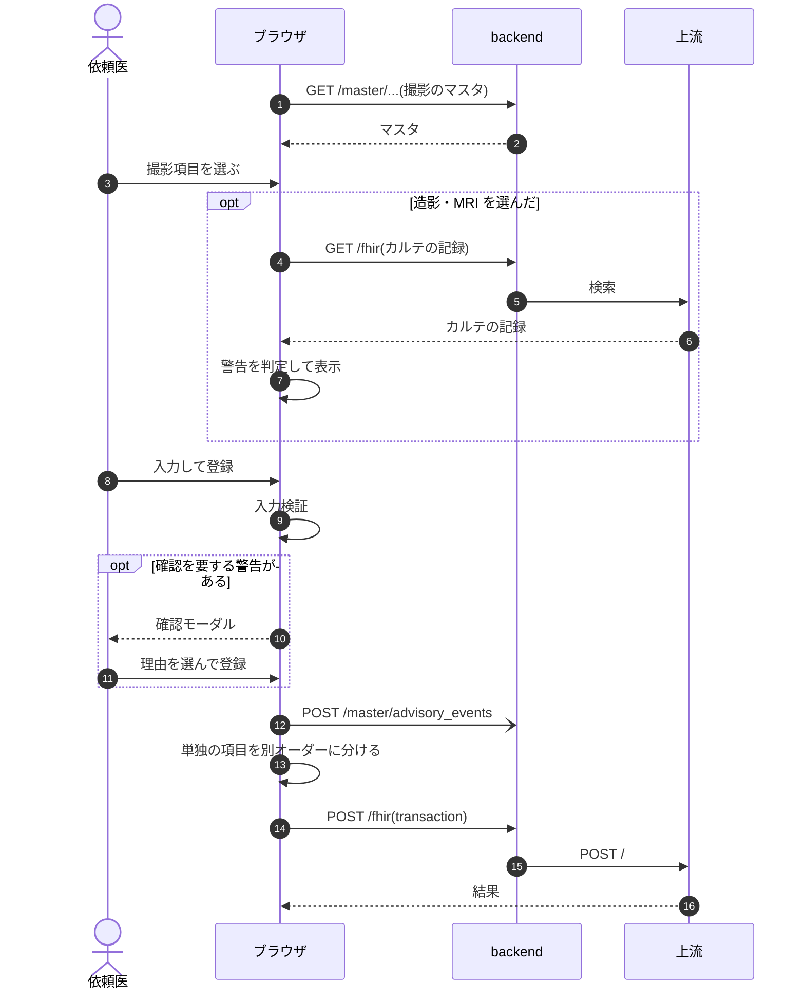

- マスタは、撮影伝票・撮影項目・セットの構成です。
- 警告のために読むカルテの記録は、`Flag`・`AllergyIntolerance`・処方・検査結果・`Patient` です。
- 依頼医が入力するのは、至急区分・撮影日時または枠・依頼病名などです。
- `POST /master/advisory_events` は、発火・無視の台帳です。
- 単独の項目は `splitRadOrderValues` で別オーダーに分けます。

| 書くもの | 条件 |
|---|---|
| ヘッダ `ServiceRequest`(`fullUrl`)+ 明細 × 項目 | オーダーごと |
| 登録時の入院病棟を `order-ward` に | いつも |
| `Provenance`(CREATE) | いつも |
| `Appointment`(`basedOn` = ヘッダ)+ `Slot` `busy` | 予約 |
| 実施記録一式 + `Task` `rad-exam` = `completed` | 即実施 |
| `Task` `order-approval` | 代行・研修医 |
| `Provenance` | 警告の無視 |

**編集**

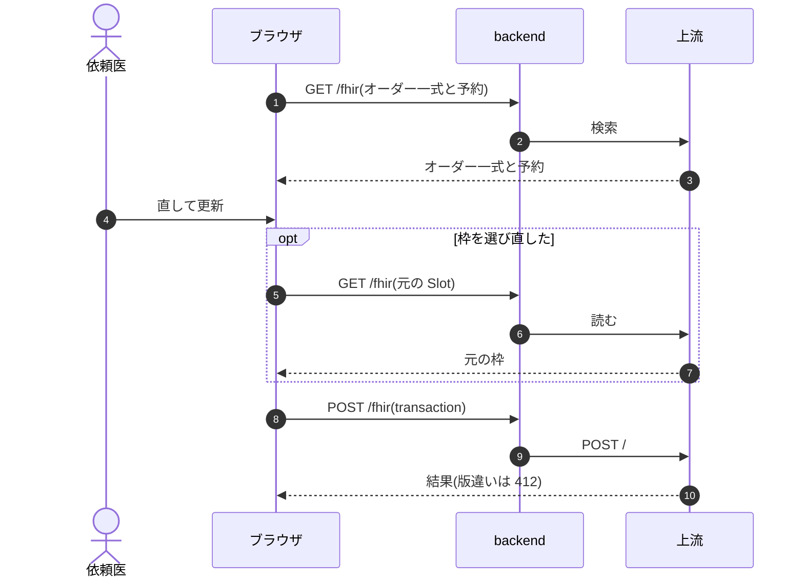

最初の検索は、ヘッダ + 明細と `Appointment?based-on` です。

| 書くもの | 条件 |
|---|---|
| PUT ヘッダ(`ifMatch`) | いつも |
| 明細を差分で POST / PUT / DELETE | いつも |
| `Appointment` の日時 + 元の `Slot` `free` + 新しい `Slot` `busy` | 枠の変更 |
| `Appointment` を作る | 予約が無ければ |
| `Provenance`(UPDATE) | いつも |

**削除**

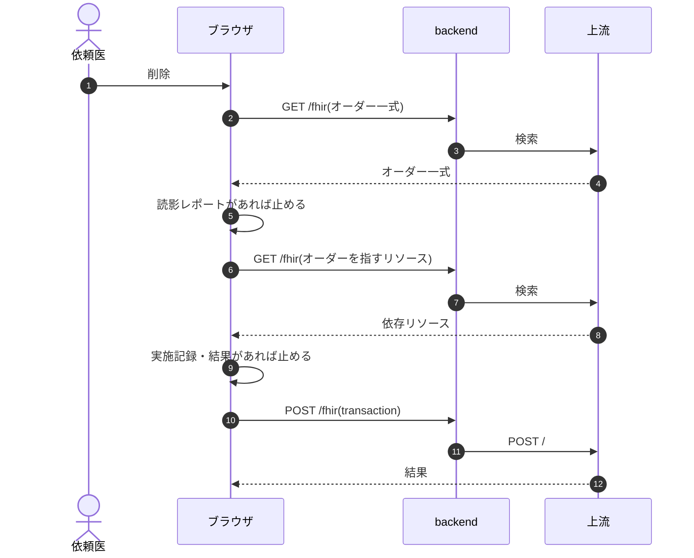

| 検索 | 条件 |
|---|---|
| オーダー一式 | `ServiceRequest?_id` + 明細・`Appointment`・`DiagnosticReport` |
| 依存リソース | オーダーを指す `Task`・`Procedure`・`DiagnosticReport` ほか |

| 書くもの | 条件 |
|---|---|
| DELETE ヘッダ・明細・テンプレート回答・`Task` | いつも |
| `Appointment` `cancelled` + `Slot` `free` | 有効な予約 |

## 日付未定の予約

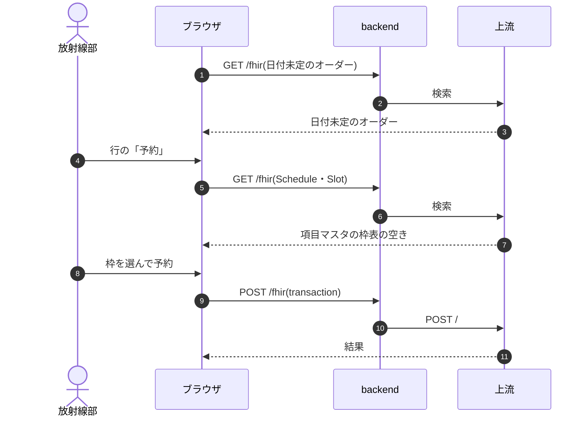

- 日付未定のオーダーの検索は `ServiceRequest?occurrence:missing=true` + 明細・`Task`・レポート・患者です。
- 依頼医の側が先に編集していれば、412 で止まります。

| 書くもの | 条件 |
|---|---|
| PUT ヘッダ・明細(`occurrenceDateTime` = 枠の開始) | いつも |
| POST `Appointment`(`basedOn` = ヘッダ)+ `Slot` `busy` | いつも |
| `Provenance`(UPDATE) | いつも |

## 受付・実施・取消・中止

**一覧を開く**

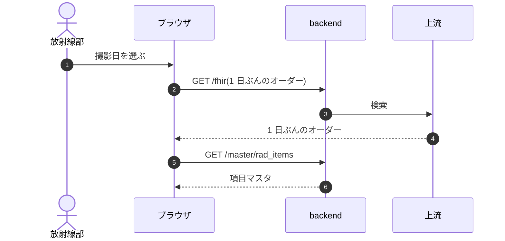

- 検索は `ServiceRequest?category=rad&occurrence=撮影日&based-on:missing=true` です。`_include` で患者、`_revinclude` で明細・`Task`・`DiagnosticReport` を付けます。
- 項目マスタからは、実施入力の有無と枠表を読みます。

**受付、実施(実施入力なし)、受付済からの取消**

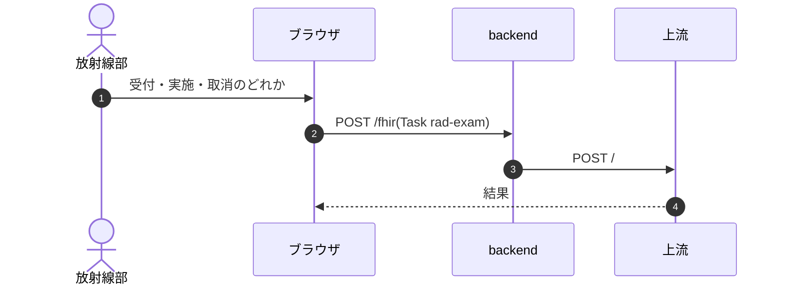

| 操作 | 書くもの |
|---|---|
| 受付 | `Task` `rad-exam` = `accepted` |
| 実施(実施入力なし) | `Task` `rad-exam` = `completed` |
| 受付済からの取消 | `Task` `rad-exam` = `requested` |

**実施(実施入力あり)**

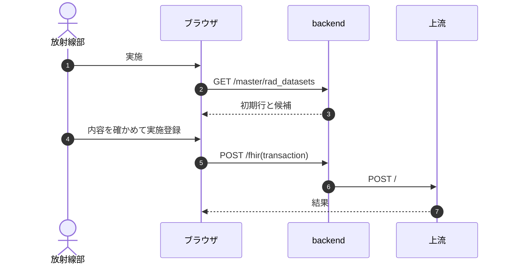

- データセットは、項目のデータセットを引きます。
- 確かめるのは、手技・造影剤・器材・線量です。

| 書くもの | 条件 |
|---|---|
| POST ハブ `Procedure` + 子 `Procedure` | いつも(子は 2 件目以降の手技) |
| POST `MedicationAdministration` | 造影剤 |
| POST `Observation` | 被曝線量 |
| `Task` `rad-exam` = `completed` | いつも |

**実施済からの取消**

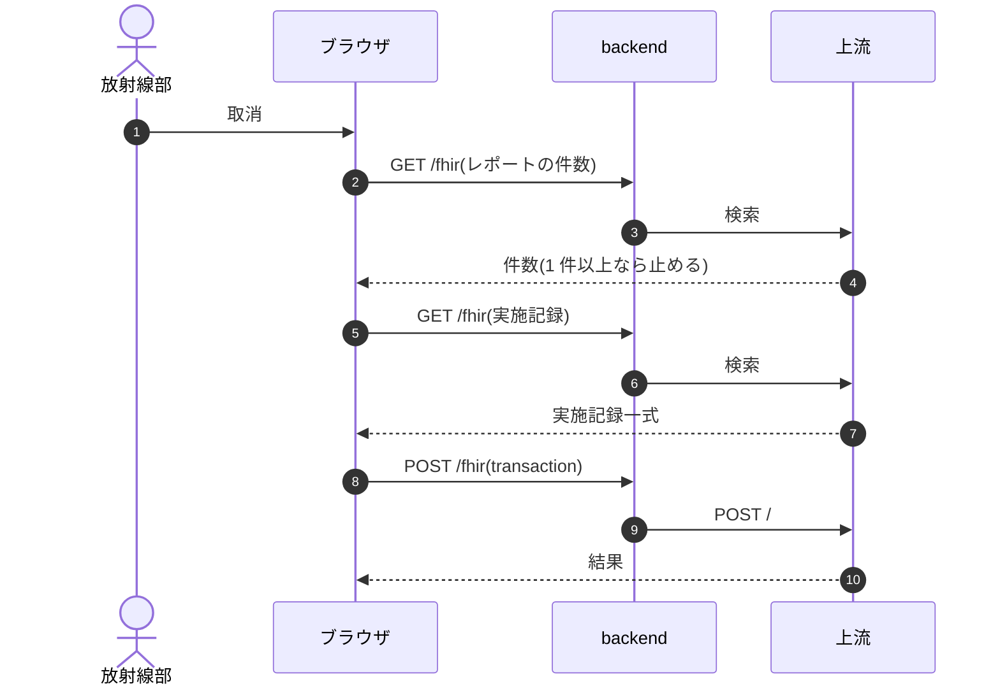

| 検索 | 条件 |
|---|---|
| レポートの件数 | `DiagnosticReport?based-on&_summary=count` |
| 実施記録 | `Procedure?based-on` + 子 |

| 書くもの | 条件 |
|---|---|
| DELETE 子(造影剤・線量・手技)→ ハブ | いつも |
| `Task` `rad-exam` = `accepted` | いつも |

**中止**

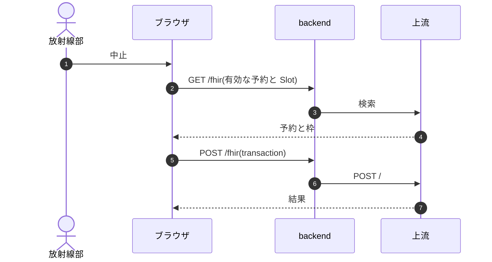

予約の検索は `Appointment?based-on` + 有効な予約、`Slot` です。

| 書くもの | 条件 |
|---|---|
| `Task` `rad-exam` = `cancelled` | いつも |
| PUT ヘッダ `revoked` | いつも |
| `Appointment` `cancelled` + `Slot` `free` | 有効な予約 |

**中止取消**

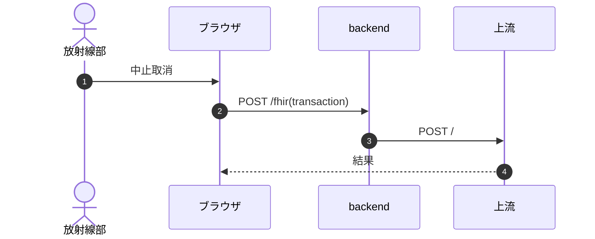

| 書くもの | 条件 |
|---|---|
| `Task` `rad-exam` = `requested` | いつも |
| PUT ヘッダ `active` | いつも |

## 読影レポート

**保存**

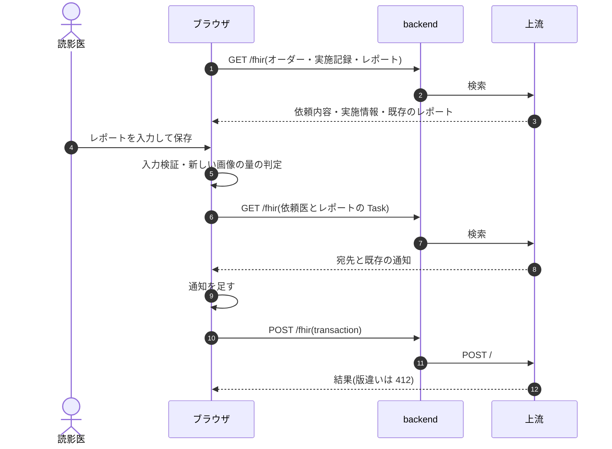

- 最初の検索は、オーダー + 明細、`Procedure` + 造影剤・線量、`DiagnosticReport?based-on` です。
- 読影医が入力するのは、所見・診断・重要所見・フォロー推奨・画像・報告区分です。

| 書くもの | 条件 |
|---|---|
| `Binary`(元画像・描き込み画像) | 画像 |
| `QuestionnaireResponse` | テンプレート |
| `DiagnosticReport` | いつも。確定済みの編集は `amended` |
| `Observation`(所見) | 所見 |
| DELETE 外れた `Observation`・回答 | 編集で外れたもの |
| `Task` `rad-critical-finding` | 要点があれば作る・書き換える。外せば `cancelled` |
| `Task` `result-review` | 確定かつ重要所見が未確認でなければ |
| `Task` `followup-recommendation` | 確定かつ推奨があれば |

**削除**

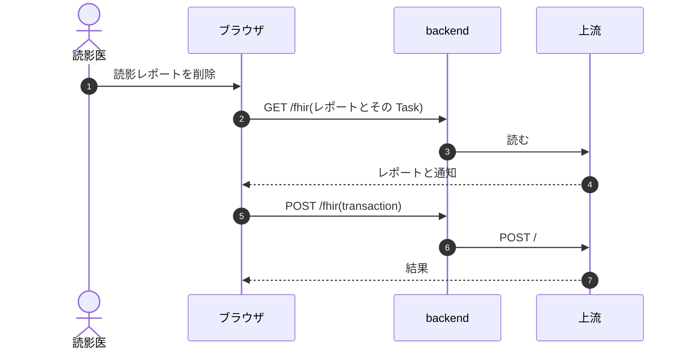

| 書くもの | 条件 |
|---|---|
| DELETE レポート・所見・テンプレート回答 | いつも |
| 通知とフォロー推奨を `cancelled` | 未確認の通知、未対応のフォロー推奨 |

`Binary` は残します(旧版が参照する)。

## 結果確認

確認の書き込みは検体検査と同じです([検体検査オーダーのシーケンス図](lab.md)「[結果確認](lab.md#結果確認)」)。放射線では緊急の通知が `rad-critical-finding` になり、`ResultReviewAction`(カルテ)と `urgentConfirmationEntries`(通知の一覧)を通ります。

**通知の一覧から(重要所見)**

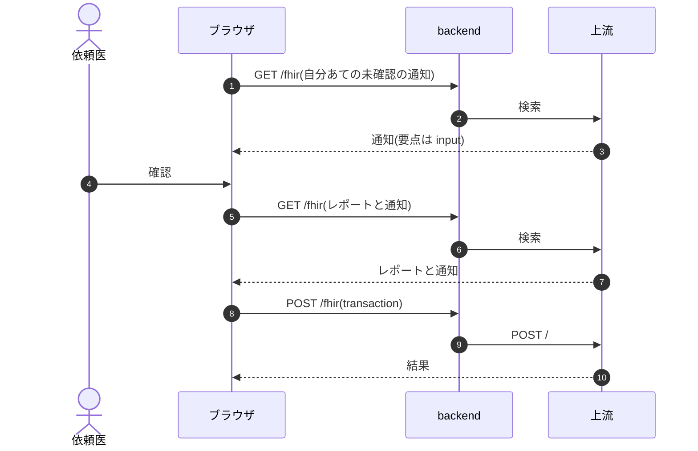

| 検索 | 条件 |
|---|---|
| 通知 | `Task` `rad-critical-finding`、自分あて・未確認 |
| レポートと通知 | レポートと、同じレポートの `result-review` |

| 書くもの | 条件 |
|---|---|
| PUT `Task` `rad-critical-finding` = `completed`(確認者を `note` に) | いつも |
| `Provenance`(verifier) | 最終・訂正なら |
| 未確認の `result-review` = `completed` | あれば |

**カルテから**

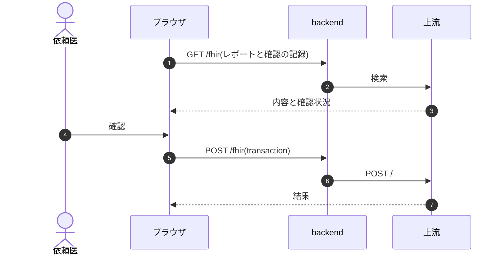

検索は、レポート + 所見と、確認の `Provenance` です。

| 書くもの | 条件 |
|---|---|
| `Provenance`(`target` = レポート、verifier、`signature`) | いつも |
| 未確認の通知をすべて `completed` | あれば |

## 医事会計と SS-MIX2

放射線は実施記録から集めます(`BillingClaimBuilder` の `:procedure` 経路)。

- **手技**: ハブと子の `Procedure.code` で送ります。オーダー項目の `receipt_code` は使いません。
- **手技の行が無いとき**: 実施入力に手技の行が無ければ、手技は送られません。データセットの初期行に手技を入れておきます。
- **部位のコメント**: 項目マスタの `site_comment_code` から足します。
- **1 剤にまとめる**: 部位のコメントは、造影剤・器材・実施コメントと一緒に 1 剤にします。
- **日付**: 実施時刻の日です。
- **実施入力のない項目だけのオーダー**: このときに限り、オーダーの撮影日と項目の `receipt_code` で組みます。

| 起きたこと | 医事会計(`BillingClaimBuilder`) | SS-MIX2 |
|---|---|---|
| 登録・編集・予約 | なし | OMG^O19(OMG-01)。ヘッダを書くと出す |
| 受付 | なし | なし(進捗 Task はメッセージにしない) |
| 実施(実施入力あり) | 実施記録から送る | OMI^Z23(OMG-11) |
| 実施(実施入力なし) | オーダーの項目を `receipt_code` で送る | なし(実施記録が無い) |
| 当日の未実施 | 送らずに報告する | なし |
| 実施済からの取消 | 対象から外れる | OMI^Z23 の `CA`(DEL) |
| 中止 | 対象から外れる(`ServiceRequest` が `revoked`) | OMG^O19 の `CA`(DEL) |
| 中止取消 | — | OMG^O19 の `NW`(INS) |
| 削除 | 対象から外れる | OMG^O19 の `CA`(DEL) |
| 読影レポートの保存・訂正・削除 | なし | なし |

- **登録・編集・予約**: 編集・日付の確定も `NW`(INS)で出します。
- **実施(実施入力あり)**: 医事会計には、手技・部位コメント・造影剤・器材・コメントを送ります。コードの無い行は「送れない項目」に出します。SS-MIX2 には、手技・使用物品(造影剤・器材)・被曝線量を出します。
- **実施(実施入力なし)**: 部門が実施済にしたオーダーが対象です。
- **当日の未実施**: 実施入力ありは「実施記録がありません(未実施のため送りません)」、なしは「部門で実施済になっていません」と報告します。
- **中止**: 医事会計へ送ったあとの中止は、医事が送り直します。
- **読影レポート**: 読影レポートに対応する電文は無く、実施通知 OMI^Z23 までです。
