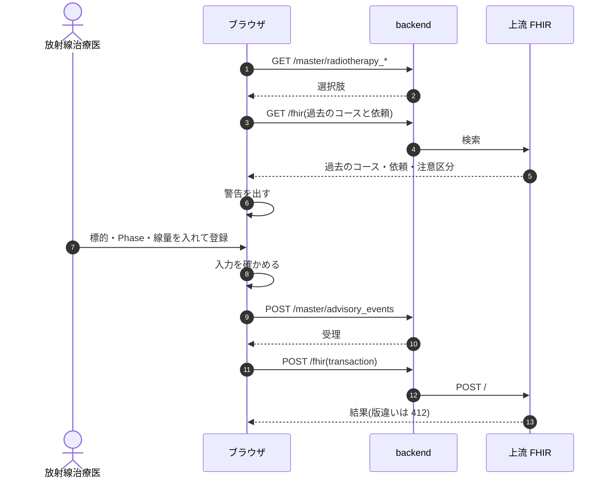
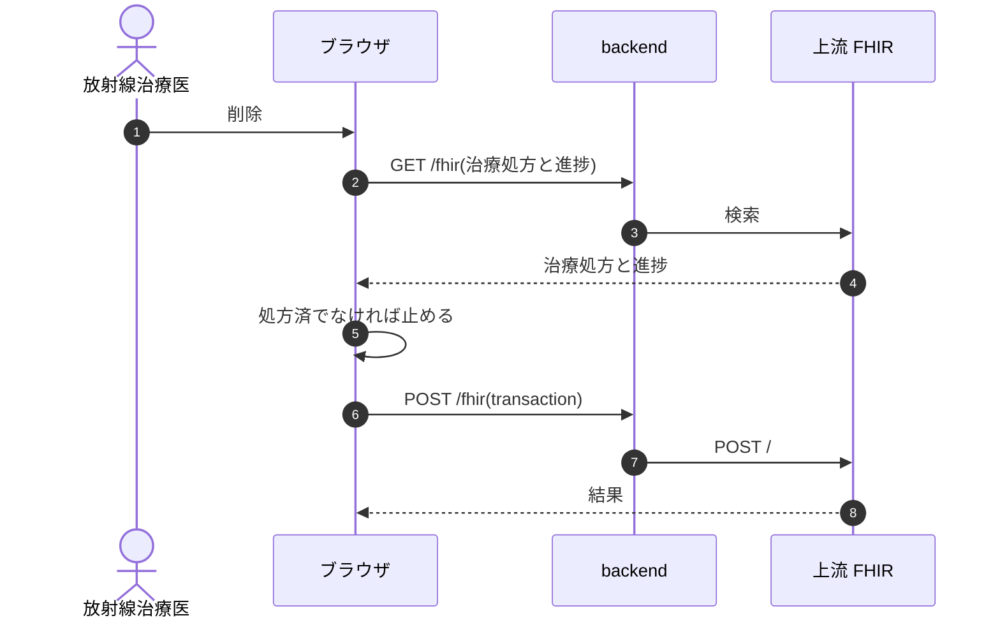
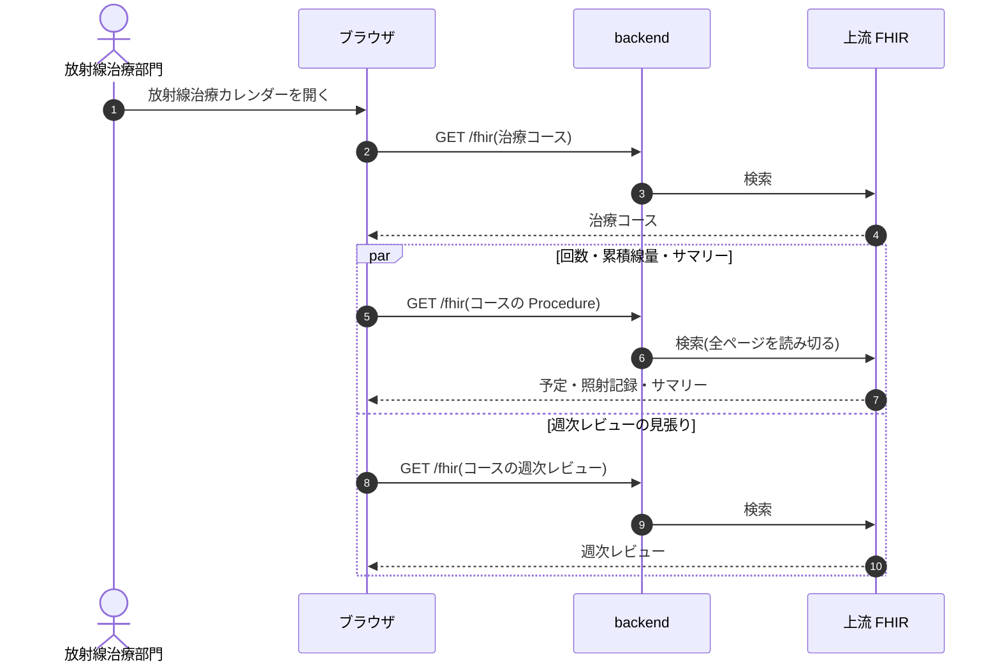
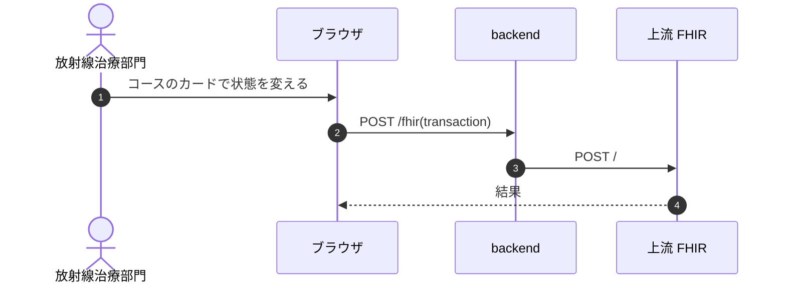
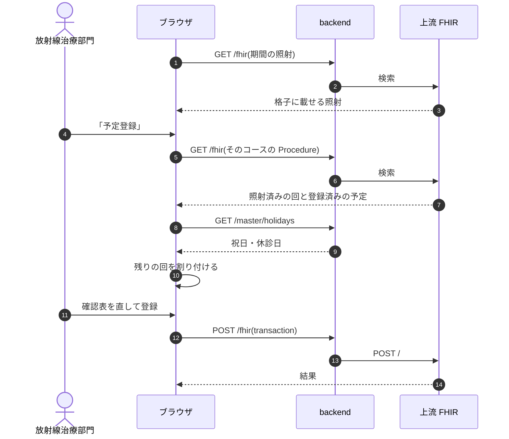
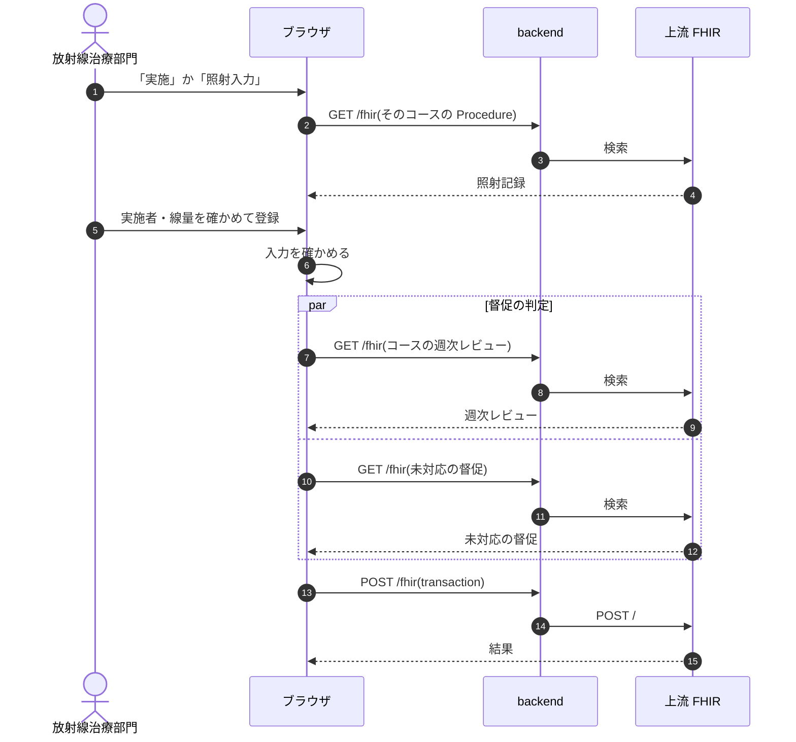
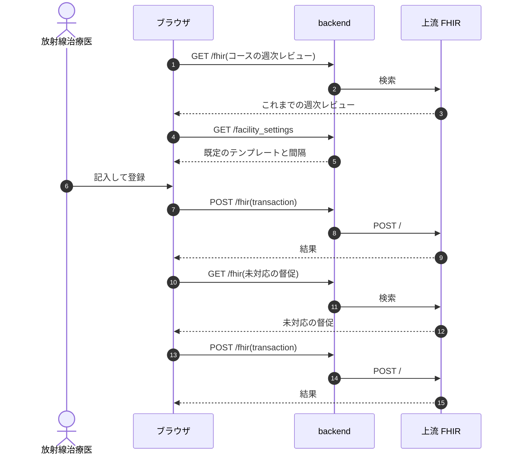
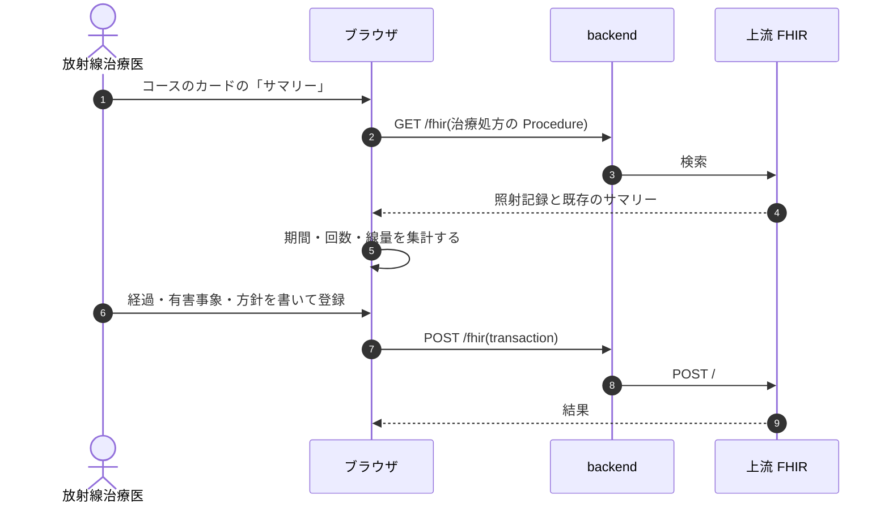

# 放射線治療のシーケンス図

<!-- ../fhir-client/docs/order-flows/radiotherapy.md から scripts/sync-flows.mjs で作る。直接編集しない。 -->

運用の流れは[放射線治療の業務フロー](../flows/radiotherapy.md)にあります。

## シーケンス図の前提

- **上流**: backend が中継する先の FHIR サーバーです。ブラウザの `/fhir` への読み書きは、backend の `FhirProxyController` が上流へ中継します。
- **書き込みは transaction**: `/fhir` への書き込みは、どれも 1 回の transaction Bundle です。週次レビューだけは、登録と督促を閉じる書き込みの 2 回になります。
- **楽観ロック**: `postBundle` が版を `ifMatch` に添え、版が違えば 412 で止まります。
- **照射記録の PUT**: 実施・この回中止・中止取消・取消・予定変更は、手元の写しではなく、読み直した版を土台にします。
- **ヘッダ**: 治療処方の `ServiceRequest` です。`basedOn` を持たない `ServiceRequest` を、オーダーのヘッダと呼びます。
- **全ページを読み切る検索**: 回数と累積線量を数える検索は、全ページを読み切れなければ結果を使いません(`searchAllPages` の `complete: true`)。
- **期間継続型**: 1 つのオーダーが期間続き、実施が日々積み上がる種別です(リハビリ・栄養指導と同じ)。照射しても進捗の Task は動かしません。
- **図の省略**: 応答は上流から backend を通ってブラウザへ戻りますが、図では上流からブラウザへの 1 本で書きます。同じ形の操作は図にせず、図の下の表に出します。
- **登場者**: 図の「放射線治療部門」は、照射の入力では診療放射線技師です。
- **SS-MIX2**: 有効にしている施設では、中継が書き込みの控えを記録します(`Ssmix2::Recorder`)。放射線治療はメッセージになりません。

| 操作 | 画面 | 組み立て | hook |
|---|---|---|---|
| 治療処方の登録 | `RadiotherapyOrderForm.tsx`、`RadiotherapyOrderPanels.tsx` | `buildRadiotherapyOrderBundle` | `useCreatePrescription` |
| 治療処方の編集 | 同じフォーム | `buildRadiotherapyOrderUpdateBundle` | `useUpdateRadiotherapyOrder` |
| 治療処方の削除 | カルテのカード | `buildRadiotherapyOrderDeleteBundle` | `deleteRadiotherapyOrderRequest` |
| 登録のときの警告 | `RadiotherapyPreCheck.tsx` | – | `useRadiotherapyAdvisories` |
| 部門の一覧 | `pages/RadiotherapyWorklistPage.tsx` | – | `useRadiotherapyWorklist`、`useRadiotherapyProcedures`、`useRadiotherapyReviews` |
| 進捗の変更 | 同じ画面 | `radiotherapyTaskActions`、`buildRadiotherapyOrderStatusEntry` | `useUpdateRadiotherapyTaskStatus` |
| 格子 | `components/RadiotherapyCalendar.tsx` | – | `useRadiotherapyCalendar` |
| 照射予定の一括登録 | `RadiotherapyPlanModal.tsx`、`RadiotherapySlotModal.tsx`(空き枠) | `draftRadiotherapyPlan`、`buildRadiotherapyPlanBundle` | `useRegisterRadiotherapyPlan` |
| 照射予定の移動・削除 | `components/RadiotherapyCalendar.tsx` | – | `useRescheduleRadiotherapyFraction`、`useDeleteRadiotherapyPlanned` |
| 照射入力 | `RadiotherapyPerformModal.tsx` | `buildRadiotherapyFractionBundle` | `useRegisterRadiotherapyFraction` |
| この回中止・中止取消 | 照射のカードのメニュー | – | `useMarkRadiotherapyFractionNotDone`、`useRestoreRadiotherapyFraction` |
| 実施済の取消 | `RadiotherapyOrderDetailPanel.tsx` | – | `useCancelRadiotherapyFraction` |
| 週次レビュー | `RadiotherapyReviewPanel.tsx` | `fhir/radiotherapyReviewHelpers.ts` | `useRadiotherapyCourseReviews`、`useCreateQuestionnaireResponse`、`useCloseRadiotherapyReviewDue` |
| 有害事象 | `RadiotherapyAdverseEventPanel.tsx`(フォームは `AdverseEventEditor`) | – | `useTreatmentAdverseEvents`、`useSaveAdverseEvent` |
| 治療終了サマリー | `RadiotherapyCourseSummaryModal.tsx` | `draftRadiotherapyCourseSummary`、`buildRadiotherapyCourseSummaryBundle` | `useSaveRadiotherapyCourseSummary` |

- **置き場所が名前と合わない hook**: `useCreatePrescription` は全種別共通の登録の hook で、`api/queries/labResult.ts` にあります。`useCreateQuestionnaireResponse` は `api/queries/patientProfile.ts` にあります。
- **hook の置き場所**: 放射線治療の hook は `api/queries/radiotherapy.ts`、有害事象は `api/queries/adverseEvent.ts` です。
- **組み立ての置き場所**: `fhir/radiotherapyOrderHelpers.ts`(治療処方)、`radiotherapyTaskHelpers.ts`(進捗)、`radiotherapyResultHelpers.ts`(予定・照射記録)、`radiotherapySummaryHelpers.ts`(サマリー)、`radiotherapyReviewHelpers.ts`(週次レビュー・督促)です。
- **部門の画面のパス**: `/radiotherapy-worklist` です。
- **モーダルを開く前の読み直し**: 入力するモーダルは、`useRadiotherapyCourseFractions` でそのコースの照射記録だけを引き直してから開きます。
- **照射記録の初期値**: `nextRadiotherapyFractionForm`(予定なし)と `radiotherapyFractionFormFromPlanned`(予定から)が作ります。
- **マスタ**: `/master/radiotherapy_{modalities,techniques,devices,stop_reasons,protocols}`(`api/masterClient/radiotherapy.ts`・`api/masterQueries/radiotherapy.ts`)。画面は「マスタメンテ > 放射線治療」です。
- **通知**: `components/notifications/notificationRegistry.tsx` の `radiotherapy-review-due` です。
- **呼び名**: 「運用フロー」の「登録のときの警告」を、コードでは安全確認(`RadiotherapyPreCheck`)と呼びます。

## リソースの構成

治療処方は、ヘッダの `ServiceRequest` 1 件です。明細は持たず、コース・標的・Phase はヘッダの拡張に入れます。進捗・照射・サマリー・週次レビュー・有害事象は、ヘッダを指す別のリソースです。

- ヘッダ `ServiceRequest`(治療処方)
    - 拡張 `radiotherapy-course`(コース)
    - 拡張 `radiotherapy-volume` × N(標的)
    - 拡張 `radiotherapy-phase` × N(Phase)
    - 拡張 `radiotherapy-consult-request`(元の依頼)
- `Task`(進捗。`focus` = ヘッダ)
- `Procedure`(照射予定・照射記録。`basedOn` = ヘッダ)
- `Procedure`(治療終了サマリー。`basedOn` = ヘッダ)
- `QuestionnaireResponse`(週次レビュー。`basedOn` = ヘッダ)
- `Observation`(有害事象。`basedOn` = ヘッダ)
- `Task`(週次レビューの督促。`focus` = ヘッダ)
- `Provenance`(代行入力。`target` = ヘッダ)

| リソース | 要素 | 中身 |
|---|---|---|
| ヘッダ `ServiceRequest` | `category` | `order-type\|radiotherapy` + 入外区分(v3 ActCode の `IMP` / `AMB`) |
| ヘッダ | `code` | `radiotherapy-order\|course-prescription` |
| ヘッダ | `occurrenceDateTime` | 開始予定日 |
| ヘッダ | `performer` | 担当医(任意) |
| ヘッダ | `bodySite[]` | 標的の部位の写し(JJ1017 部位・左右) |
| ヘッダ | `reasonReference` | 対象プロブレム |
| ヘッダ | 拡張 `radiotherapy-course` | courseNumber・intent・concurrentTherapy・protocol |
| ヘッダ | 同(終了・中止) | `endedOn` / `terminationReason` / `terminationNote` |
| ヘッダ | 同(休止) | `suspendedOn` / `suspensionReason` / `suspensionNote` |
| ヘッダ | 拡張 `radiotherapy-volume` | volumeId・label・type・bodySite |
| ヘッダ | 拡張 `radiotherapy-phase` | phaseId・status・modalityAndTechnique・device |
| ヘッダ | 同(回数と線量) | fractionsPrescribed・fractionsPerWeek・dosePrescribedToVolume |
| ヘッダ | 拡張 `radiotherapy-consult-request` | 元の依頼(他科依頼の `ServiceRequest`) |
| `Task`(進捗) | `code`、`focus` | `task-code\|radiotherapy`、`focus` = ヘッダ |
| `Procedure`(照射) | `category` | `order-type\|radiotherapy` + `radiotherapy-procedure\|fraction` |
| `Procedure`(照射) | `status` | `preparation` / `completed` / `not-done` / `entered-in-error` |
| `Procedure`(照射) | `statusReason` | 「この回中止」の理由 |
| `Procedure`(照射) | `code` | Phase の照射技法の写し |
| `Procedure`(照射) | `performedPeriod` | 照射の時刻。時刻なしは `performedDateTime` |
| `Procedure`(照射) | `performer`、`usedCode` | 実施者、装置 |
| `Procedure`(照射) | 拡張 `radiotherapy-fraction` | phaseId・fractionNumber・imageGuidance・doseDeliveredToVolume |
| `Procedure`(サマリー) | `category` | `radiotherapy-procedure\|course-summary` を含む |
| `Procedure`(サマリー) | `status` | `completed`(完遂)/ `stopped` |
| `Procedure`(サマリー) | `performedPeriod` | 初回〜最終照射日 |
| `Procedure`(サマリー) | `outcome` | サマリーの `outcome` |
| `Procedure`(サマリー) | 拡張 `radiotherapy-course-summary` | サマリーの拡張 |
| `QuestionnaireResponse` | `basedOn` | 週次レビュー。通常のテンプレート回答 |
| `Observation` | `category`、`basedOn` | 有害事象。`category` = `adverse-event` |
| `Observation` | `valueInteger`、`effectivePeriod` | Grade、発現〜回復 |
| `Observation` | 拡張 `treatment-context` | type = radiotherapy。化学療法と共通 |
| `Task`(督促) | `code`、`focus`、`owner` | `task-code\|radiotherapy-review-due`、ヘッダ、指示医師 |
| `Provenance` | `target` | 代行入力。種別共通 |

- **進捗の Task**: **登録時には作りません**。Task が無い治療処方は処方済です。
- **照射の `status`**: `preparation` は予定、`completed` は実施、`not-done` はこの回中止、`entered-in-error` は取消です。
- **サマリー**: 1 コースに 1 件です。
- **元の依頼**: 逆向きの参照は書かず、タイムラインが逆引きします(`karteTimeline.ts` の `radiotherapyByConsultId`)。
- **週次レビュー**: 上流の `based-on` 検索で集めます。
- **督促**: 通知レジストリの `radiotherapy-review-due` です。
- **Phase を子の `ServiceRequest` にしない理由**: 「`basedOn` を持たない `ServiceRequest` = オーダーのヘッダ」という前提を崩さないためです。同じ理由で、元の依頼も `basedOn` ではなく拡張です。
- **`volumeId` / `phaseId`**: 照射記録が指す安定キーです。編集では保ち、DO では振り直します(`buildDoRadiotherapyOrderForm`)。
- **線量**: Gy(UCUM)です。0.1 刻みの掛け算・足し算は、cGy の整数にしてから行います(`radiotherapyTotalDose`、`radiotherapyProgress`)。
- **集計**: 回数・累積線量・実施日の集計は `preparation` を数えません。

## 進捗 Task と status

他科依頼と同じく、**Task の遷移と同じ transaction で `ServiceRequest.status` も動かします**(`radiotherapyOrderStatusFor`)。
上流の `order-period` 検索は、終了日の拡張 URL が看護・食事・リハビリ・栄養指導の 4 種別に固定されていて、放射線治療では使えません。そのため、部門の一覧は status で切ります。
表示の正本は Task です(処方済・計画中・治療中は status では区別できません)。status は一覧を引くための索引です。書き込みの入口は `useUpdateRadiotherapyTaskStatus` だけです。

| Task | 表示 | `ServiceRequest.status` | ヘッダに書くもの |
|---|---|---|---|
| (無し)/ `requested` | 処方済 | `active` | – |
| `accepted` | 計画中 | `active` | – |
| `in-progress` | 治療中 | `active` | 休止・終了・中止の情報を落とす |
| `on-hold` | 休止 | `on-hold` | `suspendedOn` / `suspensionReason` / `suspensionNote` |
| `completed` | 終了 | `completed` | `endedOn` |
| `cancelled` | 中止 | `revoked` | `endedOn` / `terminationReason` / `terminationNote` |

- 遷移の表は `radiotherapyTaskActions`(`fhir/radiotherapyTaskHelpers.ts`)、ヘッダの PUT は `buildRadiotherapyOrderStatusEntry` です。
- 照射しても Task は動かしません。
- `executionPeriod` は、受付で `start`、終了で `end` が入ります。
- 休止中は `end` を入れません。処方済に戻すときと中止では、`executionPeriod` を落とします(`createTaskHelpers` の `buildTaskUpdate`)。

## 治療処方の登録・編集・削除

登録です。編集は、最後の transaction の中身だけが違います。

| 読むもの・呼ぶもの | 中身 |
|---|---|
| マスタ | プロトコル・モダリティ・照射技法・装置、JJ1017 の部位 |
| 上流 | 患者の放射線治療の `ServiceRequest`、他科依頼、`Flag`、科の医師 |
| 警告 | `useRadiotherapyAdvisories` と施設の規則 |
| 入力の確認 | `validateRadiotherapyOrderForm` |
| `POST /master/advisory_events` | 出ていた警告を残す |

| 操作 | transaction の中身 |
|---|---|
| 登録 | POST ヘッダ `ServiceRequest`(fullUrl)、`Provenance`(CREATE) |
| 登録(代行・研修医) | 上に加えて `Task` `order-approval` |
| 編集 | PUT ヘッダ(`ifMatch`)、`Provenance`(UPDATE) |

- **登録**: 総線量は計算した値を書きます。登録時の入院病棟を `order-ward` に書きます。
- **編集**: status と、終了・中止・休止の情報は元から引き継ぎます。`volumeId` / `phaseId` は保ちます。

削除です。

- 検索は `ServiceRequest?_id&_revinclude=Task:focus` です。
- transaction は、ヘッダの DELETE です。

## 部門の一覧と進捗の変更

部門の一覧の読み込みです。

| 読むもの | 検索 |
|---|---|
| 治療コース(進行中) | `ServiceRequest?category=order-type\|radiotherapy&status=active,on-hold` |
| 治療コース(終了・中止) | 同じ検索で `status=completed,revoked` |
| 治療コースの共通の引数 | `based-on:missing=true`、`_sort=-authoredon`、`_include` 患者、`_revinclude` `Task:focus` |
| 予定・照射記録・サマリー | `Procedure?based-on=コース,…&category=order-type\|radiotherapy&status:not=entered-in-error` |
| 週次レビュー | `QuestionnaireResponse?based-on=コース,…` |

- `useRadiotherapyProcedures` は、表示中のコースの id を `based-on` に 20 件ずつ並べて引きます。

進捗の変更です。

| transaction の中身 | 補足 |
|---|---|
| `Task` を新しい状態にする | Task が無ければ POST する |
| PUT ヘッダ(`ifMatch`) | status と、終了・中止・休止の情報 |

- 状態を変える操作は、受付・治療開始・再開・各取消・終了・中止・休止です。終了・中止・休止は、日付と理由を入れます。
- 状態ごとに書くものは「進捗 Task と status」の表にあります。

## 照射予定の一括登録・移動・削除

一括登録です。

| 読むもの | 検索 |
|---|---|
| 格子の照射 | `Procedure?category=order-type\|radiotherapy&category:not=…\|course-summary&date=ge…&date=le…` |
| 格子の照射の共通の引数 | `status:not=entered-in-error`、`_include` 患者、`_include` 治療処方 |
| そのコースの照射 | `Procedure?based-on=そのコース` |

- 「予定登録」の入口は、コースのカード、カードを格子に落とす、空き枠の 3 つです。
- transaction は、POST `Procedure`(`status` = `preparation`)× 残りの回数です。Phase・回・装置・時刻を入れます。

| 操作 | 前に読むもの | transaction の中身 |
|---|---|---|
| 移動・伸縮・予定変更 | `Procedure/id`。`preparation` でなければ止める | PUT `Procedure`(日時・装置) |
| 予定削除・予定全削除 | – | DELETE `Procedure` × N |

## 照射入力・この回中止・取消

照射入力です。

| 読むもの | 検索・中身 |
|---|---|
| 照射記録 | `Procedure?based-on=そのコース`。何回目・Phase・線量の初期値にする |
| 入力の確認 | `validateRadiotherapyFractionForm` |
| 週次レビュー | `QuestionnaireResponse?based-on=そのコース` |
| 未対応の督促 | `Task?code=…\|radiotherapy-review-due&focus=そのコース&status=requested` |

| transaction の中身 | 条件 |
|---|---|
| PUT `Procedure`(`status` = `completed`、同じ id) | 予定から入れたとき |
| POST `Procedure` | 予定なしで入れたとき |
| POST `Task` `radiotherapy-review-due`(`owner` = 指示医師) | 間隔を超えていて、未対応の督促が無いとき |

- 督促の判定は、`useRegisterRadiotherapyFraction` が同じ transaction に積みます。
- 進捗の Task は動かしません。

この回中止・中止取消・実施済の取消は、`Procedure/id` を読み直してから、transaction で PUT します。

| 操作 | 前提の `status` | PUT の中身 |
|---|---|---|
| この回中止 | `preparation` でなければ止める | `not-done` + `statusReason`。実施者と線量を落とす |
| 中止取消 | `not-done` でなければ止める | `preparation`。`statusReason` を落とす |
| 実施済の取消 | – | `entered-in-error`。物理削除はしない |

## 週次レビュー・有害事象・治療終了サマリー

カレンダーと通知からは、カルテへ `open=radiotherapy-review:<id>` 付きで飛び、右ペインが開いた状態になります。

週次レビューです。登録と、督促を閉じる書き込みは、別の transaction です。

| 読むもの・書くもの | 中身 |
|---|---|
| これまでの週次レビュー | `QuestionnaireResponse?based-on=治療処方`。前回のテンプレートを初期値にする |
| 施設設定 | `radiotherapy_review` の既定テンプレートと間隔 |
| 1 回目の transaction | POST `QuestionnaireResponse`(`basedOn` = 治療処方) |
| 未対応の督促 | `Task?code=…\|radiotherapy-review-due&focus=治療処方&status=requested` |
| 2 回目の transaction | PUT `Task`(`completed`、note「診察を記録しました。」) |

有害事象は、読んでから transaction を 1 回書く形です。

| 読むもの・書くもの | 中身 |
|---|---|
| そのコースの有害事象 | `Observation?based-on=治療処方&category=adverse-event` |
| 入力 | 用語・Grade・発現日など |
| transaction | POST か PUT `Observation`(`basedOn` = 治療処方、`treatment-context` = radiotherapy、`performer` = 記録した医療従事者) |

治療終了サマリーです。

- 検索は `Procedure?based-on=治療処方` です。
- 集計は、期間・回数・標的ごとの線量です。本文は既存のサマリーから残します。
- transaction は、初回が POST `Procedure`(course-summary)、書き直しが同じ `Procedure` への PUT です。

## 医事会計と SS-MIX2

SS-MIX2 には、どの操作も送りません(治療処方は `OMG^O19` の対象外、照射は `OMI^Z23` の対象外です)。
医事会計には、照射記録から集めて送ります(`BillingClaimBuilder` の `:procedure` 経路、`Resolvers::Radiotherapy`)。

| 送るもの | コードの出どころ | 条件 |
|---|---|---|
| 体外照射 | 照射技法マスタの `receipt_code` | その日の 1 回目の照射 |
| 体外照射 | 照射技法マスタの `receipt_code_second` | 同じ日の 2 回目の照射 |
| 放射線治療管理料 | 照射技法マスタの `management_receipt_code` | コースの初回の照射 |
| 照射部位のコメント | 施設設定 `receipt_codes.radiotherapy.site_comment` | コースの初回の照射 |

- 照射 1 回が 1 剤(医事会計に送る診療行為のまとまり)です。診療行為の区分は 840 です。
- ハブは、実施記録の親の `Procedure` です。ハブ 1 件が 1 剤になります。
- 体外照射のコードは、照射記録の照射技法から引きます。
- コースの初回の照射は、その日より前に完了した照射が無い日の照射です。照射部位のコメントは、治療処方の標的から組みます。
- 期間継続型(`continuous`)なので、照射記録の無い日のヘッダは報告しません。

| 起きたこと | 医事会計(`BillingClaimBuilder`) |
|---|---|
| 治療処方の登録・編集・削除 | なし |
| 受付・治療開始・休止・終了・中止 | なし |
| 照射予定の登録・変更・削除 | なし(`preparation` は集めない) |
| 照射(実施) | 照射日に体外照射を送る。初回は放射線治療管理料と照射部位のコメントも送る |
| 照射技法が無い、マスタにコードが無い | 「送れない項目」に出す |
| この回中止 | 「実施せずと記録されています」と報告する(送らない) |
| 照射の取消 | 対象から外れる(`entered-in-error`) |
| 週次レビュー・有害事象 | なし |
| 治療終了サマリー | 送らない(照射でないハブは resolver が読み飛ばす) |

- DPC の判定では、照射記録があることを手術・処置等のダミーコード `0008`(放射線療法)の根拠に使います。看護必要度は、コードで拾えない放射線治療を実施記録から補います。
