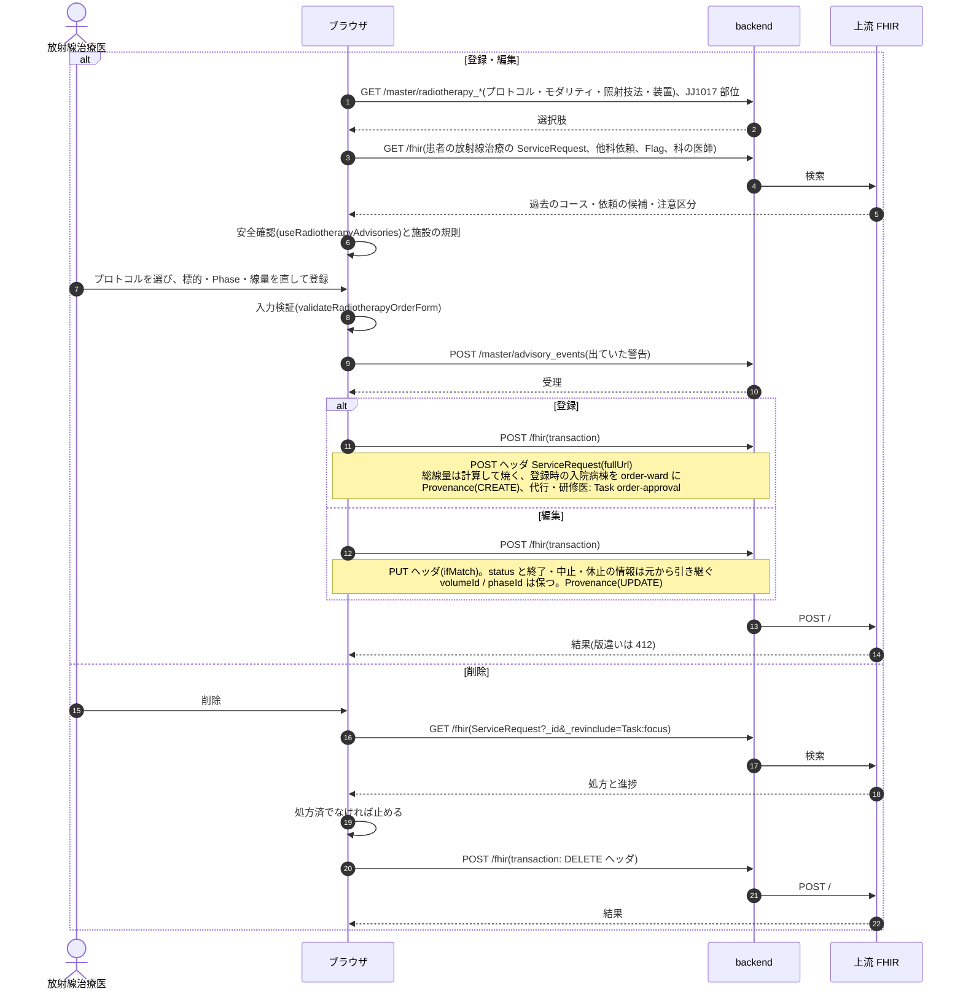
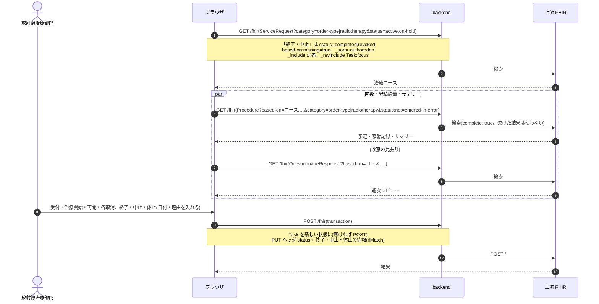
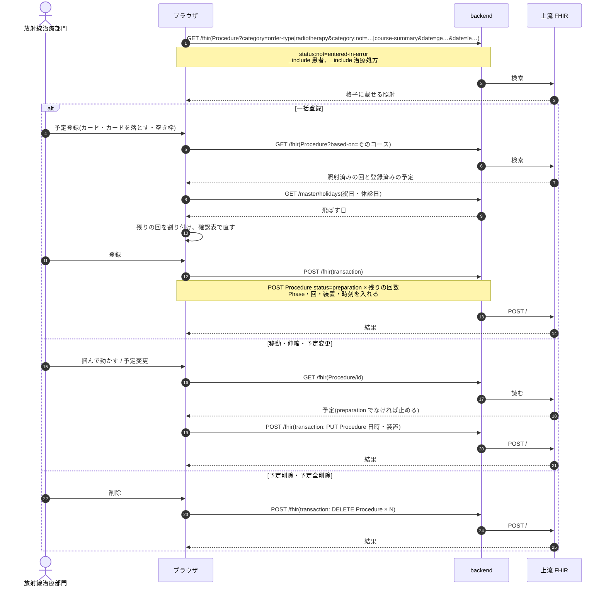
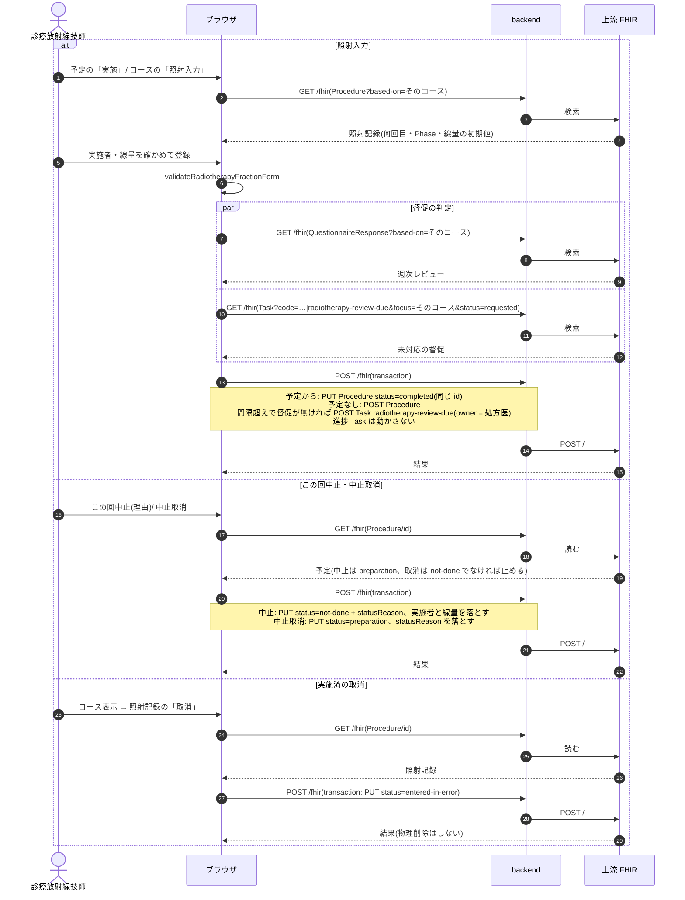
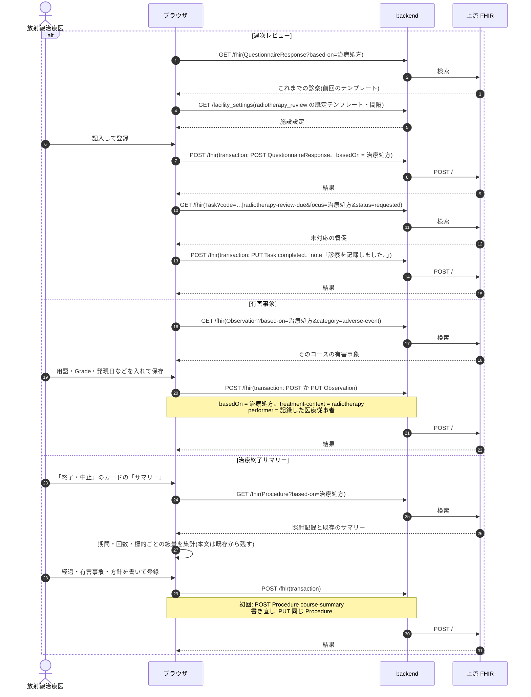

# 放射線治療のシーケンス図

<!-- ../fhir-client/docs/order-flows/radiotherapy.md から scripts/sync-flows.mjs で作る。直接編集しない。 -->

運用の流れは[放射線治療の業務フロー](../flows/radiotherapy.md)にあります。

## リソースの構成

| もの | リソース | 要点 |
|---|---|---|
| 治療処方(ヘッダ) | `ServiceRequest` | `category` = `order-type|radiotherapy` + `prescription-setting`、`code` = `radiotherapy-order|course-prescription`、`occurrenceDateTime` = 開始予定日、`performer` = 担当医(任意)、`bodySite[]` = 標的の部位の写し(JJ1017 部位・左右)、`reasonReference` = 対象プロブレム。明細は持たない |
| コース・標的・Phase | ヘッダの拡張 | `radiotherapy-course`(courseNumber・intent・concurrentTherapy・protocol、終了・中止の `endedOn` / `terminationReason` / `terminationNote`、休止の `suspendedOn` / `suspensionReason` / `suspensionNote`)、`radiotherapy-volume` ×N(volumeId・label・type・bodySite)、`radiotherapy-phase` ×N(phaseId・status・modalityAndTechnique・device・fractionsPrescribed・fractionsPerWeek・dosePrescribedToVolume) |
| 元の依頼 | ヘッダの拡張 | `radiotherapy-consult-request`(他科依頼の `ServiceRequest`)。逆向きは書かず、タイムラインが逆引きする(`karteTimeline.ts` の `radiotherapyByConsultId`) |
| 進捗 | `Task`(`task-code|radiotherapy`、`focus` = ヘッダ) | **登録時には作らず**、Task が無い処方は処方済 |
| 照射予定・照射記録 | `Procedure`(`basedOn` = ヘッダ) | `category` = `order-type|radiotherapy` + `radiotherapy-procedure|fraction`。`status` = `preparation`(予定)/ `completed`(実施)/ `not-done`(この回中止、`statusReason`)/ `entered-in-error`(取消)。`code` = Phase の照射技法の写し、`performedPeriod`(時刻なしは `performedDateTime`)、`performer` = 実施者、`usedCode` = 装置、拡張 `radiotherapy-fraction`(phaseId・fractionNumber・imageGuidance・doseDeliveredToVolume) |
| 治療終了サマリー | `Procedure`(`basedOn` = ヘッダ、1 コースに 1 件) | `category` に `radiotherapy-procedure|course-summary`。`status` = `completed`(完遂)/ `stopped`、`performedPeriod` = 初回〜最終照射日、`outcome`、拡張 `radiotherapy-course-summary` |
| 週次レビュー | `QuestionnaireResponse`(`basedOn` = ヘッダ) | 通常のテンプレート回答。上流の `based-on` 検索で集める |
| 有害事象 | `Observation`(`category` = `adverse-event`、`basedOn` = ヘッダ) | `valueInteger` = Grade、`effectivePeriod` = 発現〜回復、拡張 `treatment-context`(type = radiotherapy)。化学療法と共通 |
| 診察の督促 | `Task`(`task-code|radiotherapy-review-due`、`focus` = ヘッダ、`owner` = 処方医) | 通知レジストリの `radiotherapy-review-due` |
| 代行入力 | `Provenance`(`target` = ヘッダ) | 種別共通 |

- Phase を子の `ServiceRequest` にしないのは、「`basedOn` を持たない `ServiceRequest` = オーダーのヘッダ」という前提を崩さないためです。同じ理由で元の依頼も `basedOn` ではなく拡張です。
- `volumeId` / `phaseId` は照射記録が指す安定キーです。編集では保ち、DO では振り直します(`buildDoRadiotherapyOrderForm`)。
- 線量は Gy(UCUM)。0.1 刻みの掛け算・足し算は cGy の整数にしてから行います(`radiotherapyTotalDose`、`radiotherapyProgress`)。
- 回数・累積線量・実施日の集計は `preparation` を数えません。

## 進捗 Task と status

他科依頼と同じく、**Task の遷移と同じ transaction で `ServiceRequest.status` も動かします**(`radiotherapyOrderStatusFor`)。上流の `order-period` 検索は終了日の拡張 URL が 4 種別に固定されていて使えないので、部門の一覧は status で切ります。
表示の正本は Task(処方済・計画中・治療中は status では区別できない)、status は一覧を引くための索引です。書き込みの入口は `useUpdateRadiotherapyTaskStatus` だけです。

| Task | 表示 | `ServiceRequest.status` | ヘッダに書くもの |
|---|---|---|---|
| (無し)/ `requested` | 処方済 | `active` | – |
| `accepted` | 計画中 | `active` | – |
| `in-progress` | 治療中 | `active` | 休止・終了・中止の情報を落とす |
| `on-hold` | 休止 | `on-hold` | `suspendedOn` / `suspensionReason` / `suspensionNote` |
| `completed` | 終了 | `completed` | `endedOn` |
| `cancelled` | 中止 | `revoked` | `endedOn` / `terminationReason` / `terminationNote` |

遷移の表は `radiotherapyTaskActions`(`fhir/radiotherapyTaskHelpers.ts`)、ヘッダの PUT は `buildRadiotherapyOrderStatusEntry` です。
照射しても Task は動かしません(リハビリ・栄養指導と同じ期間継続型)。`executionPeriod` は受付で `start`、終了で `end` が入ります。休止中は `end` を入れず、処方済に戻すときと中止では落とします(`createTaskHelpers` の `buildTaskUpdate`)。

## シーケンス図の前提

`/fhir` への書き込みはどれも 1 回の transaction Bundle で、backend の `FhirProxyController` が上流へ中継します。
SS-MIX2 を有効にしている施設では、中継が書き込みの控えを記録します(`Ssmix2::Recorder`。放射線治療はメッセージになりません)。
楽観ロックの版は `postBundle` が `ifMatch` に添え、版が違えば 412 で止まります。照射記録の PUT(実施・この回中止・中止取消・取消・予定変更)は、手元の写しではなく読み直した版を土台にします。

| 部品 | 場所 |
|---|---|
| 治療処方のフォーム | `components/RadiotherapyOrderForm.tsx`・`RadiotherapyOrderPanels.tsx`、安全確認 `RadiotherapyPreCheck.tsx` |
| 組み立て | `fhir/radiotherapyOrderHelpers.ts`(処方)・`radiotherapyTaskHelpers.ts`(進捗)・`radiotherapyResultHelpers.ts`(予定・照射記録)・`radiotherapySummaryHelpers.ts`(サマリー)・`radiotherapyReviewHelpers.ts`(週次レビュー・督促) |
| 部門の画面 | `pages/RadiotherapyWorklistPage.tsx`(`/radiotherapy-worklist`)、格子 `components/RadiotherapyCalendar.tsx` |
| モーダル | 照射入力 `RadiotherapyPerformModal.tsx`、一括登録 `RadiotherapyPlanModal.tsx`、空き枠 `RadiotherapySlotModal.tsx`、サマリー `RadiotherapyCourseSummaryModal.tsx`、詳細 `RadiotherapyOrderDetailPanel.tsx` |
| カルテの右ペイン | 週次レビュー `RadiotherapyReviewPanel.tsx`、有害事象 `RadiotherapyAdverseEventPanel.tsx`(フォームは `AdverseEventEditor`) |
| hook | `api/queries/radiotherapy.ts`、有害事象 `api/queries/adverseEvent.ts` |
| マスタ | `/master/radiotherapy_{modalities,techniques,devices,stop_reasons,protocols}`(`api/masterClient/radiotherapy.ts`・`api/masterQueries/radiotherapy.ts`)、画面は「マスタメンテ > 放射線治療」 |
| 通知 | `components/notifications/notificationRegistry.tsx` の `radiotherapy-review-due` |

## 治療処方の登録・編集・削除

`buildRadiotherapyOrderBundle` / `buildRadiotherapyOrderUpdateBundle` / `buildRadiotherapyOrderDeleteBundle`、`useCreatePrescription`(`api/queries/labResult.ts`。全種別共通)、`useUpdateRadiotherapyOrder`、`deleteRadiotherapyOrderRequest`。

## 部門の一覧と進捗の変更

`useRadiotherapyWorklist`、`useRadiotherapyProcedures`(表示中のコースの id を `based-on` に 20 件ずつ並べる)、`useRadiotherapyReviews`、`useUpdateRadiotherapyTaskStatus`。

## 照射予定の一括登録・移動・削除

`useRadiotherapyCalendar`、`useRadiotherapyCourseFractions`(モーダルを開く前にそのコースだけ引き直す)、`draftRadiotherapyPlan` / `buildRadiotherapyPlanBundle`、`useRegisterRadiotherapyPlan`、`useRescheduleRadiotherapyFraction`、`useDeleteRadiotherapyPlanned`。

## 照射入力・この回中止・取消

`nextRadiotherapyFractionForm` / `radiotherapyFractionFormFromPlanned`、`buildRadiotherapyFractionBundle`、`useRegisterRadiotherapyFraction`(督促の判定を同じ transaction に積む)、`useMarkRadiotherapyFractionNotDone`、`useRestoreRadiotherapyFraction`、`useCancelRadiotherapyFraction`。

## 週次レビュー・有害事象・治療終了サマリー

`useRadiotherapyCourseReviews`、`useCreateQuestionnaireResponse`(`api/queries/patientProfile.ts`)、`useCloseRadiotherapyReviewDue`、`useTreatmentAdverseEvents` / `useSaveAdverseEvent`、`draftRadiotherapyCourseSummary` / `buildRadiotherapyCourseSummaryBundle`、`useSaveRadiotherapyCourseSummary`。
カレンダーと通知からはカルテへ `open=radiotherapy-review:<id>` 付きで飛び、右ペインが開いた状態になります。

## 医事会計と SS-MIX2

放射線治療は照射記録から集めます(`BillingClaimBuilder` の `:procedure` 経路、`Resolvers::Radiotherapy`)。照射 1 回 = 1 剤で、体外照射のコードは照射記録の照射技法から照射技法マスタの `receipt_code`(その日の 1 回目)・`receipt_code_second`(同じ日の 2 回目)を引きます。
コースの初回の照射(その日より前に完了した照射が無い日)には、照射技法マスタの `management_receipt_code`(放射線治療管理料)と、治療処方の標的から組んだ照射部位のコメント(施設設定 `receipt_codes.radiotherapy.site_comment`)を添えます。
期間継続型(`continuous`)なので、照射記録の無い日のヘッダは報告しません。診療行為の区分は 840 です。

| 起きたこと | 医事会計(`BillingClaimBuilder`) | SS-MIX2 |
|---|---|---|
| 治療処方の登録・編集・削除 | なし | なし(`OMG^O19` の対象外) |
| 受付・治療開始・休止・終了・中止 | なし | なし |
| 照射予定の登録・変更・削除 | なし(`preparation` は集めない) | なし |
| 照射(実施) | 照射日に体外照射を送る。初回は放射線治療管理料と照射部位のコメントも。照射技法が無い・マスタにコードが無いときは「送れない項目」に出す | なし(`OMI^Z23` の対象外) |
| この回中止 | 「実施せずと記録されています」と報告(送らない) | なし |
| 照射の取消 | 対象から外れる(`entered-in-error`) | なし |
| 週次レビュー・有害事象 | なし | なし |
| 治療終了サマリー | 送らない(照射でないハブは resolver が読み飛ばす) | なし |

- DPC の判定では、照射記録があることを手術・処置等のダミーコード `0008`(放射線療法)の根拠に使います。看護必要度は、コードで拾えない放射線治療を実施記録から補います。
