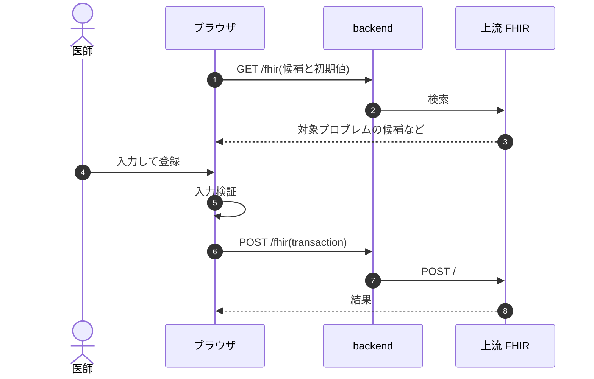
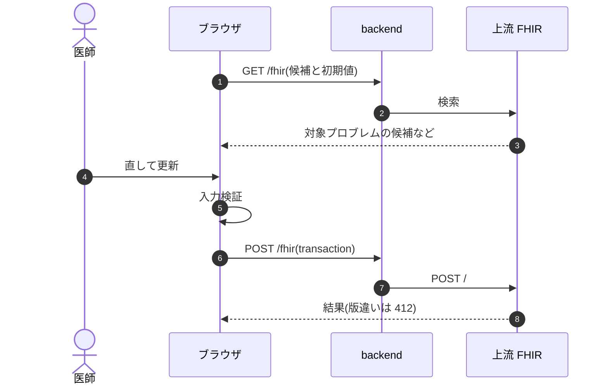
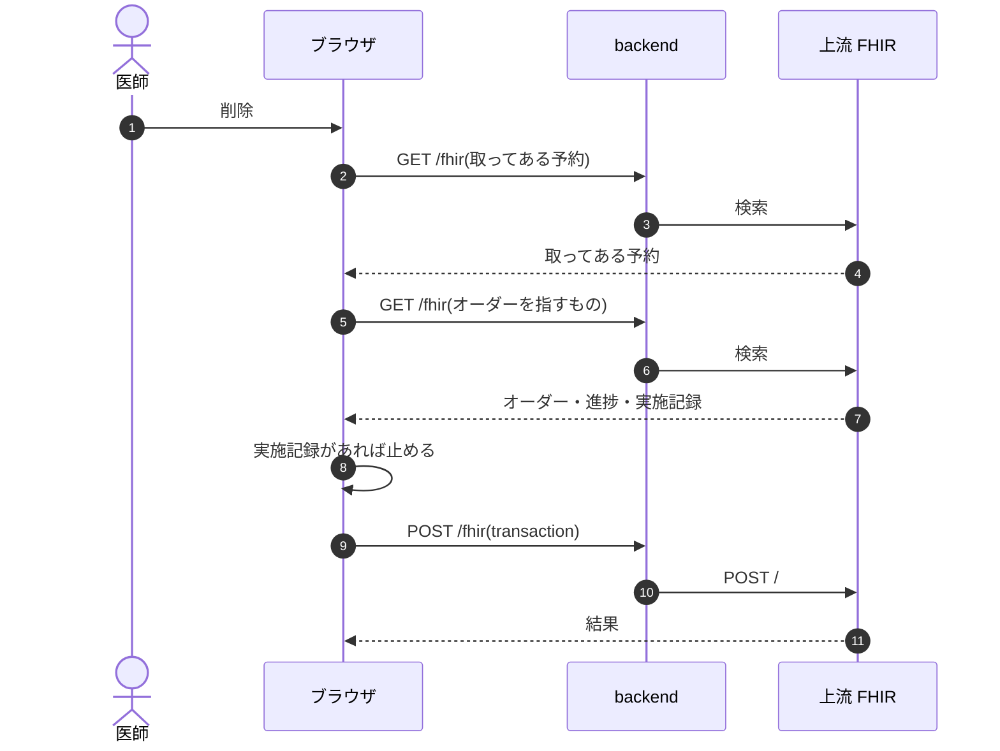
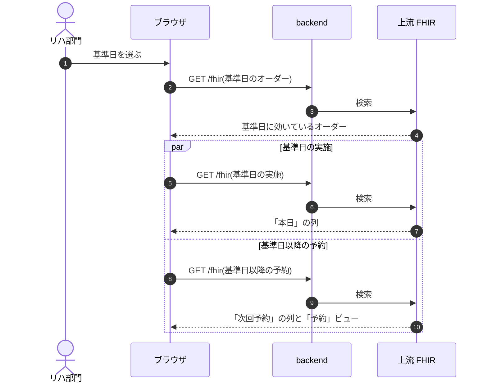
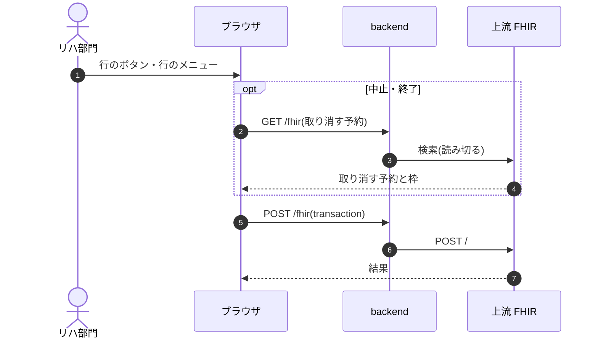
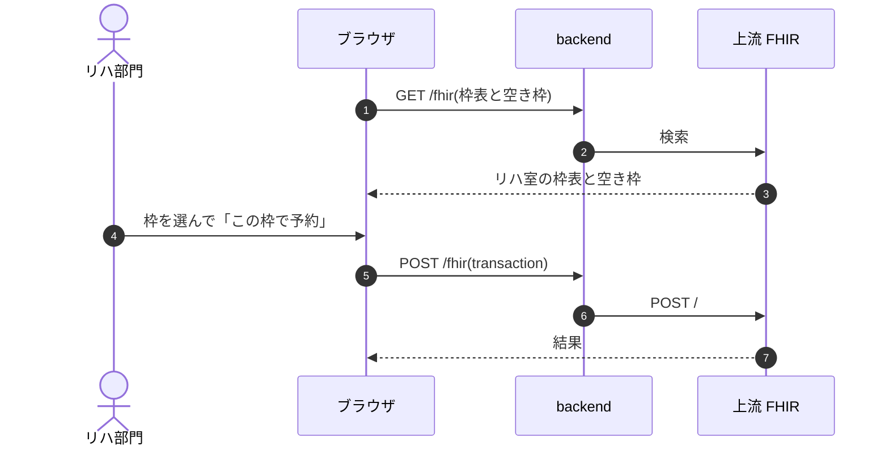
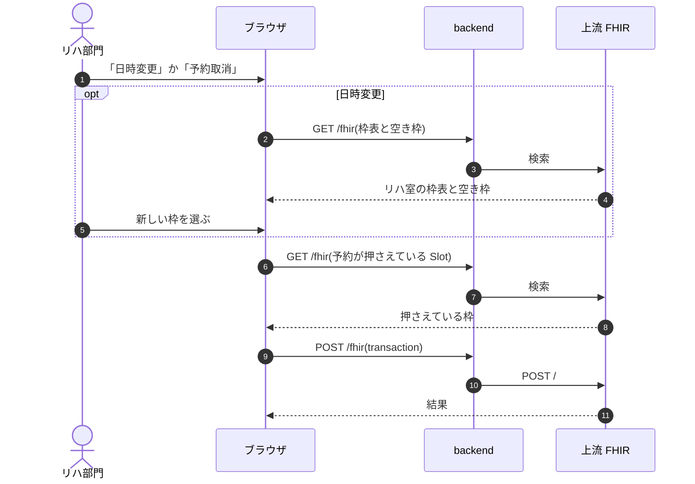
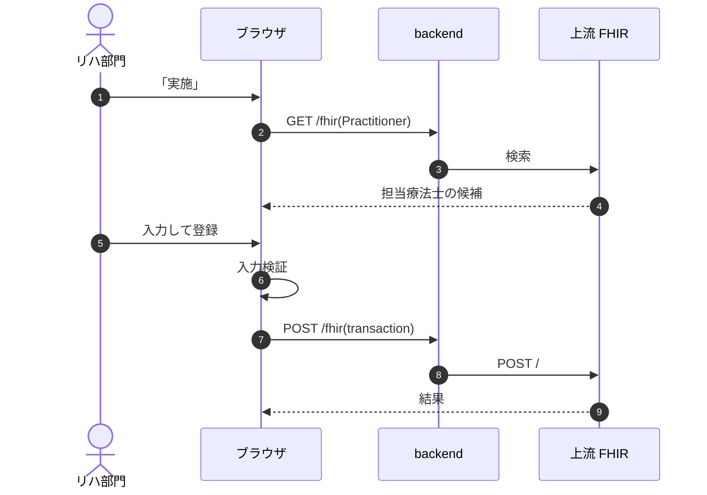
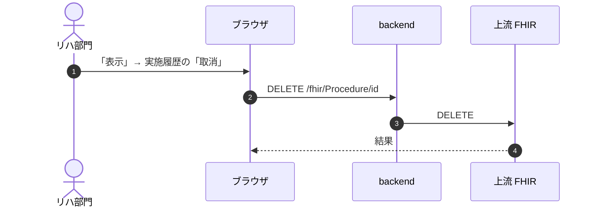
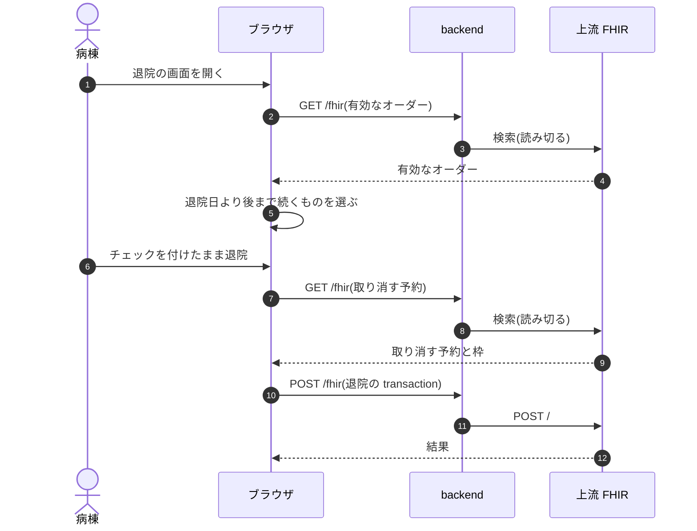

# リハビリオーダーのシーケンス図

<!-- ../fhir-client/docs/order-flows/rehab.md から scripts/sync-flows.mjs で作る。直接編集しない。 -->

運用の流れは[リハビリオーダーの業務フロー](../flows/rehab.md)にあります。

## シーケンス図の前提

- **書き込みの経路**: `/fhir` への書き込みはどれも 1 回の transaction Bundle で、backend の `FhirProxyController` が上流へ中継します。
- **上流**: backend の先にある FHIR サーバーのことです。図では「上流 FHIR」と書きます。
- **応答の中継は省く**: 図の `FHIR-->>UI` は、上流の応答を backend がそのままブラウザへ返すことを表します。
- **ヘッダ**: オーダー本体の `ServiceRequest` のことです。ほかの種別と呼び名を揃えていますが、リハビリは明細を持たず、ヘッダ 1 本だけです。
- **全ページを読み切る検索**: 取りこぼすと困る検索は `searchAllPages` に `complete: true` を渡し、上限までに読み切れなければ例外にして書き込みを止めます。`strict: true` は、検索の条件が効かずに全件が返るのを拾わないための指定です。
- **楽観ロック**: 版は `postBundle` が `ifMatch` に添え、版が違えば 412 で止まります。編集フォームは `useEditSnapshot` で開いた時点の版に固定します(`hooks/useRehabOrderInitialValues.ts`)。
- **SS-MIX2**: 有効にしている施設では、中継が書き込みの控えを記録します(`Ssmix2::Recorder`)。リハビリはメッセージになりません。

## リソースの構成

- ヘッダ `ServiceRequest`(オーダー。明細は持たない)
  - `Task`(進捗。`focus` = ヘッダ)
  - `Procedure`(実施記録。`basedOn` = ヘッダ。実施 1 回に 1 件)
  - `Appointment`(予約。`basedOn` = ヘッダ)+ `Slot`
  - `Provenance`(代行入力。`target` = ヘッダ。種別共通)

| リソース | 要素 | 中身 |
|---|---|---|
| ヘッダ `ServiceRequest` | `category` | `order-type|rehab` + `prescription-setting` |
| | `code` | 疾患別リハ区分(`rehab-disease-category`) |
| | `orderDetail[]` | 療法種別(`rehab-therapy-type`: pt / ot / st) |
| | `quantityQuantity` | 1 回あたりの単位数(unit「単位」、UCUM なし) |
| | `occurrenceDateTime` | 開始日(日付のみ) |
| | `reasonReference` | 対象プロブレム |
| | 拡張 `rehab-order-end` | 終了日。無ければ継続中 |
| | 拡張 `rehab-onset-date` | 起算日 |
| | 拡張 `rehab-target-disease` | 対象疾患名 |
| | 拡張 `rehab-frequency-per-week` | 週あたりの回数 |
| `Task` | `code` | `task-code|rehab` |
| | `status` | 部門の受け入れ状態(→「進捗 Task と status」) |
| `Procedure` | `category` | `order-type|rehab` |
| | `status` | `completed` |
| | `code` | 実施した療法種別 |
| | `performedDateTime` | 実施日時(時刻なしは日付のみ) |
| | `performer` | 担当療法士 |
| | 拡張 `rehab-performed-units` | 実施単位数 |
| | `note` | 訓練内容 |
| `Appointment` | `basedOn` | ヘッダ。1 予約 1 枠 |
| `Schedule`(枠表) | `serviceType` | `schedule-service-type|rehab` |
| | `actor` | リハ室の `Location` |

- **Task を作る時期**: 登録時には作りません。Task が無いオーダーは依頼済です。
- **実施の取消**: `Procedure` を DELETE します。
- **枠の定員**: 1 に丸めません(同じ時間帯に複数の患者を受け入れる)。
- **期間の持ち方**: 期間を `occurrencePeriod` にせず開始日 + 拡張にするのは、上流が `occurrenceDateTime` を索引するためです(食事の `meal-order-end` と同じ判断)。上流は `order-period` で開始日と `rehab-order-end` を合わせて索引しています。
- **週あたりの回数**: `occurrenceTiming` にしないのは、`occurrence[x]` が choice で、開始日の `occurrenceDateTime` と併用できないためです。
- **療法種別**: 明細の `ServiceRequest` にしないのは、療法ごとに量が分かれないためです(単位数はオーダー全体で 1 つ)。

## 進捗 Task と status

**実施しても Task を動かしません。** 他部門の実施は「実施記録 + Task を completed に」を 1 つの transaction にしますが、リハビリで同じにすると初日の実施で終了扱いになり、2 日目以降が実施できなくなります。
この逸脱は他部門の実施入力と作りが違う唯一の点です。実施ボタンを他部門と同じ形に揃えるリファクタをしないでください(`fhir/rehabTaskHelpers.ts`・`rehabResultHelpers.ts` の冒頭コメント)。

| Task | 表示 | `ServiceRequest.status` | ヘッダに書くもの |
|---|---|---|---|
| (無し)/ `requested` | 依頼済 | `active` | – |
| `accepted` | 実施中 | `active` | – |
| `completed` | 終了 | `active` のまま | `rehab-order-end`(終了日) |
| `cancelled` | 中止 | `revoked` | – |

- **遷移と入口**: 遷移の表は `rehabTaskActions`、書き込みの入口は `useUpdateRehabTaskStatus`(`api/queries/rehab.ts`)です。
- **中止とヘッダ**: 中止・中止取消は `orderCancelEntries` でヘッダの status を揃えます。
- **終了で終了日を書く理由**: 部門一覧が `order-period` で引くので、終了日が無いと status=active のまま基準日に永久にヒットし続けるためです(`buildRehabOrderCloseEntry`)。終了取消では消しません(意図した非対称)。
- **`executionPeriod`**: 受付で `start`、終了で `end` が入ります(`createTaskHelpers` の `buildTaskUpdate`)。
- **カルテのタイムライン**: 他部門が `completed` のときだけ実施情報を出すのに対し、リハビリは `accepted` / `completed` で出します(`karteTimeline.ts` の rehab 分岐)。

**予約の取消**

- 終了・中止・退院は、もう来ない日の有効な予約の取消を同じ transaction に積みます(`fetchOrderAppointmentCancelEntries` の `from`)。過ぎた予約は残します。
- 取り消す対象の検索は、全ページを読み切る検索(`complete: true`)で、`strict: true` も付けます。条件が効かずに全件を拾うと、関係ない予約まで取り消すためです。
- 読み切れなかったときは書き込みを止めます。

## 部品

| 操作 | 画面 | 組み立て | hook |
|---|---|---|---|
| 登録 | `components/RehabOrderForm.tsx`・`RehabOrderPanels.tsx` | `buildRehabOrderBundle`(`fhir/rehabOrderHelpers.ts`) | `useCreatePrescription`(`api/queries/labResult.ts`。名前と違い全種別共通) |
| 編集 | 同じフォーム | `buildRehabOrderUpdateBundle` | `useUpdateRehabOrder`(`api/queries/rehab.ts`) |
| 削除 | – | `deleteRehabOrderRequest` | `useDeleteRehabOrder`。送信は `postOrderDeleteBundle`(`api/queries/orderDelete.ts`) |
| 詳細とカード | `RehabOrderDetailPanel.tsx`、カード `karteCardBodies/RehabOrderCardBody.tsx` | – | `useRehabOrderDetail` |
| 部門の一覧 | `pages/RehabWorklistPage.tsx`(`/rehab-worklist`。依頼・予約の 2 ビュー、終了のモーダル) | – | `useRehabWorklist` |
| 状態の変更 | 同じ画面 | `fhir/rehabTaskHelpers.ts` | `useUpdateRehabTaskStatus` |
| 次回予約・日時変更 | `RehabBookModal.tsx`(枠選びは `AppointmentSlotPicker` の `scheduleType="rehab"`) | `buildRehabAppointmentBundle`(`fhir/appointmentHelpers.ts`) | `useBookRehabAppointment`、`useRescheduleAppointment`(`api/queries/appointment.ts`) |
| 予約取消 | 同じ画面とカルテの予約タブ | – | `useCancelAppointment`(`api/queries/appointment.ts`) |
| 実施 | `components/RehabPerformModal.tsx` | `buildRehabPerformBundle`(`fhir/rehabResultHelpers.ts`) | `useRegisterRehabPerform` |
| 実施の取消 | 部門の一覧の「表示」 | – | `useDeleteRehabPerform` |
| 退院での打ち切り | `components/DischargeModal.tsx` | `buildRehabOrderStopEntries`(退院の transaction に積む) | `usePatientRehabOrders`、`api/queries/encounter.ts` |
| パスからの実施 | `components/PathwayOrderModal.tsx` | `RehabPerformModal` に `acceptTask` を渡す | – |

`PathwayOrderModal.tsx` は、`TPRH` の実施のときに `RehabPerformModal` に `acceptTask` を渡します。

## 登録・編集・削除

**登録**

| 段 | 中身 |
|---|---|
| 候補と初期値の検索 | 患者の `Condition`(対象プロブレムの候補)、入院中の `Encounter`(入外区分の初期値) |
| 入力 | 区分・療法・単位数・期間・対象疾患 |
| 入力検証 | `validateRehabOrderForm` |
| transaction | POST ヘッダ `ServiceRequest`(fullUrl)、`Provenance`(CREATE) |
| 代行・研修医のとき | `Task` order-approval を同じ transaction に足す |

**編集**

| 段 | 中身 |
|---|---|
| 候補と初期値の検索・入力検証 | 登録と同じ |
| transaction | PUT ヘッダ(`ifMatch`。開いた時点の版)、`Provenance`(UPDATE) |
| 元が `revoked` のとき | `revoked` のまま書く(`keepOrderRevoked`) |

**削除**

| 段 | 中身 |
|---|---|
| 取ってある予約の検索 | `Appointment?based-on=オーダー&status=有効` |
| オーダーを指すものの検索 | `ServiceRequest?_id&_revinclude=Task:focus,Procedure:based-on,…` |
| transaction | PUT `Appointment` cancelled + `Slot` free(予約ごと)、DELETE `Task`、DELETE ヘッダ |

## 部門の一覧と進捗の変更

**一覧を開く**

| 検索 | 条件 |
|---|---|
| 基準日のオーダー | `ServiceRequest?category=order-type|rehab&status=active,revoked`、`order-period=ge基準日&order-period=le基準日`、`based-on:missing=true`、`_include` 患者、`_revinclude` `Task:focus` |
| 基準日の実施 | `Procedure?category=order-type|rehab&date=基準日` |
| 基準日以降の予約 | `Appointment?date=ge基準日&service-type=…|rehab&status=有効&_sort=date` |

- オーダーは `fetchWorklistBundles` で 500 件ずつ読みます。
- 一覧・実施・予約のどれかが上限で欠けたら `truncated` を出します。

**状態の変更**

書き込みは操作 1 回につき transaction 1 回です。中止と終了は、先に取り消す予約を読んでから、同じ transaction にまとめます。

| 操作 | 取り消す予約の検索 | transaction |
|---|---|---|
| 受付・受付取消・終了取消 | なし | `Task` を新しい状態に(無ければ POST) |
| 中止 | `Appointment?based-on=オーダー&date=ge今日&status=有効` | `Task` を cancelled に、PUT ヘッダ status=revoked、予約の取消 |
| 中止取消 | なし | `Task` を requested に、PUT ヘッダ status=active(`ifMatch`) |
| 終了(行のメニューの「終了」→ 終了日) | `Appointment?based-on=オーダー&date=ge終了日の翌日&status=有効` | PUT `Task` completed(`executionPeriod.end`)、PUT ヘッダ `rehab-order-end` = 終了日(`ifMatch`)、予約の取消 |

予約の取消は、予約ごとに PUT `Appointment` cancelled + `Slot` free です。検索は `strict: true`・`complete: true` です。

## 予約・日時変更・取消

オーダー登録とは独立した単独の transaction です。枠を選ぶ操作は、先にリハ室の枠表と空き枠を読みます(`Schedule?service-type=…|rehab`、`Slot?schedule=…&status=free`)。

**次回予約**

**日時変更・予約取消**

「日時変更」「予約取消」は、リハビリ一覧の「予約」ビューとカルテの予約タブから行います。

| 操作 | transaction |
|---|---|
| 次回予約 | POST `Appointment`(`basedOn` = オーダー、患者・リハ室)、PUT `Slot` busy |
| 日時変更 | PUT `Appointment` 日時・枠、前の `Slot` free、新しい `Slot` busy |
| 予約取消 | PUT `Appointment` cancelled、`Slot` free |

## 実施・実施の取消・退院での打ち切り

**実施**

| 段 | 中身 |
|---|---|
| 「実施」 | 「予約」ビューか「依頼」ビューの行から開く |
| 入力 | 療法・単位数・担当療法士・訓練内容 |
| 入力検証 | `validateRehabPerformForm` |
| transaction | POST `Procedure`(`basedOn` = オーダー)。進捗 `Task` は動かさない |
| パスから依頼済のオーダーを実施したとき | `Task` accepted も同じ transaction に入れる |

**実施の取消**

実施記録は消します。`entered-in-error` にして残すことはしません。

**退院での打ち切り**

| 段 | 中身 |
|---|---|
| 有効なオーダーの検索 | `ServiceRequest?subject=患者&category=order-type|rehab&status=active`。`complete: true` で、欠けた結果は使わない(`usePatientRehabOrders`) |
| 止めるオーダーを選ぶ | `rehabOrderNeedsStop` |
| 取り消す予約の検索 | `Appointment?based-on=オーダー&date=ge退院日の翌日&status=有効` を、選んだオーダーごとに。`strict: true`・`complete: true` |
| transaction | `Encounter`・ベッドの更新、食事の打ち切りと一緒に、PUT ヘッダ `rehab-order-end` = 退院日、予約ごとに PUT `Appointment` cancelled + `Slot` free |
| 進捗 | `Task` は動かさない |

## 医事会計と SS-MIX2

リハビリは実施記録から集めます(`BillingClaimBuilder` の `:procedure` 経路、`Resolvers::Rehab`)。

- **送る単位**: 実施 1 件 = 1 剤です。同じ日に PT と OT があれば剤が 2 つになります。
- **コードと数量**: コードは施設設定の `receipt_codes.rehab`(疾患別リハ区分 × 療法)から引き、数量は実施単位数です。
- **コメント**: 区分ごとに施設設定で疾患名のコメント(830 系)・発症年月日のコメント(850 系)のコードを入れておくと、オーダーの対象疾患名と起算日から組んで添えます。
- **実施の無い日**: 期間継続型(`OrderCatalog` の `continuous`)なので、実施記録の無い日のオーダーを「実施記録がありません」とは報告しません。
- **診療種別区分**: 日レセの診療種別区分は 800 です。

医事会計に送るのは実施だけです。登録・編集・削除、受付・終了・中止・退院での打ち切り、予約・日時変更・取消では何も送りません。SS-MIX2 のメッセージはどの操作でも作りません(`OMG^O19` の対象外)。

| 起きたこと | 医事会計(`BillingClaimBuilder`) |
|---|---|
| 実施 | 実施日に送る |
| 実施の取消 | 対象から外れる(DELETE) |

実施を送れないときは、次のように報告します。

- 区分・療法が無い、または施設設定にコードが無いときは「送れない項目」に出します。
- コメントのコードがあるのに、オーダーに対象疾患名・起算日が無いときも、その旨を出します。

DPC の判定では、実施記録があることを手術・処置等のダミーコード `0007`(リハビリテーション)の根拠に使います(`Dpc::DummyRules`)。
