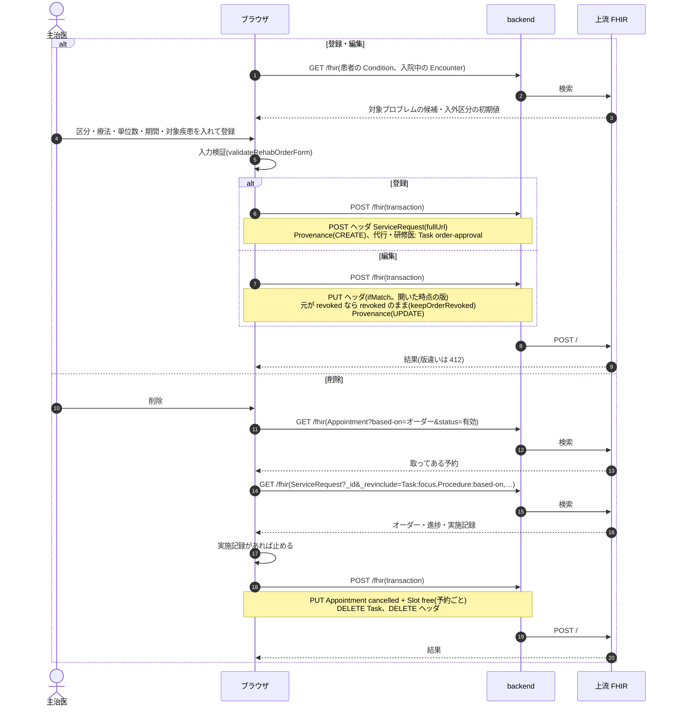
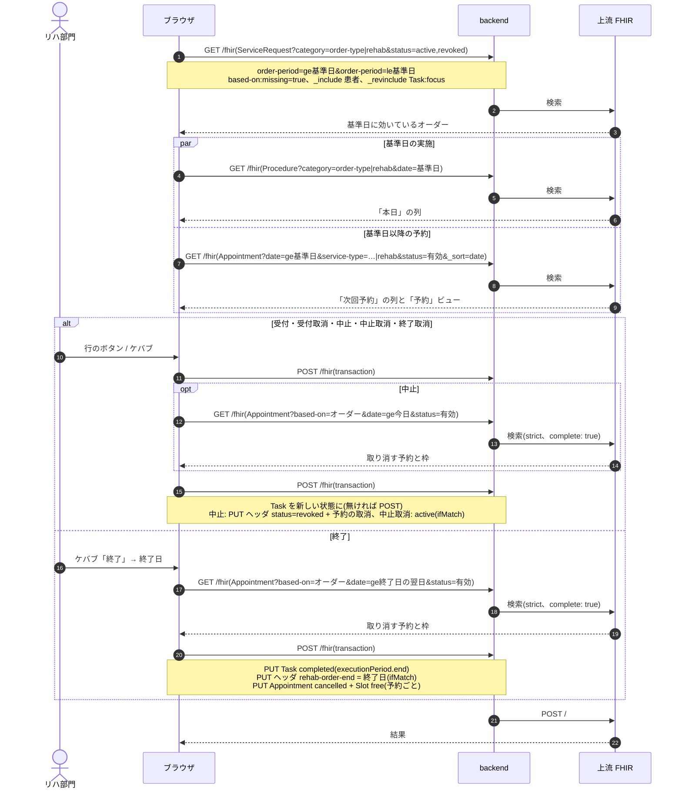
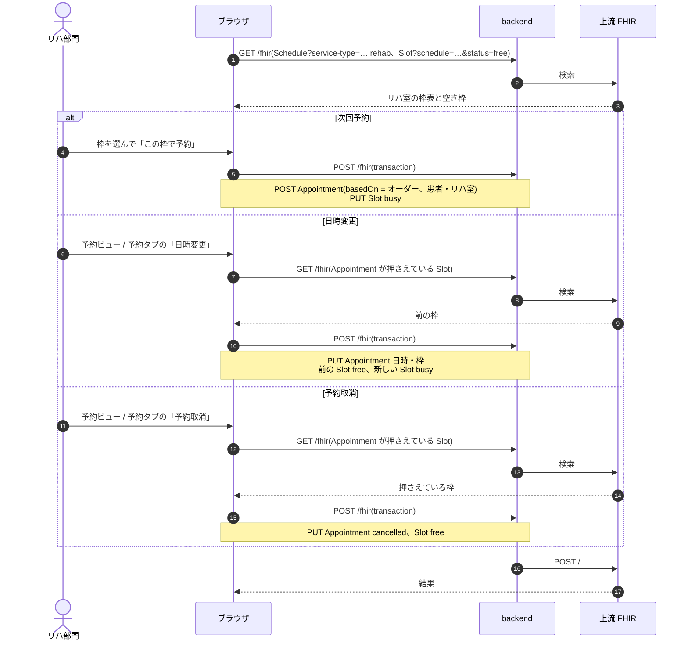
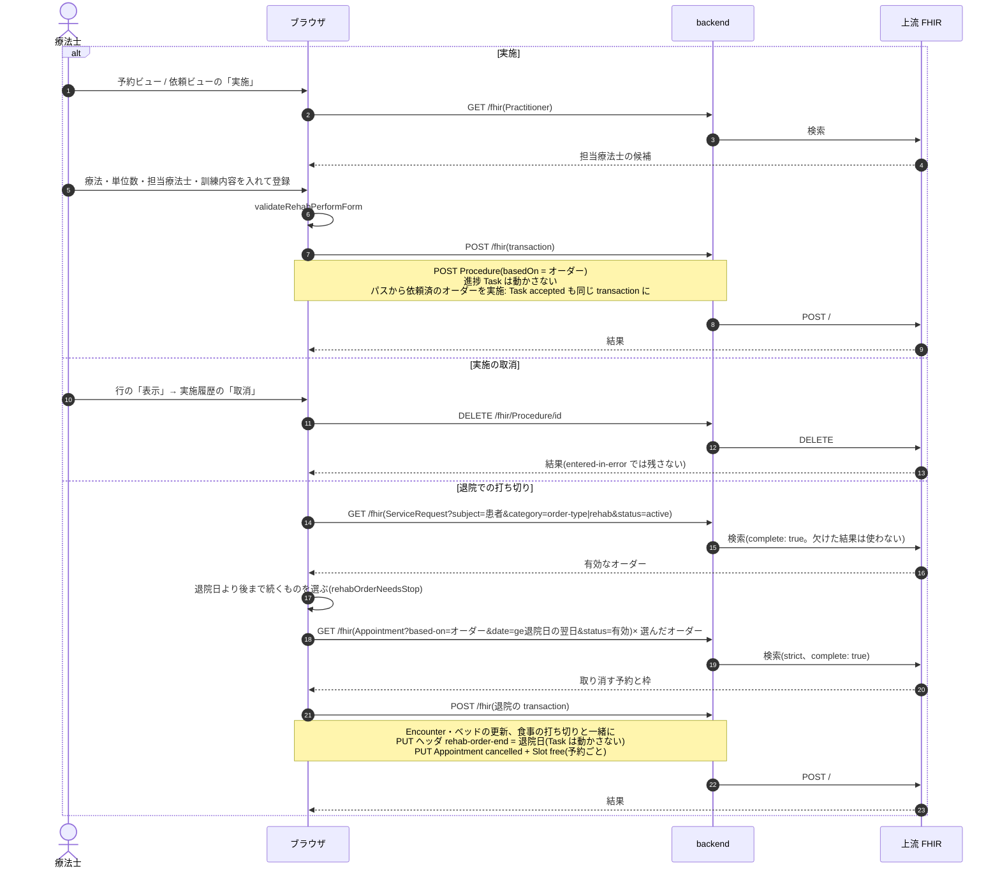

# リハビリオーダーのシーケンス図

<!-- ../fhir-client/docs/order-flows/rehab.md から scripts/sync-flows.mjs で作る。直接編集しない。 -->

運用の流れは[リハビリオーダーの業務フロー](../flows/rehab.md)にあります。

## リソースの構成

| もの | リソース | 要点 |
|---|---|---|
| オーダー(ヘッダ) | `ServiceRequest` | `category` = `order-type|rehab` + `prescription-setting`、`code` = 疾患別リハ区分(`rehab-disease-category`)、`orderDetail[]` = 療法種別(`rehab-therapy-type`: pt / ot / st)、`quantityQuantity` = 1 回あたりの単位数(unit「単位」、UCUM なし)、`occurrenceDateTime` = 開始日(日付のみ)、`reasonReference` = 対象プロブレム。明細は持たない |
| 期間・対象 | ヘッダの拡張 | `rehab-order-end`(終了日。無ければ継続中)、`rehab-onset-date`(起算日)、`rehab-target-disease`(対象疾患名)、`rehab-frequency-per-week`(週あたりの回数) |
| 進捗 | `Task`(`task-code|rehab`、`focus` = ヘッダ) | **登録時には作らず**、Task が無いオーダーは依頼済。部門の受け入れ状態を表す |
| 実施記録 | `Procedure`(`basedOn` = ヘッダ) | `category` = `order-type|rehab`、`status` = `completed`、`code` = 実施した療法種別、`performedDateTime`(時刻なしは日付のみ)、`performer` = 担当療法士、拡張 `rehab-performed-units` = 実施単位数、`note` = 訓練内容。取消は DELETE |
| 予約 | `Appointment`(`basedOn` = ヘッダ) + `Slot` | 枠表は `Schedule`(`serviceType` = `schedule-service-type|rehab`、`actor` = リハ室の `Location`)。1 予約 1 枠、定員は 1 に潰さない |
| 代行入力 | `Provenance`(`target` = ヘッダ) | 種別共通 |

- 期間を `occurrencePeriod` にせず開始日 + 拡張にするのは、上流が `occurrenceDateTime` を索引するため(食事の `meal-order-end` と同じ判断)。上流は `order-period` で開始日と `rehab-order-end` を合わせて索引しています。
- 週あたりの回数を `occurrenceTiming` にしないのは、`occurrence[x]` が choice で開始日の `occurrenceDateTime` と併用できないためです。
- 療法種別を明細の `ServiceRequest` にしないのは、療法ごとに量が分かれないためです(単位数はオーダー全体で 1 つ)。

## 進捗 Task と status

**実施しても Task を動かしません。** 他部門の実施は「実施記録 + Task を completed に」を 1 つの transaction にしますが、リハビリで同じにすると初日の実施で終了扱いになり、2 日目以降が実施できなくなります。
この逸脱は他部門の実施入力と作りが違う唯一の点です。実施ボタンを他部門と同じ形に揃えるリファクタをしないでください(`fhir/rehabTaskHelpers.ts`・`rehabResultHelpers.ts` の冒頭コメント)。

| Task | 表示 | `ServiceRequest.status` | ヘッダに書くもの |
|---|---|---|---|
| (無し)/ `requested` | 依頼済 | `active` | – |
| `accepted` | 実施中 | `active` | – |
| `completed` | 終了 | `active` のまま | `rehab-order-end`(終了日) |
| `cancelled` | 中止 | `revoked` | – |

- 遷移の表は `rehabTaskActions`、書き込みの入口は `useUpdateRehabTaskStatus`(`api/queries/rehab.ts`)です。中止・中止取消は `orderCancelEntries` でヘッダの status を揃えます。
- 終了で `rehab-order-end` を書くのは、部門一覧が `order-period` で引くので、終了日が無いと status=active のまま基準日に永久にヒットし続けるためです(`buildRehabOrderCloseEntry`)。終了取消では消しません(意図した非対称)。
- 終了・中止・退院は、もう来ない日の有効な予約の取消を同じ transaction に積みます(`fetchOrderAppointmentCancelEntries` の `from`)。過ぎた予約は残します。取り消す対象の検索は strict で全ページを読み(条件が効かずに全件を拾うと、関係ない予約まで取り消すため)、欠けたら書き込みを止めます。
- `executionPeriod` は受付で `start`、終了で `end` が入ります(`createTaskHelpers` の `buildTaskUpdate`)。
- カルテのタイムラインは、他部門が `completed` のときだけ実施情報を出すのに対し、リハビリは `accepted` / `completed` で出します(`karteTimeline.ts` の rehab 分岐)。

## シーケンス図の前提

`/fhir` への書き込みはどれも 1 回の transaction Bundle で、backend の `FhirProxyController` が上流へ中継します。
SS-MIX2 を有効にしている施設では、中継が書き込みの控えを記録します(`Ssmix2::Recorder`。リハビリはメッセージになりません)。
楽観ロックの版は `postBundle` が `ifMatch` に添え、版が違えば 412 で止まります。編集フォームは `useEditSnapshot` で開いた時点の版に固定します(`hooks/useRehabOrderInitialValues.ts`)。

| 部品 | 場所 |
|---|---|
| オーダーのフォーム | `components/RehabOrderForm.tsx`・`RehabOrderPanels.tsx`、詳細 `RehabOrderDetailPanel.tsx`、カード `karteCardBodies/RehabOrderCardBody.tsx` |
| 組み立て | `fhir/rehabOrderHelpers.ts`(オーダー・終了日・退院の打ち切り)・`rehabTaskHelpers.ts`(進捗)・`rehabResultHelpers.ts`(実施記録)、予約 `fhir/appointmentHelpers.ts` の `buildRehabAppointmentBundle` |
| 部門の画面 | `pages/RehabWorklistPage.tsx`(`/rehab-worklist`。依頼・予約の 2 ビュー、終了のモーダル) |
| モーダル | 実施入力 `components/RehabPerformModal.tsx`、次回予約・日時変更 `RehabBookModal.tsx`(枠選びは `AppointmentSlotPicker` の `scheduleType="rehab"`) |
| hook | `api/queries/rehab.ts`、予約の取消・日時変更は `api/queries/appointment.ts` |
| 退院 | `components/DischargeModal.tsx`、`api/queries/encounter.ts`(`buildRehabOrderStopEntries` を退院の transaction に積む) |
| パス | `components/PathwayOrderModal.tsx`(`TPRH` の実施で `RehabPerformModal` に `acceptTask` を渡す) |

## 登録・編集・削除

`buildRehabOrderBundle` / `buildRehabOrderUpdateBundle`、`useCreatePrescription`(`api/queries/labResult.ts`。全種別共通)、`useUpdateRehabOrder`、`deleteRehabOrderRequest` / `postOrderDeleteBundle`(`api/queries/orderDelete.ts`)。

## 部門の一覧と進捗の変更

`useRehabWorklist`(`fetchWorklistBundles` で 500 件ずつ)、`useUpdateRehabTaskStatus`。一覧・実施・予約のどれかが上限で欠けたら `truncated` を出します。

## 予約・日時変更・取消

`useBookRehabAppointment` / `buildRehabAppointmentBundle`、`useRescheduleAppointment`、`useCancelAppointment`。オーダー登録とは独立した単独の transaction です。

## 実施・実施の取消・退院での打ち切り

`buildRehabPerformBundle`、`useRegisterRehabPerform`、`useDeleteRehabPerform`、退院は `buildRehabOrderStopEntries`(`usePatientRehabOrders` で患者の有効なオーダーを全件読む)。

## 医事会計と SS-MIX2

リハビリは実施記録から集めます(`BillingClaimBuilder` の `:procedure` 経路、`Resolvers::Rehab`)。実施 1 件 = 1 剤で、コードは施設設定の `receipt_codes.rehab`(疾患別リハ区分 × 療法)から引き、数量は実施単位数です。同じ日に PT と OT があれば剤が 2 つになります。
区分ごとに施設設定で疾患名のコメント(830 系)・発症年月日のコメント(850 系)のコードを入れておくと、オーダーの対象疾患名と起算日から組んで添えます。
期間継続型(`continuous`)なので、実施記録の無い日のヘッダは報告しません。日レセの診療種別区分は 800 です。

| 起きたこと | 医事会計(`BillingClaimBuilder`) | SS-MIX2 |
|---|---|---|
| 登録・編集・削除 | なし | なし(`OMG^O19` の対象外) |
| 受付・終了・中止・退院での打ち切り | なし | なし |
| 予約・日時変更・取消 | なし | なし |
| 実施 | 実施日に送る。区分・療法が無い、施設設定にコードが無いときは「送れない項目」に出す。コメントのコードがあるのにオーダーに対象疾患名・起算日が無いときもその旨を出す | なし |
| 実施の取消 | 対象から外れる(DELETE) | なし |

- DPC の判定では、実施記録があることを手術・処置等のダミーコード `0007`(リハビリテーション)の根拠に使います(`Dpc::DummyRules`)。
