# 手術オーダーのシーケンス図

<!-- ../fhir-client/docs/order-flows/surgery.md から scripts/sync-flows.mjs で作る。直接編集しない。 -->

運用の流れは[手術オーダーの業務フロー](../flows/surgery.md)にあります。

## シーケンス図の前提

- **書き込みの経路**: `/fhir` への書き込みはどれも 1 回の transaction Bundle で、backend の `FhirProxyController` が上流へ中継します。
- **麻酔チャートの例外**: 麻酔チャートだけは 1 点ずつ書きます(打点 1 時点の組が 1 transaction、イベント・薬剤は 1 件ずつ)。他の種別と保存の単位が違います。
- **上流**: backend の先にある FHIR サーバーのことです。図では「上流 FHIR」と書きます。
- **応答の中継は省く**: 図の `FHIR-->>UI` は、上流の応答を backend がそのままブラウザへ返すことを表します。
- **ヘッダと明細**: ヘッダは申込本体の `ServiceRequest`、明細は術式 1 件ずつの `ServiceRequest`(`basedOn` でヘッダを指す。並び順 1 が主術式)です。
- **ハブと子**: 実施記録と麻酔チャートは、`Procedure`(ハブ)1 件に、子のリソースが `partOf` でぶら下がる形です。
- **回答**: このページの「回答」は、テンプレートに記入した内容(`QuestionnaireResponse`)のことです。
- **楽観ロック**: 版は `postBundle` が `ifMatch` に添え、版が違えば 412 で止まります。
- **SS-MIX2**: 有効にしている施設では、中継が書き込みの控えを記録します(`Ssmix2::Recorder`)。手術はメッセージにしません。

## リソースの構成

親子の形は次のとおりです。

- ヘッダ `ServiceRequest`(`order-type|surgery`)
  - 明細 `ServiceRequest` × 術式(`basedOn` = ヘッダ)
  - `Task`(進捗。`focus` = ヘッダ)
  - 術前指示の回答 `QuestionnaireResponse`(ヘッダの拡張が指す)
  - 麻酔科術前診察の回答 `QuestionnaireResponse`(`basedOn` = ヘッダ)
  - 実施記録ハブ `Procedure`(`order-type|surgery`)
    - `Procedure`(2 件目以降の術式・麻酔 L)
    - `MedicationAdministration`(薬剤)
    - `Observation`(出血量・尿量・輸血量)
    - NCD 症例登録の回答 `QuestionnaireResponse`(`partOf` = 実施記録ハブ)
  - 麻酔チャートハブ `Procedure`(`order-type|anesthesia-chart`)
    - `Observation`(打点)
    - `Observation`(イベント)
    - `MedicationAdministration`(単回 / 持続)

**実施記録と麻酔チャートは別のツリーです。振り分けは、必ずハブの `category` で行います。**

DPC の様式 1・NCD は、K コード・到達法・創分類・合併症を起点にします。構造化を崩さないでください。看護必要度の C 項目は、実施記録の K コードから推します。

| リソース | 要素 | 中身 |
|---|---|---|
| ヘッダ `ServiceRequest` | `occurrenceDateTime` | 予定日時。未定なら出さない |
| | ローカル拡張 | 所要時間・手術室・執刀科・スタッフ・麻酔・輸血準備・特殊機器・検体提出予定・同意書・術前指示 |
| | 拡張 `surgery-preop-instruction-questionnaire-response` | 術前指示の回答を指す |
| 明細 `ServiceRequest` | 術式コード | `surgery-order-item` |
| | `bodySite` | 部位と左右 |
| | (そのほか) | K コード・到達法・術前診断 |
| `Task` | `code` | `task-code|surgery`(→「進捗 Task(`surgery`)」) |
| 術前指示の回答 | 書く時期 | 申込と同じ transaction で書き、削除で一緒に消す |
| 麻酔科術前診察の回答 | テンプレート | `SUR_ANESPRE_01`。1 手術 1 件 |
| | `status` | `in-progress`(記入中)/ `completed`(確定) |
| | 要点の読み方 | linkId(`anes_asa` など)で読む |
| 実施記録ハブ `Procedure` | `status` | `completed` |
| | `code` | 実施術式 1 件目の K コード |
| | `performedPeriod` | 入室〜退室 |
| | `performer` | 役割つきの複数人 |
| | `usedCode` | 使用した材料。数量は拡張 `surgery-material-quantity` |
| | 拡張 | 中間時刻・創分類・カウント |
| 実施記録の `Observation` | `category` | 無し |
| 麻酔チャートハブ `Procedure` | `status` | 記録中 `in-progress` / 確定 `completed` |
| 麻酔チャートの `Observation` | 打点 | `category` 無し |
| | イベント | `anesthesia-event` |
| NCD 症例登録の回答 | テンプレート | `NCD_CASE_01`。登録状況は回答の項目 |
| ブロックスケジュール | backend `master_surgery_room_blocks` | 曜日ごとの科割当。警告だけで止めない |

実施記録は、実施取消で記録ごと消します。

## 進捗 Task(`surgery`)

Task は申込時には作りません。**Task が無い申込は申込済**として扱い、最初のステータス変更で作ります(`fhir/surgeryTaskHelpers.ts`)。
中止は同じ transaction でヘッダを `revoked` にし、中止取消で `active` に戻します(`orderCancelEntries`)。中止した申込を編集しても `revoked` のままです(`keepOrderRevoked`)。

| 状態 | `Task.status` | `executionPeriod` | 同じ transaction で書くもの |
|---|---|---|---|
| 申込済 | `requested`(または Task 無し) | なし | |
| 受付済 | `accepted` | `start` | 日程確定ならヘッダ・明細の `occurrenceDateTime`・所要時間・手術室 |
| 入室中 | `in-progress` | `start` | 緊急の入室ならヘッダ・明細の `occurrenceDateTime` |
| 実施済 | `completed` | `start` / `end` | 実施記録(ハブ + 子) |
| 中止 | `cancelled` | なし | ヘッダ `revoked` |

- **実施取消で消すもの**: 実施記録です。`category = surgery` のハブとその子だけを消し、麻酔チャートのツリーは残します。
- **何も消さない取消**: 受付取消・入室取消・中止取消です。
- **日程の移動**: `buildSurgeryMoveBundle` は Task に触りません。

## 部品

| 操作 | 画面 | 組み立て | hook |
|---|---|---|---|
| 申込 | `components/SurgeryOrderForm.tsx`・`SurgeryOrderPanels.tsx` | `buildSurgeryOrderBundle`(`fhir/surgeryOrderHelpers.ts`) | `useCreatePrescription`(名前と違い全種別共通) |
| カレンダーからの申込 | `SurgeryOrderModals.tsx`(同じパネルを包む) | 同じ | 同じ |
| 重なりの確認 | 同じフォーム | – | `hooks/useSurgeryConflictCheck.ts` |
| 編集 | 同じフォーム | `buildSurgeryOrderUpdateBundle` | `useUpdateSurgeryOrder`(`api/queries/surgery.ts`) |
| 削除 | – | `buildSurgeryOrderDeleteBundle` | `useDeleteSurgeryOrder` |
| 一覧・受付・取消・中止 | `pages/SurgeryWorklistPage.tsx` | – | `useUpdateSurgeryTaskStatus` |
| 日程確定 | `components/SurgeryScheduleModal.tsx` | `buildSurgeryScheduleBundle` | `useConfirmSurgerySchedule` |
| カレンダーでの移動 | `SurgeryCalendar.tsx`・`SurgeryMoveConfirmModal.tsx` | `buildSurgeryMoveBundle` | `useMoveSurgerySchedule` |
| 緊急の入室 | 一覧 | – | `useAdmitUnscheduledSurgery` |
| 麻酔科術前診察 | `pages/AnesthesiaPreopPage.tsx` | `fhir/anesthesiaPreopHelpers.ts`、初期値の変数は `fhir/populateSurgery.ts` | `useAnesthesiaPreopList`・`useAnesthesiaPreop` |
| 麻酔チャート | `pages/AnesthesiaChartPage.tsx`・`components/AnesthesiaChartPanel.tsx` | `fhir/anesthesiaChartHelpers.ts` | `useAnesthesiaChart`・`useAnesthesiaChartWrite`(`api/queries/anesthesia.ts`) |
| 実施 | `components/SurgeryPerformModal.tsx` | `buildSurgeryPerformBundle`(`fhir/surgeryResultHelpers.ts`) | `useRegisterSurgeryPerform` |
| 実施取消 | 一覧 | `buildSurgeryPerformDeleteEntries`(`fhir/surgeryResultHelpers.ts`) | `useUpdateSurgeryTaskStatus` |

## 申込・編集・削除

**申込**

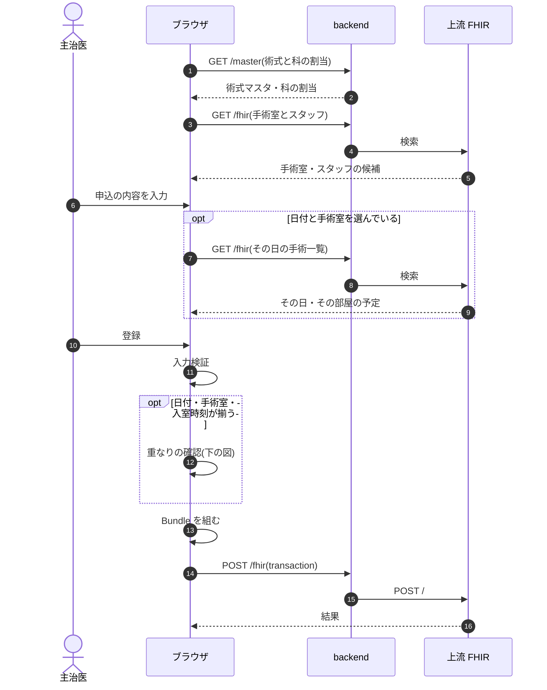

| 段 | 中身 |
|---|---|
| マスタ | `GET /master/surgery_items`(術式マスタ: 既定の所要時間・到達法・体位・麻酔・術前指示テンプレート)、`GET /master/surgery_room_blocks`(科の割当) |
| 手術室とスタッフの検索 | 手術室の `Location`、医療従事者 |
| 入力 | 術式・部位と左右・スタッフ・麻酔・準備・同意書・術前指示・希望日 |
| その日の手術一覧 | キャッシュを使わずに読み、重なりを表示する |
| 入力検証 | 術式 1 件以上、時刻だけで日付なしは不可、左右、執刀医、麻酔科管理なら麻酔科医(`SurgeryOrderForm.tsx`) |

| transaction に入れるもの | 条件 |
|---|---|
| ヘッダ `ServiceRequest`(fullUrl)+ 明細 `ServiceRequest` × 術式 | いつも。登録時の入院病棟を `order-ward` に入れる |
| `Provenance`(CREATE) | いつも |
| 術前指示の回答 `QuestionnaireResponse`(POST) | 術前指示があるとき |
| `Task` order-approval | 代行・研修医のとき |

**重なりの確認**

申込・日程確定で同じ形です。

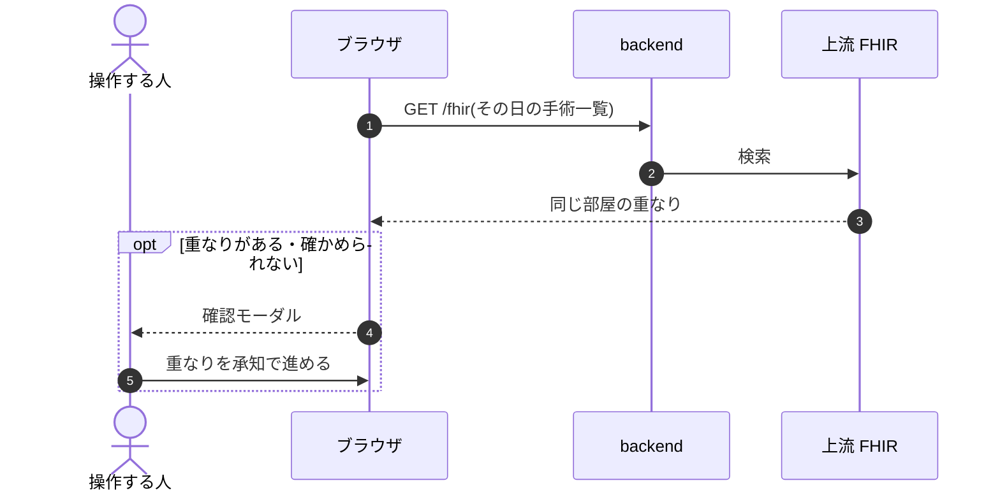

その日の手術一覧は、保存の直前に引き直します。

**編集**

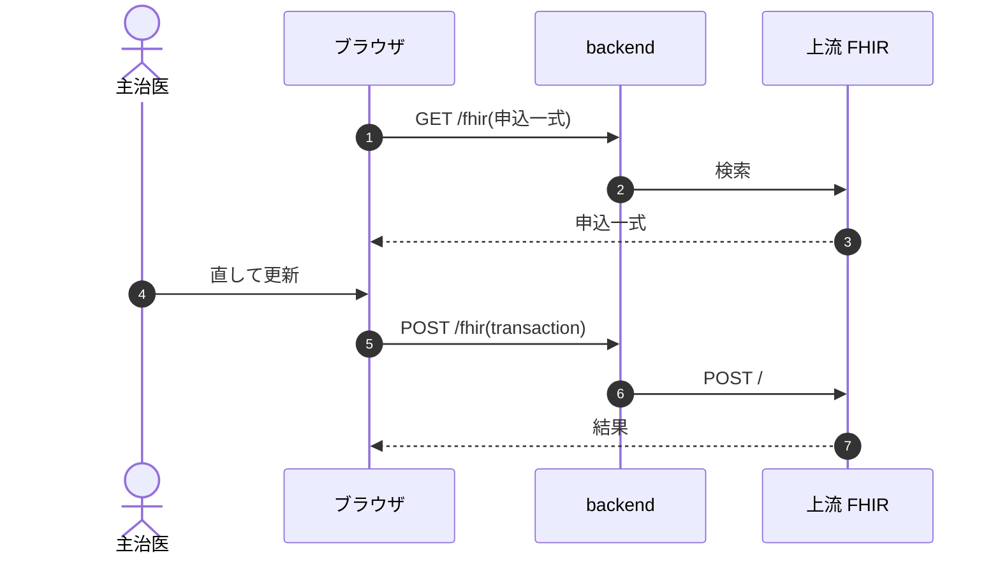

| 段 | 中身 |
|---|---|
| 申込一式の検索 | ヘッダ + 明細 + 術前指示の回答 |
| 日程を変えたとき | 重なりの確認を挟む |
| ヘッダ | PUT(`ifMatch`)。`revoked` なら `revoked` のまま |
| 明細 | 差分で POST / PUT / DELETE |
| 術前指示の回答 | POST / PUT。外したものは DELETE |
| 来歴 | `Provenance`(UPDATE) |

**削除**

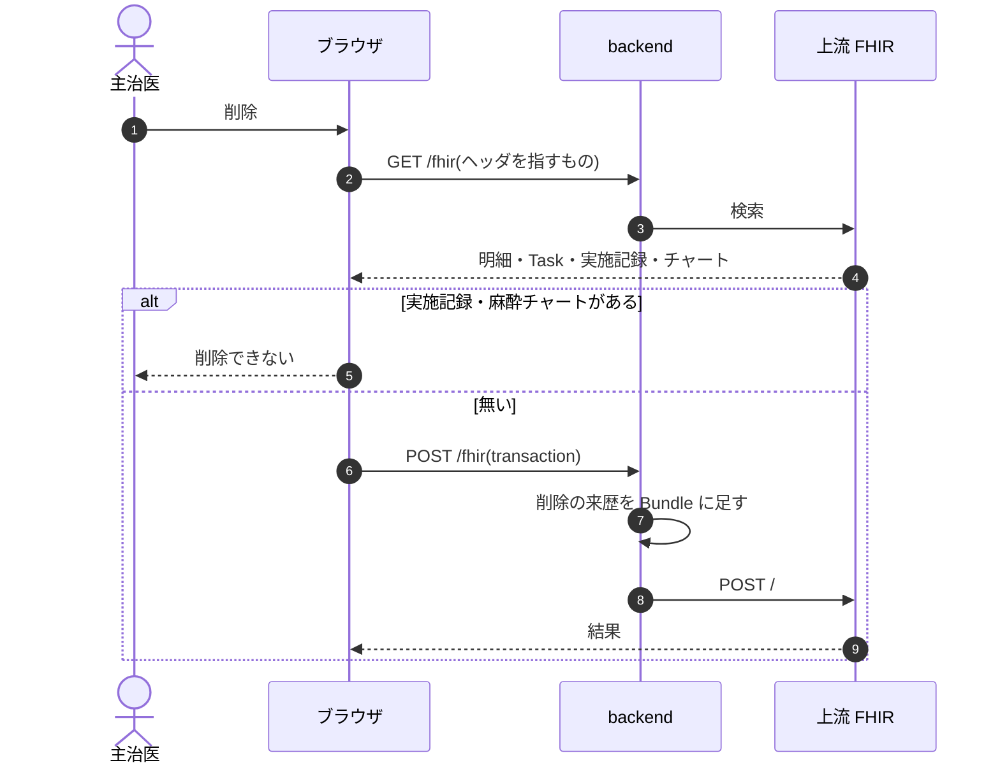

| 段 | 中身 |
|---|---|
| ヘッダを指すものの検索 | 明細・`Task`・`Procedure` |
| transaction | DELETE 明細 → ヘッダ、DELETE `Task`、術前指示の回答 |
| 術前診察があるとき | カルテのカードの削除が押せない(「術前診察があるため削除できません」。`KarteTimeline.tsx`)。この図の検索より前に止まる |

## 日程確定・移動・緊急の入室

**受付(「予定日別」タブ)**

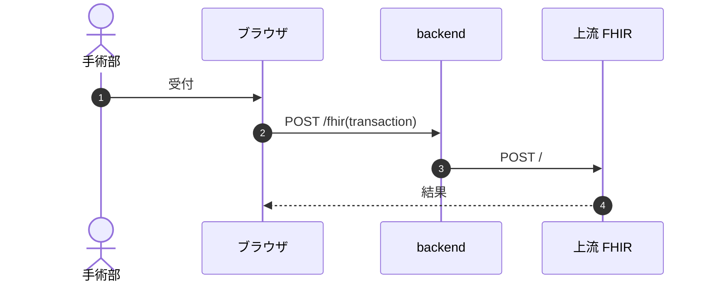

transaction は `Task` surgery = accepted です。

**日程確定(「日程未定」タブ)**

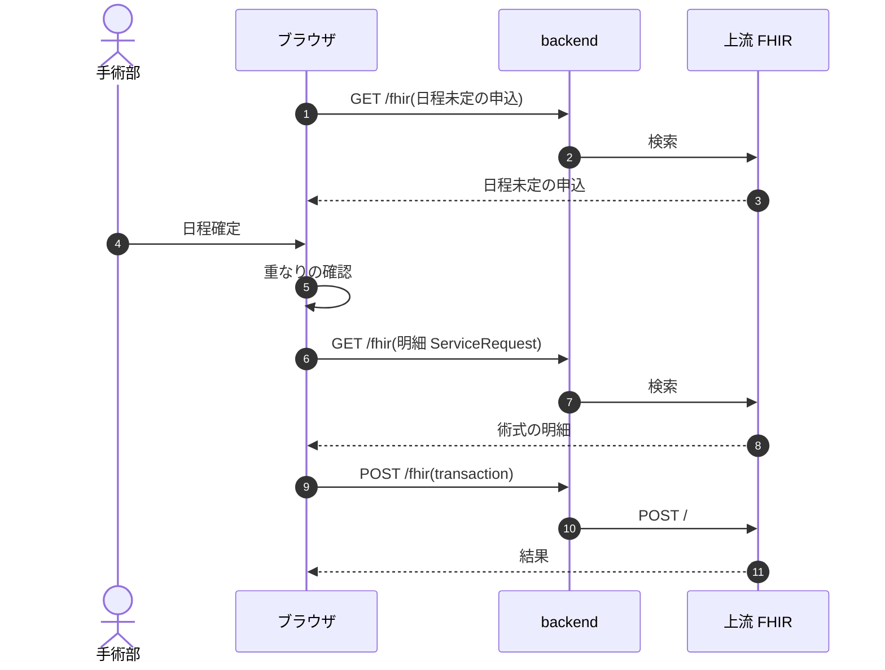

| 段 | 中身 |
|---|---|
| 日程未定の申込の検索 | `occurrence:missing=true`。並びは緊急 → 準緊急 → 予定、申込日の古い順 |
| 日程確定の入力 | 日・入室時刻・所要時間・手術室 |
| 重なりの確認 | その日の手術一覧を引き直し、同じ部屋の重なりを確認モーダルに出す(「シーケンス図: 申込・編集・削除」の図と同じ) |
| transaction | PUT ヘッダ(`occurrenceDateTime`・所要時間・手術室)、PUT 明細 × 術式(`occurrenceDateTime` を揃える)、`Task` surgery = accepted |

**カレンダーで移動・リサイズ**

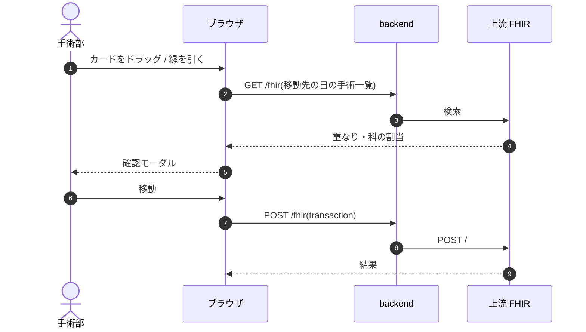

| 段 | 中身 |
|---|---|
| ドラッグ | 5 分刻み |
| 移動先の日の手術一覧 | 引き直す |
| 移動 | 重なりがあれば、承知のうえで移動する |
| transaction | PUT ヘッダ・明細(`occurrenceDateTime`・所要時間・手術室だけ差し替え)。`Task` は触らない |

**緊急の入室(「日程未定」タブ)**

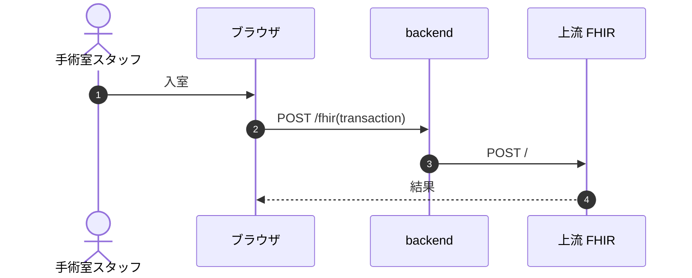

transaction は、PUT ヘッダ・明細(`occurrenceDateTime` = 押した日時)、`Task` surgery = in-progress です。

## 麻酔科術前診察

記入はカルテの右ペイン「テンプレート登録」(`?open=order-template:<オーダー id>@<テンプレートの url>`)です。

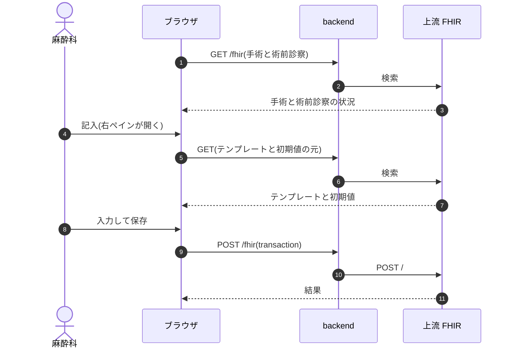

| 段 | 中身 |
|---|---|
| 手術と術前診察の検索 | 期間内と日程未定の手術 + 明細・`Task` + `QuestionnaireResponse:based-on` |
| テンプレートと初期値の元 | `GET /master/facility_settings`(テンプレート)、`GET /fhir`(`Questionnaire`、初期値の元) |
| 初期値 | 手術の予定・身長体重・既往歴・アレルギー・内服薬 |
| 入力 | 評価・気道・指示。保存は記入中 / 確定 |
| transaction(新規) | POST `QuestionnaireResponse`(`basedOn` = ヘッダ、`status` = in-progress / completed) |
| transaction(続き・訂正) | PUT `QuestionnaireResponse`(`ifMatch`) |

- 手術一覧の列・手術カード・手術の詳細・麻酔チャートの帯は、`basedOn` で術前診察を引きます。
- 麻酔記録(`SUR_ANES_01`)と NCD 症例登録(`NCD_CASE_01`)の ASA-PS は、`%preopAsa` で初期値が入ります。

## 入室・麻酔チャート・実施・実施取消

**入室**

transaction は `Task` surgery = in-progress です。

**麻酔チャート**

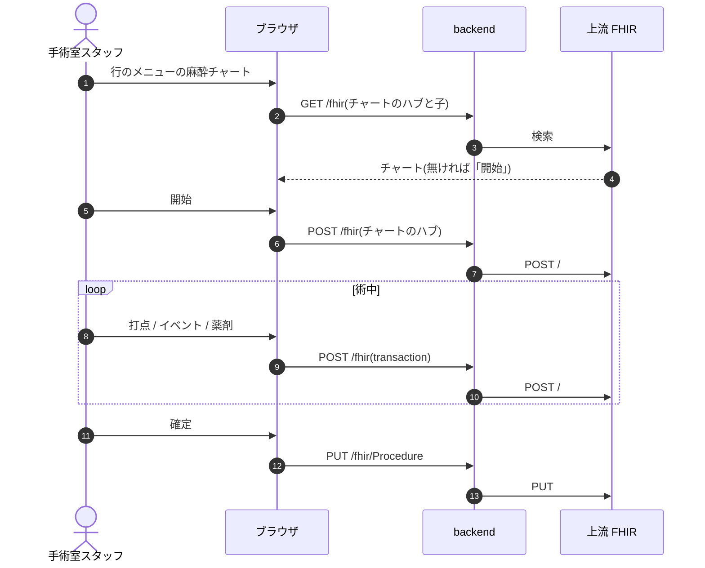

| 段 | 中身 |
|---|---|
| チャートのハブと子の検索 | `Procedure?based-on` + 子を `part-of` でページング |
| 開始 | POST `Procedure` ハブ(`anesthesia-chart`、`in-progress`) |
| 術中の入力 | 打点(1 時点の組)、イベント、薬剤(単回・持続の開始と終了) |
| 術中の transaction | `Observation` × 項目、または `MedicationAdministration` |
| 確定 | PUT `Procedure`(`completed`、`performedPeriod.end`) |

**実施入力**

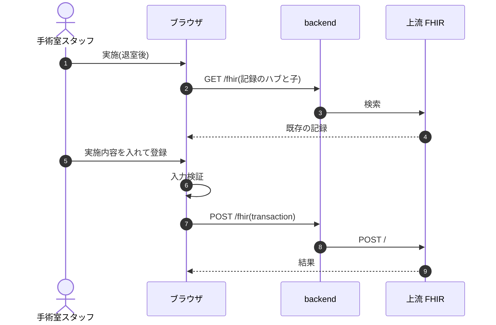

| 段 | 中身 |
|---|---|
| 記録のハブと子の検索 | `Procedure?based-on` + 子 |
| 初期値 | 申込の術式・スタッフ・予定入室時刻 |
| 入力 | 時刻・実施術式(K・L)・スタッフ・測定値・記録・薬剤・材料 |
| 入力検証 | 入室と退室の時刻、時刻の順(`validateSurgeryTimes`)、同じ薬の同じロット番号の重なり、実施術式 1 件以上、執刀医、カウント不一致のコメント(`SurgeryPerformModal.tsx`) |

| transaction に入れるもの | 補足 |
|---|---|
| POST `Procedure`(ハブ) | `code` = K、`performedPeriod`、`performer` × 役割、拡張。材料は `usedCode` |
| POST `Procedure` × 2 件目以降の術式・麻酔 | `partOf`・`basedOn` |
| POST `MedicationAdministration` × 薬剤 | |
| POST `Observation` × 測定値 | |
| `Task` surgery = completed | |

**実施取消**

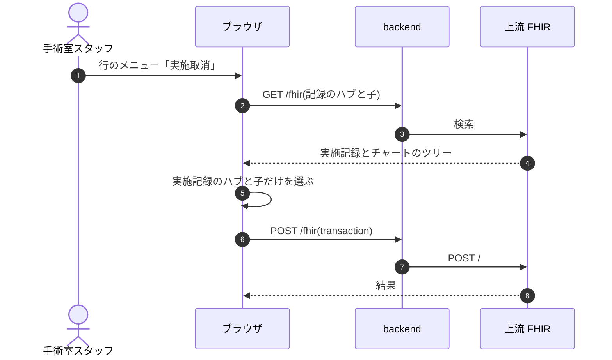

| 段 | 中身 |
|---|---|
| 選び方 | `category = surgery` のハブと子だけ |
| transaction | DELETE `Observation`・`MedicationAdministration` → 子 `Procedure` → ハブ、`Task` surgery = in-progress |

## 医事会計と SS-MIX2

手術は実施記録から集めます(`BillingClaimBuilder` の `:procedure` 経路)。ハブと子の `Procedure.code`(K 章・L 章)が手技、薬剤・材料は直前の手技の剤に付きます。
SS-MIX2 のメッセージは、どの操作でも作りません(手術のメッセージは持ちません)。申込・編集・受付・日程の移動・入室では、医事会計にも何も送りません。

| 起きたこと | 医事会計(`BillingClaimBuilder`) |
|---|---|
| 実施 | 当日の実施記録から送る(下の箇条書き) |
| 麻酔チャート | 拾わない(チャートの薬剤は算定しない) |
| 実施記録の無い当日の申込 | 「実施記録がありません(未実施のため送りません)」と報告する |
| 実施取消 | 対象から外れる |
| 中止 | 対象から外れる(`ServiceRequest` が `revoked`) |
| 削除 | 対象から外れる |

- **K 章**: 手技と、その薬剤・材料を 500 の剤として送ります。
- **L 章(麻酔)**: 手技と、その薬剤を 540 の剤として送ります。
- **麻酔時間の加算**: 実施入力で足します。
