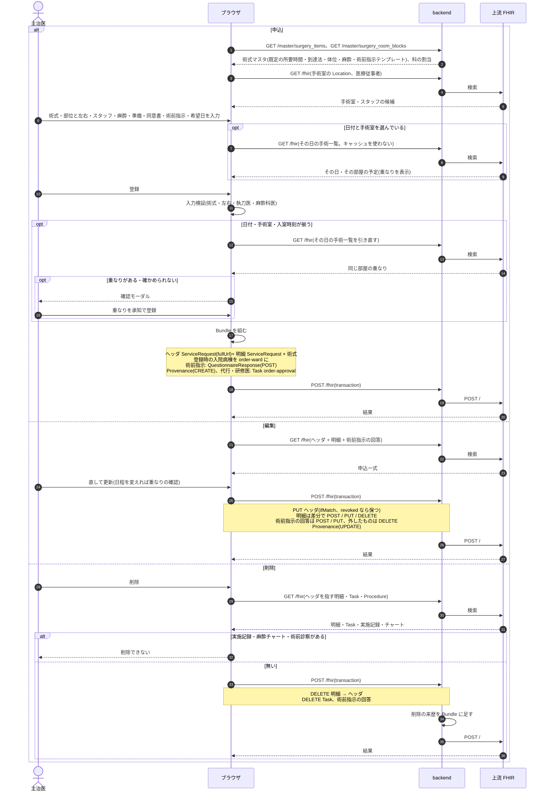
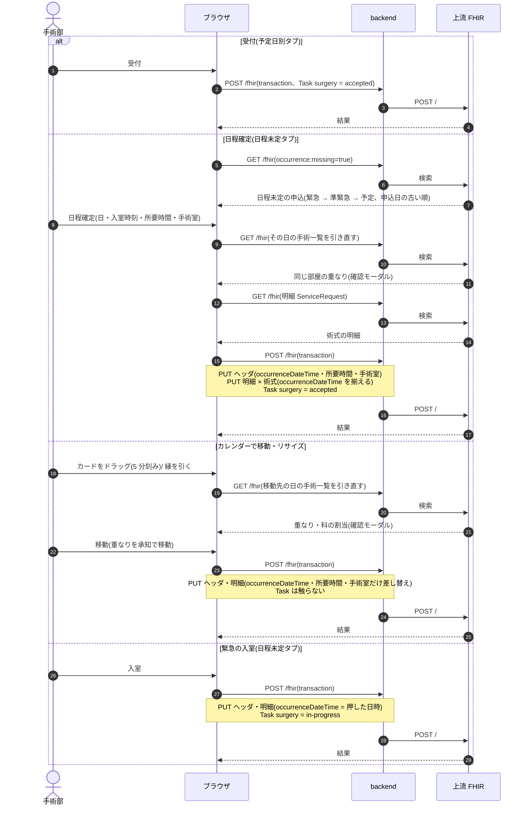
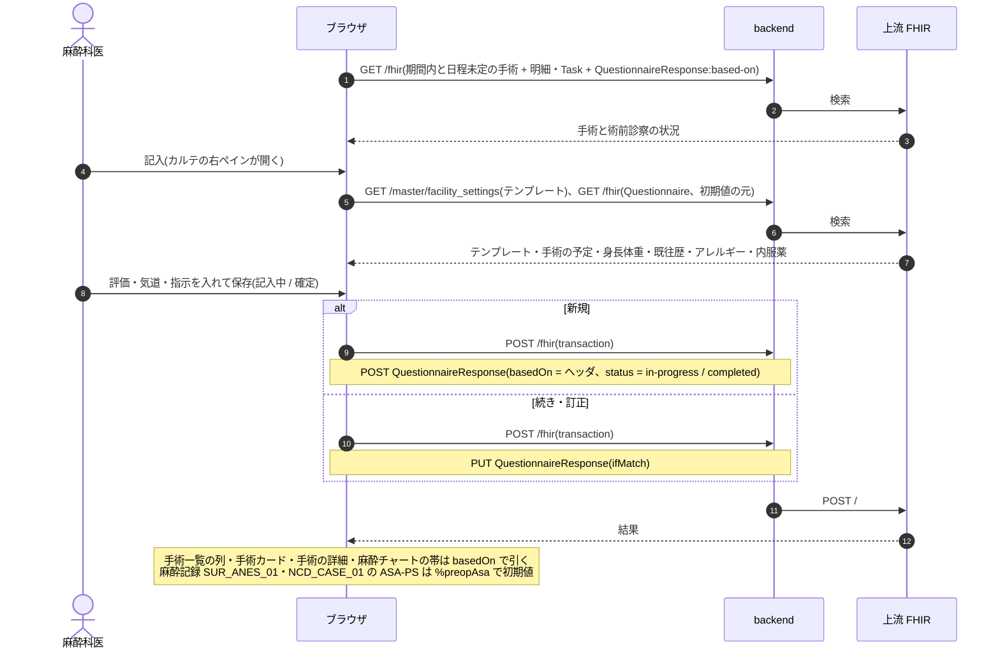
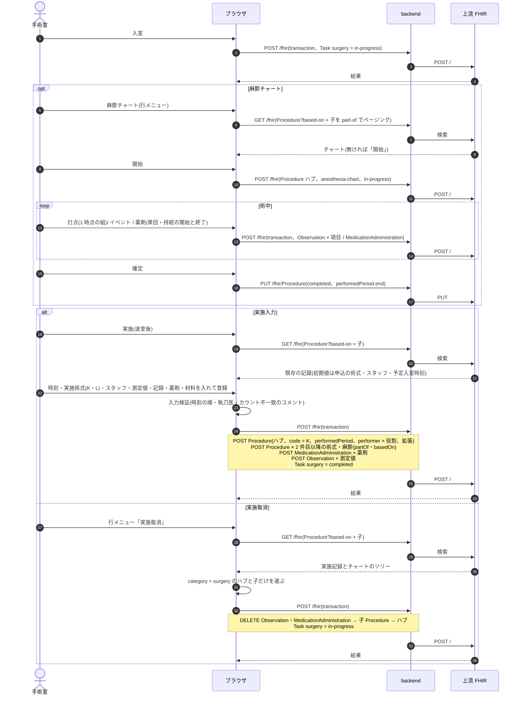

# 手術オーダーのシーケンス図

<!-- ../fhir-client/docs/order-flows/surgery.md から scripts/sync-flows.mjs で作る。直接編集しない。 -->

運用の流れは[手術オーダーの業務フロー](../flows/surgery.md)にあります。

## リソースの構成

申込はヘッダの `ServiceRequest`(`order-type|surgery`)と、術式 1 件ずつの明細 `ServiceRequest`(`basedOn` でヘッダを指す。並び順 1 が主術式)です。
ヘッダに予定日時(`occurrenceDateTime`。未定なら出さない)・所要時間・手術室・執刀科・スタッフ・麻酔・輸血準備・特殊機器・検体提出予定・同意書・術前指示をローカル拡張で、明細に術式コード(`surgery-order-item`)・K コード・部位と左右(`bodySite`)・到達法・術前診断を持ちます。

| もの | リソース | 補足 |
|---|---|---|
| 進捗 | `Task`(`task-code|surgery`、`focus` = ヘッダ) | 下の表 |
| 術前指示(テンプレート記入) | `QuestionnaireResponse` | ヘッダの拡張 `surgery-preop-instruction-questionnaire-response` が指す。申込と同じ transaction で書き、削除で一緒に消す |
| 麻酔科術前診察 | `QuestionnaireResponse`(`basedOn` = ヘッダ、`SUR_ANESPRE_01`) | 1 手術 1 件。`in-progress`(記入中)/ `completed`(確定)。要点は linkId(`anes_asa` など)で読む |
| 実施記録 | ハブ `Procedure`(`order-type|surgery`、`status = completed`、`code` = 実施術式 1 件目の K コード、`performedPeriod` = 入室〜退室、`performer` = 役割つき複数、拡張 = 中間時刻・創分類・カウント)← `partOf` ── `Procedure`(2 件目以降の術式・麻酔 L)、`MedicationAdministration`(薬剤)、`Observation`(出血量・尿量・輸血量。`category` 無し) | 実施取消で記録ごと消す |
| 麻酔チャート | ハブ `Procedure`(`order-type|anesthesia-chart`、記録中 `in-progress` / 確定 `completed`)← `partOf` ── `Observation`(打点。`category` 無し)、`Observation`(イベント `anesthesia-event`)、`MedicationAdministration`(単回 / 持続) | 実施記録と別のツリー。振り分けは必ずハブの `category` で行う |
| NCD 症例登録 | `QuestionnaireResponse`(`partOf` = 実施記録ハブ、`NCD_CASE_01`) | 登録状況は回答の項目 |
| ブロックスケジュール | backend `master_surgery_room_blocks` | 曜日ごとの科割当。警告だけで止めない |

## 進捗 Task(`surgery`)

Task は申込時には作りません。**Task が無い申込は申込済**として扱い、最初のステータス変更で作ります(`fhir/surgeryTaskHelpers.ts`)。
中止は同じ transaction でヘッダを `revoked` にし、中止取消で `active` に戻します(`orderCancelEntries`)。中止した申込を編集しても `revoked` のままです(`keepOrderRevoked`)。

| 状態 | `Task.status` | `executionPeriod` | 同じ transaction で書くもの |
|---|---|---|---|
| 申込済 | `requested`(または Task 無し) | なし | |
| 受付済 | `accepted` | `start` | 日程確定ならヘッダ・明細の `occurrenceDateTime`・所要時間・手術室 |
| 入室中 | `in-progress` | `start` | 緊急の入室ならヘッダ・明細の `occurrenceDateTime` |
| 実施済 | `completed` | `start` / `end` | 実施記録(ハブ + 子) |
| 中止 | `cancelled` | なし | ヘッダ `revoked` |

取消で戻すときに消すもの: 実施取消は実施記録(`category = surgery` のハブとその子だけ。麻酔チャートのツリーは残す)。受付取消・入室取消・中止取消は何も消しません。日程の移動(`buildSurgeryMoveBundle`)は Task に触りません。

## シーケンス図の前提

`/fhir` への書き込みはどれも 1 回の transaction Bundle で、backend の `FhirProxyController` が上流へ中継します。
SS-MIX2 を有効にしている施設では、中継が書き込みの控えを記録します(`Ssmix2::Recorder`。手術は電文にしません)。
楽観ロックの版は `postBundle` が `ifMatch` に添え、版が違えば 412 で止まります。
麻酔チャートだけは 1 点ずつ書く(打点 1 時点の組が 1 transaction、イベント・薬剤は 1 件ずつ)ので、他の種別と保存の単位が違います。

## 申込・編集・削除

`components/SurgeryOrderForm.tsx`・`SurgeryOrderPanels.tsx`(カレンダーからは `SurgeryOrderModals.tsx` が同じパネルを包む)、`buildSurgeryOrderBundle` / `buildSurgeryOrderUpdateBundle` / `buildSurgeryOrderDeleteBundle`(`fhir/surgeryOrderHelpers.ts`)、
`hooks/useSurgeryConflictCheck.ts`、`useCreatePrescription`(全種別共通)/ `useUpdateSurgeryOrder` / `useDeleteSurgeryOrder`(`api/queries/surgery.ts`)。

## 日程確定・移動・緊急の入室

`pages/SurgeryWorklistPage.tsx`、`components/SurgeryScheduleModal.tsx`・`SurgeryCalendar.tsx`・`SurgeryMoveConfirmModal.tsx`、`buildSurgeryScheduleBundle` / `buildSurgeryMoveBundle`(`fhir/surgeryOrderHelpers.ts`)、
`useConfirmSurgerySchedule` / `useMoveSurgerySchedule` / `useAdmitUnscheduledSurgery` / `useUpdateSurgeryTaskStatus`(`api/queries/surgery.ts`)。

## 麻酔科術前診察

`pages/AnesthesiaPreopPage.tsx`、`useAnesthesiaPreopList` / `useAnesthesiaPreop`(`api/queries/surgery.ts`)、`fhir/anesthesiaPreopHelpers.ts`、`fhir/populateSurgery.ts`(初期値の変数)。記入はカルテの右ペイン「テンプレート登録」(`?open=order-template:<オーダー id>@<テンプレートの url>`)です。

## 入室・麻酔チャート・実施・実施取消

`pages/AnesthesiaChartPage.tsx`・`components/AnesthesiaChartPanel.tsx`、`useAnesthesiaChart` / `useAnesthesiaChartWrite`(`api/queries/anesthesia.ts`)、`fhir/anesthesiaChartHelpers.ts`、
`components/SurgeryPerformModal.tsx`、`buildSurgeryPerformBundle` / `buildSurgeryPerformDeleteEntries`(`fhir/surgeryResultHelpers.ts`)、`useRegisterSurgeryPerform` / `useUpdateSurgeryTaskStatus`。

## 医事会計と SS-MIX2

手術は実施記録から集めます(`BillingClaimBuilder` の `:procedure` 経路)。ハブと子の `Procedure.code`(K 章・L 章)が手技、薬剤・材料は直前の手技の剤に付きます。

| 起きたこと | 医事会計(`BillingClaimBuilder`) | SS-MIX2 |
|---|---|---|
| 申込・編集・受付・日程の移動・入室 | なし | なし(手術の電文は持たない) |
| 実施 | 当日の実施記録から、K 章の手技とその薬剤・材料を 500 の剤、L 章(麻酔)とその薬剤を 540 の剤として送る。麻酔時間の加算は実施入力で足す | なし |
| 麻酔チャート | 拾わない(チャートの薬剤は算定しない) | なし |
| 実施記録の無い当日の申込 | 「実施記録がありません(未実施のため送りません)」と報告 | なし |
| 実施取消 | 対象から外れる | なし |
| 中止 | 対象から外れる(`ServiceRequest` が `revoked`) | なし |
| 削除 | 対象から外れる | なし |

看護必要度の C 項目は実施記録の K コードから推します。DPC の様式 1・NCD は K コード・到達法・創分類・合併症を起点にするので、構造化を崩さないでください。
