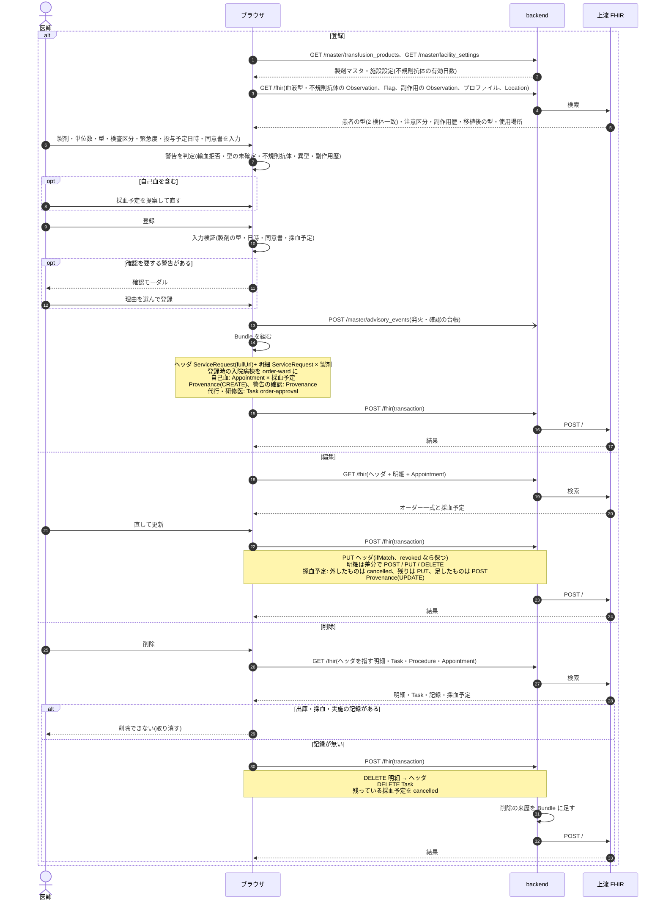
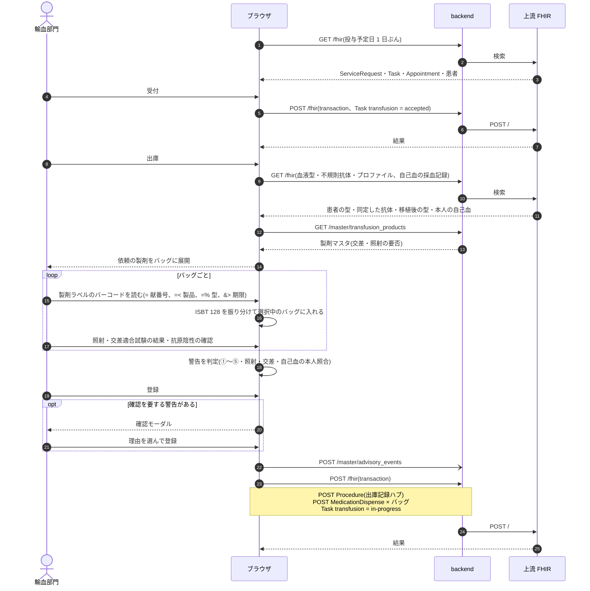
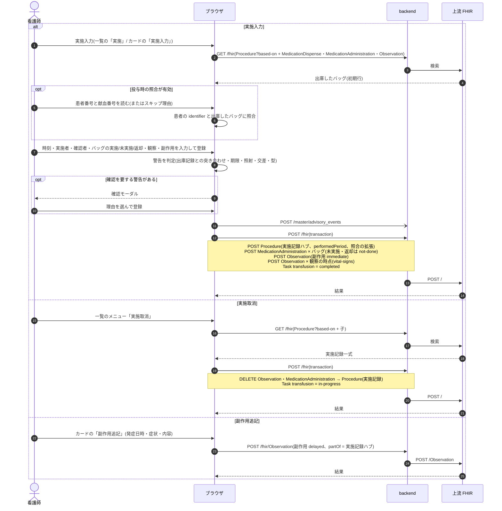
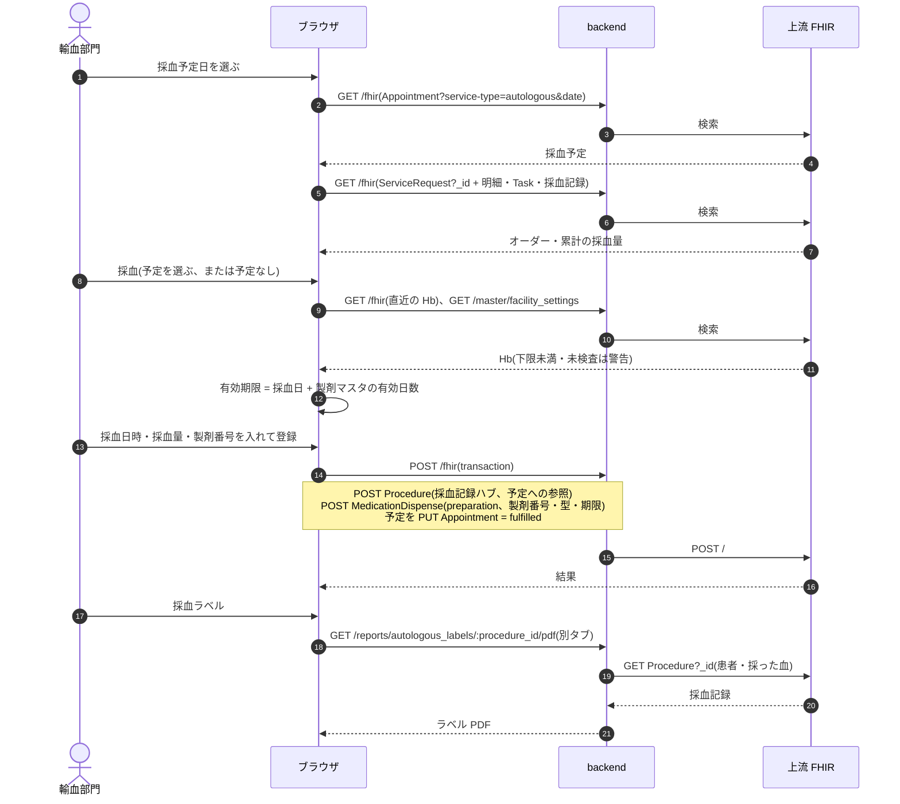
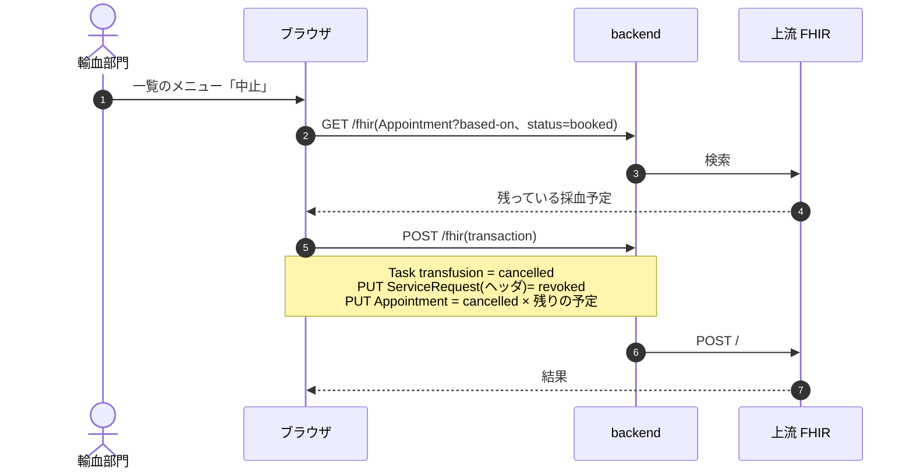

# 輸血オーダーのシーケンス図

<!-- ../fhir-client/docs/order-flows/transfusion.md から scripts/sync-flows.mjs で作る。直接編集しない。 -->

運用の流れは[輸血オーダーの業務フロー](../flows/transfusion.md)にあります。

## リソースの構成

ヘッダの `ServiceRequest`(`order-type|transfusion`)と、製剤 1 種類ずつの明細 `ServiceRequest`(`basedOn` でヘッダを指す)です。
ヘッダに検査区分(`code`)・投与予定日時(`occurrenceDateTime`)・緊急度(`priority`)・使用場所(`locationReference`)・使用目的・患者の型(`transfusion-abo` / `transfusion-rhd`。不明は `unknown`)・同意書の確認(`transfusion-consent`)、明細に製剤(`code`)・単位数(`quantityQuantity`)・製剤の型を持ちます。

| もの | リソース | 補足 |
|---|---|---|
| 進捗 | `Task`(`task-code|transfusion`、`focus` = ヘッダ) | 下の表 |
| 出庫記録 | ハブ `Procedure`(`procedure-category|transfusion-dispense`、`basedOn` = ヘッダ)← `partOf` ── `MedicationDispense` × バッグ | 製剤番号は `identifier`(`blood-product-number`)、型・有効期限・照射・交差適合試験・抗原陰性は拡張。出庫者と適合試験者は `performer.function` |
| 実施記録 | ハブ `Procedure`(`order-type|transfusion`、`performedPeriod`、`performer` = 実施者・確認者、拡張 `transfusion-verification`)← `partOf` ── `MedicationAdministration` × バッグ(未実施・返却は `not-done` + `statusReason`)、`Observation`(副作用。症状は `component`、`transfusion-reaction-timing` = immediate / delayed)、`Observation`(観察のバイタル。`vital-signs` + `transfusion-observation-point`) | 製剤番号は `MedicationAdministration` の拡張 `transfusion-lot-number` |
| 自己血の採血予定 | `Appointment`(`basedOn` = ヘッダ、`serviceType` = `autologous`、予定量は拡張) | booked → fulfilled / cancelled。枠(Schedule/Slot)は使わない |
| 自己血の採血記録 | ハブ `Procedure`(`procedure-category|autologous-collection`、拡張 `autologous-appointment` = 予定)← `partOf` ── `MedicationDispense`(`status = preparation`、製剤番号・型・有効期限) | 出庫で本人の記録から選ぶ |
| 血液型・不規則抗体 | 検体検査の `Observation`(結果項目コード + JLAC11 K1001 / K1006、不規則抗体は結果項目コード) | 2 検体一致で確定(`fhir/bloodTypeHelpers.ts`) |
| 不規則抗体の特異性・移植後の型 | `Observation`(`category = exam`、`transfusion-profile|…`) | プロファイルタブで手入力 |
| 警告の確認 | 警告の台帳(`POST /master/advisory_events`)と `Provenance` | 文脈は `transfusion-order` / `transfusion-dispense` / `transfusion-perform` / `autologous-collection` |

## 進捗 Task(`transfusion`)

Task は登録時には作りません。**Task が無いオーダーは依頼済**として扱い、最初のステータス変更で作ります(`fhir/transfusionTaskHelpers.ts`)。
中止は同じ transaction でヘッダを `revoked` にし、中止取消で `active` に戻します(`orderCancelEntries`)。中止したオーダーを編集しても `revoked` のままです(`keepOrderRevoked`)。

| 状態 | `Task.status` | `executionPeriod` | 同じ transaction で書くもの |
|---|---|---|---|
| 依頼済 | `requested`(または Task 無し) | なし | |
| 受付済 | `accepted` | `start` | |
| 出庫済 | `in-progress` | `start` | 出庫記録(ハブ + `MedicationDispense`) |
| 実施済 | `completed` | `start` / `end` | 実施記録(ハブ + `MedicationAdministration` + `Observation`) |
| 中止 | `cancelled` | なし | ヘッダ `revoked`、残っている採血予定を `cancelled` |

取消で戻すときに消すもの: 出庫取消は出庫記録、実施取消は実施記録(`useUpdateTransfusionTaskStatus` の `cancelPerform`)。受付取消・中止取消は何も消しません。

## シーケンス図の前提

`/fhir` への書き込みはどれも 1 回の transaction Bundle で、backend の `FhirProxyController` が上流へ中継します。
SS-MIX2 を有効にしている施設では、中継が書き込みの控えを記録します(`Ssmix2::Recorder`。輸血は電文にしません)。
楽観ロックの版は `postBundle` が `ifMatch` に添え、版が違えば 412 で止まります。
例外は採血ラベルと輸血カードの PDF で、backend が上流を直接読みます。

## 登録・編集・削除

`components/TransfusionOrderForm.tsx`・`TransfusionOrderPanels.tsx`、`buildTransfusionOrderBundle` / `buildTransfusionOrderUpdateBundle` / `buildTransfusionOrderDeleteBundle`(`fhir/transfusionOrderHelpers.ts`)、
`useCreatePrescription` / `useUpdatePrescription`(全種別共通)、`useDeleteTransfusionOrder`(`api/queries/transfusion.ts`)。警告は `fhir/transfusionAdvisoryHelpers.ts`。

## 受付・出庫

`pages/TransfusionWorklistPage.tsx`、`components/TransfusionDispenseModal.tsx`、`fhir/transfusionDispenseHelpers.ts`(`dispenseAdvisories` / `buildTransfusionDispenseBundle`)、`fhir/isbt128.ts`、
`useUpdateTransfusionTaskStatus` / `useRegisterTransfusionDispense`。

## 実施・実施取消・副作用追記

`components/TransfusionPerformModal.tsx`・`TransfusionVerifyStep.tsx`・`TransfusionReactionModal.tsx`、`fhir/transfusionResultHelpers.ts`(`buildTransfusionPerformBundle` / `buildTransfusionPerformDeleteEntries` / `buildDelayedReactionObservation`)、
`useRegisterTransfusionPerform` / `useAddTransfusionReaction`。カルテのカード(`KarteTimeline.tsx`)からは出庫済のときだけ「実施入力」、実施済のときだけ「副作用追記」が出ます。

## 自己血の採血

`components/AutologousCollectionModal.tsx`、`fhir/autologousHelpers.ts`(`buildAutologousCollectionBundle`)・`fhir/autologousPlanHelpers.ts`、`useRegisterAutologousCollection`、`useAutologousWorklist`、`AutologousLabelReport`(backend)。

## 中止

`useUpdateTransfusionTaskStatus`(`api/queries/transfusion.ts`)。出庫記録・採血記録は残します。

## 医事会計と SS-MIX2

輸血は実施記録から集めます(`BillingClaimBuilder` の `:procedure` 経路、`Resolvers::Transfusion`)。実施記録の無い当日のオーダーは「実施記録がありません(未実施のため送りません)」と報告します。

| 起きたこと | 医事会計(`BillingClaimBuilder`) | SS-MIX2 |
|---|---|---|
| 登録・編集・受付・出庫 | なし | なし(輸血の電文は持たない) |
| 実施 | 投与した(`completed`)バッグを製剤マスタの医薬品コードで 1 袋ずつ。手技は施設設定の保存血液輸血(1 回目 × 1、2 回目以降 × 単位数 − 1)。自己血だけなら手技なし、自己血の製剤は医薬品コードが無いので「送れない項目」 | なし |
| 未実施・返却のバッグ | 数えない | なし |
| 実施取消 | 対象から外れる | なし |
| 中止 | 対象から外れる(`ServiceRequest` が `revoked`) | なし |
| 削除 | 対象から外れる | なし |

製剤番号は上流の `MedicationAdministration?lot-number` で引けるので、ロット管理画面の検索で輸血の製剤番号も逆引きできます。
