# 輸血オーダーのシーケンス図

<!-- ../fhir-client/docs/order-flows/transfusion.md から scripts/sync-flows.mjs で作る。直接編集しない。 -->

運用の流れは[輸血オーダーの業務フロー](../flows/transfusion.md)にあります。

## シーケンス図の前提

- **書き込みの経路**: `/fhir` への書き込みはどれも 1 回の transaction Bundle で、backend の `FhirProxyController` が上流へ中継します。
- **上流**: backend の先にある FHIR サーバーのことです。図では「上流 FHIR」と書きます。
- **応答の中継は省く**: 図の `FHIR-->>UI` は、上流の応答を backend がそのままブラウザへ返すことを表します。
- **ヘッダと明細**: ヘッダはオーダー本体の `ServiceRequest`、明細は製剤 1 種類ずつの `ServiceRequest`(`basedOn` でヘッダを指す)です。
- **ハブと子**: 出庫・実施・採血の記録は、`Procedure`(ハブ)1 件に、バッグごとのリソース(子)が `partOf` でぶら下がる形です。
- **PDF の例外**: 採血ラベルと輸血カードの PDF は、ブラウザが `/fhir` を読むのではなく、backend が上流を直接読みます。
- **警告の台帳**: 出た警告と確認の理由は、transaction とは別に `POST /master/advisory_events` で送ります。図の `UI-)BE` は、応答を待たない送信です。
- **楽観ロック**: 版は `postBundle` が `ifMatch` に添え、版が違えば 412 で止まります。
- **SS-MIX2**: 有効にしている施設では、中継が書き込みの控えを記録します(`Ssmix2::Recorder`)。輸血はメッセージにしません。

## リソースの構成

親子の形は次のとおりです。

- ヘッダ `ServiceRequest`(`order-type|transfusion`)
  - 明細 `ServiceRequest` × 製剤の種類(`basedOn` = ヘッダ)
  - `Task`(進捗。`focus` = ヘッダ)
  - 出庫記録ハブ `Procedure`(`basedOn` = ヘッダ)
    - `MedicationDispense` × バッグ(`partOf` = ハブ)
  - 実施記録ハブ `Procedure`
    - `MedicationAdministration` × バッグ(`partOf` = ハブ)
    - `Observation`(副作用)
    - `Observation`(観察のバイタル)
  - 自己血の採血予定 `Appointment`(`basedOn` = ヘッダ)
  - 自己血の採血記録ハブ `Procedure`
    - `MedicationDispense`(`partOf` = ハブ)

| リソース | 要素 | 中身 |
|---|---|---|
| ヘッダ `ServiceRequest` | `code` | 検査区分 |
| | `occurrenceDateTime` | 投与予定日時 |
| | `priority` | 緊急度 |
| | `locationReference` | 使用場所 |
| | `reasonCode.text` | 使用目的 |
| | 拡張 `transfusion-abo` / `transfusion-rhd` | 患者の型。不明は `unknown` |
| | 拡張 `transfusion-consent` | 同意書の確認 |
| 明細 `ServiceRequest` | `code` | 製剤 |
| | `quantityQuantity` | 単位数 |
| | 拡張 `transfusion-abo` / `transfusion-rhd` | 製剤の型 |
| `Task` | `code` | `task-code|transfusion`(→「進捗 Task(`transfusion`)」) |
| 出庫記録ハブ `Procedure` | `category` | `procedure-category|transfusion-dispense` |
| 出庫の `MedicationDispense` | `identifier` | 製剤番号(`blood-product-number`) |
| | 拡張 | 型・有効期限・照射・交差適合試験・抗原陰性 |
| | `performer.function` | 出庫者と適合試験者 |
| 実施記録ハブ `Procedure` | `category` | `order-type|transfusion` |
| | `performedPeriod` | 開始〜終了 |
| | `performer` | 実施者・確認者 |
| | 拡張 `transfusion-verification` | 投与時の照合 |
| 実施の `MedicationAdministration` | `status` | 未実施・返却は `not-done` + `statusReason` |
| | 拡張 `transfusion-lot-number` | 製剤番号 |
| 副作用の `Observation` | `component` | 症状 |
| | `transfusion-reaction-timing` | immediate / delayed |
| 観察の `Observation` | `category` | `vital-signs` |
| | `transfusion-observation-point` | 観察の時点 |
| 採血予定 `Appointment` | `serviceType` | `autologous` |
| | `status` | booked → fulfilled / cancelled |
| | 拡張 | 予定量 |
| 採血記録ハブ `Procedure` | `category` | `procedure-category|autologous-collection` |
| | 拡張 `autologous-appointment` | 採血予定 |
| 採血の `MedicationDispense` | `status` | `preparation` |
| | (そのほか) | 製剤番号・型・有効期限 |

- **採血予定の枠**: 枠(`Schedule` / `Slot`)は使いません。
- **採血記録の使い道**: 出庫のときに、本人の記録から選びます。
- **血液型・不規則抗体**: 検体検査の `Observation` です(結果項目コード + JLAC11 K1001 / K1006。不規則抗体は結果項目コード)。2 検体の一致で確定します(`fhir/bloodTypeHelpers.ts`)。
- **不規則抗体の特異性・移植後の型**: `Observation`(`category = exam`、`transfusion-profile|…`)です。プロファイルタブで手入力します。
- **警告の確認**: 警告の台帳(`POST /master/advisory_events`)と `Provenance` に残します。文脈は `transfusion-order` / `transfusion-dispense` / `transfusion-perform` / `autologous-collection` です。

## 進捗 Task(`transfusion`)

Task は登録時には作りません。**Task が無いオーダーは依頼済**として扱い、最初のステータス変更で作ります(`fhir/transfusionTaskHelpers.ts`)。
中止は同じ transaction でヘッダを `revoked` にし、中止取消で `active` に戻します(`orderCancelEntries`)。中止したオーダーを編集しても `revoked` のままです(`keepOrderRevoked`)。

| 状態 | `Task.status` | `executionPeriod` | 同じ transaction で書くもの |
|---|---|---|---|
| 依頼済 | `requested`(または Task 無し) | なし | |
| 受付済 | `accepted` | `start` | |
| 出庫済 | `in-progress` | `start` | 出庫記録(ハブ + `MedicationDispense`) |
| 実施済 | `completed` | `start` / `end` | 実施記録(ハブ + `MedicationAdministration` + `Observation`) |
| 中止 | `cancelled` | なし | ヘッダ `revoked`、残っている採血予定を `cancelled` |

取消で戻すときに消すもの: 出庫取消は出庫記録、実施取消は実施記録(`useUpdateTransfusionTaskStatus` の `cancelPerform`)。受付取消・中止取消は何も消しません。

## 部品

| 操作 | 画面 | 組み立て | hook |
|---|---|---|---|
| 登録 | `components/TransfusionOrderForm.tsx`・`TransfusionOrderPanels.tsx` | `buildTransfusionOrderBundle`(`fhir/transfusionOrderHelpers.ts`) | `useCreatePrescription`(名前と違い全種別共通) |
| 編集 | 同じフォーム | `buildTransfusionOrderUpdateBundle` | `useUpdatePrescription`(全種別共通) |
| 削除 | – | `buildTransfusionOrderDeleteBundle` | `useDeleteTransfusionOrder`(`api/queries/transfusion.ts`) |
| 登録のときの警告 | 同じフォーム | `fhir/transfusionAdvisoryHelpers.ts` | – |
| 一覧・受付・取消・中止 | `pages/TransfusionWorklistPage.tsx` | – | `useUpdateTransfusionTaskStatus`(`api/queries/transfusion.ts`) |
| 出庫 | `components/TransfusionDispenseModal.tsx` | `buildTransfusionDispenseBundle`・`dispenseAdvisories`(`fhir/transfusionDispenseHelpers.ts`)、バーコードは `fhir/isbt128.ts` | `useRegisterTransfusionDispense` |
| 実施 | `components/TransfusionPerformModal.tsx`・`TransfusionVerifyStep.tsx` | `buildTransfusionPerformBundle`(`fhir/transfusionResultHelpers.ts`) | `useRegisterTransfusionPerform` |
| 実施取消 | 一覧 | `buildTransfusionPerformDeleteEntries`(`fhir/transfusionResultHelpers.ts`) | `useUpdateTransfusionTaskStatus` |
| 副作用追記 | `components/TransfusionReactionModal.tsx` | `buildDelayedReactionObservation`(`fhir/transfusionResultHelpers.ts`) | `useAddTransfusionReaction` |
| 自己血の採血 | `components/AutologousCollectionModal.tsx` | `buildAutologousCollectionBundle`(`fhir/autologousHelpers.ts`)、予定は `fhir/autologousPlanHelpers.ts` | `useRegisterAutologousCollection`、一覧は `useAutologousWorklist` |
| 採血ラベル | – | `AutologousLabelReport`(backend) | – |

カルテのカード(`KarteTimeline.tsx`)からは、出庫済のときだけ「実施入力」、実施済のときだけ「副作用追記」が出ます。

## 登録・編集・削除

**登録**

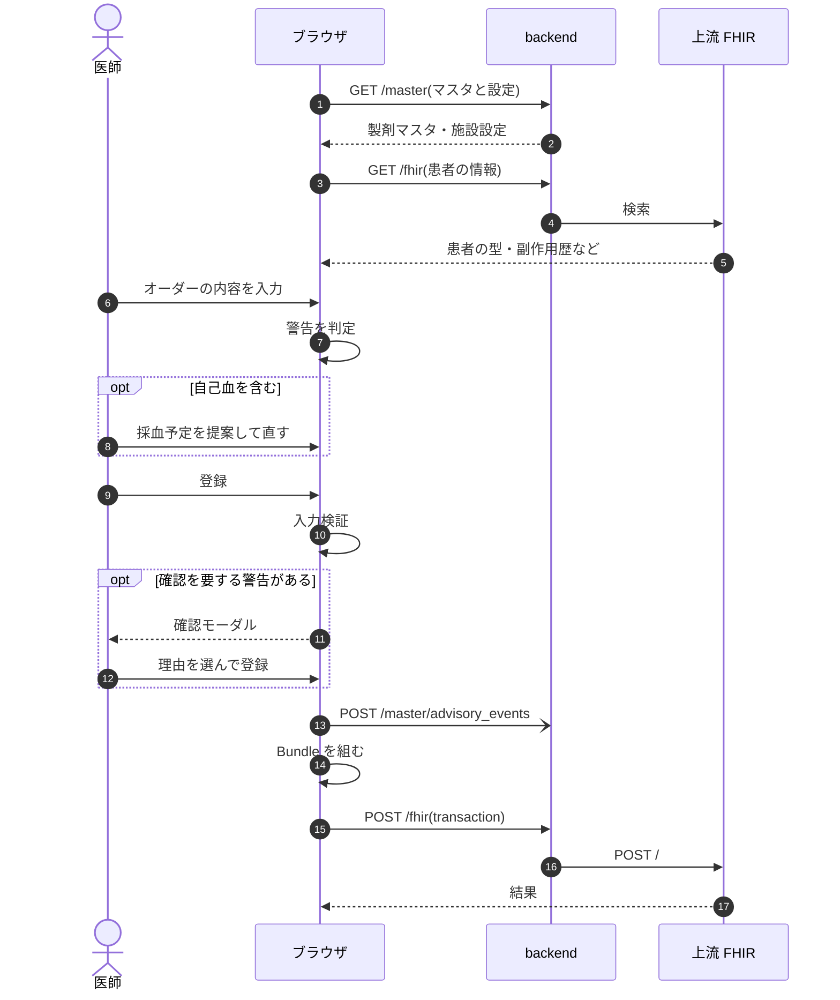

| 段 | 中身 |
|---|---|
| マスタと設定 | `GET /master/transfusion_products`(製剤マスタ)、`GET /master/facility_settings`(不規則抗体の有効日数) |
| 患者の情報の検索 | 血液型・不規則抗体の `Observation`、`Flag`、副作用の `Observation`、プロファイル、`Location` |
| 検索で分かること | 患者の型(2 検体一致)・注意区分・副作用歴・移植後の型・使用場所 |
| 入力 | 製剤・単位数・型・検査区分・緊急度・投与予定日時・同意書 |
| 警告の判定 | 輸血拒否・型の未確定・不規則抗体・異型・副作用歴 |
| 入力検証 | 製剤の型・日時・同意書・採血予定 |
| 警告の台帳 | 発火と確認を `POST /master/advisory_events` に送る |

| transaction に入れるもの | 条件 |
|---|---|
| ヘッダ `ServiceRequest`(fullUrl)+ 明細 `ServiceRequest` × 製剤 | いつも。登録時の入院病棟を `order-ward` に入れる |
| `Provenance`(CREATE) | いつも |
| `Appointment` × 採血予定 | 自己血を含むとき |
| 警告の確認の `Provenance` | 警告を確認したとき |
| `Task` order-approval | 代行・研修医のとき |

**編集**

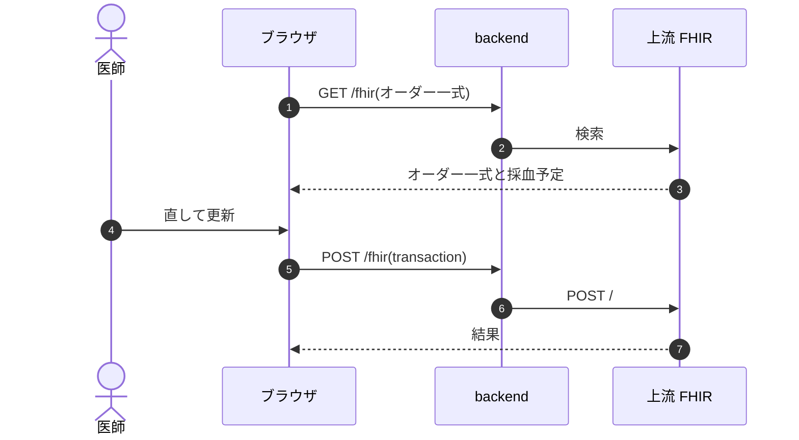

| 段 | 中身 |
|---|---|
| オーダー一式の検索 | ヘッダ + 明細 + `Appointment` |
| ヘッダ | PUT(`ifMatch`)。`revoked` なら `revoked` のまま |
| 明細 | 差分で POST / PUT / DELETE |
| 採血予定 | 外したものは cancelled、残りは PUT、足したものは POST |
| 来歴 | `Provenance`(UPDATE) |

**削除**

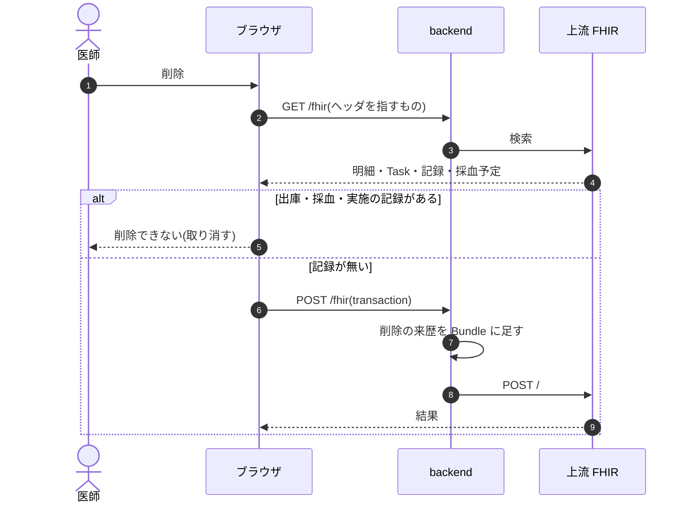

| 段 | 中身 |
|---|---|
| ヘッダを指すものの検索 | 明細・`Task`・`Procedure`・`Appointment` |
| transaction | DELETE 明細 → ヘッダ、DELETE `Task`、残っている採血予定を cancelled |

## 受付・出庫

**一覧と受付**

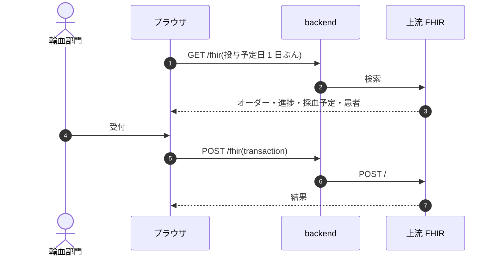

一覧の検索で返るのは `ServiceRequest`・`Task`・`Appointment`・患者です。受付の transaction は `Task` transfusion = accepted です。

**出庫**

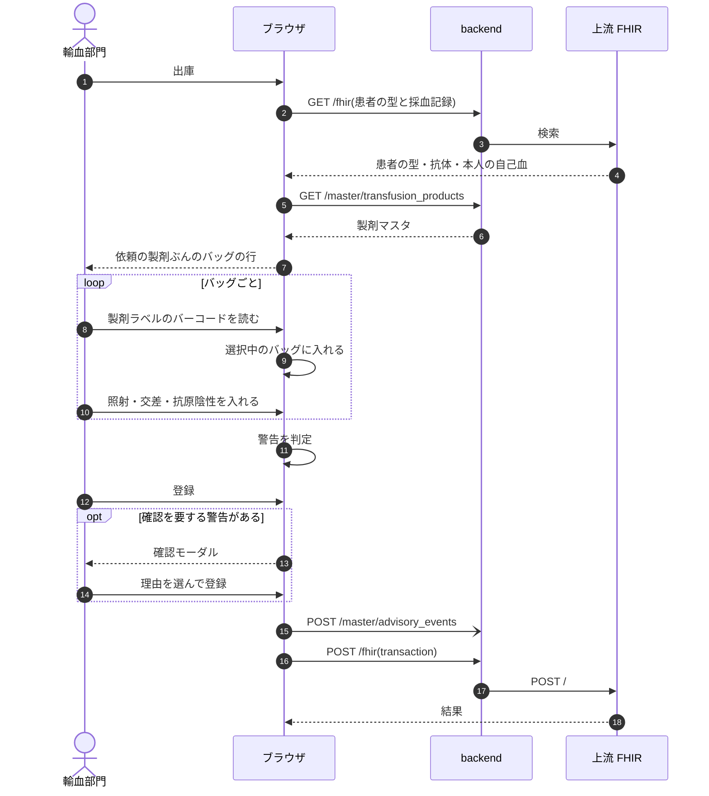

| 段 | 中身 |
|---|---|
| 患者の型と採血記録の検索 | 血液型・不規則抗体・プロファイル、自己血の採血記録 |
| 検索で分かること | 患者の型・同定した抗体・移植後の型・本人の自己血 |
| 製剤マスタ | 交差・照射の要否 |
| バーコード | ISBT 128 を振り分けて、選択中のバッグに入れる(下の表) |
| 手で入れるもの | 照射・交差適合試験の結果・抗原陰性の確認 |
| transaction | POST `Procedure`(出庫記録ハブ)、POST `MedicationDispense` × バッグ、`Task` transfusion = in-progress |

| ISBT 128 の先頭の記号 | 中身 |
|---|---|
| `=` | 献血番号(製剤番号として入る) |
| `=<` | 製品 |
| `=%` | 血液型 |
| `&>` | 有効期限 |

警告の判定(`dispenseAdvisories`)は次のとおりです。①〜⑤ は「運用フロー」の「出庫の流れ」の表と同じ番号です。

| 警告 | 種別(`kind`) |
|---|---|
| ① 患者の型との適合 | `dispense-blood-type` |
| ② 依頼の型との一致 | `dispense-requested-type` |
| ③ 依頼の製剤との一致 | `dispense-product` |
| ④ 有効期限と投与予定日 | `dispense-expiry` |
| ⑤ 不規則抗体(抗原陰性の確認、同定していない陽性) | `antibody-positive` |
| 照射 | `dispense-irradiation` |
| 交差適合試験(未入力・不適合) | `dispense-crossmatch` |
| 自己血の本人照合 | `autologous-mismatch` |

## 実施・実施取消・副作用追記

**実施入力**

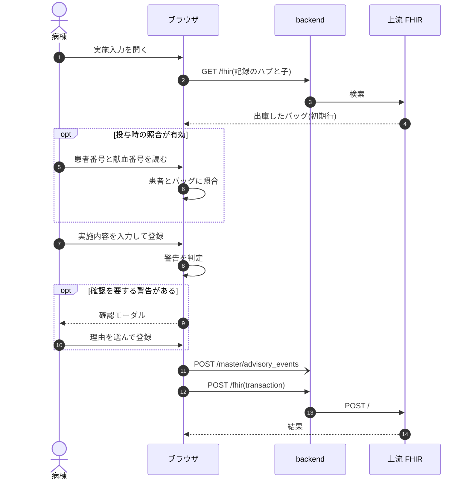

| 段 | 中身 |
|---|---|
| 入口 | 一覧の「実施」か、カードの「実施入力」 |
| 記録のハブと子の検索 | `Procedure?based-on` + `MedicationDispense`・`MedicationAdministration`・`Observation` |
| 照合 | 患者の `identifier` と、出庫したバッグに照合する。読めないときはスキップ理由を選ぶ。一致しない間は「照合完了」を押せない(`TransfusionVerifyStep.tsx`) |
| 入力 | 時刻・実施者・確認者・バッグの実施 / 未実施 / 返却・観察・副作用 |
| 警告の判定 | 出庫記録との突き合わせ・期限・照射・交差・型 |

| transaction に入れるもの | 補足 |
|---|---|
| POST `Procedure`(実施記録ハブ) | `performedPeriod`、照合の拡張 |
| POST `MedicationAdministration` × バッグ | 未実施・返却は `not-done` |
| POST `Observation`(副作用) | immediate |
| POST `Observation` × 観察の時点 | `vital-signs` |
| `Task` transfusion = completed | |

**実施取消**

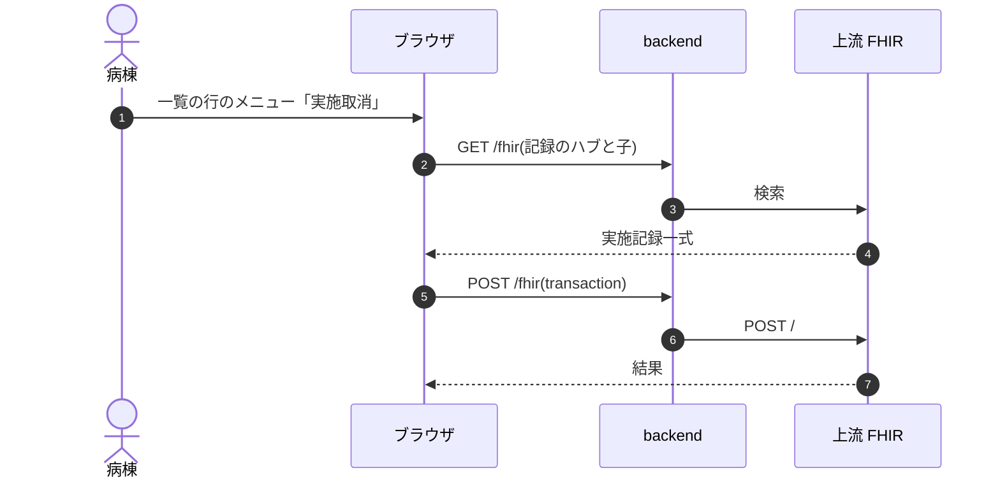

検索は `Procedure?based-on` + 子です。transaction は、DELETE `Observation`・`MedicationAdministration` → `Procedure`(実施記録)、`Task` transfusion = in-progress です。

**副作用追記**

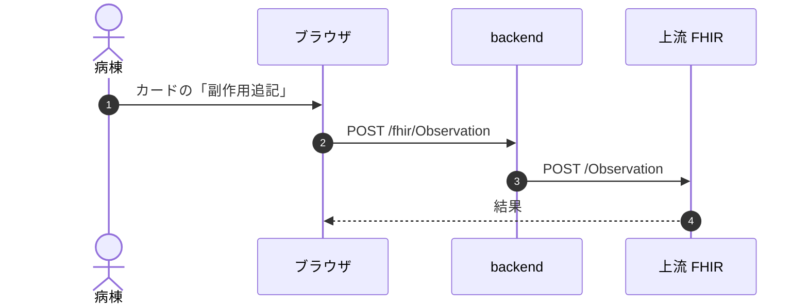

入力は発症日時・症状・内容です。`Observation` は副作用 delayed で、`partOf` = 実施記録ハブです。

## 自己血の採血

**採血**

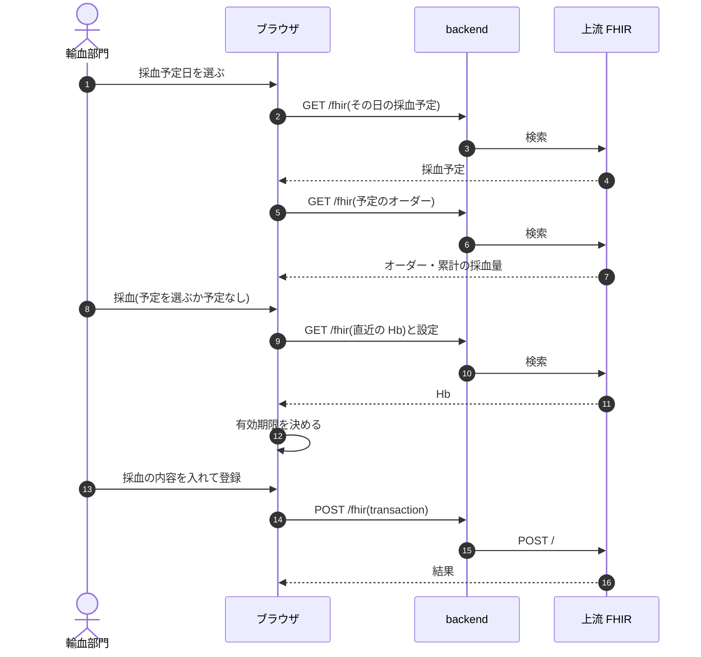

| 段 | 中身 |
|---|---|
| その日の採血予定の検索 | `Appointment?service-type=autologous&date` |
| 予定のオーダーの検索 | `ServiceRequest?_id` + 明細・`Task`・採血記録 |
| Hb と設定 | 直近の Hb と `GET /master/facility_settings`。下限未満・未検査は警告 |
| 有効期限 | 採血日 + 製剤マスタの有効日数 |
| 入力 | 採血日時・採血量・製剤番号 |
| transaction | POST `Procedure`(採血記録ハブ、予定への参照)、POST `MedicationDispense`(preparation、製剤番号・型・期限)、予定を PUT `Appointment` = fulfilled |

**採血ラベル**

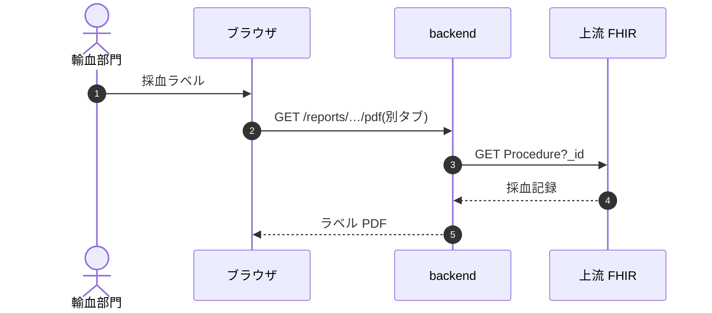

パスは `GET /reports/autologous_labels/:procedure_id/pdf` です。backend は採血記録から患者と採った血を読みます。

## 中止

`useUpdateTransfusionTaskStatus`(`api/queries/transfusion.ts`)が書きます。出庫記録・採血記録は残します。

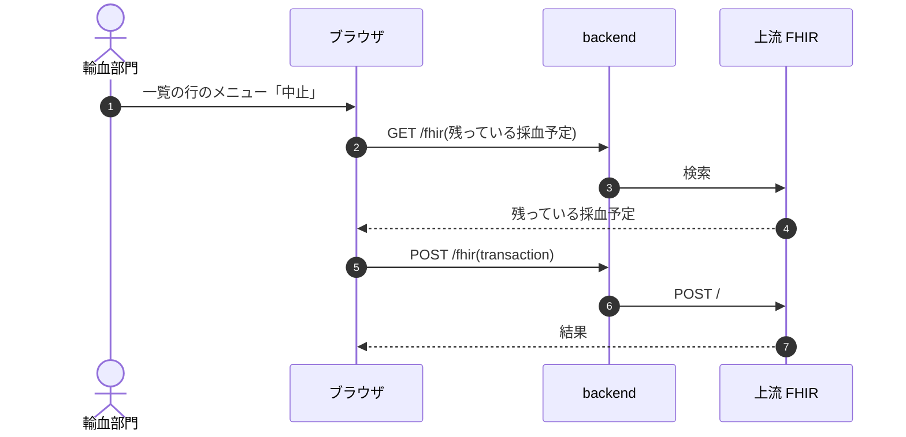

| 段 | 中身 |
|---|---|
| 残っている採血予定の検索 | `Appointment?based-on`、`status=booked` |
| transaction | `Task` transfusion = cancelled、PUT `ServiceRequest`(ヘッダ)= revoked、PUT `Appointment` = cancelled × 残りの予定 |

## 医事会計と SS-MIX2

輸血は実施記録から集めます(`BillingClaimBuilder` の `:procedure` 経路、`Resolvers::Transfusion`)。`BillingClaimBuilder` が組むのは外来 1 日ぶんの診療行為なので、送るのは外来の輸血です。
SS-MIX2 のメッセージは、どの操作でも作りません(輸血のメッセージは持ちません)。登録・編集・受付・出庫では、医事会計にも何も送りません。

| 起きたこと | 医事会計(`BillingClaimBuilder`) |
|---|---|
| 実施 | 投与した(`completed`)バッグと手技を送る(下の箇条書き) |
| 未実施・返却のバッグ | 数えない |
| 実施記録の無い当日のオーダー | 「実施記録がありません(未実施のため送りません)」と報告する |
| 実施取消 | 対象から外れる |
| 中止 | 対象から外れる(`ServiceRequest` が `revoked`) |
| 削除 | 対象から外れる |

- **製剤**: 投与したバッグを、製剤マスタの医薬品コードで 1 袋ずつ送ります。
- **手技**: 施設設定の保存血液輸血です。1 回目 × 1、2 回目以降 ×(単位数 − 1)で送ります。
- **自己血**: 自己血だけなら手技は付きません。自己血の製剤は医薬品コードが無いので「送れない項目」に出ます。

製剤番号は上流の `MedicationAdministration?lot-number` で引けるので、ロット管理画面の検索で輸血の製剤番号も逆引きできます。
