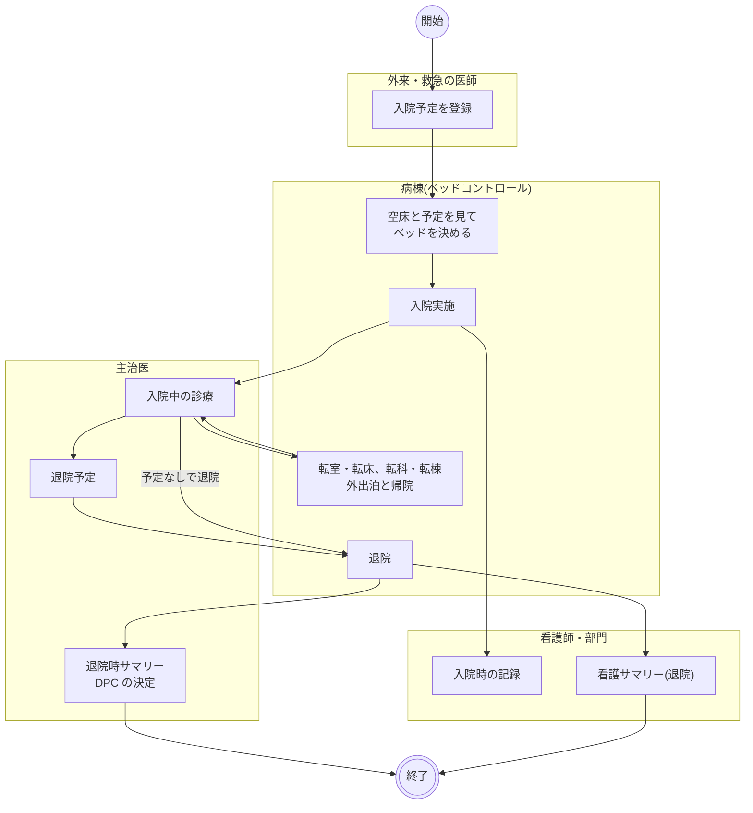
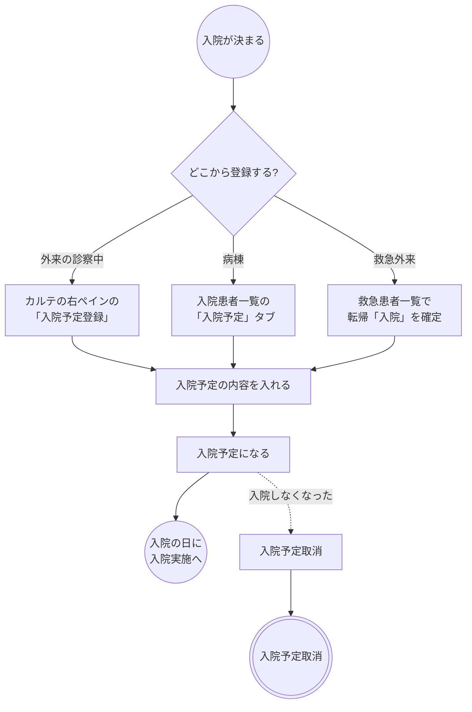
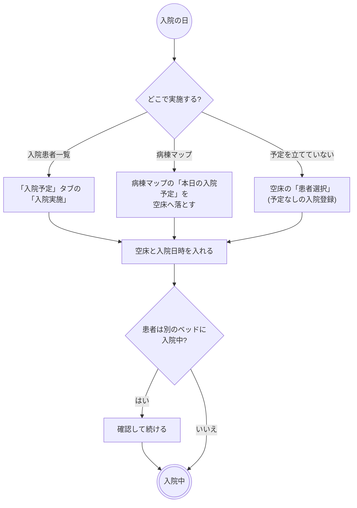
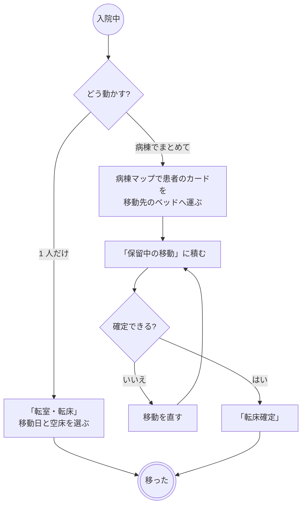
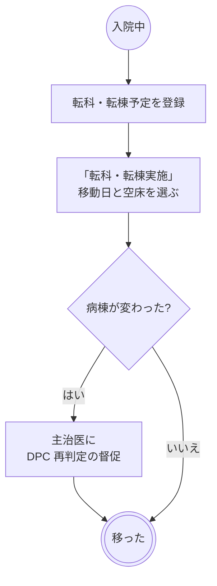
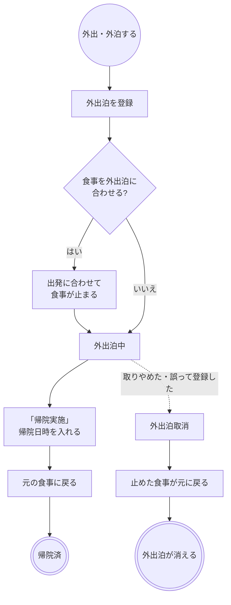
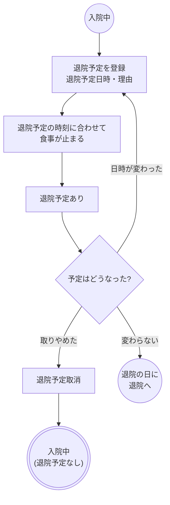
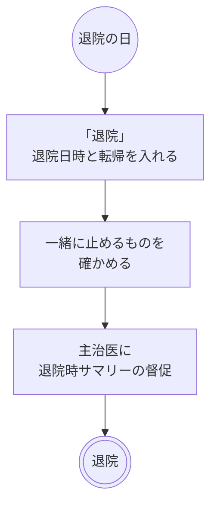

# 入院から退院までの業務フロー

<!-- ../fhir-client/docs/order-flows/admission-discharge.md から scripts/sync-flows.mjs で作る。直接編集しない。 -->

入院を、入院予定の登録からベッドの割り当てと入院実施、入院中の転室・転床・転科・転棟・外出泊、退院予定と退院、退院後の文書まで追う流れです。
入院は、患者 1 人の 1 回の入院を 1 件として扱います。入院予定から退院まで、その 1 件の状態と居場所(ベッド)が移っていきます。
入院中のオーダーはそれぞれの種別の流れに乗ります。退院のときは、食事・看護指示・リハビリ・栄養指導・服薬指導・入院の透析・持参薬を一緒に止められます。外出泊と退院予定で止まるのは食事だけです。
連動の細部は各種別の業務フローにあります([食事オーダーの業務フロー](meal.md)「[入退院・外出泊との連動](meal.md#入退院外出泊との連動)」、[看護指示](nursing.md)、[リハビリ](rehab.md)、[栄養指導・服薬指導](guidance.md))。

外来・救急の医師 病棟(ベッドコントロール) 主治医 看護師・部門

## 全体の流れ

| 段 | 行うこと |
|---|---|
| ベッドを決める | ベッドスケジュールと病床状況で、空床(空いているベッド)と予定を見る |
| 入院実施 | 空床を選び、入院日時を確定する |
| 入院中の診療 | オーダー、クリニカルパス、入院診療計画書 |
| 入院時の記録 | 看護プロファイル、持参薬、栄養スクリーニング、褥瘡リスク評価 |
| 転科・転棟 | 主治医が転科・転棟予定を立て、病棟が実施する |
| 退院予定 | 登録すると、退院の時刻に合わせて食事が止まる |
| 退院 | 食事・看護指示・リハビリなどを一緒に止める |

この文書で使う呼び名は次のとおりです。

- **転室・転床**: 同じ病棟の中で、病室やベッドを移ること。
- **転科・転棟**: 別の病棟や別の診療科へ移ること。
- **空床**: 患者の入っていないベッド。
- **督促**: 文書の作成や DPC の決め直しを求める、主治医あての通知。

主に使う画面は次の 4 つです。ほかの画面は「ほかの画面とのつながり」にまとめます。

| 画面 | 見えるもの |
|---|---|
| 入院患者一覧 | 病棟と日付を選び、その日のベッドと患者を表で見る。入院・退院の操作の入口 |
| 病棟マップ | 病棟の間取りの上に、患者のカードが並ぶ |
| ベッドスケジュール | ベッド × 日付の表に、入院の期間が帯で出る |
| 病床状況 | 病棟ごとの在院数・空床数・稼働率などの集計 |

- **役割**: 役割の分け方は運用で決めます。入退院の操作はどの職種のログインでもできます。システムの権限で止めているのは、看護サマリーの承認など一部だけです。
- **クリニカルパス**: 入院実施の前でも、入院予定に対してクリニカルパスを当てられます。そのときの病日 1 は入院予定日です。

## 入院の状態

| 状態 | 意味 | 変わるきっかけ |
|---|---|---|
| 入院予定 | 入院が決まっている。病棟は決まっている | 入院予定の登録 |
| 入院中 | ベッドに居る | 入院実施、予定なしの入院登録 |
| 退院 | 退院日時で入院を終えた | 退院 |
| 入院予定取消 | 入院の予定がなくなった(誤りではない) | 入院予定取消 |
| 入院取消 | 誤って入院登録した | 入院取消 |

入院予定では、病室・ベッド・入院予定日は決まっていなくてもかまいません。

状態ごとの画面での見え方は次のとおりです。

| 状態 | 入院患者一覧 | 病棟マップ | ベッドスケジュール |
|---|---|---|---|
| 入院予定 | 「入院予定」タブ | 「本日の入院予定」 | 点線の帯。ベッド未定は最下段 |
| 入院中 | 「入院患者」タブ | 患者のカード | 塗りの帯 |
| 退院 | 「退院患者」タブ | – | 退院日までの帯 |
| 入院予定取消 | 出ない | 出ない | 出ない |
| 入院取消 | 出ない | 出ない | 出ない |

入院中の患者には、状態とは別に次の 3 種類の予定を登録できます。

| 予定 | 登録できる数 | 中身 | 済んだら |
|---|---|---|---|
| 転科・転棟予定 | 1 件。登録し直すと置き換わる | 予定日・移動先の病棟(必須)・病室・ベッド・診療科 | 転科・転棟の実施で消える |
| 外出泊 | 何件でも | 開始日時・帰院予定の日時・理由 | 帰院で「帰院済」になり、残る |
| 退院予定 | 1 件。登録し直すと置き換わる | 退院予定日時・理由 | 退院で消える |

- **履歴**: 退院・入院取消・入院予定取消のどれも、消さずに状態として残します。いつ誰が登録したかを後から追えます。
- **入院日数**: 入院日を 1 日目として数えます。
- **入院の情報を使うもの**: 入院中の患者の入院日・病棟・主治医は、次の 4 つの元になります。
    - オーダーの入院・外来の区分(入院が初めから選ばれる)
    - オーダーに残る入院病棟
    - クリニカルパスの病日
    - DPC の入院日

## 入院予定から入院実施まで

### 入院予定の登録

カルテの右ペインは、カルテの右側のオーダー入力の欄です。

| 項目 | 条件 |
|---|---|
| 病棟 | 必須。選ばずに登録すると入力エラーになる |
| 病室・ベッド | 任意 |
| 入院予定日 | 任意。空なら日付未定 |
| 診療科・主治医・担当看護師 | 任意 |
| 入院経路、予定・救急の区分、特記事項 | 任意 |

- **日付未定**: 入院予定は日付が決まっていなくても登録でき、そのまま入院実施できます。日付未定の入院予定は「入院予定」タブの先頭に並びます。
- **救急から**: 救急の転帰で「入院」を確定すると、そのまま入院予定の入力に進みます。病棟とベッドは救急では決めず、入院実施のときに決めます。
- **救急車**: 救急車で来た患者は、搬送の情報が入院経路に引き継がれます。
- **ベッドの重なり**: ベッドスケジュールでは、退院前の患者と入院予定が同じベッドに重なると、段を分けて並びます。ベッドを決めるときに重なりを見ます。

### 入院実施

| 項目 | 条件 |
|---|---|
| ベッド | 必須。空床から選ぶ |
| 入院日時 | 初めは今の日時が入っている(入院予定日ではない) |
| 診療科 | 必須。入院予定から引き継ぐ |
| 主治医 | 入院予定から引き継ぐ |

- **ベッドの選び直し**: 入院予定のベッドが埋まっていれば、その病棟の空床から選び直します。
- **予定なしの入院登録**: 入院患者一覧と病棟マップの空床の「患者選択」から、入院予定を立てずに入院を登録できます。患者・診療科・主治医・入院日時を入れます。
- **別のベッドに入院中の患者**: 確認を出しますが、登録は止めません。転床やデータ修正の途中のことがあるためです。
- **取消の使い分け**: 入院の予定がなくなったときは「入院予定取消」、誤って入院を登録したときは「入院取消」です。

## 入院時に書くもの

「入退院文書」の画面は、入院ごとの行と、文書ごとの列でできた表です。入院すると、その入院の行ができ、文書ごとに作成状況と期限が出ます。

| 文書 | 期限(初めの設定) | 書く人の目安 | 対象 |
|---|---|---|---|
| 褥瘡リスク評価 | 入院日 + 1 日 | 看護師 | 全員 |
| 栄養スクリーニング | 入院日 + 3 日 | 看護師・管理栄養士 | 全員 |
| 入院診療計画書 | 入院日 + 7 日 | 主治医 | 全員 |
| 栄養管理計画書 | 入院日 + 7 日 | 管理栄養士 | 特別な栄養管理が要る入院 |
| 褥瘡対策計画書 | 入院日 + 7 日 | 看護師 | 計画が要ると判定された入院 |

- **書き始める**: 表のセルを押すとカルテが開きます。未作成なら、右ペインでその入院の文書の登録が始まります。
- **期限**: 期限を過ぎて作成済でないものは赤で出ます。
- **再評価**: 計画書は、再評価の時期を過ぎても入院が続いていると「再評価」と出ます。
- **栄養管理計画書の対象**: 栄養スクリーニングか入院診療計画書で「特別な栄養管理の必要性」を有とした入院です。
- **褥瘡対策計画書の対象**: 褥瘡リスク評価で計画が要ると判定された入院です。褥瘡リスク評価は看護プロファイルの中で書きます。
- **設定する人へ**: 期限と文書の様式は「施設設定」の「文書作成の督促」で決めます。様式を決めていない文書は、列が出ません。

このほかに、入院時には次の仕事があります。

- 持参薬の登録(カルテの「持参薬」タブ)。登録すると薬剤部に鑑別依頼が届きます。
- 看護プロファイルと看護計画。
- クリニカルパスの適用。

## 入院中の移動

### 転室・転床

- **病棟マップでの入れ替え**: カードを別の患者の居るベッドへ運ぶと、2 人を入れ替えます。「一時退避」に置けば、ベッドを空けられます。
- **確定できる条件**: 「一時退避」に患者が残っていないこと、ほかの端末でその入院が変更されていないことです。
- **転床確定**: 保留中の移動を、全件まとめて登録します。
- **履歴**: 移った履歴は消えず、いつまでどのベッドに居たかが入院に残ります。ベッドスケジュールでは、ベッドごとに帯が分かれます。

### 転科・転棟

| 場面 | 項目 | 条件 |
|---|---|---|
| 転科・転棟予定 | 予定日 | 入れる |
| 転科・転棟予定 | 移動先の病棟 | 必須 |
| 転科・転棟予定 | 病室・ベッド・診療科 | 任意 |
| 転科・転棟実施 | 移動日 | 入れる |
| 転科・転棟実施 | ベッド | 予定の病棟の空床から選ぶ |
| 転科・転棟実施 | 診療科 | 変えられる |

- **予定の表示**: 転科・転棟予定は、ベッドまで決まっていれば、ベッドスケジュールに「転予」の点線で出ます。
- **予定の取消**: 「転科・転棟」タブの行のメニュー(行の「︙」)の「転科・転棟予定取消」です。
- **ベッドの選び直し**: 予定のベッドが埋まっていることがあるので、実施の時点で空いているベッドから選び直します。
- **DPC 再判定の督促**: 病棟が変わったときだけ出ます。その入院に未対応の督促が既にあれば、重ねて出しません。転棟時の DPC の決定を保存すると閉じます。

### 転棟のときの注意

- **前に出したオーダーの病棟は変わりません**: オーダーに残る入院病棟は、オーダーを登録した時点のものです。
- **看護指示は前の病棟の指示簿に出続けます**: 転棟の前に出した看護指示は、転棟しても前の病棟の指示簿に出ます。

### 担当者変更と移動取消

- **担当者変更**: 「入院患者」タブの行のメニューの「担当者変更」で、主治医と担当看護師を差し替えます。
- **移動取消**: 誤って移したときは、行のメニューの「移動取消」で直前の 1 回を取り消します。移動前のベッドと診療科に戻ります。
- **移動取消の確認**: 移動前のベッドに別の患者が入っていれば確認で知らせますが、止めません。
- **移動取消と督促**: その転棟で出した DPC 再判定の督促も取り下げます。

## 外出泊

| 項目 | 条件 |
|---|---|
| 外出泊開始日時 | 必須 |
| 帰院予定の日時 | 任意。入れるなら開始より後 |
| 理由 | 任意 |
| 「食事オーダーを外出泊に合わせる」 | 初めはチェックが入っている |

食事は次のように止まり、戻ります。

| 時点 | 食事 |
|---|---|
| 出発 | 出発までに出る最後の食事で、いまの食事が止まる |
| 外出泊中 | 外泊食止めになる |
| 帰院予定の日時を入れたとき | 帰院後の最初の食事からの再開も、あらかじめ登録される |
| 帰院実施 | 帰院後の最初の食事から、元の食事に戻る |
| 外出泊取消 | 外泊食止めと再開が消え、元の食事に戻る |

- **表示**: 外出泊中の患者は、病棟マップのカードに札が付き、「外出泊」タブに並びます。
- **回数**: 1 回の入院に何度でも外出泊を登録できます。登録済みの外出泊は登録の画面に並び、間違えたものを外せます。
- **止める食事**: 止める食事と戻す食事は手で選びません。食事の提供時刻と、出発・帰院の時刻から決まります。登録の画面で、止める食事と再開する食事を確かめられます。
- **期間の変更**: 外出泊の期間を後から直す操作はありません。取り消して登録し直します。食事もいったん戻ってから、止まり直します。
- **食事のほかは止まりません**: 外出泊中でも、看護指示・リハビリなどは自動では止まりません。
- **設定する人へ**: 食事の提供時刻は施設設定で決めます。食止めの食種がマスタに無いと、外泊食止めは登録されず、食事の終了と再開だけが行われます。

## 退院予定と退院

### 退院予定

- **退院食止め**: 退院予定を登録すると、退院予定の時刻までに出る最後の食事で、食事が止まります。これを退院食止めと呼びます。
- **表示**: 退院予定のある患者は「退院予定」タブに並び、病棟マップのカードに札が付きます。ベッドスケジュールの帯は退院予定日で止まります。
- **登録し直す**: 退院予定を登録し直すと、止めた食事も新しい日時に合わせて止まり直します。
- **退院予定取消**: 退院予定がなくなり、退院食止めで止めた食事が元に戻ります。

### 退院

退院は、「退院予定」タブの「退院実施」か、「入院患者」タブの行のメニューの「退院」から行います。退院予定を立てずに、当日に退院することもできます。

| 項目 | 条件 |
|---|---|
| 退院日時 | 必須。初めは今の日時。入院日より前にはできない |
| 転帰(退院先) | 任意 |

一緒に止めるものは次のとおりです。初めはすべてチェックが入っています。

| 止めるもの | 止め方 |
|---|---|
| 食事 | 退院時刻までに出る最後の食事で終わる |
| 看護指示 | 退院日で終わる |
| リハビリ | 退院日で終わる。翌日以降の予約は取り消される |
| 栄養指導 | 退院日で終わる。翌日以降の予約は取り消される |
| 服薬指導 | 退院日で終わる |
| 入院の透析 | 退院日で終わる。翌日以降の予約は取り消される |
| 持参薬 | 継続中・休止中のものが終わる。鑑別依頼は取り下げられる |

- **同時に止まります**: 退院と、チェックしたものの終了は同時に登録されます。退院だけ登録されて、オーダーが残ることはありません。
- **チェックを外したもの**: 止まりません。外来で続けるリハビリや栄養指導は、チェックを外します。
- **退院予定から退院したとき**: 退院予定で止めていた食事は、止めた理由が「退院」に変わります。
- **看護指示**: 退院日が終了日になるだけで、指示受けの状態は変わりません。
- **リハビリ・栄養指導**: 部門の「終了」は、退院では付きません。部門が終了にします。
- **透析**: 止める候補に出るのは、入院のオーダーだけです。外来の維持透析は入院と退院をまたいで続くので、候補に出ません。
- **転帰**: 退院の画面でも、退院時サマリーでも書けます。
- **退院時サマリーの督促**: 確定済みの退院時サマリーがある入院と、未対応の督促がある入院には出しません。
- **クリニカルパス**: 退院しても自動では終わりません。パスタブで終了・中止を記録します。
- **ベッド**: 退院すると、そのベッドはすぐ空床として選べます。同じ日の入院予定を入れられます。

## 退院後に書くもの

| 文書 | 期限(初めの設定) | 書く人 |
|---|---|---|
| 退院時サマリー | 退院日 + 14 日 | 主治医 |
| 看護サマリー(区分「退院」) | 退院日 + 7 日 | 担当看護師 |
| DPC の決定(退院時) | なし | 主治医・医事 |
| DPC 様式 1 | なし | 医事 |

- **退院時サマリーの督促**: 退院すると、通知「文書作成」が主治医に届きます。退院時サマリーを確定で保存すると閉じます。退院時サマリーが要らない入院は、通知一覧の「対応済」で閉じます。
- **退院時サマリーの書き始め**: 入院中から書き始められます。
- **退院時サマリーに初めから入るもの**: 入院期間のプロブレム、入院経過、手術処置、退院時処方、アレルギーです。入院経過には、入院・転棟・転床・外泊・退院と手術が入ります。
- **看護サマリー**: 入退院文書の列に作成状況が出ます。病棟の「看護サマリー承認」で承認します。
- **DPC の決定**: カルテの「診断群分類」タブで判定して決定します。DPC 患者一覧で、未決定と期間Ⅱ超えを見ます。
- **DPC 様式 1**: 入院の情報と退院時サマリーなどから、初めの値が入ります。
- **入退院文書での表示**: 退院のときの文書は、退院するまで「退院後」と出ます。書き始めていれば、その状態が出ます。
- **設定する人へ**: 退院時サマリーの期限の日数は施設設定で決めます。

## 取消

| 取消 | どこから | 起きること |
|---|---|---|
| 入院予定取消 | 「入院予定」タブの行のメニュー | 状態が入院予定取消になる |
| 入院取消 | 「入院患者」タブの行のメニュー | 状態が入院取消になる |
| 移動取消 | 「入院患者」タブの行のメニュー | 直前の 1 回の移動を取り消す |
| 転科・転棟予定取消 | 「転科・転棟」タブの行のメニュー | 転科・転棟予定がなくなる |
| 外出泊取消 | 「外出泊」タブの行のメニュー、外出泊の登録の画面 | 外出泊がなくなり、止めた食事が戻る |
| 退院予定取消 | 「退院予定」タブの行のメニュー | 退院予定がなくなり、止めた食事が戻る |
| 退院取消 | 「退院患者」タブの行のメニュー | 入院中に戻る |

- **確認だけ**: 取消はどれも確認だけで、理由は残しません。
- **入院予定取消と入院取消**: どちらも、取り消した入院はどの一覧にも出なくなります。入院取消は、その入院の DPC 再判定の督促も取り下げます。
- **移動取消**: 一度でも移った入院にだけ出ます。前のベッドと診療科に戻り、その転棟の DPC 再判定の督促を取り下げます。
- **退院取消で戻るもの**: 入院と食事だけです。退院時サマリーの督促は取り下げます。
- **退院取消で戻らないもの**: 看護指示・リハビリ・栄養指導・服薬指導に入れた終了日、取り消した予約、終了にした持参薬、退院のときに消えた退院予定です。続けるものは出し直し、退院予定は必要なら立て直します。
- **退院取消の確認**: 退院したベッドに別の患者が入っていれば、確認で知らせます。

## ほかの画面とのつながり

| 画面 | 入院に関わる所 |
|---|---|
| 入院患者一覧 | その日のベッドと患者。6 つのタブ |
| 病棟マップ | 患者のカードと札、転床のまとめ確定、本日の入院予定 |
| ベッドスケジュール | 実績は塗りの帯、予定は点線の帯 |
| 病床状況 | 病棟ごとの集計 |
| 入退院文書 | 入院時・退院時の文書の作成状況と期限 |
| カルテ | 患者の見出しに入院中の病棟と入院日数 |
| 看護の画面 | 病棟の入院患者で一覧を組む |
| 給食部門の食事一覧 | 転棟した患者は、いまの病棟に出る |
| マルチチャート | 入院は期間のバー、転棟と外出泊は印 |
| データ抽出 | 「入院・外来」タブで、入院 1 件が 1 行 |

- **入院患者一覧のタブ**: 「入院予定」「入院患者」「転科・転棟」「外出泊」「退院予定」「退院患者」です。
- **入院患者一覧の列**: クリニカルパス・DPC・NEWS2 の列と、指示受けの札があります。経過表の一括入力もここから開きます。
- **病棟マップの札**: 退院予定・転棟予定・外出泊中の札が、患者のカードに付きます。
- **ベッドスケジュールの予定**: 入院予定は「入予」、転科・転棟予定は「転予」と出ます。ベッド未定の入院予定は最下段に並びます。
- **病床状況の集計**: 在院数、稼働率、空床数、当日の入退院と転出入、翌日の予定、病床利用率、平均在院日数です。
- **カルテのタブ**: 退院時サマリー、看護サマリー、持参薬、DPC のタブがあります。
- **看護の画面**: 指示簿、ワークシート、看護必要度、看護サマリー承認です。
- **同じ入院を見ています**: 入院患者一覧・病棟マップ・ベッドスケジュール・病床状況・入退院文書・看護必要度・DPC 患者一覧は、同じ入院の情報を表示します。
