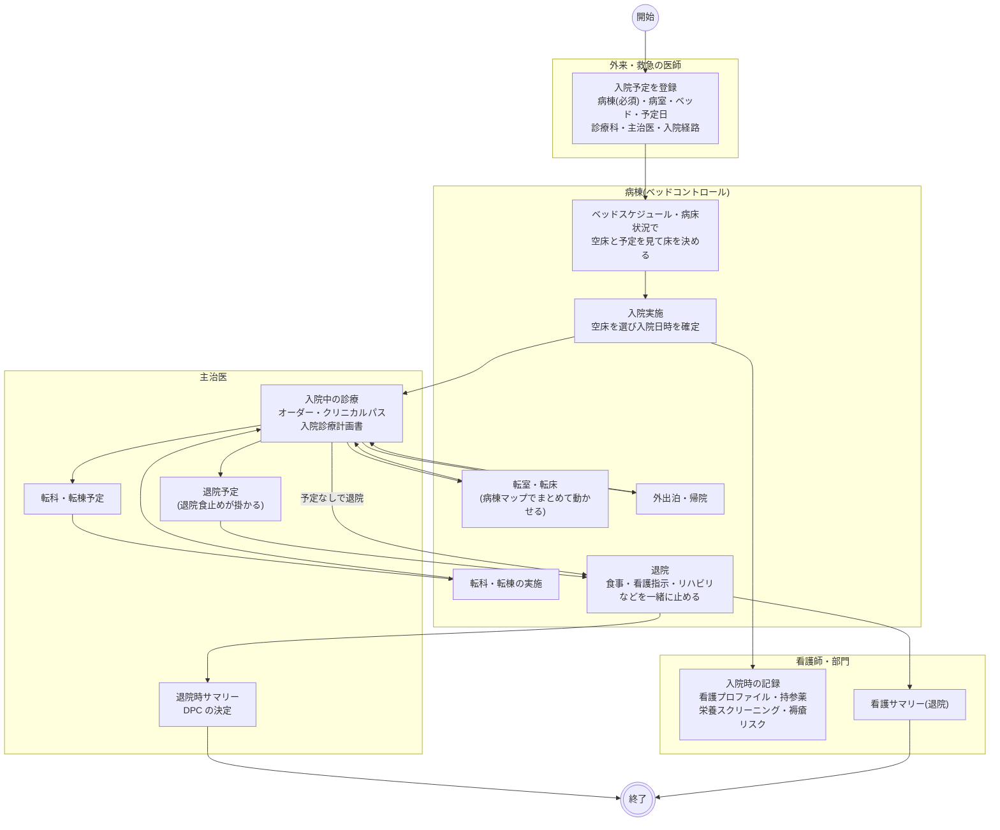
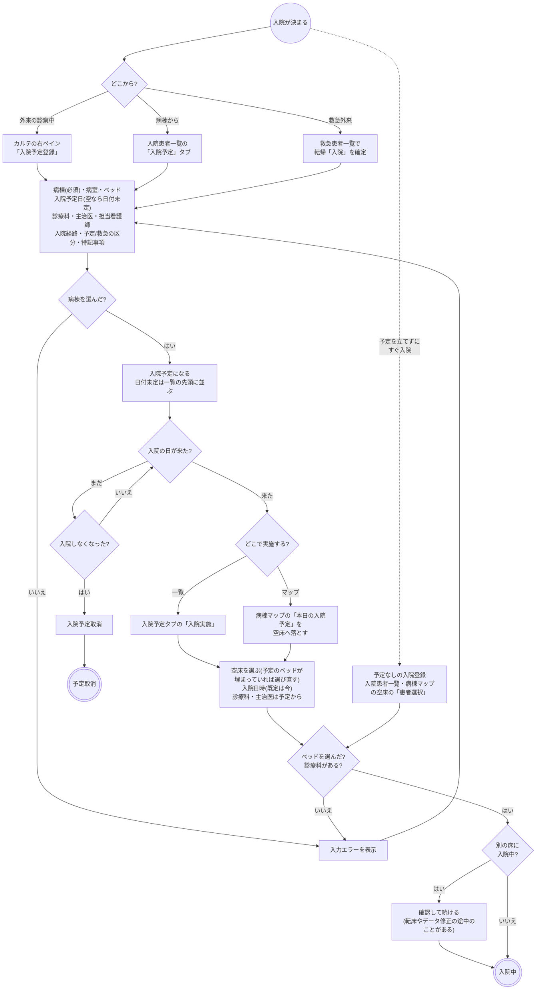
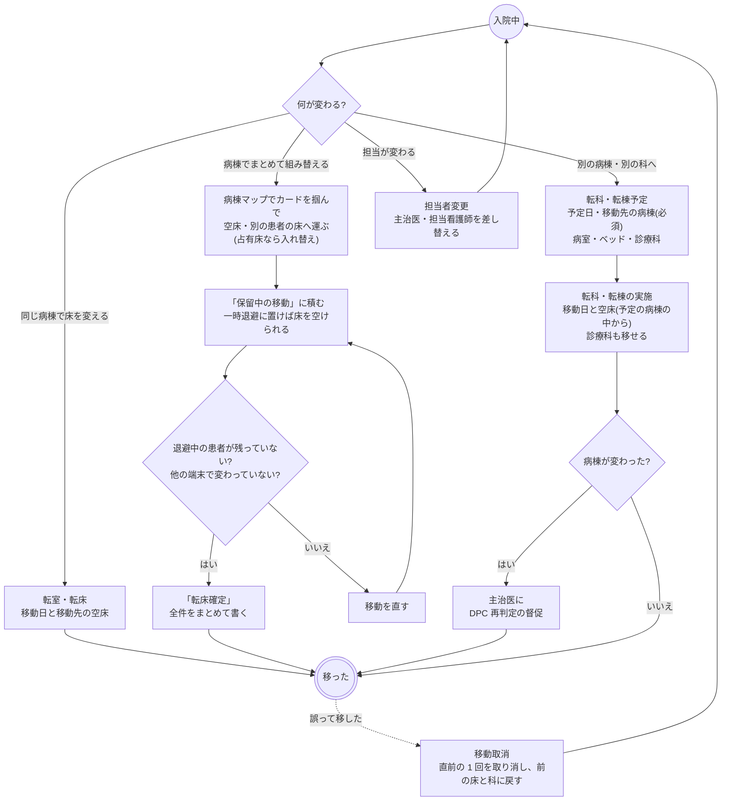
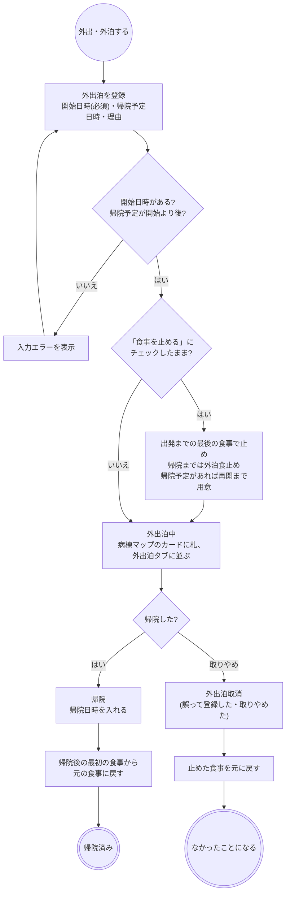
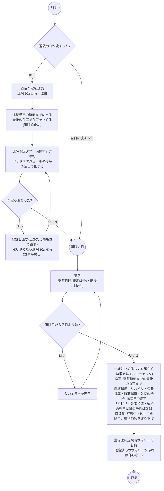

# 入院から退院までの業務フロー

<!-- ../fhir-client/docs/order-flows/admission-discharge.md から scripts/sync-flows.mjs で作る。直接編集しない。 -->

入院を、入院予定の登録からベッドの割り当てと入院実施、入院中の転室・転床・転科・転棟・外出泊、退院予定と退院、退院後の文書まで追う流れです。
入院は**患者 1 人の 1 回の入院を 1 件の記録**で表し、予定から退院までその記録の状態と居場所(ベッド)が移っていきます。入院中のオーダーはそれぞれの種別の流れに乗りますが、食事・看護指示・リハビリ・栄養指導・服薬指導・持参薬は退院や外出泊に合わせて止まり、戻ります。その連動の細部は各種別の業務フロー([食事](meal.md#入退院外出泊との連動)、[看護指示](nursing.md)、[リハビリ](rehab.md)、[栄養指導・服薬指導](guidance.md))を読みます。

外来・救急の医師 病棟(ベッドコントロール) 主治医 看護師・部門

## 入院の状態

| 状態 | 意味 | 変わるきっかけ | 一覧での見え方 |
|---|---|---|---|
| 入院予定 | 入院が決まっている。病棟は決まり、病室・ベッド・日付は未定でもよい | 入院予定の登録(カルテ右ペイン・入院患者一覧・救急の転帰「入院」) | 入院患者一覧の「入院予定」タブ、ベッドスケジュールの点線の帯(ベッド未定は最下段)、病棟マップの「本日の入院予定」 |
| 入院中 | ベッドに居る | 入院実施(予定から)、空床への入院登録(予定なし) | 入院患者一覧の「入院患者」タブ、病棟マップのカード、ベッドスケジュールの塗りの帯 |
| 退院 | 退院日時で入院を終えた | 退院 | 「退院患者」タブ、ベッドスケジュールの退院日までの帯 |
| 入院予定取消 | 予定がなくなった(誤りではない) | 入院予定取消 | どこにも出ない |
| 入院取消 | 誤って入院登録した | 入院取消 | どこにも出ない |

入院中の患者には、状態とは別に**予定のメモ**を 1 件ずつ持てます。

| 予定 | 持てる数 | 中身 | 済んだら |
|---|---|---|---|
| 転科・転棟予定 | 1 件(登録し直すと置き換わる) | 予定日・移動先の病棟(必須)・病室・ベッド・診療科 | 転科・転棟の実施で消える |
| 外出泊 | 何件でも | 開始日時・終了(帰院予定)日時・理由・帰院済みか | 帰院で「帰院済み」になり、記録として残る |
| 退院予定 | 1 件(登録し直すと置き換わる) | 退院予定日時・理由 | 退院で消える |

- 記録は消さずに状態で残します。退院・入院取消・予定取消のどれも、いつ誰が登録したかを後から追えます。
- 入院日数は保存せず、入院日を 1 日目として数えます。
- 入院中の患者の入院日・病棟・主治医は、オーダーの入外区分の初期値、オーダーに残す入院病棟、クリニカルパスの病日、DPC の入院日の元になります。

## 全体の流れ

- 役割の分け方は運用で決めます。システムの権限で止めているのは一部(看護サマリーの承認など)だけで、入退院の操作はどの職種のログインでもできます。
- 入院実施の前でも、入院予定に対してクリニカルパスを当てられます(病日 1 は予定日)。
- 入院中の情報は、入院患者一覧・病棟マップ・ベッドスケジュール・病床状況・入退院文書・看護必要度・DPC 患者一覧が同じ入院の記録から読みます。

## 入院予定から入院実施まで

- 入院予定は日付が決まっていなくても登録でき、そのまま入院実施できます。「日付を確定してから実施」という段階はありません。
- 救急の転帰で「入院」を確定すると、そのまま入院予定の入力に進みます。病棟・ベッドは救急では決めず、入院予定から入院実施の流れに乗せます。救急車で来た患者は入院経路に搬送が引き継がれます。
- 入院実施は予定日ではなく今日の日時が既定です。予定のベッドが埋まっていれば、その病棟の空床から選び直します。
- 入院予定取消と入院取消は別の操作です。予定がなくなったのは誤りではないので「取消」、入院を誤って登録したのは「入院取消」です。
- ベッドスケジュールでは、退院前の患者と入院予定が同じベッドに重なると段を分けて積みます。床を決めるときに重なりを見ます。

## 入院時に書くもの

入院すると、入退院文書にその入院の行ができ、期限つきで作成状況が出ます。期限・テンプレートは施設設定「文書作成の督促」で決め、テンプレートが未設定の文書は列を出しません。

| 文書 | 期限の既定 | 書く人の目安 | 対象 |
|---|---|---|---|
| 褥瘡リスク評価 | 入院日 + 1 日 | 看護師(看護プロファイルの区画) | 全員 |
| 栄養スクリーニング | 入院日 + 3 日 | 看護師・管理栄養士 | 全員 |
| 入院診療計画書 | 入院日 + 7 日 | 主治医 | 全員 |
| 栄養管理計画書 | 入院日 + 7 日 | 管理栄養士 | スクリーニングか計画書で「特別な栄養管理」が有の入院 |
| 褥瘡対策計画書 | 入院日 + 7 日 | 看護師 | 褥瘡リスク評価で計画が要ると判定された入院 |

- セルを押すとカルテを開き、未作成なら右ペインでその入院の登録を始めます。期限を過ぎて作成済でないものは赤です。
- 計画書は再評価の時期を過ぎて在院していると「再評価」が出ます。
- このほか、持参薬(カルテの「持参薬」タブ。登録すると薬剤部に鑑別依頼が届く)、看護プロファイル、看護計画、クリニカルパスの適用が入院時の仕事です。

## 入院中の移動

- 移った記録は消えず、「いつまでどの床に居たか」が入院に積み上がります。ベッドスケジュールでは床ごとに帯が分かれます。
- 転科・転棟予定は、ベッドまで決まっていればベッドスケジュールに「転予」の点線で出ます。予定の取消は転科・転棟タブの行のメニューからです。
- 転科・転棟の実施では、予定の床が埋まっていることがあるので、実施の時点で空いている床から選び直します。
- DPC 再判定の督促は、病棟が変わったときだけ、その入院に未対応の督促が無ければ出ます。転棟時の決定を保存すると閉じます。
- 移動取消は直前の 1 回ずつです。移動前の床に別の患者が入っていれば確認で知らせますが止めません。その転棟で出した DPC 再判定の督促も取り下げます。
- オーダーに残る入院病棟は登録した時点のものです。転棟しても前に出したオーダーの病棟は書き換わりません(看護指示は前の病棟の指示簿に出続けます)。

## 外出泊

- 1 回の入院に何度でも外出泊を登録できます。登録済みの外出泊は登録画面に並び、間違えたものを外せます。
- 止める食事・戻す食事は手で選ばず、施設設定の食事の提供時刻と出発・帰院の時刻から決まります。登録の画面で、止める食事と再開する食事を確かめられます。
- 外出泊の期間を後から直す操作はありません。取り消して登録し直すと、食事も戻ってから掛かり直ります。
- 外出泊中でも看護指示・リハビリなどは自動では止まりません。

## 退院予定と退院

- 退院予定だけでも食事は止まります(退院食止め)。予定のまま退院すると、止めた理由が「退院」に置き換わります。
- 退院で止めるものは、退院の記録と同じ 1 回の書き込みで書きます。退院だけ通ってオーダーが残ることはありません。チェックを外したものは止まりません。
- 看護指示は退院日を終了日にするだけで、指示受けの状態は動きません。リハビリ・栄養指導の進捗(部門の「終了」)も部門が締めます。
- 透析は入外区分が入院のオーダーだけを止めます。外来の維持透析は入院・退院をまたいで続くので出しません。
- 転帰は退院の画面でも退院時サマリーでも書けます。
- 退院してもクリニカルパスは自動では終わりません。パスタブで終了・中止を記録します。
- 退院するとそのベッドはすぐ空床として選べるようになり、同じ日の入院予定を入れられます。

## 退院後に書くもの

| 文書 | 期限の既定 | 書く人 | 督促・確認 |
|---|---|---|---|
| 退院時サマリー | 退院日 + 14 日(施設設定) | 主治医 | 退院で通知「文書作成」が主治医に届く。確定で保存すると閉じる。入院中から書き始められる |
| 看護サマリー(区分「退院」) | 退院日 + 7 日 | 担当看護師 | 入退院文書の列。病棟の「看護サマリー承認」で承認する |
| DPC の決定(退院時) | – | 主治医・医事 | 「診断群分類」タブで判定・決定。DPC 患者一覧で未決定・期間Ⅱ超えを見る |
| DPC 様式 1 | – | 医事 | 入院の情報と退院時サマリーなどから初期値を集める |

- 退院時サマリーは入院期間のプロブレム・入院経過(入院・転棟・転床・外泊・退院と手術)・手術処置・退院時処方・アレルギーを初期値に集めます。
- 入退院文書では、退院系の文書は退院するまで「退院後」と出し、書き始めていれば状態を出します。
- 退院時サマリーが不要な入院は、通知一覧の「対応済」で督促を閉じます。

## 取消

| 取消 | どこから | 何が戻るか |
|---|---|---|
| 入院予定取消 | 入院予定タブの行のメニュー | 予定がなくなる。誤りではないので記録は「取消」として残る |
| 入院取消 | 入院患者タブの行のメニュー | 誤登録として扱い、どの一覧にも出なくなる。その入院の DPC 再判定の督促を取り下げる |
| 移動取消 | 入院患者タブの行のメニュー(一度でも移った入院) | 直前の 1 回の移動を取り消し、前の床と診療科に戻す。その転棟の DPC 再判定の督促を取り下げる |
| 転科・転棟予定取消 | 転科・転棟タブの行のメニュー | 予定のメモを外す |
| 外出泊取消 | 外出泊タブの行のメニュー・外出泊の登録画面 | 外出泊を外し、止めた食事を元に戻す(食止め・再開のオーダーは消える) |
| 退院予定取消 | 退院予定タブの行のメニュー | 予定のメモを外し、退院食止めを元に戻す |
| 退院取消 | 退院患者タブの行のメニュー | 入院中に戻し、退院で止めた食事を戻し、退院時サマリーの督促を取り下げる。退院した床に別の患者が入っていれば確認で知らせる |

- 退院取消で戻るのは入院と食事だけです。看護指示・リハビリ・栄養指導・服薬指導に入れた終了日と、取り消した予約、終了にした持参薬は戻りません。続けるものは出し直します。
- 退院のときに消えた退院予定も戻りません。必要なら立て直します。
- 取消はどれも確認だけで、理由は残しません。

## ほかの画面とのつながり

| 画面 | 入院の使い方 |
|---|---|
| 入院患者一覧 | 病棟と日付で、その日の床と患者。タブは入院予定・入院患者・転科転棟・外出泊・退院予定・退院患者。パス・DPC・NEWS2 の列、指示受けの札、経過表一括入力 |
| 病棟マップ | 間取りの上の患者カード(退院予定・転棟予定・外出泊中の札)、転床のまとめ確定、本日の入院予定を空床へ |
| ベッドスケジュール | ベッド × 日付の帯。実績は塗り、予定(入予・転予)は点線、ベッド未定の予定は最下段 |
| 病床状況 | 病棟ごとの在院・稼働率・空床・当日の入退院と転出入・翌日の予定・病床利用率・平均在院日数 |
| 入退院文書 | 入院時・退院時の文書の作成状況と期限 |
| カルテ | 患者ヘッダに入院中の病棟・入院日数。退院時サマリー・看護サマリー・持参薬・DPC のタブ。オーダーの入外区分の初期値 |
| 看護の画面 | 指示簿・ワークシート・看護必要度・看護サマリー承認は病棟の入院患者で組む |
| 給食部門の食事一覧 | 入院のいまのベッドで病棟を決める。転棟した患者はいまの病棟に出る |
| マルチチャート | 入院を期間のバー、転棟・外出泊を印で出す |
| データ抽出 | 「入院・外来」タブで入院 1 件 1 行 |
