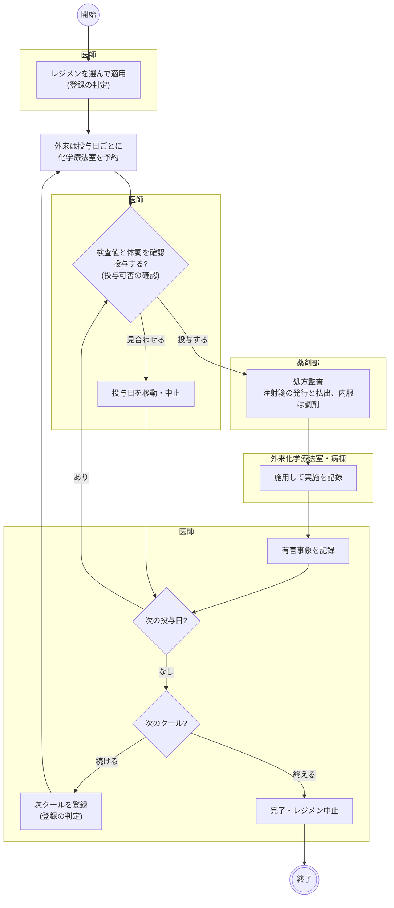
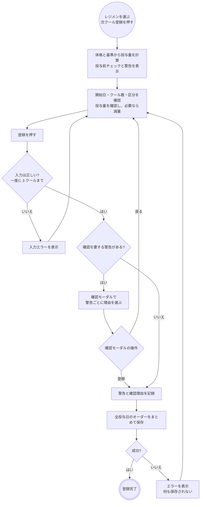
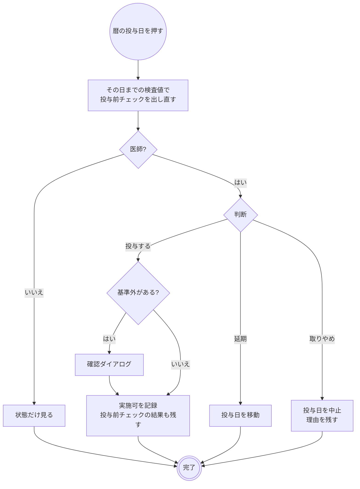

# 化学療法の業務フロー

<!-- ../fhir-client/docs/order-flows/chemotherapy.md から scripts/sync-flows.mjs で作る。直接編集しない。 -->

レジメンの適用からクールの登録、当日の投与可否の確認、投与、終了までの流れです。
投与日の注射と内服は通常の注射・処方として流れるので、払出・調剤・実施の細部は[注射オーダーの業務フロー](injection.md)と[処方オーダーの業務フロー](prescription.md)を読みます。

医師 薬剤部 外来化学療法室・病棟

## 通常の注射・処方との違い

| 投与日のオーダー | 処方監査 | 帳票 | 払出・調剤 | 実施の記録 | 医事会計への送信 |
|---|---|---|---|---|---|
| 注射 | あり(投与日ごと) | 注射箋・注射ラベル(レジメン名・クール・Day 入り) | 払出登録 | あり | 外来は実施の記録から。外来化学療法加算と無菌製剤処理料を足す |
| 内服(入院) | あり | 処方箋(備考にレジメン名・クール・Day) | 調剤登録 | 経過表で | なし(外来のみ) |
| 内服(外来・院内) | あり | 処方箋(同上) | 調剤登録 | なし | 投与日の会計に載る |
| 内服(外来・院外) | なし(保険薬局が監査) | 院外処方箋(同上) | 保険薬局が調剤 | なし | 投与日の会計に載る |

- 適用 1 件で、開始日から 1〜3 クールを一度に登録します。投与日ごとに、その日の注射をまとめた 1 オーダーと、内服をまとめた 1 オーダーができます。
- 注射は注射日で注射一覧に、内服は投与開始日で処方一覧に並びます。数クール分をまとめて登録しても、登録した日の一覧には載りません。
- 処方監査は投与日のオーダーごとに行います。連日の注射のように束ねません。登録した日から未監査に並ぶので、先のクールも同じです。
- 処方監査一覧と注射一覧にレジメン名・クール・Day が出ます。監査の画面では体格と体表面積あたりの量も確かめられます。施設設定「監査済まで調剤登録・払出登録を出さない」も通常の注射・処方と同じくかかります。
- 中止しても監査は未監査のまま残ります。一覧の進捗に「中止」が出るので、薬剤師が監査済にして閉じます。
- 疑義照会は注射・処方と同じです([処方オーダーの疑義照会の流れ](prescription.md#疑義照会の流れ))。
- 投与日のオーダーは DO できません。同じ内容をもう一度出すときは次クールを登録します。

## レジメンマスタの状態

| 状態 | 適用 | 内容の変更 |
|---|---|---|
| 下書き | できない | できる |
| 承認済 | 有効期間内ならできる | できない。複製して承認し直し、元を廃止する |
| 廃止 | できない | できない |

承認済を下書きへ戻せるのは、患者に 1 件も適用していないレジメンだけです。治療中の患者の次クールは、元のレジメンが廃止や有効期間外になっても注意を出して登録できます。

## 適用の状態

| 状態 | 変わるきっかけ | レジメン詳細からできること |
|---|---|---|
| 適用中 | 適用、再開 | 次クール登録、休止、適用編集、完了、レジメン中止、クール取消 |
| 休止 | 休止 | 再開、適用編集、完了、レジメン中止、クール取消 |
| 完了 | 完了 | 帳票の表示 |
| 中止 | レジメン中止(理由を選ぶ) | 帳票の表示 |

- 予定クール数に達しても自動では完了しません。最後のクールを終えたら医師が完了にします。予定クール数は適用編集で延ばせます。
- 休止は適用の状態だけを変え、登録済みの投与日はそのまま残します。一覧・払出登録・調剤登録に「休止中」の印が出ますが、払出と実施は止まりません。投与を止めるときは投与日を中止します。
- 完了とレジメン中止は、未実施の投与日をすべて中止にして、その日の化学療法室の予約も取り消します。実施済の日は残ります。
- 適用中・休止の適用があると、患者帯に化学療法のピクトグラムが出ます。

## 全体の流れ

- 図は標準の順序です。投与可否の確認は払出と実施を止めません。未確認のままでも払出と実施はできます。
- クールの途中でも休止できます。休止の間は次クールを登録できません(適用の状態)。
- 見合わせた日のために払い出した薬剤の扱いはシステムの記録の対象外で、運用で決めます。
- 実施は注射の[実施の流れ](injection.md#実施の流れ)と同じです。カルテのカード、注射カレンダー、経過表などから入力します。
- 化学療法室の予約はカルテの投与日パネルから、その投与日の枠だけを選びます。日を変えるときは投与日を移動します。移動した日の予約は取り消されるので取り直します。
- 外来化学療法室の一覧は予約の時間順に、レジメン・クール・投与可否・進捗を並べます。予約の無い患者は出ません。
- 有害事象はレジメン詳細のクール一覧から、クールごとに CTCAE 用語と Grade を記録します。次クールの登録画面に前のクールの有害事象が出ます。

## 登録の判定

適用と次クール登録は同じ画面で、同じ判定を通ります。

| 警告 | 確認を要する(理由が必須) | 表示のみ |
|---|---|---|
| 投与前チェック | 適応基準を外れる検査値 | 値が取れない、古い(7 日より前) |
| 薬剤アレルギー | 銘柄または成分が一致 | |
| 累積投与量 | 上限を超える | 判定できない |
| 体重の変化 | 前のクールから ±10% 以上 | |
| レジメンの重なり | 同じレジメンが適用中・休止 | 別のレジメンが進行中 |
| 開始日 | | 過去日、登録済みの投与日と重なる |
| 候補外のレジメン | | 廃止・有効期間外、適用後のマスタ変更 |
| 妊娠・授乳 | | 該当するとき |
| 施設の規則 | 規則の設定による | 規則の設定による |

- 登録を止める警告はありません。基準外でも、理由を選べば登録できます。
- 次クールでは、前のクールの投与量・減量・区分が初期値になります。体格は直近の測定値が初期値で、「いまの体格で出し直す」を選ぶと投与量を計算し直します。
- 処方と違い、外部の判断支援への問い合わせはありません。

## 投与可否の確認

| 印 | 意味 | 出る場所 |
|---|---|---|
| 未確認 | 実施可の記録が無い | 投与日パネル、注射一覧、処方一覧、外来化学療法室 |
| 実施可 | 医師が確認した | 同上と暦 |
| 要再確認 | 確認のあとで移動・編集した | 同上と暦 |
| 休止中 | 適用が休止中。投与可否の印に代わって出る | 注射一覧、処方一覧、外来化学療法室 |

- 記録できるのは基本の職種が医師・歯科医師のログインだけです。代行入力はありません。
- 実施可は同じ日の注射と内服の両方に記録します。「取消」で未確認に戻せます。
- 見合わせという状態はありません。延期は移動、取りやめは中止で記録します。
- 実施済・中止の日には確認欄も印も出ません。

## 変更・中止・削除

| 操作 | できる場所 | 範囲 | できないとき | 化学療法室の予約 |
|---|---|---|---|---|
| 移動 | 暦のドラッグ、投与日パネル | この日のみ / この日以降すべて | 実施済 | 取り消す |
| 編集 | 投与日パネル | その日 | | そのまま |
| 中止 | 投与日パネル | この日のみ / この日以降すべて | 実施済 | 取り消す |
| 中止 | カルテのカード(注射)、注射一覧・処方一覧のメニュー | その日 | 実施済、照会中など(注射・処方の文書のとおり) | 取り消す |
| 中止取消 | 投与日パネル | この日のみ / この日以降すべて | | 戻らない。取り直す |
| 中止取消 | カルテのカード(注射)、注射一覧・処方一覧のメニュー | その日 | | 戻らない。取り直す |
| クール取消 | レジメン詳細 | クール全体 | 依頼済・中止以外の日を含む | 取り消す |
| 削除 | カルテのカード | その日 | 注射は実施の記録があるとき | 取り消す |

- どこから中止しても、予約の取消と止めた人の記録は同じです。理由を入力できるのは投与日パネルだけで、範囲を選べるのも投与日パネルだけです。
- 注射カレンダーからは実施と実施取消だけができます。
- 中止取消は、受付済・払出済など中止する前の進捗に戻します。
- 編集すると投与可否は要再確認に戻り、再監査になります。
- 移動は投与量も進捗も変えませんが、投与可否は要再確認に戻り、再監査になります。受付済以降の日を動かすときは、確認の画面に件数が出ます。薬剤部へ通知は届かないので日付の変更を伝えます。
- 最初の投与日を移動すると、適用の開始日も合わせて動きます。
- 投与を止めるのではなく、登録の誤りを片付けるときはクール取消を使います。
- 代行で移動・中止・完了・休止などをすると、指示医師の承認待ちに並びます。

## 帳票

| 帳票 | 開く場所 | 内容 |
|---|---|---|
| 化学療法実施計画書 | レジメン詳細のクール一覧の「計画書」 | クールの投与日ごとのステップ・薬剤・投与量・進捗、確認欄 |
| スケジュール表 | レジメン詳細 | 患者向けの月の暦。中止した投与日は出さない |
| 公開用 PDF | レジメンマスタの編集画面 | 外部向けのレジメンの内容。承認済だけ |
