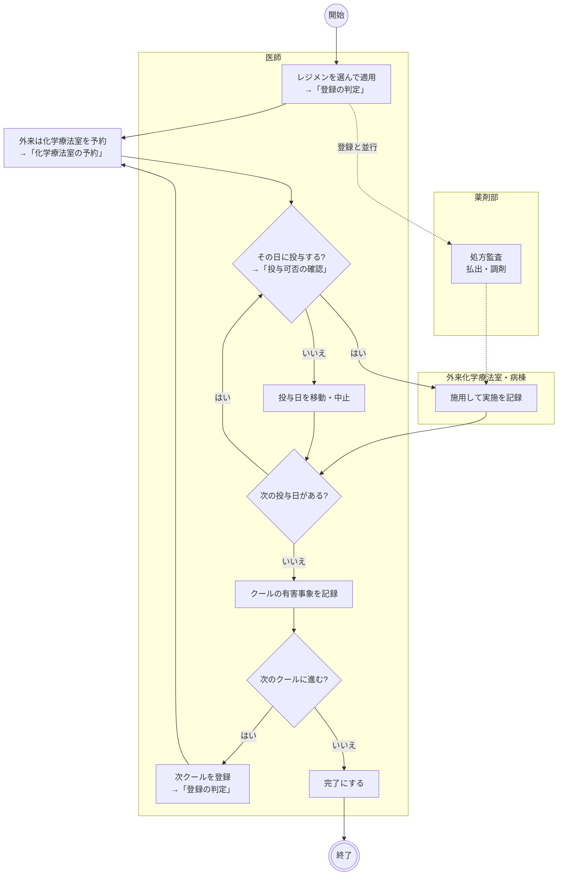
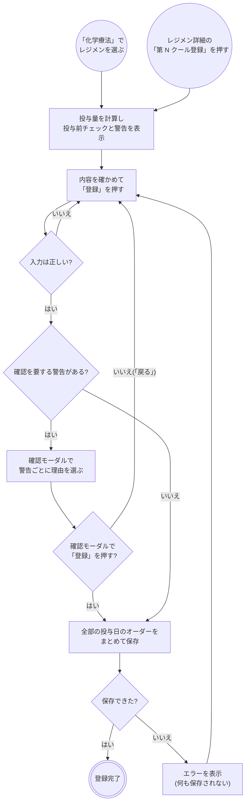
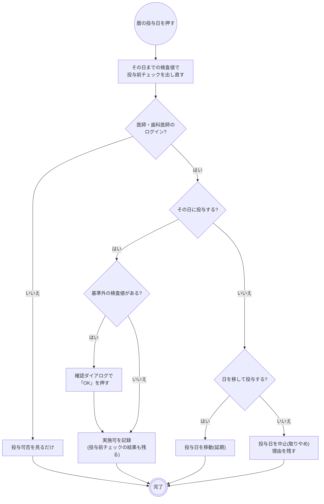

# 化学療法の業務フロー

<!-- ../fhir-client/docs/order-flows/chemotherapy.md から scripts/sync-flows.mjs で作る。直接編集しない。 -->

レジメンの適用からクールの登録、当日の投与可否の確認、投与、終了までの流れです。
投与日の注射と内服は通常の注射・処方として流れるので、払出・調剤・実施の細部は[注射オーダーの業務フロー](injection.md)と[処方オーダーの業務フロー](prescription.md)を読みます。

医師 薬剤部 外来化学療法室・病棟

このページで使う呼び名です。

- **レジメン**: 化学療法の治療計画の雛形です。施設が「マスタメンテ > 化学療法 > レジメン」に登録し、承認したものを患者に使います。
- **クール**: 投与期間と休薬期間を合わせた 1 回りです。クールの何日目かを Day 1、Day 8 のように呼びます。
- **適用**: 1 人の患者に 1 つのレジメンを使うことです。適用 1 件で、開始日から 1〜3 クールを一度に登録します。
- **投与日のオーダー**: 投与日ごとにできる注射と内服のオーダーです。その日の注射をまとめた 1 オーダーと、内服をまとめた 1 オーダーができます。通常の注射・処方と同じ流れで、薬剤部の一覧に並びます。
- **状態**: 投与日のオーダーの、薬剤部の作業と実施の進み具合です(依頼済・受付済・払出済など)。注射・処方と同じです。

使う画面は次のとおりです。

| 画面 | 開き方 | できること |
|---|---|---|
| カルテの右ペイン(右側のオーダー入力)の「化学療法」 | カルテの右ペインで選ぶ | レジメンを選んで適用する |
| 暦 | カルテの左ペインの「化学療法」タブ | 月の暦に投与日を出す。投与日をドラッグして移動する |
| 右ペインの「化学療法(投与日)」 | 暦の投与日を押すと開く | 投与可否の確認、移動、編集、中止・中止取消、化学療法室の予約 |
| レジメン詳細 | 「化学療法」タブの「レジメン詳細」 | クール一覧(計画書・有害事象・クール取消)、次クール登録、休止・再開、適用編集、完了、レジメン中止、スケジュール表 |

## 全体の流れ

- **投与可否と薬剤部の作業**: 投与可否の確認は、処方監査・払出・調剤・実施を止めません。未確認のままでも払出と実施はできます。薬剤部の作業は、投与日のオーダーができた時点から始まります。
- **投与しない日**: 日を移して投与するときは投与日を移動(延期)し、その日の投与をやめるときは投与日を中止(取りやめ)します。
- **見合わせた日の薬剤**: 払い出したあとに投与をやめた薬剤の扱いは記録しません。運用で決めます。
- **実施**: 注射は通常の注射と同じく記録します。カルテのカード、注射カレンダー、経過表などから実施入力を開きます([注射オーダーの業務フロー](injection.md)「[実施の流れ](injection.md#実施の流れ)」)。
- **有害事象**: レジメン詳細のクール一覧の「記録」から、クールごとに CTCAE の用語と Grade を記録します。次クールの登録画面に、前のクールの有害事象が出ます。
- **完了**: 予定クール数に達しても自動では完了しません。最後のクールを終えたら医師が完了にします。途中でやめるときはレジメン中止にします。
- **外来化学療法室の一覧**: 「部門業務 > 外来化学療法室」は、予約の時間順にレジメン・クール・投与可否・状態を並べます。予約の無い患者は出ません。

## レジメンマスタの状態

| 状態 | 新しい適用 | 内容の変更 |
|---|---|---|
| 下書き | できない | できる |
| 承認済 | 有効期間内ならできる | できない。複製して承認し直し、元を廃止する |
| 廃止 | できない | できない |

- **下書きへ戻す**: 承認済を下書きへ戻せるのは、患者に 1 件も適用していないレジメンだけです。
- **治療中の患者の次クール**: 元のレジメンが廃止や有効期間外になっても、注意を出して登録できます。

## 適用の状態

| 状態 | 変わるきっかけ | レジメン詳細からできること |
|---|---|---|
| 適用中 | 適用、再開 | 次クール登録、休止、適用編集、完了、レジメン中止、クール取消 |
| 休止 | 休止 | 再開、適用編集、完了、レジメン中止、クール取消 |
| 完了 | 完了 | 帳票の表示 |
| 中止 | レジメン中止(理由を選ぶ) | 帳票の表示 |

- **休止**: 適用の状態だけを変えます。登録済みの投与日はそのまま残り、払出と実施も止まりません。一覧・払出登録・調剤登録に「休止中」の印が出ます。
- **休止の間**: 次クールは登録できません。クールの途中でも休止できます。投与を止めるときは、投与日を中止します。
- **完了とレジメン中止**: 未実施の投与日をすべて中止にし、その日の化学療法室の予約も取り消します。実施済の日は残ります。
- **予定クール数**: 適用編集で延ばせます。
- **患者帯**: 適用中・休止の適用があると、化学療法のピクトグラムが出ます。

## 登録の判定

適用と次クール登録は同じ画面で、同じ判定を通ります。

画面で確かめて入れるもの:

| 項目 | 説明 |
|---|---|
| 開始日 | Day 1 の日 |
| クール数 | 一度に 3 クールまで |
| 区分 | 入院か外来か |
| 投与量 | 体格(身長・体重)とレジメンの基準から計算した量。必要なら減量する |

警告は次のとおりです。

| 警告 | 確認を要する(理由が必須) | 表示のみ |
|---|---|---|
| 投与前チェック | 適応基準を外れる検査値 | 値が取れない、古い(7 日より前) |
| 薬剤アレルギー | 銘柄または成分が一致 | |
| 累積投与量 | 上限を超える | 判定できない |
| 体重の変化 | 前のクールから ±10% 以上 | |
| レジメンの重なり | 同じレジメンが適用中・休止 | 別のレジメンが進行中 |
| 開始日 | | 過去日、登録済みの投与日と重なる |
| 候補外のレジメン | | 廃止・有効期間外、適用後のマスタ変更 |
| 妊娠・授乳 | | 該当するとき |
| 施設の規則 | 規則の設定による | 規則の設定による |

- **登録を止める警告**: いまはありません。基準外でも、理由を選べば登録できます。
- **次クールの初期値**: 投与量・減量・区分は、前のクールと同じものが入ります。体格を新しい測定値で計算し直すときは「いまの体格で出し直す」を選びます。
- **外部の判断支援**: 処方と違い、問い合わせません。

## 投与可否の確認

その日に投与してよいかを、医師が投与日ごとに記録します。

投与可否は、印で次のように出ます。

| 印 | 意味 | 出る場所 |
|---|---|---|
| 未確認 | 実施可の記録が無い | 「化学療法(投与日)」、注射一覧、処方一覧、外来化学療法室 |
| 実施可 | 医師が確認した | 「化学療法(投与日)」、注射一覧、処方一覧、外来化学療法室、暦 |
| 要再確認 | 確認のあとで移動・編集した | 「化学療法(投与日)」、注射一覧、処方一覧、外来化学療法室、暦 |
| 休止中 | 適用が休止中 | 注射一覧、処方一覧、外来化学療法室 |

- **記録できる人**: 医師・歯科医師のログインだけです。ほかの操作と違い、代行入力はできません。
- **記録の範囲**: 実施可は、同じ日の注射と内服の両方に記録します。「取消」で未確認に戻せます。
- **見合わせ**: 「見合わせ」という記録はありません。延期は移動、取りやめは中止で記録します。
- **休止中の印**: 一覧では、投与可否の印の代わりに出ます。
- **実施済・中止の日**: 確認欄も印も出ません。

## 化学療法室の予約

外来の投与日は、外来化学療法室の枠を予約します。

- **予約する場所**: 右ペインの「化学療法(投与日)」から、その投与日の枠だけを選べます。
- **日を変えるとき**: 予約だけを別の日にはできません。投与日を移動し、予約を取り直します。移動した日の予約は取り消されます。
- **暦の表示**: 予約のある日は、暦のマスに時計のアイコンと予約の時刻が出ます。
- **適用との関係**: 予約は適用とは別に取ります。枠が空いていなくても適用はできます。

## 変更・中止・削除

右ペインの「化学療法(投与日)」からの操作です。

| 操作 | 範囲 | できないとき | 化学療法室の予約 |
|---|---|---|---|
| 移動 | この日のみ / この日以降すべて | 実施済 | 取り消す |
| 編集 | その日 | | そのまま |
| 中止 | この日のみ / この日以降すべて | 実施済 | 取り消す |
| 中止取消 | この日のみ / この日以降すべて | | 戻らない(取り直す) |

ほかの画面からの操作です。

| 操作 | できる場所 | 範囲 | できないとき | 化学療法室の予約 |
|---|---|---|---|---|
| 移動 | 暦のドラッグ | この日のみ / この日以降すべて | 実施済 | 取り消す |
| 中止 | カルテの注射カード、注射一覧・処方一覧の行のメニュー | その日 | 注射・処方の中止と同じ | 取り消す |
| 中止取消 | カルテの注射カード、注射一覧・処方一覧の行のメニュー | その日 | | 戻らない(取り直す) |
| クール取消 | レジメン詳細のクール一覧 | クール全体 | 依頼済・中止以外の日を含む | 取り消す |
| 削除 | カルテのカード | その日 | 注射は実施の記録があるとき | 取り消す |

- **中止の理由と範囲**: 理由を入力でき、範囲を選べるのは右ペインの「化学療法(投与日)」だけです。どこから中止しても、予約の取消と、止めた人の記録は同じです。
- **中止取消の戻り先**: 中止する前の状態(受付済・払出済など)に戻ります。通常の注射・処方の中止取消は依頼済に戻るので、ここが違います。
- **編集と移動**: どちらも投与可否が要再確認に戻り、処方監査をやり直します。移動しても、投与量と状態は変わりません。
- **薬剤部の作業が進んだ日の移動**: 受付・払出・調剤を済ませた日を動かすときは、確認の画面にその件数が出ます。薬剤部へ通知は届かないので、移動した医師が薬剤部に日付の変更を伝えます。
- **最初の投与日の移動**: 適用の開始日も合わせて動きます。
- **中止した日の処方監査**: 投与日を中止しても、処方監査の未監査からは自動では消えません。一覧の状態に「中止」と出るので、薬剤師が監査済にして一覧から外します。完了・レジメン中止で止めた日も同じです。
- **クール取消**: 投与を止めるためではなく、登録の誤りを片付けるときに使います。
- **注射カレンダー**: 投与日のオーダーは、実施と実施取消だけができます。
- **代行入力**: 代行で移動・中止・完了・休止などをすると、指示医師の承認待ちに並びます。

## 帳票

| 帳票 | 開く場所 | 内容 |
|---|---|---|
| 化学療法実施計画書 | レジメン詳細のクール一覧の「計画書」 | クールの投与日ごとの薬剤・投与量・状態と、確認欄 |
| スケジュール表 | レジメン詳細の「スケジュール表」 | 患者向けの月の暦。中止した投与日は出さない |
| 公開用 PDF | レジメンマスタの編集画面の「公開用PDF」 | 外部向けのレジメンの内容。承認済のレジメンだけ |

- **注射箋・注射ラベル**: レジメン名・クール・Day が入ります。
- **処方箋**: 備考の先頭にレジメン名・クール・Day が入ります。

## 通常の注射・処方との違い

| 投与日のオーダー | 処方監査 | 帳票 | 払出・調剤 | 実施の記録 | 医事会計への送信 |
|---|---|---|---|---|---|
| 注射 | する(投与日ごと) | 注射箋・注射ラベル | 払出登録 | する | 外来は実施の記録から送る |
| 内服(入院) | する | 処方箋 | 調剤登録 | 経過表で記録 | 送らない |
| 内服(外来・院内) | する | 処方箋 | 調剤登録 | しない | 投与日の会計で送る |
| 内服(外来・院外) | しない | 院外処方箋 | 保険薬局が調剤 | しない | 投与日の会計で送る |

- **一覧の並び**: 注射は注射日で注射一覧に、内服は投与開始日で処方一覧に並びます。数クール分をまとめて登録しても、登録した日の一覧には載りません。
- **処方監査の単位**: 投与日のオーダーごとに監査します。連日の注射のように束ねません。
- **先のクールの処方監査**: 先のクールの投与日も、登録した日から処方監査の未監査に並びます。
- **一覧の表示**: 処方監査一覧と注射一覧にレジメン名・クール・Day が出ます。監査の画面では、体格と体表面積あたりの量も確かめられます。
- **施設設定**: 「監査済まで調剤登録・払出登録を出さない」は、通常の注射・処方と同じくかかります。
- **院外処方**: 内服の院外処方は、保険薬局が監査と調剤をします。
- **医事会計**: 外来の注射の会計には、外来化学療法加算と無菌製剤処理料が加わります。
- **疑義照会**: 注射・処方と同じです。薬剤師が照会を送ると状態が照会中になり、払出登録・調剤登録が止まります。医師が回答すると受付済に戻ります([処方オーダーの業務フロー](prescription.md)「[疑義照会の流れ](prescription.md#疑義照会の流れ)」)。
- **DO**: 投与日のオーダーは DO(前回と同じ内容で出し直す)できません。同じ内容をもう一度出すときは、次クールを登録します。
