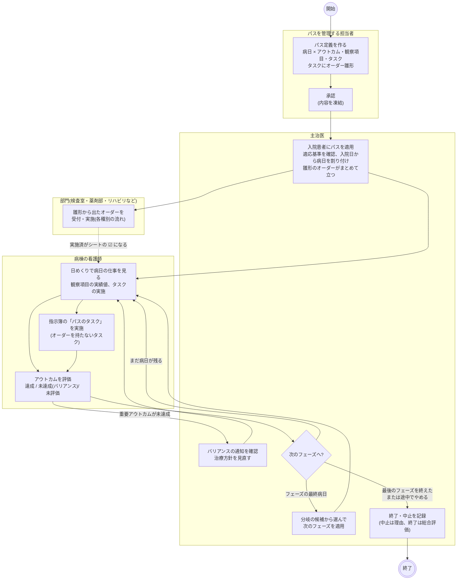
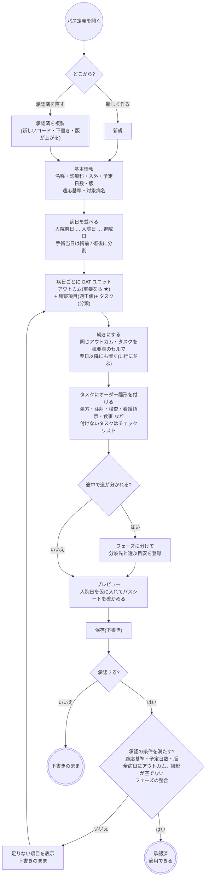
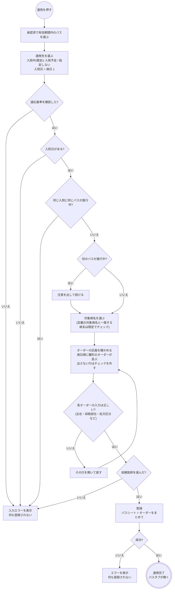
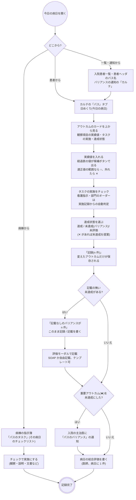
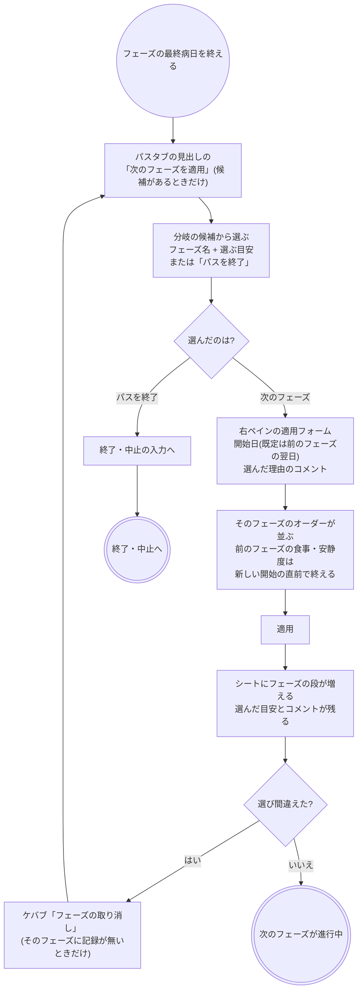
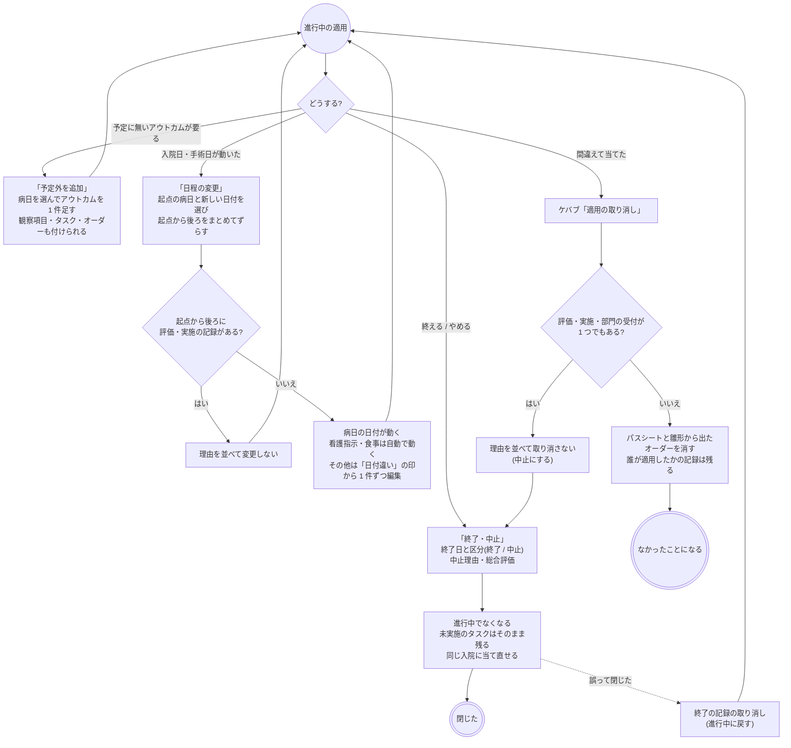

# クリニカルパスの業務フロー

<!-- ../fhir-client/docs/order-flows/clinical-pathway.md から scripts/sync-flows.mjs で作る。直接編集しない。 -->

クリニカルパスを、パス定義の作成と承認から患者への適用、病棟の日々の評価と実施、バリアンス、フェーズの進行、終了・中止まで追う流れです。
クリニカルパスは、疾患・術式ごとの入院診療の標準計画を**病日 × アウトカム**の格子(パスシート)で書いたものです。病日ごとに「患者がこうなっている」(アウトカム)、「それを何で判断するか」(観察項目)、「何をするか」(タスク)を置き、適用した患者ではタスクが日付の入ったオーダーになり、病棟は毎日アウトカムの達成・未達成(バリアンス)を記録します。
雛形から出たオーダー(処方・注射・検査・看護指示・食事など)はそれぞれの種別の流れに乗るので、部門の受付・実施の細部は各種別の業務フロー([看護指示](nursing.md)、[食事](meal.md)、[注射](injection.md)、[検体検査](lab.md)など)を読みます。
基本仕様は JAMI・JSCP の ePath に準じます。

パスを管理する担当者 主治医 病棟の看護師 部門(検査室・薬剤部・リハビリなど)

## オーダーセット・レジメンとの違い

| | オーダーセット | レジメン(化学療法) | クリニカルパス |
|---|---|---|---|
| 何を表すか | 医師がいつも出す組み合わせ | 化学療法の治療計画の雛形 | 疾患・術式ごとの入院診療の標準計画 |
| 持ち主 | 院内共通 / 診療科 / 医師 | 院内共通(承認制) | 院内共通(承認制) |
| 時間軸 | 無い(適用した日に全部出す) | 相対日(Day 1・8・15) | **病日**(入院日 = 1、入院前日 = -1) |
| 適用の単位 | 1 回で全部 | クール | **フェーズ**(分岐の無いパスは一括) |
| 適用後に残るもの | オーダーだけ | 適用の記録と投与日のオーダー | **パスシート**(病日ごとの計画)とオーダー |
| 評価 | 無い | 投与可否の確認 | **アウトカムの達成 / 未達成(バリアンス)**を病日ごとに記録 |
| 日々見る人 | なし | 化学療法室 | 病棟の看護師と主治医 |
| 終わり方 | なし | 完了・中止 | 終了・中止(手で記録) |

- 入口は、定義が「マスタメンテ > クリニカルパス > パス定義」、適用がカルテ右ペインの「クリニカルパス」、日々の記録がカルテの「パス」タブと病棟の指示簿です。
- アウトカム・観察項目は BOM(日本クリニカルパス学会の Basic Outcome Master)または施設のコードで持てます。BOM の配布ファイルは施設が学会から取得して「マスタ取込」で取り込みます。
- 1 つの入院に複数のパスを重ねて当てられます(術後に別のパスへ移るなど)。同じパスを同じ入院に二重には当てられません。

## パス定義の状態

| 状態 | 適用 | 内容の変更 |
|---|---|---|
| 下書き | できない | できる |
| 承認済 | 有効期間内ならできる | できない。複製して直し、承認し直す(版の小さい桁が 1 つ上がる) |
| 廃止 | できない | できない。使った記録として残す |

- 承認するときに確かめること: 適応基準・予定日数・版(「1」「1.1」の形式)がある、すべての病日にアウトカムが 1 つ以上ある、オーダー雛形を付けたタスクの中身が空でない、予定日数が標準の経路の最終病日以上。フェーズを分けたパスは、フェーズ名があり、分岐が循環せず、開始フェーズからすべてのフェーズに進め、フェーズの中の病日が連続していること。
- 承認済を下書きに戻せるのは、**患者に 1 件も適用していない**パスだけです。適用済みのパスは次のフェーズを定義から展開するので、直すと食い違うためです。
- 承認済の内容は凍結されますが、状態・有効期間・表示順は動かせます。削除は下書きだけです。

## 適用の状態

| 状態 | 意味 | 変わるきっかけ | できること |
|---|---|---|---|
| 進行中 | 評価・実施を記録している | 適用、終了の記録の取り消し | 評価・実施、次のフェーズ、予定外の追加、日程の変更、終了・中止、適用の取り消し(記録が無いときだけ) |
| 終了 | 予定どおりに終えた | 「終了・中止」で終了を選ぶ、分岐で「パスを終了」を選ぶ | 読む、ePath 出力、終了の記録の取り消し |
| 中止 | 途中でやめた(理由を残す) | 「終了・中止」で中止を選ぶ | 読む、ePath 出力、終了の記録の取り消し |

- 終了・中止は**手で記録**します。退院や最終病日の到来で自動的には終わりません。
- 取り消しは適用そのものを消すので、状態ではなく「なかったこと」になります。評価・実施・部門の受付が 1 つでもあれば取り消せず、中止にします。
- 進み具合(未評価・バリアンス・未実施の件数)はパスタブのオーバービューの見出し帯に出ます。

## 全体の流れ

- 「パスを管理する担当者」はパス委員会や各科のパス担当を想定した呼び方で、システムの権限ではありません。定義の作成・承認はマスタメンテから誰でも行えます。
- 医師の操作はカルテから、看護師の操作はカルテのパスタブと病棟の指示簿からです。パスシートの記録はどの職種でも行え、記録者はログイン中の本人です。
- 部門は、パスから出たことを気にせずに通常どおり受け付け・実施します。オーダーには「パス」の印が付き、カルテのカードにバッジで出ます。

## パス定義の作成と承認

- アウトカム・観察項目のコードは、BOM を取り込んだ施設では「選択」で名称から探せます。アウトカムを選ぶと、そのアウトカムに属する観察項目の候補がチェックで選べます。取り込んでいない施設は手入力です。
- 看護観察(MEDIS)に結んだ観察項目は、適正値を数値の範囲や許容値として構造化できます。適用後の評価で実績値に ○ / ✕ が付き、達成状態の提案に使われます。
- 「続き」は、同じアウトカムやタスクを複数の病日に置いたものです。名前・コード・雛形は続き全体で揃い、適正値は日ごとに変えられます(術後 1 日目は疼痛 3 以下、4 日目は 2 以下など)。
- 病日の「主要イベント」で、手術・内視鏡・放射線治療のタスクを選んでおくと、適用後のシートに実施の時刻つきで出ます。
- 承認済の定義を直すときは複製して下書きで直し、承認し直して元を廃止します。進行中の患者は元の定義のまま進みます。
- サンプルとして 4 泊 5 日の腹腔鏡下胆嚢摘出術、1 泊 2 日の大腸ポリープ切除、2 泊 3 日の鼠径ヘルニア、7 日間の市中肺炎、分岐つきの市中肺炎が下書きで入っています。

## 適用の判定

- 入口はカルテ右ペインの「クリニカルパス」です。適応基準の文がそのまま出て、「適応基準を確認した」にチェックしないと適用できません。
- 入院予定に当てると、入院日はその予定の日付です。予定の日付が未定なら当日が入ります。入院日を変えると病日 → 日付の表とオーダーの開始日が追随します。
- オーダーの区画には、雛形を持つタスクが病日順に並びます。開始日は入院日 + (病日 − 1)。続く病日の看護指示は 1 件にまとまり、食事・安静度は次の食事・安静度の直前で終わります。その他の種別(注射・検査・処方など)は病日ごとに 1 件です。
- 雛形が外来で作られていると処方区分が空になることがあります。検証に落ちた行があれば何も登録せず、その行を開きます。
- フェーズを分けたパスは、最初は開始フェーズの病日とオーダーだけを登録します。
- 代行入力は他のオーダーと同じです。雛形から出たオーダーには承認待ちの通知が付き、パスの適用そのものには付きません。
- 予約が要る項目(CT・MRI・内視鏡など)は、適用では予約されません。適用後に部門の予約で枠を取ります。

## 日々の評価と実施

- パスタブは「日めくり」(1 病日ずつ)と「オーバービュー」(紙のパスシートと同じ格子。既定)の 2 つの見方があります。オーバービューはアウトカムのセルを押すと評価モーダル、タスクのセルを押すとそのオーダーの詳細(看護指示は実施入力)が開きます。
- 達成状態・実績値・タスクの実施は日めくりでまとめて入れ、記載(SOAP・自由記載)とコメントは評価モーダルで書きます。
- タスクの実施の決まり方は 3 通りです。オーダーを持たないチェックリストはチェックで記録する。看護指示・リハビリ・栄養指導を結んだタスクはその日の実施記録があれば ☑。その他のオーダーを結んだタスクは部門がオーダーを実施済みにすれば ☑。後の 2 つはパス側で押せません。
- オーダーの詳細から「実施入力」へ進めます(注射・輸血・放射線・生理・内視鏡・処置・手術・リハビリ・栄養指導)。部門の受付を済ませていなくても実施できます。検体検査・病理・細菌・他科依頼・食事・処方は部門や経過表で記録します。
- 同じアウトカムを 1 日に何度評価しても全部残ります。シートのセルには「×n」が付き、評価モーダルに履歴が並びます。実績値は前回と変えたものだけ新しく記録され、空にしても前の値は消えません。
- バリアンスの通知は重要アウトカム(★)を未達成にしたときだけ届きます。宛先は入院の主治医、強度は注意。未達成のまま記録し直しても出し直さず、達成・未評価に直すと未対応の通知は取り下げます。主治医は通知の「確認」で対応済みにします。
- 記載のある評価と病日の総合評価は、カルテのタイムラインに「パス評価」のカードとして記録日時の日に出ます。達成状態だけの評価はカードになりません。
- 指示簿の「パスのタスク」はオーダーを持たないタスクだけです。雛形から出た看護指示は同じ画面の上の表に、その他は各部門の画面に出るので重ねません。指示受けは要りません。

## フェーズの進行

- 分岐は市中肺炎のように「3 日目の効果判定で、継続か抗菌薬変更か」のような道の分かれ目に使います。分岐の先頭が標準の経路です。
- 「どこまで適用したか」は適用済みの病日の印から決まります。最後のフェーズを終えたら「次のフェーズを適用」は出ません。
- 次のフェーズの開始日は、適用済みの最後の病日より後にします。前のフェーズの最終日より早くはできません。
- フェーズの取り消しで戻せるのは最後に適用した 2 つ目以降のフェーズだけで、条件は適用の取り消しと同じ(そのフェーズの病日に記録が無い)です。前のフェーズの食事・安静度に入れた終了は戻しません。

## 予定外・日程の変更・終了・中止・取り消し

- 予定外のアウトカムは、シートでは「予定外」の印の付いた行として予定どおりのものと同じに扱えます。付けたオーダーは適用と同じ束に入ります。終了・中止したパスには足せません。
- 日程の変更で自動でずらすのは看護指示と食事だけです(日付が 1 本で完結する)。注射・検査・手術・処置などは、明細・予約・部門の受付を伴うので、シートのセルの「日付違い」を見て 1 件ずつオーダー詳細の「編集」で直します。記録のある病日はずらせません。
- 終了は予定どおり終えたとき、中止は途中でやめたときです。どちらも手で記録し、退院しても自動では終わりません。退院後に進行中のまま残らないよう、退院の前後に終了を記録する運用にします。
- 終了・中止すると「予定外を追加」「日程の変更」「次のフェーズ」は出なくなります。間違えて閉じたときは「終了の記録」から取り消して進行中に戻せます。
- 適用の取り消しは、雛形から出したオーダーをカルテのカードの削除と同じ種別ごとの処理で消します(予約の取消、テンプレートの記入の削除なども各種別に任せる)。看護指示も、普段は中止で残すところをここでは消します。途中で失敗したら、もう一度開けば残ったオーダーから続けられます。

## ほかの画面とのつながり

| 画面 | クリニカルパスの使い方 |
|---|---|
| カルテの時系列 | 雛形から出たオーダーのカードに「パス」のバッジ(ツールチップにパス名)。記載のある評価と病日の総合評価は「パス評価」のカード |
| 病棟の指示簿 | 看護指示の表の下に「パスのタスク」(オーダーを持たないタスク)。氏名からパスタブのその病日の日めくりへ。雛形から出た看護指示は上の表に出て、続く病日は 1 件の指示 |
| 入院患者一覧・患者ヘッダ | 進行中のパス名。押すとパスタブ |
| 通知 | 「パスのバリアンス」(重要アウトカムの未達成)。入院の主治医あて、強度は注意、「カルテ」でその病日の日めくり、「確認」で対応済み |
| 経過表 | 看護観察に結んだ観察項目の実績値の候補を経過表の値から出す(押して記録したときだけパスの実績になる)。パスの実績値そのものは経過表に出ない |
| 部門の一覧(検査・放射線・リハビリなど) | 雛形から出たオーダーが通常どおり並ぶ。実施済みにするとシートの ☑ になる。パスタブのオーダー詳細「実施入力」から部門と同じ実施入力を開ける |
| データ抽出・ダッシュボード | 「パス」タブで適用 1 件 1 行(状態・終了区分・予定日数と実日数・評価とバリアンスの件数・中止理由)。クラスタ・指標にも使える |
| ePath 出力 | 定義の編集画面で施設パス、パスタブのケバブで患者に適用したパス(評価・実施・総合評価を含む)を JAMI 標準の XML でダウンロード |

## 変更・中止・削除

| 操作 | できること |
|---|---|
| 定義の変更 | 下書きは自由に。承認済は複製して直し、承認し直す。承認済を下書きに戻すのは適用 0 件のときだけ |
| 定義の削除 | 下書きだけ。承認済は廃止にする |
| 適用後の計画の変更 | 予定外のアウトカムの追加、日程の変更。病日や予定どおりのアウトカムを消す手段は無い(予定外のアウトカムも名前を直せない) |
| 雛形から出たオーダーの変更 | 通常のオーダーと同じ(カルテのカードやパスタブのオーダー詳細の「編集」から)。オーダーを直してもパス側の計画は変わらない |
| 終了・中止 | 見出しのアイコン「終了・中止」。終了日・区分・中止理由・総合評価。取り消して進行中に戻せる |
| 取り消し | 何も記録していない進行中の適用だけ。シートとオーダーを消す |
| 評価の訂正 | 達成状態・記載は記録し直す(履歴に残る)。実績値は正しい値をもう一度記録する(前の値は消えない) |

## 帳票

専用の帳票はありません。パスシートの持ち出しは ePath 出力(JAMI 標準の XML)です。雛形から出たオーダーの帳票(処方箋・注射箋・ラベルなど)は各種別と同じです。
