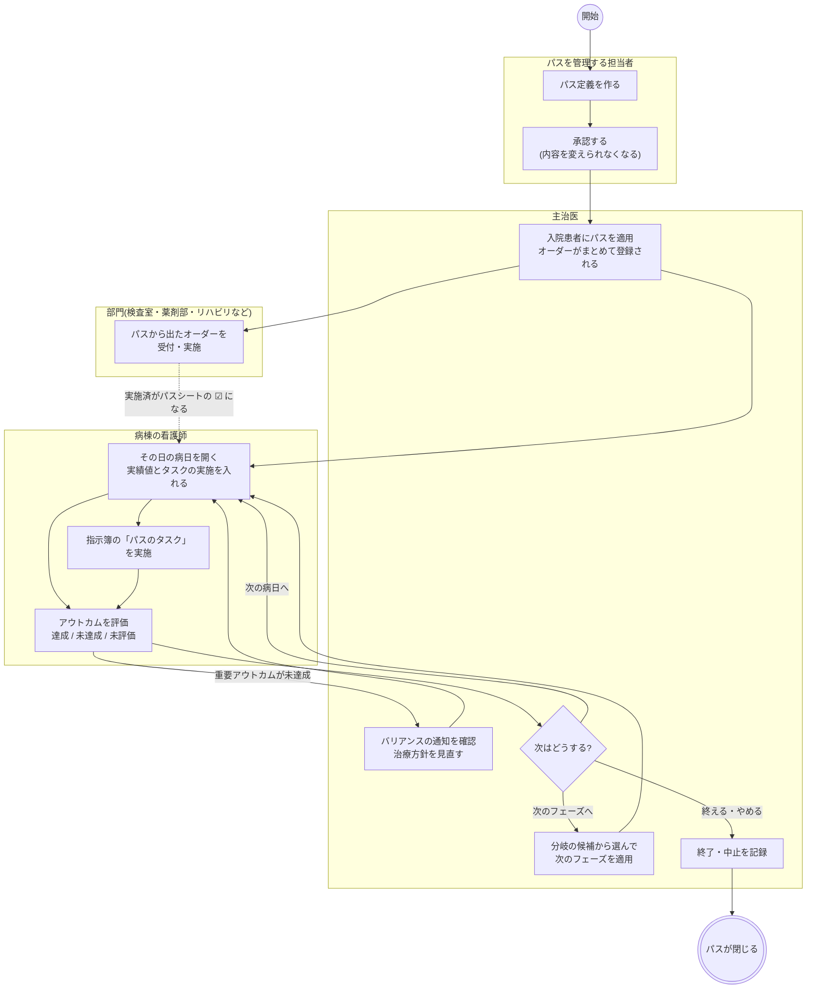
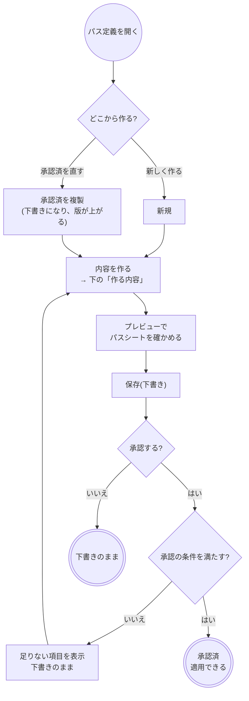
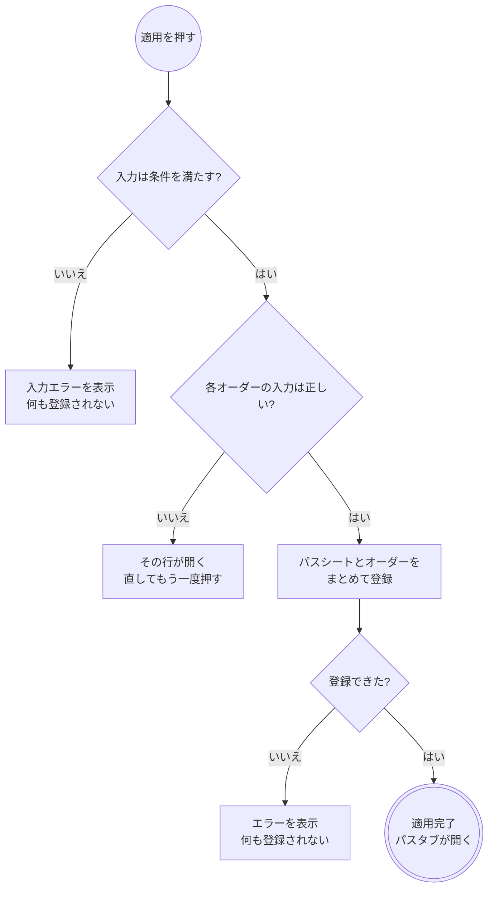
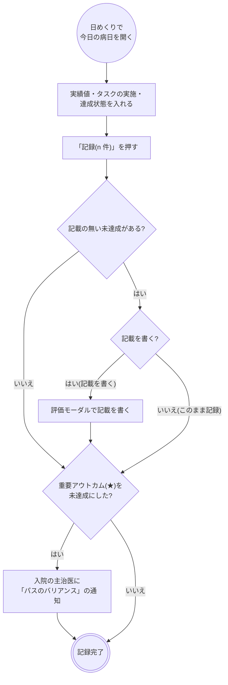
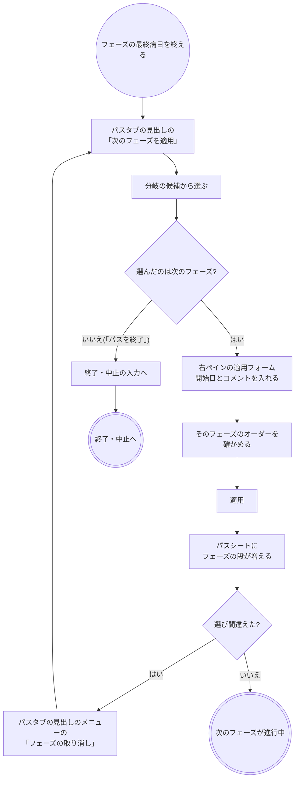
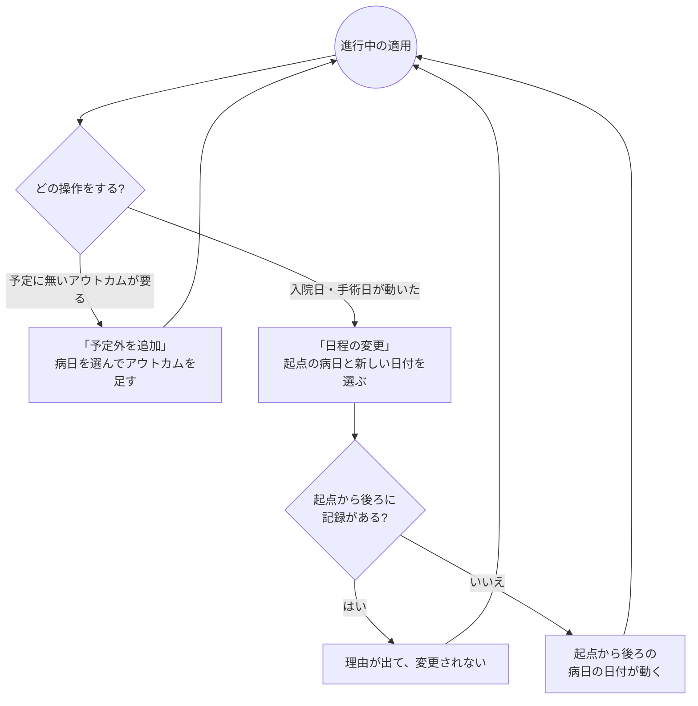
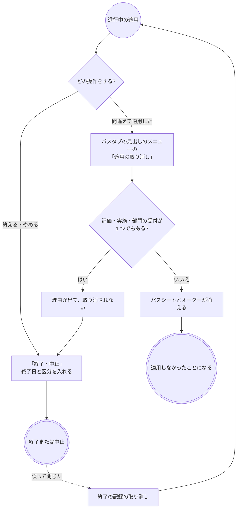

# クリニカルパスの業務フロー

<!-- ../fhir-client/docs/order-flows/clinical-pathway.md から scripts/sync-flows.mjs で作る。直接編集しない。 -->

クリニカルパスを、パス定義の作成と承認から患者への適用、病棟の日々の評価と実施、バリアンス、フェーズの進行、終了・中止まで追う流れです。
クリニカルパスは、疾患・術式ごとの入院診療の標準計画です。病日(入院日を 1 とする日数)ごとに、患者がどうなっているか・何で判断するか・何をするかを書きます。患者に適用すると、計画は**病日 × アウトカム**の表(パスシート)になり、病棟は毎日アウトカムの達成・未達成を記録します。
パスから出たオーダー(処方・注射・検査・看護指示・食事など)は、それぞれの種別の流れに乗ります。部門の受付・実施の細部は、各種別の業務フロー([看護指示](nursing.md)、[食事](meal.md)、[注射](injection.md)、[検体検査](lab.md)など)を読みます。
基本仕様は、日本医療情報学会(JAMI)と日本クリニカルパス学会(JSCP)の ePath に準じます。

パスを管理する担当者 主治医 病棟の看護師 部門(検査室・薬剤部・リハビリなど)

## 全体の流れ

**このページの言葉**

| 言葉 | 意味 |
|---|---|
| パス定義 | 疾患・術式ごとに作る計画の元。承認すると患者に適用できる |
| 適用 | パス定義を 1 人の患者の入院に当てはめること。当てはめた結果も「適用」と呼ぶ |
| 病日 | 入院日を 1、入院前日を -1 とする日数 |
| アウトカム | その病日に「患者がこうなっている」という目標 |
| 観察項目 | アウトカムを何で判断するか。適正値を持てる |
| タスク | その病日に何をするか |
| オーダー雛形 | タスクに付けておくオーダーの内容。適用すると日付の入ったオーダーになる |
| バリアンス | アウトカムの未達成 |
| フェーズ | 連続する病日のまとまり。途中で道が分かれるパスで使う |
| パスシート | 適用したパスの、病日 × アウトカムの表 |

**使う画面**

| だれが | 画面 | すること |
|---|---|---|
| パスを管理する担当者 | 「マスタメンテ > クリニカルパス > パス定義」 | 定義の作成・承認 |
| 主治医 | カルテの右ペイン(右側のオーダー入力)の「クリニカルパス」 | 適用、次のフェーズ |
| 看護師・主治医 | カルテの「パス」タブ(以下、パスタブ) | 日々の評価と実施、終了・中止 |
| 看護師 | 病棟の指示簿 | オーダーを持たないタスクの実施 |

- 「パスを管理する担当者」は、パス委員会や各科のパス担当を想定した呼び方です。システムの権限ではなく、定義の作成・承認はマスタメンテから誰でも行えます。
- パスシートの記録は、どの職種でも行えます。記録者は、ログイン中の本人です。
- 部門は、パスから出たオーダーかどうかを気にせず、通常どおり受け付け・実施します。パスから出たオーダーには、カルテのカードに「パス」のバッジが出ます。
- 1 つの入院に、複数のパスを重ねて適用できます(術後に別のパスへ移るなど)。同じパスを同じ入院に二重には適用できません。

## パス定義の状態

| 状態 | 適用 | 内容の変更 |
|---|---|---|
| 下書き | できない | できる |
| 承認済 | 有効期間内ならできる | できない。複製して直す |
| 廃止 | できない | できない。使った記録として残す |

- 承認済の内容は変えられません。状態・有効期間・表示順は変えられます。
- 承認済を直すときは、複製して下書きで直し、承認し直して、元を廃止します。複製すると、版の小さい桁が 1 つ上がります。進行中の患者は、元の定義のまま進みます。
- 承認済を下書きに戻せるのは、**患者に 1 件も適用していない**パスだけです。適用済みのパスは、次のフェーズを定義から作るので、定義を直すと食い違うためです。
- 削除できるのは下書きだけです。承認済は廃止にします。
- 承認の条件は「パス定義の作成と承認」にあります。

## 適用の状態

| 状態 | 意味 | 変わるきっかけ | できること |
|---|---|---|---|
| 進行中 | 評価・実施を記録している | 適用、終了の記録の取り消し | 評価・実施と、下の「進行中にできる操作」 |
| 終了 | 予定どおりに終えた | 「終了・中止」で終了を選ぶ、分岐で「パスを終了」を選ぶ | 読む、ePath 出力、終了の記録の取り消し |
| 中止 | 途中でやめた(理由を残す) | 「終了・中止」で中止を選ぶ | 読む、ePath 出力、終了の記録の取り消し |

**進行中にできる操作**

- 次のフェーズの適用
- 予定外の追加
- 日程の変更
- 終了・中止
- 適用の取り消し(評価・実施・部門の受付が 1 つも無いときだけ)

**注意すること**

- 終了・中止は**手で記録**します。退院や最終病日の到来で、自動的には終わりません。
- 「適用の取り消し」は、適用そのものを消します。状態が変わるのではなく、適用しなかったことになります。
- 評価・実施・部門の受付が 1 つでもあれば、適用の取り消しはできません。そのときは中止にします。
- 進み具合(未評価・バリアンス・未実施の件数)は、パスタブのオーバービューの見出しに出ます。

このページでは、「取り消し」を 3 つに呼び分けます。

| 呼び名 | 何を取り消すか |
|---|---|
| 適用の取り消し | 適用そのもの。パスシートと、パスから出たオーダーを消す |
| 終了の記録の取り消し | 終了・中止の記録。進行中に戻す |
| フェーズの取り消し | 最後に適用したフェーズ。前のフェーズまで戻す |

## パス定義の作成と承認

**作る内容**

| 順 | 作るもの | 中身 |
|---|---|---|
| 1 | 基本情報 | 名称・診療科・入外・予定日数・版・適応基準・対象病名 |
| 2 | 病日 | 入院前日から退院日までを並べる |
| 3 | アウトカム・観察項目・タスク | 病日ごとに置く |
| 4 | 続き | 同じアウトカム・タスクを翌日以降にも置く |
| 5 | オーダー雛形 | タスクに付ける。処方・注射・検査・看護指示・食事など |
| 6 | フェーズ(任意) | 途中で道が分かれるパスだけ。分岐先と選ぶ目安を登録する |

- **複製**: 複製した定義は、新しいコードの下書きになります。
- **病日**: 手術当日は、術前と術後に分けられます。
- **アウトカム・観察項目・タスク**: 1 つのアウトカムと、それを判断する観察項目、行うタスクを 1 組にして置きます。画面ではこの組を「OAT ユニット」と呼びます。
- **重要アウトカム**: アウトカムに重要の印(★)を付けられます。未達成にしたとき、主治医に通知が届きます。
- **観察項目とタスク**: 観察項目には適正値、タスクには分類を付けます。
- **続き**: 概要表(定義の編集画面の末尾の、病日 × アウトカムの表)のセルから足します。パスシートでは 1 行に並びます。
- **続きでそろうもの**: 名前・コード・雛形は続き全体でそろいます。適正値は日ごとに変えられます(術後 1 日目は疼痛 3 以下、4 日目は 2 以下など)。
- **オーダー雛形**: 雛形を付けないタスクは、チェックで実施を記録するチェックリストになります。
- **プレビュー**: 入院日を仮に入れて、パスシートを確かめられます。

**承認の条件**

| 対象 | 条件 |
|---|---|
| すべてのパス | 適応基準がある |
| すべてのパス | 予定日数がある |
| すべてのパス | 版が「1」「1.1」の形式である |
| すべてのパス | 病日が 1 つ以上ある |
| すべてのパス | すべての病日にアウトカムが 1 つ以上ある |
| すべてのパス | オーダー雛形を付けたタスクの、雛形の中身が空でない |
| すべてのパス | 予定日数が、標準の経路の最終病日以上である |
| すべてのパス | どのフェーズにも病日がある |
| フェーズを分けたパス | フェーズ名がある |
| フェーズを分けたパス | 分岐が循環していない |
| フェーズを分けたパス | 開始フェーズから、すべてのフェーズに進める |
| フェーズを分けたパス | フェーズの中の病日が連続している |
| フェーズを分けたパス | 分岐先のフェーズが、前のフェーズの最終病日の翌日から始まる |

- 標準の経路は、各フェーズの分岐の先頭をたどった経路です。
- 下書きの保存でも、次のものは保存できません。同じ病日の重複、フェーズに属さない病日、分岐先が同じフェーズか存在しないフェーズ、その病日に無いタスクを選んだ主要イベント。

**コードと適正値**

- アウトカム・観察項目は、BOM(日本クリニカルパス学会の Basic Outcome Master)または施設のコードを持てます。
- BOM の配布ファイルは、施設が学会から取得して「マスタ取込」で取り込みます。
- BOM を取り込んだ施設では、「選択」で名称からコードを探せます。アウトカムを選ぶと、そのアウトカムに属する観察項目の候補をチェックで選べます。取り込んでいない施設は手入力です。
- 看護観察(MEDIS)に結んだ観察項目は、適正値を数値の範囲や許容値として登録できます。適用後の評価で実績値に ○ / ✕ が付き、達成状態の提案に使われます。

**主要イベント**

- 病日の「主要イベント」で、手術・内視鏡・放射線治療のタスクを選んでおくと、適用後のパスシートに実施の時刻つきで出ます。

**サンプル**

- 次の 5 つが下書きで入っています。4 泊 5 日の腹腔鏡下胆嚢摘出術、1 泊 2 日の大腸ポリープ切除、2 泊 3 日の鼠径ヘルニア、7 日間の市中肺炎、分岐つきの市中肺炎。

## 適用の判定

適用は、カルテの右ペインの「クリニカルパス」で、次の順に入力してから「適用」を押します。

1. 承認済で有効期間内のパスを選ぶ。
2. 適用先を選ぶ。入院中(既定)、入院予定、指定しない、のどれか。
3. 入院日を確かめる。入院日が病日 1 になる。
4. 適応基準を読み、「適応基準を確認した」にチェックする。
5. 対象病名を選ぶ。定義の対象病名と一致する病名は、既定でチェックが付いている。
6. オーダーの区画を確かめる。出さない行はチェックを外す。
7. 依頼医師を選ぶ。

**入力の条件**

| 項目 | 条件 |
|---|---|
| 適応基準 | 「適応基準を確認した」にチェックしている |
| 入院日 | 入っている |
| 同じパス | 同じ入院に、同じパスが進行中でない |
| 依頼医師 | 選んでいる |
| 各オーダー | 種別ごとの入力の条件を満たす(左右・採取部位・処方区分など) |

- 別のパスが進行中のときは、注意が出ますが、そのまま適用できます。
- オーダーの入力に誤りのある行が 1 つでもあると、何も登録されず、その行が開きます。
- 雛形が外来で作られていると、処方区分が空になっていることがあります。

**入院日**

- 入院予定に適用すると、入院日はその予定の日付です。予定の日付が未定なら、当日が入ります。
- 入院日を変えると、病日ごとの日付の表と、オーダーの開始日も変わります。

**登録されるオーダー**

オーダーの区画には、雛形を持つタスクが病日順に並びます。開始日は、その病日の日付です。

| 種別 | オーダーの数 | 終わる日 |
|---|---|---|
| 看護指示 | 続く病日で 1 件 | 続きの最終日 |
| 食事・安静度 | 病日ごとに 1 件 | 次の食事・安静度が始まる直前 |
| そのほか(注射・検査・処方など) | 病日ごとに 1 件 | 種別ごと |

- フェーズを分けたパスは、最初は開始フェーズの病日とオーダーだけを登録します。
- 予約が要る項目(CT・MRI・内視鏡など)は、適用では予約されません。適用後に、部門の予約で枠を取ります。
- 代行入力は、ほかのオーダーと同じです。承認待ちの通知は、パスから出たオーダーに付きます。パスの適用そのものには付きません。

## 日々の評価と実施

パスタブには、2 つの見方があります。

| 見方 | 中身 | 使いどころ |
|---|---|---|
| 「オーバービュー」(既定) | パスシート。紙のパスシートと同じ表 | 全体を見る。セルから 1 件ずつ開く |
| 「日めくり」 | 1 病日ずつ、アウトカムのカードが並ぶ | その日の達成状態・実績値・タスクの実施をまとめて入れる |

**開き方**

| どこから | 開くもの |
|---|---|
| カルテの「パス」タブ | パスタブ。「日めくり」で今日の病日を開く |
| 入院患者一覧・患者ヘッダのパス名 | パスタブ |
| バリアンスの通知の「カルテ」 | その病日の日めくり |
| 病棟の指示簿の「パスのタスク」の氏名 | その病日の日めくり |

**日めくりで入れるもの**

| 入れるもの | 中身 |
|---|---|
| 実績値 | 観察項目の値。経過表の値が候補のボタンで出る |
| タスクの実施 | チェックリストのタスクにチェックする |
| 達成状態 | 達成 / 未達成(バリアンス)/ 未評価から選ぶ |

- 実績値が適正値の範囲なら ○、外れたら ✕ が付きます。✕ があれば、未達成が提案されます。
- 「記録(n 件)」で保存されるのは、変えたアウトカムだけです。
- 記載の無い未達成があると、「記載なしのバリアンスが n 件」と出ます。「記載を書く」か「このまま記録」を選びます。
- 記載は評価モーダルで書きます。SOAP か自由記載で、テンプレートも使えます。コメントも評価モーダルで書きます。

**オーバービューから開くもの**

- アウトカムのセルを押すと、評価モーダルが開きます。
- タスクのセルを押すと、そのオーダーの詳細が開きます。看護指示は実施入力が開きます。

**タスクに ☑ が付く条件**

| タスクの種類 | ☑ が付くとき |
|---|---|
| オーダーを持たないチェックリスト | パスタブか指示簿でチェックしたとき |
| 看護指示・リハビリ・栄養指導を結んだタスク | その日の実施記録があるとき |
| そのほかのオーダーを結んだタスク | 部門がオーダーを実施済みにしたとき |

- 下の 2 つは、パスタブではチェックできません。
- オーダーの詳細から「実施入力」へ進める種別は、注射・輸血・放射線・生理・内視鏡・処置・手術・リハビリ・栄養指導です。部門の受付を済ませていなくても実施できます。
- 検体検査・病理・細菌・他科依頼・食事・処方は、部門や経過表で記録します。

**指示簿の「パスのタスク」**

- 病棟の指示簿の「パスのタスク」には、その病日の、オーダーを持たないタスク(観察・説明・文書など)が並びます。チェックで実施にします。
- パスから出た看護指示は同じ画面の上の表に、そのほかのオーダーは各部門の画面に出ます。「パスのタスク」には重ねて出ません。
- 「パスのタスク」に指示受けは要りません。

**病日の総合評価**

- 医師は、病日ごとに総合評価を 1 件書けます。
- パスを終了・中止するときに書く総合評価とは別のものです。

**評価の履歴**

- 同じアウトカムを 1 日に何度評価しても、全部残ります。パスシートのセルには「×n」が付き、評価モーダルに履歴が並びます。
- 実績値は、前回と変えたものだけが新しく記録されます。空にしても、前の値は消えません。

**バリアンスの通知**

- 通知は、重要アウトカム(★)を未達成にしたときだけ届きます。宛先は入院の主治医で、通知の強度は「注意」です。
- 未達成のまま記録し直しても、通知は出し直されません。達成・未評価に直すと、未対応の通知は取り下げられます。
- 主治医は、通知の「確認」で対応済みにします。

**カルテのタイムライン**

- 記載のある評価と、病日の総合評価は、カルテのタイムラインに「パス評価」のカードとして、記録日時の日に出ます。
- 達成状態だけの評価は、カードになりません。

## フェーズの進行

**分岐**

- 分岐は、市中肺炎の「3 日目の効果判定で、継続か抗菌薬変更か」のような、道の分かれ目に使います。分岐の先頭が標準の経路です。
- 候補には、フェーズ名と選ぶ目安が出ます。「パスを終了」も選べます。
- 「次のフェーズを適用」は、候補があるときだけ出ます。最後のフェーズを終えたら出ません。

**次のフェーズの適用**

- 開始日の既定は、前のフェーズの翌日です。適用済みの最後の病日より後にします。前のフェーズの最終日より早くはできません。
- 選んだ理由をコメントに書けます。選んだ目安とコメントは、パスシートに残ります。
- 前のフェーズの食事・安静度は、新しいフェーズの開始の直前で終わります。

**フェーズの取り消し**

- 戻せるのは、最後に適用した 2 つ目以降のフェーズだけです。
- 条件は適用の取り消しと同じで、そのフェーズの病日に記録があれば取り消せません。
- 前のフェーズの食事・安静度に入った終了日は、取り消しても戻りません。

## 予定外・日程の変更・終了・中止・取り消し

どれも進行中の適用に行う操作で、パスタブの見出しから行います。

**予定外の追加と日程の変更**

- **予定外の追加**: アウトカムを 1 件足します。観察項目・タスク・オーダーも付けられます。付けたオーダーは、アウトカムと一緒に登録されます。
- **予定外の見え方**: パスシートでは「予定外」の印の付いた行になります。評価・実施は、予定どおりのアウトカムと同じように記録できます。
- **日程の変更**: 起点の病日から後ろを、まとめてずらします。起点から後ろに評価・実施の記録があると、変更できません。

日程の変更でのオーダーの扱いは、種別で違います。

| 種別 | 日付 |
|---|---|
| 看護指示・食事 | 自動で動く |
| そのほか(注射・検査・手術・処置など) | 動かない。1 件ずつ直す |

- 動かないオーダーには、パスシートのセルに「日付違い」の印が出ます。オーダーの詳細の「編集」で、1 件ずつ直します。
- 自動で動かさないのは、明細・予約・部門の受付を伴うためです。

**終了・中止と適用の取り消し**

- **終了と中止**: 終了は予定どおり終えたとき、中止は途中でやめたときです。「終了・中止」で、終了日・区分・中止理由・総合評価を入れます。
- **退院との関係**: 退院しても、パスは自動では終わりません。退院後に進行中のまま残らないよう、退院の前後に終了を記録する運用にします。
- **終了・中止の後**: 「予定外を追加」「日程の変更」「次のフェーズを適用」は出なくなります。未実施のタスクは、そのまま残ります。同じ入院に、同じパスをもう一度適用できます。
- **終了の記録の取り消し**: 間違えて閉じたときは、「終了の記録」から取り消して、進行中に戻せます。
- **適用の取り消し**: パスシートと、パスから出たオーダーが消えます。誰が適用したかの記録は残ります。
- **取り消しで消えるオーダー**: オーダーごとに、カルテのカードから削除したときと同じ結果になります(予約の取消、テンプレートの記入の削除など)。看護指示も、ふだんは中止で残しますが、適用の取り消しでは消えます。
- **取り消しが途中で失敗したとき**: もう一度「適用の取り消し」を開くと、残ったオーダーから続けられます。

## 変更・中止・削除

| 操作 | できること |
|---|---|
| 定義の変更 | 下書きは自由に変えられる。承認済は複製して直す |
| 定義の削除 | 下書きだけ。承認済は廃止にする |
| 適用後の計画の変更 | 予定外の追加と、日程の変更だけ |
| パスから出たオーダーの変更 | 通常のオーダーと同じ |
| 終了・中止 | パスタブの見出しの「終了・中止」から記録する |
| 適用の取り消し | 何も記録していない進行中の適用だけ |
| 評価の訂正 | 記録し直す |

- **適用後の計画**: 病日や、予定どおりのアウトカムを消す手段はありません。予定外のアウトカムも、名前は直せません。
- **オーダーの変更**: カルテのカードか、パスタブのオーダーの詳細の「編集」から行います。オーダーを直しても、パスの計画は変わりません。
- **評価の訂正**: 達成状態・記載は記録し直すと、前の評価は履歴に残ります。実績値は、正しい値をもう一度記録します。前の値は消えません。

## ほかの画面とのつながり

| 画面 | クリニカルパスとの関係 |
|---|---|
| カルテの時系列 | パスから出たオーダーのカードに「パス」のバッジが出る。評価は「パス評価」のカードになる |
| 病棟の指示簿 | 看護指示の表の下に「パスのタスク」が出る |
| 入院患者一覧・患者ヘッダ | 進行中のパス名が出る。押すとパスタブが開く |
| 通知 | 「パスのバリアンス」が入院の主治医に届く |
| 経過表 | 経過表の値が、実績値の候補に出る |
| 部門の一覧(検査・放射線・リハビリなど) | パスから出たオーダーが通常どおり並ぶ |
| データ抽出・ダッシュボード | 「パス」タブに、適用 1 件が 1 行で出る |
| ePath 出力 | 定義と、患者に適用したパスを XML でダウンロードできる |

- **カルテの時系列**: バッジのツールチップにパス名が出ます。「パス評価」のカードになるのは、記載のある評価と病日の総合評価です。
- **病棟の指示簿**: パスから出た看護指示は上の看護指示の表に出ます。続く病日は 1 件の指示です。
- **通知**: 通知の「カルテ」でその病日の日めくりが開き、「確認」で対応済みになります。
- **経過表**: 候補に出るのは、看護観察に結んだ観察項目です。候補を押して記録したときだけ、パスの実績値になります。パスの実績値は経過表には出ません。
- **部門の一覧**: 部門が実施済みにすると、パスシートの ☑ になります。パスタブのオーダーの詳細の「実施入力」からも、部門と同じ実施入力を開けます。
- **データ抽出・ダッシュボード**: 列は、状態・終了区分・予定日数と実日数・評価とバリアンスの件数・中止理由です。クラスタ・指標にも使えます。
- **ePath 出力**: 施設パスは定義の編集画面から、患者に適用したパスはパスタブの見出しのメニューから出します。適用したパスには、評価・実施・総合評価が含まれます。形式は JAMI 標準の XML です。

## 帳票

専用の帳票はありません。パスシートを外へ持ち出すときは、ePath 出力(JAMI 標準の XML)を使います。パスから出たオーダーの帳票(処方箋・注射箋・ラベルなど)は、各種別の帳票がそのまま出ます。

## オーダーセット・レジメンとの違い

| | オーダーセット | レジメン(化学療法) | クリニカルパス |
|---|---|---|---|
| 何を表すか | 医師がいつも出す組み合わせ | 化学療法の治療計画の雛形 | 疾患・術式ごとの入院診療の標準計画 |
| 持ち主 | 院内共通 / 診療科 / 医師 | 院内共通(承認制) | 院内共通(承認制) |
| 時間軸 | 無い(適用した日に全部出す) | 相対日(Day 1・8・15) | **病日**(入院日 = 1、入院前日 = -1) |
| 適用の単位 | 1 回で全部 | クール | **フェーズ**(分岐の無いパスは一括) |
| 適用後に残るもの | オーダーだけ | 適用の記録と投与日のオーダー | **パスシート**(病日ごとの計画)とオーダー |
| 評価 | 無い | 投与可否の確認 | **アウトカムの達成 / 未達成(バリアンス)**を病日ごとに記録 |
| 日々見る人 | なし | 化学療法室 | 病棟の看護師と主治医 |
| 終わり方 | なし | 完了・中止 | 終了・中止(手で記録) |
