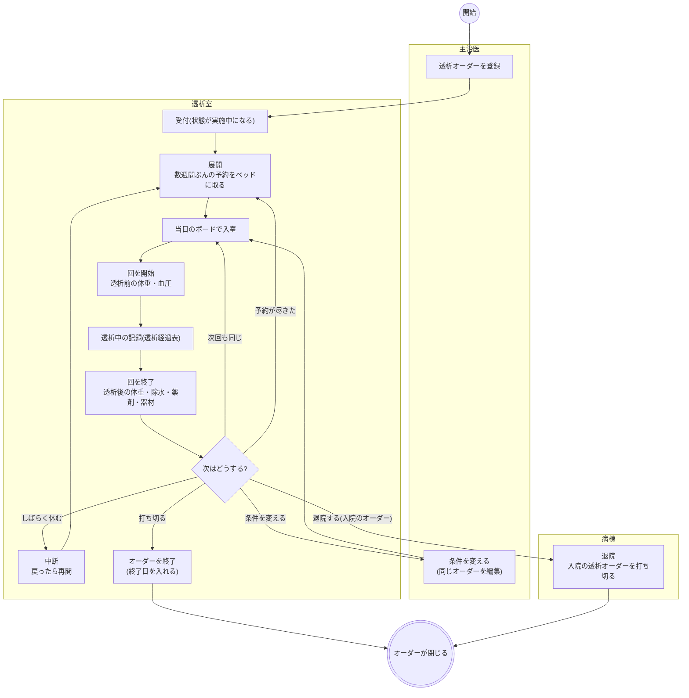
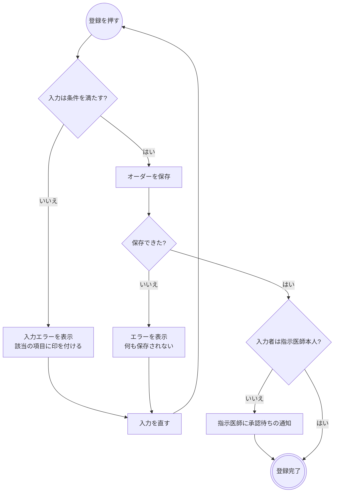
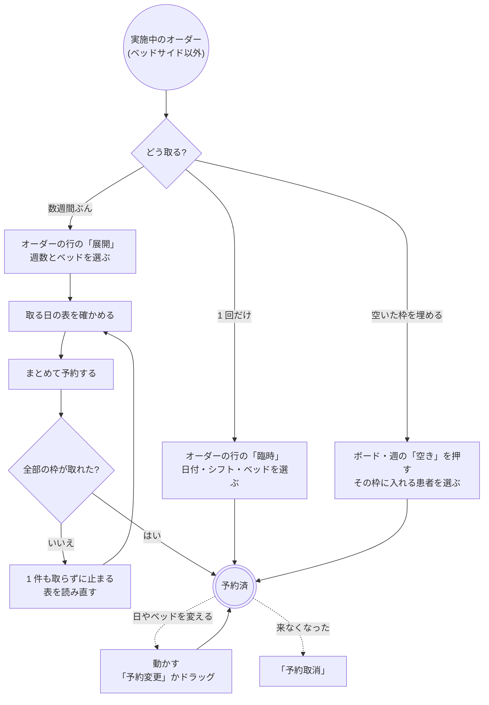
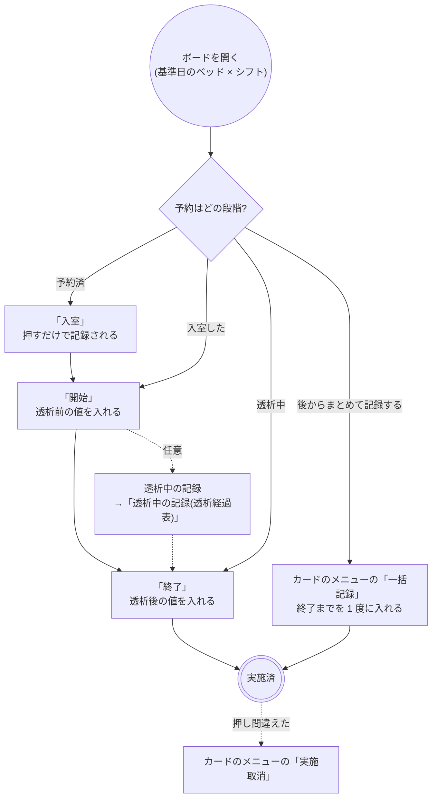
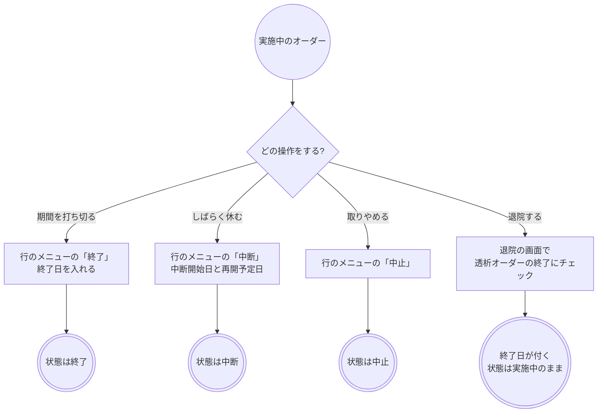

# 透析オーダーの業務フロー

<!-- ../fhir-client/docs/order-flows/dialysis.md から scripts/sync-flows.mjs で作る。直接編集しない。 -->

透析(血液浄化)オーダーを、登録から透析室の受付、予約、各回の入室から回の終了まで、オーダーの終了・中断・退院での打ち切り、医事会計まで追う流れです。
透析はリハビリと同じ**期間継続型**のオーダーで、1 つのオーダーが週 3 回を何か月も続けます。オーダーには「浄化方法と透析条件、曜日 × シフト、期間」を書きます。どのベッドで行うかは透析室が取る予約で決まり、実際の体重・除水・薬剤は各回の実施記録に残します。
このページでは、1 回ぶんの透析を「回」、曜日 × シフトから数週間ぶんの予約をまとめて取ることを画面の表記どおり「展開」と呼びます。

主治医 透析室 病棟

## 全体の流れ

**使う画面**

| だれが | 画面 | すること |
|---|---|---|
| 主治医 | カルテの右ペイン(右側のオーダー入力)の「透析」 | オーダーの登録・編集 |
| 透析室 | 「部門業務 > 透析部門 > 透析一覧」 | 受付、予約、各回の実施、オーダーの終了・中断・中止 |
| 透析室 | 「部門業務 > 透析部門 > 透析室の設定」 | 透析室・ベッド・枠の準備 |
| 病棟 | 退院の画面 | 入院の透析オーダーの打ち切り |

- 透析一覧には「ボード」「週」「オーダー」「患者」「統計」の 5 つのビューがあります。一覧の上の「基準日」で、見る日を選びます。
- 透析オーダーは、オーダーセットにも入れられ、クリニカルパスのタスク分類「透析」の既定のオーダー種別でもあります。パスからできるのは登録までで、実施は透析一覧で行います。
- ホームでは臨床工学技士に、今日有効なオーダーの件数と、本日の予約の件数のカードが出ます。

**条件を変えるとき**

- 新しいオーダーを出さず、同じオーダーを編集します。取ってある予約はそのまま使えます。
- 各回の実施記録に実際の QB(血流量)・QD(透析液流量)・血液浄化器・薬剤が残るので、いつどの条件で行ったかは実施記録で分かります。

**カルテと患者帯の表示**

- オーダーのカードは、カルテの開始日の日に 1 枚載ります。浄化方法・曜日 × シフト・透析条件と、直近 3 回の実施(「11/11 前 62.4 → 後 60.2kg / 除水 2.2L / 4時間05分」)が出ます。
- 実施が出るのは、オーダーの状態が実施中・中断・終了のときです。全部の実施とドライウェイトは、カードの詳細で見ます。
- 患者帯の透析のピクトグラムは、今日が期間内の有効なオーダーがあるときに出ます。吹き出しに浄化方法・曜日 × シフト・アクセスと、直近のドライウェイトと設定日が出ます。

## オーダーの状態

| 状態 | 意味 | 変わるきっかけ | 一覧からできること |
|---|---|---|---|
| 依頼済 | 透析室がまだ受けていない | 医師の登録、「受付取消」、「中止取消」 | 「受付」「中止」 |
| 実施中 | 受けた。期間中ずっとこの状態で、回の実施が積み上がる | 「受付」、「終了取消」、「再開」 | 予約と各回の実施。「終了」「中断」「受付取消」「中止」 |
| 中断 | 入院などでしばらく透析室に来ない | 「中断」(中断開始日・再開予定日) | 「再開」「中止」 |
| 終了 | 期間を打ち切った | 「終了」(終了日) | 「終了取消」 |
| 中止 | 透析を取りやめた | 「中止」 | 「中止取消」 |

- 状態を変えるのは透析室だけで、透析一覧の「オーダー」のビューで行います。予約を展開しても、各回を実施しても状態は変わりません。
- 行に直接出るボタンは「受付」「再開」「展開」「臨時」「表示」です。「終了」「中断」「中止」と各取消は、押し間違えると期間や予約が動くので、行の「︙」のメニュー(以下、行のメニュー)に入っています。
- 予約を取れるのも、各回を実施できるのも実施中のオーダーだけです。中断中のオーダーは、空き枠からの予約の候補にも出ません。
- ベッドサイドのオーダー(病棟のベッドで行う透析)は予約を取らず、実施だけを記録します。
- 中断しても、オーダーの期間は変わりません。中断の間の予約だけが取り消されます。

## 準備(透析室を始める前に 1 度だけ)

設定を担当する人が、透析室を使い始める前に行います。

| 準備 | 画面 | 内容 |
|---|---|---|
| シフト | 施設設定「透析室のシフト」 | 1 日の区切りを、コード・名前・開始・終了で登録する |
| 透析室とベッド | 「透析室の設定」 | 透析室を作り、台数を入れてベッドを足す |
| 枠 | 「透析室の設定」の「枠の生成」 | 開始日と月数(上限 6)を入れて、予約の入れ物を作る |
| 血液浄化器 | 「マスタ > 透析 > 血液浄化器」 | 施設で使う製品と、算定に使う特定器材コードを登録する |
| 会計コード | 施設設定「医事会計のレセプト電算コード」の透析 | 浄化方法ごとの診療行為コードを登録する |
| 採血の項目 | 施設設定「透析患者一覧の採血項目」 | 患者一覧に並べる検査の結果項目のコードと、列の見出しを登録する |
| 患者メモの雛形 | 「テンプレート一覧」 | 「透析の患者メモ」を取り込む |

- **シフト**: 既定は午前 9:00〜13:30・午後 14:00〜18:30 です。時間帯は重ねられません。シフトは、オーダーの曜日 × シフト、ベッドの枠、ボードの列になります。
- **ベッド**: 番号の続きで名前が付きます。使わなくなったベッドは無効にします。無効のベッドには枠が作られず、ボードにも出ません。
- **枠**: 有効なベッドに、日 × シフトで 1 枠ずつできます。祝日・休診日にもできるので、行わない日は予約を入れずにおきます。
- **枠の作り直し**: 既に枠のある日 × シフトは飛ばします。シフトを足したあとに生成し直すと、足したシフトの枠だけが増えます。
- **血液浄化器**: ダイアライザ・ヘモダイアフィルタ・血液濾過器・血漿分離器・吸着器などを登録します。
- **会計コード**: 維持透析(HD・HDF・I-HDF)は時間区分(4 時間未満・4〜5 時間・5 時間以上)ごと、急性血液浄化(CHDF・CHD・PE・DFPP・DHP)は浄化方法ごとに登録します。
- **採血の項目**: 既定は Hb・Alb・K・P・Ca です。
- **患者メモの雛形**: 項目やシャントの台紙を施設に合わせて直すときは、同じテンプレートを直して版を上げます。

## 登録の判定

**入力の条件**

| 項目 | 条件 |
|---|---|
| 浄化方法 | 選ぶ |
| 開始日 | 入れる。オーダーセット・パスの内容として作るときは不要 |
| 終了日 | 空か、開始日以降 |
| 曜日 × シフト | 1 つ以上選ぶ。「ベッドサイド」を付けたときは不要 |
| 透析時間 | 入れる。「ベッドサイド」を付けたときは不要 |
| 透析時間の値 | 入れたときは 30〜1440 分の整数 |
| QB・QD・液量・抗凝固薬の量 | 入れたときは正の数 |
| 抗凝固薬 | 量を入れたときは、薬も選ぶ |

**入力する項目**

- 日程: 入外区分、開始日、終了日、曜日 × シフト、透析時間
- 透析条件: 浄化方法、QB(血流量)、QD(透析液流量)、血液浄化器
- 薬剤と液: 抗凝固薬と量、透析液、補充液、置換液
- アクセス: バスキュラーアクセス、穿刺針
- そのほか: 対象プロブレム、透析部門への指示、「ベッドサイド」

**浄化方法で変わる入力欄**

| 浄化方法 | 透析液 | 補充液 | 置換液 |
|---|---|---|---|
| 血液透析(HD) | ある | 無い | 無い |
| 血液透析濾過(HDF)・間歇補充型血液透析濾過(I-HDF) | ある | ある | 無い |
| 持続的血液濾過透析(CHDF) | ある | ある | 無い |
| 持続的血液透析(CHD) | ある | 無い | 無い |
| 血漿交換(PE)・二重膜濾過血漿交換(DFPP) | 無い | 無い | ある |
| 血液吸着(DHP) | 無い | 無い | 無い |

- 血液浄化器の種類と行数も浄化方法で決まります。HD はダイアライザ 1 行、DFPP は血漿分離器と血漿成分分画器の 2 行、などです。
- 「ベッドサイド」は、病棟のベッドで行う急性血液浄化に付けます。透析室の予約を作りません。
- 入外区分の初期値は、入院中なら「入院」です。入院のオーダーは、透析一覧の「病棟」列に登録したときの病棟が出ます。
- 登録時の警告(禁忌・重複など)はありません。
- 承認待ちでも、オーダーは透析室に届きます。

## 予約(展開・臨時・空き枠・変更・ドラッグ・取消)

予約は、透析一覧の「ボード」(基準日のベッド × シフトの表)と「週」のビューに並びます。このページでは、予約の入れ物(ベッド × 日 × シフト)を「枠」、枠に入った予約の表示を「カード」と呼びます。カードの「︙」のメニューを、カードのメニューと呼びます。

**展開**

- 週数(1〜12)とベッドを選ぶと、オーダーの曜日 × シフトから取る日の表ができます。表には、日ごとに「枠あり」「枠なし」「既に予約あり」が出ます。既に予約のある日は取りません。
- 開始日は、まだ予約が無ければオーダーの開始日(過去なら今日)、予約があれば最後の予約の翌日です。
- ベッドの初期値は、同じ曜日 × シフトの直近の予約のベッドです。曜日 × シフトごとに変えられます。
- 1 回に取れるのは 40 件までです。超えるときは一部だけを取ることはせず、取る前に止まるので、週数を減らします。
- 先に別の患者が取った枠が 1 つでもあると、1 件も予約されません。「別の患者が取った枠があります」と出て、表が読み直されます。

**臨時・予約変更**

- 日付とシフトを選ぶと、その日 × シフトのベッドが「空き」「埋まり」「枠なし」で並びます。
- 「予約変更」はカードのメニューから開きます。別の日・シフト・ベッドへ移せ、今の枠は「現在」と出ます。

**空き枠から**

- 「ボード」「週」のビューの「空き」を押すと、その枠に入れる患者を選べます。
- 候補に出るのは、その日が期間内で、状態が実施中で、その日 × シフトにまだ予約の無いオーダーです。

**ドラッグ**

| カードを落とす先 | 起きること |
|---|---|
| 空いている枠 | 予約変更。日・シフトをまたいでもよい |
| 同じ日 × シフトの、動かせる別のカード | ベッドの入れ替え |
| 入室以降のカード、予約が 2 件以上入っている枠 | 落とせない |

- 動かせるのは、予約済でまだ入室していないカードだけです。
- 別の端末で先に枠や予約が変わっていたときは、動かさずに止まり、ボードが読み直されます。

**予約取消**

- カードのメニューの「予約取消」と、カルテの予約タブから行います。
- 実施記録のある予約は取り消せません。先に「実施取消」をします。

**そのほか**

- 予約はカルテの予約タブにも「透析」として並び、そこからも日時変更・取消ができます。枠は透析室の枠表から選びます。
- 透析の予約は外来一覧には出ません。
- 枠を生成していない日や、無効にしたベッドは「枠なし」になり、予約を取れません。先に「透析室の設定」で枠を生成します。

## 各回の実施

**段ごとに入れるもの**

| 段 | 入れるもの | 予約の表示 |
|---|---|---|
| 「入室」 | なし(押すだけ) | 来院 |
| 「開始」 | 開始時刻、透析前の体重と血圧 | 来院 |
| 「終了」 | 終了時刻、透析後の値、使ったもの、ドライウェイトの見直し、コメント | 実施済 |
| 「一括記録」 | 「開始」と「終了」の内容を 1 度に | 実施済 |
| 「実施取消」 | なし。回の記録を消す | 予約済に戻る |

- 「開始」の入力では、ドライウェイトと目標除水が見られます。
- 「終了」で入れる透析後の値は、体重、血圧、除水量、QB、QD です。
- 「終了」で入れる使ったものは、血液浄化器、薬剤(ロット・算定)、器材、追加の手技です。

**入力の条件**

| 項目 | 条件 |
|---|---|
| 開始時刻 | 「開始」で必須 |
| 終了時刻 | 「終了」で必須。開始時刻より後 |
| 体重 | 入れたときは 1〜300 kg |
| 血圧 | 入れたときは収縮期と拡張期の両方 |
| 除水量 | 入れたときは 0〜20 L |
| QB・QD | 入れたときは正の数 |

- 表に無い項目は、空でも記録できます。

**初期値**

- 開始時刻と終了時刻の初期値は、その日の枠を今記録するときは今の時刻、別の日の枠を後から記録するときは枠の開始時刻です。
- 終了時刻の初期値は、「開始時刻 + オーダーの透析時間」と今の時刻の早いほうです。
- 除水量の初期値は、透析前後の体重の差です。手で直せます。実透析時間は開始時刻と終了時刻から自動で出ます。
- 血液浄化器・QB・QD・抗凝固薬の初期値は、オーダーの値です。
- 急性血液浄化(CHDF など)では、オーダーの透析液・補充液・置換液も薬剤の行に入ります。
- 透析前の体重と血圧は「開始」で入れます。「開始」で入れていれば「終了」では変わらず、入れていなければ「終了」で入れます。

**薬剤の算定**

- 薬剤の「算定」を外した行は、記録には残りますが、医事会計には送りません。
- 維持透析の抗凝固薬は、初期値で「算定」が外れています。人工腎臓の所定点数に含まれるためです。
- ESA など、所定点数に含まれる薬を足したときは、手で「算定」を外します。

**ドライウェイト**

- ドライウェイトは患者ごとの値です。「終了」の入力で値を変えたときだけ、新しい値が記録されます。

**ベッドサイドのオーダー**

- ボードの表の下の「ベッドサイド」の表から、「開始」「一括記録」で実施します。
- CHDF のように日をまたぐ回は、終わるまで、基準日を変えても表に出続けます。

**ほかの画面への表示**

- 透析前後の血圧はバイタルとして記録されるので、温度板(病棟の経過表)の血圧の行にも出ます。
- 体重は、透析前後の 2 つの値が並ぶことになるので、温度板には出ません。
- 各回は、カルテの透析カードの詳細の実施履歴にも並びます。そこから透析経過表を開けます。

## 透析中の記録(透析経過表)

透析経過表は、1 回の透析の間のバイタル・装置の値・できごと・薬剤を、時刻つきで残す画面です。画面のボタンやメニューには「経過表」と出ます。病棟の経過表(このページでは温度板と呼びます)とは別の画面です。

**開き方**

- 開始後の回で、ボードのカードのメニューの「経過表」から開きます。「ベッドサイド」の表では操作の列にあります。
- カルテの透析カードの詳細の、実施履歴の行からも開けます。
- 透析経過表のある回には、折れ線の印(「経過表あり」)が付きます。印は、ボード・週・「ベッドサイド」の表と、カルテの透析カードの実施の行、詳細の実施履歴に出ます。

**記録するもの**

| 種類 | 中身 |
|---|---|
| バイタル | 血圧・脈拍・SpO2・体温 |
| 装置の値 | QB・QD・除水速度・累積除水・静脈圧・動脈圧・TMP |
| できごと | 時刻と種別 |
| 薬剤 | 医薬品マスタから選び、単回(量)か持続(速度)と、経路・時刻 |

- バイタルと装置の値は、30 分毎など、測るたびに時刻つきで足していきます。装置の値は前回の値が初期値なので、変わったところだけ直します。
- できごとの種別は、穿刺・除水停止・除水再開・血圧低下・補液・回路交換・返血・止血確認・その他です。
- 薬剤は、補液・昇圧薬などを「薬剤」に足します。持続の薬剤は「終了」で閉じます。
- 記録は 1 点ずつ保存されます。「確定」の操作はありません。回を終了したあとも、書き忘れた血圧を足せます。

**グラフ**

- 血圧(∨ ∧)と脈拍(●)が出て、回の開始と終了が縦線で出ます。
- 累積除水は右軸(■)に出ます。目標除水(透析前体重 − ドライウェイト)が破線で出ます。

**回の終了とのつながり**

| 透析経過表の値 | 「終了」の入力での初期値 |
|---|---|
| 最後の血圧 | 透析後血圧 |
| 累積除水 | 除水量 |
| 薬剤 | 薬剤の行 |

- 透析経過表の薬剤は、そのままでは医事会計に送りません。「終了」の入力で薬剤の行になったものについて、算定するかを決めます。
- 透析経過表の薬剤がオーダーの抗凝固薬と同じ薬なら、抗凝固薬の行に量が入ります。
- 「実施取消」をすると、その回の透析経過表も一緒に消えます。

**印刷と温度板**

- 「印刷」で別タブに A4 横の紙面を開き、ブラウザから印刷します。紙面には、見出し・グラフ・記録の表・できごと・薬剤が載ります。
- 透析経過表の記録は、温度板の期間表示には出ません。温度板で日付の見出しを押した 24 時間表示にだけ、透析中の血圧・脈拍・SpO2・体温が重なります。

## 患者メモ

消毒液・止血方法・導入年月日・シャントのシェーマなど、穿刺・止血のたびに見返すことは患者メモに書きます。
患者 1 人に 1 枚で、入院・外来をまたいで同じものを書き直していきます。

- ボードのカードのメニューの「患者メモ」と、「患者」のビューの「メモ」で開きます。
- 透析オーダーの詳細にも出ます。詳細は、カルテの透析カードと、透析一覧の「表示」から開きます。
- シャントのシェーマは、両上肢の台紙に描き込みます。
- 患者メモはカルテの時系列には出ません。患者のテンプレート回答の一覧には出ます。

## 透析患者一覧・月間統計

**「患者」のビュー**

基準日に透析室で透析を受けている患者を、1 人 1 行で見られます。

| 列 | 中身 |
|---|---|
| アクセス | バスキュラーアクセス |
| ドライウェイト | 推移 |
| 直近の透析 | 透析後体重とドライウェイトの差・除水量・時間 |
| 透析間の体重増加 | 前の回からの増加 |
| 直近の採血 | 準備で選んだ検査項目(既定は Hb・Alb・K・P・Ca) |
| 次回予約 | 次の予約の日 |

- ベッドサイド・中止・受付取消を除き、中断中の患者は載ります。
- 採血は、基準日から 90 日前までの結果を見ます。基準日より前の回に測った項目には、日付が添えられます。

**「統計」のビュー**

月を選んで、実施回数・実患者数・平均の透析時間・ベッドの稼働率を見られます。

- 表は、浄化方法別、シフト別、ベッド別、日別の 4 つです。シフト別とベッド別には、枠・予約・未来院・実施の数が出ます。
- 日別の表は CSV に出せます。
- 稼働率は「透析室で実施した回 ÷ 枠」です。ベッドサイドの回は別に数えます。
- 入室だけで開始していない回は数えません。

## 終了・中断・中止・退院

オーダーを閉じる・休む操作です。回の「終了」とは別で、透析一覧の「オーダー」のビューの行のメニューから行います。退院だけは退院の画面から行います。

**操作ごとの結果**

| 操作 | 取り消される予約 | 一覧での見え方 |
|---|---|---|
| 「終了」 | 終了日の翌日以降 | 終了日を過ぎると出ない |
| 「中断」 | 中断の期間(両端を含む) | 「中断」と期間が出る |
| 「中止」 | 今日以降 | 中止の行として残る |
| 退院 | 退院日の翌日以降 | 状態は実施中のまま |

- どの操作でも、もう来ない日の予約が同じ操作で取り消され、枠が空きます。それより前の予約は、通院の記録として残ります。
- 「終了」の終了日は、開始日以降にします。
- 「中断」の再開予定日は任意です。入れなければ、中断開始日以降の予約がすべて取り消されます。中断開始日の初期値は、基準日と今日の遅いほうです。
- 「中止」は、依頼済と中断のオーダーにもできます。

**戻す操作**

| 戻す操作 | 戻した後の状態 | 戻らないもの |
|---|---|---|
| 「終了取消」 | 実施中 | 終了日、取り消された予約 |
| 「再開」 | 実施中 | 取り消された予約 |
| 「中止取消」 | 依頼済 | 取り消された予約 |

- 取り消された予約は、どの操作でも戻りません。取り消したあとに、枠が別の患者で埋まっていることがあるためです。続けるときは、展開・臨時・空き枠から取り直します。
- 「終了取消」をしても、終了日は消えません。打ち切った期間まで戻すと、その間の実施記録と食い違うためです。期間を延ばすときは、オーダーを編集して終了日を直します。
- 中止のオーダーは、基準日が期間内なら中止の行として並びます。そこから「中止取消」ができます。

**中断と再開**

- 中断中のオーダーも「患者」のビューに載り、カルテのカードには実施が出ます。
- 中断中のオーダーは、中止にはできますが、終了にはできません。終了するときは、先に再開します。
- 再開予定日より後の予約は残っています。再開したあとに展開すると、開始日はその続きになります。
- 再開が予定より早まって、中断の期間に予約の無い日ができたときは、臨時か空き枠から取ります。

**退院**

- 退院の画面に「入院の透析オーダーを退院日で終了する」のチェックが出ます。チェックは外せます。
- 対象は、入外区分が入院で、退院日より後まで続くオーダーです。終了日が無いか、終了日が退院日より後のものが当たります。
- 急性血液浄化が退院(転院・死亡を含む)で終わるときは、ここで閉じます。
- 外来の維持透析は退院後も続くので、対象になりません。
- 退院で打ち切ったオーダーは、退院日が終了日として付くだけで、状態は「終了」になりません。

**入院中に維持透析を続けるとき**

- 入院のオーダーを別に出し、外来のオーダーは中断しておきます。入院の登録では、外来のオーダーは自動で中断になりません。

## 変更・中止・削除

| 操作 | どこから | 条件と結果 |
|---|---|---|
| 変更 | カルテのカードの編集 | 状態・取ってある予約・実施記録は変わらない |
| 中止 | 透析一覧の行のメニューの「中止」 | カルテのカードからは中止できない |
| 削除 | カルテのカード | 実施記録が無いオーダーだけ。取ってある予約も取り消される |
| DO(前回と同じ内容で出し直す) | カルテのカード | 新しいオーダーとして登録される |

- **変更**: 中止のオーダーを編集しても、中止のまま保存されます。
- **削除**: 実施記録があるときは、先に各回の「実施取消」をしてから削除するか、中止にします。
- **DO**: 透析条件・曜日 × シフト・アクセスは元のオーダーのまま引き継ぎます。開始日は今日、終了日は空になります。入外区分は今の状態(入院中なら入院)になります。
- **入院から外来への切り替え**: 入外区分は登録したときの値のままで、後から変える手段はありません。外来で続けるときは、新しいオーダーを出します。

## ほかの画面とのつながり

| 画面 | 透析との関係 |
|---|---|
| ホーム | 臨床工学技士のカードに、今日有効なオーダーの件数・本日の予約の件数・状態の内訳が出る |
| カルテの予約タブ | 透析の予約が「透析」のバッジで並び、日時変更・取消ができる |
| 患者帯 | 今日が期間内の透析オーダーがあると、透析のピクトグラムが出る |
| 温度板(病棟の経過表) | 透析前後の血圧が載る。透析中の記録は 24 時間表示にだけ重なる |
| クリニカルパス | タスク分類「透析」から透析オーダーを登録できる。実施は透析一覧で行う |
| オーダーセット | 透析オーダーを入れられる。開始日・終了日・対象プロブレムはセットに入らない |
| 退院 | 入院の透析オーダーを退院日で打ち切る(「終了・中断・中止・退院」) |
| 枠表の一覧 | 透析室のベッドの枠表が種別「透析」で並ぶ |
| 医事送信 | 終了した回を、回を始めた日の「透析」として送る |

- 患者帯のピクトグラムの吹き出しには、浄化方法・曜日 × シフト・アクセス・ドライウェイトが出ます。
- 枠表の一覧では、枠カレンダーの停止・再開・個別追加が使えます。枠表の名前・有効の切り替えと枠の生成は「透析室の設定」で行います。

## 帳票

専用の帳票はありません。透析経過表の「印刷」で、A4 横の紙面をブラウザから印刷します。透析条件の指示書や透析記録の様式は、まだ出せません。

## リハビリとの違い

リハビリの流れは[リハビリオーダーの業務フロー](rehab.md)にあります。

| | リハビリ | 透析 |
|---|---|---|
| 入力する項目 | 区分・療法・単位数・週あたりの回数 | 浄化方法・透析条件・曜日 × シフト・期間など(「登録の判定」) |
| マスタ | 持たない | 血液浄化器(製品と算定用の特定器材コード)。透析液などは医薬品マスタ |
| 施設設定 | 会計コード | シフト、会計コード、患者一覧の採血項目 |
| 場所 | リハ室(枠表 1 つ) | 透析室とベッド(ベッド 1 台に枠表 1 つ) |
| 予約 | 部門が 1 件ずつ取る | **数週間ぶんをまとめて展開**する。臨時・空き枠・ドラッグでも取れる |
| 実施 | 1 回の入力で終わる | **入室 → 開始 → 終了**の 3 段。後から 1 度に記録もできる |
| 実施で記録するもの | 療法・単位数・訓練内容 | 透析前後の値と使ったもの(「各回の実施」)。透析中の値は透析経過表 |
| ベッドを取らない実施 | 無い | ベッドサイド(CHDF・血漿交換など)は予約なしで実施する |
| 一時的な休み | 無い(終了して出し直す) | **中断**(入院・旅行など)。期間は変えず、その間の予約だけ取り消す |
| 退院での打ち切り | 全件 | **入院のオーダーだけ**。外来の維持透析は入院・退院をまたいで続く |
| 医事会計 | 実施 1 回 = 1 剤、単位数 | 実施 1 回 = 1 剤。維持透析は実際の時間の区分でコードが分かれる |

- 透析の枠は、1 日 × シフトで 1 枠、1 つの枠に 1 患者です。
