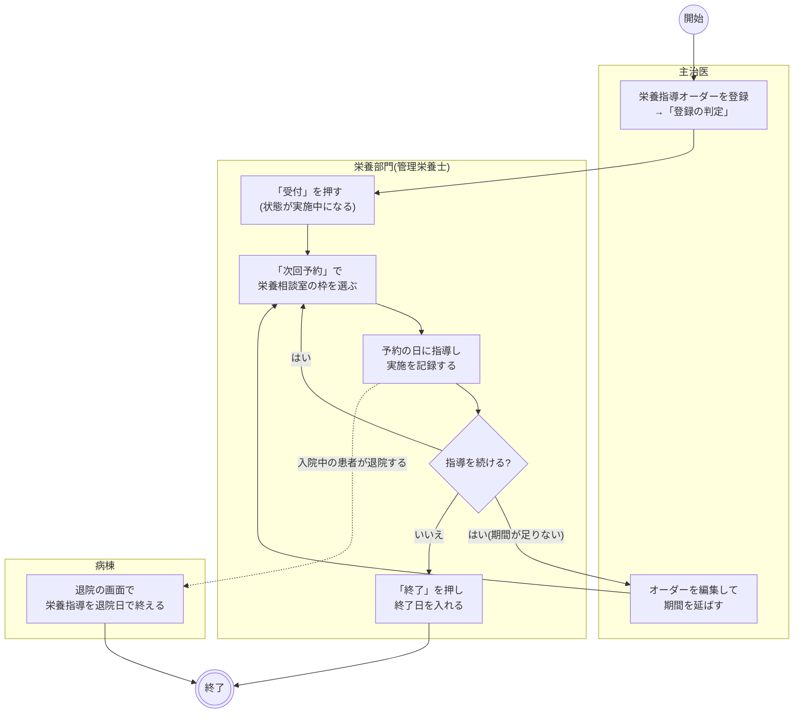
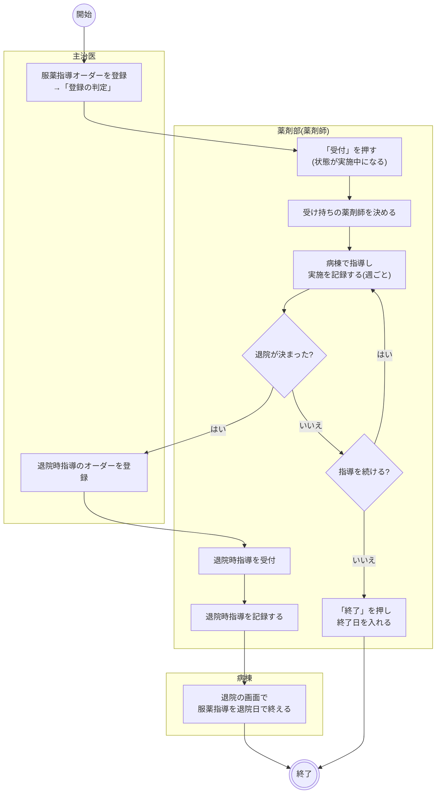
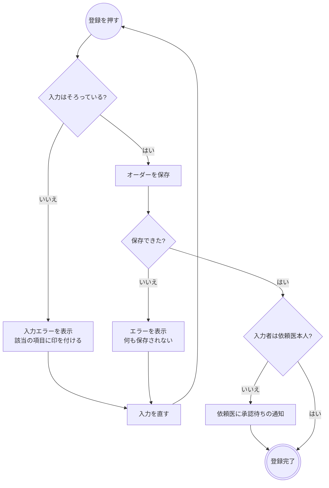
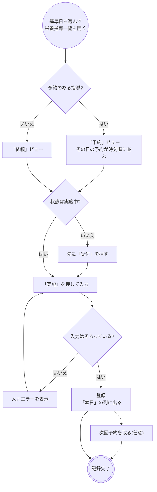
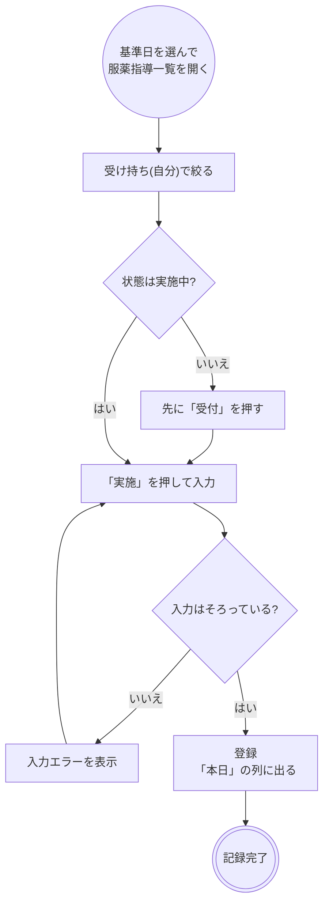
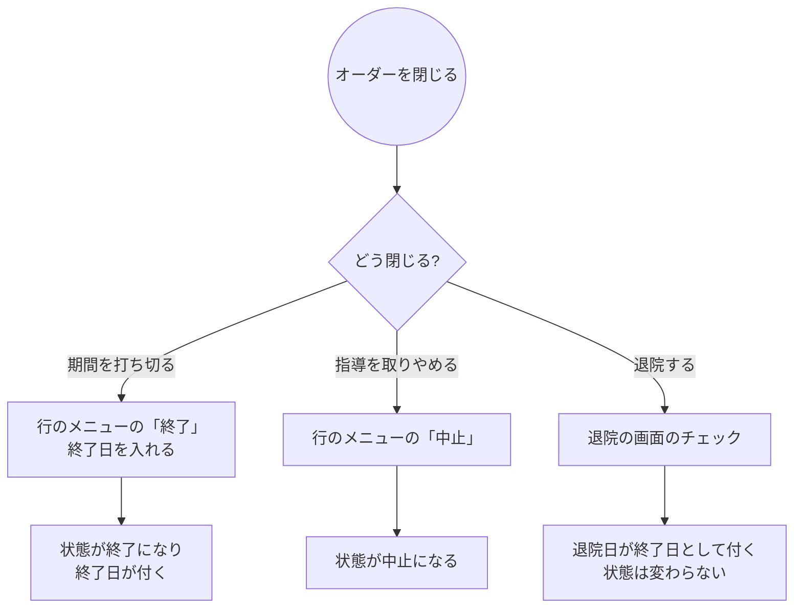

# 栄養指導・服薬指導の業務フロー

<!-- ../fhir-client/docs/order-flows/guidance.md から scripts/sync-flows.mjs で作る。直接編集しない。 -->

管理栄養士への栄養食事指導の依頼(栄養指導)と、薬剤師への服薬指導の依頼(服薬指導)を、登録から部門の受付・指導の積み上げ・終了(退院での打ち切り)まで追う流れです。
2 つともリハビリと同じ**期間継続型**のオーダーです。1 つの依頼が数週間〜数か月続き、その間に指導の記録が何度も積み上がります。予約の取り方はリハビリと同じなので、先に [リハビリオーダーの業務フロー](rehab.md) を読むと分かりやすくなります。リハビリとの違いは、流れを書いた後ろの「リハビリとの違い」にまとめます。

主治医 栄養部門(管理栄養士) 病棟 薬剤部(薬剤師)

## 全体の流れ(栄養指導)

- 初回はおおむね 30 分以上、2 回目以降はおおむね 20 分以上という算定の目安があります。初回と継続 2〜3 回で終わるのが典型です。
- 予約を取らずに指導した日(ベッドサイドでの指導など)は、栄養指導一覧の「依頼」ビューから実施を記録します。

## 全体の流れ(服薬指導)

- **2 つのオーダー**: 入院中の指導(指導区分「服薬指導」)と退院時の指導(指導区分「退院時指導」)は、別のオーダーにします。退院時指導のオーダーでは、実施の指導種別が「退院時指導」だけになるためです。
- **退院のとき**: 退院の画面で、入院中の指導のオーダーも退院時指導のオーダーも、退院日で終えられます。
- **受け持ちの薬剤師**: 受付の前でも決められます。状態は依頼済のままで、受け持ちだけが付きます。終了・中止・取消をしても、受け持ちは外れません。
- **受け持ちの漏れ**: 服薬指導一覧は、受け持ち(自分 / 未定)で絞れます。ホームの「服薬指導」カードには、受け持ちが未定の件数が出ます。

この文書で使う呼び名は次のとおりです。

| 呼び名 | 指すもの |
|---|---|
| 部門の一覧 | 「部門業務 > 栄養部門 > 栄養指導一覧」と「部門業務 > 薬剤部門 > 服薬指導一覧」 |
| 行のメニュー | 部門の一覧の行の「︙」から開くメニュー |
| 状態 | 部門の進み具合(依頼済・実施中・終了・中止) |
| 状態の「終了」 | 部門が「終了」を押して期間を打ち切った状態。オーダーの終了日とは別 |
| 終了日 | オーダーの期間の終わりの日 |
| 受け持ちの薬剤師 | 服薬指導一覧の「担当薬剤師」。行のメニューの「担当」で決める |
| 指導した薬剤師 | 実施の入力の「担当薬剤師」。その回に指導した人 |
| 依頼医 | オーダーを指示した医師 |

- **入口**: カルテの右ペイン(右側のオーダー入力)の「栄養指導」「服薬指導」です。部門の一覧から代わりに登録する入口はありません。
- **クリニカルパス**: タスク分類は、栄養指導が「栄養指導」、服薬指導が「服薬指導」です。
- **オーダーセット**: オーダーセットにも入れられます。開始日・終了日・対象プロブレムは、セットには入りません。

## 進捗の状態

| 状態 | 意味 | 変わるきっかけ | 部門の一覧の行からできること |
|---|---|---|---|
| 依頼済 | 部門がまだ受けていない | 医師の登録、「受付取消」、「中止取消」 | 「受付」、「中止」 |
| 実施中 | 部門が受けた。期間中はずっとこの状態 | 「受付」、「終了取消」 | 「実施」、「次回予約」(栄養指導)、「終了」、「受付取消」、「中止」 |
| 終了 | 部門が期間を打ち切った | 「終了」 | 「終了取消」 |
| 中止 | 指導を取りやめた | 「中止」 | 「中止取消」 |

- **状態を変える場所**: 状態を変えるのは、部門の一覧だけです。実施を記録しても、状態は実施中のままです。
- **行に直接出るボタン**: 「受付」「実施」「次回予約」(栄養指導)「表示」です。「終了」・各取消・「中止」は、行のメニューにあります。
- **服薬指導の「担当」**: 行のメニューにあり、依頼済・実施中・終了の行で使えます。
- **クリニカルパスからの実施**: 依頼済のオーダーをパスの画面から実施すると、同時に実施中になります。
- **退院**: 退院で終えたオーダーは、終了日が付くだけで、状態は「終了」になりません。

## 登録の判定

登録のときに確かめる項目は次のとおりです。

| 項目 | 栄養指導 | 服薬指導 |
|---|---|---|
| 指導形態 | 必須 | 項目なし |
| 指導区分 | 項目なし | 必須 |
| 対象疾患名 | 必須 | 項目なし |
| 開始日 | 必須 | 必須 |
| 終了日 | 空か、開始日以降 | 空か、開始日以降 |

開始日は、オーダーセット・クリニカルパスの内容として作るときは不要です。

栄養指導で入力する項目は次のとおりです。

- 指導形態(個別指導 / 集団指導)。初期値は「個別指導」
- 期間(開始日・終了日)
- 対象疾患名
- 指示食種
- 指導目的
- 栄養部門への指示
- 対象プロブレム

服薬指導で入力する項目は次のとおりです。

- 指導区分(服薬指導 / 退院時指導)。初期値は「服薬指導」
- 指導条件(複数選べる)
- 期間(開始日・終了日)
- 対象薬剤
- 指導してほしいこと
- 薬剤部への連絡事項
- 対象プロブレム

**栄養指導**

- 対象疾患名は、特別食加算の算定要件なので必須です。登録病名から選んで写すこともできます。写した後に手で書き換えると、病名とのつながりは外れます。
- 指示食種は任意で、食事オーダーと同じ食種マスタから選びます。
- 入院中で食事が出ていれば、いまの食種が横に出て、「指示食種へ複写」で写せます。違う食種を指導することもあるので、自動では入りません。

**服薬指導**

- 指導条件は、「ハイリスク薬」「麻薬」「吸入・自己注射の手技」「多剤併用」「服薬状況の確認」「嚥下・剤形の相談」「家族への指導」から選びます。
- 「ハイリスク薬」を付けると、実施の指導種別の初期値が「服薬指導(ハイリスク薬)」になります。

**共通**

- 入外区分の初期値は、入院中なら「入院」です。
- 承認待ちのあいだも、オーダーは部門の一覧に出ます。

## 予約(栄養指導)

栄養指導の予約は、栄養部門がオーダーを受付した後に、行の「次回予約」でそのつど取ります。オーダーの登録のときには取りません。「日時変更」「予約取消」は、栄養指導一覧の「予約」ビューとカルテの予約タブからできます。
取り方はリハビリと同じです。詳しくは [リハビリオーダーの業務フロー](rehab.md)「[予約](rehab.md#予約)」にあります。リハビリと違うのは次の点です。

- **枠**: 「栄養指導予約」の枠表から選びます。場所は栄養相談室などです。
- **枠の準備**: 枠表は、設定する人が管理画面の「予約枠」で作ります。
- **定員**: 集団指導では 1 枠に複数の患者が入るので、枠の定員は 1 に固定されません。
- **カルテの予約タブ**: 「栄養指導」の印が付きます。

服薬指導には予約がありません。指導する日は、受け持ちの薬剤師が病棟の都合で決めます。

## 日々の実施

栄養指導です。

服薬指導です。

実施で入力する項目は次のとおりです。

| 項目 | 栄養指導 | 服薬指導 |
|---|---|---|
| 実施日 | 必須 | 必須 |
| 指導種別 | 必須 | 必須 |
| 実施時間(分) | 必須。1〜600 分 | 項目なし |
| 理解度 | 項目なし | 任意(良好 / 一部理解 / 不十分) |
| 担当 | 必須(「担当管理栄養士」) | 必須(「担当薬剤師」) |
| 指導内容 | 自由入力かテンプレート | 自由入力かテンプレート |

「実施」を押すと、実施日・時刻(予約の時刻)・担当(ログイン中の人)が入った状態で開きます。登録しても、状態は実施中のままです。

**指導種別**

- 栄養指導は、オーダーの指導形態に合うものだけ選べます。個別指導のオーダーなら「初回」か「2 回目以降」、集団指導のオーダーなら「集団」だけです。
- 初回か 2 回目以降かは、指導した人が選びます。
- 服薬指導は、退院時指導のオーダーなら「退院時指導」だけです。それ以外のオーダーは、「服薬指導」「服薬指導(ハイリスク薬)」から選びます。

**担当**

- 担当を選べるようにしてあるのは、指導したのがログインした人とは限らないためです。
- 服薬指導では、実施の入力の「担当薬剤師」(指導した薬剤師)と、服薬指導一覧の「担当薬剤師」(受け持ちの薬剤師)は別に残ります。

**指導内容のテンプレート**

- 指導内容はテンプレートからも書けます。栄養指導には、指導記録のテンプレート「栄養指導 指導記録」(カテゴリ「栄養指導」)があります。
- テンプレートで書いているあいだは、欄を直接直せません。「テンプレート編集」から直します。
- 「解除」を押すと、テンプレートとのつながりだけが外れ、文言は残ります。

**実施の取消**

- 部門の一覧の行の「表示」を開き、実施履歴の「取消」を押します。テンプレートで書いた記入内容も一緒に消えます。
- 別の日の実施を取り消すときは、基準日をその日にします。

**確かめていないこと**

- 月あたりの回数、指導時間の下限、特別食に当たるかどうかは、画面では確かめていません。

## 終了・中止・退院

| 操作 | できるとき | 部門の一覧での見え方 | 栄養指導の予約 |
|---|---|---|---|
| 「終了」 | 実施中 | 終了日を過ぎると出なくなる | 終了日の翌日以降の予約が取り消される |
| 「中止」 | 依頼済・実施中 | 中止の行として残る | 今日以降の予約が取り消される |
| 退院 | 退院日より後まで続くオーダー | 退院日を過ぎると出なくなる | 退院日の翌日以降の予約が取り消される |

- **「終了」**: 終了日は、開始日以降の日を入れます。
- **退院の画面のチェック**: 「栄養指導オーダーを退院日で終了する」「服薬指導オーダーを退院日で終了する」です。外来の栄養指導・服薬指導に切り替えて続けることもあるので、食事とは別のチェックになっていて、外せます。
- **予約の扱い**: 取り消されるのは、もう指導に来ない日の予約だけです。枠は空きます。それより前の予約は、来院の記録として残ります。

押し間違えたときは、行のメニューの取消で戻します。

| 操作 | 戻る先 | 戻らないもの |
|---|---|---|
| 「終了取消」 | 実施中 | 終了日、取り消された予約 |
| 「中止取消」 | 依頼済 | 取り消された予約 |
| 「受付取消」 | 依頼済 | なし |

- **「終了取消」の後に期間を延ばすとき**: オーダーを編集して終了日を直し、予約を取り直します。
- **終了日が残る理由**: 終了日を自動で消すと、打ち切った後の期間までオーダーが続いていたことになり、その間に実施記録が無いことと食い違うためです。

## 変更・中止・削除

| 操作 | できる場所 |
|---|---|
| 変更 | カルテのカード(カルテに出る、そのオーダーのカード)の編集 |
| 中止 | 部門の一覧の行のメニューの「中止」 |
| 削除 | カルテのカード |
| DO(前回と同じ内容で出し直す) | カルテのカード |

- **変更**: 状態・実施記録・予約・受け持ちの薬剤師は変わりません。中止のオーダーを編集しても、中止のままです。
- **中止**: カルテのカードに中止はありません。
- **削除できるとき**: 実施記録が無いオーダーだけ削除できます。実施記録があるときは、実施を取り消してから削除するか、中止します。
- **削除で一緒に消えるもの**: 栄養指導では、取ってある予約が取り消され、指導目的のテンプレートの記入内容も消えます。
- **DO**: 新しいオーダーとして写ります。開始日は今日になり、終了日は空になります。
- **DO で引き継ぐもの**: 栄養指導は、対象疾患名と指示食種を引き継ぎます。指導目的は文言だけを引き継ぎ、テンプレートとのつながりは外れます。

## リハビリとの違い

実施を記録しても状態が変わらないこと、「終了」で期間を打ち切ること、退院で終えられることは、リハビリと同じです。違いは次のとおりです。

| | リハビリ | 栄養指導 | 服薬指導 |
|---|---|---|---|
| 依頼先 | リハ部門(療法士) | 栄養部門(管理栄養士) | 薬剤部(薬剤師) |
| 予約 | 部門が「次回予約」でそのつど取る | 部門が「次回予約」でそのつど取る | 無い(薬剤師が病棟で指導する) |
| 受け持ち | 無い | 無い | 受け持ちの薬剤師を一覧で決める |
| テンプレート | 無い | 指導目的と指導内容で使える | 指導内容で使える |
| 部門の画面 | リハビリ一覧 | 栄養指導一覧 | 服薬指導一覧 |
| ホームのカード | 療法士向け | 管理栄養士向けの「栄養指導」 | 薬剤師向けの「服薬指導」 |
| 医事会計 | 実施 1 回ごとに送る | 実施 1 回ごとに送る | まだ送らない |

- **必須の項目**: リハビリは区分・療法・単位数・開始日・対象疾患名です。栄養指導と服薬指導は「登録の判定」の表のとおりです。
- **実施で入れるもの**: リハビリは療法・単位数・担当療法士・訓練内容です。栄養指導と服薬指導は「日々の実施」の表のとおりです。
- **実施した人**: どのオーダーも、実施記録に担当(療法士・管理栄養士・薬剤師)を残します。
- **服薬指導の医事会計**: 送信の画面では、服薬指導は「送れない項目」に出ます。

## 帳票

専用の帳票はありません。次のものは、このオーダーでは扱いません。

- 服薬指導患者表・同意書・薬歴の帳票
- 栄養管理計画書(入院時の栄養管理は、病棟の「栄養管理」で扱う)
