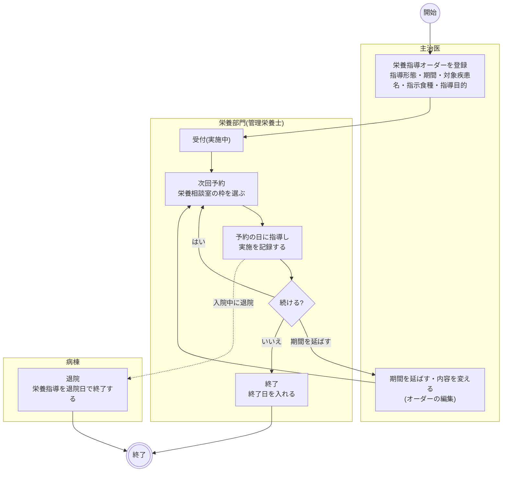
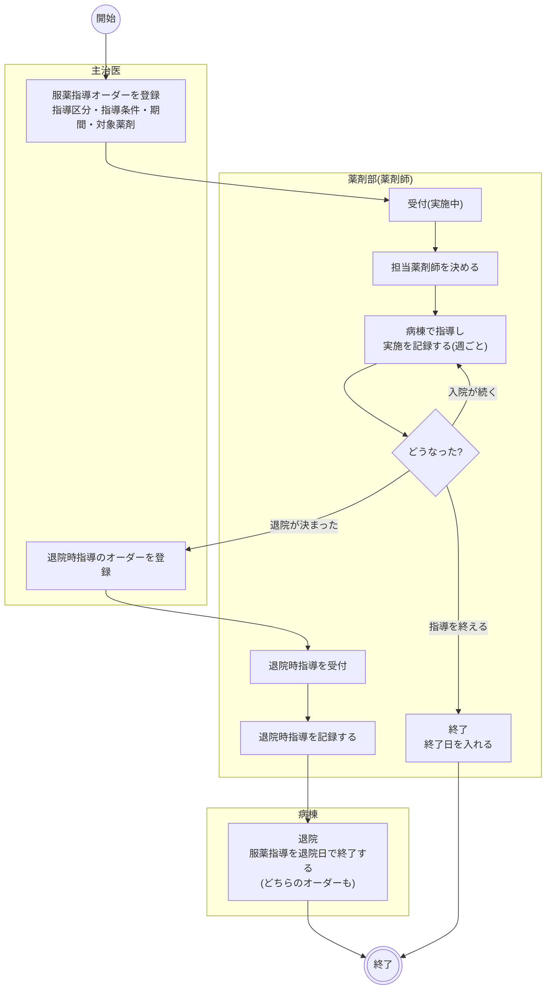
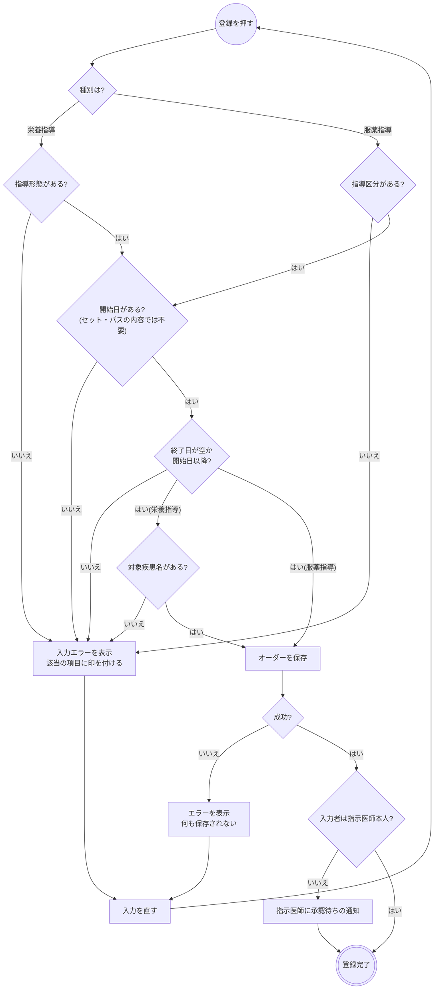
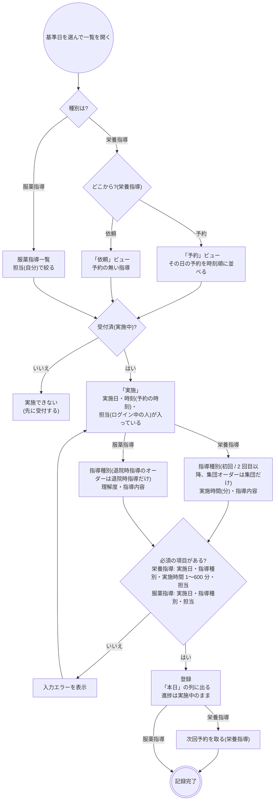
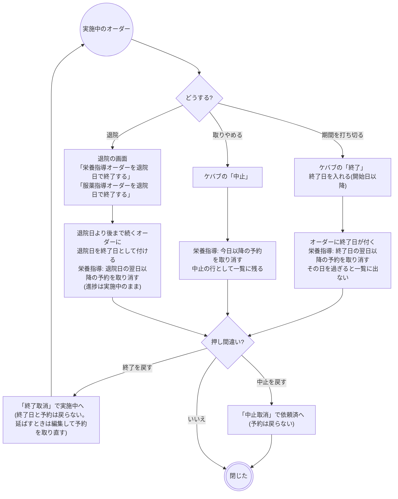

# 栄養指導・服薬指導の業務フロー

<!-- ../fhir-client/docs/order-flows/guidance.md から scripts/sync-flows.mjs で作る。直接編集しない。 -->

管理栄養士への栄養食事指導の依頼(栄養指導)と、薬剤師への服薬指導の依頼(服薬指導)を、登録から部門の受付・指導の積み上げ・終了(退院での打ち切り)まで追う流れです。
2 つともリハビリと同じ**期間継続型**のオーダーです。1 つの依頼が数週間〜数か月続き、その間に指導の記録が何度も積み上がります。骨格は [リハビリオーダーの業務フロー](rehab.md) と同じなので、この文書は**リハビリとの違い**を中心に書きます。

主治医 栄養部門(管理栄養士) 病棟 薬剤部(薬剤師)

## リハビリとの違い

| | リハビリ | 栄養指導 | 服薬指導 |
|---|---|---|---|
| 依頼先 | リハ部門(療法士) | 栄養部門(管理栄養士) | 薬剤部(薬剤師) |
| 入力する項目 | 区分・療法・単位数・週の回数・期間・対象疾患名・起算日 | 指導形態(個別 / 集団)・期間・対象疾患名・指示食種・指導目的・栄養部門への指示 | 指導区分(服薬指導 / 退院時指導)・指導条件(複数可)・期間・対象薬剤・指導してほしいこと・薬剤部への連絡事項 |
| 必須の項目 | 区分・療法・単位数・開始日・対象疾患名 | 指導形態・開始日・対象疾患名 | 指導区分・開始日 |
| 予約 | 部門が「次回予約」を都度取る | 部門が「次回予約」を都度取る(栄養相談室の枠) | 持たない(薬剤師が病棟で指導する) |
| 担当 | 実施記録の担当療法士だけ | 実施記録の担当管理栄養士だけ | 受け持ちの「担当薬剤師」を一覧で登録する。実施した薬剤師は別に残す |
| 実施で入れるもの | 療法・単位数・担当療法士・訓練内容 | 指導種別(初回 / 2 回目以降 / 集団)・実施時間(分)・担当管理栄養士・指導内容 | 指導種別(服薬指導 / ハイリスク薬 / 退院時指導)・理解度・担当薬剤師・指導内容 |
| テンプレート | 無し | 指導目的(オーダー)と指導内容(実施)で使える | 指導内容(実施)で使える |
| 部門の画面 | リハビリ一覧 | 部門業務 > 栄養部門 > 栄養指導一覧 | 部門業務 > 薬剤部門 > 服薬指導一覧 |
| ホームのカード | 療法士 | 管理栄養士「栄養指導」 | 薬剤師「服薬指導」(担当未定の件数を添える) |
| 医事会計 | 実施 1 回ごとに送る | 実施 1 回ごとに送る | まだ送らない(送れない項目に出す) |

- 入口はカルテの右ペイン「栄養指導」「服薬指導」です。部門の一覧から代わりに起こす入口はありません。
- クリニカルパスのタスク分類は、栄養指導が「栄養指導」、服薬指導が「服薬指導」です。オーダーセットにも入れられます(開始日・終了日・対象プロブレムは持ち込みません)。
- 実施しても進捗は動かない、終了で期間を打ち切る、退院で止められる、という点はリハビリと同じです。

## 進捗の状態

| 状態 | 意味 | 変わるきっかけ | 一覧の行からできること |
|---|---|---|---|
| 依頼済 | 部門がまだ受けていない | 医師の登録、受付取消、中止取消 | 受付、中止(服薬指導は担当も) |
| 実施中 | 受けた。期間中ずっとこの状態で指導が積み上がる | 受付、終了取消 | 実施、次回予約(栄養指導)、終了、受付取消、中止(服薬指導は担当も) |
| 終了 | 期間を打ち切った | 終了(終了日) | 終了取消(実施中へ。服薬指導は担当も) |
| 中止 | 指導を取りやめた | 中止 | 中止取消(依頼済へ) |

- 状態を動かすのは部門の一覧だけです。実施しても状態は変わりません。
- 一覧の行に直接出るのは「受付」「実施」「次回予約」(栄養指導)「表示」です。終了・各取消・中止と、服薬指導の「担当」は行のケバブメニューに畳んであります。
- 例外はクリニカルパスからの実施です。依頼済のオーダーをパスの画面から実施すると、同時に実施中になります。

## 全体の流れ(栄養指導)

- 初回はおおむね 30 分以上、2 回目以降はおおむね 20 分以上という算定の目安があり、初回と継続 2〜3 回で終わるのが典型です。
- 予約を取らずに指導した日は、一覧の「依頼」ビューから実施を記録します(ベッドサイドでの指導など)。

## 全体の流れ(服薬指導)

- 入院中の指導(指導区分「服薬指導」)と退院時の指導(「退院時指導」)は別のオーダーにします。退院時指導のオーダーでは、実施の指導種別が「退院時指導」だけになるためです。
- 担当薬剤師は受付の前でも決められます(依頼済のまま担当だけ付きます)。担当は終了・中止・取消をしても外れません。
- 一覧は担当(自分 / 未定)で絞れ、ホームの「服薬指導」カードは担当未定の件数を出すので、受け持ちの漏れに気づけます。

## 登録の判定

- 栄養指導の対象疾患名は特別食加算の算定要件なので必須です。登録病名から選んで写すこともでき、手で書き換えると病名との紐付けは外れます。
- 栄養指導の指示食種は任意で、食事オーダーと同じ食種マスタから選びます。入院中で食事が出ていれば、いまの食種を横に出し「指示食種へ複写」で写せます(違う食種を指導することもあるので自動では入れません)。
- 服薬指導の指導条件は「ハイリスク薬」「麻薬」「吸入・自己注射の手技」「多剤併用」「服薬状況の確認」「嚥下・剤形の相談」「家族への指導」から複数選べます。ハイリスク薬を付けると、実施の指導種別の初期値が「服薬指導(ハイリスク薬)」になります。
- 指導形態の初期値は「個別指導」、指導区分の初期値は「服薬指導」です。入外区分の初期値は、入院中なら「入院」です。
- 承認待ちでもオーダーは部門に流れます。

## 予約(栄養指導)

予約の取り方・日時変更・取消はリハビリと同じです([リハビリオーダーの業務フロー](rehab.md)「予約」)。違いは次の点だけです。

- 枠は管理画面の「予約枠」で作る「栄養指導予約」の枠表です(場所は栄養相談室など)。
- 集団指導では 1 枠に複数の患者が入るので、枠の定員は 1 に固定しません。
- カルテの予約タブでは「栄養指導」の印が付き、取消・日時変更ができます。
- 服薬指導には予約がありません。指導する日は担当薬剤師が病棟の都合で決めます。

## 日々の実施

- 栄養指導の指導種別は、オーダーの指導形態と食い違うものを選ばせません(個別のオーダーなら初回 / 2 回目以降、集団のオーダーなら集団だけ)。初回か 2 回目以降かは指導した人が選びます。
- 服薬指導の指導種別は、退院時指導のオーダーなら「退院時指導」だけ、それ以外は「服薬指導」「服薬指導(ハイリスク薬)」から選びます。理解度(良好 / 一部理解 / 不十分)は任意です。
- 担当を選ばせるのは、実施したのがログインした人とは限らないからです。服薬指導では、実施した薬剤師と一覧の担当薬剤師は別に残ります。
- 指導内容はテンプレートからも書けます。栄養指導には指導記録のテンプレート(「栄養指導 指導記録」、カテゴリ「栄養指導」)があります。テンプレートで書いている間は欄を直接直せず、「テンプレート編集」から直します。「解除」で紐付けだけ外れ、文言は残ります。
- 実施の取消は、一覧の行の「表示」→ 実施履歴の「取消」です。テンプレートで書いた記入内容も一緒に消えます。別の日の実施を取り消すときは基準日をその日にします。
- 月あたりの回数・指導時間の下限・特別食に当たるかどうかの判定はしていません。

## 終了・中止・退院

- 扱いはリハビリと同じです。栄養指導の予約は、もう来ない日のぶんを同じ操作で取り消して枠を空け、それより前の予約は来院の記録として残します。
- 退院では、外来の栄養指導・服薬指導に切り替えて続けることもあるので、食事とは別のチェックにしてあり外せます。退院で止めたオーダーは終了日が付くだけで、進捗は「終了」になりません。
- 終了取消で終了日を消さないのは、打ち切った期間まで巻き戻すとその間の実施記録と食い違うためです。期間を延ばしたいときはオーダーを編集します。

## 変更・中止・削除

| 操作 | できること |
|---|---|
| 変更 | カルテのカードの編集。進捗・実施記録・予約・担当は変わりません。中止のオーダーは中止のまま保存します |
| 中止 | 部門の一覧の行のケバブ「中止」。カルテのカードに中止はありません |
| 削除 | 実施記録が無いオーダーだけできます。栄養指導は取ってある予約を同じ操作で取り消し、指導目的のテンプレートの記入内容も消します。実施があるときは実施を取り消してから削除するか、中止します |
| DO | 新しいオーダーとして写します。開始日は今日、終了日は空にします。栄養指導は対象疾患名・指示食種を引き継ぎ、指導目的は文言だけ引き継ぎます(テンプレートとの紐付けは外します) |

## 帳票

専用の帳票はありません。服薬指導患者表・同意書・薬歴の帳票、栄養管理計画書(入院時の栄養管理は病棟の「栄養管理」)はこのオーダーの外です。
